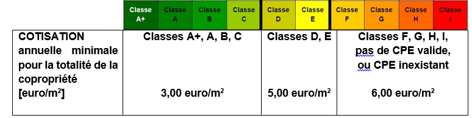

# Loi du 30 juin 2022 modifiant la loi modifiée du 16 mai 1975 portant statut de la copropriété des immeubles bâtis aux fins d’introduire un fonds de travaux.

Nous Henri, Grand-Duc de Luxembourg, Duc de Nassau,

Notre Conseil d’État entendu ;

De l’assentiment de la Chambre des Députés ;

Vu la décision de la Chambre des Députés du 26 avril 2022 et celle du Conseil d’État du 10 mai 2022 portant qu’il n’y a pas lieu à second vote ;

Avons ordonné et ordonnons :

## Art. 1er.

À la suite de l’article 11 de la [loi modifiée du 16 mai 1975](https://legilux.public.lu/eli/etat/leg/loi/1975/05/16/n1/jo) portant statut de la copropriété des immeubles bâtis, est inséré un article 11*bis* libellé comme suit :

> **«  **Art. 11*bis*.****
>
> Les copropriétaires constituent un fonds de travaux pour faire face au coût des travaux décidés par l’assemblée générale.
>
> Le fonds de travaux est alimenté par une cotisation annuelle obligatoire versée par les copropriétaires. Les avoirs du fonds de travaux ne font pas partie du capital investi au sens de l’article 3 de la [loi modifiée du 21 septembre 2006](https://legilux.public.lu/eli/etat/leg/loi/2006/09/21/n1/jo) sur le bail à usage d’habitation et modifiant certaines dispositions du [Code civil](https://legilux.public.lu/eli/etat/leg/code/civil).
>
> Le montant de la cotisation est décidé par l’assemblée générale votant dans les conditions de majorité prévues à l’article 15, sans que le montant de la cotisation annuelle à verser ne puisse être inférieur au montant par mètre carré fixé à l’annexe, au prorata de la quote-part des copropriétaires.
>
> Les cotisations versées au titre du fonds de travaux sont attachées aux lots et définitivement acquises au syndicat des copropriétaires. Elles ne donnent pas lieu à un remboursement par le syndicat à l’occasion de la cession d’un lot.
>
> Une personne qui a déclaré son intérêt à l’acquisition à titre gratuit ou à titre onéreux d’un lot dans une copropriété, après qu’un propriétaire a déclaré son intention de transfert à titre gratuit ou à titre onéreux du lot concerné, et une personne qui a accepté sous bénéfice d’inventaire une succession comprenant un lot dans une copropriété doivent pouvoir consulter le solde actuel des cotisations au fonds de travaux acquises par ce lot. ».

## Art. 2.

À la suite de l’article 16, alinéa 1er, lettre d), de la [même loi](https://legilux.public.lu/eli/etat/leg/loi/1975/05/16/n1/jo), sont ajoutés les lettres e), f), et g), qui prennent la teneur suivante :

> « e) les travaux de rénovation énergétique ;
>
>     f) les travaux de réalisation d’infrastructures dans les parties communes en préparation pour l’installation de gaines techniques ;
>
>    g) les travaux de réalisation d’installations de production et de stockage d’énergie à partir de sources d’énergie renouvelables dans les parties communes. ».

## Art. 3.

L’article 17, lettre c), de la [même loi](https://legilux.public.lu/eli/etat/leg/loi/1975/05/16/n1/jo), est remplacé comme suit :

> « c) les travaux comportant transformation, addition et amélioration à l’exception de ceux visés à l’article 16 lettres d), e), f) et g) et de ceux relatifs à l’installation d’infrastructures d’accueil au sens de la [loi du 22 mars 2017](https://legilux.public.lu/eli/etat/leg/loi/2017/03/22/a356/jo) relative à des mesures visant à réduire le coût du déploiement de réseaux de communication électroniques à haut débit et modifiant la [loi modifiée du 16 mai 1975](https://legilux.public.lu/eli/etat/leg/loi/1975/05/16/n1/jo) portant statut de la copropriété des immeubles bâtis. ».

## Art. 4.

La présente loi entre en vigueur le premier jour du troisième mois qui suit celui de sa publication au Journal officiel du Grand-Duché de Luxembourg, à l’exception de l’article 1er, qui entre en vigueur le premier jour du treizième mois qui suit celui de sa publication au Journal officiel du Grand-Duché de Luxembourg.

Mandons et ordonnons que la présente loi soit insérée au Journal officiel du Grand-Duché de Luxembourg pour être exécutée et observée par tous ceux que la chose concerne.

\*Le Ministre du Logement*   ,   Henri Kox   Le Ministre de l’Énergie  et de l’Aménagement du territoire,   Claude Turmes   La Ministre de la Justice,   Sam Tanson

Château de Berg, le 30 juin 2022   .   Henri

\**Annexe**

Tableau de détermination de la cotisation annuelle minimale au fonds de travaux par m2 de surface de référence énergétique, basé sur la qualité énergétique (classe d’isolation thermique) du bâtiment en question :

La surface de référence à prendre en compte est la surface de référence énergétique An en m2 au sens de la [loi modifiée du 5 août 1993](https://legilux.public.lu/eli/etat/leg/loi/1993/08/05/n1/jo) concernant l’utilisation rationnelle de l’énergie et les règlements grand-ducaux pris en son exécution et telle qu’indiquée sur le certificat de performance énergétique (CPE) (An = partie conditionnée (chauffée et/ou refroidie) de la surface de plancher nette à l’intérieur de l’enveloppe thermique et de l’enveloppe d’étanchéité à l’air).

Si le certificat de performance énergétique est inexistant ou invalide, la surface de référence à prendre en considération est celle attachée aux lots conformément à l’acte de base de la copropriété.

Doc. parl. [7763](https://legilux.public.lu/eli/etat/projet/pl/20170413) ; sess. ord. 2020-2021 et 2021-2022.
