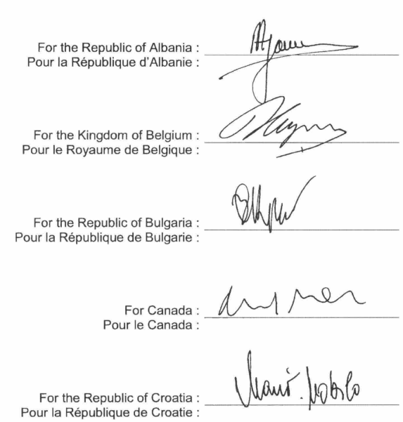
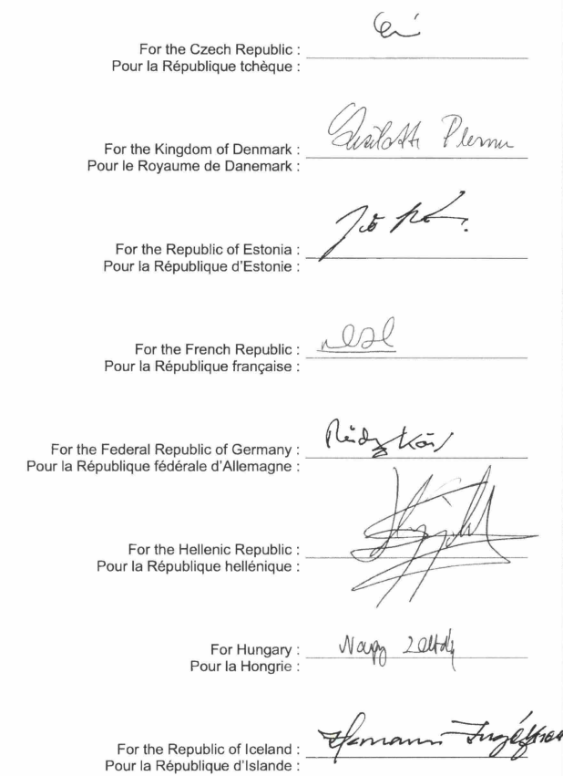
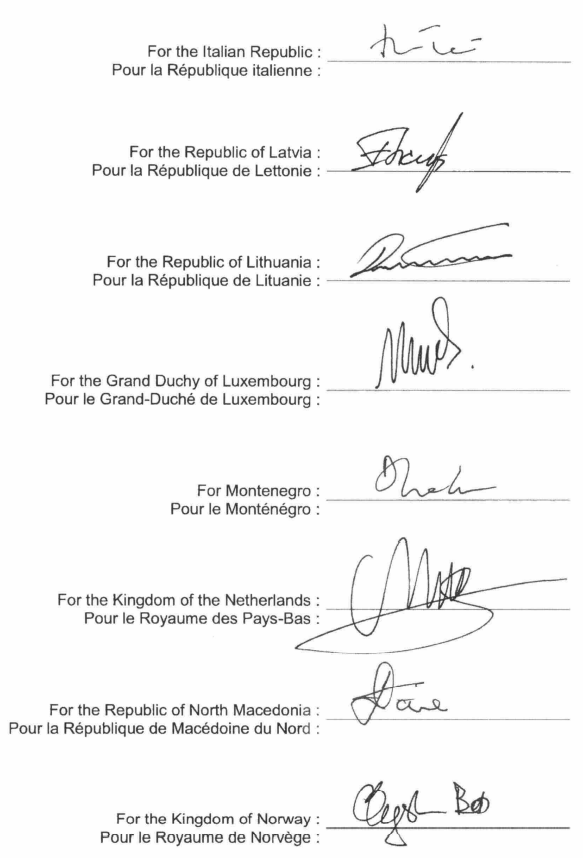
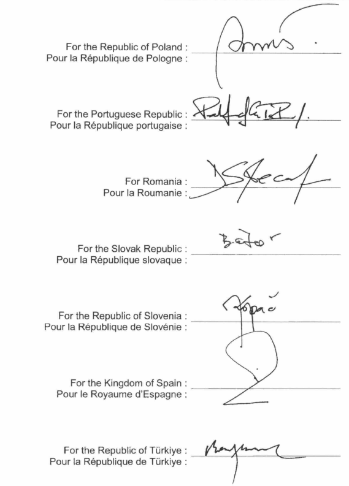
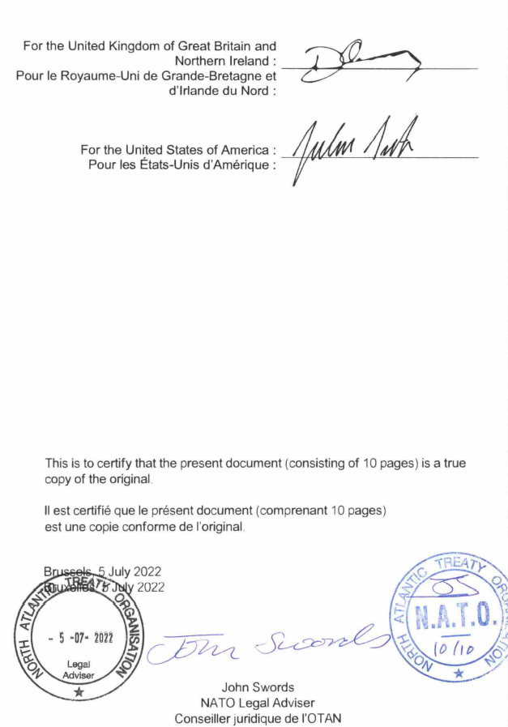

# Loi du 22 juillet 2022 portant approbation du Protocole au Traité de l’Atlantique Nord sur l’accession de la République de Finlande, fait à Bruxelles, le 5 juillet 2022.

Nous Henri, Grand-Duc de Luxembourg, Duc de Nassau,

Notre Conseil d’État entendu ;

De l’assentiment de la Chambre des Députés ;

Vu la décision de la Chambre des Députés du 12 juillet 2022 et celle du Conseil d’État du 15 juillet 2022 portant qu’il n’y a pas lieu à second vote ;

Avons ordonné et ordonnons :

## **Article unique**.

Est approuvé le Protocole au Traité de l’Atlantique Nord sur l’accession de la République de Finlande, fait à Bruxelles, le 5 juillet 2022.

Mandons et ordonnons que la présente loi soit insérée au Journal officiel du Grand-Duché de Luxembourg pour être exécutée et observée par tous ceux que la chose concerne.

Le Ministre des Affaires étrangères  et européennes,   Jean Asselborn

Cabasson, le 22 juillet 2022   .   Henri

\**PROTOCOL**   **TO THE NORTH ATLANTIC TREATY**   **ON THE ACCESSION OF**   **THE REPUBLIC OF FINLAND**

\**PROTOCOLE**   **AU TRAITÉ DE L'ATLANTIQUE NORD**   **SUR L'ACCESSION DE**   **LA RÉPUBLIQUE DE FINLANDE**

The Parties to the North Atlantic Treaty, signed at Washington on April 4, 1949,

Being satisfied that the security of the North Atlantic area will be enhanced by the accession of the Republic of Finland to that Treaty,

Agree as follows:

\**Article I**

Upon the entry into force of this Protocol, the Secretary General of the North Atlantic Treaty Organisation shall, on behalf of all the Parties, communicate to the Government of the Republic of Finland an invitation to accede to the North Atlantic Treaty. In accordance with Article 10 of the Treaty, the Republic of Finland shall become a Party on the date when it deposits its instrument of accession with the Government of the United States of America.

\**Article II**

The present Protocol shall enter into force when each of the Parties to the North Atlantic Treaty has notified the Government of the United States of America of its acceptance thereof. The Government of the United States of America shall inform all the Parties to the North Atlantic Treaty of the date of receipt of each such notification and of the date of the entry into force of the present Protocol.

\**Article III**

The present Protocol, of which the English and French texts are equally authentic, shall be deposited in the Archives of the Government of the United States of America. Duly certified copies thereof shall be transmitted by that Government to the Governments of all the Parties to the North Atlantic Treaty.

Les Parties au Traité de l'Atlantique Nord, signé le 4 avril 1949 à Washington,

Assurées que l'accession de la République de Finlande au Traité de l'Atlantique Nord permettra d'augmenter la sécurité de la région de l'Atlantique Nord,

Conviennent ce qui suit :

\**Article I**

Dès l'entrée en vigueur de ce Protocole, le Secrétaire Général de l'Organisation du Traité de l'Atlantique Nord enverra, au nom de toutes les Parties, au Gouvernement de la République de Finlande une invitation à adhérer au Traité de l'Atlantique Nord. Conformément à l'Article 10 du Traité, la République de Finlande deviendra Partie à ce Traité à la date du dépôt de son instrument d'accession auprès du Gouvernement des Etats-Unis d'Amérique.

\**Article II**

Le présent Protocole entrera en vigueur lorsque toutes les Parties au Traité de l'Atlantique Nord auront notifié leur approbation au Gouvernement des Etats-Unis d'Amérique. Le Gouvernement des Etats-Unis d'Amérique informera toutes les Parties au Traité de l'Atlantique Nord de la date de réception de chacune de ces notifications et de la date d'entrée en vigueur du présent Protocole.

\**Article III**

Le présent Protocole, dont les textes en français et anglais font également foi, sera déposé dans les archives du Gouvernement des Etats-Unis d'Amérique. Des copies certifiées conformes seront transmises par celui-ci aux Gouvernements de toutes les autres Parties au Traité de l'Atlantique Nord.

In witness whereof, the undersigned plenipotentiaries have signed the present Protocol.

Signed at Brussels on the 5th day of July 2022.

En foi de quoi, les plénipotentiaires désignés ci-dessous ont signé le présent Protocole.

Signé à Bruxelles le 5 juillet 2022.

Doc. parl. [8044](https://legilux.public.lu/eli/etat/projet/pl/20220076) ; sess. ord. 2021-2022.
