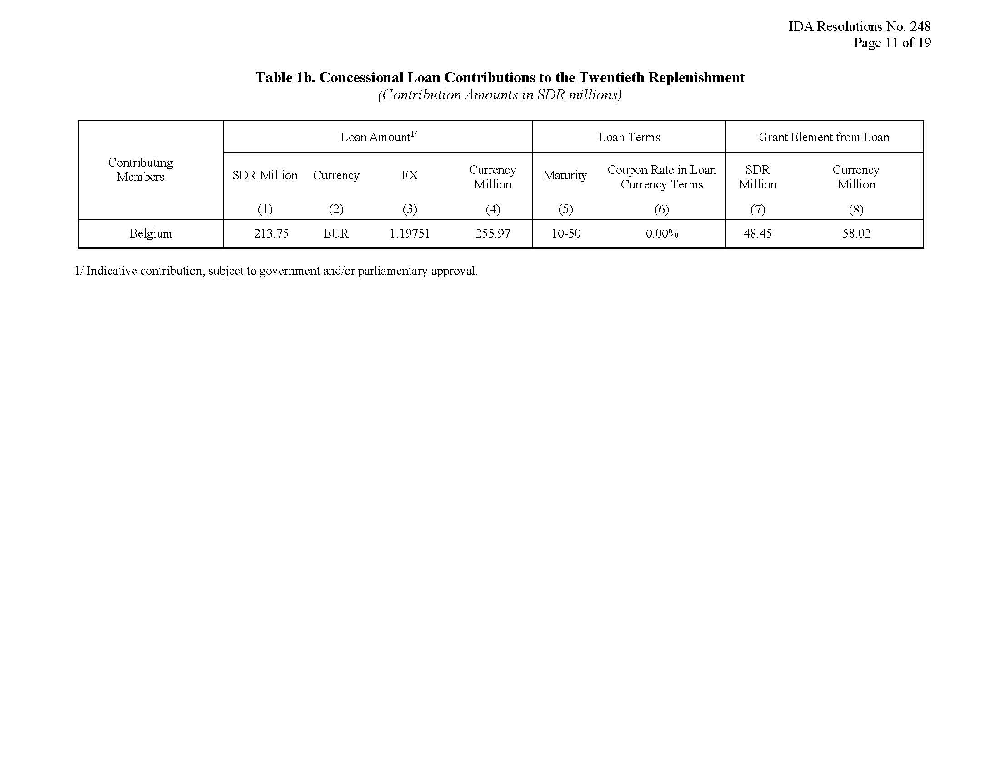
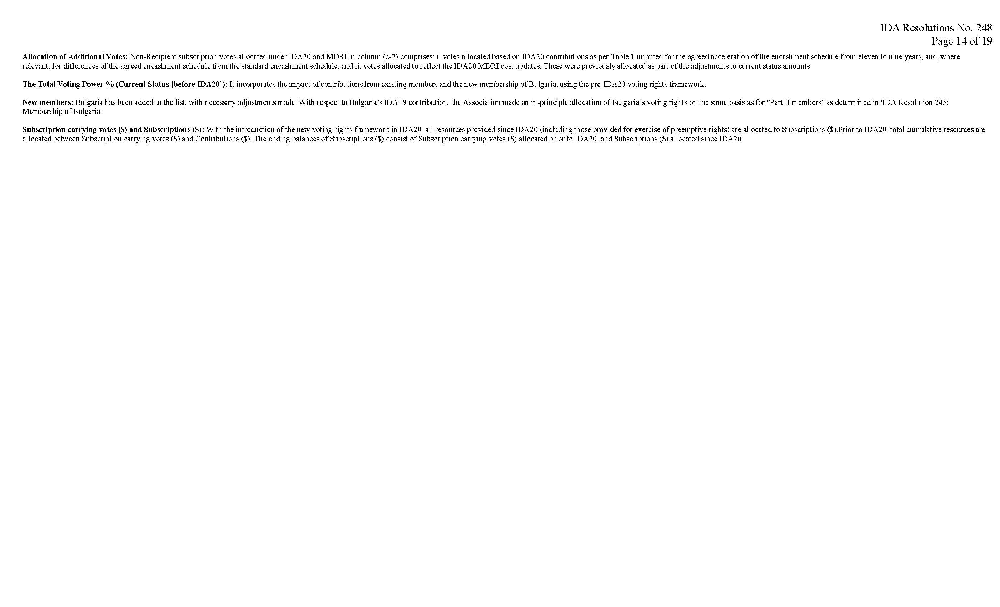
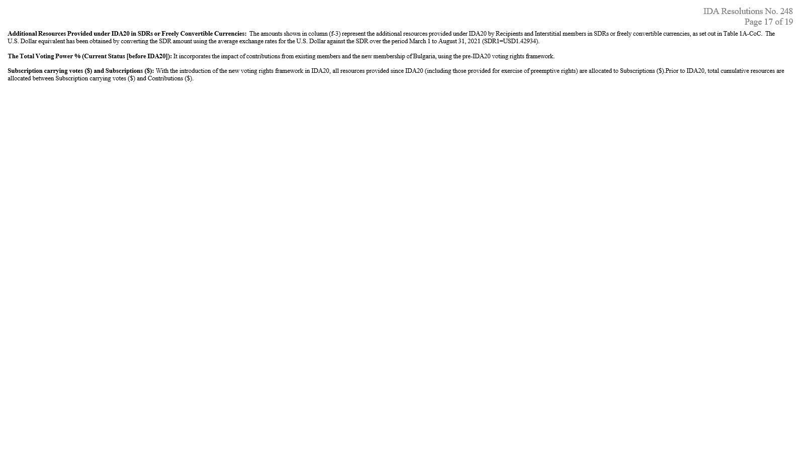
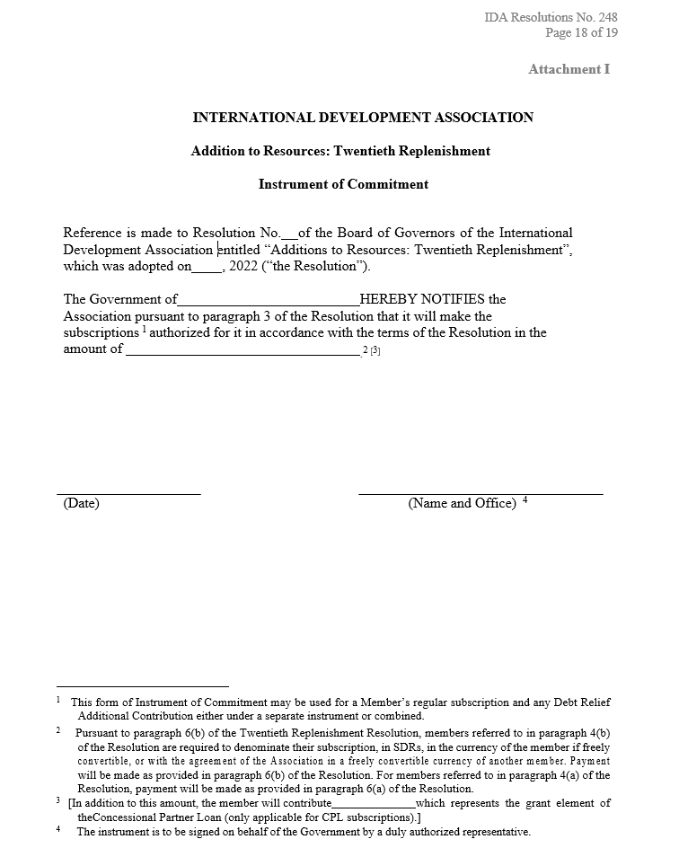
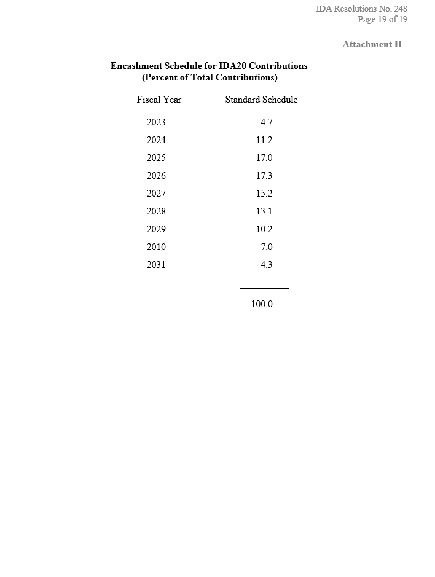

# Loi du 22 décembre 2023 approuvant la participation du Grand-Duché de Luxembourg à la vingtième reconstitution des ressources de l’Association internationale de développement (AID).

Nous Henri, Grand-Duc de Luxembourg, Duc de Nassau,

Le Conseil d’État entendu ;

Vu l’adoption par la Chambre des Députés ;

Vu la décision de la Chambre des Députés du 14 décembre 2023 et celle du Conseil d’État du 22 décembre 2023 portant qu’il n’y a pas lieu à second vote ;

Avons ordonné et ordonnons :

## Article unique.

Le Gouvernement est autorisé à participer à concurrence de 61 210 000 euros à la vingtième reconstitution des ressources financières de l’Association internationale de développement (AID), conformément à la résolution n° 248 adoptée le 31 mars 2022 par le Conseil des gouverneurs de l’Association internationale de développement (AID).

Mandons et ordonnons que la présente loi soit insérée au Journal officiel du Grand-Duché de Luxembourg pour être exécutée et observée par tous ceux que la chose concerne.

Le Ministre des Finances,   Gilles Roth

Crans-Montana, le 22 décembre 2023.   Henri

\**INTERNATIONAL DEVELOPMENT ASSOCIATION**

\**BOARD OF GOVERNORS**

\**Resolution No. 248**

\**Additions to Resources: Twentieth Replenishment**

\**WHEREAS:**

(A) The members of the International Development Association (the “Association”) have recognized the urgent need to increase the financing of the Association to its borrowing countries to further support the response to and recovery from the COVID-19 pandemic;

(B) In recognition of the strong demand for additional resources in the face of the COVID-19 pandemic, the Executive Directors of the Association have considered the prospective financial requirements of the Association and have concluded that it is desirable to:

(i) shorten the period of the Nineteenth Replenishment of resources authorized by Resolution No. 244 of the Board of Governors (the “Nineteenth Replenishment”) by one year and adjust the financing envelope for the Nineteenth Replenishment; and

(ii) authorize a replenishment of resources for new financing commitments for the period from July 1, 2022 to June 30, 2025 (the “Twentieth Replenishment”) in the amounts and on the basis set out in the report of the IDA Deputies, “Additions to Resources: Twentieth Replenishment – Building Back Better from the Crisis: Toward a Green, Resilient and Inclusive Future,” (the “Report”), approved by the Executive Directors on February 17, 2022, and submitted to the Board of Governors;

(C) The members of the Association agree that an increase in the resources of the Association is required and intend to take all necessary governmental and legislative action to authorize and approve the allocation of additional resources to the Association in the amounts and on the conditions set out in this Resolution;

(D) Additional subscriptions are to be authorized:

(i) for members of the Association that have expressed their intention, subject to any necessary legislative authorization, to make available additional resources to the Association, and

(ii) for other members of the Association pursuant to the provisions of Article III, Section 1(c) of the Articles of Agreement of the Association (the “Articles”) to give each such member an opportunity to subscribe, under such conditions as shall be reasonably determined by the Association, an amount which will enable it to maintain its relative voting power;

(E) Recipient Members (as defined in paragraph 13(a) below) are to receive additional votes to enhance Recipients’ voice, on the basis of the agreement of Non-Recipient Members (as defined in paragraph 13(b) below) and Interstitial Non-Recipient Members (as defined in paragraph 13(a) below) to waive their rights under Article III, Section 1(c) of the Articles;

(F) It is desirable to provide for a portion of resources to be subscribed by members to be paid to the Association as advance subscriptions;

(G) Additional subscriptions are to be authorized for members to provide compensation for the Association’s debt forgiveness commitments under the HIPC Debt Initiative; and to reflect the grant element of concessional loans made by members to the Association;

(H) The Executive Directors of the Association have authorized the borrowing of concessional loans from members (each a “Concessional Partner Loan”) (“CPL”) in the currencies and on the terms and conditions as approved by the Executive Directors and it is intended that the grant element of the CPLs will form part of the member’s subscriptions hereunder;

(I) It is desirable to authorize the Association to provide financing in the form of grants, guarantees, equity investments, and the intermediation of risk management products in addition to loans; and

(J) It is desirable to administer any remaining funds from the Nineteenth Replenishment as part of the Twentieth Replenishment.

\**NOW THEREFORE THE BOARD OF GOVERNORS HEREBY ACCEPTS** the Report as approved by the Executive Directors, **NOTES** its conclusions and recommendations, **AND RESOLVES THAT** a general increase in subscriptions of the Association is authorized on the following terms and conditions:

1\. **Adjustment of the Period of the Nineteenth Replenishment** .

(a) Resolution No. 244 is amended in Recital A to read as follows:

“The Executive Directors of the International Development Association (the “Association”) have considered the prospective financial requirements of the Association and have concluded that it is desirable to authorize a replenishment of the resources of the Association for new financing commitments for the period from July 1, 2020 to June 30, 2022 (the “Nineteenth Replenishment”) in the amounts and on the basis set out in the report of the IDA Deputies, “Additions to Resources: Nineteenth Replenishment,” (the “Report”), approved by the Executive Directors on February 11, 2020, and submitted to the Board of Governors;”

(b) Except as provided in paragraph 1(a) above, all other terms of Resolution No. 244 of the Board of Governors shall remain the same.

2\. **Authorization of Subscriptions under the Twentieth Replenishment** .

(a) The Association is authorized to accept additional resources from each member in the amounts and in the currencies specified for each such member in Columns 5, 6 and 8 of Table 1a-SDR attached to this Resolution.

(i) As part of the resources described in paragraph 2(a) above, the Association is authorized to accept additional subscriptions from members to compensate the Association for the Association’s debt forgiveness commitments under the HIPC Debt Initiative in the amounts and as specified in Column 8 of Table 1a-SDR attached to this Resolution.

(ii) As part of the resources described in paragraph 2(a) above, the Association is authorized to accept additional subscriptions from members reflecting the grant element of a CPL in the amounts specified in Column 6 of Table 1a- SDR attached to this Resolution.

(b) The Association is authorized to accept additional resources from any member for which no subscription is specified in Table 2 and additional subscriptions from members incremental to the amounts specified for each such member in Tables 1a and 1b.

(c) The rights and obligations of the Association and the members that make available additional resources to the Association pursuant to paragraph 4(b) below in respect of the authorized subscriptions in paragraphs (a) and (b) above will be the same (except as otherwise provided in this Resolution) as those applicable to the ninety percent portion of the initial subscriptions of original members payable under Article II, Section 2(d) of the Articles by members listed in Part I of Schedule A ofthe Articles.

3\. **Agreement to Pay** .

(a) When a member agrees to pay its subscription, it will deposit with the Association an Instrument of Commitment substantially in the form set out in Attachment I to this Resolution (“Instrument of Commitment”) and with respect to:

(i) its subscription for debt forgiveness under the HIPC Debt Initiative, a member will either include such subscription in an Instrument of Commitment or make a Debt Relief Transfer Contribution, as defined and specified in paragraph 10(a) of this Resolution; and

(ii) a CPL, a member will enter into written agreement(s) in such form as maybe acceptable to the Association.

(b) When a member that is referred to in paragraph 4(b) below agrees to pay the first part of its subscription without qualification and the other part is subject to enactment by its legislature of the necessary appropriation legislation, it will deposit (other than in respect of the grant element of a CPL) a qualified Instrument of Commitment in a form acceptable to the Association (“Qualified Instrument of Commitment”) and such member:

(i) undertakes to exercise its best efforts to obtain legislative approval for the full amount of its subscription by the payment dates set out in paragraph 4(b) of this Resolution; and

(ii) agrees that, upon obtaining such approvals, it will notify the Association that any parts of its Qualified Instrument of Commitment have become unqualified.

4\. **Payment Timeline** .

(a) Each Recipient Member and Interstitial Non-Recipient Member that agrees to subscribe only up to an amount necessary to enable it to maintain its relative voting power, will pay such amount to the Association in full within 31 days after the date of deposit of its Instrument of Commitment; provided that if the Twentieth Replenishment shall not have become effective by March 15, 2023, payment may be postponed by the member for not more than 31 days after the Effective Date as defined in paragraph 7(a) of this Resolution.

(b) A member, other than such members referred to in paragraph 4(a) above, that agrees to subscribe to an amount and that deposits an Instrument of Commitment that is not a Qualified Instrument of Commitment, will pay to the Association the amount of its subscription in three equal annual installments no later than 31 days after the Effective Date or as agreed with the Association, April 15, 2024, and April 15, 2025; provided that:

(i) the Association and each member may agree to earlier payment;

(ii) if the Twentieth Replenishment shall not have become effective by March 15, 2023, payment of the first such installment may be postponed by the member for not more than 31 days after the date on which the Twentieth Replenishment becomes effective;

(iii) the Association may agree to the postponement of any installment, or part thereof, if the amount paid, together with any unused balance of previous payments by the member concerned, is at least equal to the amount estimated by the Association to be required from that member up to the due date of the next installment; and

(iv) if any member deposits an Instrument of Commitment with the Association after the date when the first installment of the subscription is due, payment of any installment, or part thereof, will be made to the Association within 31 days after the date of such deposit.

(c) If a member has deposited a Qualified Instrument of Commitment and, upon enactment of appropriation legislation, notifies the Association that an installment, or part thereof, is unqualified after the date when it was due, then payment of such installment or part thereof, will be made within 31 days after the date of such notification.

(d) Each member that makes a subscription through the grant element of a CPL will pay to the Association the amount of the Loan in three equal annual installments no later than 31 days after the Effective Date, April 15, 2024, and April 15, 2025, or as agreed with the Association.

5\. **Mode of Payment** .

(a) Payments pursuant to this Resolution will be made, at the option of the member:

(i) in cash, on terms agreed between the member and the Association; or

(ii) by the deposit of notes or similar obligations issued by the government of the member or the depository designated by such member, which shall be nonnegotiable, non-interest bearing and payable at their par value on demand to the account of the Association.

(b) The Association will encash notes or similar obligations of the members referred to in paragraph 4(b) above, on an approximately pro rata basis among such members, in accordance with the encashment schedule set out in Attachment II to this Resolution, or as agreed between a member and the Association. With respect to a member that is unable to comply with one or more encashment requests, the Association may agree with the member on a revised encashment schedule that yields at least an equivalent value to the Association.

(c) The provisions of Article IV, Section 1(a) of the Articles will apply to the use of a member’s currency paid to the Association pursuant to this Resolution as may be applicable.

6\. **Currency of Denomination of Payments** .

(a) Members that provide the amount of their subscriptions pursuant to paragraph 4(a) above will denominate the resources to be made available pursuant to this Resolution in the currency of the member or in a freely convertible currency with the agreement of the Association. Payments will be made in the currency of the member or in a freely convertible currency with the agreement of the Association.

(b) Members that provide the amount of their subscriptions pursuant to paragraph 4(b) above will denominate the resources to be made available pursuant to this Resolution in SDRs, the currency of the member if freely convertible, or, with the agreement of the Association, in a freely convertible currency of another member, except that if a member’s economy experienced a rate of inflation in excess of ten percent per annum on average in the period 2017-2019, as determined by the Association, its subscription will be denominated in SDRs or in any currency used for the valuation of the SDR and agreed with the Association. Payments will be made in SDRs, a currency used for the valuation of the SDR, or, with the agreement of the Association, in another freely convertible currency, and the Association may freely exchange the amounts received as required for its operations.

(c) Each member will maintain, in respect of its currency paid by it under this Resolution, and the currency of such member derived there from as principal, interest or other charges, the same convertibility as existed on the effective date of this Resolution.

(d) The provisions of Article IV, Section 2 of the Articles with respect to maintenance of value will not be applicable.

(e) Notwithstanding the foregoing provisions of this paragraph, a member that makes a subscription through the grant element of a CPL will denominate and make payment of such CPL in SDRs or any other currencies approved by the Executive Directors and as defined in their respective loan agreements.

7\. **Effective Date** .

(a) The Twentieth Replenishment will become effective and the resources to be subscribed pursuant to this Resolution will become payable to the Association on the date (the “Effective Date”) when the members referred to in paragraph 4(b) above, whose subscriptions aggregate not less than SDR 9,868 million shall have deposited with the Association Instruments of Commitment, Qualified Instruments of Commitment, Debt Relief Transfer Notifications (as defined in paragraph 10(b) of this Resolution) or duly executed concessional loan agreements to provide the CPLs, provided that this date shall be not later than March 15, 2023, or such later date as the Executive Directors of the Association may determine.

(b) If the Association determines that the availability of additional resources pursuant to this Resolution is likely to be unduly delayed, it shall convene promptly a meeting of the members to review the situation and to consider the steps to be taken to prevent a suspension of financing to eligible recipients by the Association.

(c) In order to avoid an interruption in the Association’s ability to commit financing to eligible recipients pending the effectiveness of the Twentieth Replenishment, the Association may deem, prior to the Effective Date, to use one third of the agreed Replenishment amount, for grants, loans, guarantees, equity investments and risk management products.

8\. **Advance Subscriptions** .

(a) In order to avoid an interruption in the Association’s ability to commit financing to eligible recipients pending the effectiveness of the Twentieth Replenishment, the Association may deem, prior to the Effective Date, one third of the total amount of each subscription for which -

(i) an Instrument of Commitment has been deposited with the Association;

(ii) a Debt Relief Transfer Notification (as defined in paragraph 10(b) of this Resolution) has been received by the Association; or

(iii) a duly executed concessional loan agreement for a CPL has been received by the Association;

as an “Advance Subscription” to use for grants, loans, guarantees, equity investments and risk management products, unless the member referred to in paragraph 4(b) above specifies otherwise in its Instrument of Commitment, Debt Relief Transfer Notification or concessional loan agreement for a CPL.

(b) The Association shall specify when Advance Subscriptions pursuant to paragraph 8(a) are to be paid to the Association.

(c) The terms and conditions applicable to subscriptions to the Twentieth Replenishment shall apply also to Advance Subscriptions until the Effective Date,when such subscriptions shall be deemed to constitute payment towards the amount due from each member referred to in paragraph 4(b) above, for its subscription.

(d) In the event that the Twentieth Replenishment shall not become effective pursuant to paragraph 7(a) of this Resolution, (i) voting rights will be allocated to each member for the Advance Subscription as if it had been made as a subscription under this Resolution, and (ii) each member not making an Advance Subscription will have the opportunity to exercise its preemptive rights under Article III, Section 1(c) of the Articles with respect to such subscription as the Association shall specify.

9\. **Authority to Use Subscription.**

(a) Subscriptions will become available for use by the Association for financing to eligible recipients upon receipt of the Instruments of Commitment and after the Effective Date, provided that Advance Subscriptions may become available earlier under paragraph 8(a) of this Resolution.

(b) Any qualified part of a subscription notified under a Qualified Instrument of Commitment will become available for use by the Association for financing when the Association has been notified, pursuant to paragraph 3(b) (ii) of this Resolution, that such parts have become unqualified.

(c) The Association may enter into financing commitments with eligible recipients conditional on such commitments becoming effective and binding on the Association when resources under the Twentieth Replenishment become available for commitment by the Association.

10\. **HIPC Subscriptions** .

(a) Members making an additional subscription to compensate the Association for forgiveness of debt under the HIPC Debt Relief Initiative, will do so either: (i) through an additional subscription to the Association’s regular resources (a “Debt Relief Additional Subscription”) or (ii) through a creditor-specific contribution for the benefit of the Association to the HIPC window or of the Debt Relief Trust Fund (“Debt Relief Transfer Contribution”).

(b) Members making a Debt Relief Transfer Contribution will either (i) enter into a Contribution Agreement with the Association as administrator of the Debt Relief Trust Fund; or (ii) for members that are already current contributors to the Debt Relief Trust Fund, send to the Association a notice of additional contribution or allocation to the appropriate window of the Debt Relief Trust Fund (each a “Debt Relief Transfer Notification”). Such Debt Relief Transfer Notification will provide for a contribution to be made to the appropriate window of the Debt Relief Trust Fund in the amount set forth in Column 8 of Table 1a-SDR to this Resolution, to be payable in three equal annual installments no later than 31 days after the Effective Date, April 15, 2024, and April 15, 2025; provided that the Association and each member may agree to earlier payment.

(c) When any amount of a Debt Relief Transfer Contribution is paid to compensate the Association for forgiveness of debt under the HIPC Debt Initiative, such amount of the Debt Relief Transfer Contribution will be treated as a subscription under the Twentieth Replenishment.

11\. **Authorization of Grants, Guarantees, Equity Investments and Risk Intermediation.** The Association is hereby authorized to provide financing under the Twentieth Replenishment in the form of grants and guarantees, equity investments and through the intermediation of risk management products.

12\. **Administration of IDA19 Funds under the Twentieth Replenishment** .

(a) On the Effective Date, any funds, receipts, assets and liabilities held by the Association under the Nineteenth Replenishment will be administered under the Twentieth Replenishment, subject, as appropriate, to the terms and conditions applicable to the Nineteenth Replenishment.

(b) Pursuant to Article V, Section 2(a) (i) of the Articles of Agreement of the Association, the Association is authorized to use the funds referred to in paragraph12(a) above, and funds derived therefrom as principal, interest or other charges, to provide financing in the forms of grants, guarantees, equity investments and through the intermediation of risk management products under the terms, conditions and policies applicable under the Twentieth Replenishment.

13\. **Allocation of Voting Rights under the Twentieth Replenishment.** The IDA Voting Rights Framework recommended by the Executive Directors is hereby approved and, notwithstanding the provisions of paragraph 7 of this Resolution, is effective immediately. On the basis of the IDA Voting Rights Framework, voting rights shall be allocated to members for subscriptions under the Twentieth Replenishment, in addition to their current voting rights, as follows:

(a) (i) Each member that is determined to be eligible to receive financing from the Association on or about July 1 immediately preceding the date of submission of this Resolution to the Board of Governors but excluding members that are proposed to graduate from the Association during the Twentieth Replenishment (“Recipient Member”) and (2) each member that is not a Recipient Member but was eligible to receive financing from the Association any time during the period covered by the Fifteenth Replenishment through the Nineteenth Replenishment (“Interstitial Non-Recipient Member”) that agrees to subscribe only up to an amount necessary to enable it to maintain its relative voting power and has deposited with the Association an Instrument of Commitment (other than in respect of the grant element of a Concessional Member Loan which are allocated as per (d) below) shall be allocated the subscription votes specified for each such member in Table 2 on the effective payment date pursuant to paragraph 4(a) of this Resolution on the basis of one additional vote for each $25 of its additional subscription authorized by the Association for such member to enable it to maintain its relative voting power.

(ii) Each Recipient Member and each Interstitial Non-Recipient Member that agrees to subscribe to an amount exceeding such amount necessary to enable it to maintain its relative voting power and has deposited with the Association an Instrument of Commitment (other than in respect of the grant element of a Concessional Member Loan which are allocated as per (d) below) shall be allocated one-third the subscription votes specified for each such member in Table 2 on each effective payment date pursuant to paragraph 4(b) of this Resolution on the basis of:

(A) one additional vote for each $25 of its additional subscription authorized by the Association for such member to enable it to maintain its relative voting power; and

(B) one additional vote for each $17,670 of its additional subscription authorized in excess of the amount in subparagraph (A) above.

(iii) Each Recipient Member and each Interstitial Non-Recipient Member referred to in subparagraph (i) above shall be allocated the additional membership votes specified in Column d-3 of Table 2 on the date such member is allocated its subscription votes.

(iv) Each Recipient Member and each Interstitial Non-Recipient Member referred to in subparagraph (ii) above shall be allocated the additional membership votes specified in Column d-3 of Table 2 for its subscription on the date such member is allocated the first one-third of its subscription votes.

(v) Each Recipient Member shall be allocated the additional votes (“Recipient Boost Votes”) specified in Column b-1 of Table 2 on the date such member is allocated its subscription votes.

(b) Each member that is not a Recipient Member or an Interstitial Non-Recipient Member (“Non- Recipient Member”) that has deposited with the Association an Instrument of Commitment (other than in respect of the grant element of a Concessional Member Loan) shall be allocated one-third of the subscription votes specified for each such member in Table 2 on each effective payment date pursuant to paragraph 4(b) of this Resolution on the basis of one additional vote for each $17,670 of its additional subscription. Each such member shall be allocated the additional membership votes specified in Column c-3 of Table 2 for its subscription on the date such member is allocated the first one-third of its subscription votes.

(c) Each member that has made a Debt Relief Transfer Contribution will be allocated a proportionate share of the subscription votes specified for such member in Column c-2 of Table 2 from time to time and at least semi-annually following payment of any amount of its Debt Relief Transfer Contribution to compensate the Association for forgiveness of debt under the HIPC Debt Initiative.

(d) Each member that has provided a CPL in the amount provided in Table 1b will be notified by the Association of the grant element determined by the Association with respect to the CPL and will be allocated, in respect of such grant element, a proportionate share of the subscription votes specified for such member in Column c-2 of Table 2 from time to time following payment to the Association of the CPL.

(e) Each member that has deposited with the Association a Qualified Instrument of Commitment will be allocated subscription votes at the time and to the extent of payments made in respect of its subscription.

(f) Any member that deposits its Instrument of Commitment after any of these dates will be allocated, within 31 days of the date of such deposit, the subscription votes to which such member is entitled on account of such deposit.

(g) If a member fails to pay any amount of its subscription when due, or fails to pay when due any amount of (or due in connection with) a CPL, the number of subscription votes allocated from time to time to such member under this Resolution in respect of the Twentieth Replenishment will be reduced in proportion to the shortfall in the net present value of such payments, but any such votes will be reallocated when the shortfall in the net present value of such payments causing such adjustment is subsequently made up.

(h) If a member makes available, on or after the date this Resolution is adopted by the Board of Governors, additional resources to the Association in the form of subscriptions, pursuant to the authorization to the Association under the respective resolutions for any replenishment from the Eleventh Replenishment through to the Nineteenth Replenishment to accept additional resources from any member (i) for which no contribution is specified under such resolutions, or (ii) incremental to the amounts specified for such member in such resolutions, such member shall be allocated voting rights, and other members shall have the opportunity to exercise their preemptive right, in respect of this additional subscription, in accordance with the IDA Voting Rights Framework and the provisions of this paragraph 13.

\*(Adopted on March 31, 2022)*

*[image omitted (1.2 MB) — see the official version: https://legilux.public.lu/eli/etat/leg/loi/2023/12/22/a834/jo]*

*[image omitted (0.7 MB) — see the official version: https://legilux.public.lu/eli/etat/leg/loi/2023/12/22/a834/jo]*

*[image omitted (1.1 MB) — see the official version: https://legilux.public.lu/eli/etat/leg/loi/2023/12/22/a834/jo]*

*[image omitted (1.1 MB) — see the official version: https://legilux.public.lu/eli/etat/leg/loi/2023/12/22/a834/jo]*

*[image omitted (1.0 MB) — see the official version: https://legilux.public.lu/eli/etat/leg/loi/2023/12/22/a834/jo]*

*[image omitted (1.0 MB) — see the official version: https://legilux.public.lu/eli/etat/leg/loi/2023/12/22/a834/jo]*

Doc. parl. [8257](https://legilux.public.lu/eli/etat/projet/pl/20230101) ; sess. ord. 2022-2023 et législature 2023-2028.
