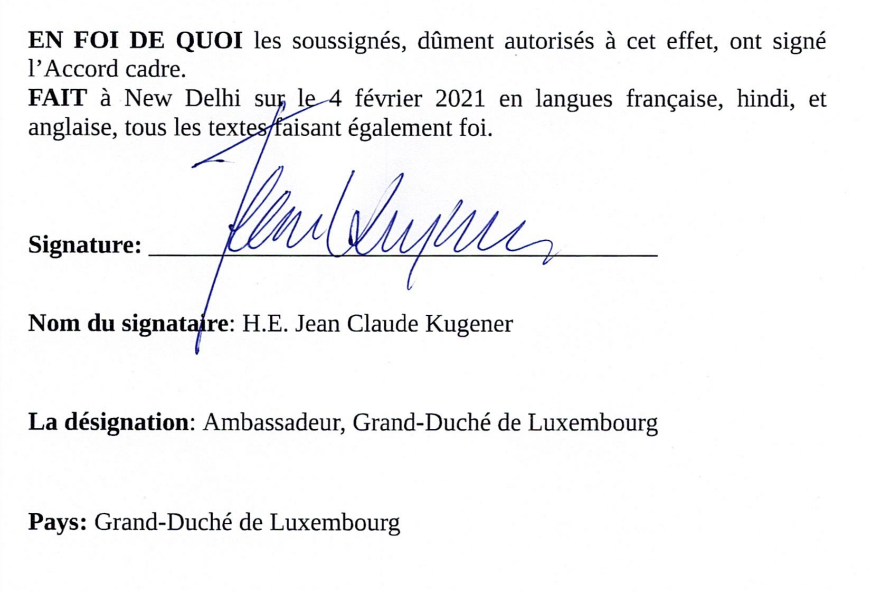
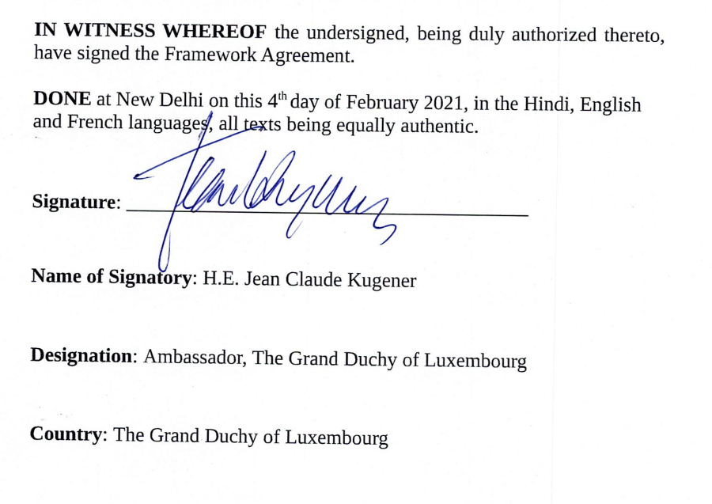

# Loi du 13 décembre 2024 portant approbation de l’Accord-cadre portant création de l’Alliance solaire internationale (ASI), fait à New Delhi, le 4 février 2021.

Nous Henri, Grand-Duc de Luxembourg, Duc de Nassau,

Le Conseil d’État entendu ;

Vu l’adoption par la Chambre des Députés ;

Vu la décision de la Chambre des Députés du 4 décembre 2024 et celle du Conseil d’État du 10 décembre 2024 portant qu’il n’y a pas lieu à second vote ;

Avons ordonné et ordonnons :

## Article unique.

Est approuvé l’Accord-cadre portant création de l’Alliance solaire internationale (ASI), fait à New Delhi, le 4 février 2021.

Mandons et ordonnons que la présente loi soit insérée au Journal officiel du Grand-Duché de Luxembourg pour être exécutée et observée par tous ceux que la chose concerne.

\*Le Ministre des Affaires étrangères*   *et du Commerce extérieur,*   Xavier Bettel   *Le Ministre de l’Économie, des PME,*   *de l’Énergie et du Tourisme,*   **Lex Delles**

Fait le 13 décembre 2024.   Pour le Grand-Duc,   Son Lieutenant-Représentant,   Guillaume,   Grand-Duc Héritier

\**Accord cadre portant création de l’Alliance solaire internationale**   **(ASI)**

Nous, Parties au présent Accord,

\*Rappelant* la Déclaration de Paris du 30 novembre 2015 sur l’Alliance solaire internationale ainsi que notre ambition commune d’entreprendre les efforts conjoints nécessaires pour réduire le coût du financement et des technologies, mobiliser plus de 1000 milliards USD d’investissements requis à l’horizon 2030 pour un déploiement massif de l’énergie solaire et ouvrir la voie à des technologies futures adaptées aux besoins,

\*Reconnaissant* que l’énergie solaire offre aux pays une possibilité sans précédent d’apporter la prospérité, la sécurité énergétique et un développement durable à leurs populations,

\*Conscients* des obstacles spécifiques et communs qui entravent encore un déploiement rapide et massif de l’énergie solaire dans ces pays,

\*Affirmant* que ces obstacles peuvent être surmontés si les pays riches en ressources solaires agissent de façon coordonnée, avec une impulsion et volonté politique fortes, et qu’une meilleure harmonisation et agrégation de la demande, notamment de financement, de technologies, d’innovation ou de renforcement des capacités dans le domaine de l’énergie solaire, entre les pays, constituera un puissant levier pour abaisser les prix, améliorer la qualité et mettre une énergie solaire fiable et d’un coût abordable à la portée de tous,

\*Unies* par leur volonté commune de mettre en place un mécanisme efficace de coordination et de décision entre elles,

\*Sommes convenues* des dispositions suivantes :

## Article Ier — Objectif

Les Parties créent par les présentes une Alliance solaire internationale (ci-après dénommée ASI) à travers laquelle ils apporteront une réponse collective aux principaux obstacles communs à un déploiement d’énergie solaire à l’échelle de leurs besoins.

## Article II — Principes directeurs

1\. Les Membres prennent des mesures coordonnées par le biais de programmes et d’activités engagés sur une base volontaire, visant à mieux harmoniser et agréger la demande, notamment en matière de financement solaire, de technologies solaires, d’innovation, de recherche et de développement et de renforcement des capacités.

2\. A cette fin, les Membres coopèrent étroitement et s’efforcent d’établir des relations mutuellement avantageuses avec les organisations compétentes, les parties prenantes publiques et privées et les pays non Membres.

3\. Chaque membre partage et actualise, pour les applications solaires pour lesquelles il recherche les bénéfices d’une action collective dans le cadre de l’ASI, et sur la base d’une cartographie analytique commune des applications solaires, les informations pertinentes concernant : ses besoins et objectifs ; les mesures et initiatives nationales engagées ou prévues pour atteindre ces objectifs ; les obstacles recontrés tout au long de la chaîne de valeur et du processus de diffusion. le Secrétariat tient une base de données de ces analyses afin de souligner le potentiel de coopération.

4\. Chaque Membre désigne un Point focal national pour l’ASI. Les Points focaux nationaux constituent un réseau permanent de correspondants de l’ASI dans les pays Membres. Ils échangent notamment les uns avec les autres ainsi qu’avec les parties prenantes concernées afin de définir des domaines d’intérêt commun, et de formuler des propositions de Programmes et des recommandations à l’attention du Secrétariat en ce qui concerne la mise en œuvre des objectifs de l’ASI.

## Article III — Programmes et autres activités

1\. Un programme de l’ASI se compose d’une série d’actions, de projets et d’activités à mener de manière coordonnée par les Membres, avec l’aide du Secrétariat, conformément à l’objectif et aux principes directeurs visés aux articles Ier et II. Les Programmes sont conçus de manière à assurer un effet d’échelle optimal et la participation du plus grand nombre de Membres possible. Ils comportent des objectifs simples, quantifiables et mobilisateurs.

2\. Les propositions de Programme sont élaborées à travers des consultations ouvertes entre tous les Points focaux nationaux avec l’aide du Secrétariat et sur la base des informations partagées par les Membres. Un Programme peut être proposé par deux Membres ou un groupe de Membres ou par le Secrétariat. le Secrétariat veille à la cohérence entre tous les Programmes de l’ASI.

3\. Les propositions de programme sont communiquées par le Secrétariat à l’Assemblée par diffusion numérique, par l’intermédiaire du réseau de Points focaux nationaux. Une proposition de Programme est réputée soutenue par deux Membres au moins et si aucune objection n’est formulée par plus de deux pays.

4\. Une proposition de Programme est officiellement approuvée par le biais d’une Déclaration commune par les Membres désireux de s’y associer. Toutes les décisions concernant la mise en œuvre du Programme sont prises par les Membres participant audit Programme. Elles sont exécutées sous la conduite et avec le concours du Secrétariat, par les Représentants nationaux désignés par chaque Membre.

5\. Le plan de travail annuel présente une vue d’ensemble des Programmes et des autres activités de l’ASI. Il est présenté par le Secrétariat à l’Assemblée, qui veille à ce que tous les Programmes et activités dudit Plan entrent dans le cadre de l’objectif global de l’ASI.

## Article IV — Assemblée

1\. Les Parties mettent en place par les présentes une Assemblée où chaque Membre est représenté, chargée de prendre les décisions concernant la mise en œuvre du présent Accord et les actions coordonnées à mener pour réaliser son objectif. L’Assemblée se réunit chaque année au niveau ministériel au siège de l’ASI. Elle peut également se réunir dans des circonstances spéciales.

2\. Des sessions en petits groupes sont organisées entre les Membres participant à chaque programme afin de faire le bilan au niveau ministériel et de prendre les décisions concernant leur mise en œuvre ultérieure en application de l’article III.4.

3\. L’Assemblée évalue l’effet cumulé des Programmes et des autres activités menées dans le cadre de l’ASI, notamment du point de vue du déploiement de l’énergie solaire, de la performance, de la fiabilité ainsi que du coût et du volume de financement. Sur la bse de cette évaluation, les Membres prennent toutes les décisions nécessaires concernant la poursuite de la mise en œuvre de l’objectif de l’ASI.

4\. L’Assemblée prend toutes les décisions nécessaires en ce qui concerne le fonctionnement de l’ASI, notamment le choix du Directeur général et l’approbation du budget de fonctionnement.

5\. Chaque Membre dispose d’une voix à l’Assemblée. Les Observateurs et les Organisations partenaires peuvent participer sans droit de vote. les décisions sur les questions de procédure sont prise à la majorité simple des Membres présents et votants. Les décisions sur les questions de fond sont prises à la majorité des deux tiers des Membres présents et votants. Les décisions portant sur un programme spécifique sont prises par les Membres participant à ce programme.

6\. Toutes les décisions prises par le Comité de pilotage international de l’ASI institué par la Déclaration de Paris du 30 novembre 2015 relative à l’ASI sont soumises à l’Assemblée pour adoption lors de sa première réunion.

## Article V — Secrétariat

1\. Les Parties établissent par les présentes un Secrétariat chargé de les assister lors de leurs travaux collectifs dans le cadre du présent Accord. Le Secrétariat se compose d’un Directeur général, qui est l’administrateur général, ainsi que du personnel éventuellement nécessaire.

2\. Le Directeur général est désigné par l’Assemblée et responsable devant elle pour un mandat de quatre ans, renouvelable une fois.

3\. Le Directeur général est responsable devant l’Assemblée pour la nomination du personnel et l’organisation et le fonctionnement du Secrétariat ainsi que pour la mobilisation de ressources.

4\. Le Secrétariat prépare les questions pour suite à donner par l’Assemblée et exécute les décisions dont il est chargé par celle-ci. Il veille à ce que les mesures adéquates soient prises pour assurer le suivi des décisions de l’Assemblée et coordonner les actions des Membres dans la mise en œuvre de ces décisions. Le Secrétariat assure notamment les tâches ci-après :

a) aider les Points focaux nationaux à préparer les propositions de Programme et les recommandations soumises à l’Assemblée ;

b) fournir des orientations et un soutien aux Membres pour la mise en œuvre de chaque Programme, notamment pour la collecte de fonds ;

c) agir au nom de l’Assemblée, ou au nom d’un groupe de Membres participant à un Programme spécifique, à leur demande, et notamment nouer des contacts avec les parties prenantes concernées ;

d) établir et mettre en œuvre tous les moyens de communications, instruments et activités transversales requis pour le fonctionnement de l’ASI et ses programmes, tels qu’approuvés par l’Assemblée.

## Article VI — Budget et ressources financières

1\. Les frais de fonctionnement du Secrétariat et de l’Assemblée, ainsi que tous les frais liés aux fonctions d’appui et aux activités transversales constituent le budget de l’ASI. Ils sont couverts par :

a) des contributions volontaires de ses Membres, des Nations Unies et de leurs institutions ainsi que d’autres pays ;

b) des contributions volonaitres du secteur privé. En cas de conflit d’intérêt éventuel, le Secrétariat soumet la question à l’Assemblée pour approbation de l’acceptation de la contribution ;

c) les recettes pouvant être générées par des activités spécifiques approuvées par l’Assemblée.

2\. Le Secrétariat présente des propositions à l’Assemblée en vue de mettre en place et de développer un Fonds de dotations qui génèrera des recettes pour le budget de l’ASI, avec une dotation initiale de 16 millions USD.

3\. Le Gouvernement de l’Inde contribuera à hauteur de 27 millions USD à l’ASI pour la création du fonds, la mise en place des infrastructures ainsi que les dépenses récurrentes sur une période de cinq ans, de 2016-17 à 2020-21. Par ailleurs, les entreprises du secteur public du gouvernement indien, à savoir Solar Energy Corporation of India (SECI) et Indian Renewable Energy Development Agency (IREDA) ont apporté une contribution d’un million USD chacune pour la création du fonds de dotation de l’ASI.

4\. Les ressources financières nécessaires pour la mise en œuvre d’un Programme spécifique, autres que les frais administratifs relevant du budget général, sont évaluées et mobilisées par les pays participant à ce Programme avec l’aide et le soutien du Secrétariat.

5\. Les activités financières et administratives et l’ASI autres que les Programmes peuvent être sous-traitées à une autre organisation, conformément à un accord séparé à approuver par l’Assemblée.

6\. Avec l’accord de l’Assemblée, le Secrétariat peut désigner un auditeur externe pour examiner les comptes de l’ASI.

## Article VII — Statut de pays membre

1\. L’adhésion est ouverte aux États membres des Nations Unies. Ces États deviennent Membres de l’ASI après avoir signé le présent Accord et déposé un instrument de ratification, d’acceptation ou d’approbation.

## Article VIII — Organisation partenaire

1\. Le statut d’Organisation partenaire peut être accordé par l’Assemblée à des organisations susceptibles d’aider l’ASI à réaliser ses objectifs, notamment des organisations intergouvernementales d’intégration économique régionale constituées par des États souverains dont l’un au moins est Membre de l’ASI.

2\. Les décisions relatives aux partenariats à conclure dans le cadre d’un Programme spécifique sont prises par les pays participants à ce Programme avec l’approbation du Secrétariat.

3\. Les Nations Unies, y compris leurs organes, seront le Partenaire stratégique de l’ASI.

## Article IX — Observateurs

Le statut d’Observateur peut être accordé par l’Assenblée à des candidats à l’adhésion dont la demande est pendante ou à toute autre organisation pouvant servir les intérêts et objectifs de l’ASI.

## Article X — Statut, privilèges et immunités de l’ASI

1\. Le Secrétariat de l’ASI possède la personnalité juridique en vertu de l’Accord de siège ainsi que la capacité de contracter, d’acquérir et d’aliéner des biens meubles et immeubles et d’ester en justice.

2\. En vertu dudit Accord de siège, le Secrétariat de l’ASI jouit des privilèges, avantages fiscaux et immunités applicables nécessaires à son Siège pour s’acquitter de ses fonctions et exécuter ses programmes en toute indépendance, et approuvés par l’Assemblée.

3\. Sur le territoire de chaque Membre, sous réserve de sa législation nationale et conformément à un Accord séparé, si nécessaire, le Secrétariat de l’ASI peut jouir des immunités et privilèges nécessaires pour s’acquitter de ses fonctions et exécuter ses programmes en toute indépendance.

## Article XI — Amendements et retrait

1\. Tout Membre peut proposer des amendements à l’Accord cadre après l’expiration d’un an à compter de la date d’entrée en vigueur de l’Accord cadre.

2\. Les amendements à l’Accord cadre sont adoptés par l’Assemblée à la majorité des deux tiers des Membres présents et votants. Ces amendements entrent en vigueur lorsque les deux tiers des Membres ont exprimé leur approbation conformément à leurs procédures constitutionnelles respectives.

3\. Tout Membre peut se retirer du présent Accord cadre moyennant un préavis de trois mois adressé au Dépositaire. Ce retrait est notifié aux autres Membres par le Dépositaire.

## Article XII — Siège de l’ASI

1\. L’Accord cadre est ratifié, accepté ou approuvé par les États conformément à leurs procédures constitutionnelles respectives. Il entre en vigueur le trentième jour qui suit la date de dépôt du quinzième instrument de ratification, d’acceptation ou d’approbation.

2\. Pour les Membres qui ont déposé un instrument de ratificaton, d’acceptation ou d’approbation après l’entrée en vigueur de l’Accord cadre, celui-ci entre en vigueur le trentième jour qui suit la date de dépôt de l’instrument en question.

3\. Une fois l’ASI établie, le Comité directeur international de l’ASI cesse d’exister.

## Article XIV — Dépositaire, enregistrement, authentification du texte

1\. Le Gouvernement de la République de l’Inde est dépositaire de l’Accord cadre.

2\. Le présent Accord cadre est enregistré par le Dépositaire conformément à l’article 102 de la Charte des Nations Unies.

3\. Le Dépositaire transmet des copies certifiées conformes de l’Accord cadre à toutes les Parties.

4\. Le présent Accord cadre, dont les textes français, hindi, et anglais font également foi, est déposé aux archives du Dépositaire.

\**Framework Agreement on the establishment of the International Solar Alliance (ISA)**

We, the Parties to this Agreement,

\*Recalling* the Paris Declaration on the International Solar Alliance of 30th November 2015 and the shared ambition to undertake joint efforts required to reduce the cost of finance and the cost of technology, mobilize more than US $ 1000 billion of investments needed by 2030 for massive deployment of solar energy, and pave the way for future technologies adapted to the needs,

\*Recognizing* that solar energy provides countries with an unprecedented opportunity to bring prosperity, energy security and sustainable development to their peoples,

\*Acknowledging* the specific and common obstacles that still stand in the way of rapid and massive scale-up of solar energy in these countries,

\*Affirming* that these obstacles can be addressed if solar resource rich countries act in a coordinated manner, with strong political impulse and resolve, and that better harmonizing and aggregating the demande for inter alia solar finance, technologies, innovation or capacity building, across countries, will provide a strong lever to lower costs, increase quality, and bring reliable and affordable solar energy within the reach of all,

\*Have agreed* as follow:

## Article I — Objective

Parties hereby establish an International Solar Alliance (hereinafter referred to as the ISA), through which they will collectively address key common challenges to the scaling up of solar energy in line with their needs.

## Article II — Guiding Principles

1\. Members take coordinated actions through Programmes and activities launched on a voluntary basis, aimed at better harmonizing and aggregating demand for, inter alia, solar finance, solar technologies, innovation, research and development, and capacity building.

2\. In this endeavor, Members cooperate closely and strive for establishing mutually beneficial relationships with relevant organizations, public and private stakeholders, and with non-member countries.

3\. Each Member shares and updates, for those solar applications for which it seeks the benefits of collective action under the ISA, and based on a common analytical mapping of solar applications, relevant information regarding: its needs and objectives; domestic measures and initiatives taken or intended to be taken in order to achieve these objectives; obstacles along the value chain and dissemination process. The Secretariat maintains a databse of these assessments in order to highlight the potential for cooperation.

4\. Each Member designates a National Focal Point for the ISA. National Focal Points constitute a permanent network of correspondents of the ISA in Member countries. They inter alia interact with one another and also with relevant stakeholders to indentify areas of common interest, design Programmes proposals and make recommendations to the Secretariat regarding the implmentation of the objectives of the ISA.

## Article III — Programmes and other activities

1\. A Programme of the ISA consists of a set of actions, projects and activities to be taken in a coordinated manner by Members, with the assistance of the Secretariat, in furtherance of the objective and guiding principles described in article I and II. Programmes are design in a way to ensure maximum scale effect and participation of the largest possible number of Members. They include simple, measurable, mobilizing targets.

2\. Programme proposals are designed through open consultations among all National Focal Points, with the assistance of the Secretariat, and base on information shared by Members. A Programme can be proposed by any two Members or group of Members, or by the Secretariat. The Secretariat ensures coherence among all ISA Programmes.

3\. Programmes proposals are circulated by the Secretariat to the Assembly by digital circulation, through the network of National Focal Points. A Programme proposal is deemed open to adhesion by Members willing to join if it is supported by at least two Members and if objections are not raised by more than two countries.

4\. A Programme proposal is formally endorsed by Members willing to join, through a joint declaration. All decisions regarding the implementation of the Programme taken by Members participating in the Programme. They are carried out, with the guidance and assistance of the Secretariat, by country Representatives designed by each Member.

5\. The annual work plan gives an overview of the Programmes, and other activities of the ISA. It is presented by the Secretariat of the Assembly, which ensures that all Programmes and activities of the annual work plan are within the overall objective of the ISA.

## Article IV — Assembly

1\. Tha Parties hereby establish an Assembly, on which each Member is represented, to make decisions concerning the implementation of this Agreement and coordinated actions to be taker to achieve its objective. The Assembly meets annually at the Ministerial level at the seat of the ISA. The Assembly may also meet under special circumstances.

2\. Break-out sessions of the Assembly are held in order to take stock of the Programmes at Ministerial level and make decisions regarding their further implementation, in furtherance of article III.4.

3\. The Assembly assesses the aggregate effect of the Programmes and other activities under the ISA, in particular in termes of deployment of solar energy, performance, reliability, as well as cost and scale of finance. Based on this assessment, Members take all necessary decisions regarding the further implementation of the objective of the ISA.

4\. The Assembly makes all necessary decisions regarding the functioning of the ISA, including the selection of the Director General and approval of the operating budget.

5\. Each Member has one vote in the Assembly. Observers and Partner organizations may participate without having right to vote. Decisions on questions or procedure are taken by a simple majority of the Members present and voting. Decisions on matters of substance are taken by two-third majority of the Members present and voting. Decisions regarding specific Programmes are taken by Members participating in this Programme.

6\. All decisions taken by the International Steering Committee of the ISA establish by the Paris Declaration on the ISA of 30th November 2015 are submitted to the Assembly for adoption at its first meeting.

## Article V — Secretariat

1\. Parties hereby establish a Secretariat to assist them in their collective work under this Agreement. The Secretariat comprises of a Director General, who is the Chief Executive Officer, and other staff as may be required.

2\. The Director General is selected by and responsible to the Assembly, for a term of four years, renewable for one further term.

3\. The Director General is responsible to the Assembly for the appointment of the staff as well as the organization and functioning of the Secretariat, and also for resource mobilization.

4\. The Secretariat prepares matters for Assembly action and carries out decisions entrusted to it by the Assembly. It ensures that appropriate steps are taken to follow up Assembly. It ensures that appropriate steps are take to folow up Assembly decisions and to co-ordinate the actions of Membres in the implementation of such decisions. The Secretariat, inter alia, shall:

(a) assist the National Focal Points in preparing the Programmes proposals and recommendations submitted to the Assembly;

(b) provide guidance and support to Members in the implementation of each Programme, including for the raising of funds;

(c) act on behalf of the Assembly, or on behalf of a group of Members participating in a particular establishes contacts with relevant stakeholders;

(d) set and operate all means of communication, instruments and cross-cutting activities required for the functioning of the ISA and its Programmes, as approved by the Assembly.

## Article VI — Budget and Financial Resources

1\. Operating costs of the Secretariat and Assembly, and all costs related to support functions and cross-cutting activities, form the budget of the ISA. They are covered by:

(a) Voluntary contributions by its Members, UN & its agencies and other countries;

(b) Voluntary contributions from private sector. In case of a possible conflict of interest, the Secretariat refers the matter to the Assembly for approval of the acceptance of the contribution;

(c) Revenue to be generated from specific activites approved by the Assembly.

2\. The Secretariat will make proposals before the Assembly to establish and ehance a Corpus Fund which will generate revenues for the budget of the ISA, with initial donation of US $16 million.

3\. Government of India will contribute US $ 27 million to the ISA for creating corpus, building infrastructure and recurring expenditure over 5 year duration from 2016-17 to 2020-21. In addition, public sector undertakings of the Government of India namely Solar Energy Corporation of India (SECI) and INdian Renewable Energy Development Agency (IREDA) have made a contribution of US $ 1 million each creating the ISA corpus fund.

4\. Financial resources required for the implement of a specific Programme, other than administrative costs falling under the general budget, are adressed and moboliyed bz countries participating in this Programme, with the support and assistance of the Secretariat.

5\. The finance and administration activities of the ISA other than Programmes may be outsourced to another organization, in accordance with a seperate agreement to be approved by the Assembly.

6\. The Secretariat with the approval of the Assembly may appoint an external auditor to examine the accounts of the ISA.

## Article VII — Member Country status

1\. Membership is open to States which are members of the United Nations. Such States become Members of the ISA by having signed this Agreement and having deposited an instrument of ratification, acceptance or approval.

## Article VIII — Partner Organization

1\. Partner Organization status may be granted by the Assembly to organizations that have potential to help the ISA to achieve objectives, including regional inter-governmental economic integration organizations constituted by sovereign States and at least one of which is a member of ISA.

2\. Decisions regarding partnerships to be concluded in the context of a specific Programme are taken by countries participating in this Programme, with the approval of the Secretariat.

3\. United Nations including its organs will be the Strategic Partner of the ISA.

## Article IX — Observers

1\. Observer status that may be granted by the Assembly to applicants for membership whose application is pending, or to any other organization which can further the interest and objectives of the ISA.

## Article X — Status, privileges and immunities of the ISA

1\. The ISA Secretariat shall process juridical personality under the Host Country Agreement, the capacity to contract, to acquire and dispose of movable and immovable properties and to institute legal proceedings.

2\. Under the same Host Country Agreement, the ISA Secretariat shall enjoy such privileges, applicable tax concessions and immunities as are necessary at its Headquarters for independent discharge of its functions and programmes, approved by the Assembly.

3\. Under the territory of each Member, subject to its National Laws and in accordance with a separate Agreement, if necessary; the ISA Secretariat may enjoy such immunity and privileges that are necessary for the independent discharge of its functions and programmes.

## Article XI — Amendments and withdrawal

1\. Any Member may propose amendments to the Framework Agreement after expiry of one year from the commencement of the Framework Agreement.

2\. Amendments to the Framework Agreement shall be adopted by the Assembly by two thirds majority of the Members present and voting. The amendments shall come into force when two thirds of the Members convey acceptance in accordance with their respective constitutional processes.

3\. Any member may withdraw from the present Framework Agreement, by giving a notice of three months of the Depository in advance. Notice of such withdrawal are notified to the other Members by the Depository.

## Article XII — Seat of the ISA

The seat of the ISA shall be in India.

## Article XIII — Signature and entry into force

1\. Ratification, acceptance or approval of the Framework Agreement is effected by the States in accordance with their respective constitutional processes. This Framework Agreement shall enter into force on the thirtieth day after the date of deposit of the fifteenth instrument of ratification, acceptance or approval.

2\. For Members having deposited an instrument of ratification, acceptance or approval after the entry into force of the Framework Agreement, this Framework Agreement shall enter into force on the thirtieth day after the date of deposit of the relevant instrument.

3\. Once the ISA is established, the International Steering Committee of the ISA ceases to exist.

## Article XIV — Depositary, registration, authentication of the text

1\. The Government of the Republic of India is the Depositary of the Framework Agreement.

2\. This Framework Agreement is registered by the Depositary pursuant to Article 102 of the Charter of the United Nations.

3\. The Depositary transmits certified copies of the Framework Agreement to all Parties.

4\. This Framework Agreement, of which Hindi, English and French texts are equally authentic, is deposited in the archives of the Depositary.

Doc. parl. [8373](https://legilux.public.lu/eli/dl/pl/2024/67) ; législature 2023-2028.
