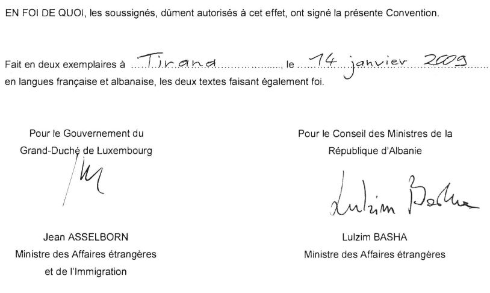

# Loi du 18 décembre 2024 portant approbation de la Convention entre le Gouvernement du Grand-Duché de Luxembourg et le Conseil des Ministres de la République d’Albanie tendant à éviter les doubles impositions et à prévenir la fraude fiscale en matière d’impôts sur le revenu et sur la fortune, faite à Tirana, le 14 janvier 2009, ainsi que du Protocole, fait à Luxembourg, le 21 octobre 2020, modifiant la Convention entre le Gouvernement du Grand-Duché de Luxembourg et le Conseil des Ministres de la République d’Albanie tendant à éviter les doubles impositions et à prévenir la fraude fiscale en matière d’impôts sur le revenu et sur la fortune, faite à Tirana, le 14 janvier 2009.

Nous Henri, Grand-Duc de Luxembourg, Duc de Nassau ;

Le Conseil d’État entendu ;

Vu l’adoption par la Chambre des Députés ;

Vu la décision de la Chambre des Députés du 21 novembre 2024 et celle du Conseil d’État du 26 novembre 2024 portant qu’il n’y a pas lieu à second vote ;

Avons ordonné et ordonnons :

## Article unique.

Sont approuvés la Convention, faite à Tirana, le 14 janvier 2009, entre le Gouvernement du Grand-Duché de Luxembourg et le Conseil des Ministres de la République d’Albanie tendant à éviter les doubles impositions et à prévenir la fraude fiscale en matière d’impôts sur le revenu et sur la fortune, ainsi que le Protocole, fait à Luxembourg, le 21 octobre 2020, modifiant la Convention entre le Gouvernement du Grand-Duché de Luxembourg et le Conseil des Ministres de la République d’Albanie tendant à éviter les doubles impositions et à prévenir la fraude fiscale en matière d’impôts sur le revenu et sur la fortune, faite à Tirana, le 14 janvier 2009.

Mandons et ordonnons que la présente loi soit insérée au Journal officiel du Grand-Duché de Luxembourg pour être exécutée et observée par tous ceux que la chose concerne.

Le Ministre des Affaires étrangères et du Commerce extérieur,   Xavier Bettel   Le Ministre des Finances,   Gilles Roth

Fait le 18 décembre 2024.   Pour le Grand-Duc,   Son Lieutenant-Représentant,   Guillaume,   Grand-Duc Héritier

\**CONVENTION**

\**ENTRE**

\**LE GOUVERNEMENT DU GRAND-DUCHE DE LUXEMBOURG**

\**ET**

\**LE CONSEIL DES MINISTRES DE LA REPUBLIQUE D'ALBANIE**

\**TENDANT A EVITER LES DOUBLES IMPOSITIONS ET A**

\**PREVENIR LA FRAUDE FISCALE EN MATIERE D'IMPOTS**

\**SUR LE REVENU ET SUR LA FORTUNE**

Le Gouvernement du Grand-Duché de Luxembourg et le Conseil des Ministres de la République d'Albanie, désireux de conclure une Convention tendant à éviter les doubles impositions et à prévenir la fraude fiscale en matière d'impôts sur le revenu et sur la fortune, sont convenus de ce qui suit:

## Article 1 — PERSONNES VISÉES

La présente Convention s'applique aux personnes qui sont des résidents d'un État contractant ou des deux États contractants.

## Article 2 — IMPÔTS VISÉS

1\. La présente Convention s'applique aux impôts sur le revenu et sur la fortune perçus pour le compte d'un État contractant ou de ses collectivités locales, quel que soit le système de perception.

2\. Sont considérés comme impôts sur le revenu et sur la fortune les impôts perçus sur le revenu total, sur la fortune totale, ou sur des éléments du revenu ou de la fortune, y compris les impôts sur les gains provenant de l'aliénation de biens mobiliers ou immobiliers, les impôts sur le montant global des salaires payés par les entreprises, ainsi que les impôts sur les plus-values.

3\. Les impôts actuels auxquels s'applique la Convention sont notamment:

a) en ce qui concerne le Grand-Duché de Luxembourg:

(i) l'impôt sur le revenu des personnes physiques;

(ii) l'impôt sur le revenu des collectivités;

(iii) l'impôt sur la fortune; et

(iv) l'impôt commercial communal;

(ci-après dénommés "impôt luxembourgeois");

b) en ce qui concerne la République d'Albanie:

(i) les impôts sur le revenu (y compris l'impôt sur les bénéfices des sociétés et l'impôt sur le revenu des personnes physiques);

(ii) l'impôt sur les petites entreprises; et

(iii) l'impôt sur la propriété;

(ci-après dénommés "impôt albanais").

4\. La Convention s'applique aussi aux impôts de nature identique ou analogue qui seraient établis après la date de signature de la Convention et qui s'ajouteraient aux impôts actuels ou qui les remplaceraient. Les autorités compétentes des États contractants se communiquent les modifications significatives apportées à leurs législations fiscales.

## Article 3 — DÉFINITIONS GÉNÉRALES

1\. Au sens de la présente Convention, à moins que le contexte n'exige une interprétation différente:

a) le terme "Luxembourg" désigne le Grand-Duché de Luxembourg et, lorsqu'il est employé dans un sens géographique, il désigne le territoire du Grand-Duché de Luxembourg;

b) le terme "Albanie" désigne la République d'Albanie et, lorsqu'il est employé dans un sens géographique, il désigne le territoire de la République d'Albanie y compris les eaux territoriales et l'espace aérien au-dessus, ainsi que toute zone au delà des eaux territoriales de la République d'Albanie qui, en vertu de sa législation et conformément au droit international, constitue une zone sur laquelle la République d'Albanie peut exercer ses droits relatifs au lit de mer et au sous-sol et à leurs ressources naturelles;

c) le terme "personne" comprend les personnes physiques, les sociétés et tous autres groupements de personnes;

d) le terme "société" désigne toute personne morale ou toute entité qui est considérée comme une personne morale aux fins d'imposition;

e) les expressions "entreprise d'un État contractant" et "entreprise de l'autre État contractant" désignent respectivement une entreprise exploitée par un résident d'un État contractant et une entreprise exploitée par un résident de l'autre État contractant;

f) l'expression "trafic international" désigne tout transport effectué par un navire ou un aéronef exploité par une entreprise dont le siège de direction effective est situé dans un État contractant, sauf lorsque le navire ou l'aéronef n'est exploité qu'entre des points situés dans l'autre État contractant;

g) l'expression "autorité compétente" désigne:

(i) en ce qui concerne le Luxembourg: le Ministre des Finances ou son représentant autorisé;

(ii) en ce qui concerne l'Albanie: le Ministère des Finances ou son représentant autorisé;

h) le terme "national" désigne:

(i) toute personne physique qui possède la nationalité d'un État contractant;

(ii) toute personne morale, société de personnes ou association constituée conformément à la législation en vigueur dans un État contractant.

2\. Pour l'application de la Convention à un moment donné par un État contractant, tout terme ou expression qui n'y est pas défini a, sauf si le contexte exige une interprétation différente, le sens que lui attribue, à ce moment, le droit de cet État concernant les impôts auxquels s'applique la Convention, le sens attribué à ce terme ou expression par le droit fiscal de cet État prevalant sur le sens que lui attribuent les autres branches du droit de cet État.

## Article 4 — RESIDENT

1\. Au sens de la présente Convention, l'expression "résident d'un État contractant" désigne toute personne qui, en vertu de la législation de cet État, est assujettie à l'impôt dans cet État, en raison de son domicile, de sa résidence, de son siège de direction, de son lieu d'enregistrement ou de tout autre critère de nature analogue et s'applique aussi à cet État ainsi qu'à toutes ses collectivités locales. Toutefois, cette expression ne comprend pas les personnes qui ne sont assujetties à l'impôt dans cet État que pour les revenus de sources situées dans cet État ou pour la fortune qui y est située.

2\. Lorsque, selon les dispositions du paragraphe 1, une personne physique est un résident des deux États contractants, sa situation est réglée de la manière suivante:

a) cette personne est considérée comme un résident seulement de l'État où elle dispose d'un foyer d'habitation permanent; si elle dispose d'un foyer d'habitation permanent dans les deux États, elle est considérée comme un résident seulement de l'État avec lequel ses liens personnels et économiques sont les plus étroits (centre des intérêts vitaux);

b) si l'État où cette personne a le centre de ses intérêts vitaux ne peut pas être déterminé, ou si elle ne dispose d'un foyer d'habitation permanent dans aucun des États, elle est considérée comme un résident seulement de l'État où elle séjourne de façon habituelle;

c) si cette personne séjourne de façon habituelle dans les deux États ou si elle ne séjourne de façon habituelle dans aucun d'eux, elle est considérée comme un résident seulement de l'État dont elle possède la nationalité;

d) si cette personne possède la nationalité des deux États ou si elle ne possède la nationalité d'aucun d'eux, les autorités compétentes des États contractants tranchent la question d'un commun accord.

3\. Lorsque, selon les dispositions du paragraphe 1, une personne autre qu'une personne physique est un résident des deux États contractants, elle est considérée comme un résident seulement de l'État où son siège de direction effective est situé.

## Article 5 — ÉTABLISSEMENT STABLE

1\. Au sens de la présente Convention, l'expression "établissement stable" désigne une installation fixe d'affaires par l'intermédiaire de laquelle une entreprise exerce tout ou partie de son activité.

2\. L'expression "établissement stable" comprend notamment:

a) un siège de direction,

b) une succursale,

c) un bureau,

d) une usine,

e) un atelier et

f) une mine, un puits de pétrole ou de gaz, une carrière ou tout autre lieu d'extraction de ressources naturelles.

3\. L'expression "établissement stable" englobe également:

a) un chantier de construction ou de montage ou des activités de surveillance s'y exerçant, mais seulement lorsque ce chantier ou ces activités ont une durée supérieure à douze mois, et

b) la fourniture de services, y compris les services de consultants, par une entreprise agissant par l'intermédiaire de salariés ou d'autre personnel engagé par l'entreprise à cette fin, mais seulement lorsque des activités de cette nature se poursuivent sur le territoire du pays pendant une période supérieure à douze mois.

4\. Nonobstant les dispositions précédentes du présent article, on considère qu'il n'y a pas "établissement stable" si:

a) il est fait usage d'installations aux seules fins de stockage, d'exposition ou de livraison de marchandises appartenant à l'entreprise;

b) des marchandises appartenant à l'entreprise sont entreposées aux seules fins de stockage, d'exposition ou de livraison;

c) des marchandises appartenant à l'entreprise sont entreposées aux seules fins de transformation par une autre entreprise;

d) une installation fixe d'affaires est utilisée aux seules fins d'acheter des marchandises ou de réunir des informations, pour l'entreprise;

e) une installation fixe d'affaires est utilisée aux seules fins d'exercer, pour l'entreprise, toute autre activité de caractère préparatoire ou auxiliaire;

f) une installation fixe d'affaires est utilisée aux seules fins de l'exercice cumulé d'activités mentionnées aux alinéas a) à e), à condition que l'activité d'ensemble de l'installation fixe d'affaires résultant de ce cumul garde un caractère préparatoire ou auxiliaire.

5\. Nonobstant les dispositions des paragraphes 1 et 2, lorsqu'une personne - autre qu'un agent jouissant d'un statut indépendant auquel s'applique le paragraphe 6 - agit pour le compte d'une entreprise et dispose dans un État contractant de pouvoirs qu'elle y exerce habituellement lui permettant de conclure des contrats au nom de l'entreprise, cette entreprise est considérée comme ayant un établissement stable dans cet État pour toutes les activités que cette personne exerce pour l'entreprise, à moins que les activités de cette personne ne soient limitées à celles qui sont mentionnées au paragraphe 4 et qui, si elles étaient exercées par l'intermediaire d'une installation fixe d'affaires, ne permettraient pas de considérer cette installation comme un établissement stable selon les dispositions de ce paragraphe.

6\. Une entreprise n'est pas considérée comme ayant un établissement stable dans un État contractant du seul fait qu'elle y exerce son activité par l'entremise d'un courtier, d'un commissionnaire général ou de tout autre agent jouissant d'un statut indépendant, à condition que ces personnes agissent dans le cadre ordinaire de leur activité.

7\. Le fait qu'une société qui est un résident d'un État contractant, contrôle ou est contrôlée par une société qui est un résident de l'autre État contractant ou qui y exerce son activité (que ce soit par l'intermédiaire d'un établissement stable ou non) ne suffit pas, en lui-même, à faire de l'une quelconque de ces sociétés un établissement stable de l'autre.

## Article 6 — REVENUS IMMOBILIERS

1\. Les revenus qu'un résident d'un État contractant tire de biens immobiliers (y compris les revenus des exploitations agricoles au forestières) situés dans l'autre État contractant, sont imposables dans cet autre État.

2\. L'expression "biens immobiliers" a le sens que lui attribue le droit de l'État contractant où les biens considérés sont situés. L'expression comprend en tous cas les accessoires, le cheptel mort ou vif des exploitations agricoles et forestières, les droits auxquels s'appliquent les dispositions du droit privé concernant la propriété foncière, l'usufruit des biens immobiliers et les droits à des paiements variables ou fixes pour l'exploitation ou la concession de l'exploitation de gisements minéraux, sources et autres ressources naturelles; les navires, bateaux et aéronefs ne sont pas considérés comme des biens immobiliers.

3\. Les dispositions du paragraphe 1 s'appliquent aux revenus provenant de l'exploitation directe, de la location ou de l'affermage, ainsi que de toute autre forme d'exploitation des biens immobiliers.

4\. Les dispositions des paragraphes 1 et 3 s'appliquent également aux revenus provenant des biens immobiliers d'une entreprise ainsi qu'aux revenus de biens immobiliers servant à l'exercice d'une profession libérale.

## Article 7 — BÉNÉFICES DES ENTREPRISES

1\. Les bénéfices d'une entreprise d'un État contractant ne sont imposables que dans cet État, à moins que l'entreprise n'exerce son activité dans l'autre État contractant par l'intermédiaire d'un établissement stable qui y est situé. Si l'entreprise exerce son activité d'une telle façon, les bénéfices de l'entreprise sont imposables dans l'autre État, mais uniquement dans la mesure où ils sont imputables à cet établissement stable.

2\. Sous réserve des dispositions du paragraphe 3, lorsqu'une entreprise d'un État contractant exerce son activité dans l'autre État contractant par l'intermédiaire d'un établissement stable qui y est situé, il est imputé, dans chaque État contractant, à cet établissement stable les bénéfices qu'il aurait pu réaliser s'il avail constitué une entreprise distincte exerçant des activités identiques ou analogues dans des conditions identiques ou analogues et traitant en toute indépendance avec l'entreprise dont il constitue un établissement stable.

3\. Pour déterminer les bénéfices d'un établissement stable, sont admises en déduction les dépenses exposées aux fins poursuivies par cet établissement stable, y compris les dépenses de direction et les frais généraux d'administration ainsi exposés, soit dans l'État où est situé cet établissement stable, soit ailleurs.

4\. S'il est d'usage, dans un État contractant, de déterminer les bénéfices imputables à un établissement stable sur la base d'une répartition des bénéfices totaux de l'entreprise entre ses diverses parties, aucune disposition du paragraphe 2 n'empêche cet État contractant de déterminer les bénéfices imposables selon la répartition en usage; la méthode de répartition adoptée doit cependant être telle que le résultat obtenu soit conforme aux principes contenus dans le présent article.

5\. Aucun bénéfice n'est imputé à un établissement stable du fait qu'il a simplement acheté des marchandises pour l'entreprise.

6\. Aux fins des paragraphes précédents, les bénéfices à imputer à l'établissement stable sont déterminés chaque année selon la même méthode, à moins qu'il n'existe des motifs valables et suffisants de procéder autrement.

7\. Lorsque les bénéfices comprennent des éléments de revenu traités séparément dans d'autres articles de la présente Convention, les dispositions de ces articles ne sont pas affectées par les dispositions du présent article.

## Article 8 — TRANSPORT INTERNATIONAL

1\. Les bénéfices provenant de l'exploitation, en trafic international, de navires ou d'aéronefs ne sont imposables que dans l'État contractant où le siège de direction effective de l'entreprise est situé.

2\. Les bénéfices provenant de l'exploitation de bateaux servant à la navigation intérieure ne sont imposables que dans l'État contractant où le siège de direction effective de l'entreprise est situé.

3\. Si le siège de direction effective d'une entreprise de navigation maritime ou intérieure est à bord d'un navire ou d'un bateau, ce siège est considéré comme situé dans l'État contractant où se trouve le port d'attache de ce navire ou de ce bateau, ou à defaut de port d'attache, dans l'État contractant dont l'exploitant du navire ou du bateau est un résident.

4\. Les dispositions du paragraphe 1 s'appliquent aussi aux bénéfices provenant de la participation à un pool, une exploitation en commun ou un organisme international d'exploitation.

## Article 9 — ENTREPRISES ASSOCIÉES

1\. Lorsque

a) une entreprise d'un État contractant participe directement ou indirectement à la direction, au contrôle ou au capital d'une entreprise de l'autre État contractant, ou que

b) les mêmes personnes participent directement ou indirectement à la direction, au contrôle ou au capital d'une entreprise d'un État contractant et d'une entreprise de l'autre État contractant,

et que, dans l'un et l'autre cas, les deux entreprises sont, dans leurs relations commerciales ou financières, liées par des conditions convenues ou imposées, qui différent de celles qui seraient convenues entre des entreprises indépendantes, les bénéfices qui, sans ces conditions, auraient été réalisés par l'une des entreprises, mais n'ont pu l'être en fait à cause de ces conditions, peuvent être inclus dans les bénéfices de cette entreprise et imposés en conséquence.

2\. Lorsqu'un État contractant inclut dans les bénéfices d'une entreprise de cet État - et impose en conséquence - des bénéfices sur lesquels une entreprise de l'autre État contractant a été imposée dans cet autre État, et que les bénéfices ainsi inclus sont des bénéfices qui auraient été réalisés par l'entreprise du premier État si les conditions convenues entre les deux entreprises avaient été celles qui auraient été convenues entre des entreprises indépendantes, l'autre État procède à un ajustement approprié du montant de l'impôt qui y a été perçu sur ces bénéfices. Pour déterminer cet ajustement, il est tenu compte des autres dispositions de la présente Convention et, si c'est nécessaire, les autorites compétentes des États contractants se consultent.

## Article 10 — DIVIDENDES

1\. Les dividendes payés par une société qui est un résident d'un État contractant à un résident de l'autre État contractant, sont imposables dans cet autre État.

2\. Toutefois, ces dividendes sont aussi imposables dans l'État contractant dont la société qui paie les dividendes est un résident, et selon la législation de cet État, mais si le bénéficiaire effectif des dividendes est un résident de l'autre État contractant, l'impôt ainsi etabli ne peut excéder:

a) 5 pour cent du montant brut des dividendes, si le bénéficiaire effectif est une société (autre qu'une société de personnes) qui détient directement au moins 25 pour cent du capital de la société qui paie les dividendes;

b) 10 pour cent du montant brut des dividendes, dans tous les autres cas.

Le présent paragraphe n'affecte pas l'imposition de la société au titre des bénéfices qui servent au paiement des dividendes.

3\. Le terme "dividendes" employé dans le présent article désigne les revenus provenant d'actions de toute nature ou autres parts bénéficiaires à l'exception des créances, ainsi que les revenus d'autres parts sociales soumis au même régime fiscal que les revenus d'actions par la législation de l'État dont la société distributrice est un résident.

4\. Les dispositions des paragraphes 1 et 2 ne s'appliquent pas, lorsque le bénéficiaire effectif des dividendes, résident d'un État contractant, exerce dans l'autre État contractant dont la société qui paie les dividendes est un résident, soit une activité industrielle ou commerciale par l'intermédiaire d'un établissement stable qui y est situé, soit une profession indépendante au moyen d'une base fixe qui y est située, et que la participation génératrice des dividendes s'y rattache effectivement. Dans ce cas, les dispositions de l'article 7 ou de l'article 14, suivant les cas, sont applicables.

5\. Lorsqu'une société qui est un résident d'un État contractant, tire des bénéfices ou des revenus de l'autre État contractant, cet autre État ne peut percevoir aucun impôt sur les dividendes payés par la société, sauf dans la mesure où ces dividendes sont payés à un résident de cet autre État ou dans la mesure où la participation génératrice des dividendes se rattache effectivement à un établissement stable ou à une base fixe situés dans cet autre État, ni prélever aucun impôt, au titre de l'imposition des bénéfices non distribués, sur les bénéfices non distribués de la société, même si les dividendes payés ou les bénéfices non distribués consistent en tout ou en partie en bénéfices ou revenus provenant de cet autre État.

## Article 11 — INTÉRÊTS

1\. Les intérêts provenant d'un État contractant et payés à un résident de l'autre État contractant, sont imposables dans cet autre État.

2\. Toutefois, ces intérêts sont aussi imposables dans l'État contractant d'où ils proviennent et selon la législation de cet État, mais si le bénéficiaire effectif des intérêts est un résident de l'autre État contractant, l'impôt ainsi établi ne peut excéder 5 pour cent du montant brut des intérêts.

3\. Nonobstant les dispositions du paragraphe 2, les intérêts mentionnés au paragraphe 1 ne sont imposables que dans l'État contractant dont la personne qui reçoit les intérêts est un résident si le bénéficiaire effectif de ces intérêts est un résident de cet État et:

a) est cet État, l'une de ses collectivités locales ou établissements publics,

b) si les intérêts sont versés par l'État dans lequel ils sont générés ou par l'une de ses collectivités locales ou établissements publics,

c) si l'intérêt est versé au titre d'un prêt, d'une créance ou d'un crédit qui est dû à cet État ou consenti, accordé, garanti ou assuré par lui ou par l'une de ses collectivités locales ou agences de financement des exportations.

4\. Le terme "intérêts" employé dans le présent article désigne les revenus des créances de toute nature, assorties ou non de garanties hypothécaires ou d'une clause de participation aux bénéfices du débiteur, et notamment les revenus des fonds publics et des obligations d'emprunts, y compris les primes et lots attachés à ces titres. Les pénalisations pour paiement tardif ne sont pas considérées comme des intérêts au sens du présent article.

5\. Les dispositions des paragraphes 1, 2 et 3 ne s'appliquent pas lorsque le bénéficiaire effectif des intérêts, résident d'un État contractant, exerce dans l'autre État contractant d'où proviennent les intérêts, soit une activité industrielle ou commerciale par l'intermédiaire d'un établissement stable qui y est situé, soit une profession indépendante au moyen d'une base fixe qui y est située, et que la créance génératrice des intérêts s'y rattache effectivement. Dans ce cas, les dispositions de l'article 7 ou de l'article 14, suivant les cas, sont applicables.

6\. Les intérêts sont considérés comme provenant d'un État contractant lorsque le débiteur est un résident de cet État. Toutefois, lorsque le débiteur des intérêts, qu'il soit ou non un résident d'un État contractant, a dans un État contractant un établissement stable, ou une base fixe, pour lequel la dette donnant lieu au paiement des intérêts a été contractée et qui supporte la charge de ces intérêts, ceux-ci sont considérés comme provenant de l'État où l'établissement stable, ou la base fixe, est situé.

7\. Lorsque, en raison de relations spéciales existant entre le débiteur et le bénéficiaire effectif ou que l'un et l'autre entretiennent avec de tierces personnes, le montant des intérêts, compte tenu de la créance pour laquelle ils sont payés, excède celui dont seraient convenus le débiteur et le bénéficiaire effectif en l'absence de pareilles relations, les dispositions du présent article ne s'appliquent qu'à ce dernier montant. Dans ce cas, la partie excédentaire des paiements reste imposable selon la législation de chaque État contractant et compte tenu des autres dispositions de la présente Convention.

## Article 12 — REDEVANCES

1\. Les redevances provenant d'un État contractant et payées à un résident de l'autre État contractant sont imposables dans cet autre État.

2\. Toutefois, ces redevances sont aussi imposables dans l'État contractant d'où elles proviennent et selon la législation de cet État, mais si le bénéficiaire effectif des redevances est un résident de l'autre État contractant, l'impôt ainsi établi ne peut excéder 5 pour cent du montant brut des redevances.

3\. Le terme "redevances" employé dans le présent article désigne les rémunérations de toute nature payées pour l'usage ou la concession de l'usage d'un droit d'auteur sur une oeuvre littéraire, artistique ou scientifique y compris les films cinématographiques et les films ou bandes pour la radio ou la télévision, d'un brevet, d'une marque de fabrique ou de commerce, d'un dessin ou d'un modèle, d'un plan, d'une formule ou d'un procédé secrets, ou pour l'usage ou la concession de l'usage d'un équipement industriel, commercial ou scientifique, ou pour des informations ayant trait à une expérience acquise dans le domaine industriel, commercial ou scientifique.

4\. Les dispositions des paragraphes 1 et 2 ne s'appliquent pas lorsque le bénéficiaire effectif des redevances, résident d'un État contractant, exerce dans l'autre État contractant d'où proviennent les redevances, soit une activité industrielle ou commerciale par l'intermédiaire d'un établissement stable qui y est situé, soit une profession indépendante au moyen d'une base fixe qui y est située, et que le droit ou le bien générateur des redevances s'y rattache effectivement. Dans ce cas, les dispositions de l'article 7 ou de l'article 14, suivant les cas, sont applicables.

5\. Les redevances sont considérées comme provenant d'un État contractant lorsque le débiteur est un résident de cet État. Toutefois, lorsque le débiteur des redevances, qu'il soit ou non un résident d'un État contractant, a dans un État contractant un établissement stable, ou une base fixe, pour lequel l'engagement donnant lieu au paiement des redevances a été contracté et qui supporte la charge de ces redevances, celles­-ci sont considérées comme provenant de l'État où l'établissement stable, ou la base fixe, est situé.

6\. Lorsque, en raison de relations spéciales existant entre le débiteur et le bénéficiaire effectif ou que l'un et l'autre entretiennent avec de tierces personnes, le montant des redevances, compte tenu de la prestation pour laquelle elles sont payées, excède celui dont seraient convenus le débiteur et le bénéficiaire effectif en l'absence de pareilles relations, les dispositions du présent article ne s'appliquent qu'à ce dernier montant. Dans ce cas, la partie excédentaire des paiements reste imposable selon la législation de chaque État contractant et compte tenu des autres dispositions de la présente Convention.

## Article 13 — GAINS EN CAPITAL

1\. Les gains qu'un résident d'un État contractant tire de l'aliénation de biens immobiliers visés à l'article 6, et situés dans l'autre État contractant, sont imposables dans cet autre État.

2\. Les gains provenant de l'aliénation de biens mobiliers qui font partie de l'actif d'un établissement stable qu'une entreprise d'un État contractant a dans l'autre État contractant, ou de biens mobiliers qui appartiennent à une base fixe dont un résident d'un État contractant dispose dans l'autre État contractant pour l'exercice d'une profession indépendante, y compris de tels gains provenant de l'aliénation de cet établissement stable (seul ou avec l'ensemble de l'entreprise) ou de cette base fixe, sont imposables dans cet autre État.

3\. Les gains provenant de l'aliénation de navires ou aéronefs exploités en trafic international, de bateaux servant à la navigation intérieure ou de biens mobiliers affectés à l'exploitation de ces navires, aéronefs ou bateaux, ne sont imposables que dans l'État contractant où le siège de direction effective de l'entreprise est situé.

4\. Les gains provenant de l'aliénation de tous biens autres que ceux visés aux paragraphes précédents du présent article, ne sont imposables que dans l'État contractant dont le cédant est un résident.

## Article 14 — PROFESSIONS INDÉPENDANTES

1\. Les revenus qu'une personne physique qui est un résident d'un État contractant tire d'une profession libérale ou d'autres activités similaires de caractère indépendant ne sont imposables que dans cet État; toutefois, ces revenus sont aussi imposables dans l'autre État contractant dans les cas suivants:

a) si ce résident dispose de façon habituelle, dans l'autre État contractant, d'une base fixe pour l'exercice de ses activités; dans ce cas, seule la fraction du revenu qui est imputable à cette base fixe est imposable dans cet autre État; ou

b) si son séjour dans l'autre État contractant s'étend sur une période ou des périodes d'une durée totale égale ou supérieure à 183 jours durant toute période de douze mois commençant ou se terminant durant l'année civile considérée; dans ce cas, seule la fraction des revenus qui est tirée de ses activités exercées dans cet autre État est imposable dans cet autre État.

2\. L'expression "profession libérale" comprend notamment les activités indépendantes d'ordre scientifique, littéraire, artistique, éducatif ou pédagogique, ainsi que les activités indépendantes des médecins, dentistes, avocats, ingénieurs, architectes, auditeurs et comptables.

## Article 15 — PROFESSIONS DÉPENDANTES

1\. Sous réserve des dispositions des articles 16, 18 et 19, les salaires, traitements et autres rémunérations similaires qu'un résident d'un État contractant reçoit au titre d'un emploi salarié, ne sont imposables que dans cet État, à moins que l'emploi ne soit exercé dans l'autre État contractant. Si l'emploi y est exercé, les rémunérations reçues à ce titre sont imposables dans cet autre État.

2\. Nonobstant les dispositions du paragraphe 1, les rémunérations qu'un résident d'un État contractant reçoit au titre d'un emploi salarié exercé dans l'autre État contractant, ne sont imposables que dans le premier État si toutes les conditions suivantes sont remplies:

a) le bénéficiaire séjourne dans l'autre État pendant une période ou des périodes n'excédant pas au total 183 jours durant toute période de douze mois commençant ou se terminant durant l'année civile considérée, et

b) les rémunérations sont payées par un employeur ou pour le compte d'un employeur qui n'est pas un résident de l'autre État, et

c) la charge des rémunérations n'est pas supportée par un établissement stable ou une base fixe que l'employeur a dans l'autre État.

3\. Nonobstant les dispositions précédentes du présent article, les rémunérations reçues au titre d'un emploi salarié exercé à bord d'un navire, d'un aéronef ou d'un véhicule routier exploité en trafic international, ou à bord d'un bateau servant à la navigation intérieure, sont imposables dans l'État contractant où le siège de direction effective de l'entreprise est situé.

## Article 16 — TANTIÈMES

Les tantièmes, jetons de présence et autres rétributions similaires qu'un résident d'un État contractant reçoit en sa qualité de membre du conseil d'administration ou de surveillance ou d'un organe similaire d'une société qui est un résident de l'autre État contractant, sont imposables dans cet autre État.

## Article 17 — ARTISTES ET SPORTIFS

1\. Nonobstant les dispositions des articles 7, 14 et 15, les revenus qu'un résident d'un État contractant tire de ses activités personnelles exercées dans l'autre État contractant en tant qu'artiste du spectacle, tel qu'un artiste de théâtre, de cinéma, de la radio ou de la télévision, ou qu'un musicien, ou en tant que sportif, sont imposables dans cet autre État.

2\. Lorsque les revenus d'activités qu'un artiste du spectacle ou un sportif exerce personnellement et en cette qualité, sont attribués non pas à l'artiste ou au sportif lui-même, mais à une autre personne, ces revenus sont imposables, nonobstant les dispositions des articles 7, 14 et 15, dans l'État contractant où les activités de l'artiste ou du sportif sont exercées.

## Article 18 — PENSIONS

1\. Sous réserve des dispositions du paragraphe 2 de l'article 19, les pensions et autres rémunérations similaires, payées à un résident d'un État contractant au titre d'un emploi antérieur, ne sont imposables que dans cet État.

2\. Nonobstant les dispositions du paragraphe 1, les pensions et autres sommes payées en application de la législation sur la sécurité sociale d'un État contractant ne sont imposables que dans cet État.

3\. Nonobstant les dispositions du paragraphe 1, les pensions et autres rémunérations similaires (y compris les versements forfaitaires) provenant d'un État contractant et payées à un résident de l'autre État contractant, ne sont pas imposables dans l'autre État contractant si ces paiements découlent des cotisations, allocations ou primes d'assurance versées à un régime complémentaire de pension par le bénéficiaire ou pour son compte, ou des dotations faites par l'employeur à un régime interne, et si ces cotisations. allocations, primes d'assurance ou dotations ont été effectivement soumises à l'impôt dans le premier État contractant.

## Article 19 — FONCTIONS PUBLIQUES

1\. a) Les salaires, traitements et autres rémunérations similaires payés par un État contractant ou l'une de ses collectivités locales à une personne physique, au titre de services rendus à cet État ou à cette collectivité, ne sont imposables que dans cet État.

b) Toutefois, ces salaires, traitements et autres rémunérations similaires ne sont imposables que dans l'autre État contractant si les services sont rendus dans cet État et si la personne physique est un résident de cet État qui:

(i) possède la nationalité de cet État, ou

(ii) n'est pas devenu un résident de cet État à seule fin de rendre les services.

2\. a) Nonobstant les dispositions du paragraphe 1, les pensions et autres rémunérations similaires payées par un État contractant ou l'une de ses collectivités locales, soit directement, soit par prélèvement sur des fonds qu'ils ont constitués, à une personne physique, au titre de services rendus à cet État ou à cette collectivité, ne sont imposables que dans cet État.

b) Toutefois, ces pensions et autres rémunérations similaires ne sont imposables que dans l'autre État contractant si la personne physique est un résident de cet État et en possède la nationalité.

3\. Les dispositions des articles 15, 16, 17 et 18 s'appliquent aux salaires, traitements, pensions, et autres rémunérations similaires payés au titre de services rendus dans le cadre d'une activité industrielle ou commerciale exercée par un État contractant ou l'une de ses collectivités locales.

## Article 20 — ÉTUDIANTS ET STAGIAIRES

1\. Les sommes qu'un étudiant ou un stagiaire qui est, ou qui était immédiatement avant de se rendre dans un État contractant, un résident de l'autre État contractant et qui séjourne dans le premier État à seule fin d'y poursuivre ses études ou sa formation, reçoit pour couvrir ses frais d'entretien, d'études ou de formation ne sont pas imposables dans cet État, à condition qu'elles proviennent de sources situées en dehors de cet État.

2\. En ce qui concerne les allocations d'études, les bourses et les rémunérations d'un emploi salarié auxquelles ne s'applique pas le paragraphe 1, un étudiant ou un stagiaire au sens du paragraphe 1 aura en outre, pendant la durée de ces études ou de cette formation, le droit de bénéficier des mêmes exonérations, dégrèvements ou réductions d'impôts que les résidents de l'État dans lequel il séjourne.

## Article 21 — AUTRES REVENUS

1\. Les éléments du revenu d'un résident d'un État contractant, d'où qu'ils proviennent, qui ne sont pas traités dans les articles précédents de la présente Convention, ne sont imposables que dans cet État.

2\. Les dispositions du paragraphe 1 ne s'appliquent pas aux revenus autres que les revenus provenant de biens immobiliers tels qu'ils sont définis au paragraphe 2 de l'article 6, lorsque le bénéficiaire de tels revenus, résident d'un État contractant, exerce dans l'autre État contractant, soit une activité industrielle ou commerciale par l'intermédiaire d'un établissement stable qui y est situé, soit une profession indépendante au moyen d'une base fixe qui y est située, et que le droit ou le bien générateur des revenus s'y rattache effectivement. Dans ce cas, les dispositions de l'article 7 ou de l'article 14, suivant les cas, sont applicables.

## Article 22 — FORTUNE

1\. La fortune constituée par des biens immobiliers visés à l'article 6, que possède un résident d'un État contractant et qui sont situés dans l'autre État contractant, est imposable dans cet autre État.

2\. La fortune constituée par des biens mobiliers qui font partie de l'actif d'un établissement stable qu'une entreprise d'un État contractant a dans l'autre État contractant, ou par des biens mobiliers qui appartiennent à une base fixe dont un résident d'un État contractant dispose dans l'autre État contractant pour l'exercice d'une profession indépendante, est imposable dans cet autre État.

3\. La fortune constituée par des navires et des aéronefs exploités en trafic international, par des bateaux servant à la navigation intérieure ainsi que par des biens mobiliers affectés à l'exploitation de ces navires, aéronefs ou bateaux, n'est imposable que dans l'État contractant où le siège de direction effective de l'entreprise est situé.

4\. Tous les autres éléments de la fortune d'un résident d'un État contractant ne sont imposables que dans cet État.

## Article 23 — ÉLIMINATION DES DOUBLES IMPOSITIONS

1\. En ce qui concerne le Luxembourg:

Sous réserve des dispositions de la législation luxembourgeoise concernant l'élimination de la double imposition qui n'en affectent pas le principe général, la double imposition est évitée de la manière suivante:

a) Lorsqu'un résident du Luxembourg reçoit des revenus ou possède de la fortune qui, conformément aux dispositions de la présente Convention, sont imposables en Albanie, le Luxembourg exempte de l'impôt ces revenus ou cette fortune, sous réserve des dispositions des sous-paragraphes b) et c), mais peut, pour calculer le montant de l'impôt sur le reste du revenu ou de la fortune du résident, appliquer les mêmes taux d'impôt que si les revenus ou la fortune n'avaient pas été exemptés.

b) Lorsqu'un résident du Luxembourg reçoit des éléments de revenu qui, conformément aux dispositions des articles 10, 11, 12 et 17, sont imposables en Albanie, le Luxembourg accorde sur l'impôt sur le revenu des personnes physiques ou sur l'impôt sur le revenu des collectivités de ce résident, une déduction d'un montant égal à l'impôt payé en Albanie. Cette déduction ne peut toutefois excéder la fraction de l'impôt, calculé avant déduction, correspondant à ces éléments de revenus reçus d'Albanie.

c) Les dispositions du sous-paragraphe a) ne s'appliquent pas au revenu reçu ou à la fortune possédée par un résident du Luxembourg, lorsque l'Albanie applique les dispositions de la présente Convention pour exempter d'impôt ce revenu ou cette fortune ou applique les dispositions du paragraphe 2 des articles 10, 11 ou 12 à ce revenu.

2\. En ce qui concerne l'Albanie:

a) Lorsqu'un résident de l'Albanie reçoit des revenus ou possède de la fortune qui, conformément aux dispositions de la présente Convention, sont imposables au Luxembourg, l'Albanie accorde:

(i) sur l'impôt albanais qu'elle perçoit sur les revenus de ce résident, une déduction d'un montant égal à l'impôt sur le revenu payé au Luxembourg, et

(ii) sur l'impôt albanais qu'elle perçoit sur la fortune de ce résident, une déduction d'un montant égal à l'impôt sur la fortune payé au Luxembourg.

Dans l'un ou l'autre cas, cette déduction ne peut toutefois excéder la fraction de l'impôt albanais sur le revenu ou de l'impôt albanais sur la fortune, calculé avant déduction, correspondant selon le cas aux revenus ou à la fortune imposables au Luxembourg.

b) Lorsque, conformément à une disposition quelconque de la présente Convention, les revenus qu'un résident de l'Albanie reçoit ou la fortune qu'il possède sont exempts d'impôt en Albanie, l'Albanie peut néanmoins, pour calculer le montant de l'impôt sur le reste des revenus ou de la fortune de ce résident, tenir compte des revenus ou de la fortune exemptés.

## Article 24 — NON-DISCRIMINATION

1\. Les nationaux d'un État contractant ne sont soumis dans l'autre État contractant à aucune imposition ou obligation y relative, qui est autre ou plus lourde que celles auxquelles sont ou pourront être assujettis les nationaux de cet autre État qui se trouvent dans la même situation, notamment au regard de la résidence. La présente disposition s'applique aussi, nonobstant les dispositions de l'article 1, aux personnes qui ne sont pas des résidents d'un État contractant ou des deux États contractants.

2\. L'imposition d'un établissement stable qu'une entreprise d'un État contractant a dans l'autre État contractant, n'est pas établie dans cet autre État d'une façon moins favorable que l'imposition des entreprises de cet autre État qui exercent la même activité. La présente disposition ne peut être interprétée comme obligeant un État contractant à accorder aux résidents de l'autre État contractant les déductions personnelles, abattements et réductions d'impôt en fonction de la situation ou des charges de famille qu'il accorde à ses propres résidents.

3\. A moins que les dispositions du paragraphe 1 de l'article 9, du paragraphe 7 de l'article 11 ou du paragraphe 6 de l'article 12 ne soient applicables, les intérêts, redevances et autres dépenses payés par une entreprise d'un État contractant à un résident de l'autre État contractant, sont déductibles, pour la détermination des bénéfices imposables de cette entreprise, dans les mêmes conditions que s'ils avaient été payés à un résident du premier État. De même, les dettes d'une entreprise d'un État contractant envers un résident de l'autre État contractant sont déductibles, pour la détermination de la fortune imposable de cette entreprise, dans les mêmes conditions que si elles avaient été contractées envers un résident du premier État.

4\. Les entreprises d'un État contractant, dont le capital est en totalité ou en partie, directement ou indirectement, détenu ou contrôlé par un ou plusieurs résidents de l'autre État contractant, ne sont soumises dans le premier État à aucune imposition ou obligation y relative, qui est autre ou plus lourde que celles auxquelles sont ou pourront être assujetties les autres entreprises similaires du premier État.

5\. Les dispositions du présent article s'appliquent aux impôts visés par la présente Convention.

## Article 25 — PROCÉDURE AMIABLE

1\. Lorsqu'une personne estime que les mesures prises par un État contractant ou par les deux États contractants entraînent ou entraîneront pour elle une imposition non conforme aux dispositions de la présente Convention, elle peut, indépendamment des recours prévus par le droit interne de ces États, soumettre son cas à l'autorité compétente de l'État contractant dont elle est un résident ou, si son cas relève du paragraphe 1 de l'article 24, à celle de l'État contractant dont elle possède la nationalité. Le cas doit être soumis dans les trois ans qui suivent la première notification de la mesure qui entraîne une imposition non conforme aux dispositions de la Convention.

2\. L'autorité compétente s'efforce, si la réclamation lui paraît fondée et si elle n'est pas elle-même en mesure d'y apporter une solution satisfaisante, de résoudre le cas par voie d'accord amiable avec l'autorité compétente de l'autre État contractant, en vue d'éviter une imposition non conforme à la Convention. L'accord est appliqué quels que soient les délais prévus par le droit interne des États contractants.

3\. Les autorités compétentes des États contractants s'efforcent, par voie d'accord amiable, de résoudre les difficultés ou de dissiper les doutes auxquels peuvent donner lieu l'interprétation ou l'application de la Convention. Elles peuvent aussi se concerter en vue d'éliminer la double imposition dans les cas non prévus par la Convention.

4\. Les autorités compétentes des États contractants peuvent communiquer directement entre elles, y compris au sein d'une commission mixte composée de ces autorités ou de leurs représentants, en vue de parvenir à un accord comme il est indiqué aux paragraphes précédents.

## Article 26 — ÉCHANGE DE RENSEIGNEMENTS

1\. Les autorités compétentes des États contractants échangent les renseignements nécessaires pour appliquer les dispositions de la présente Convention ou celles de la législation interne des États contractants relative aux impôts visés par la Convention dans la mesure où l'imposition qu'elle prévoit n'est pas contraire à la Convention. Les renseignements reçus par un État contractant sont tenus secrets de la même manière que les renseignements obtenus en application de la législation interne de cet État et ne sont communiqués qu'aux personnes ou autorités (y compris les tribunaux et organes administratifs) concernées par l'établissement ou le recouvrement des impôts visés par la Convention, par les procédures ou poursuites concernant ces impôts, ou par les décisions sur les recours relatifs à ces impôts. Ces personnes ou autorités n'utilisent ces renseignements qu'à ces fins. Elles peuvent révéler ces renseignements au cours d'audiences publiques de tribunaux ou dans des jugements.

2\. Les dispositions du paragraphe 1 ne peuvent en aucun cas être interprétées comme imposant à un État contractant l'obligation:

a) de prendre des mesures administratives dérogeant à sa législation et à sa pratique administrative ou à celles de l'autre État contractant;

b) de fournir des renseignements qui ne pourraient être obtenus sur la base de sa législation ou dans le cadre de sa pratique administrative normale ou de celles de l'autre État contractant:

c) de fournir des renseignements qui révéleraient un secret commercial, industriel, professionnel ou un procédé commercial ou des renseignements dont la communication serait contraire à l'ordre public.

## Article 27 — MEMBRES DES MISSIONS DIPLOMATIQUES ET POSTES CONSULAIRES

Les dispositions de la présente Convention ne portent pas atteinte aux privilèges fiscaux dont bénéficient les membres des missions diplomatiques ou postes consulaires en vertu soit des règles générales du droit international, soit des dispositions d'accords particuliers.

## Article 28 — ENTRÉE EN VIGUEUR

1\. Chacun des États contractants notifiera à l'autre, par écrit par la voie diplomatique, l'accomplissement des procédures requises par sa législation pour la mise en vigueur de la présente Convention. La Convention entrera en vigueur à la date de réception de la dernière de ces notifications.

2\. La Convention sera applicable:

a) en ce qui concerne les impôts retenus à la source, aux revenus attribués le ou après le 1er janvier de l'année civile suivant immédiatement l'année au cours de laquelle la Convention entrera en vigueur;

b) en ce qui concerne les autres impôts sur le revenu et les impôts sur la fortune, aux impôts dus pour toute année d'imposition commençant le ou après le 1er janvier de l'année civile suivant immédiatement l'année au cours de laquelle la Convention entrera en vigueur.

Aux fins de l'article 26 (Échange de renseignements), les dispositions seront applicables à la date ou après la date à laquelle la Convention entrera en vigueur.

## Article 29 — DÉNONCIATION

1\. La présente Convention demeurera en vigueur tant qu'elle n'aura pas été dénoncée par un État contractant. Chaque État contractant peut dénoncer la Convention par voie diplomatique avec un préavis minimum de six mois avant la fin de chaque année civile commençant après l'expiration d'une période de cinq années à partir de la date de son entrée en vigueur.

2\. La Convention cessera d'être applicable:

a) en ce qui concerne les impôts retenus à la source, aux revenus attribués le ou après le 1er janvier de l'année civile suivant immédiatement l'année au cours de laquelle le préavis est donné;

b) en ce qui concerne les autres impôts sur le revenu et les impôts sur la fortune, aux impôts dus pour toute année d'imposition commençant le ou après le 1er janvier de l'année civile suivant immédiatement l'année au cours de laquelle le préavis est donné.

\**PROTOCOLE**

\**MODIFIANT LA CONVENTION ENTRE LE GOUVERNEMENT**

\**DU GRAND-DUCHE DE LUXEMBOURG ET LE CONSEIL DES MINISTRES DE LA REPUBLIQUE D’ALBANIE TENDANT A EVITER LES DOUBLES IMPOSITIONS ET A PREVENIR LA FRAUDE FISCALE EN MATIERE D’IMPOTS SUR LE REVENU ET SUR LA FORTUNE, SIGNEE A TIRANA LE 14 JANVIER 2009**

Le Gouvernement du Grand-Duché de Luxembourg et le Conseil des Ministres de la République d’Albanie,

Désireux de conclure un Protocole modifiant la Convention entre le Gouvernement du Grand-Duché de Luxembourg et le Conseil des Ministres de la République d’Albanie tendant à éviter les doubles impositions et à prévenir la fraude fiscale en matière d’impôts sur le revenu et sur la fortune, signée à Tirana le 14 janvier 2009, (ci-après dénommée « la Convention »),

Sont convenus de ce qui suit :

## ARTICLE 1

Le Préambule de la Convention est supprimé et remplacé par celui qui suit :

> « Le Gouvernement du Grand-Duché de Luxembourg et le Conseil des Ministres de la République d’Albanie
>
> Soucieux de promouvoir leurs relations économiques et d’améliorer leur coopération en matière fiscale,
>
> Entendant conclure une Convention pour l’élimination de la double imposition en matière d’impôts sur le revenu et sur la fortune sans créer de possibilités de non-imposition ou d’imposition réduite par l’évasion ou la fraude fiscale (y compris par des mécanismes de chalandage fiscal destinés à obtenir les allégements prévus dans la présente Convention au bénéfice indirect de résidents d’États tiers), sont convenus de ce qui suit : »

## ARTICLE 2

L’article 26 (ECHANGE DE RENSEIGNEMENTS) de la Convention est supprimé et remplacé par celui qui suit :

> **« Article 26 — ECHANGE DE RENSEIGNEMENTS**
>
> 1\. Les autorités compétentes des États contractants échangent les renseignements vraisemblablement pertinents pour appliquer les dispositions de la présente Convention ou pour l’administration ou l’application de la législation interne relative aux impôts de toute nature ou dénomination perçus pour le compte des États contractants ou de leurs collectivités locales dans la mesure où l’imposition qu’elle prévoit n’est pas contraire à la Convention. L’échange de renseignements n’est pas restreint par les articles 1 et 2.
>
> 2\. Les renseignements reçus en vertu du paragraphe 1 par un État contractant sont tenus secrets de la même manière que les renseignements obtenus en application de la législation interne de cet État et ne sont communiqués qu’aux personnes ou autorités (y compris les tribunaux et organes administratifs) concernées par l’établissement ou le recouvrement des impôts mentionnés au paragraphe 1, par les procédures ou poursuites concernant ces impôts, par les décisions sur les recours relatifs à ces impôts, ou par le contrôle de ce qui précède. Ces personnes ou autorités n’utilisent ces renseignements qu’à ces fins. Elles peuvent révéler ces renseignements au cours d’audiences publiques de tribunaux ou dans des jugements. Nonobstant ce qui précède, les renseignements reçus par un État contractant peuvent être utilisés à d’autres fins si la législation des deux États l’autorise et si l’autorité compétente de l’État qui fournit les renseignements autorise cette utilisation.
>
> 3\. Les dispositions des paragraphes 1 et 2 ne peuvent en aucun cas être interprétées comme imposant à un État contractant l’obligation :
>
> a) de prendre des mesures administratives dérogeant à sa législation et à sa pratique administrative ou celles de l’autre État contractant ;
>
> b) de fournir des renseignements qui ne pourraient être obtenus sur la base de sa législation ou dans le cadre de sa pratique administrative normale ou de celles de l’autre État contractant ;
>
> c) de fournir des renseignements qui révéleraient un secret commercial, industriel, professionnel ou un procédé commercial ou des renseignements dont la communication serait contraire à l’ordre public.
>
> 4\. Si des renseignements sont demandés par un État contractant conformément à cet article, l’autre État contractant utilise les pouvoirs dont il dispose pour obtenir les renseignements demandés, même s’il n’en a pas besoin à ses propres fins fiscales. L’obligation qui figure dans la phrase précédente est soumise aux limitations prévues au paragraphe 3 sauf si ces limitations sont susceptibles d’empêcher un État contractant de communiquer des renseignements uniquement parce que ceux-ci ne présentent pas d’intérêt pour lui dans le cadre national.
>
> 5\. En aucun cas les dispositions du paragraphe 3 ne peuvent être interprétées comme permettant à un État contractant de refuser de communiquer des renseignements uniquement parce que ceux-ci sont détenus par une banque, un autre établissement financier, un mandataire ou une personne agissant en tant qu’agent ou fiduciaire ou parce que ces renseignements se rattachent aux droits de propriété d’une personne. »

## ARTICLE 3

L’article 27A (DROIT AUX AVANTAGES) qui suit est ajouté à la Convention après l’article 27:

> **« Article 27A — DROIT AUX AVANTAGES**
>
> 1\. Nonobstant les autres dispositions de la présente Convention, un avantage au titre de celle-ci ne sera pas accordé au titre d’un élément de revenu ou de fortune si l’on peut raisonnablement conclure, compte tenu de l’ensemble des faits et circonstances propres à la situation, que l’octroi de cet avantage était un des objets principaux d’un montage ou d’une transaction ayant permis, directement ou indirectement, de l’obtenir, à moins qu’il soit établi que l’octroi de cet avantage dans ces circonstances serait conforme à l’objet et au but des dispositions pertinentes de la présente Convention.
>
> 2\. Lorsqu’un avantage prévu par cette Convention est refusé à une personne en vertu du paragraphe 1, l’autorité compétente de l’État contractant qui aurait normalement accordé cet avantage doit néanmoins traiter cette personne comme ayant droit à cet avantage, ou à d’autres avantages au titre d’un élément de revenu ou de fortune spécifique, si cette autorité compétente, à la demande de cette personne et après examen des faits et circonstances propres au cas, conclut que ces avantages auraient été octroyés à cette personne en l’absence de la transaction ou du montage mentionné au paragraphe 1. L’autorité compétente de l’État contractant à laquelle la demande a été adressée consulte l’autorité compétente de l’autre État avant de rejeter une demande présentée par un résident de cet autre État en vertu du présent paragraphe. »

## ARTICLE 4

1\. Le présent Protocole sera ratifié conformément aux procédures applicables au Luxembourg et en Albanie. Chacun des États contractants notifiera à l’autre, par écrit par la voie diplomatique, l’accomplissement des procédures applicables respectives.

2\. Le Protocole entrera en vigueur à la date de la réception de la dernière des notifications visées au paragraphe 1. Les dispositions du présent Protocole seront applicables aux années d’imposition commençant le ou après le premier jour de janvier de l’année civile suivant immédiatement l’année au cours de laquelle le Protocole entrera en vigueur.

EN FOI DE QUOI, les soussignés, dûment autorisés à cet effet, ont signé le présent Protocole.

Fait en double exemplaire à Luxembourg, le 21 octobre 2020, en langues française et albanaise, les deux textes faisant foi.

| **Pour le Gouvernement du** **Grand-Duché de Luxembourg** | **Pour le Conseil des Ministres de la** **République d’Albanie** |
|---|---|
| **Pierre GRAMEGNA** **Ministre des Finances** | **Suela JANINA** **Ambassadeur** |

Doc. parl. [8401](https://legilux.public.lu/eli/dl/pl/2024/120) ; législature 2023-2028.
