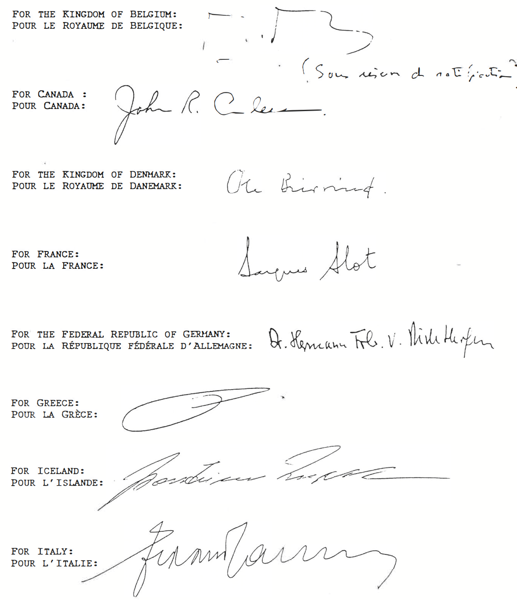
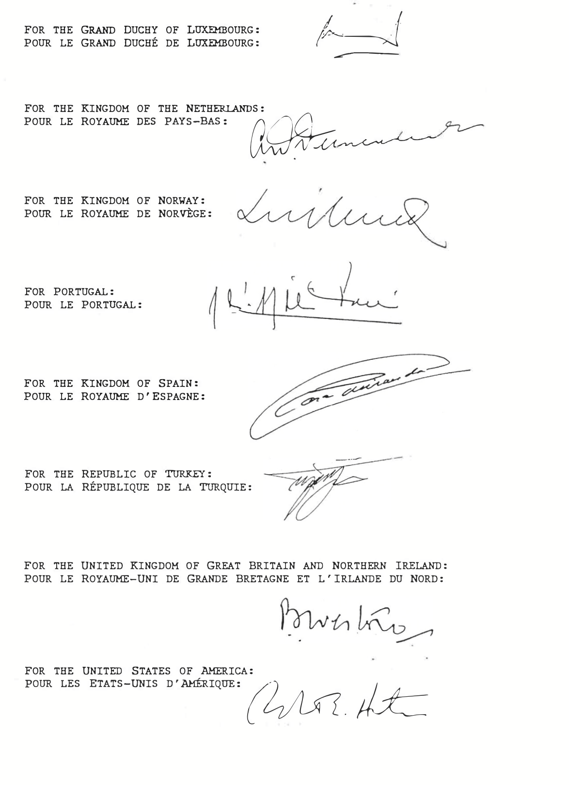

# Loi du 20 décembre 2024 portant approbation de l’Accord sur le statut des missions et des représentants d’États tiers auprès de l’Organisation du Traité de l’Atlantique Nord, fait à Bruxelles, le 14 septembre 1994.

Nous Henri, Grand-Duc de Luxembourg, Duc de Nassau,

Le Conseil d’État entendu ;

Vu l’adoption par la Chambre des Députés ;

Vu la décision de la Chambre des Députés du 11 décembre 2024 et celle du Conseil d’État du 20 décembre 2024 portant qu’il n’y a pas lieu à second vote ;

Avons ordonné et ordonnons :

## Article unique.

Est approuvé l’Accord sur le statut des missions et des représentants d’États tiers auprès de l’Organisation du Traité de l’Atlantique Nord, fait à Bruxelles, le 14 septembre 1994.

Mandons et ordonnons que la présente loi soit insérée au Journal officiel du Grand-Duché de Luxembourg pour être exécutée et observée par tous ceux que la chose concerne.

Le Ministre des Affaires étrangères  et du Commerce extérieur,   Xavier Bettel

Fait le 20 décembre 2024.   Pour le Grand-Duc,   Son Lieutenant-Représentant,   Guillaume,   Grand-Duc Héritier

\**AGREEMENT ON THE STATUS OF MISSIONS AND REPRESENTATIVES OF**   **THIRD STATES TO THE NORTH ATLANTIC TREATY ORGANIZATION.**

\**ACCORD SUR LE STATUT DES MISSIONS ET DES REPRESENTANTS**   **D'ETATS TIERS AUPRES DE L'ORGANISATION DU TRAITE DE L'ATLANTIQUE**   **NORD**

CONSIDERING THE DECLARATION ON PEACE AND COOPERATION ISSUED BY THE HEADS OF STATE AND GOVERNMENT PARTICIPATING IN THE MEETING OF THE NORTH ATLANTIC COUNCIL IN ROME ON 7TH AND 8TH NOVEMBER 1991 CALLING FOR THE ESTABLISHMENT OF A NORTH ATLANTIC COOPERATION COUNCIL AND THE NORTH ATLANTIC COOPERATION COUNCIL STATEMENT ON DIALOGUE, PARTNERSHIP AND COOPERATION OF 20TH DECEMBER 1991;

NOTING THE PARTNERSHIP FOR PEACE INVITATION ISSUED AND SIGNED BY THE HEADS OF STATE AND GOVERNMENT OF THE MEMBER STATES OF THE NORTH ATLANTIC TREATY ORGANIZATION AT THE MEETING OF THE NORTH ATLANTIC COUNCIL IN BRUSSELS ON 10TH JANUARY 1994;

RECOGNIZING THE NEED TO DETERMINE THE STATUS OF THE MISSIONS AND REPRESENTATIVES OF THIRD STATES TO THE ORGANIZATION;

CONSIDERING THAT THE PURPOSE OF IMMUNITIES AND PRIVILEGES CONTAINED IN THE PRESENT AGREEMENT IS NOT TO BENEFIT INDIVIDUALS BUT TO ENSURE THE EFFICIENT PERFORMANCE OF THEIR FUNCTIONS IN CONNECTION WITH THE ORGANIZATION;

THE PARTIES TO THE PRESENT AGREEMENT HAVE AGREED AS FOLLOWS:

## ARTICLE 1

FOR THE PURPOSE OF THE PRESENT AGREEMENT:

"ORGANIZATION" MEANS:

THE NORTH ATLANTIC TREATY ORGANIZATION;

"MEMBER STATE" MEANS:

A STATE PARTY TO THE NORTH ATLANTIC TREATY DONE IN WASHINGTON ON 4TH APRIL 1949;

"THIRD STATE" MEANS:

A STATE WHICH IS NOT A PARTY TO THE NORTH ATLANTIC TREATY DONE IN WASHINGTON ON 4TH APRIL 1949, AND WHICH HAS ACCEPTED THE INVITATION TO THE PARTNERSHIP FOR PEACE AND SUBSCRIBED TO THE PARTNERSHIP FOR PEACE FRAMEWORK DOCUMENT, IS A MEMBER STATE OF THE NORTH ATLANTIC COOPERATION COUNCIL OR IS ANY OTHER STATE INVITED BY THE NORTH ATLANTIC COUNCIL TO ESTABLISH A MISSION TO THE ORGANIZATION.

## ARTICLE 2

(a) THE MEMBER STATE IN WHOSE TERRITORY THE ORGANIZATION HAS ITS HEADQUARTERS SHALL ACCORD TO THE MISSIONS OF THIRD STATES TO THE ORGANIZATION AND THE MEMBERS OF THEIR STAFF THE IMMUNITIES AND PRIVILEGES ACCORDED TO DIPLOMATIC MISSIONS AND THEIR STAFF;

(b) IN ADDITION, THE MEMBER STATE IN WHOSE TERRITORY THE ORGANIZATION HAS ITS HEADQUARTERS SHALL ACCORD THE CUSTOMARY IMMUNITIES AND PRIVILEGES TO THE REPRESENTATIVES OF THIRD STATES, ON TEMPORARY MISSION, WHO ARE NOT COVERED BY PARAGRAPH (a) OF THE PRESENT ARTICLE, WHILE PRESENT IN ITS TERRITORY FOR THE PURPOSE OF ENSURING THE REPRESENTATION OF THIRD STATES IN RELATION TO THE PROCEEDINGS OF THE ORGANIZATION.

## ARTICLE 3

(a) THE PRESENT AGREEMENT SHALL BE OPEN FOR SIGNATURE BY MEMBER STATES AND SHALL BE SUBJECT TO RATIFICATION, ACCEPTANCE OR APPROVAL. INSTRUMENTS OF RATIFICATION, ACCEPTANCE OR APPROVAL SHALL BE DEPOSITED WITH THE GOVERNMENT OF THE KINGDOM OF BELGIUM WHICH SHALL NOTIFY ALL SIGNATORY STATES OF THE DEPOSIT OF EACH SUCH INSTRUMENT;

(b) AS SOON AS TWO OR MORE SIGNATORY STATES, INCLUDING THE MEMBER STATE IN WHOSE TERRITORY THE ORGANIZATION HAS ITS HEADQUARTERS, HAVE DEPOSITED THEIR INSTRUMENTS OF RATIFICATION, ACCEPTANCE OR APPROVAL, THE PRESENT AGREEMENT SHALL COME INTO FORCE IN RESPECT OF THOSE STATES. IT SHALL COME INTO FORCE IN RESPECT OF EACH OTHER SIGNATORY STATE ON THE DATE OF THE DEPOSIT OF ITS INSTRUMENT.

## ARTICLE 4

(a) THE PRESENT AGREEMENT MAY BE DENOUNCED BY ANY CONTRACTING STATE BY GIVING WRITTEN NOTIFICATION OF DENUNCIATION TO THE GOVERNMENT OF THE KINGDOM OF BELGIUM WHICH SHALL NOTIFY ALL SIGNATORY STATES OF EACH SUCH NOTIFICATION;

(b) THE DENUNCIATION SHALL TAKE EFFECT ONE YEAR AFTER THE RECEIPT OF THE NOTIFICATION BY THE GOVERNMENT OF THE KINGDOM OF BELGIUM.

CONSIDÉRANT LA DÉCLARATION SUR LA PAIX ET LA COOPÉRATION PUBLIÉE PAR LES CHEFS D'ETAT ET DE GOUVERNEMENT PARTICIPANT À LA RÉUNION DU CONSEIL DE L'ATLANTIQUE NORD À ROME LES 7 ET 8 NOVEMBRE 1991, QUI PRÉVOIT LA CRÉATION D'UN CONSEIL DE COOPÉRATION NORD-ATLANTIQUE, AINSI QUE LA DÉCLARATION DU CONSEIL DE COOPÉRATION NORD-ATLANTIQUE SUR LE DIALOGUE, LE PARTENARIAT ET LA COOPÉRATION DU 20 DÉCEMBRE 1991;

PRENANT NOTE DE L'INVITATION AU PARTENARIAT POUR LA PAIX FORMULÉE ET SIGNÉE PAR LES CHEFS D'ETAT ET DE GOUVERNEMENT DES ETATS MEMBRES DE L'ORGANISATION DU TRAITÉ DE L'ATLANTIQUE NORD PARTICIPANT À LA RÉUNION DU CONSEIL DE L'ATLANTIQUE NORD TENUE À BRUXELLES LE 10 JANVIER 1994;

RECONNAISSANT LA NÉCESSITÉ DE DÉTERMINER LE STATUT DES MISSIONS ET DES REPRÉSENTANTS D'ETATS TIERS AUPRÈS DE L'ORGANISATION;

CONSIDÉRANT QUE LE BUT DES IMMUNITÉS ET DES PRIVILÈGES PRÉVUS DANS LE PRÉSENT ACCORD N'EST PAS D'AVANTAGER DES INDIVIDUS MAIS D'ASSURER L'EXERCICE EFFICACE DE LEURS FONCTIONS AUPRÈS DE L'ORGANISATION;

LES PARTIES AU PRÉSENT ACCORD SONT CONVENUES DE CE QUI SUIT :

## ARTICLE 1

AUX FINS DU PRÉSENT ACCORD :

"ORGANISATION" DÉSIGNE :

L'ORGANISATION DU TRAITÉ DE L'ATLANTIQUE NORD

"ETAT MEMBRE" DÉSIGNE :

UN ETAT PARTIE AU TRAITÉ DE L'ATLANTIQUE NORD FAIT À WASHINGTON LE 4 AVRIL 1949;

"ETAT TIERS" DÉSIGNE :

UN ETAT QUI N'EST PAS PARTIE AU TRAITÉ DE L'ATLANTIQUE NORD FAIT À WASHINGTON LE 4 AVRIL 1949, ET QUI A ACCEPTÉ L'INVITATION AU PARTENARIAT POUR LA PAIX ET EN A SIGNÉ LE DOCUMENT CADRE, AINSI QU'UN ETAT MEMBRE DU CONSEIL DE COOPÉRATION NORD-ATLANTIQUE OU TOUT AUTRE ETAT INVITÉ PAR LE CONSEIL DE L'ATLANTIQUE NORD À ÉTABLIR UNE MISSION AUPRÈS DE L'ORGANISATION.

## ARTICLE 2

(a) L'ETAT MEMBRE SUR LE TERRITOIRE DUQUEL L'ORGANISATION A SON SIÈGE ACCORDE AUX MISSIONS D'ETATS TIERS AUPRÈS DE L'ORGANISATION ET À LEUR PERSONNEL LES IMMUNITÉS ET LES PRIVILÈGES ACCORDÉS AUX MISSIONS DIPLOMATIQUES ET À LEUR PERSONNEL.

(b) EN OUTRE, L'ETAT MEMBRE SUR LE TERRITOIRE DUQUEL L'ORGANISATION A SON SIÈGE ACCORDE LES IMMUNITÉS ET LES PRIVILÈGES D'USAGE AUX REPRÉSENTANTS D'ETATS TIERS EN MISSION TEMPORAIRE, QUI NE SONT PAS VISÉS PAR LES DISPOSITIONS DE L'ALINÉA (a) DU PRÉSENT ARTICLE, PENDANT QU'ILS SE TROUVENT SUR SON TERRITOIRE POUR ASSURER LA REPRÉSENTATION DES ETATS TIERS CONSIDÉRÉS DANS LE CADRE DES TRAVAUX DE L'ORGANISATION.

## ARTICLE 3

(a) LE PRÉSENT ACCORD EST SOUMIS À LA SIGNATURE DES ETATS MEMBRES ET EST SUJET À RATIFICATION, ACCEPTATION OU APPROBATION. LES INSTRUMENTS DE RATIFICATION, D'ACCEPTATION OU D'APPROBATION SONT DÉPOSÉS AUPRÈS DU GOUVERNEMENT DU ROYAUME DE BELGIQUE, QUI DOIT INFORMER TOUS LES ETATS SIGNATAIRES DU DÉPÔT DE CHACUN DE CES INSTRUMENTS.

(b) DÈS QU'AU MOINS DEUX ETATS SIGNATAIRES, Y COMPRIS L'ETAT MEMBRE SUR LE TERRITOIRE DUQUEL L'ORGANISATION A SON SIÈGE, ONT DÉPOSÉ LEURS INSTRUMENTS DE RATIFICATION, D'ACCEPTATION OU D'APPROBATION, LE PRÉSENT ACCORD ENTRE EN VIGUEUR POUR CES ETATS. IL ENTRE EN VIGUEUR POUR CHAQUE AUTRE ETAT SIGNATAIRE À LA DATE OÙ CELUI-CI DÉPOSE SON INSTRUMENT.

## ARTICLE 4

(a) LE PRÉSENT ACCORD PEUT ÊTRE DÉNONCÉ PAR TOUT ETAT CONTRACTANT AU MOYEN D'UNE NOTIFICATION ÉCRITE DE DÉNONCIATION ADRESSÉE AU GOUVERNEMENT DU ROYAUME DE BELGIQUE, QUI DOIT INFORMER DE CETTE NOTIFICATION TOUS LES ETATS SIGNATAIRES.

(b) LA DÉNONCIATION PREND EFFET UN AN APRÈS RÉCEPTION DE LA NOTIFICATION PAR LE GOUVERNEMENT DU ROYAUME DE BELGIQUE.

IN WITNESS WHEREOF THE UNDERSIGNED, BEING DULY AUTHORISED BY THEIR RESPECTIVE GOVERNMENTS, HAVE SIGNED THE PRESENT AGREEMENT OF WHICH THE ENGLISH AND FRENCH TEXTS ARE EQUALLY AUTHENTIC.

DONE IN BRUSSELS, THIS 14TH DAY OF SEPTEMBER 1994,

EN FOI DE QUOI, LES SOUSSIGNÉS, DÛMENT HABILITÉS PAR LEUR GOUVERNEMENT RESPECTIF, ONT SIGNÉ LE PRÉSENT ACCORD, DONT LES VERSIONS ANGLAISE ET FRANÇAISE FONT ÉGALEMENT FOI.

FAIT À BRUXELLES, LE 14 SEPTEMBRE 1994,

Doc. parl. [8392](https://legilux.public.lu/eli/dl/pl/2024/106) ; législature 2023-2028.
