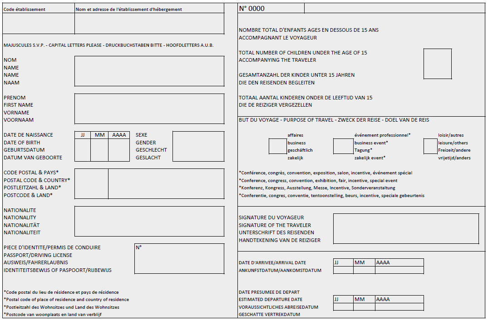
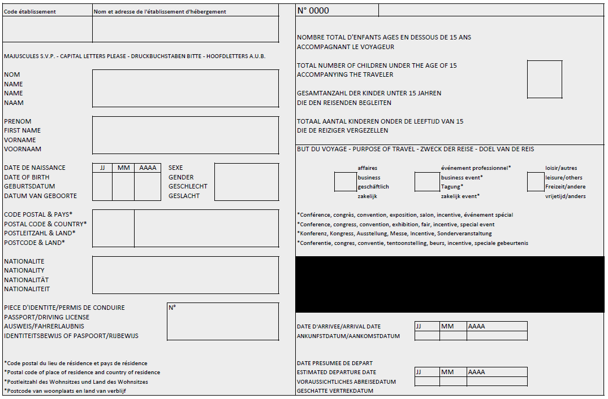
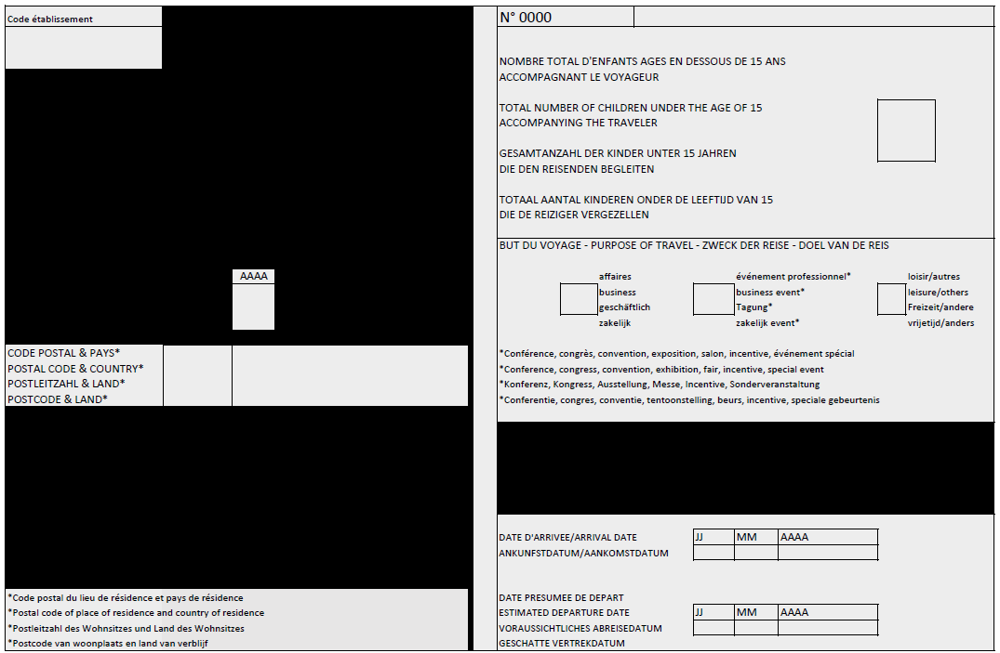

# Loi du 28 février 2025 relative aux fiches d’hébergement et portant modification de :\n1° la loi modifiée du 5 juillet 2016 portant réorganisation du Service de renseignement de l’État ;\n2° la loi modifiée du 18 juillet 2018 sur la Police grand-ducale.\n

Nous Henri, Grand-Duc de Luxembourg, Duc de Nassau,

Le Conseil d’État entendu ;

Vu l’adoption par la Chambre des Députés ;

Vu la décision de la Chambre des Députés du 13 février 2025 et celle du Conseil d’État du 25 février 2025 portant qu’il n’y a pas lieu à second vote ;

Avons ordonné et ordonnons :

## Art. 1er.

Pour l’application de la présente loi, on entend par :

1° « exploitant » : toute personne physique ou morale désignée comme exploitant sur la fiche d’hébergement qui fournit, à titre onéreux, un service d’hébergement touristique ;

2° « fiche d’hébergement » : le document reprenant les informations et données à caractère personnel énumérées aux annexes I et II ;

3° « hébergement touristique » : tout lieu d’hébergement de courte durée qui relève de l’un des groupes suivants de la nomenclature statistique commune des activités économiques dans l’Union européenne établie par le [règlement (CE) n° 1893/2006](https://legilux.public.lu/eli/reg_ue/2006/1893/jo) du Parlement européen et du Conseil établissant la nomenclature statistique des activités économiques NACE Rév. 2 et modifiant le [règlement (CEE) n° 3037/90](https://legilux.public.lu/eli/reg_ue/1990/3037/jo) du Conseil ainsi que certains règlements (CE) relatifs à des domaines statistiques spécifiques :

a) groupe 55.1 « hôtels et hébergement similaire » ;

b) groupe 55.2 « hébergement touristique et autre hébergement de courte durée » ;

c) groupe 55.3 « terrains de camping et parcs pour caravanes ou véhicules de loisirs ».

4° « voyageur » : toute personne âgée de quinze ans ou plus qui loge dans un hébergement touristique sans y élire domicile et pour une durée ne dépassant pas trois mois consécutifs ;

5° « solution informatique » : l’ensemble des applications pour le compte du ministre ayant le Tourisme dans ses attributions, nécessaires à l’acheminement des fiches d’hébergement sous forme électronique de l’exploitant vers le fichier des fiches d’hébergement du ministre ayant le Tourisme dans ses attributions ;

6° « infractions terroristes » : les infractions visées au livre II, titre 1er, chapitre III-1, du [Code pénal](https://legilux.public.lu/eli/etat/leg/code/penal) ;

7° « formes graves de criminalité » : les infractions énumérées à l’annexe II de la [loi modifiée du 1er août 2018](https://legilux.public.lu/eli/etat/leg/loi/2018/08/01/a690/jo) relative au traitement des données des dossiers passagers dans le cadre de la prévention et de la répression du terrorisme et de la criminalité grave et portant modification de la [loi du 5 juillet 2016](https://legilux.public.lu/eli/etat/leg/loi/2016/07/05/n8/jo) portant réorganisation du Service de renseignement de l’État qui sont passibles d’une peine privative de liberté d’une durée maximale d’au moins trois ans.

## Art. 2.

L’exploitant est tenu d’établir une fiche d’hébergement pour chaque voyageur et chaque séjour. Le voyageur peut lui-même remplir les informations énumérées à l’annexe I.

## Art. 3.

(1) Les fiches d’hébergement sont établies sous forme électronique.

(2) Aux fins visées au paragraphe 1er, l’État met gratuitement à disposition des exploitants une solution informatique.

Les équipements informatiques sont à charge de l’exploitant.

## Art. 4.

(1) Avec sa signature, le voyageur confirme l’exactitude des données renseignées.

(2) L’exploitant vérifie l’exactitude des données à caractère personnel fournies par le voyageur et se fait présenter à cet effet une carte d’identité, un passeport ou un permis de conduire en cours de validité permettant de prouver son identité.

Le voyageur a l’obligation de présenter une de ces pièces, sous peine de se voir refuser l’accès à l’hébergement touristique.

## Art. 5.

(1) L’exploitant est obligé de transmettre pour chaque voyageur et chaque séjour, les informations et données à caractère personnel énumérées à l’annexe I dans le fichier des fiches d’hébergement du ministre ayant le Tourisme dans ses attributions.

(2) L’exploitant est obligé de transmettre dans le fichier des fiches d’hébergement du ministre ayant le Tourisme dans ses attributions, pour l’Institut national de la statistique et des études économiques du Grand-Duché de Luxembourg, pour chaque voyageur et chaque séjour, les informations énumérées à l’annexe II aux fins prévues à l’article 9 du [règlement (UE) n° 692/2011](https://legilux.public.lu/eli/reg_ue/2011/692/jo) du Parlement européen et du Conseil du 6 juillet 2011 concernant les statistiques européennes sur le tourisme et abrogeant la [directive 95/57/CE](https://legilux.public.lu/eli/dir_ue/1995/57/jo) du Conseil.

(3) Le début de l’acte de transmission visée au paragraphe 1er est à accomplir dans un délai maximal de vingt-quatre heures qui suit l’arrivée du voyageur dans l’hébergement touristique. La transmission visée au paragraphe 2 a lieu dans un délai maximal de cinq jours qui suit l’arrivée du voyageur dans l’hébergement touristique.

Ces transmissions sont effectuées sous forme électronique par l’intermédiaire de la solution informatique.

(4) Les données à caractère personnel des voyageurs seront supprimées au plus tard six mois après leur enregistrement dans le fichier des fiches d’hébergement du ministre ayant le Tourisme dans ses attributions.

(5) La Police grand-ducale a accès au fichier des fiches d’hébergement du ministre ayant le Tourisme dans ses attributions par le biais de la solution informatique qui est aménagée de sorte que :

1° les membres de la Police grand-ducale ne puissent consulter les informations et données à caractère personnel auxquelles ils ont accès qu’en indiquant leur identifiant numérique personnel ;

2° les informations relatives aux membres de la Police grand-ducale ayant procédé à la consultation, ainsi que les informations et données à caractère personnel consultées, la date et l’heure de la consultation sont enregistrées et conservées pendant un délai d’au moins dix-huit mois, afin que le motif de la consultation puisse être retracé. Les informations et données à caractère personnel consultées doivent avoir un lien direct avec les faits ayant motivé la consultation.

(6) La Police grand-ducale ne peut traiter les informations et données à caractère personnel du fichier des fiches d’hébergement du ministre ayant le Tourisme dans ses attributions et le résultat du traitement de ces données qu’à des fins de prévention, de recherche, de constatation et de poursuite des infractions terroristes et des formes graves de criminalité.

L’alinéa 1er est sans préjudice des compétences de la Police grand-ducale lorsque d’autres infractions ou indices d’autres infractions sont détectés à la suite de ce traitement.

(7) Le Service de renseignement de l’État a accès au fichier des fiches d’hébergement du ministre ayant le Tourisme dans ses attributions conformément à l’article 10 de la [loi modifiée du 5 juillet 2016](https://legilux.public.lu/eli/etat/leg/loi/2016/07/05/n8/jo) portant réorganisation du Service de renseignement de l’État.

## Art. 6.

Les fiches d’hébergement sont conservées dans la solution informatique pendant une durée de six mois.

À l’issue de cette période de six mois, elles sont automatiquement supprimées.

## Art. 7.

Sera puni d’une amende de 251 à 25 000 euros, l’exploitant qui aura hébergé un voyageur sans établir une fiche d’hébergement ou qui n’aura pas transmis toutes les informations et données à caractère personnel visées aux annexes I et II dans le fichier des fiches d’hébergement du ministre ayant le Tourisme dans ses attributions ou qui ne les aura pas transmises dans le délai prévu à l’article 5, paragraphe 3.

## Art. 8.

À l’article 10, paragraphe 2, de la [loi modifiée du 5 juillet 2016](https://legilux.public.lu/eli/etat/leg/loi/2016/07/05/n8/jo) portant réorganisation du Service de renseignement de l’État est ajouté une lettre h) qui prend la teneur suivante :

> h) le fichier des fiches d’hébergement du ministre ayant le Tourisme dans ses attributions.

## Art. 9.

La [loi modifiée du 24 juin 2008](https://legilux.public.lu/eli/etat/leg/loi/2008/06/24/n1/jo) ayant pour objet le contrôle des voyageurs dans les établissements d’hébergement est abrogée.

## Art. 10.

La référence à la présente loi se fait sous la forme suivante : « loi du 28 février 2025 relative aux fiches d’hébergement ».

## Art. 11.

La présente loi entre en vigueur le premier jour du sixième mois qui suit celui de sa publication au Journal officiel du Grand-Duché de Luxembourg.

Mandons et ordonnons que la présente loi soit insérée au Journal officiel du Grand-Duché de Luxembourg pour être exécutée et observée par tous ceux que la chose concerne.

Le Ministre de l’Économie, des PME, de l’Énergie et du Tourisme,   Lex Delles

Fait le 28 février 2025.   Pour le Grand-Duc,   Son Lieutenant-Représentant,   Guillaume,   Grand-Duc Héritier

\**Annexe I.** Informations et données à caractère personnel

1° nom de l’exploitant personne physique ou raison sociale de l’exploitant personne morale et, le cas échéant, l’enseigne commerciale ;

2° adresse de l’hébergement ;

3° numéro d’identification propre à chaque établissement d’hébergement attribué par le STATEC ;

4° numéro courant de la fiche d’hébergement ;

5° nom, prénom(s), date de naissance et sexe du voyageur ;

6° numéro de la pièce d’identité ou du permis de conduire du voyageur en cours de validité ;

7° nationalité du voyageur ;

8° pays de résidence et code postal du lieu de résidence du voyageur ;

9° date d’arrivée et date présumée de départ du voyageur ;

10° nombre d’enfants de moins de quinze ans accompagnant le voyageur ;

11° but du voyage : « affaires » ou « évènements professionnels » ou « loisirs et autres ».

\**Annexe II** **.** Informations statistiques

1° numéro d’identification propre à chaque établissement d’hébergement attribué par le STATEC ;

2° numéro courant de la fiche d’hébergement ;

3° année de naissance du voyageur ;

4° pays de résidence et code postal du lieu de résidence du voyageur ;

5° date d’arrivée et date présumée de départ du voyageur ;

6° nombre d’enfants de moins de quinze ans accompagnant le voyageur ;

7° but du voyage : « affaires », « évènements professionnels » ou « loisirs et autres ».

\**Annexe III**

Fiche d’hébergement digitale imprimable par l’exploitant

\**Volet « Annexe I »**

\**Volet « Annexe II »**

Doc. parl. [8253](https://legilux.public.lu/eli/dl/pl/2023/225) ; sess. ord. 2022-2023 et législature 2023-2028.
