# Loi du 25 mars 2025 portant approbation de l’Accord sous forme d’échange de lettres des 4 et 10 mars 2021 entre le Gouvernement du Grand-Duché de Luxembourg et le Gouvernement de la région administrative spéciale de Hong Kong de la République populaire de Chine amendant l’Accord relatif aux services aériens, signé à Hong Kong, le 3 juin 1998.

Nous Henri, Grand-Duc de Luxembourg, Duc de Nassau,

Le Conseil d’État entendu ;

Vu l’adoption par la Chambre des Députés ;

Vu la décision de la Chambre des Députés du 11 février 2025 et celle du Conseil d’État du 25 février 2025 portant qu’il n’y a pas lieu à second vote ;

Avons ordonné et ordonnons :

## Article unique.

Est approuvé l’Accord sous forme d’échange de lettres des 4 et 10 mars 2021 entre le Gouvernement du Grand-Duché de Luxembourg et le Gouvernement de la région administrative spéciale de Hong Kong de la République populaire de Chine amendant l’Accord relatif aux services aériens, signé à Hong Kong, le 3 juin 1998.

Mandons et ordonnons que la présente loi soit insérée au Journal officiel du Grand-Duché de Luxembourg pour être exécutée et observée par tous ceux que la chose concerne.

Le Ministre des Affaires étrangères et du Commerce extérieur,   Xavier Bettel   La Ministre de la Mobilité et des Travaux publics,   Yuriko Backes

Fait le 25 mars 2025.   Pour le Grand-Duc,   Son Lieutenant-Représentant,   Guillaume,   Grand-Duc Héritier

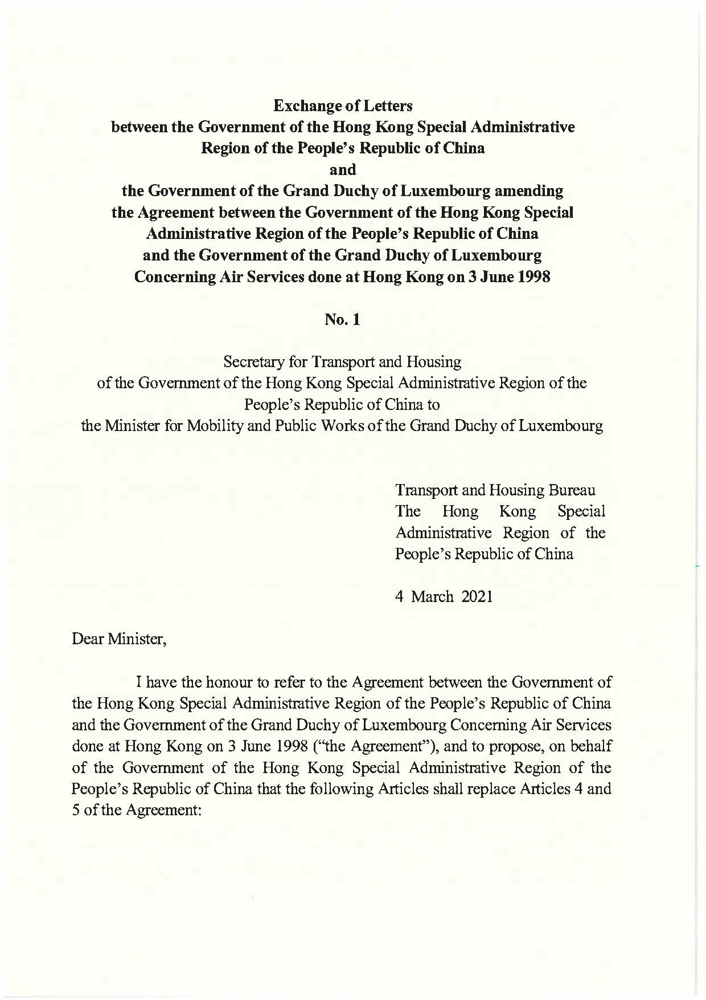

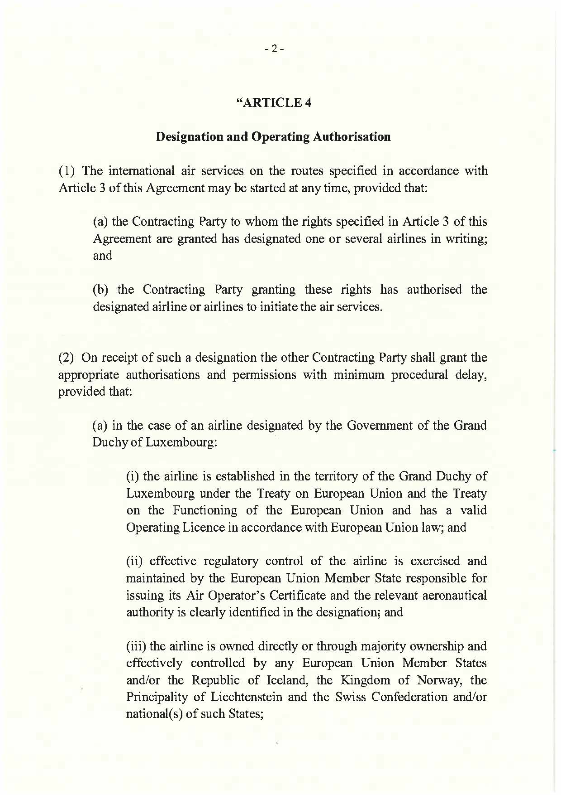

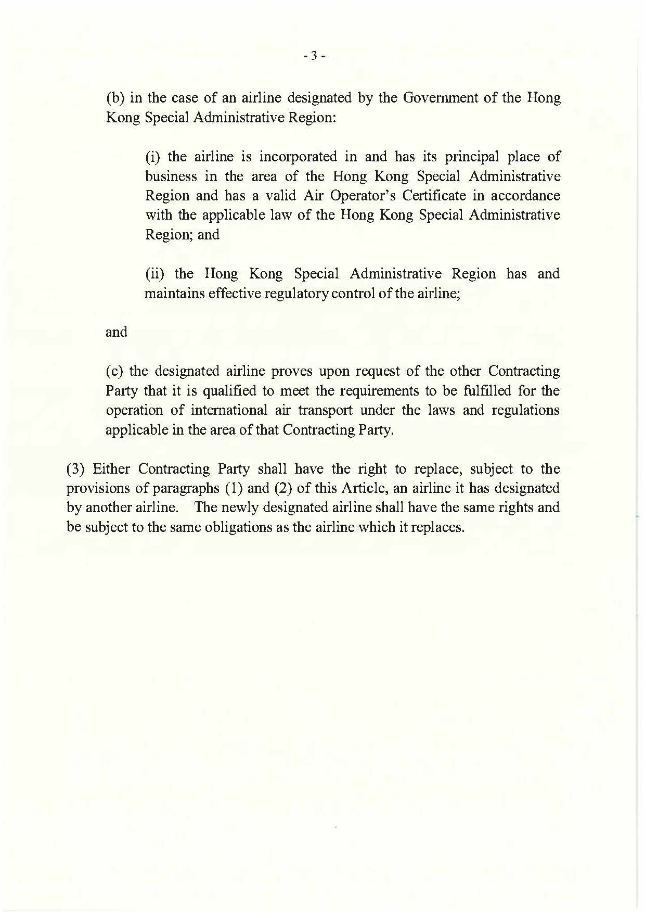

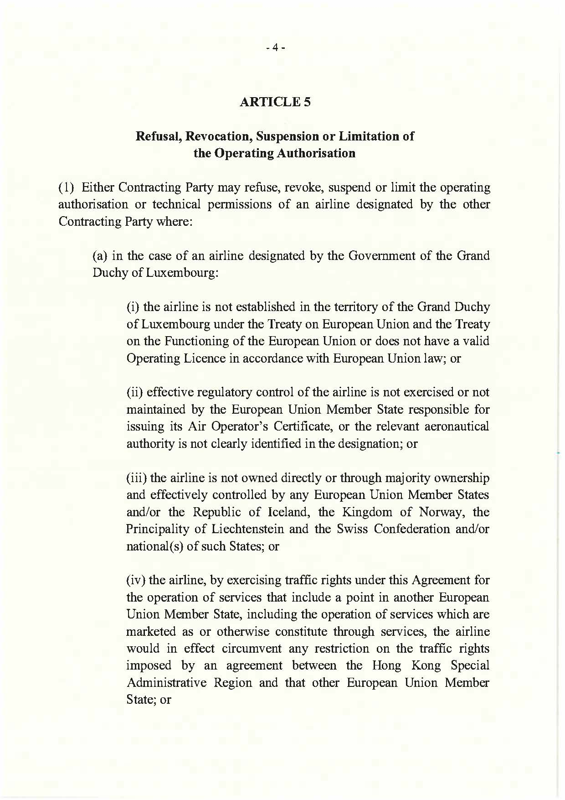

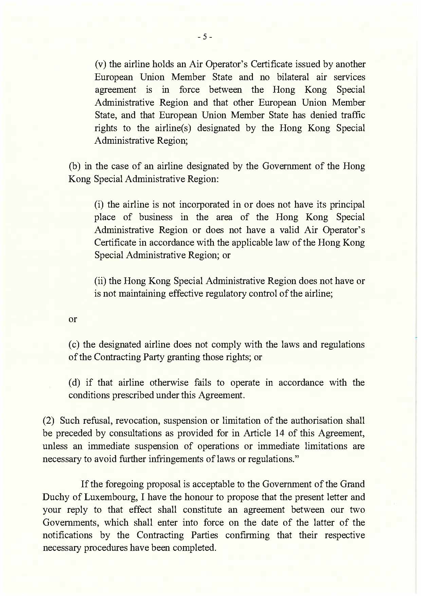

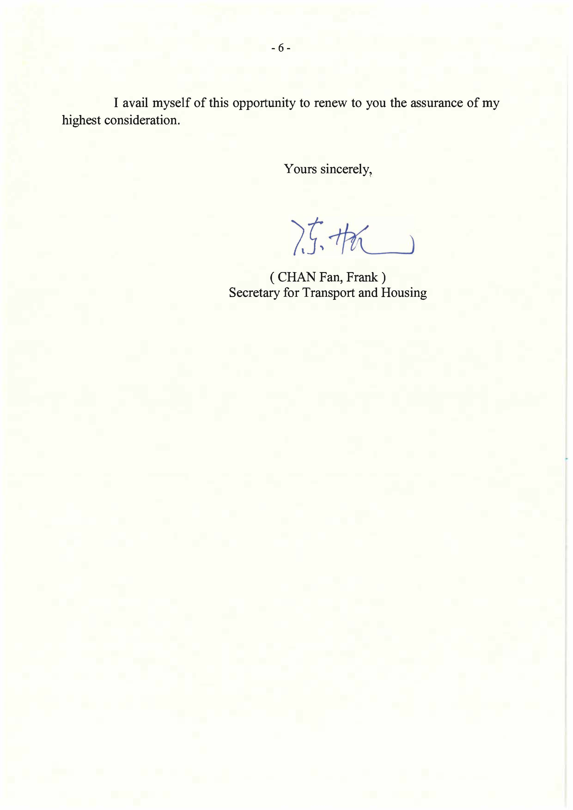

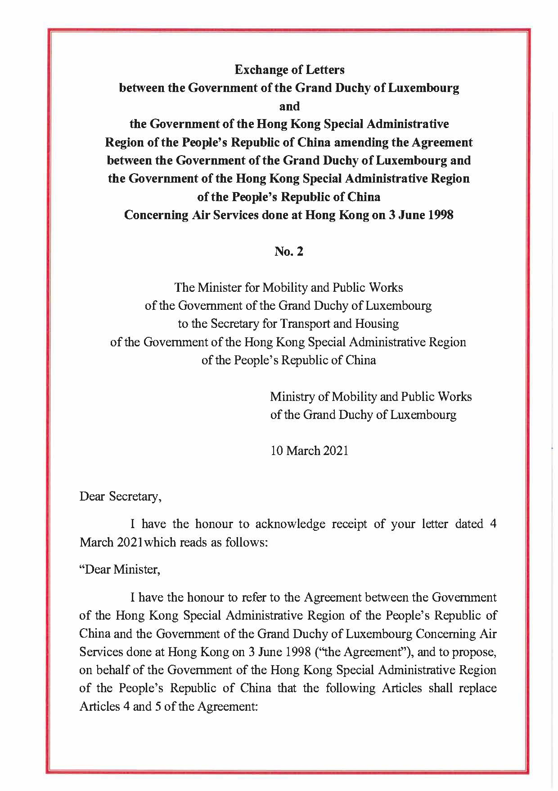

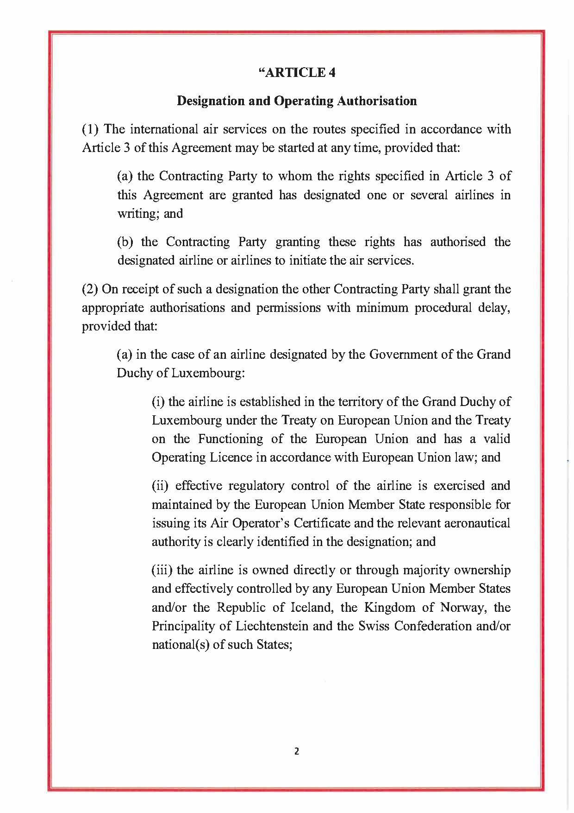

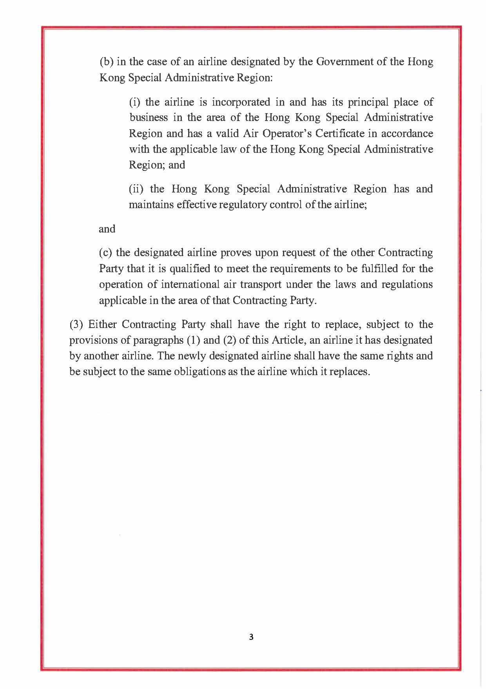

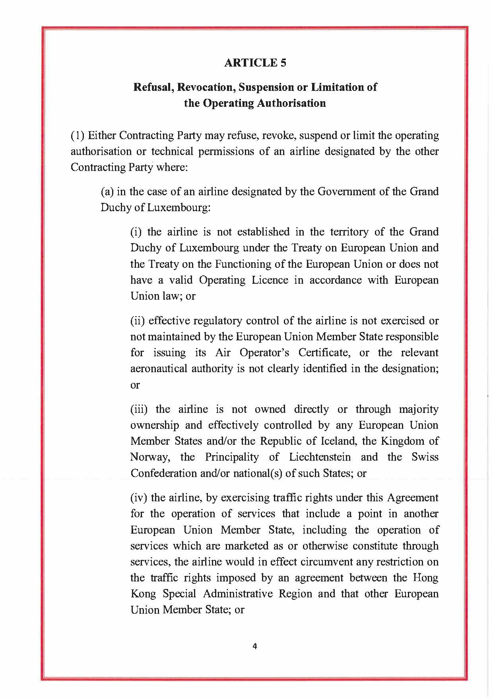

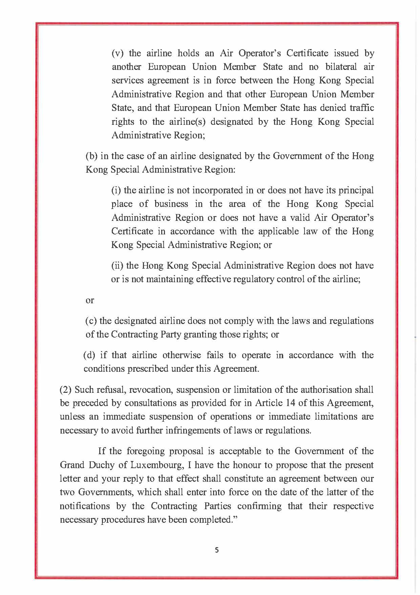

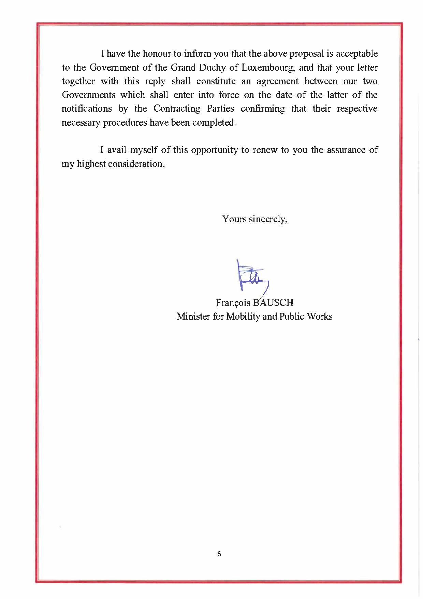

Doc. parl. [8334](https://legilux.public.lu/eli/dl/pl/2023/409) ; législature 2023-2028.
