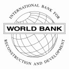

# Loi du 4 avril 2025 portant approbation des amendements :\n1° aux Statuts de la Banque internationale pour la reconstruction et le développement, signés à Bretton Woods, le 22 juillet 1944 ;\n2° à l’Accord portant création de la Banque asiatique de développement, signé à Manille, le 4 décembre 1965 ;\n3° à l’Accord portant création de la Banque européenne pour la reconstruction et le développement, signé à Paris, le 29 mai 1990 ;\n4° à l’article 4 du Protocole n° 5 sur les statuts de la Banque européenne d’investissement portant sur une augmentation du capital souscrit de la Banque.\n

Nous Henri, Grand-Duc de Luxembourg, Duc de Nassau,

Le Conseil d’État entendu ;

Vu l’adoption par la Chambre des Députés ;

Vu la décision de la Chambre des Députés du 2 avril 2025 et celle du Conseil d’État du 4 avril 2025 portant qu’il n’y a pas lieu à second vote ;

Avons ordonné et ordonnons :

## Art. 1er.

Est approuvé l’amendement à l’article III, section 3, des Statuts de la Banque internationale pour la reconstruction et le développement, adopté par la résolution 696 du Conseil des gouverneurs en date du 10 juillet 2023.

## Art. 2.

Est approuvé l’amendement à l’article 12 de l’Accord portant création de la Banque asiatique de développement, tel que proposé par le Conseil d’administration au Conseil des gouverneurs de la Banque asiatique de développement en date du 20 octobre 2023.

## Art. 3.

Est approuvé l’amendement à l’article 1er et à l’article 12.1 de l’Accord portant création de la Banque européenne pour la reconstruction et le développement, adopté par les résolutions 259 et 260 du Conseil des gouverneurs en date du 18 mai 2023.

## Art. 4.

Est approuvée la version consolidée de l’article 4 du Protocole n° 5 sur les statuts de la Banque européenne d’investissement, tel que modifié par la [décision du Conseil des gouverneurs de la Banque européenne d’investissement du 16 avril 2019 relative au remplacement de la part du capital du Royaume-Uni dans la Banque européenne d’investissement par le capital souscrit par les États membres restants (2019/655)](http://data.europa.eu/eli/dec/2019/655/oj) et tel qu’approuvé par la [décision (UE) 2019/654](http://data.europa.eu/eli/dec/2019/654/oj) du Conseil du 15 avril 2019 modifiant le protocole n° 5 sur les statuts de la Banque européenne d’investissement et par la [décision (UE) 2019/1255](http://data.europa.eu/eli/dec/2019/1255/oj) du Conseil du 18 juillet 2019 modifiant le protocole n° 5 sur les statuts de la Banque européenne d’investissement.

Mandons et ordonnons que la présente loi soit insérée au Journal officiel du Grand-Duché de Luxembourg pour être exécutée et observée par tous ceux que la chose concerne.

Le Ministre des Finances,   Gilles Roth

Fait le 4 avril 2025   Pour le Grand-Duc,   Son Lieutenant-Représentant,   Guillaume,   Grand-Duc Héritier

ANNEXES

<table>
<tr>
<td rowspan="2"></td>
<td><b>INTERNATIONAL BANK FOR RECONSTRUCTION AND</b> <b>DEVELOPMENT</b></td>
</tr>
<tr>
<td><b>BOARD OF GOVERNORS</b></td>
</tr>
</table>

\**Resolution No. 696 Amendment of the Articles of Agreement – Removal of Lending Limitation**

RESOLVED:

WHEREAS, the Report of the Executive Directors recommended that Article III, Section 3 of the Articles of Agreement of the International Bank for Reconstruction and Development (Bank) be amended as set forth below; and

WHEREAS, the Chair of the Board of Governors has requested the Secretary of the Bank to bring the proposal of the Executive Directors before the Board of Governors to vote on the following Resolution without meeting, pursuant to Section 12 of the By-Laws of the Bank;

NOW, THEREFORE, the Board of Governors, noting the recommendations and the said Report of the Executive Directors, hereby resolves as set forth below:

Article III, Section 3 of the Articles of Agreement of the Bank shall be amended by deleting the existing title and text and substituting therefor “Article III, Section 3 Deleted.”

\*(Adopted on July 10, 2023)*

(DRAFT) RESOLUTION OF THE BOARD OF GOVERNORS OF THE ASIAN DEVELOPMENT BANK

Proposal to Remove the ADB Charter Lending Limitation

WHEREAS:

The Asian Development Bank (ADB) in its Report of the Board of Directors to the Board of Governors recommended that the Board of Governors approve the proposal to remove Article 12 (Limitations on Ordinary Operations), para. 1 of the Agreement Establishing the Asian Development Bank (ADB Charter) as set forth below.

The Chairman of the Board of Governors has requested the President to transmit the Board of Directors’ proposal to amend the ADB Charter to each Governor to vote on the following resolution without a meeting, pursuant to the special procedure prescribed in Section 3 of the by-laws of ADB.

NOW, THEREFORE, the Board of Governors HEREBY RESOLVES THAT:

Article 12 (Limitations on Ordinary Operations), para. 1 of the Agreement Establishing the Asian Development Bank (ADB Charter) shall be amended by deleting the existing text and substituting therefor “1. Deleted.” As amended, Article 12 (Limitations on Ordinary Operations) of the ADB Charter shall be read as follows:

## Article 12 — LIMITATIONS ON ORDINARY OPERATIONS

1\. Deleted.

2\. In the case of loans made with funds borrowed by the Bank to which the commitment to calls provided for by paragraph 5 of Article 6 of this Agreement is applicable, the total amount of principal outstanding and payable to the Bank in a specific currency shall not at any time exceed the total amount of the principal of outstanding borrowings by the Bank that are payable in the same currency.

3\. In the case of funds invested in equity capital out of the ordinary capital resources of the Bank, the total amount invested shall not exceed ten (10) per cent of the aggregate amount of the unimpaired paid-in capital stock of the Bank actually paid up at any given time together with the reserves and surplus included in its ordinary capital resources, exclusive of the special reserve provided for in Article 17 of this Agreement.

4\. The amount of any equity investment shall not exceed such percentage of the equity capital of the entity or enterprise concerned as the Board of Directors shall in each specific case determine to be appropriate. The Bank shall not seek to obtain by such an investment a controlling interest in the entity or enterprise concerned, except where necessary to safeguard the investment of the Bank.

PUBLIC

RESOLUTION NO.259

AMENDMENT TO ARTICLE 1 OF THE AGREEMENT ESTABLISHING THE EUROPEAN BANK FOR RECONSTRUCTION AND DEVELOPMENT TO ENABLE A LIMITED AND INCREMENTAL EXPANSION OF THE GEOGRAPHIC SCOPE OF THE BANK’S OPERATIONS TO SUB-SAHARAN AFRICA AND IRAQ

THE BOARD OF GOVERNORS,

Recalling Resolution No.248, by which the Board of Governors approved, in principle, a limited and incremental expansion of the geographic scope of the Bank’s operations to sub-Saharan Africa and Iraq;

Emphasising the importance of sub-Saharan Africa and Iraq to achieving the international community’s geopolitical and development priorities, the growing links between many countries in sub-Saharan Africa and Iraq and current EBRD countries of operations, and the relevance and applicability of the Bank’s mandate, business model, private sector focus and competencies in sub-Saharan Africa and Iraq;

Stressing that the most urgent priority of the Bank remains to support Ukraine and other countries of operations affected by the war on Ukraine;

Recognising that the war on Ukraine has reinforced the parallel relevance of continuing to address shareholder objectives in sub-Saharan Africa and Iraq;

Underlying that any possible limited and incremental expansion to new countries of operations must not: impair the Bank’s ability to support its current countries of operations, compromise the Bank’s triple-A rating, lead to a request for additional capital contributions, or deviate from the Bank’s mandate to support transition and its operating principles of additionality and sound banking;

Emphasising the importance of complementarity and collaboration amongst development partners already active in sub-Saharan Africa and Iraq; and

PUBLIC

PUBLIC

Having considered the Report of the Board of Directors to the Board of Governors “*Amendment to Article 1 of the Agreement Establishing the European* *Bank for Reconstruction and Development in order to enable the limited and* *incremental expansion of the geographic scope of the Bank’s operations to sub-* *Saharan Africa and Iraq*” and being in agreement with its conclusions, amongst others, that:

(i) The analysis of the capital and financial implications reconfirms that a limited and incremental expansion to Sub-Saharan Africa and Iraq will not in itself impair the Bank’s ability to support its existing countries of operations, compromise the Bank’s triple-A credit rating, or lead to a request for additional capital contributions;

(ii) Such limited and incremental expansion of the geographic scope of the Bank’s operations to sub-Saharan Africa and Iraq should be enabled through an amendment of Article 1 of the Agreement Establishing the European Bank for Reconstruction and Development (‘the Agreement’); and

(iii) The implementation of the expansion must be carried out in a way that will not dilute the focus of the Bank in supporting Ukraine and other countries of operations affected by the war on Ukraine.

RESOLVES THAT:

PUBLIC

1\. Article 1 of the Agreement shall be amended to read as follows:

> “*In contributing to economic progress and reconstruction, the purpose of* *the Bank shall be to foster the transition towards open market-oriented* *economies and to promote private and entrepreneurial initiative in the* *Central and Eastern European countries committed to and applying the* *principles of multiparty democracy, pluralism and market economics.* *Subject to the same conditions, the purpose of the Bank may also be* *carried out in (i) Mongolia; and in member countries of the Southern and* *Eastern Mediterranean; and (iii) a limited number of member countries of* *sub-Saharan Africa; in each case under (ii) and (iii)* *as determined by the* *Bank upon the affirmative vote of not less than two-thirds of the Governors,* *representing not less than three-fourths of the total voting power of the* *members. Accordingly, any reference in this Agreement and its annexes to* *“Central and Eastern European countries”, “countries from Central and* *Eastern Europe”, “recipient country (or countries)” or “recipient member* *country (or countries)” shall refer to Mongolia and each of such countries of* *the Southern and Eastern Mediterranean and sub-Saharan Africa as well* .”

a. The term “sub-Saharan Africa” as set out under Article 1 of the Agreement shall be understood to mean the sub-Saharan Africa region as defined by the World Bank Group.

b. The limitation on the number of member countries of sub-Saharan Africa in which the Bank may carry out its purpose as set out under Article 1 of the Agreement shall be understood so as to enable a limited and incremental expansion of the geographic scope of the Bank’s operations, in accordance with the measures and mechanisms set out in the report of Board of Directors “*Amendment of the Agreement Establishing the European Bank for* *Reconstruction and Development in order to enable the limited and* *incremental expansion of the geographic scope of the Bank’s* *operations to sub- Saharan Africa and Iraq*”. In this context, an affirmative vote of not less than three- fourths of the Governors, representing not less than four-fifths of the total voting power of the members shall be required to approve any further increment to the expansion.

c. Iraq shall be incorporated into the Southern and Eastern Mediterranean region for the purposes of the Agreement, and consequently the term “Southern and Eastern Mediterranean” as set out under Article 1 of the Agreement shall be understood to mean the region consisting of the countries that have a shoreline on the Mediterranean as well as Jordan and Iraq, which are closely integrated into this region.

2\. Members of the Bank shall be asked whether they accept the said amendment by (a) executing and depositing with the Bank an instrument stating that such member has accepted the said amendment in accordance with its law and (b) furnishing evidence, in form and substance satisfactory to the Bank, that the amendment has been accepted and the instrument of acceptance has been executed and deposited in accordance with the law of that member.

3\. The said amendment shall enter into force three (3) months after the date on which the Bank has formally confirmed to its members that the requirements for accepting the said amendment, as provided for in Article 56 of the Agreement, have been met.

(Adopted 18 May 2023)

PUBLIC

PUBLIC

RESOLUTION NO.260

AMENDMENT TO ARTICLE 12.1 OF THE AGREEMENT ESTABLISHING THE EUROPEAN BANK FOR RECONSTRUCTION AND DEVELOPMENT TO REMOVE THE STATUTORY CAPITAL LIMITATION ON ORDINARY OPERATIONS

THE BOARD OF GOVERNORS,

Recognising the essential role of Multilateral Development Banks (MDBs) in addressing multiple pressing global challenges;

Noting the significant changes in capital management practices in the financial sector since the Agreement entered into force on 28 March 1991;

Wishing to enable the optimal use of the Bank’s capital capacity to support the Bank in achieving the maximum potential impact in its recipient countries;

Welcoming the wide ranging recommendations of the G20 Independent Review of Capital Adequacy Frameworks and the careful consideration accorded to them by the Bank, including specifically the recommendation to modernise MDBs’ approach to managing capital adequacy by relocating specific leverage limits from MDB statutes to MDB capital adequacy frameworks, in a coordinated manner among MDBs;

Having considered and being in agreement with the report of the Board of Directors “*Amendment of the Article 12.1 to the Agreement Establishing the European Bank for Reconstruction and Development in order to remove the statutory capital limitation on ordinary operations*” and its recommendation to approve an amendment of Article 12.1 of the Agreement to remove the statutory capital limitation on ordinary operations; and

On the understanding that the Board of Directors will maintain an appropriate nominal leverage limit on operations, set against relevant capital metrics, within the Bank’s capital adequacy framework, as part of its responsibility to protect the financial soundness and sustainability of the Bank.

PUBLIC

RESOLVES THAT:

1\. Article 12.1 of the Agreement shall be amended by deleting its existing text and introducing a new text as follows:

> "*1. The Board of Directors shall establish and maintain appropriate limits with respect to capital adequacy metrics, in order to protect the financial soundness and sustainability of the Bank.*"

2\. Members of the Bank shall be asked whether they accept the said amendment by (a) executing and depositing with the Bank an instrument stating that such member has accepted the said amendment in accordance with its law and (b) furnishing evidence, in form and substance satisfactory to the Bank, that the amendment has been accepted and the instrument of acceptance has been executed and deposited in accordance with the law of that member.

3\. The said amendment shall enter into force three (3) months after the date on which the Bank has formally confirmed to its members that the requirements for accepting the said amendment, as provided for in Article 56 of the Agreement, have been met.

(Adopted 18 May 2023)

PUBLIC

\*8* STATUTS BANQUE EUROPÉENNE D’INVESTISSEMENT - 2020

## Article 4

1\. La Banque est dotée d’un capital de 248 795 606 881 EUR, souscrit par les États membres à concurrence des montants suivants :

| Allemagne | 46 722 369 149 |
|---|---|
| France | 46 722 369 149 |
| Italie | 46 722 369 149 |
| Espagne | 28 033 421 847 |
| Belgique | 12 951 115 777 |
| Pays-Bas | 12 951 115 777 |
| Pologne | 11 366 679 827 |
| Suède | 8 591 781 713 |
| Danemark | 6 557 521 657 |
| Autriche | 6 428 994 386 |
| Finlande | 3 693 702 498 |
| Grèce | 3 512 961 713 |
| Portugal | 2 263 904 037 |
| République tchèque | 2 206 922 328 |
| Hongrie | 2 087 849 195 |
| Irlande | 1 639 379 073 |
| Roumanie | 1 639 379 073 |
| Croatie | 1 062 312 542 |
| Slovaquie | 751 236 149 |
| Slovénie | 697 455 090 |
| Bulgarie | 510 041 217 |
| Lituanie | 437 633 208 |
| Luxembourg | 327 878 318 |
| Chypre | 321 508 011 |
| Lettonie | 267 076 094 |
| Estonie | 206 248 240 |
| Malte | 122 381 664 |

Les États membres ne sont responsables que jusqu’à concurrence de leur quotepart du capital souscrit et non versé.

2\. L’admission d’un nouveau membre entraîne une augmentation du capital souscrit correspondant à l’apport du nouveau membre.

3\. Le Conseil des gouverneurs, statuant à l’unanimité, peut décider une augmentation du capital souscrit.

4\. La quote-part du capital souscrit ne peut être ni cédée ni donnée en nantissement et est insaisissable.

Doc. parl. [8422](https://legilux.public.lu/eli/dl/pl/2024/174) ; législature 2023-2028.
