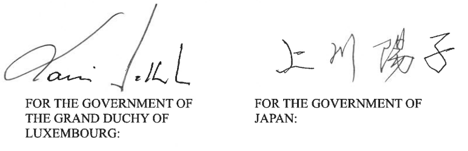

# Loi du 19 septembre 2025 portant approbation de l’« Agreement between the Grand Duchy of Luxembourg and Japan for air services », fait à Tokyo, le 11 juin 2024.

Nous Henri, Grand-Duc de Luxembourg, Duc de Nassau,

Le Conseil d’État entendu ;

Vu l’adoption par la Chambre des Députés ;

Vu la décision de la Chambre des Députés du 9 juillet 2025 et celle du Conseil d’État du 11 juillet 2025 portant qu’il n’y a pas lieu à second vote ;

Avons ordonné et ordonnons :

## Article unique.

Est approuvé l’« Agreement between the Grand Duchy of Luxembourg and Japan for air services », fait à Tokyo, le 11 juin 2024.

Mandons et ordonnons que la présente loi soit insérée au Journal officiel du Grand-Duché de Luxembourg pour être exécutée et observée par tous ceux que la chose concerne.

Le Ministre des Affaires étrangères et du Commerce extérieur,   Xavier Bettel   La Ministre de la Mobilité et des Travaux publics,   Yuriko Backes

Fait le 19 septembre 2025.   Pour le Grand-Duc,   Son Lieutenant-Représentant,   Guillaume,   Grand-Duc Héritier

AGREEMENT BETWEEN THE GRAND DUCHY OF LUXEMBOURG AND JAPAN FOR AIR SERVICES

The Government of the Grand Duchy of Luxembourg and the Government of Japan,

Desiring to conclude an agreement for the purposes of establishing and operating air services between and beyond their respective territories; and

Being parties to the Convention on International Civil Aviation opened for signature at Chicago on 7 December 1944,

Have agreed as follows:

## ARTICLE 1 — Definitions

1\. For the purposes of this Agreement, unless the context otherwise requires:

(a) the term “Convention” means the Convention on International Civil Aviation opened for signature at Chicago on 7 December 1944, including any Annex adopted and amended under Article 90 of that Convention and any amendment made to the Convention under Article 94 thereof insofar as such amendment has been ratified by both Contracting Parties;

(b) the term “aeronautical authorities” means, in the case of the Grand Duchy of Luxembourg, the Minister responsible for civil aviation and any person or body authorised to perform any functions on civil aviation at present exercised by the said Minister or similar functions, and, in the case of Japan, the Minister of Land, Infrastructure, Transport and Tourism and any person or body authorised to perform any functions on civil aviation at present exercised by the said Minister or similar functions;

(c) the term “designated airline” means an airline which one Contracting Party has designated by written notification to the other Contracting Party for the operation of air services on the routes specified in such notification, and to which the appropriate operating permission has been given by that other Contracting Party, in accordance with the provisions of Article 3 of this Agreement;

(d) the term “territory” means a territory as defined in Article 2 of the Convention;

(e) the terms “air service”, “international air service”, “airline” and “stop for non-traffic purposes” have the meanings respectively assigned to them in Article 96 of the Convention;

(f) the terms “Annex I” and “Annex II” mean Annex I and Annex II to this Agreement or as amended in accordance with the provisions of Article 18 of this Agreement;

(g) the term “specified route” means any of the routes specified in Annex I;

(h) the term “agreed service” means any air service operated on the specified routes; and

(i) the term “Member State” means a Member State of the European Union.

2\. Annex I and Annex II form an integral part of this Agreement, and all references to the “Agreement” shall include reference to Annex I and Annex II except where otherwise provided.

## ARTICLE 2 — Rights to establish and operate the agreed services

Each Contracting Party grants to the other Contracting Party the rights specified in this Agreement, particularly to enable its designated airlines to establish and operate the agreed services.

## ARTICLE 3 — Inauguration of the agreed services

1\. The agreed services on any specified route may be inaugurated immediately or at a later date at the option of the Contracting Party to which the rights are granted under Article 2 of this Agreement, subject to the provisions of Article 10 of this Agreement, and not before:

(a) the Contracting Party to which the rights have been granted has designated an airline or airlines for that route; and

(b) the Contracting Party granting the rights has given the appropriate operating permission in accordance with its laws and regulations to the airline or airlines concerned; which it shall, subject to the provisions of paragraph 2 of this Article and of paragraphs 1 and 2 of Article 7, be bound to grant without delay.

2\. Each of the airlines designated by either Contracting Party may be required to satisfy the aeronautical authorities of the other Contracting Party that it is qualified to fulfil the conditions prescribed by the laws and regulations normally and reasonably applied by those authorities to the operation of international air services.

## ARTICLE 4 — Privileges of airlines

1\. The airlines of each Contracting Party shall enjoy the following privileges in respect of their international air services:

(a) to fly across the territory of the other Contracting Party without landing; and

(b) to make stops for non-traffic purposes in the territory of the other Contracting Party.

2\. Subject to the provisions of this Agreement, the designated airlines of each Contracting Party shall enjoy, while operating an agreed service on a specified route, the privilege to make stops in the territory of the other Contracting Party at the points specified for that route in Annex I for the purposes of discharging and of taking on international traffic in passengers, cargo and mail separately or in combination.

3\. Nothing in paragraph 2 of this Article shall be deemed to confer on the airlines of one Contracting Party the privilege of taking on, in the territory of the other Contracting Party, passengers, cargo or mail carried for remuneration or hire and destined for another point in the territory of that other Contracting Party.

## ARTICLE 5 — Charges for the use of airports and other facilities

The charges which either of the Contracting Parties may impose, or permit to be imposed, on the designated airlines of the other Contracting Party for the use of airports and other facilities under its control shall be just and reasonable and shall not be higher than those which would be paid for the use of such airports and facilities by the airlines of the most favoured nation or by any airline of the former Contracting Party engaged in international air services.

## ARTICLE 6 — Exemption from customs duties and taxes

1\. Fuel, lubricating oils, spare parts, regular equipment and aircraft stores retained on board aircraft engaged in the agreed services operated by the designated airlines of either Contracting Party shall be exempt from customs duties, excise taxes, inspection fees and other similar duties, taxes or charges in the territory of the other Contracting Party, even when they are consumed or used on the part of the journey performed over that territory.

2\. Fuel, lubricating oils, spare parts, regular equipment and aircraft stores taken on board aircraft of the designated airlines of either Contracting Party in the territory of the other Contracting Party and used in the agreed services shall, subject to the regulations of the latter Contracting Party, be exempt from customs duties, excise taxes, inspection fees and other similar duties, taxes or charges.

3\. Fuel, lubricating oils, spare parts, regular equipment and aircraft stores introduced for the account of the designated airlines of either Contracting Party and stored in the territory of the other Contracting Party under customs supervisions for the purpose of supplying aircraft of those designated airlines shall, subject to the regulations of the latter Contracting Party, be exempt from customs duties, excise taxes, inspection fees and other similar duties, taxes or charges.

4\. Nothing in this Article shall prevent either Contracting Party from imposing, on a non-discriminatory basis, taxes or other similar charges on fuel supplied in its territory for use by aircraft engaged in the agreed services operated by the designated airlines of the other Contracting Party for the journey performed:

(a) in the case of the designated airlines of Japan, between points in the territory of the Grand Duchy of Luxembourg or between a point in the territory of the Grand Duchy of Luxembourg and a point in the territory of another Member State; and

(b) in the case of the designated airlines of the Grand Duchy of Luxembourg, between points in the territory of Japan.

## ARTICLE 7 — Revocation of the privileges and other measures

1\. Each Contracting Party reserves the right to withhold or revoke the privileges specified in paragraphs 1 and 2 of Article 4 of this Agreement in respect of an airline designated by the other Contracting Party, or to impose such conditions as it may deem necessary on the exercise by the airline of those privileges, in any case where one of the following conditions is satisfied:

(a) in the case of an airline designated by Japan, substantial ownership and effective control of the airline are not vested in Japan or in nationals of Japan; and

(b) in the case of an airline designated by the Grand Duchy of Luxembourg:

(i) the airline is not established in the territory of the Grand Duchy of Luxembourg or does not have a valid operating licence issued by a Member State in accordance with the law of the European Union;

(ii) effective regulatory control of the airline is not exercised or not maintained by the Member State responsible for issuing its air operator’s certificate, or the relevant aeronautical authority is not clearly identified in the designation;

(iii) majority ownership and effective control of the airline are not vested in Member States or States listed in Annex II, or in nationals of such States;

(iv) the airline does not have its principal place of business in the territory of the Member State from which it has received its operating licence;

(v) the airline has been given operating permission under an agreement between another Member State and Japan for air services, and Japan can demonstrate that it would be circumventing restrictions on routes and capacity under that agreement by operating agreed services under this Agreement on a route which includes a point in that other Member State; or

(vi) the airline holds an air operator’s certificate issued by a Member State and there is no agreement between that Member State and Japan for air services and that Member State has not consented to the operation of international air services by an airline of Japan between that Member State and Japan.

2\. In exercising its right under paragraph 1 of this Article, and without prejudice to its rights under subparagraphs (b)(v) and (vi) of paragraph 1 of this Article, Japan shall not discriminate between airlines designated by the Grand Duchy of Luxembourg, of which majority ownership and effective control are vested in Member States or States listed in Annex II, or in nationals of such States, on the basis of their ownership and control.

3\. Each Contracting Party reserves the right to suspend the exercise by a designated airline of the other Contracting Party of the privileges referred to in paragraphs 1 and 2 of Article 4, or to impose such conditions as it may deem necessary on the exercise by the airline of those privileges, in any case where such airline fails to comply with the laws and regulations of the Contracting Party granting those privileges or otherwise fails to operate in accordance with the conditions prescribed in this Agreement; provided that, unless immediate suspension or imposition of conditions is essential to prevent further infringements of such laws and regulations, or unless immediate action is required for reasons of aviation security or of the safety of air navigation in accordance with the provisions of paragraph 6 of Article 13 or paragraph 3 of Article 14 of this Agreement respectively, this right shall be exercised only after consultations with the other Contracting Party.

## ARTICLE 8 — Fair and equal opportunity

There shall be fair and equal opportunity for the designated airlines of both Contracting Parties to operate the agreed services on the specified routes between their respective territories.

## ARTICLE 9 — Capacity

1\. The agreed services provided by the designated airlines of the Contracting Parties shall bear a close relationship to the requirements of the public for such services.

2\. The agreed services provided by a designated airline shall retain as their primary objective the provision at a reasonable load factor of capacity adequate to current and reasonably anticipated requirements for the carriage of passengers, cargo and mail originating from or destined for the territory of the Contracting Party which has designated the airline. Provision for the carriage of passengers, cargo and mail both taken on and discharged at points on the specified routes in the territories of States other than that designating the airline shall be made in accordance with the general principles that capacity shall be related to:

(a) the traffic requirements to and from the territory of the Contracting Party which has designated the airline;

(b) the requirements of through airline operation; and

(c) the traffic requirements of the area through which the airline passes, after taking account of local and regional services.

3\. Capacity to be provided by the designated airlines of the Contracting Parties in respect of the agreed services shall be agreed through consultations between the aeronautical authorities of both Contracting Parties in accordance with the principles laid down in Article 8, and paragraphs 1 and 2 of this Article.

## ARTICLE 10 — Tariffs

1\. The tariffs on any agreed service shall be established by the designated airlines of both Contracting Parties at reasonable levels based upon commercial considerations, due regard being paid to all relevant factors including cost of operation, reasonable profit and characteristics of services (such as standards of speed and accommodation).

2\. The aeronautical authorities of each Contracting Party may require the designated airlines of the Contracting Parties to provide information relating to the establishment of the tariffs.

3\. If required by the laws and regulations of either Contracting Party, the aeronautical authorities of that Contracting Party may also require the designated airlines of the Contracting Parties to submit tariffs proposed to be charged for approval for carriage to or from the territory of that Contracting Party in accordance with its applicable procedures, provided that such submission shall not be required to be made more than thirty (30) days before the proposed date of introduction of the tariffs. The aeronautical authorities of that Contracting Party then shall have the right to approve or disapprove such tariffs, and to ensure, in accordance with its applicable procedures, that the designated airlines conform to the tariffs fixed.

4\. The aeronautical authorities of either Contracting Party may request consultations with the aeronautical authorities of the other Contracting Party if they believe that any tariff proposed to be charged or charged by the designated airlines of the Contracting Parties is inconsistent with the provisions in paragraph 1 of this Article. Such consultations shall be held not later than thirty (30) days after receipt of the request. The Contracting Parties shall cooperate in securing information necessary for reasonable resolution of the issues. If the aeronautical authorities of the Contracting Parties reach agreement, the aeronautical authorities of each Contracting Party shall inform designated airlines of that Contracting Party of the results and, as necessary, request them to submit revised tariffs. If no agreement is reached, those tariffs shall be charged or continue to be charged.

## ARTICLE 11 — Corporate activities of the designated airlines

1\. The designated airlines of either Contracting Party shall be permitted, in accordance with the applicable laws and regulations of the other Contracting Party, to establish and maintain in the territory of the other Contracting Party their branches and to engage in activities necessary for the operation of the agreed services.

2\. The designated airlines of either Contracting Party shall be entitled, in accordance with the applicable laws and regulations of the other Contracting Party, to bring in and maintain at their branches in the territory of the other Contracting Party their own managerial, technical, operational and other specialist staff as are reasonably required for the provision of air services.

3\. The designated airlines of either Contracting Party shall be permitted to transfer freely, in accordance with the applicable laws and regulations of the other Contracting Party, in convertible currencies, at the prevailing rate of exchange in the official market at the time of remittance, the excess of receipts over expenditure earned by those airlines in the territory of the other Contracting Party in connection with the operation of the agreed services, and to establish and maintain, for the operation of such agreed services, deposit accounts in foreign currencies and in convertible domestic currency in accordance with the applicable laws and regulations of the other Contracting Party.

## ARTICLE 12 — Provision of information and statistics

The aeronautical authorities of either Contracting Party shall supply to the aeronautical authorities of the other Contracting Party, upon request, such information and statistics relating to traffic carried on the agreed services by the designated airlines of the former Contracting Party to and from the territory of the other Contracting Party as may normally be prepared and submitted by the designated airlines to their national aeronautical authorities for publication. Any additional statistical traffic data which the aeronautical authorities of one Contracting Party may desire from the aeronautical authorities of the other Contracting Party shall, upon request, be a subject of mutual discussion between the aeronautical authorities of the two Contracting Parties.

## ARTICLE 13 — Cooperation to prevent unlawful acts

1\. Consistent with their rights and obligations under international law, the Contracting Parties reaffirm that their obligation to each other to protect the security of civil aviation against acts of unlawful interference forms an integral part of this Agreement. Without prejudice to their rights and obligations under international law, the Contracting Parties shall in particular act in conformity with the provisions of the Convention on Offences and Certain Other Acts Committed on Board Aircraft, signed at Tokyo on 14 September 1963, the Convention for the Suppression of Unlawful Seizure of Aircraft, signed at The Hague on 16 December 1970, the Convention for the Suppression of Unlawful Acts against the Safety of Civil Aviation, signed at Montreal on 23 September 1971, the Protocol for the Suppression of Unlawful Acts of Violence at Airports Serving International Civil Aviation, Supplementary to the Convention for the Suppression of Unlawful Acts against the Safety of Civil Aviation, Done at Montreal on 23 September 1971, signed at Montreal on 24 February 1988, the Convention on the Marking of Plastic Explosives for the Purpose of Detection, signed at Montreal on 1 March 1991 and any other convention or protocol on the security of civil aviation to which both Contracting Parties become parties.

2\. The Contracting Parties shall provide, upon request, all necessary assistance, in accordance with their respective laws and regulations, to each other to prevent acts of unlawful seizure of civil aircraft and other unlawful acts against the safety of such aircraft, their passengers and crew, airports and air navigation facilities, and any other threat to the security of civil aviation.

3\. The Contracting Parties should, in their mutual relations, act in conformity with the aviation security provisions established by the International Civil Aviation Organization and designated as Annexes to the Convention to the extent that such security provisions are applicable to the Contracting Parties. Each Contracting Party should require that its airlines and the operators of airports in its territory act in conformity with such aviation security provisions.

4\. Each Contracting Party agrees that its airlines may be required to observe the aviation security provisions referred to in paragraph 3 above required by the other Contracting Party for entry into, departure from, or while within, the territory of that other Contracting Party. Each Contracting Party shall take appropriate measures within its territory to protect the aircraft and to inspect passengers, crew, carry-on items, baggage, cargo and aircraft stores prior to and during boarding or loading. Each Contracting Party shall also give sympathetic consideration to any request from the other Contracting Party for reasonable special security measures to meet a particular threat.

5\. When an incident or threat of an incident of unlawful seizure of civil aircraft or other unlawful acts against the safety of such aircraft, their passengers or crew, airports or air navigation facilities occurs, the Contracting Parties shall assist each other by facilitating communications and other appropriate measures intended to terminate rapidly and safely such incident or threat thereof.

6\. When a Contracting Party has reasonable grounds to believe that the other Contracting Party has departed from the provisions of this Article, the former Contracting Party may request consultations with the latter Contracting Party. Such consultations shall take place within fifteen (15) days from the date of receipt of the request. Failure to reach a satisfactory agreement within fifteen (15) days from the initiation of consultations shall constitute grounds for withholding, revoking, suspending or imposing conditions on the operating permission of the designated airlines of the latter Contracting Party. When justified by an emergency to protect aviation security, or to prevent further non-compliance with the provisions of this Article, the former Contracting Party may provisionally withhold, revoke, suspend or impose conditions on the operating permission at any time.

## ARTICLE 14 — Aviation safety

1\. If a Contracting Party finds that the regulations or practices on aviation safety maintained by the other Contracting Party in areas relating to aeronautical facilities, flight crew, aircraft and the operations of aircraft are not likely to conform to the international standards designated as Annexes to the Convention (hereinafter referred to as “the International Standards”), the former Contracting Party may request consultations with the latter Contracting Party. Such consultations shall take place within a period of thirty (30) days from the date of receipt of that request. If, following such consultations, the latter Contracting Party confirms that its regulations or practices on aviation safety do not conform to the International Standards, it shall take steps considered necessary to conform its regulations or practices to the International Standards. The former Contracting Party may advise the Secretary General of the International Civil Aviation Organization, if the former Contracting Party finds that the latter Contracting Party fails to take steps considered necessary to conform its regulations or practices to the International Standards within a reasonable period.

2\. The competent authorities of each Contracting Party may search aircraft engaged in the agreed services operated by the designated airlines of the other Contracting Party, in the territory of the first-mentioned Contracting Party except during flight, and without causing the operation of the aircraft unreasonable delay, to verify the validity of the relevant aircraft documentation, the licensing of its crew, and that the aircraft equipment and condition of aircraft conform to the International Standards.

3\. When it is essential to ensure the safety of air navigation, each Contracting Party may immediately suspend or vary the operating permission of the designated airlines of the other Contracting Party. Any such action taken by that Contracting Party shall be discontinued once the basis for taking of that action ceases to exist.

## ARTICLE 15 — Consultations between the aeronautical authorities

It is the intention of both Contracting Parties that there should be regular and frequent consultations between the aeronautical authorities of the Contracting Parties to ensure close collaboration in all matters affecting the fulfilment of this Agreement.

## ARTICLE 16 — Settlement of disputes

1\. If any dispute arises between the Contracting Parties relating to the interpretation or application of this Agreement, the Contracting Parties shall in the first place endeavour to settle it by negotiation between themselves.

2\. If the Contracting Parties fail to reach a settlement by negotiation, the dispute may, at the request of either Contracting Party, be submitted for decision to a tribunal of three arbitrators, one to be named by each Contracting Party and the third to be agreed upon by the two arbitrators so chosen, provided that such third arbitrator shall not be a national of either Contracting Party. Such third arbitrator shall act as the President of the tribunal. Each of the Contracting Parties shall designate an arbitrator within a period of sixty (60) days from the date of receipt by either Contracting Party from the other Contracting Party of a diplomatic note requesting arbitration of the dispute and the third arbitrator shall be agreed upon within a further period of sixty (60) days. If either of the Contracting Parties fails to designate its own arbitrator within the period of sixty (60) days or if the third arbitrator is not agreed upon within the period indicated, the President of the Council of the International Civil Aviation Organization may be requested by either Contracting Party to appoint an arbitrator or arbitrators.

3\. The Contracting Parties undertake to comply with any decision of the tribunal referred to in paragraph 2 of this Article.

## ARTICLE 17 — Headings

The headings of the Articles of this Agreement are inserted for convenience of reference only and shall not affect the interpretation of this Agreement.

## ARTICLE 18 — Amendments

1\. Either Contracting Party may at any time request consultations with the other Contracting Party for the purpose of amending this Agreement. Such consultations shall begin within a period of sixty (60) days from the date of receipt of such request.

2\. If the amendment relates to the provisions of this Agreement other than those of Annex I and Annex II, the amendment shall be approved by each Contracting Party in accordance with its constitutional procedures and shall enter into force on the thirtieth day after the date of exchange of diplomatic notes indicating such approval.

3\. If the amendment relates only to Annex I, the consultations shall be between the aeronautical authorities of both Contracting Parties. When these authorities agree on a new or revised Annex I, the agreed amendments on the matter shall enter into force after they have been confirmed by exchange of diplomatic notes.

4\. If the amendment relates only to Annex II, the amendment may be made by means of an exchange of diplomatic notes between the Government of the Grand Duchy of Luxembourg and the Government of Japan, in conformity with their applicable domestic procedures.

## ARTICLE 19 — Multilateral convention

If a general multilateral convention concerning air transport comes into force in respect of both Contracting Parties, this Agreement shall be amended so as to conform with the provisions of such convention.

## ARTICLE 20 — Termination

Either Contracting Party may at any time notify the other Contracting Party, through diplomatic channels, of its intention to terminate this Agreement. A copy of the notice shall be sent simultaneously to the International Civil Aviation Organization. If such notice is given, this Agreement shall terminate one year after the date of receipt by the latter Contracting Party of the notice, unless by agreement between the Contracting Parties the notice under reference is withdrawn before the expiration of that period. If the other Contracting Party fails to acknowledge receipt, the notice shall be deemed to have been received fourteen (14) days after the date of receipt by the International Civil Aviation Organization of its copy.

## ARTICLE 21 — Registration

This Agreement and any amendment thereto shall be registered with the International Civil Aviation Organization.

## ARTICLE 22 — Entry into force

This Agreement shall be approved by each Contracting Party in accordance with its constitutional procedures and shall enter into force on the thirtieth day after the date of exchange of diplomatic notes indicating such approval.

IN WITNESS WHEREOF, the undersigned, being duly authorised by their respective Governments, have signed this Agreement.

DONE in duplicate, in the English language, at Tokyo, this eleventh day of June, 2024.

ANNEX I

1\. Routes to be operated in both directions by the designated airline or airlines of Japan:

(a) Tokyo - intermediate points - Luxembourg - points beyond.

(b) Points in Japan other than Tokyo - intermediate points - Luxembourg - points beyond.

(c) Osaka - intermediate points - Luxembourg - points beyond.

(d) Komatsu - intermediate points - Luxembourg - points beyond.

Note 1: On route (b), the designated airline or airlines of Japan may only operate passenger services.

Note 2: On routes (c) and (d), the designated airline or airlines of Japan may only operate all-cargo services.

2\. Routes to be operated in both directions by the designated airline or airlines of Luxembourg:

(a) Luxembourg - intermediate points -Tokyo - points beyond.

(b) Luxembourg - intermediate points - points in Japan other than Tokyo - points beyond.

(c) Luxembourg - intermediate points - Osaka - points beyond.

(d) Luxembourg - intermediate points - Komatsu - points beyond.

Note 1: On route (b), the designated airline or airlines of Luxembourg may only operate passenger services.

Note 2: On routes (c) and (d), the designated airline or airlines of Luxembourg may only operate all-cargo services.

3\. The agreed services provided by the designated airline or airlines of either Contracting Party shall begin at a point in the territory of that Contracting Party, but other points on the specified route may at the option of the designated airline be omitted on any or all flights.

ANNEX II

States referred to in paragraphs 1 and 2 of Article 7 of this Agreement are as follows:

aash Iceland (under the Agreement on the European Economic Area);

bash the Principality of Liechtenstein (under the Agreement on the European Economic Area);

cash the Kingdom of Norway (under the Agreement on the European Economic Area); and

dash the Swiss Confederation (under the Agreement between the European Community and the Swiss Confederation on Air Transport).

Doc. parl. [8493](https://legilux.public.lu/eli/dl/pl/2025/30) ; législature 2023-2028.
