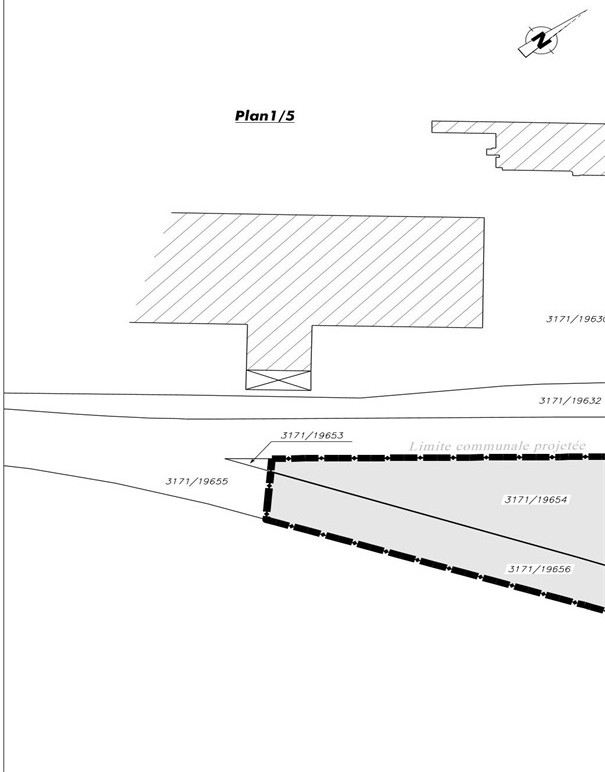
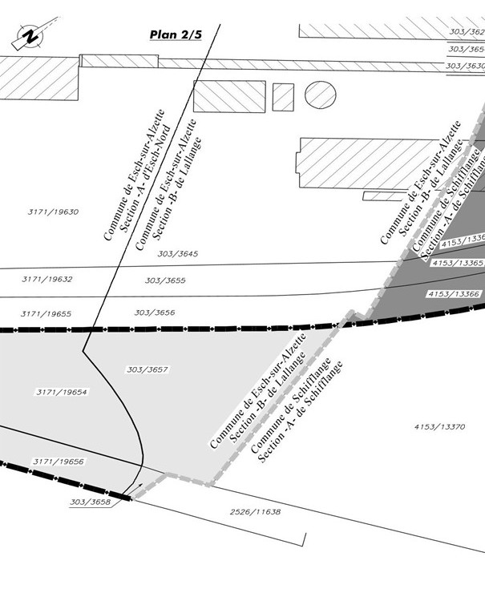
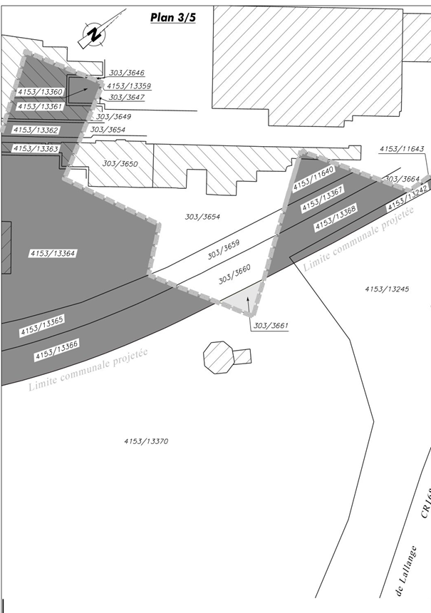
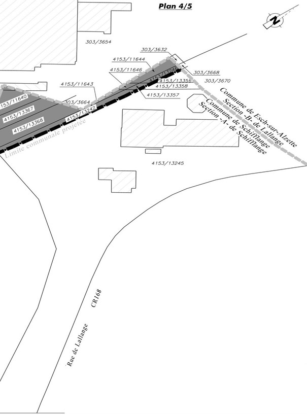
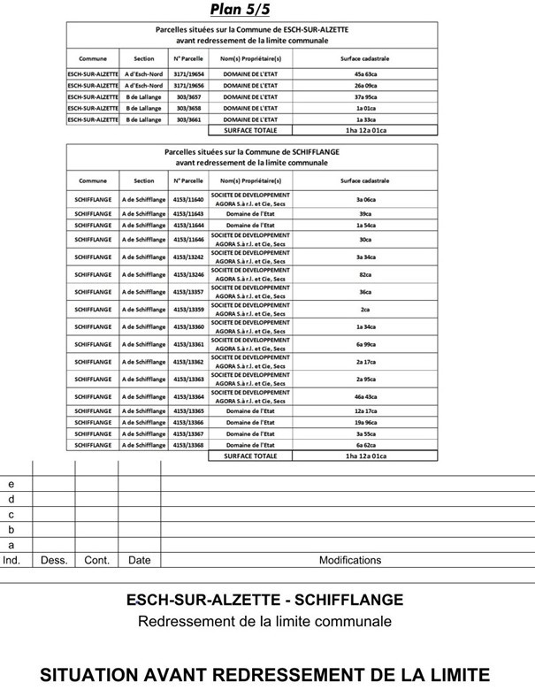

# Loi du 29 octobre 2025 portant changement de limites entre la Ville d’Esch-sur-Alzette et la Commune de Schifflange.

Nous Guillaume, Grand-Duc de Luxembourg, Duc de Nassau,

Le Conseil d’État entendu ;

Vu l’adoption par la Chambre des Députés ;

Vu la décision de la Chambre des Députés du 16 octobre 2025 et celle du Conseil d’État du 21 octobre 2025 portant qu’il n’y pas lieu à second vote ;

Avons ordonné et ordonnons :

## Art. 1er.

Les terrains suivants d’une contenance totale de 1 ha 12 a et 01 ca, actuellement situés sur le territoire de la Ville d’Esch-sur-Alzette, Sections A d’Esch-Nord et B de Lallange, sont rattachés à la Commune de Schifflange.

| Section | N° cadastral | Surface cadastrale |
|---|---|---|
| A d’Esch-Nord | 3171/19654 | 45a 63ca |
| A d’Esch-Nord | 3171/19656 | 26a 9ca |
| B de Lallange | 303/3657 | 37a 95ca |
| B de Lallange | 303/3658 | 1a 1ca |
| B de Lallange | 303/3661 | 1a 33ca |
|  |  | Total : 1ha 12a 1ca |

## Art. 2.

Les terrains suivants d’une contenance totale de 1 ha 12 a et 01 ca, actuellement situés sur le territoire de la Commune de Schifflange, Section A de Schifflange, sont rattachés à la Ville d’Esch-sur-Alzette.

| Section | N° cadastral | Surface cadastrale |
|---|---|---|
| A de Schifflange | 4153/11640 | 3a 6ca |
| A de Schifflange | 4153/11643 | 39ca |
| A de Schifflange | 4153/11644 | 1a 54ca |
| A de Schifflange | 4153/11646 | 30ca |
| A de Schifflange | 4153/13242 | 3a 34ca |
| A de Schifflange | 4153/13246 | 82ca |
| A de Schifflange | 4153/13357 | 36ca |
| A de Schifflange | 4153/13359 | 2ca |
| A de Schifflange | 4153/13360 | 1a 34ca |
| A de Schifflange | 4153/13361 | 6a 99ca |
| A de Schifflange | 4153/13362 | 2a 17ca |
| A de Schifflange | 4153/13363 | 2a 95ca |
| A de Schifflange | 4153/13364 | 46a 43ca |
| A de Schifflange | 4153/13365 | 12a 17ca |
| A de Schifflange | 4153/13366 | 19a 96ca |
| A de Schifflange | 4153/13367 | 3a 55ca |
| A de Schifflange | 4153/13368 | 6a 62ca |
|  |  | Total : 1ha 12a 1ca |

## Art. 3.

Les modifications à apporter aux limites communales sont indiquées aux plans cadastraux annexés. Les anciennes limites communales sont dressées d’un trait interrompu en gris, tandis que les nouvelles limites communales sont dressées d’un trait interrompu en noir.

Les surfaces transférées de la Ville d’Esch-sur-Alzette à la Commune de Schifflange sont indiquées en couleur gris clair. Les surfaces transférées de la Commune de Schifflange à la Ville d’Esch-sur-Alzette sont indiquées en couleur gris foncé.

Mandons et ordonnons que la présente loi soit insérée au Journal officiel du Grand-Duché de Luxembourg pour être exécutée et observée par tous ceux que la chose concerne.

Le Ministre des Affaires intérieures,   Léon Gloden

Fait le 29 octobre 2025.   Guillaume

\**ANNEXE**

Doc. parl. [8557](https://legilux.public.lu/eli/dl/pl/2025/158) ; législature 2023-2028.
