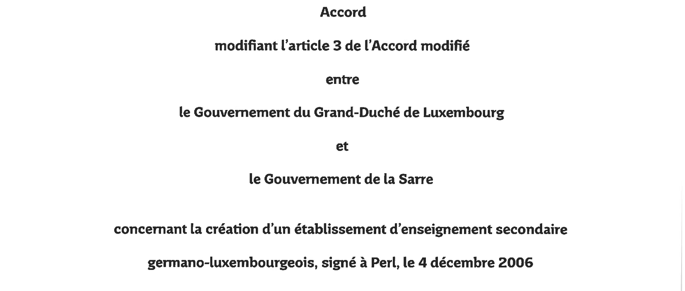
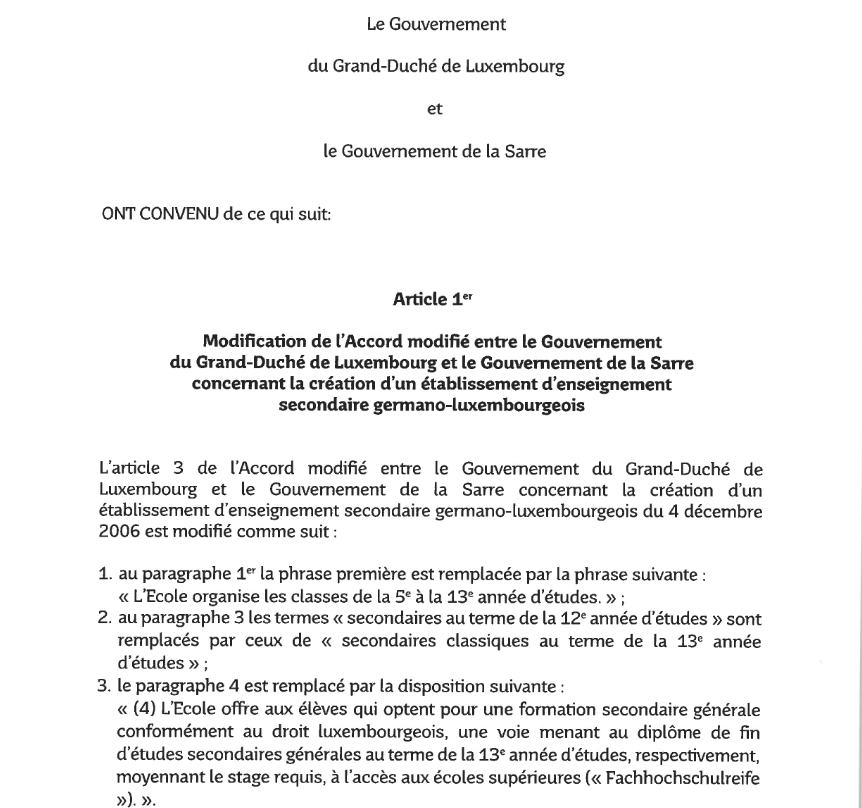
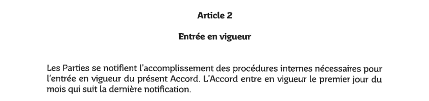
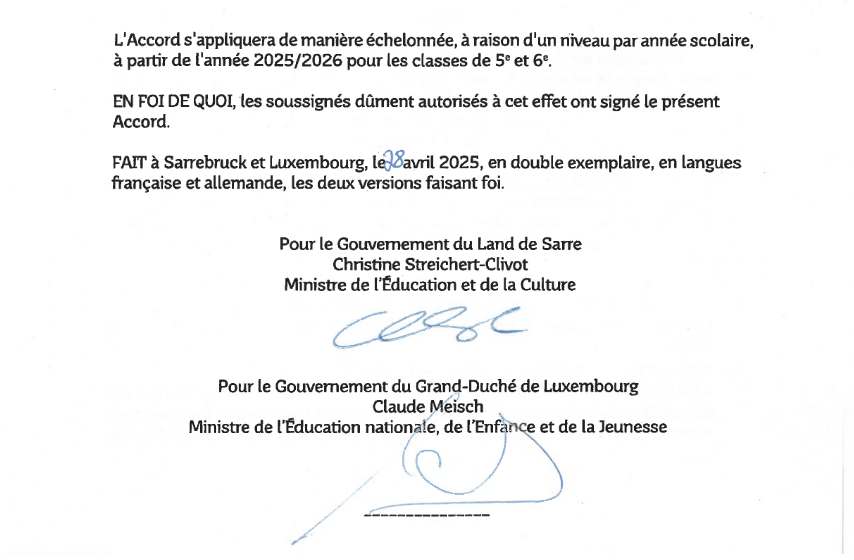

# Loi du 25 février 2026 portant approbation de l’Accord modifiant l’article 3 de l’Accord modifié entre le Gouvernement du Grand-Duché de Luxembourg et le Gouvernement de la Sarre concernant la création d’un établissement d’enseignement secondaire germano-luxembourgeois, fait à Sarrebruck et Luxembourg, le 28 avril 2025.

Nous Guillaume, Grand-Duc de Luxembourg, Duc de Nassau,

Le Conseil d’État entendu ;

Vu l’adoption par la Chambre des Députés ;

Vu la décision de la Chambre des Députés du 21 janvier 2026 et celle du Conseil d’État du 3 février 2026 portant qu’il n’y a pas lieu à second vote ;

Avons ordonné et ordonnons :

## Article unique.

Est approuvé l’Accord modifiant l’article 3 de l’[Accord modifié entre le Gouvernement du Grand-Duché de Luxembourg et le Gouvernement de la Sarre concernant la création d’un établissement d’enseignement secondaire germano-luxembourgeois](https://legilux.public.lu/eli/etat/leg/loi/2007/07/11/n2/jo), fait à Sarrebruck et Luxembourg, le 28 avril 2025.

Mandons et ordonnons que la présente loi soit insérée au Journal officiel du Grand-Duché de Luxembourg pour être exécutée et observée par tous ceux que la chose concerne.

Le Ministre des Affaires étrangères et du Commerce extérieur,   Xavier Bettel   Le Ministre de l’Éducation nationale, de l’Enfance et de la Jeunesse,   Claude Meisch

Fait le 25 février 2026.   Guillaume

Doc. parl. [8613](https://legilux.public.lu/eli/dl/pl/2025/248) ; législature 2023-2028.
