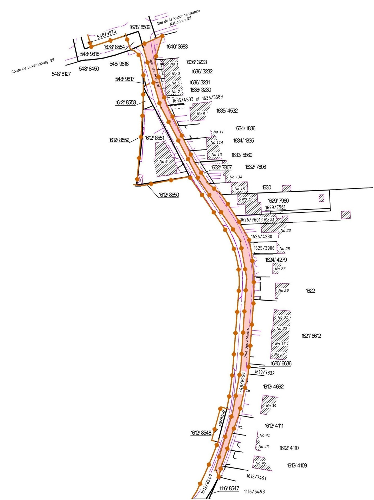

# Loi du 12 juin 2026 portant changement de limites entre la Commune de Käerjeng et la Commune de Pétange.

Nous Guillaume, Grand-Duc de Luxembourg, Duc de Nassau,

Le Conseil d’État entendu ;

Vu l’adoption par la Chambre des Députés ;

Vu la décision de la Chambre des Députés du 21 mai 2026 et celle du Conseil d’État du 9 juin 2026 portant qu’il n’y pas lieu à second vote ;

Avons ordonné et ordonnons :

## Art. 1er.

Le terrain suivant d’une contenance totale de 12a 57ca, actuellement situé dans la Commune de Pétange, section A de Pétange, est rattaché à la Commune de Käerjeng.

| **Section** | **N° parcelle** | **Surface** | **Nom propriétaire** |
|---|---|---|---|
| -A- de Pétange | 548/9969 | 12a 57ca | Pétange, la Commune |

## Art. 2.

La modification à apporter aux limites communales est indiquée sur le plan cadastral en annexe.

Le terrain transféré de la Commune de Pétange à la Commune de Käerjeng est marqué en couleur rouge.

ANNEXE

Mandons et ordonnons que la présente loi soit insérée au Journal officiel du Grand-Duché de Luxembourg pour être exécutée et observée par tous ceux que la chose concerne.

Le Ministre des Affaires intérieures,   Léon Gloden

Fait le 12 juin 2026.   Guillaume

Doc. parl. [8691](https://legilux.public.lu/eli/dl/pl/2026/21) ; législature 2023-2028.
