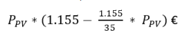
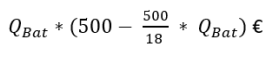

# Loi du 24 juillet 2026 relative au régime d’aides pour la promotion de la durabilité, de l’utilisation rationnelle de l’énergie et des énergies renouvelables dans le domaine du logement.

Nous Guillaume, Grand-Duc de Luxembourg, Duc de Nassau,

Le Conseil d’État entendu ;

Vu l’adoption par la Chambre des Députés ;

Vu la décision de la Chambre des Députés du 15 juillet 2026 et celle du Conseil d’État du 17 juillet 2026 portant qu’il n’y apas lieu à second vote ;

Avons ordonné et ordonnons :

## Art. 1er — Objet

(1) La présente loi a pour objet de promouvoir la rénovation énergétique durable de logements existants et la mise en valeur des sources d’énergie renouvelables dans le domaine du logement.

À cette fin, la présente loi encadre le régime d’aides financières pour la réalisation de projets d’investissement qui ont pour but la rénovation énergétique durable de logements existants et la mise en valeur des sources d’énergie renouvelables.

(2) Le ministre ayant l’Environnement dans ses attributions, ci-après « ministre », est autorisé à accorder, dans les limites des crédits budgétaires disponibles, des aides financières sous forme de subventions en capital à des personnes physiques, des personnes morales de droit privé et des personnes morales de droit public, autres que l’État, pour la réalisation d’investissements et de services y relatifs ayant pour objet la rénovation énergétique durable de logements existants et la mise en valeur des sources d’énergie renouvelables.

Les aides financières peuvent être sollicitées par une personne physique, une personne morale ou le représentant légal d’un groupement au nom et pour le compte de plusieurs personnes physiques ou morales bénéficiaires des aides financières, faisant partie dudit groupement.

(3) Les aides financières ne peuvent être accordées que pour des investissements réalisés sur le territoire du Grand-Duché de Luxembourg. Sont exclus du bénéfice d’une aide :

1° toute installation d’occasion ;

2° tout échange, remplacement ou réparation de parties d’installations ne pouvant pas fonctionner indépendamment du reste de l’installation.

(4) Les montants respectifs des aides financières sont déterminés individuellement pour chaque projet d’investissement.

(5) Les aides financières sont limitées aux investissements et services pour lesquels la facture est établie au plus tard le 31 décembre 2035 inclus.

Tout droit à l’aide financière se prescrit par quatre ans à compter du 31 décembre de l’année civile à laquelle se rapporte la facture en question.

En vue de sa liquidation, la demande d’aide financière est à introduire au plus tard le 31 décembre 2039 inclus.

## Art. 2 — Définitions

Pour l’application de la présente loi, on entend par :

1° « bâtiment » : un édifice construit sur un terrain doté d’un toit et de murs dans lequel de l’énergie est utilisée pour réguler le climat intérieur ;

2° « bâtiment d’habitation » : un bâtiment pris dans son ensemble dans lequel au moins 90 pour cent de la surface est destinée à des fins d’habitation ;

3° « bénéficiaire » : le demandeur auquel une aide a été accordée ;

4° « coûts effectifs » : les coûts des éléments éligibles visés à l’annexe I hors taxe sur la valeur ajoutée ;

5° « conseiller en énergie » : une personne agréée au titre de la [loi du 21 avril 1993](https://legilux.public.lu/eli/etat/leg/loi/1993/04/21/n3/jo) relative à l’agrément de personnes physiques ou morales, privées ou publiques, autres que l’État, pour l’accomplissement de tâches techniques d’étude et de vérification dans le domaine de l’environnement ;

6° « demandeur » : toute personne morale ou physique au nom et pour le compte de laquelle est introduite une demande en obtention de l’aide visée par la présente loi et qui est propriétaire ou qui détient des droits réels immobiliers sur le logement ou les installations techniques, sauf s’il est établi que le nouveau propriétaire ou détenteur de droits réels immobiliers sur le logement ou les installations techniques renonce à l’aide en question au profit du demandeur qui a réalisé les investissements visés par la présente loi. Dans le cas d’un immeuble soumis au statut de la copropriété, le syndic ou toute autre personne expressément mandatée pour le faire introduit la demande en exécution d’une décision de l’assemblée générale des copropriétaires prise conformément à la [loi modifiée du 16 mai 1975](https://legilux.public.lu/eli/etat/leg/loi/1975/05/16/n1/jo) portant statut de la copropriété des immeubles bâtis. Est considéré comme demandeur, le copropriétaire qui a été autorisé par l’assemblée générale des copropriétaires à monter à ses frais les installations sur la partie commune ;

7° « immeuble collectif » : un bâtiment comprenant plusieurs logements ;

8° « logement » : un local d’habitation distinct et indépendant ;

9° « local d’habitation distinct » : tout immeuble ou partie d’immeuble ayant une désignation cadastrale propre et susceptible d’être habité à titre principal de sorte qu’une personne ou un groupe de personnes puissent y dormir, y préparer et y prendre leurs repas et s’y abriter à l’écart d’autres personnes ;

10° « local d’habitation indépendant » : tout immeuble ou partie d’immeuble disposant d’une porte principale permettant d’accéder à l’extérieur de l’immeuble ou à une partie commune à l’intérieur d’un immeuble collectif, sans que les habitants du local doivent traverser un local habité par une ou plusieurs autres personnes respectivement une partie de l’immeuble utilisée à des fins professionnelles ;

11° « maison unifamiliale » : un bâtiment d’habitation servant au logement permanent et comprenant un logement ou un logement avec un logement intégré ;

12° « maison bifamiliale » : un bâtiment d’habitation servant au logement permanent et comprenant deux logements ;

13° « stockage d’électricité » : le report de l’utilisation finale de l’électricité à un moment postérieur à celui auquel elle a été produite, ou la conversion de l’énergie électrique en une forme d’énergie qui peut être stockée, la conservation de cette énergie et la reconversion ultérieure de celle-ci en énergie électrique ;

14° « système de gestion d’énergie » : un dispositif qui surveille, contrôle et optimise les flux d’énergie d’un circuit électrique derrière un point de raccordement ou, le cas échéant, de fourniture au sens de l’article 1er, paragraphes 36 et 37, de la [loi modifiée du 1er août 2007](https://legilux.public.lu/eli/etat/leg/loi/2007/08/01/n13/jo) relative à l’organisation du marché de l’électricité :

a) on entend par « surveiller » : l’action de mesurer et d’enregistrer ou, à défaut, de comptabiliser des données transférées à partir d’un appareil externe à un intervalle de temps au moins quart-horaire :

i) la puissance soutirée du ou injectée dans le réseau de distribution d’électricité ;

ii) la puissance de la consommation ou de la production des appareils électriques intégrés dans le système de gestion de l’énergie ;

iii) les signaux et informations externes reçus par le biais d’une interface informatique standardisée ;

b) on entend par « contrôler » : l’action d’analyser les informations visées à la lettre a) et de mettre par conséquent en œuvre des actions automatiques selon des consignes préétablies qui consistent dans la réduction ou l’augmentation des puissances visées à la lettre a), sous i) et ii) ;

c) on entend par « optimiser » : la gestion intelligente des actions visées à la lettre b) impliquant des processus décisionnels stratégiques par le biais d’algorithmes pour atteindre un objectif spécifique.

15° « surface de référence énergétique » : la surface de référence énergétique correspond à la partie conditionnée de la surface de plancher nette à l’intérieur de l’enveloppe thermique et de l’enveloppe d’étanchéité à l’air. La présence d’un système de transmission de chaleur dans un local n’est pas déterminante pour la prise en compte de ce local dans la surface de référence énergétique.

Pour les locaux ayant des hauteurs libres différentes, seule la partie de la surface dont la hauteur est supérieure à un mètre fait partie de la surface de référence énergétique. La hauteur d’un local va du bord supérieur du plancher fini au bord inférieur du plafond fini. Pour les plafonds comportant des poutres apparentes, la mesure est effectuée entre les poutres.

Ne font pas partie de la surface de référence énergétique les surfaces suivantes, même si elles sont comprises dans l’enveloppe thermique et dans l’enveloppe d’étanchéité à l’air :

a) les garages pour équipements roulants ;

b) les locaux à poubelles ;

c) les gaines techniques ;

d) les locaux servant à l’approvisionnement en combustibles. ;

16° « entreprise » : une entreprise au sens de l’article 2, point 15°, de la [loi modifiée du 2 septembre 2011](https://legilux.public.lu/eli/etat/leg/loi/2011/09/02/n1/jo) réglementant l’accès aux professions d’artisan, de commerçant, d’industriel ainsi qu’à certaines professions libérales ;

17° « registre » : le registre visé à l’article 17 qui recueille toutes les entreprises admises à agir en tant que demandeur intermédiaire dans la procédure de préfinancement ;

18° « demandeur intermédiaire » : une entreprise inscrite au registre visé au point 17° ;

19° « État membre » : un État membre de l’Union européenne, de l’Espace économique européen ou la Confédération helvétique ;

20° « installation solaire photovoltaïque » : une installation technique indépendante pour la production d’électricité à partir de l’énergie solaire sur un site géographique défini qui intègre toutes les composantes qui sont nécessaires pour la production de l’électricité ;

21° « installation de stockage » : une installation fixe destinée au stockage de l’électricité ;

22° « unité » : un bâtiment ou une partie d’un bâtiment délimitée et séparée disposant d’une porte principale permettant d’accéder directement à l’extérieur du bâtiment ou, le cas échéant, à travers une partie commune à l’intérieur d’un bâtiment collectif sans qu’il soit nécessaire de traverser une autre unité ;

23° « unité privative » : une unité dans un immeuble collectif réservée à l’usage exclusif d’un occupant ou d’un groupe d’occupants distinct ;

24° « communauté domestique » : l’ensemble des personnes physiques vivant dans un foyer commun, dont il peut être raisonnablement admis qu’elles partagent un budget commun, à moins qu’une preuve matérielle ne démontre qu’elles résident ailleurs ou qu’elles vivent de manière économiquement autonome ;

25° « construction » : tout ouvrage bâti ou assemblé, fixé de manière stable et ancré au sol, présentant une certaine durabilité et dont l’usage principal n’est pas le support direct d’une installation solaire photovoltaïque.

## Art. 3 — Assainissement énergétique durable

(1) Le ministre est autorisé à accorder une aide financière pour l’assainissement énergétique durable :

1° d’un bâtiment utilisé intégralement à des fins d’habitation après les travaux d’assainissement ;

2° de la partie d’un bâtiment utilisée à des fins d’habitation après les travaux d’assainissement ;

âgés de plus de dix ans depuis la date de délivrance de l’autorisation de bâtir lors de l’introduction de la demande d’accord de principe et respectant les exigences et critères déterminés à l’annexe II.

(2) Les travaux d’assainissement relatifs aux éléments de construction de l’enveloppe thermique du bâtiment et à la ventilation mécanique contrôlée sont éligibles pour l’aide financière lorsque les conditions suivantes sont remplies :

1° les travaux d’assainissement sont réalisés sur base d’un conseil en énergie visé à l’article 12 ;

2° les travaux d’assainissement font l’objet d’un accompagnement ponctuel de la mise en œuvre des travaux visé à l’article 12.

(3) Les travaux d’assainissement se limitant à un seul élément de construction de l’enveloppe thermique du bâtiment sont éligibles pour l’aide financière lorsqu’une des conditions suivantes est remplie :

1° les travaux d’assainissement font l’objet d’un accompagnement ponctuel de la mise en œuvre des travaux visé à l’article 12 ; ou

2° l’entreprise qui exécute les travaux d’assainissement est une personne agréée au titre de la [loi du 21 avril 1993](https://legilux.public.lu/eli/etat/leg/loi/1993/04/21/n3/jo) relative à l’agrément de personnes physiques ou morales, privées ou publiques, autres que l’État, pour l’accomplissement de tâches techniques d’étude et de vérification dans le domaine de l’environnement.

(4) Une demande en vue de l’obtention d’un accord de principe est introduite avant le commencement des travaux d’assainissement énergétique moyennant le formulaire visé à l’article 15, paragraphe 1er.

(5) Les montants de l’aide financière alloués pour l’assainissement des éléments de construction de l’enveloppe thermique sont déterminés en fonction du standard de performance énergétique atteint et de la catégorie de l’isolant thermique.

(6) Les montants de l’aide financière sont calculés sur base des surfaces de ces éléments après l’assainissement énergétique. La surface de l’élément assaini est multipliée par le montant de l’aide financière spécifique respective précisée dans le tableau suivant.

<table>
<tr>
<td></td>
<td></td>
<td></td>
<td colspan="3"><b>Aide spécifique en euros par mètre carré assaini</b></td>
</tr>
<tr>
<td></td>
<td><b>Élément de construction de l’enveloppe thermique assaini</b></td>
<td><b>Catégorie d’isolant thermique</b></td>
<td><b>Standard de performance III</b></td>
<td><b>Standard de performance II</b></td>
<td><b>Standard de performance I</b></td>
</tr>
<tr>
<td rowspan="3">1</td>
<td rowspan="3">Élément contre extérieur : mur extérieur (isolé du côté extérieur, du côté intérieur en combinaison avec une isolation du côté extérieur ou isolé exclusivement du côté intérieur2), toiture inclinée ou plate, dalle inférieure contre extérieur</td>
<td>a. fossile (min 50 % recyclés) et autres matériaux1</td>
<td>35</td>
<td>45</td>
<td>60</td>
</tr>
<tr>
<td>b. minéral</td>
<td>60</td>
<td>70</td>
<td>85</td>
</tr>
<tr>
<td>c. écologique</td>
<td>90</td>
<td>100</td>
<td>115</td>
</tr>
<tr>
<td>2</td>
<td>Mur extérieur (isolé du côté extérieur) avec un bardage3</td>
<td>c. écologique</td>
<td>105</td>
<td>115</td>
<td>130</td>
</tr>
<tr>
<td rowspan="3">3</td>
<td rowspan="3">Élément contre zone non chauffée ou sol : dalle supérieure contre zone non chauffée, mur ou dalle inférieure contre sol ou zone non chauffée</td>
<td>a. fossile (min 50 % recyclés) et autres matériaux1</td>
<td>20</td>
<td>30</td>
<td>45</td>
</tr>
<tr>
<td>b. minéral</td>
<td>25</td>
<td>35</td>
<td>50</td>
</tr>
<tr>
<td>c. écologique</td>
<td>40</td>
<td>50</td>
<td>65</td>
</tr>
<tr>
<td>4</td>
<td>Fenêtres et portes-fenêtres</td>
<td></td>
<td colspan="3">70</td>
</tr>
</table>

1 Sont visés les matériaux ne répondant pas aux définitions des catégories d’isolant thermique b. et c. ainsi que les matériaux de type « fossile » dont plus de 50 pour cent des matières premières sont issues de la biomasse.

2Pour une isolation qui est réalisée exclusivement du côté intérieur, les aides financières spécifiques en euros par mètre carré assaini indiquées dans le tableau ci-dessus sont diminuées de 25 pour cent.

3 L’isolant thermique écologique et le bardage sont fixés exclusivement de manière mécanique ; les bardages comportant des matériaux fossiles ne sont pas admis.

Toutefois, pour les travaux d’assainissement énergétique, pour lesquels la demande en vue de l’obtention d’un accord de principe est introduite entre le 1er janvier 2026 et le 30 juin 2027 inclus et dont la facture est établie au plus tard le 31 décembre 2030 inclus, la surface de l’élément assaini est multipliée par le montant de l’aide financière spécifique respective précisée dans le tableau suivant.

<table>
<tr>
<td></td>
<td></td>
<td></td>
<td colspan="3"><b>Aide spécifique en euros par mètre carré assaini</b></td>
</tr>
<tr>
<td></td>
<td><b>Élément de construction de l’enveloppe thermique assaini</b></td>
<td><b>Catégorie d’isolant thermique</b></td>
<td><b>Standard de performance III</b></td>
<td><b>Standard de performance II</b></td>
<td><b>Standard de performance I</b></td>
</tr>
<tr>
<td rowspan="3">1</td>
<td rowspan="3">Élément contre extérieur : mur extérieur (isolé du côté extérieur, du côté intérieur en combinaison avec une isolation du côté extérieur ou isolé exclusivement du côté intérieur2), toiture inclinée ou plate, dalle inférieure contre extérieur</td>
<td>a. fossile (min 50 % recyclés) et autres matériaux1</td>
<td>40</td>
<td>50</td>
<td>70</td>
</tr>
<tr>
<td>b. minéral</td>
<td>70</td>
<td>80</td>
<td>100</td>
</tr>
<tr>
<td>c. écologique</td>
<td>105</td>
<td>120</td>
<td>140</td>
</tr>
<tr>
<td>2</td>
<td>Mur extérieur (isolé du côté extérieur) avec un bardage3</td>
<td>c. écologique</td>
<td>125</td>
<td>140</td>
<td>155</td>
</tr>
<tr>
<td rowspan="3">3</td>
<td rowspan="3">Élément contre zone non chauffée ou sol : dalle supérieure contre zone non chauffée, mur ou dalle inférieure contre sol ou zone non chauffée</td>
<td>a. fossile (min 50 % recyclés) et autres matériaux1</td>
<td>25</td>
<td>35</td>
<td>50</td>
</tr>
<tr>
<td>b. minéral</td>
<td>30</td>
<td>40</td>
<td>60</td>
</tr>
<tr>
<td>c. écologique</td>
<td>50</td>
<td>60</td>
<td>75</td>
</tr>
<tr>
<td>4</td>
<td>Fenêtres et portes-fenêtres</td>
<td></td>
<td colspan="3">80</td>
</tr>
</table>

1 Sont visés les matériaux ne répondant pas aux définitions des catégories d’isolant thermique b. et c. ainsi que les matériaux de type « fossile » dont plus de 50 pour cent des matières premières sont issues de la biomasse.

2Pour une isolation qui est réalisée exclusivement du côté intérieur, les aides financières spécifiques en euros par mètre carré assaini indiquées dans le tableau ci-dessus sont diminuées de 25 pour cent.

3 L’isolant thermique écologique et le bardage sont fixés exclusivement de manière mécanique ; les bardages comportant des matériaux fossiles ne sont pas admis.

Mis à part pour les murs contre sol, les toitures végétalisées, les murs végétalisés et les dalles inférieures contre sol, aucune aide financière n’est allouée pour les surfaces des éléments assainis avec des isolants thermiques fossiles. Cette disposition ne s’applique pas pour les isolants thermiques fossiles composés à plus de 50 pour cent de matières recyclées.

L’isolant thermique minéral, catégorie b. est un isolant dont plus de 70 pour cent en poids des composants sont d’origine minérale.

L’isolant thermique écologique, catégorie c. est un isolant qui remplit simultanément les conditions suivantes :

1° plus de 70 pour cent en poids des composants sont des matériaux renouvelables d’origine végétale ou animale. Sont classés comme renouvelables les matériaux régénérés dans un délai raisonnable et à court terme. Les matières premières fossiles, issues de biomasse géologiquement liée, ne sont pas considérées comme renouvelables ;

2° il est fixé exclusivement de manière mécanique, à l’exception des murs isolés du côté intérieur ou extérieur.

Pour la position 4 du tableau, les mesures extérieures des fenêtres et portes-fenêtres sont prises en compte pour le calcul des montants alloués.

(7) Les aides financières allouées pour les éléments visés aux positions 1, 2 et 3 des tableaux du paragraphe 6 peuvent être augmentées de 15 euros par mètre carré, s’ils sont assainis avec des isolants thermiques qui remplissent une des conditions suivantes :

1° ils sont des isolants minéraux composés à plus de 50 pour cent de matières recyclées ; ou

2° ils sont des isolants écologiques dont les composants proviennent de cultures certifiées durables, répondant aux critères « Forest Stewardship Council », « Programme for Endorsement of Forest Certification », « Sustainable Forestry Initiative », « Certificat Eco-Institut », « Certificat Natureplus », ou tout autre certificat équivalent.

(8) Les aides financières allouées pour les éléments visés aux positions 1 et 2 des tableaux du paragraphe 6 peuvent être augmentées de 15 euros par mètre carré si le mur extérieur ou la toiture est végétalisé.

(9) Les aides financières allouées conformément au paragraphe 6, le cas échéant augmentées des montants précisés aux paragraphes 7 et 8, peuvent être augmentées d’un bonus en fonction de la valeur spécifique du besoin en chaleur de chauffage du bâtiment et de la classe d’isolation thermique, après la réalisation des mesures d’assainissement énergétique.

La valeur spécifique du besoin en chaleur de chauffage du bâtiment, telle que reprise au certificat de performance énergétique, est le rapport du besoin annuel en chaleur de chauffage et de la surface de référence énergétique.

La valeur spécifique du besoin en chaleur de chauffage, exprimée en kilowattheures par mètre carré et par année, détermine les classes d’isolation thermique suivantes :

|  |  | **Classe A+** | **Classe A** | **Classe B** | **Classe C** | **Classe D** | **Classe E** | **Classe F** | **Classe G** | **Classe H** | **Classe** **I** |
|---|---|---|---|---|---|---|---|---|---|---|---|
| 1 | Immeuble collectif | ≤ 13 | ≤ 14 | ≤ 27 | ≤ 43 | ≤54 | ≤ 85 | ≤ 115 | ≤ 150 | ≤ 185 | > 185 |
| 2 | Maison unifamiliale | ≤ 19 | ≤ 22 | ≤ 43 | ≤ 69 | ≤ 86 | ≤ 130 | ≤ 170 | ≤ 230 | ≤ 295 | > 295 |

Le bonus est déterminé conformément au tableau suivant :

| **Classes d’isolation thermique** | **Bonus** |
|---|---|
| C | 20 pour cent |
| B | 30 pour cent |
| A ou A+ | 50 pour cent |

Le droit au bonus de l’aide financière est lié au respect simultané des conditions suivantes :

1° la valeur spécifique du besoin en chaleur de chauffage du bâtiment, après la réalisation des mesures d’assainissement énergétique, doit atteindre la classe d’isolation thermique C, B, A ou A+ ;

2° la valeur spécifique du besoin en chaleur de chauffage du bâtiment est améliorée d’au moins deux classes d’isolation thermique suite à l’assainissement énergétique.

(10) Pour une maison unifamiliale ou un immeuble collectif, les aides financières ne sont accordées qu’une seule fois par élément d’un objet. Toutefois, les mesures d’assainissement visées au paragraphe 6 peuvent être réalisées en plusieurs étapes. Le bonus de l’aide financière pour une mesure d’assainissement énergétique peut être accordé en plusieurs tranches successives, au fur et à mesure que la réalisation de mesures d’assainissement énergétique d’éléments de construction de l’enveloppe thermique du bâtiment mène à une amélioration de la classe d’isolation thermique. Toutefois, pour un bâtiment dont la valeur spécifique du besoin en chaleur de chauffage après assainissement atteint la classe d’isolation thermique B, le bonus de l’aide financière, accordé en deux tranches, ne peut dépasser 30 pour cent de l’aide financière visée au paragraphe 6, le cas échéant augmentée des montants précisés aux paragraphes 7 et 8. Pour un bâtiment dont la valeur spécifique du besoin en chaleur de chauffage après assainissement atteint la classe d’isolation thermique A ou A+, le bonus de l’aide financière, accordé en deux ou trois tranches, ne peut dépasser 50 pour cent de l’aide financière visée au paragraphe 6, le cas échéant augmentée des montants précisés aux paragraphes 7 et 8.

(11) Les aides financières allouées conformément au paragraphe 6, le cas échéant augmentées des montants précisés aux paragraphes 7 et 8 et du bonus précisé au paragraphe 9, sont plafonnées à 60 pour cent des coûts effectifs des mesures d’assainissement.

(12) Pour la mise en œuvre d’une ventilation mécanique contrôlée, les montants des aides financières sont calculés sur la base de la surface de référence énergétique. Pour une maison unifamiliale, la surface de référence énergétique est multipliée par le montant de l’aide financière spécifique précisée dans le tableau suivant. Pour un logement faisant partie d’un immeuble collectif, la surface de référence énergétique du logement, abstraction faite des parties communes, est multipliée par le montant de l’aide financière spécifique précisée dans le tableau suivant. L’aide financière ne peut toutefois dépasser 50 pour cent des coûts effectifs.

<table>
<tr>
<td></td>
<td colspan="2"><b>Aide financière en euros par mètre carré</b></td>
</tr>
<tr>
<td></td>
<td>Maison unifamiliale</td>
<td>Logement faisant partie d’un immeuble collectif</td>
</tr>
<tr>
<td>Ventilation avec récupération de chaleur</td>
<td>60</td>
<td>60</td>
</tr>
</table>

Toutefois, pour la mise en œuvre d’une ventilation mécanique contrôlée, pour laquelle la demande en vue de l’obtention d’un accord de principe est introduite entre le 1er janvier 2026 et le 30 juin 2027 inclus et dont la facture est établie au plus tard le 31 décembre 2030 inclus, la surface de référence énergétique du logement, abstraction faite des parties communes, est multipliée par le montant de l’aide financière spécifique précisée dans le tableau suivant. L’aide financière ne peut toutefois pas dépasser 60 pour cent des coûts effectifs.

<table>
<tr>
<td></td>
<td colspan="2"><b>Aide financière en euros par mètre carré</b></td>
</tr>
<tr>
<td></td>
<td>Maison unifamiliale</td>
<td>Logement faisant partie d’un immeuble collectif</td>
</tr>
<tr>
<td>Ventilation avec récupération de chaleur</td>
<td>70</td>
<td>70</td>
</tr>
</table>

La surface de référence énergétique maximale éligible s’élève à 150 mètres carrés pour une maison unifamiliale et à 80 mètres carrés pour un logement faisant partie d’un immeuble collectif. Au moins 80 pour cent de la surface de référence énergétique doivent être ventilés mécaniquement. Pour l’immeuble collectif, les aides financières sont plafonnées à 35 000 euros.

## Art. 4 — Installations techniques valorisant les sources d’énergie renouvelables

(1) Le ministre est autorisé à accorder des aides financières pour la mise en place des installations techniques valorisant les sources d’énergie renouvelables suivantes :

1° une installation solaire thermique ;

2° une pompe à chaleur et une pompe à chaleur hybride non fossile ;

3° une chaudière à bois, un poêle à bois et un filtre à particules ;

4° un réseau de chaleur et le raccordement à un réseau de chaleur ;

5° un système de gestion d’énergie ;

6° une installation solaire photovoltaïque ;

7° une installation de stockage.

Pour une maison unifamiliale ou un immeuble collectif, une seule des aides financières visées au paragraphe 1er, points 2°, 3° et 4° est accordée.

Pour les installations techniques visées au point 5°, une seule aide est accordée :

1° pour une maison unifamiliale ;

2° soit pour chaque logement faisant partie d’un immeuble collectif, soit pour l’ensemble de l’immeuble collectif.

(2) Dans le cas où une chaudière au fioul est remplacée, les aides financières allouées conformément aux articles 6, 7 et 8 peuvent être augmentées d’un bonus de 1 500 euros pour l’enlèvement, la neutralisation et le recyclage du réservoir au fioul. Le droit à cette aide est soumis aux exigences et critères déterminés à l’annexe II.

Dans le cas où la chaudière alimentée au fioul qui est remplacée est située dans une zone de protection d’eau destinée à la consommation humaine au sens de la [loi modifiée du 19 décembre 2008](https://legilux.public.lu/eli/etat/leg/loi/2008/12/19/n17/jo) relative à l’eau, les aides financières allouées conformément aux articles 6, 7 et 8 sont augmentées de 2 000 euros.

(3) L’aide financière pour les installations techniques, le cas échéant augmentée conformément au paragraphe 2, ne peut pas dépasser le montant des coûts effectifs repris sur la facture.

## Art. 5 — Installations solaires thermiques

(1) Sont visées les installations solaires thermiques respectant les exigences et critères définis à l’annexe II.

Les installations solaires thermiques sont éligibles pour une aide financière si elles sont installées dans des bâtiments d’habitation existants et si la date de la facture se situe au moins dix ans après la délivrance de l’autorisation de bâtir.

Pour une installation solaire thermique de production d’eau chaude sanitaire, l’aide financière s’élève à :

1° 2 500 euros dans le cas d’une maison unifamiliale ;

2° 2 000 euros par logement faisant partie d’un immeuble collectif, avec un plafond de 14 000 euros par immeuble collectif.

Pour une installation solaire thermique de production d’eau chaude sanitaire combinée à un appoint du chauffage, l’aide financière s’élève à :

1° 4 000 euros dans le cas d’une maison unifamiliale ;

2° 3 500 euros par logement faisant partie d’un immeuble collectif, avec un plafond de 17 500 euros par immeuble collectif.

(2) Lorsque la mise en place d’une installation solaire thermique se fait conjointement avec la mise en place d’une chaudière à bois ou d’une pompe à chaleur visées par la présente loi, un bonus de 1 000 euros est accordé.

## Art. 6 — Pompes à chaleur

(1) Sont visées les pompes à chaleur respectant les exigences et critères définis à l’annexe II.

(2) Pour une pompe à chaleur géothermique ainsi qu’une pompe à chaleur combinée à un accumulateur de chaleur latente et un collecteur solaire thermique, le montant de l’aide financière, dans le cas du remplacement simultané d’une chaudière alimentée au combustible fossile existante ou d’un chauffage électrique existant, s’élève à :

1° 12 000 euros dans le cas d’une maison unifamiliale ;

2° 10 000 euros par logement faisant partie d’un immeuble collectif, avec un plafond de 50 000 euros par immeuble collectif.

3° 10 000 euros par maison unifamiliale ou par logement faisant partie d’un immeuble collectif raccordés à un réseau de chaleur alimenté par une telle installation, avec un plafond de 50 000 euros par immeuble collectif.

Toutefois, lorsque la date de commande est comprise entre le 1er janvier 2026 et le 30 juin 2027 inclus et la facture est établie au plus tard le 31 décembre 2028 inclus, le montant de l’aide financière visée à l’alinéa 1er s’élève à :

1° 14 000 euros dans le cas d’une maison unifamiliale ;

2° 12 000 euros par logement faisant partie d’un immeuble collectif, avec un plafond de 60 000 euros par immeuble collectif ;

3° 12 000 euros par maison unifamiliale ou par logement faisant partie d’un immeuble collectif raccordés à un réseau de chaleur alimenté par une telle installation, avec un plafond de 60 000 euros par immeuble collectif.

En l’absence d’un remplacement d’une chaudière alimentée au combustible fossile existante ou d’un chauffage électrique existant, les montants de l’aide financière visés aux alinéas 1er et 2 sont diminués de :

1° 4 000 euros dans le cas d’une maison unifamiliale ;

2° 5 000 euros dans le cas d’un immeuble collectif ;

3° 5 000 euros dans le cas d’un réseau de chaleur alimenté par une telle installation.

(3) Pour une pompe à chaleur air-eau ou un appareil compact comprenant la ventilation mécanique contrôlée et la pompe à chaleur air rejeté-eau dans un nouveau bâtiment d’habitation, le montant de l’aide financière s’élève à :

1° 3 000 euros dans le cas d’une maison unifamiliale ;

2° 2 000 euros par logement faisant partie d’un immeuble collectif, avec un plafond de 10 000 euros par immeuble collectif.

(4) Pour une pompe à chaleur air-eau ou un appareil compact comprenant la ventilation mécanique contrôlée et la pompe à chaleur air rejeté-eau dans un bâtiment d’habitation existant, le montant de l’aide financière, dans le cas du remplacement simultané d’une chaudière alimentée au combustible fossile existante ou d’un chauffage électrique existant, s’élève à :

1° 10 000 euros dans le cas d’une maison unifamiliale ;

2° 8 000 euros par logement faisant partie d’un immeuble collectif, avec un plafond de 24 000 euros par immeuble collectif ;

3° 8 000 euros par maison unifamiliale ou par logement faisant partie d’un immeuble collectif raccordés à un réseau de chaleur alimenté par une telle installation, avec un plafond de 24 000 euros par immeuble.

Toutefois, lorsque la date de commande est comprise entre le 1er janvier 2026 et le 30 juin 2027 inclus et la facture est établie au plus tard le 31 décembre 2028 inclus, le montant de l’aide financière visée à l’alinéa 1er s’élève à :

1° 12 000 euros dans le cas d’une maison unifamiliale ;

2° 10 000 euros par logement faisant partie d’un immeuble collectif, avec un plafond de 30 000 euros par immeuble collectif ;

3° 10 000 euros par maison unifamiliale ou par logement faisant partie d’un immeuble collectif raccordés à un réseau de chaleur alimenté par une telle installation, avec un plafond de 30 000 euros par immeuble.

En l’absence d’un remplacement d’une chaudière alimentée au combustible fossile existante ou d’un chauffage électrique existant, les montants de l’aide financière visés aux alinéas 1er et 2 sont diminués de :

1° 4 000 euros dans le cas d’une maison unifamiliale ;

2° 5 000 euros dans le cas d’un immeuble collectif ;

3° 5 000 euros dans le cas d’un réseau de chaleur alimenté par une telle installation.

(5) Dans le cas du remplacement d’une chaudière existante par une pompe à chaleur géothermique visée au paragraphe 2 ou par une pompe à chaleur air-eau visée au paragraphe 4, combiné à une adaptation du système de distribution de chaleur existant, un bonus de 50 pour cent des coûts effectifs pour cette adaptation peut être accordé.

Ce bonus est plafonné à 2 000 euros dans le cas d’une maison unifamiliale et à 5 000 euros dans le cas d’un immeuble collectif.

## Art. 7 — Chaudières, poêles à bois et filtres à particules

(1) Sont visés les chaudières à bois, les poêles à bois et les filtres à particules respectant les exigences et critères définis à l’annexe II.

Seuls les chaudières à bois, les poêles à bois et les filtres à particules installés dans des bâtiments d’habitation existants sont éligibles pour une aide financière.

(2) Pour une chaudière à granulés de bois, le montant de l’aide financière, dans le cas du remplacement simultané d’une chaudière alimentée au combustible fossile existante ou d’un chauffage électrique existant, s’élève à :

1° 8 000 euros dans le cas d’une maison unifamiliale ;

2° 6 000 euros par logement faisant partie d’un immeuble collectif, avec un plafond de 40 000 euros par immeuble collectif ;

3° 6 000 euros par maison unifamiliale ou par logement faisant partie d’un immeuble collectif raccordés à un réseau de chaleur alimenté par une telle installation, avec un plafond de 24 000 par immeuble collectif.

Toutefois, en l’absence d’un remplacement d’une chaudière alimentée au combustible fossile existante ou d’un chauffage électrique existant, les montants de l’aide financière visés à l’alinéa 1er sont diminués de :

1° 4 000 euros dans le cas d’une maison unifamiliale ;

2° 5 000 euros dans le cas d’un immeuble collectif ;

3° 5 000 euros dans le cas d’un réseau de chaleur alimenté par une telle installation.

(3) L’aide financière pour une chaudière à granulés de bois allouée conformément au paragraphe 2 peut être augmentée d’un bonus de 15 pour cent si un réservoir tampon est mis en place.

Le droit à ce bonus est soumis aux conditions précisées à l’annexe II.

(4) Pour un poêle à granulés de bois avec filtre qui est raccordé à un système de chauffage central dans une maison unifamiliale, l’aide financière s’élève à 50 pour cent des coûts effectifs, sans toutefois dépasser 3 000 euros.

(5) Pour un remplacement d’un poêle à combustible solide par un poêle à granulés de bois ou un poêle à bûches de bois dans une maison unifamiliale sans chauffage central, l’aide financière s’élève à 50 pour cent des coûts effectifs, sans toutefois dépasser 2 500 euros.

(6) Pour un filtre à particules installé sur une chaudière à bois existante, l’aide financière s’élève à 1 500 euros, sans toutefois dépasser 50 pour cent des coûts effectifs.

## Art. 8 — Réseau de chaleur et raccordement à un réseau de chaleur

(1) Pour la mise en place d’un réseau de chaleur alimentant au moins deux bâtiments d’habitation, l’aide financière couvre 50 pour cent des coûts effectifs, sans toutefois dépasser 20 000 euros.

(2) Pour le raccordement d’un bâtiment d’habitation à un réseau de chaleur, dans le cas du remplacement simultané d’une chaudière alimentée au combustible fossile existante ou d’un chauffage électrique existant, l’aide financière, sans dépasser 50 pour cent des coûts effectifs, s’élève à :

1° 8 000 euros dans le cas d’une maison unifamiliale ;

2° 5 000 euros par logement faisant partie d’un immeuble collectif, avec un plafond de 20 000 euros par immeuble collectif.

Toutefois, en l’absence d’un remplacement d’une chaudière alimentée au combustible fossile existante ou d’un chauffage électrique existant, les montants de l’aide financière visés à l’alinéa 1er sont diminués de :

1° 4 000 euros dans le cas d’une maison unifamiliale ;

2° 5 000 euros dans le cas d’un immeuble collectif.

## Art. 9 — Systèmes de gestion d’énergie

(1) Sont seuls éligibles les systèmes de gestion d’énergie, ci-après « systèmes », qui remplissent simultanément les conditions suivantes :

1° ils permettent a minima l’intégration d’appareils électriques des catégories suivantes :

a) une pompe à chaleur, une pompe à chaleur hybride et une installation hybride avec pompe à chaleur ;

b) une station de recharge au sens de l’article 2, paragraphe 1er, point 52, du [règlement (UE) 2023/1804](https://legilux.public.lu/eli/reg_ue/2023/1804/jo) du Parlement européen et du Conseil du 13 septembre 2023 sur le déploiement d’une infrastructure pour carburants alternatifs et abrogeant la [directive 2014/94/UE](https://legilux.public.lu/eli/dir_ue/2014/94/jo) ;

c) une installation de stockage d’électricité ;

d) une installation solaire photovoltaïque ;

e) un thermoplongeur contrôlable servant au chauffage d’un réservoir central d’eau chaude sanitaire ;

2° ils sont connectés à au moins deux des appareils visés au point 1° ;

3° ils sont installés et mis en service par :

a) un installateur établi au Grand-Duché de Luxembourg et titulaire d’une autorisation d’établissement conformément à l’article 1er de la [loi précitée du 2 septembre 2011](https://legilux.public.lu/eli/etat/leg/loi/2011/09/02/n1/jo) pour l’activité d’électricien, d’installateur chauffage-sanitaire-frigoriste ou d’installateur d’équipements électroniques ;

b) un installateur établi dans un État membre qui se déplace au Grand-Duché de Luxembourg, à titre temporaire et occasionnel, disposant :

i) dans l’État membre où il est établi, d’une autorisation pour le montage et le cas échéant la connexion au réseau électrique public des installations visées à l’article 5, paragraphe 1er, point 1°, de la [loi précitée du 23 décembre 2016](https://legilux.public.lu/eli/etat/leg/loi/2016/12/23/n20/jo) ;

ii) d’un certificat de déclaration préalable conformément à l’article 7 de la [loi modifiée du 28 octobre 2016](https://legilux.public.lu/eli/etat/leg/loi/2016/10/28/n2/jo) relative à la reconnaissance des qualifications professionnelles.

(2) Tous les appareils visés au paragraphe 1er, point 1°, déjà connectés au circuit électrique concerné au moment de l’installation du système doivent être raccordés au système.

(3) Pour un système de gestion d’énergie le montant de l’aide financière s’élève à 500 euros.

## Art. 10 — Installation solaire photovoltaïque

(1) Sont visées les installations solaires photovoltaïques respectant les exigences et critères définis à l’annexe II.

(2) Pour les installations d’une puissance électrique de crête strictement inférieure à 15 kilowatts, le montant de l’aide financière est déterminé par le biais de la formule suivante :

avec :

PPV : la puissance électrique de crête de l’installation solaire photovoltaïque concernée exprimée en kilowatt et arrondie à deux décimales près.

Pour les installations d’une puissance électrique de crête supérieure ou égale à 15 kilowatts, le montant de l’aide financière est de 10 000 euros.

(3) L’aide financière visée au présent article est octroyée à condition que le demandeur renonce expressément à toute rémunération pour l’électricité injectée dans le réseau électrique d’un gestionnaire de réseau en vertu d’une disposition légale ou réglementaire. Lorsque le bénéficiaire de l’aide cède l’installation à un autre exploitant, ladite exclusion au bénéfice d’une rémunération d’injection est transférée à ce dernier.

(4) Une installation solaire photovoltaïque additionnelle montée sur la même toiture, la même façade ou intégrée dans l’enveloppe d’un même bâtiment ou d’une même construction qu’une installation existante, pour laquelle une aide financière a été accordée en vertu de la présente loi, de la [loi précitée du 23 décembre 2016](https://legilux.public.lu/eli/etat/leg/loi/2016/12/23/n20/jo) ou de la [loi du 19 décembre 2025](https://legilux.public.lu/eli/etat/leg/loi/2025/12/19/a647/jo) introduisant une procédure de préfinancement pour les installations solaires photovoltaïques, est éligible à l’octroi de l’aide visée au présent article à condition qu’un délai de deux ans entre les deux dates de première injection d’électricité dans le réseau soit respecté.

Dans le cas d’un immeuble collectif soumis au statut de la copropriété qui englobe moins de trois unités privatives, la condition visée à l’alinéa 1er s’applique par unité privative et non pour l’immeuble dans son ensemble, à condition que le demandeur ne soit ni le propriétaire de l’installation solaire photovoltaïque préexistante ni un membre de la communauté domestique de ce dernier.

## Art. 11 — Installation de stockage

(1) Sont visées les installations de stockage respectant les exigences et critères définis à l’annexe II.

(2) Pour les installations d’une capacité utile strictement inférieure à 9 kilowattheures, le montant de l’aide financière est déterminé par le biais de la formule suivante :

avec :

QBat : la capacité utile de l’installation de stockage concernée exprimée en kilowattheure et arrondie à deux décimales près.

Pour les installations d’une capacité utile supérieure ou égale à 9 kilowattheures, le montant de l’aide financière est de 2 250 euros.

(3) Une installation de stockage additionnelle destinée à équiper une installation solaire photovoltaïque déterminée n’est éligible à l’octroi de l’aide visée au présent article qu’à l’expiration d’un délai de cinq ans à compter de l’acquisition de la dernière installation de stockage, montée à des fins d’équipement de l’installation solaire photovoltaïque concernée et pour laquelle une aide financière a été accordée en vertu de la présente loi, de la [loi précitée du 23 décembre 2016](https://legilux.public.lu/eli/etat/leg/loi/2016/12/23/n20/jo) ou de la [loi précitée du 19 décembre 2025](https://legilux.public.lu/eli/etat/leg/loi/2025/12/19/a647/jo), la date de la facture faisant foi.

## Art. 12 — Conseil en énergie et accompagnement ponctuel des travaux

(1) Le ministre est autorisé à accorder une aide financière pour les services de conseil en énergie et d’accompagnement ponctuel de la mise en œuvre des travaux fournis par un conseiller en énergie dans le cadre des travaux d’assainissement énergétique visés à l’article 3.

L’aide financière pour le conseil en énergie est octroyée après l’introduction de la demande en vue de l’obtention d’un accord de principe.

L’aide financière pour l’accompagnement ponctuel de la mise en œuvre des travaux est accordée après la réalisation des travaux d’assainissement énergétique.

(2) Pour la prestation d’un conseil en énergie, l’aide financière s’élève à :

1° 1 700 euros pour une maison unifamiliale, sans toutefois dépasser les coûts effectifs du conseil en énergie ;

2° 2 000 euros pour un immeuble collectif se composant de deux logements, sans toutefois dépasser les coûts effectifs du conseil en énergie. À ce montant de base s’ajoute un supplément de 60 euros pour chaque logement supplémentaire. Le montant total est plafonné à 3 000 euros, sans toutefois dépasser les coûts effectifs du conseil en énergie.

Toutefois, lorsque la prestation du conseil en énergie concerne des travaux d’assainissement énergétique pour lesquels la demande en vue de l’obtention d’un accord de principe est introduite entre le 1er janvier 2026 et le 30 juin 2027 inclus, l’aide financière s’élève à :

1° 2 000 euros pour une maison unifamiliale, sans toutefois dépasser les coûts effectifs du conseil en énergie ;

2° 2 500 euros pour un immeuble collectif se composant de deux logements, sans toutefois dépasser les coûts effectifs du conseil en énergie. À ce montant de base s’ajoute un supplément de 75 euros pour chaque logement supplémentaire. Le montant total est plafonné à 3 750 euros, sans toutefois dépasser les coûts effectifs du conseil en énergie.

Cette aide financière peut, dans le cas où la valeur spécifique du besoin en chaleur de chauffage du bâtiment, après la réalisation des mesures d’assainissement énergétique, atteint au moins la classe d’isolation thermique C, être augmentée de 160 euros pour le calcul d’un pont thermique et des propositions de traitement afférentes, sans toutefois dépasser un montant de 800 euros.

(3) Le contenu obligatoire du conseil en énergie est défini à l’annexe II. Un rapport concluant, reprenant le contenu précisé à l’annexe II, est à établir par le conseiller en énergie avant le commencement des travaux d’assainissement énergétique, excepté pour les travaux d’assainissement se limitant à un seul élément de construction de l’enveloppe thermique.

(4) En vue de la conformité de la mise en œuvre avec le concept d’assainissement énergétique tel que défini à l’annexe II, le conseil en énergie visé à l’article 3 doit être complété par un accompagnement ponctuel de la mise en œuvre à prester par le conseiller en énergie qui a établi le rapport concluant exigé au paragraphe 3. Cet accompagnement comprend la vérification de la conformité des offres et de la mise en œuvre sur chantier avec les mesures proposées dans le cadre du concept d’assainissement énergétique précité ainsi que les conseils requis afin d’atteindre cette conformité.

(5) Pour la réalisation de la vérification de la conformité des offres précitée, l’aide financière s’élève à 100 euros par mesure subventionnée, sans toutefois dépasser un montant de 400 euros.

Pour la réalisation de la vérification de la conformité de la mise en œuvre sur chantier précitée, l’aide financière s’élève à 250 euros par mesure subventionnée, sans toutefois dépasser un montant de 1 000 euros. Toutefois, pour les travaux d’assainissement se limitant à un seul élément de construction de l’enveloppe thermique et pour lesquels une aide financière pour la prestation d’un conseil en énergie visé au paragraphe 2 n’a pas été demandée, l’aide financière pour la vérification de l’offre s’élève à 100 euros et l’aide financière pour la vérification de la mise en œuvre sur chantier s’élève à 400 euros pour cette seule mesure subventionnée. Un rapport final, reprenant le contenu précisé à l’annexe II, est à établir par le conseiller en énergie, excepté pour les travaux d’assainissement se limitant à un seul élément de construction de l’enveloppe thermique.

(6) L’aide financière pour le conseil en énergie correspondant au paragraphe 2 est diminuée de 50 pour cent au cas où le même objet profite d’une aide financière pour le conseil en énergie visé par la [loi modifiée du 23 décembre 2016](https://legilux.public.lu/eli/etat/leg/loi/2016/12/23/n20/jo) instituant un régime d’aides pour la promotion de la durabilité, de l’utilisation rationnelle de l’énergie et des énergies renouvelables dans le domaine du logement. L’aide financière pour le conseil en énergie correspondant au paragraphe 2 est diminuée de 70 pour cent au cas où seules des mesures visées aux articles 5 à 8 sont réalisées.

(7) Un seul conseil en énergie par objet est éligible.

## Art. 13 — Accès aux données

(1) Dans le cadre de l’instruction des demandes visées par la présente loi et des contrôles y relatifs visés à l’article 14, l’Administration de l’environnement peut accéder directement aux données :

1° du Registre national des personnes physiques en vue de vérifier l’exactitude des données fournies par les demandeurs ;

2° des registres de l’Administration du cadastre et de la topologie en vue de vérifier l’exactitude des données fournies par les demandeurs ;

3° détenues par les gestionnaires des réseaux électriques relatives à la production d’électricité des points de raccordement des demandeurs et bénéficiaires pour les trois dernières années avant le dépôt de la demande ainsi que les trois années après la notification de la décision d’octroi de l’aide en vue de vérifier que des installations techniques sont opérationnelles ;

4° du Registre national des centrales de production visées à l’article 17, paragraphes 1er et 1bis, de la [loi modifiée du 1er août 2007](https://legilux.public.lu/eli/etat/leg/loi/2007/08/01/n13/jo) relative à l’organisation du marché de l’électricité en vue de vérifier si la déclaration de fin de travaux a été notifiée au gestionnaire du réseau concerné ;

5° du Centre commun de la sécurité sociale en vue de vérifier l’exactitude des données fournies par les entreprises ;

6° de l’Agence pour le développement de l’emploi en vue de vérifier l’exactitude des données fournies par les entreprises ;

7° de l’Administration des contributions directes et de l’Administration de l’enregistrement, des domaines et de la TVA en vue de vérifier l’exactitude des données fournies par les entreprises ;

8° du Registre des bénéficiaires effectifs en vue de vérifier l’exactitude des données fournies par les entreprises et en vue de vérifier le respect de l’article 17, paragraphe 2, point 2° ;

9° de la base de données du ministre ayant les Petites et moyennes entreprises dans ses attributions relatives aux autorisations d’établissement et aux certificats de déclaration préalable en vue de vérifier l’éligibilité des entreprises ;

10° du ministre ayant le Logement dans ses attributions en vue de vérifier le respect de l’article 19, paragraphe 1er.

(2) Les gestionnaires des réseaux électriques peuvent accéder aux données relatives aux décisions d’octroi de l’aide visée à l’article 10 en vue de vérifier l’éligibilité à la rémunération de l’électricité injectée dans le réseau électrique d’un gestionnaire de réseau.

## Art. 14 — Restitution des aides financières

(1) L’Administration de l’environnement peut contrôler à tout instant, mais au plus tard dans les cinq ans après la notification d’une décision d’octroi, la véracité des informations fournies à l’appui de cette demande. Dans le cadre de ce contrôle, elle peut demander la production de toute pièce qu’elle juge nécessaire pour constater la véracité des informations concernées.

(2) À défaut de produire les pièces demandées en vertu du paragraphe 1er endéans un délai de deux ans à partir de la notification de la demande de production des pièces supplémentaires concernée, l’Administration de l’environnement procède au retrait de l’aide.

## Art. 15 — Procédure ordinaire

(1) En vue de leur liquidation, les demandes d’aides financières sont introduites après la finalisation des travaux, auprès de l’Administration de l’environnement moyennant un formulaire et des fiches annexes, mis à disposition par l’Administration de l’environnement, qui reprennent les informations nécessaires afin de vérifier l’identité du demandeur et le respect des conditions d’éligibilité de l’aide financière ainsi que de permettre le traitement de la demande et la liquidation de l’aide financière visées par la présente loi. Les informations à renseigner sur le formulaire sont liées aux spécificités techniques figurant dans l’annexe I et l’annexe II de la présente loi.

Par dérogation à l’alinéa 1er, les demandes d’aides financières pour les services de conseil en énergie visées à l’article 12 peuvent être soumises à l’Administration de l’environnement après l’introduction de la demande en vue de l’obtention d’un accord de principe.

Le formulaire visé à l’alinéa 1er est à remplir par le demandeur.

(2) Toutefois, dans le cas d’un assainissement énergétique visé à l’article 3, une demande en vue de l’obtention d’un accord de principe doit être introduite par le demandeur avant le commencement des travaux d’assainissement énergétique moyennant un formulaire mis à disposition par l’Administration de l’environnement. Le bénéficiaire peut introduire :

1° une demande détaillée qui résulte dans un accord de principe détaillé ; ou

2° une demande simplifiée, sur base d’estimations avec indication des éléments à assainir, qui résulte dans un accord de principe simplifié qui précise uniquement les exigences minimales à respecter.

Mis à part pour les travaux d’assainissement se limitant à un seul élément de construction de l’enveloppe thermique, la demande en vue de l’obtention d’un accord de principe doit se baser sur un conseil en énergie.

En cas d’adaptation du concept d’assainissement ou, pour les travaux d’assainissement se limitant à un seul élément de construction de l’enveloppe thermique, de la fiche standardisée décrivant la mesure, une fois l’accord de principe intervenu, le demandeur peut introduire une demande en vue de l’obtention d’un nouvel accord de principe.

(3) Pour un immeuble collectif, un seul dossier de demande est à soumettre à l’Administration de l’environnement à l’exception de l’aide financière visée à l’article 9.

(4) Les fiches annexes précitées, spécifiques aux aides financières sollicitées, sont à valider :

1° dans le cas d’un assainissement énergétique, par le conseiller en énergie ou, pour les travaux d’assainissement se limitant à un seul élément de construction de l’enveloppe thermique, par l’entreprise qui exécute les travaux d’assainissement, laquelle est une personne agréée au titre de la [loi du 21 avril 1993](https://legilux.public.lu/eli/etat/leg/loi/1993/04/21/n3/jo) relative à l’agrément de personnes physiques ou morales, privées ou publiques, autres que l’État, pour l’accomplissement de tâches techniques d’étude et de vérification dans le domaine de l’environnement ;

2° dans le cas d’une installation technique, par le conseiller en énergie, la personne ayant établi le calcul de la performance énergétique, l’architecte responsable du projet ou l’entreprise responsable des travaux ;

3° dans le cas d’un système de gestion d’énergie une déclaration sur l’honneur établie par l’installateur certifiant que les conditions énumérées à l’article 9 sont remplies ;

4° dans le cas d’un conseil en énergie, par le conseiller en énergie.

(5) La demande doit être accompagnée de factures détaillées et précises, quant aux coûts des matériaux et équipements mis en œuvre, ainsi qu’aux frais d’installation et de conseil en énergie. Les factures peuvent se référer à un devis détaillé à joindre à la facture. Les factures détaillées peuvent être résumées sur une facture globale, accompagnées de certificats de conformité validés par l’entreprise ou la personne responsable des travaux, sur base de modèles mis à disposition par l’Administration de l’environnement. Lesdites factures doivent être acquittées en due forme et, dans le cas des aides financières visées à l’article 3, indiquer les surfaces des éléments assainis.

(6) Lorsque les conditions suivantes sont réunies, les aides prévues à l’article 4 peuvent être octroyées par l’intermédiaire d’un crédit-bailleur :

1° le crédit-preneur a donné mandat au crédit-bailleur pour demander des aides pour les installations sur lesquelles porte le contrat de crédit-bail et en obtenir le paiement au nom et pour le compte du crédit-preneur ;

2° les aides en cause sont entièrement transférées au crédit-preneur qui en est le seul bénéficiaire à travers une réduction du prix du crédit-bail conformément aux modalités fixées par l’annexe II ;

3° le contrat de crédit-bail indique expressément et de manière non équivoque que le crédit-preneur acquiert la propriété des installations subventionnées à la fin du contrat de crédit-bail.

(7) Dans le cadre de l’instruction des demandes, l’Administration de l’environnement peut demander la production de toute pièce qu’elle juge nécessaire pour constater le respect des conditions d’attribution ainsi que la véracité des informations lui fournies à l’appui des demandes.

Tout dossier dans lequel il n’est pas donné suite à la demande visée à l’alinéa 1er endéans un délai de cinq ans est clôturé et la demande en l’obtention d’une aide financière est refusée. L’Administration de l’environnement informe le demandeur de la clôture du dossier ainsi que du refus de la demande.

Les aides financières prévues par la présente loi ne sont accordées qu’une seule fois par objet. Pour une maison unifamiliale ou un immeuble collectif, une aide financière ne peut être accordée que pour la mise en œuvre d’une seule des trois installations techniques suivantes :

1° une pompe à chaleur ;

2° une chaudière à bois ; ou

3° un raccordement à un réseau de chaleur.

Une exception est faite pour les maisons bifamiliales et les logements dans un bâtiment d’habitation existant disposant d’un chauffage individuel.

(8) Les aides financières sont directement virées aux comptes bancaires des personnes physiques, des personnes morales de droit privé ou des personnes morales de droit public, autres que l’État, qui ont réalisé les investissements.

Lorsque les aides financières sont sollicitées moyennant un mandat par le représentant légal d’un groupement au nom et pour compte de plusieurs personnes physiques ou morales bénéficiaires des aides financières faisant partie dudit groupement, elles peuvent être virées aux comptes bancaires du représentant légal précité. Dans ce cas, le représentant légal précité a l’obligation de virer immédiatement sur les comptes bancaires des personnes physiques ou morales bénéficiaires leurs parts respectives. Une copie des virements afférents doit être transmise sans délai à l’Administration de l’environnement.

## Art. 16 — Procédure de préfinancement

(1) Les demandes d’aides financières relatives aux investissements suivants, pour lesquels la facture est établie à partir du 1er janvier 2027, peuvent être introduites soit selon la procédure ordinaire visée à l’article 15, soit selon la procédure de préfinancement visée au présent article :

1° les travaux d’assainissement visés à l’article 3 ;

2° la mise en place d’une pompe à chaleur visée à l’article 6 ;

3° la mise en place d’une installation solaire photovoltaïque visée à l’article 10 ;

4° la mise en place d’une installation de stockage visée à l’article 11 acquise conjointement avec une installation visée au point 3°.

Pour les investissements visés à l’alinéa 1er, point 1°, chaque travail d’assainissement doit faire l’objet d’une demande distincte accompagnée d’une facture distincte.

(2) La procédure de préfinancement consiste dans le versement des montants dus en vertu des articles 3, 6, 10 et 11 directement au demandeur intermédiaire qui les transfère intégralement au demandeur moyennant une réduction du prix de vente final.

Pour les montants dus en vertu des articles 3 et 6, la réduction se fait par rapport au prix de vente final hors taxe sur la valeur ajoutée.

Pour les montants dus en vertu des articles 10 et 11, la réduction se fait par rapport au prix de vente final toutes taxes comprises.

(3) Le demandeur intermédiaire soumet la demande à l’Administration de l’environnement moyennant un formulaire et des fiches annexes disponibles sur une plateforme gouvernementale sécurisée qui requiert une authentification forte et qui garantit l’authenticité et la non-répudiation de la démarche de dépôt de la demande et d’importations des données y contenues.

Le formulaire et les fiches annexes visés à l’alinéa 1er, mis à disposition par l’Administration de l’environnement, reprennent les informations nécessaires afin de vérifier l’identité du demandeur et du demandeur intermédiaire, le respect des conditions d’éligibilité de la demande, afin de permettre le traitement de la demande et la liquidation de l’aide financière. Les informations à renseigner sur le formulaire sont liées aux spécificités techniques figurant dans l’annexe I et l’annexe II de la présente loi.

Les demandeurs intermédiaires ne peuvent soumettre des demandes que pour des travaux pour lesquels ils possèdent une autorisation visée à l’article 17, paragraphe 1er.

Seules les entreprises inscrites au registre visé à l’article 17 peuvent procéder au dépôt de la demande de préfinancement.

(4) Ne sont pas éligibles à la procédure de préfinancement :

1° les investissements faits par des entreprises ;

2° les installations techniques visées aux articles 6, 10 et 11 qui font l’objet d’un contrat de crédit-bail ;

3° les installations techniques visées aux articles 10 et 11 pour lesquelles le demandeur a payé un acompte supérieur à 30 pour cent du prix final toutes taxes comprises tel que projeté dans l’offre signée par le demandeur ;

4° les investissements visés aux articles 3 et 6 pour lesquels la somme du montant de l’aide financière et de l’acompte versé par le demandeur excède le prix de vente final hors taxe sur la valeur ajoutée.

(5) Dans les quinze jours ouvrables suivant le dépôt de la demande, le ministre prend une décision et la notifie au demandeur intermédiaire par transmission électronique via une plateforme électronique gouvernementale sécurisée et en informe le demandeur par courrier. En l’absence de notification du ministre endéans le délai lui imparti, la demande est réputée accordée.

Le ministre procède à la liquidation des aides accordées dans les quinze jours ouvrables suivant la date d’octroi de l’aide.

(6) Dans le cadre de l’instruction des dossiers, l’Administration de l’environnement se réserve le droit de demander endéans le délai prévu au paragraphe 5 la production de toute pièce qu’elle juge nécessaire pour pouvoir constater le respect des conditions d’octroi ainsi que la véracité des informations lui fournies à l’appui des demandes. Dans ce cas, le délai visé au paragraphe 5 est interrompu.

Tout dossier dans lequel il n’est pas donné suite à la demande visée à l’alinéa 1er endéans un délai d’un an est clôturé et la demande en obtention d’une aide financière est refusée. L’Administration de l’environnement informe le demandeur intermédiaire et le demandeur de la clôture du dossier ainsi que du refus de la demande.

(7) La demande est accompagnée de factures détaillées et précises, quant aux coûts des matériaux et équipements mis en œuvre, ainsi qu’aux frais d’installation. Les factures peuvent se référer à un devis détaillé à joindre à la facture. Les factures détaillées peuvent être résumées sur une facture globale, accompagnées de certificats de conformité validés par l’entreprise ou la personne responsable des travaux, sur base de modèles mis à disposition par l’Administration de l’environnement. Lesdites factures doivent être acquittées en due forme. Le montant du subside est à indiquer et à déduire de la facture finale.

(8) Pour un immeuble collectif, à l’exception de l’aide financière visée à l’article 9, un seul dossier de demande par investissement est à soumettre à l’Administration de l’environnement.

(9) Les aides financières prévues par la présente loi ne sont accordées qu’une seule fois par objet. Pour une maison unifamiliale ou un immeuble collectif, une aide financière ne peut être accordée que pour la mise en œuvre d’une seule des trois installations techniques suivantes :

1° une pompe à chaleur ;

2° une chaudière à bois ; ou

3° un raccordement à un réseau de chaleur.

Une exception est faite pour les maisons bifamiliales et les logements dans un bâtiment d’habitation existant disposant d’un chauffage individuel.

(10) En cas de refus de l’aide en vertu du présent article, une nouvelle demande peut être introduite soit selon la procédure ordinaire visée à l’article 15, soit selon la procédure de préfinancement visée au présent article.

(11) Les décisions prises en vertu du présent article sont susceptibles d’un recours en réformation devant le Tribunal administratif.

## Art. 17 — Registre des entreprises admises à la procédure de préfinancement

(1) L’Administration de l’environnement gère et tient à jour un registre des entreprises admises à la procédure de préfinancement. Le registre est publié sur un site internet accessible au public.

Est admise au registre toute entreprise établie au Grand-Duché de Luxembourg et titulaire d’une autorisation d’établissement conformément à l’article 1er de la [loi précitée du 2 septembre 2011](https://legilux.public.lu/eli/etat/leg/loi/2011/09/02/n1/jo) pour les travaux visés à l’article 3 ou la mise en place des installations visées à l’article 4, paragraphe 1er, points 2°, 6° ou 7°.

Est également admise au registre toute entreprise établie dans un État membre qui se déplace à titre temporaire et occasionnel au Grand-Duché de Luxembourg et qui dispose :

1° d’une autorisation pour les activités visées à l’alinéa 2 dans l’État membre où elle est établie ;

2° d’un certificat de déclaration préalable conformément à l’article 7 de la [loi modifiée du 28 octobre 2016](https://legilux.public.lu/eli/etat/leg/loi/2016/10/28/n2/jo) relative à la reconnaissance des qualifications professionnelles.

(2) Ne sont pas admises au registre :

1° une entreprise qui a fait l’objet d’une radiation en vertu du paragraphe 7 ;

2° une entreprise dont les dirigeants ou les actionnaires ont commis des faits qui ont été sanctionnés par une radiation d’office en vertu du paragraphe 7, alinéa 1er, point 3°, ou qui en étaient complices au sens de l’article 67 du [Code pénal](https://legilux.public.lu/eli/etat/leg/code/penal).

(3) La demande d’inscription au registre se fait auprès de l’Administration de l’environnement. Les entreprises informent l’Administration de l’environnement de tout changement relatif à leur inscription.

Suite au dépôt de la demande, le ministre prend une décision et la notifie à l’entreprise par transmission électronique via une plateforme électronique gouvernementale sécurisée.

Le ministre prend la décision visée à l’alinéa 2 dans les quinze jours suivant le dépôt de la demande. En l’absence de réaction du ministre endéans le délai lui imparti, la demande est réputée accordée.

(4) L’inscription d’une entreprise au registre expire de plein droit à la date d’expiration du certificat de déclaration préalable, le cas échéant renouvelé, visé au paragraphe 1er, alinéa 3, point 2°.

(5) Dans le cadre de l’instruction des demandes, l’Administration de l’environnement peut demander la production de toute pièce qu’elle juge nécessaire pour constater le respect des conditions d’octroi ainsi que la véracité des informations lui fournies à l’appui des demandes.

Tout dossier, dans lequel il n’est pas donné suite à la demande de l’Administration de l’environnement endéans un délai d’un an est clôturé et la demande d’inscription au registre est refusée. Le ministre informe le demandeur intermédiaire du refus de la demande.

(6) Le ministre peut prononcer une suspension de trois à six mois de l’inscription au registre d’une entreprise qui a fait, de manière répétée, des déclarations fausses ou incomplètes ou a omis de communiquer les informations visées à l’article 16, paragraphe 3.

Dans les cas visés au présent paragraphe, les demandes visées à l’article 16, qui ont été déposées avant la décision de suspension par l’entreprise concernée, sont traitées et finalisées.

(7) Le ministre radie définitivement du registre :

1° toute entreprise dont l’autorisation d’établissement ou le certificat de déclaration préalable visés au paragraphe 1er a fait l’objet d’une révocation ou annulation. Ne sont pas visés les certificats de déclaration préalables expirés ;

2° tout entreprise dans le chef de laquelle une déclaration de faillite a été prononcée conformément à l’article 442 du [Code de commerce](https://legilux.public.lu/eli/etat/leg/code/commerce) ;

3° toute entreprise qui a sciemment fait une déclaration fausse ou incomplète ou a omis de communiquer une information en violation de l’article 16, paragraphe 3, en vue de recevoir le paiement d’un montant indu.

Dans les cas visés au présent paragraphe, les demandes visées à l’article 16, qui ont été déposées avant la décision de radiation par l’entreprise concernée, sont d’office refusées.

(8) Les décisions prises en vertu du présent article sont susceptibles d’un recours en réformation devant le Tribunal administratif.

## Art. 18 — Modalités d’éligibilité

(1) Sont éligibles les investissements et services pour lesquels la facture est établie entre :

1° le 1er janvier 2026 et le 31 décembre 2035 inclus dans le cas d’un assainissement énergétique d’un bâtiment d’habitation après les travaux d’assainissement énergétique ou d’une partie d’un bâtiment utilisée à des fins d’habitation après les travaux d’assainissement énergétique, sous condition que :

a) la première demande en vue de l’obtention d’un accord de principe est introduite entre le 1er janvier 2026 et le 31 décembre 2030 inclus ;

b) l’investissement concerné, à savoir l’élément de construction de l’enveloppe thermique ou la ventilation mécanique contrôlée, ne bénéficie pas d’une aide financière sous le régime de la [loi modifiée du 23 décembre 2016](https://legilux.public.lu/eli/etat/leg/loi/2016/12/23/n20/jo) instituant un régime d’aides pour la promotion de la durabilité, de l’utilisation rationnelle de l’énergie et des énergies renouvelables dans le domaine du logement et ses règlements d’exécution.

2° le 1er janvier 2026 et le 31 décembre 2030 inclus dans le cas des installations techniques visées aux articles 5 à 8, 10 et 11, ainsi que du conseil en énergie visé à l’article 12 sous condition que l’installation technique concernée ne bénéficie pas d’une aide financière sous le régime de la [loi modifiée du 23 décembre 2016](https://legilux.public.lu/eli/etat/leg/loi/2016/12/23/n20/jo) instituant un régime d’aides pour la promotion de la durabilité, de l’utilisation rationnelle de l’énergie et des énergies renouvelables dans le domaine du logement et ses règlements d’exécution. À l’exception des installations techniques visées aux articles 10 et 11, ce délai est prolongé jusqu’au 31 décembre 2035 inclus sous condition que les investissements et services en question soient réalisés conjointement avec l’assainissement énergétique d’un bâtiment existant visé au point 1°.

3° le 1er octobre 2026 et le 31 décembre 2030 inclus dans le cas de l’installation technique visée à l’article 9. Ce délai est prolongé jusqu’au 31 décembre 2035 inclus sous condition que les investissements et services en question soient réalisés conjointement avec l’assainissement énergétique d’un bâtiment existant visé au point 1°.

(2) Tout droit à l’aide financière se prescrit par quatre ans à compter du 31 décembre de l’année civile à laquelle se rapporte la facture en question.

(3) Le droit à l’aide financière relative au conseil en énergie se prescrit par quatre ans à compter du 31 décembre de l’année civile à laquelle se rapporte la dernière facture en relation avec une mesure éligible d’un assainissement énergétique d’un bâtiment d’habitation existant.

(4) La demande d’aide financière est à introduire au plus tard le 31 décembre 2039.

## Art. 19 — Non-cumul

(1) Par dérogation à l’article 2, paragraphe 1er, alinéa 2, de la [loi modifiée du 7 août 2023](https://legilux.public.lu/eli/etat/leg/loi/2023/08/07/a611/jo) relative au logement abordable, aucune aide financière au titre de la présente loi n’est accordée ni pour une installation solaire photovoltaïque, ni pour une installation de stockage qui y est directement liée, lorsque cette installation fait partie d’un projet de réalisation de logements destinés à la location abordable et bénéficie d’une participation financière accordée par le ministre ayant le Logement dans ses attributions en vertu de la [loi précitée du 7 août 2023](https://legilux.public.lu/eli/etat/leg/loi/2023/08/07/a611/jo).

(2) Toute demande d’octroi de l’aide introduite sur base de la présente loi est d’office refusée si une demande d’octroi de l’aide en vertu de la [loi précitée du 19 décembre 2025](https://legilux.public.lu/eli/etat/leg/loi/2025/12/19/a647/jo) a déjà été accordée pour la même installation.

(3) Toute demande d’octroi de l’aide introduite sur base de l’article 3, paragraphe 1er, est d’office refusée si le ministre ayant l’Économie dans ses attributions a déjà accordé une aide pour le même travail d’assainissement énergétique.

## Art. 20 — Disposition abrogatoire

La [loi précitée du 19 décembre 2025](https://legilux.public.lu/eli/etat/leg/loi/2025/12/19/a647/jo) est abrogée avec effet au 1er janvier 2027.

## Art. 21 — Dispositions transitoires

Les demandes d’aides financières introduites avant le 1er janvier 2027 en vertu de la [loi précitée du 19 décembre 2025](https://legilux.public.lu/eli/etat/leg/loi/2025/12/19/a647/jo) demeurent régies par [cette loi](https://legilux.public.lu/eli/etat/leg/loi/2025/12/19/a647/jo).

## Art. 22 — Mise en vigueur

La présente loi produit ses effets au 1erjanvier 2026, à l’exception :

1° des dispositions suivantes qui entrent en vigueur le 1er janvier 2027 :

a) l’article 4, paragraphe 1er, alinéa 1er, points 6° et 7° ;

b) les articles 10, 11 et 16 ;

c) l’article 17, paragraphes 1er, 2 et 4 à 8 ;

d) l’article 17, paragraphe 3, alinéas 1er et 2 ;

2° de l’article 17, paragraphe 3, alinéa 3, qui entre en vigueur le 1er mars 2027.

Mandons et ordonnons que la présente loi soit insérée au Journal officiel du Grand-Duché de Luxembourg pour être exécutée et observée par tous ceux que la chose concerne.

Le Ministre de l’Environnement, du Climat et de la Biodiversité,   Serge Wilmes   Le Ministre des Finances,   Gilles Roth

Fait le 24 juillet 2026.   Guillaume

\**Annexe I - Éléments éligibles**

1\) En relation avec l’aide financière visée à l’article 3, les éléments éligibles sont :

1° les éléments de construction de l’enveloppe thermique assainis énergétiquement par l’application d’un isolant thermique ou le remplacement des fenêtres, y compris les travaux et les frais de main-d’œuvre relatifs aux éléments de construction assainis :

a) le mur extérieur (isolé du côté extérieur ou intérieur) ;

b) le mur extérieur (isolation du côté intérieur combinée avec une isolation du côté extérieur) ;

c) le mur extérieur végétalisé ;

d) le bardage du mur extérieur ;

e) le mur contre sol ou zone non chauffée ;

f) la toiture inclinée ou plate ;

g) la toiture végétalisée ;

h) la dalle supérieure contre zone non chauffée ;

i) la dalle inférieure contre zone non chauffée ou sol ou extérieur ;

j) les fenêtres et portes-fenêtres ;

2° la ventilation mécanique contrôlée, c’est-à-dire le module de ventilation avec récupération de chaleur, les gaines de ventilation, les bouches d’aération, les filtres, les installations périphériques (alimentation, régulation) et les frais d’installation y relatifs ;

3° le conseil en énergie.

2\) En relation avec l’aide financière visée à l’article 5, les éléments éligibles sont :

1° le système complet se composant des collecteurs solaires thermiques, des rails de fixation, de la tuyauterie isolée et du réservoir de stockage solaire ;

2° le calorimètre ;

3° les installations périphériques (alimentation, régulation, échangeurs de chaleur) ;

4° les frais d’installation propres aux éléments éligibles.

3\) En relation avec l’aide financière visée à l’article 6, les éléments éligibles sont :

1° la pompe à chaleur géothermique, le forage et le captage géothermique vertical ou horizontal ;

2° la pompe à chaleur combinée à un accumulateur de chaleur latente et un collecteur solaire thermique, le collecteur solaire thermique n’étant éligible que s’il n’est pas éligible sous l’article 5 ;

3° la pompe à chaleur air/eau ;

4° l’appareil compact comprenant la ventilation mécanique contrôlée avec récupération de chaleur et la pompe à chaleur air rejeté/eau ;

5° la pompe à chaleur hybride non fossile ;

6° les installations périphériques (alimentation, régulation, échangeurs de chaleur, système de distribution de chaleur dans le cas d’un bâtiment existant (circuit de distribution et radiateurs), équipements d’insonorisation et de protection contre le bruit (aussi insonorisation de l’élément de la pompe à chaleur installé à l’extérieur)) ;

7° les frais liés à l’enlèvement, la neutralisation et le recyclage d’un réservoir à fioul ;

8° les frais d’installation propres aux éléments éligibles.

4\) En relation avec l’aide financière visée à l’article 7, les éléments éligibles sont :

1° la chaudière centrale à granulés de bois, y inclus le filtre à particules ;

2° le poêle à granulés de bois, y inclus le filtre à particules ;

3° le poêle à bûches de bois, y inclus le filtre à particules ;

4° le filtre à particules, installé sur une chaudière à bois existante ;

5° les installations périphériques (système d’alimentation, réservoir de stockage du combustible, régulation, échangeurs de chaleur, réservoir tampon) ;

6° les frais liés à l’enlèvement, la neutralisation et le recyclage d’un réservoir à fioul ;

7° les frais d’installation propres aux éléments éligibles ;

8° les travaux de génie civil ne sont pas éligibles.

5\) En relation avec l’aide financière visée à l’article 8, les éléments éligibles sont :

1° Pour la mise en place d’un nouveau réseau de chaleur, le réseau de chaleur comprend la partie jusqu’aux stations de transfert incluses, les éléments éligibles sont :

a) le réseau de distribution primaire avec tous ses composants : conduites isolées, pompes de circulation, système de contrôle et de régulation, équipement pour maintien de pression, vidange et purge ;

b) les stations de transfert de chaleur avec tous leurs composants : échangeur de chaleur, système de contrôle et de régulation, système de comptage et d’acquisition de données, vanne d’arrêt, équipement de vidange et de purge, autres installations périphériques ;

c) les travaux de tranchée et de percée dans les bâtiments ;

d) les frais d’installation propres aux éléments éligibles, y compris les frais de main-d’œuvre ;

2° pour le raccordement d’un bâtiment d’habitation à un réseau de chaleur, le raccordement comprend la partie entre une conduite principale du réseau et la station de transfert incluse, les éléments éligibles sont :

a) les conduites de raccordement isolées ;

b) la station de transfert de chaleur avec tous leurs composants : échangeur de chaleur, système de contrôle et de régulation, système de comptage et d’acquisition de données, vanne d’arrêt, équipement de vidange et de purge, autres installations périphériques ;

c) les travaux de tranchée et de percée dans le bâtiment ;

d) les frais liés à l’enlèvement, la neutralisation et le recyclage d’un réservoir à fioul ;

e) les frais d’installation propres aux éléments éligibles, y compris les frais de main-d’œuvre.

Seulement une station de transfert par raccordement d’un bâtiment d’habitation est éligible.

6\) En relation avec l’aide financière visée à l’article 9 les éléments éligibles sont :

1° le système de gestion d’énergie ;

2° les travaux d’installation et de mise en service du système ;

3° le matériel et les travaux de câblage électrique et de communication entre le tableau électrique et le système ;

4° les travaux de modification du tableau électrique lorsque ces modifications sont liées à l’installation du système.

\**Annexe II - Exigences techniques et autres critères spécifiques**

\**Concernant l’art. 3.** **Assainissement énergétique durable**

1° En relation avec l’aide financière visée à l’article 3, les exigences à respecter par les éléments de construction assainis sont regroupées dans le tableau suivant en fonction du standard de performance visé.

Les épaisseurs minimales des isolants thermiques indiquées dans le tableau suivant sont applicables à une conductivité thermique de l’isolant de 0,035 W/(mK). À d’autres conductivités thermiques, les épaisseurs minimales sont à convertir en fonction de la conductivité thermique réelle de l’isolant : **Élément assaini** **Standard de performance III** **Standard de performance II** **Standard de performance I** Épaisseur minimale de l’isolant thermique en cm Valeur U maximale de l’élément de construction en W/(m2K) Valeur U maximale de l’élément de construction en W/(m2K) 1 Mur extérieur (isolé du côté extérieur) 15 0,17 0,13 2 Mur extérieur (isolé du côté intérieur1 ou isolation du côté intérieur combinée avec une isolation du côté extérieur2) 8 cm1 10 cm1 12 cm1 3 Mur contre sol ou zone non chauffée 12 0,22 0,17 4 Toiture inclinée ou plate 20 0,13 0,11 5 Dalle supérieure contre zone non chauffée 20 0,13 0,10 6 Dalle inférieure contre zone non chauffée ou sol ou extérieur 12 0,22 0,15 7 Fenêtres et portes-fenêtres Ug ≤ 0,6 W/(m2K)

1 Les épaisseurs minimales des isolants thermiques indiquées dans le tableau précédent pour les murs extérieurs isolés du côté intérieur sont applicables à une conductivité thermique de l’isolant de 0,040 W/m2K. À d’autres conductivités thermiques, les épaisseurs minimales sont à convertir en fonction de la conductivité thermique réelle de l’isolant.

2Dans le cas d’une isolation du côté intérieur qui est réalisée en combinaison avec une isolation du côté extérieur, l’isolant appliqué du côté extérieur doit avoir une résistance thermique R d’au minimum 2 W/m2K.

Pour les fenêtres, le coefficient de transmission thermique du verre (Ug) doit être plus petit ou égal à 0,6 W/m2K. Indépendamment du standard de performance, l’élément de construction assaini n’est éligible que si l’épaisseur du nouvel isolant thermique équivaut au moins à l’épaisseur minimale exigée dans le cas du standard de performance III.

2° Afin d’éviter l’humidité produite par la condensation et les problèmes en résultant (moisissures, etc.), le remplacement des fenêtres doit se faire en principe conjointement soit avec l’isolation thermique des murs extérieurs soit avec la mise en place d’une ventilation mécanique contrôlée. La même contrainte s’applique dans le cas d’un grenier chauffé lors d’un remplacement des fenêtres. Abstraction est faite de cette contrainte, si le mur extérieur ou la toiture du grenier chauffé présente un coefficient de transmission thermique inférieur ou égal à 0,85 W/m2K. Pour les éléments de construction existants l’avis du conseiller en énergie ou, le cas échéant, de l’artisan certifié est pris en compte.

3° Au cas où le grenier est chauffé, l’assainissement de la toiture doit inclure la substitution des fenêtres de toiture lorsqu’elles sont âgées de plus de 10 ans et lorsque leur coefficient de transmission thermique est supérieur à 1,4 W/m2K. La fenêtre de remplacement doit présenter un coefficient de transmission thermique inférieur ou égal à 1,4 W/m2K.

4° Lors de la mise en place d’une ventilation mécanique contrôlée avec récupération de chaleur, les critères suivants doivent être respectés :

a) le rendement du système de récupération de chaleur (« Wärmebereitstellungsgrad ») doit être supérieur ou égal à 80 pour cent ;

b) la puissance électrique absorbée ne peut pas dépasser 0,40 W/(m3/h) ;

c) le résultat du test d’étanchéité à l’air de l’enveloppe thermique du bâtiment réalisé conformément au règlement grand-ducal pris en exécution de la [loi modifiée du 5 août 1993](https://legilux.public.lu/eli/etat/leg/loi/1993/08/05/n1/jo) concernant l’utilisation rationnelle de l’énergie doit être inférieur ou égal à 2,0 1/h.

5° La preuve du droit au bonus de l’aide financière s’effectue par l’intermédiaire des certificats de performance énergétique avant et après l’assainissement énergétique. Les mesures réalisées et subventionnées dans le cadre des règlements grand-ducaux pris en exécution de la [loi modifiée du 23 décembre 2004](https://legilux.public.lu/eli/etat/leg/loi/2004/12/23/n1/jo) établissant un système d’échange de quotas d’émission de gaz à effet de serre, ainsi que les règlements grand-ducaux pris en exécution de la [loi du 23 décembre 2016](https://legilux.public.lu/eli/etat/leg/loi/2016/12/23/n20/jo) instituant un régime d’aides pour la promotion de la durabilité, de l’utilisation rationnelle de l’énergie et des énergies renouvelables dans le domaine du logement, peuvent être prises en compte pour prouver l’amélioration d’au moins deux classes d’isolation thermique à laquelle le droit au bonus de l’aide financière est lié.

6° Le justificatif suivant est requis lors de la demande de liquidation de l’aide financière : le rapport final relatif à la vérification de la conformité des offres et de la mise en œuvre sur chantier avec les mesures proposées dans le cadre du concept d’assainissement énergétique, excepté pour les travaux d’assainissement se limitant à un seul élément de construction de l’enveloppe thermique.

\**Concernant l’art. 4. Installations techniques valorisant les sources d’énergie renouvelables**

1° Les coûts effectifs relatifs à l’enlèvement, la neutralisation et le recyclage du réservoir au fioul doivent être justifiés par une facture établie par une entreprise spécialisée dans ce secteur.

2° Lorsque la chaudière alimentée au fioul est située dans une zone de protection d’eau potable, la localisation de l’installation à remplacer est à présenter sur base d’une carte générée par un site internet mis à disposition du public qui indique également la zone de protection d’eau potable.

\**Concernant l’art. 5. Installation solaire thermique**

En relation avec l’aide financière visée à l’article 5, les exigences à respecter sont :

a) les collecteurs solaires thermiques doivent être certifiés par la marque de certification européenne Solar Keymark ;

b) l’installation solaire thermique doit être équipée d’un calorimètre servant au comptage de la chaleur générée par le circuit solaire ;

c) la surface des collecteurs solaires thermiques d’une installation avec un appoint du chauffage doit être supérieure ou égale à 9 mètres carrés dans le cas de collecteurs plans et 7 mètres carrés dans le cas de collecteurs tubulaires sous vide ;

d) ne sont pas éligibles les collecteurs solaires thermiques non-vitrés à tuyaux en polyéthylène et les collecteurs solaires hybrides générant de l’eau chaude et de l’électricité.

\**Concernant l’art. 6. Pompe à chaleur**

1° En relation avec l’aide financière visée à l’article 6, les pompes à chaleur suivantes sont éligibles :

a) pompes à chaleur géothermiques moyennant capteurs verticaux (sondes géothermiques) ou capteurs horizontaux (collecteurs et corbeilles géothermiques) ;

b) pompes à chaleur combinées à un accumulateur de chaleur latente et un collecteur solaire thermique ;

c) pompes à chaleur air/eau dans les nouveaux bâtiments d’habitation ;

d) pompes à chaleur air/eau dans les bâtiments d’habitation existants ;

e) appareils compacts comprenant la ventilation mécanique contrôlée avec récupération de chaleur et la pompe à chaleur air rejeté/eau ;

f) pompes à chaleur géothermiques ou air-eau hybrides non fossile dans le cas de bâtiments d’habitation existants, qui sont installées en supplément à un chauffage existant pour former un système hybride ou sous forme d’appareils combinés hybrides en remplacement d’un système de chauffage existant, sous condition que la pompe à chaleur puisse fonctionner seule, en mode monovalent et que l’installation hybride couvre au moins 70 pour cent de la demande de chaleur utile sur l’année en mode pompe à chaleur.

Les pompes à chaleur géothermiques moyennant sondes géothermiques sont éligibles pour autant que les forages géothermiques afférents soient autorisés conformément aux dispositions de l’article 23 de la [loi modifiée du 19 décembre 2008](https://legilux.public.lu/eli/etat/leg/loi/2008/12/19/n17/jo) relative à l’eau par une entreprise de forage qui possède un agrément dans le domaine de l’eau (9.1 Réalisation de forages géothermiques).

2° Les pompes à chaleur et les pompes à chaleur hybrides doivent respecter les exigences suivantes au niveau du coefficient de performance (COP), déterminé conformément à la norme EN 14511 :

a) pompe à chaleur géothermique eau glycolée/eau : COP ≥ 4,3 au régime B0/W35 ;

b) pompe à chaleur combinée à un accumulateur de chaleur latente et un collecteur solaire thermique : COP ≥ 4,3 au régime B0/W35 ;

c) pompe à chaleur géothermique à détente directe : COP ≥ 4,3 au régime E4/W35 ;

d) pompe à chaleur air/eau (y compris pompe à chaleur air rejeté/eau) : COP ≥ 3,1 au régime A7/W35.

3° Pour tous types de pompes à chaleur dans le cas de nouveaux bâtiments d’habitation, le système de chauffage est à dimensionner de façon à pouvoir alimenter le circuit de chauffage avec une température de départ maximale de 35 °C (W35). Si tel n’est pas le cas, le coefficient de performance (COP) de la pompe à chaleur doit atteindre au moins le seuil demandé au régime W35 avec la température de départ choisie. Le régime de la température de source à prendre en compte est de B0 pour les pompes à chaleur correspondant au point 2°, lettres a) et b), de E4 pour celles correspondant au point 2°, lettre c), et de A7 pour celles correspondant au point 2°, lettre d).

4° L’alimentation électrique de la pompe à chaleur est équipée d’un compteur électrique séparé ou intégré dans la pompe à chaleur, servant au comptage de la consommation d’électricité de la pompe à chaleur, y compris des consommateurs périphériques. Le compteur électrique couvre la résistance électrique d’appoint et la régulation, l’unité de la pompe à chaleur installée, le cas échéant, à l’extérieur du bâtiment, ainsi que la pompe de circulation du circuit d’eau glycolée. La pompe à chaleur est en outre équipée d’un compteur de chaleur.

5° Lors de la mise en place d’une pompe à chaleur, l’équilibrage hydraulique du réseau de chauffage doit être effectué.

6° La puissance thermique nominale de la pompe à chaleur correspond à la puissance renseignée sur le label « ErP » :

a) Puissance thermique nominale (55°) dans le cas de bâtiments existants ;

b) Puissance thermique nominale (35°) dans le cas de nouvelles constructions.

7° Pour les pompes à chaleur air-eau la puissance acoustique LW (« Schallleistungspegel ») pour l’élément de la pompe à chaleur installé à l’extérieur du bâtiment doit respecter les exigences suivantes : Puissance nominale de la pompe à chaleur suivant le label ErP [kW] Valeur maximale de la puissance acoustique LW suivant le label ErP [dB(A)] 1 ≤ 5 kW 48 dB(A) > 5 et < 12 kW 51 dB(A) ≥ 12 kW 55 dB(A)

1Pour une installation dont l’élément extérieur dépasse la valeur maximale reprise au tableau ci-dessus, la valeur à prendre en compte peut être réduite par un équipement additionnel d’insonorisation et de protection contre le bruit qui réduit le bruit émis par l’élément extérieur de la pompe à chaleur. La valeur de réduction de bruit en dB(A) doit être garantie et indiquée dans les données techniques de l’équipement d’insonorisation.

Alternativement, si les exigences relatives à la puissance acoustique LW reprises dans le tableau de l’alinéa 1er ne sont pas respectées, le niveau de bruit, augmenté le cas échéant par des termes de correction, causé à la limite du terrain avoisinant constructible le plus proche des équipements techniques fixes de la pompe à chaleur installés à l’extérieur du bâtiment, ne doit pas dépasser 40 dB(A). Aux fins de preuve du respect de cette exigence par l’installation, une évaluation acoustique moyennant un calcul des émissions sonores est établie pour les éléments techniques fixes de la pompe à chaleur installés à l’extérieur du bâtiment. Elle est établie préalablement à l’installation de la pompe à chaleur et exclusivement sur base d’un outil de calcul désigné « Calcul du niveau de bruit / Schallrechner » mis à disposition par le ministre.

8° Les pompes à chaleur et pompes à chaleur hybrides non fossile pour des bâtiments d’habitation existants sont combinées avec un ballon tampon d’une capacité supérieure ou égale à 30 litres par kWthermique, à l’exception des pompes à chaleur et pompes à chaleur hybrides avec modulation de la vitesse/puissance ;

9° L’entreprise ayant procédé à la mise en service d’une pompe à chaleur a introduit la demande de réception auprès du service compétent de la Chambre des métiers.

\**Concernant l’art. 7. Chaudières, poêles à bois et filtres à particules**

1° L’installation à combustion de bois dispose d’une combustion contrôlée, c’est-à-dire les phases de dégazage et d’oxydation doivent se laisser régler indépendamment l’une de l’autre. Ainsi, l’installation doit être équipée d’une régulation de puissance et de combustion (capteur de température à la sortie de la chambre de combustion ou sonde lambda dans le tuyau d’échappement) par laquelle l’alimentation en combustible et en air comburant est contrôlée.

2° L’installation à combustion de bois est équipée d’une alimentation et d’un allumage automatiques. Elle doit alimenter un circuit de chauffage central.

3° L’installation à combustion de bois est équipée d’un filtre à particules (type électrostatique ou autre), dont le taux de rétention (« Abscheidegrad ») doit être tel que le taux d’émission de poussières ne dépasse pas 8 mg/m3. L’équipement obligatoire d’un filtre à particules ne vaut pas si la chaudière à granulés de bois respecte le seuil de 8 mg/m3 en l’absence d’un tel filtre.

4° Le droit au bonus alloué conformément à l’article 7, paragraphe 3 est soumis à la condition que le réservoir tampon a une capacité minimale de 30 l/kWpuissance *thermique nominale* de la chaudière.

5° Le poêle à granulés de bois, exception faite du cas d’une maison unifamiliale sans chauffage central, doit être raccordé au système de chauffage central et le degré de soutirage de la chaleur utile au caloporteur doit atteindre au moins 50 pour cent.

6° Dans le cas d’une maison unifamiliale sans chauffage central, le dispositif de chauffage décentralisé domestique : poêle à granulés de bois ou poêle à bûches de bois est à foyer fermé et utilise exclusivement des combustibles solides renouvelables. Le lit de combustion et les gaz de combustion sont isolés de façon étanche du local dans lequel le dispositif est installé, et qui est raccordé de façon étanche à un conduit de cheminée ou à une sortie de foyer, ou qui nécessite un conduit de fumée pour l’évacuation des produits de la combustion.

7° Dans le cas d’une maison unifamiliale sans chauffage central, le poêle à granulés de bois ou le poêle à bûches de bois remplace un dispositif de chauffage décentralisé domestique existant âgé d’au moins 10 ans.

8° Dans le cas d’une maison unifamiliale sans chauffage central, le poêle à granulés de bois ou le poêle à bûches de bois atteint une classe d’efficacité énergétique A+ ou meilleure suivant le [règlement délégué (UE) 2015/1186](https://legilux.public.lu/eli/reg_ue/2015/1186/jo) de la Commission du 24 avril 2015 complétant la [directive 2010/30/UE](https://legilux.public.lu/eli/dir_ue/2010/30/jo) du Parlement européen et du Conseil en ce qui concerne l’étiquetage énergétique des dispositifs de chauffage décentralisés, tel que modifié, comme renseignée sur le label « ErP » (données fournies par le fabricant et renseignées dans la banque de données européenne « EPREL » (Registre européen de l’étiquetage énergétique des produits, catégorie : Dispositifs de chauffage décentralisés).

9° Le filtre à particules (de type électrostatique ou autre) doit atteindre un taux de rétention (« Abscheidegrad ») tel que le taux d’émission de poussières ne dépasse pas 8 mg/m3.

10° Les critères suivants sont à respecter par les installations à combustion de bois à la puissance thermique nominale et à une concentration volumétrique d’oxygène dans les fumées de 13 pour cent aux conditions normales de température et de pression (273 K, 1013 hPa) :

a) les émissions de poussières ≤ 8 mg/m3 (le cas échéant, avec filtre à particules) ;

b) les émissions d’oxydes d’azote (NOx) ≤ 200 mg/m3 ;

c) le rendement de production (« Kesselwirkungsgrad ») de la chaudière ≥ 90 pour cent ;

d) le rendement de combustion (« feuerungstechnischer Wirkungsgrad ») du poêle à granulés ≥ 90 pour cent.

Dans le cas d’une maison unifamiliale sans chauffage central, les lettres c) et d) repris ci-dessus ne s’appliquent pas aux poêles à granulés de bois et aux poêles à bûches de bois.

11° Les installations à combustion de bois doivent avoir été réceptionnées conformément au règlement grand-ducal pris en exécution de la [loi modifiée du 21 juin 1976](https://legilux.public.lu/eli/etat/leg/loi/1976/06/21/n1/jo) relative à la lutte contre la pollution de l’atmosphère.

\**Concernant l’art. 8. Réseau de chaleur et raccordement à un réseau de chaleur**

Le transfert de chaleur entre le réseau de chaleur et le bâtiment d’habitation doit se faire par l’intermédiaire d’une station de transfert de chaleur.

\**Concernant l’art. 10. Installation solaire photovoltaïque**

Sont seules éligibles les installations solaires photovoltaïques respectant les exigences suivantes :

1° avoir une puissance électrique de crête d’au moins 2 kilowatts ;

2° être montées sur la toiture ou la façade, ou être intégrées dans l’enveloppe d’un bâtiment ou d’une construction située sur le même terrain ;

3° être opérées en mode autoconsommation.

\**Concernant l’art. 11. Installations de stockage**

1° Sont seules éligibles les installations de stockage d’une capacité utile d’au moins 2 kilowattheures montées à des fins d’équipement d’une installation solaire photovoltaïque déterminée et identifiable.

2° Dans le cas d’un immeuble collectif, ne sont éligibles que les installations de stockage destinées à équiper une installation solaire photovoltaïque dont la puissance électrique de crête répartie sur l’ensemble des unités privatives est supérieure à 1,5 kilowatt par unité privative.

\**Concernant l’art. 12. Conseil en énergie**

1° Le conseiller en énergie doit jouir de l’indépendance morale, technique et financière nécessaire pour l’accomplissement de sa mission.

2° Le conseiller en énergie est chargé de réaliser le conseil en énergie sur base d’une visite sur place et de fournir au maître de l’ouvrage la documentation du conseil, qui est à joindre à la demande d’un accord de principe avant le commencement des travaux d’assainissement énergétique, excepté pour les travaux d’assainissement se limitant à un seul élément de construction de l’enveloppe thermique. Le conseil en énergie doit être documenté sous forme d’un concept d’assainissement à établir par le conseiller en énergie, dont le contenu est précisé au point 5°. Un rapport final, dont le contenu est précisé au point 6°, est à établir par le conseiller en énergie et à joindre à la demande de liquidation des aides financières.

3° Au cas où les travaux d’assainissement se limitent à un seul élément de construction de l’enveloppe thermique, une description de la mesure moyennant une fiche standardisée est à établir par le conseiller en énergie ou par l’entreprise qui exécute les travaux d’assainissement, laquelle doit dans ce cas être une personne agréée au titre de la [loi du 21 avril 1993](https://legilux.public.lu/eli/etat/leg/loi/1993/04/21/n3/jo) relative à l’agrément de personnes physiques ou morales, privées ou publiques, autres que l’État, pour l’accomplissement de tâches techniques d’étude et de vérification dans le domaine de l’environnement. Cette fiche est à joindre à la demande d’un accord de principe avant le commencement des travaux d’assainissement énergétique.

4° À titre de preuve de la conformité de la mise en œuvre par rapport au concept d’assainissement énergétique, le conseiller en énergie doit vérifier la conformité des offres et de la mise en œuvre sur chantier des mesures proposées dans le concept d’assainissement énergétique précité. Pour les travaux d’assainissement se limitant à un seul élément de construction de l’enveloppe thermique, qui ne sont pas exécutés par une personne agréée au titre de la [loi du 21 avril 1993](https://legilux.public.lu/eli/etat/leg/loi/1993/04/21/n3/jo) relative à l’agrément de personnes physiques ou morales, privées ou publiques, autres que l’État, pour l’accomplissement de tâches techniques d’étude et de vérification dans le domaine de l’environnement, le conseiller en énergie doit vérifier la conformité des offres et de la mise en œuvre sur chantier des mesures proposées sur la fiche.

5° Le concept d’assainissement énergétique intégral doit couvrir :

a) la description de l’objet (type, adresse, propriétaire, situation relative à la protection du patrimoine) et la date de la visite des lieux ;

b) le certificat de performance énergétique avant assainissement établi conformément au règlement grand-ducal pris en exécution de la [loi modifiée du 5 août 1993](https://legilux.public.lu/eli/etat/leg/loi/1993/08/05/n1/jo) concernant l’utilisation rationnelle de l’énergie ou le certificat de performance énergétique établi conformément au règlement grand-ducal pris en exécution de la [loi modifiée du 5 août 1993](https://legilux.public.lu/eli/etat/leg/loi/1993/08/05/n1/jo) concernant l’utilisation rationnelle de l’énergie, sous condition que le certificat de performance énergétique est encore valide et, au cas où un certificat de performance énergétique a été établi avant la réalisation de l’inventaire global, que ce certificat correspond à la situation telle que décrite au niveau de la lettre a), ainsi qu’un résumé des surfaces et valeurs des coefficients de transmission thermique existants ;

c) le certificat de performance énergétique après assainissement établi conformément au règlement grand-ducal pris en exécution de la [loi modifiée du 5 août 1993](https://legilux.public.lu/eli/etat/leg/loi/1993/08/05/n1/jo) concernant l’utilisation rationnelle de l’énergie ;

d) la description des mesures jugées nécessaires par le conseiller (isolation de l’enveloppe thermique et ventilation mécanique contrôlée) pour atteindre l’amélioration de la classe d’isolation thermique C, B, A ou A+. La description des mesures se fait moyennant des fiches standardisées mises à disposition par l’Administration de l’environnement comprenant les informations suivantes :

i) l’épaisseur et le coefficient de transmission thermique de l’isolant ;

ii) les données relatives à la catégorie des isolants thermiques ;

iii) la manière dont l’isolant thermique est fixé à l’élément de construction assaini ;

e) les propositions de recours aux matériaux écologiques, comme alternative aux matériaux fossiles ou minéraux ;

f) les propositions de recours aux énergies renouvelables et d’amélioration de la performance énergétique du système de chauffage ;

g) les propositions de traitement des ponts thermiques jugées nécessaires par le conseiller afin de garantir une mesure d’isolation thermique efficace, sans risque de condensation, et une réalisation selon les règles de l’art ;

h) la nécessité et la faisabilité de la mise en place d’une ventilation mécanique contrôlée et, le cas échéant, des recommandations comprenant les informations suivantes :

i) système central ou dé-central ;

ii) emplacement de l’appareil de ventilation ;

iii) emplacement des conduits de ventilation ;

iv) rendement du système de récupération de chaleur ;

v) puissance électrique de l’appareil de ventilation ;

i) une recommandation relative à l’ordre chronologique de la mise en œuvre des mesures proposées.

Le concept d’assainissement énergétique devra indiquer, sur base de fiches standardisées, les mesures d’assainissement que le demandeur envisage de réaliser et qui feront l’objet de la demande d’un accord de principe repris au point 2°.

6° Le rapport final relatif à la vérification de la conformité des offres et de la mise en œuvre sur chantier avec les mesures proposées dans le cadre du concept d’assainissement énergétique ou, le cas échéant, avec la mesure décrite sur la fiche reprise au point 3°, doit inclure :

a) pour la vérification de la conformité des offres, les copies des offres vérifiées ;

b) pour la vérification de la conformité de la mise en œuvre sur chantier :

i) le certificat de performance énergétique après assainissement énergétique, dûment signé et conforme au règlement grand-ducal pris en exécution de la [loi modifiée du 5 août 1993](https://legilux.public.lu/eli/etat/leg/loi/1993/08/05/n1/jo) concernant l’utilisation rationnelle de l’énergie ;

ii) une confirmation que tous les éléments de construction assainis de l’enveloppe thermique correspondent au concept d’assainissement énergétique ou, pour les travaux d’assainissement se limitant à un seul élément de construction de l’enveloppe thermique, à la fiche reprise au point 3° ayant fait l’objet d’un accord de principe ainsi que, le cas échéant, une confirmation que les mesures d’assainissement dont la réalisation diffère du concept d’assainissement énergétique ou de la fiche sont conformes aux exigences de la présente loi. Sont à indiquer :

aot les dimensions exactes extérieures de l’élément de construction de l’enveloppe thermique après assainissement énergétique ;

bot pour chaque élément de construction assaini, les caractéristiques suivantes de l’isolant thermique :

– l’épaisseur ;

– la conductivité thermique ;

– la manière dont l’isolant thermique est fixé à l’élément de construction assaini ;

cot pour les fenêtres assainies, une confirmation de la valeur Ug du verre du fabricant ou de l’installateur ;

dot pour chaque élément de construction assaini au niveau du standard de performance II ou I, le coefficient de transmission thermique conformément au règlement grand-ducal pris en exécution de la [loi modifiée du 5 août 1993](https://legilux.public.lu/eli/etat/leg/loi/1993/08/05/n1/jo) concernant l’utilisation rationnelle de l’énergie ;

iii) le cas échéant, une confirmation de l’installation d’une ventilation mécanique contrôlée qui indique :

aot la marque et le modèle de la ventilation mécanique contrôlée ;

bot le type d’installation ;

cot la puissance électrique absorbée ;

dot le rendement du système de récupération de chaleur ;

iv) au moins une photo, prise lors de la visite des lieux, pour chaque élément de construction vérifié ;

v) le certificat du contrôle d’étanchéité dûment signé et conforme au règlement grand-ducal pris en exécution de la [loi modifiée du 5 août 1993](https://legilux.public.lu/eli/etat/leg/loi/1993/08/05/n1/jo) concernant l’utilisation rationnelle de l’énergie.

Les confirmations précitées sont produites sur base de « fiches de confirmation » mises à disposition par l’Administration de l’environnement.

\**Concernant l’art. 15. Procédure ordinaire**

Une demande qui est introduite par l’intermédiaire d’un crédit-bailleur doit inclure :

a) un mandat donné par le crédit-preneur autorisant celui-ci à demander l’aide et en obtenir le paiement au nom et pour le compte du crédit-preneur ;

b) un contrat de crédit-bail conclu avec le crédit-preneur indiquant clairement la base légale et le montant de l’aide octroyée au crédit-preneur ainsi que le montant des versements échelonnés dus par le crédit-preneur avec et sans l’aide.

Doc. parl. [8585](https://legilux.public.lu/eli/dl/pl/2025/204) ; législature 2023-2028.
