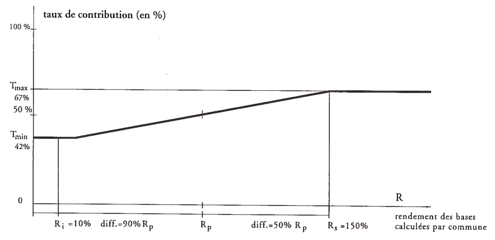
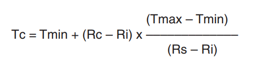

# Règlement grand-ducal du 20 avril 1962 réglant, en matière d'impôt commercial, les ventilations et la participation des communes de résidences des salariés.

## Titre Ier — Définitions

### Art. 1er.

L’impôt commercial au sens du présent règlement grand-ducal est l’impôt fixé sur la base de la [loi modifiée du 1er décembre 1936](https://legilux.public.lu/eli/etat/leg/loi/1936/12/01/n2/jo) concernant l’impôt commercial.

La base d’assiette globale est constituée par l’impôt commercial sur le bénéfice d’exploitation.

## Titre II — Ventilations

### Art. 2.

Lorsqu’une exploitation passible de l’impôt commercial possède, pendant le ou les exercices d’exploitation à considérer pour la détermination du bénéfice d’exploitation, des établissements stables sur le territoire de plusieurs communes indigènes, la base d’assiette globale est à répartir entre les communes de situation conformément aux dispositions ci-après.

Un préciput de 10% est attribué à la commune du siège d’exploitation, lorsque ce siège se trouve au Grand-Duché, et, au cas où ce siège est à l’étranger, à la commune sur le territoire de laquelle se trouve le principal établissement indigène.

Les 90% restants se répartissent entre les communes indigènes de situation:

a) en ce qui concerne les compagnies d’assurance, d’après le rapport qui existe entre d’une part les recettes brutes réalisées dans le ou les établissements stables situés sur le territoire de chaque commune indigène de situation et d’autre part les recettes brutes réalisées dans tous les établissements stables que l’exploitation considérée possède au Grand-Duché;

b) en ce qui concerne les banques et autres instituts de crédits, en tenant compte, pour un tiers:

1° du rapport qui, au début de l’exercice d’exploitation, existe entre d’une part la somme des dépôts et comptes courants de la clientèle, banquiers non compris, du ou des établissements stables situés sur le territoire de chaque commune indigène de situation et d’autre part la somme des dépôts de la clientèle, banquiers non compris, de tous les établissements stables que l’exploitation considérée possède au Grand-Duché;

2° du rapport qui, au début de l’exercice d’exploitation, existe entre d’une part la somme des avances à la clientèle, banquiers non compris, du ou des établissements stables situés sur le territoire de chaque commune indigène de situation et d’autre part la somme des avances a la clientèle, banquiers non compris, de tous les établissements stables que l’exploitation considérée possède au Grand-Duché;

3° du rapport qui existe entre d’une part les salaires payés aux salariés occupés auprès du ou des établissements stables situés sur le territoire de chaque commune indigène de situation et d’autre part les salaires payés à tous les salariés occupés auprès des établissements stables que l’exploitation considérée possède au Grand-Duché.

Les dépôts et comptes courants de la clientèle et les avances à la clientèle sont à arrondir au multiple inférieur de 100 euros.

Lorsqu’une banque, un institut de crédit ou un établissement stable de semblables exploitations comprend une partie d’exploitation exempte de l’impôt commercial, il faut éliminer les dépôts, comptes courants et avances de cette partie d’exploitation ainsi que les salaires payés aux salariés occupés exclusivement ou principalement auprès de cette partie d’exploitation;

c) en ce qui concerne les exploitations dans le chef desquelles les ventes de gros représentent moins de 10 p.c. du chiffre d’affaires global, par moitié d’après le procédé indiqué sub a) ci-dessus et par moitié d’après le rapport qui existe entre d’une part les salaires payés aux salariés occupés auprès du ou des établissements stables situés sur le territoire de chaque commune indigène de situation et d’autre part les salaires payés à tous les salariés occupés auprès des établissements stables que l’exploitation considérée possède au Grand-Duché;

d) en ce qui concerne les exploitations autres que celles visées sub a) à c) ci-dessus, d’après le rapport qui existe entre d’une part les salaires payés aux salariés occupés auprès du ou des établissements stables situés sur le territoire de chaque commune indigène de situation et d’autre part les salaires payés à tous les salariés occupés auprès des établissements stables que l’exploitation considérée possède au Grand-Duché.

Lorsqu’une exploitation visée à l’alinéa premier comprend un établissement stable qui s’étend sur le territoire de plusieurs communes, la répartition a lieu comme si ledit établissement était situé sur le territoire d’une commune tierce.

Entrent en ligne de compte les recettes brutes réalisées et les salaires payés pendant le ou les exercices d’exploitation à considérer pour la détermination du bénéfice. Tant les recettes bruttes que les salaires payés sont à arrondir au multiple inférieur de 100 euros.

Sont à considérer comme salaires pour l’application des dispositions du présent article les rémunérations au sens des dispositions qui régissent l’impôt sur le total des salaires. Toutefois, dans le cas des exploitants individuels, des exploitations commerciales collectives et des sociétés de personnes assimilées (paragraphe 2, al. 2, N° 1 de la [loi du 1.12.1936](https://legilux.public.lu/eli/etat/leg/loi/1936/12/01/n2/jo) concernant l’impôt commercial) un salaire fictif annuel de 2.900 euros est à mettre en compte pour l’exploitant ou pour l’ensemble des coexploitants ou associés au service de l’exploitation; il en est de même de l’ensemble des associés commandités au service d’une société en commandite par actions et de l’ensemble des associés au service d’une société de capitaux et dont chacun possède plus de 25% du capital social de la société de capitaux.

Sont à considérer comme «vente de gros» et comme «chiffre d’affaires global» au sens du présent article les fournitures visées au § 11, al. 1er et 2 et le chiffre d’affaires visé au § 13, al. 1er de l’ordonnance d’exécution du 23 décembre 1938 relative à l’impôt sur le chiffre d’affaires.

Lorsqu’une exploitation ou un établissement stable comprend une partie d’exploitation exempte de l’impôt commercial, les recettes réalisées dans cette partie d’exploitation sont à éliminer de même que les salaires payés aux salariés occupés exclusivement ou principalement auprès de cette partie d’exploitation.

### Art. 3.

Lorsque, pendant l’exercice d’exploitation à considérer pour la détermination du bénéfice, un établissement stable s’étend sur le territoire de plusieurs communes, la base d’assiette globale ou la quote-part de base d’assiette globale qui se rapporte à l’établissement stable est à répartir entre les communes de situation en tenant compte des conditions locales et des charges occasionnées à ces communes du fait de l’existence de l’établissement stable.

### Art. 4.

Au cas où les communes intéressées et le débiteur de l’impôt tombent d’accord sur un procédé de ventilation, la base d’assiette globale doit être ventilée d’après ce procédé.

### Art. 5.

Lorsque la quote-part de base d’assiette globale à attribuer à une commune par application des règles de ventilation prévues aux articles qui précèdent est inférieure à 2,50 euros, elle est à attribuer à la commune du siège d’exploitation, lorsque ce siège se trouve au Grand-Duché, et, au cas où ce siège est à l’étranger, à la commune sur le territoire de laquelle se trouve le principal établissement indigène.

### Art. 6.

L’impôt commercial revenant à une commune du chef de sa participation à une ventilation établie par application des dispositions des articles qui précèdent s’obtient en multipliant par son taux communal sa quote-part de base d’assiette globale.

### Art. 6bis.

(1) Au cas où les communes associées en syndicat intercommunal pour l’exploitation d’une zone d’activité intercommunale au sens de l’article 6 point 2b de la [loi modifiée du 1er mars 1952](https://legilux.public.lu/eli/etat/leg/loi/1952/03/01/n1/jo) tombent d’accord dans les statuts du syndicat sur un procédé de ventilation, les dispositions des articles 2, 5 et 6 ayant trait aux établissements stables qui s’étendent sur le territoire de plusieurs communes indigènes sont d’application correspondante aux établissements stables installés dans la zone d’activité intercommunale répondant aux conditions déterminées par le [règlement grand-ducal du 24 mars 1993](https://legilux.public.lu/eli/etat/leg/rgd/1993/03/24/n5/jo) fixant les critères auxquels doit répondre une zone d’activité intercommunale.

(2) Lorsque, pendant l’exercice d’exploitation à considérer pour la détermination du bénéfice, un établissement stable est installé dans une zone d’activité intercommunale, la base d’assiette globale ou la quote-part de base d’assiette globale qui se rapporte à l’établissement stable est ventilée d’après le procédé arrêté dans le cadre du règlement grand-ducal visé à l’alinéa précédent par toutes les communes membres du syndicat intercommunal.

(3) Au cas où une ou plusieurs des communes intéressées ne tombent pas d’accord sur un procédé de ventilation, le présent article est considéré comme inexistant.

## Titre III — Participation des communes au produit de l’impôt commercial

### Art. 7.

Le montant d’impôt commercial revenant à une commune est égal à ses rentrées d’impôt commercial diminuées de sa contribution au Fonds de dotation globale des communes. Toutefois, le montant par résident des rentrées d’impôt commercial d’une commune diminuées de sa contribution au fonds dépassant trois fois la moyenne nationale est versé au Fonds de l’emploi. Le montant dépassant le plafond prévu à l’article 8 de la [loi modifiée du 30 juin 1976](https://legilux.public.lu/eli/etat/leg/loi/1976/06/30/n1/jo) portant 1. création d’un fonds pour l’emploi; 2. réglementation de l’octroi des indemnités de chômage complet est versé au Fonds de dotation globale des communes.

## Titre IV — Dispositions finales

### Art. 13.

A la fin des mois de février, mai, août et novembre, une avance, à faire valoir sur l’attribution annuelle définitive, est versée par la Trésorerie de l’Etat aux communes. Le total des avances versées par la Trésorerie de l’Etat aux communes ne peut en aucun cas dépasser le montant de la participation directe à l’impôt commercial communal tel qu’établi par le ministre ayant l’Intérieur dans ses attributions. Le montant de l’avance à verser à chaque commune est calculé proportionnellement à la moyenne de ses participations directes des trois années précédentes. Le calcul des participations directes fictives à l’impôt commercial communal des trois années budgétaires précédant l’entrée en vigueur du présent règlement grand-ducal incombe au ministre ayant l’Intérieur dans ses attributions.

Après la fin de l’année, au plus tard le 30 avril qui suit, l’administration des contributions procède au calcul des attributions définitives pour ladite année sur la base de l’article 7, alinéa 2. La trésorerie de I’Etat procède au versement aux communes de ces attributions, compte tenu des sommes avancées en vertu de l’alinéa 1er.

### Art. 14.

Les dispositions du présent arrêté sont applicables à compter de l’année 1962 à l’impôt versé au titre des exercices postérieurs à 1951, sauf que pour l’année 1962 le taux des versements contributifs dont question à l’article 8 est fixé à 331/3% quel que soit le produit de l’impôt.

L’impôt versé au titre des exercices antérieurs à 1970 est ajouté au total des versements contributifs visé à l’alinéa 1er de l’article 7.

### Art. 15.

Sont abrogés les [arrêtés grand-ducaux du 5 juin 1952](https://legilux.public.lu/eli/etat/leg/agd/1952/06/05/n1/jo) réglant, en matière d’impôt commercial, les ventilations et la participation des communes de résidence des salariés et du [21 mars 1953](https://legilux.public.lu/eli/etat/leg/agd/1953/03/21/n1/jo) revisant certaines dispositions en matière de ventilation de l’impôt commercial communal ainsi que le [règlement grand-ducal du 8 novembre 1961](https://legilux.public.lu/eli/etat/leg/rgd/1961/11/08/n2/jo) modifiant, en matière d’impôt commercial communal, certaines dispositions relatives aux ventilations et à la participation des communes de résidence des salariés.

ANNEXE

1\) Représentation graphique

Légende:

– rendement des bases calculées d’une commune:

Rc = bases calculées/population de la commune

– rendement des bases calculées du pays

Rp = la somme des bases calculées/population totale du pays

– taux de contribution d’une commune

Tc = taux de contribution au fonds d’une commune

– amplitude de variation du taux est l’intervalle entre

Tmax (taux de contribution maximum) et

Tmin (taux de contribution minimum)

– plage d’application du taux de contribution variable est l’intervalle entre

Rs (rendement supérieur de bases calculées) et

Ri (rendement inférieur de bases calculées)

avec

Ri = (1 - i) x Rp où i est le facteur qui définit la limite inférieure de la plage par rapport au Rp; et

Rs = (1 + s) x Rp où s est le facteur qui définit la limite supérieure de la plage par rapport au Rp.

2\) Description du schéma

A partir du Rp qui exprime les potentialités fiscales par habitant du pays (comme si le pays ne formait qu’une seule commune) il est déterminé un intervalle défini par Ri (limite inférieure) et Rs (limite supérieure) à l’intérieur duquel le taux de contribution varie de son minimum (Tmin) à son maximum (Tmax) proportionnellement au rendement effectif des bases calculées par commune. A l’extérieur de l’intervalle ainsi défini le taux de contribution applicable est, soit le Tmin soit le Tmax.

3\) Formules de détermination du taux de contribution

| si Ri ≥ Rc | alors Tc = Tmin |
|---|---|
| si Rc ≥ Rs | alors Tc = Tmax |
| si Ri < Rc < Rs | alors |

4\) Exemples de détermination du taux de contribution

\*Hypothèses*

– le rendement des bases calculées du pays (Rp) a été déterminé sur base des recette fiscales de l’année et s’élève à 8.000,- LUF avec

– un Tmin = 42%

– un Tmax = 67%

– un Ri = 0,10 x 8.000,- = 800,-

– un Rs = 1,50 x 8.000,- = 12.000,-

– si pour une commune donnée le Rc = a) Rc = 700,- LUF: Rc ≤ Ri donc Tc = Tmin 700 < 800 = > Tc = 42% b) Rc = 17.000,- LUF: Rc ≥ Rs donc Tc = Tmax 17.000 > 12.000 = > Tc = 67% c) Rc = 10.000,- LUF: Ri < Rc < Rs = > Tc = formule Tc = Tmin + (Rc – Ri) x (Tmax – Tmin) (Rs – Ri) Tc = 42 + (10.000-800) x (67 - 42) (12.000-800) Tc = 42 + 9.200 x 25 = 42 + 20,53 = 62,53% 11.200[^3]

---

[^3]: [Règlement grand-ducal du 14 décembre 2016 portant exécution de la loi du 14 décembre 2016 portant création d'un Fonds de dotation globale des communes et modifiant: 1. le règlement grand-ducal modifié du 20 avril 1962 réglant, en matière d'impôt commercial, les ventilations et la participation des communes au produit de l'impôt commercial de résidence des salariés; 2. le règlement grand-ducal du 18 janvier 2012 fixant les modalités du calcul et du remboursement des frais de personnel à charge de l'État pour les fonctionnaires communaux, les employés communaux et les salariés des communes qui continuent à intervenir dans l'enseignement fondamental suivant conventions établies par l'État avec les communes concernées; 3. le règlement grand-ducal modifié du 30 juillet 2013 portant exécution de certaines dispositions du Titre 4. - De la comptabilité communale de la loi communale modifiée du 13 décembre 1988.](https://legilux.public.lu/eli/etat/leg/rgd/2016/12/14/n1/jo)
