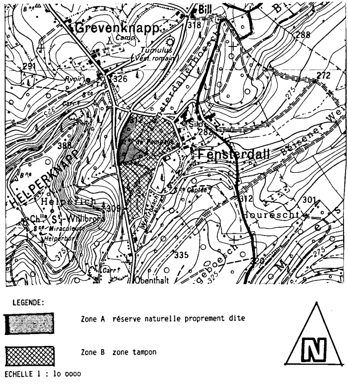

# Règlement grand-ducal du 18 février 1987 déclarant zone protégée la zone humide FENSTERDALL englobant des fonds sis sur le territoire de la commune de Boevange-sur-Attert.

Nous JEAN, par la grâce de Dieu, Grand-Duc de Luxembourg, Duc de Nassau;

Vu les articles 27 à 32 de la [loi du 11 août 1982](https://legilux.public.lu/eli/etat/leg/loi/1982/08/11/n1/jo) concernant la protection de la nature et des ressources naturelles;

Le conseil supérieur de la protection de la nature et des ressources naturelles entendu en son avis;

Vu le dossier établi par l’administration des eaux et forêts;

Vu l’avis émis par le conseil communal de Boevange-sur-Attert après enquête publique;

Notre Conseil d’Etat entendu;

Sur le rapport de Notre ministre de l’environnement et après délibération du Gouvernement en conseil;

Arrêtons:

## Art. 1er.

Est déclarée zone protégée la zone humide « FENSTERDALL » située sur le territoire de la commune de Boevange-sur-Attert.

## Art. 2.

La zone protégée «Fensterdall» se compose de deux parties:

aone la partie A dite réserve naturelle proprement dite formée par des fonds inscrits au cadastre de la commune de Boevange-sur-Attert sous les numéros 1483/1787 (partie), 1484/1789 (partie), 1487/686 (partie), parties indiquées sur le plan annexé qui fait partie intégrante du présent règlement;

bone la partie B dite zone tampon, formée par des fonds inscrits:

cone au cadastre de la commune de Boevange-sur-Attert, section A de Boevange, sous les numéros 1483/1017, 1483/1787 (partie), 1483/1788, 1484/1789 (partie) et 14871686 (partie), parties indiquées sur le plan annexé qui fait partie intégrante du présent règlement;

done au cadastre de la commune de Boevange-sur-Attert, section B de Buschdorf, sous les numéros 1067/1323 (partie), 1067/1324 (partie), 1068/1325, 1068/1326 (partie), parties indiquées sur le plan annexé qui fait partie intégrante du présent règlement.

## Art. 3.

Dans la réserve naturelle proprement dite (partie A) sont interdits:

aash les fouilles, sondages, terrassements et extractions de matériaux;

bash le drainage des eaux;

cash toute construction incorporée ou non au sol;

dash l’emploi de pesticides et de substances organiques ou minérales susceptibles de modifier la croissance de la végétation naturelle;

eash le changement d’affectation du sol;

fash la capture d’animaux appartenant à la faune sauvage indigène à l’exception de ceux appartenant à des espèces considérées comme gibier;

gash l’enlèvement de plantes appartenant à la flore sauvage indigène;

hash la circulation de personnes à pied, à cheval ou au moyen de tout véhicule quelconque;

iash la chasse;

jash la divagation d’animaux domestiques.

## Art. 4.

Dans la zone tampon (partie B) sont interdits:

aash l’enlèvement de terre végétale;

bash le changement d’affectation des sols;

cash le drainage des eaux.

## Art. 5.

Les dispositions des articles 3 et 4 ne concernent pas les mesures prises dans l’intérêt de la conservation de la zone protégée et de sa gestion. Ces mesures sont toutefois soumises à l’autorisation du ministre ayant dans ses attributions la protection de la nature et des ressources naturelles.

## Art. 6.

Notre ministre ayant dans ses attributions la protection de la nature et des ressources naturelles est chargé de l’exécution du présent règlement qui sera publié au Mémorial.

Le Ministre de l’Environnement,   Robert Krieps

Château de Berg, le 18 février 1987.   Jean

