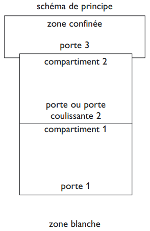
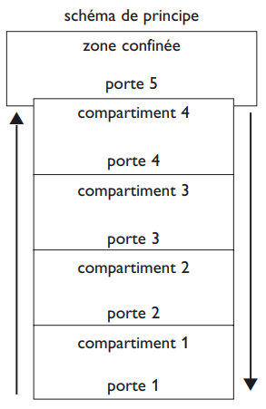

# Règlement grand-ducal du 15 juillet 1988 concernant la protection des travailleurs contre les risques liés à une exposition à l'amiante pendant le travail.

## Art. 1er.

1\. Le présent règlement a pour objet la protection des salariés[^96] contre les risques pour leur santé, y compris la prévention de tels risques, découlant ou pouvant découler d'une exposition, pendant le travail, à l'amiante. Il fixe des valeurs limites de cette exposition[^28] et d'autres dispositions particulières.

Les dispositions du [règlement grand-ducal du 13 mars 2025](https://legilux.public.lu/eli/etat/leg/rgd/2025/03/13/a93/jo) concernant la protection des salariés contre les risques liés à l’exposition à des agents cancérigènes ou mutagènes ou à des substances reprotoxiques au travail s’appliquent chaque fois qu’elles sont plus favorables à la santé et à la sécurité des salariés au travail.[^29]

2\. Le présent règlement ne s'applique pas:

aash à la navigation maritime,

bash à la navigation aérienne.[^5]

## Art. 2.

Aux fins du présent règlement, on entend par « amiante » les silicates fibreux suivants, classés comme substances cancérogènes de catégorie 1A en application de l’annexe VI, partie 3, du [règlement (CE) n° 1272/2008](https://legilux.public.lu/eli/reg_ue/2008/1272/jo) du Parlement européen et du Conseil du 16 décembre 2008 relatif à la classification, à l’étiquetage et à l’emballage des substances et des mélanges, modifiant et abrogeant les [directives 67/548/CEE](https://legilux.public.lu/eli/dir_ue/1967/548/jo) et [1999/45/CE](https://legilux.public.lu/eli/dir_ue/1999/45/jo) et modifiant le [règlement (CE) n° 1907/2006](https://legilux.public.lu/eli/reg_ue/2006/1907/jo) :

1° l’actinolite amiante, n° 77536-66-4 du registre du Chemical Abstracts Service, désigné ci-après « CAS » ;

2° l’amosite amiante (grunérite), n° 12172-73-5 du CAS ;

3° l’anthophyllite amiante, n° 77536-67-5 du CAS ;

4° la chrysotile amiante, n° 12001-29-5 du CAS ;

5° la crocidolite amiante, n° 12001-28-4 du CAS ;

6° la trémolite amiante, n° 77536-68-6 du CAS.[^30]

## Art. 3.

1\. Le présent règlement est applicable aux activités dans lesquelles les salariés[^97] sont exposés ou susceptibles d'être exposés pendant leur travail à la poussière provenant de l'amiante ou des matériaux contenant de l'amiante.

2\. Pour toute activité susceptible de présenter un risque d'exposition à la poussière provenant de l'amiante ou des matériaux contenant de l'amiante, ce risque doit être évalué de manière à déterminer la nature et le degré de l'exposition des salariés[^98] à la poussière provenant de l'amiante ou des matériaux contenant de l'amiante et de manière à donner la priorité à l’élimination de l’amiante ou de matériaux contenant de l’amiante par rapport à d’autres formes de manipulation de l’amiante[^31].

3\. Pour autant qu'il s'agit d'expositions sporadiques des salariés[^99] et que leur intensité est faible et lorsqu'il ressort clairement des résultats de l'évaluation des risques prévue au paragraphe 2 que la valeur limite pertinente de l’article 8[^32] ne sera pas dépassée dans l'air de la zone de travail, l’article 4 peut ne pas être appliqué[^33] lorsque le travail fait intervenir:

a) de courtes activités non continues d'entretien durant lesquelles le travail ne porte que sur des matériaux non friables;

b) le retrait sans détérioration de matériaux non dégradés dans lesquels les fibres d'amiante sont fermement liées dans une matrice;

c) l'encapsulation et le gainage de matériaux contenant de l'amiante qui sont en bon état;

d) la surveillance et le contrôle de l'air et le prélèvement d'échantillons destiné à déceler la présence d'amiante dans un matériau donné.[^7]

3bis. Des directives pratiques pour la définition des expositions sporadiques et des expositions de faible intensité, comme prévues au paragraphe 3, peuvent être définies en annexe.[^8]

4\. L'évaluation prévue au paragraphe 2 fait l'objet d'une consultation des salariés[^100] et/ou de la délégation du personnel de l'entreprise et est révisée lorsqu'il existe des raisons de penser qu'elle n'est pas correcte ou qu'une modification matérielle intervient dans le travail.

## Art. 4.

Sous réserve de l'article 3, paragraphe 3, les mesures suivantes doivent être prises:

1\) les activités visées à l'article 3, paragraphe 1 doivent faire l'objet d'une notification;

2\) la notification est faite par l’employeur à l’Inspection du travail et des mines avant le début des travaux. Cette notification inclut au moins une description succincte :

a) du lieu du chantier et, le cas échéant, des zones spécifiques où le travail doit être réalisé ;

b) du type et de la quantité d’amiante utilisés ou manipulés ;

c) des activités et des processus concernés, y compris en ce qui concerne la protection et la décontamination des salariés, l’élimination des déchets et, le cas échéant, le renouvellement de l’air en cas de travaux sous confinement ;

d) du nombre de salariés impliqués, de la liste des salariés susceptibles d’être affectés au site concerné, des certificats de formation individuels des salariés et de la date de la dernière évaluation de l’état de santé des salariés en application de l’article 14 ;

e) de la date de commencement des travaux et de leur durée ;

f) des mesures prises, y compris une vue d’ensemble des équipements utilisés, pour limiter l’exposition des salariés à l’amiante.

Les informations visées à la lettre d) sont conservées par l’Inspection du travail et des mines conformément à la législation pendant une durée d’au moins quarante ans après la fin de l’exposition pour s’assurer que les salariés qui effectuent des travaux liés à l’amiante sont correctement formés, en tenant dûment compte des effets à long terme de l’amiante sur la santé des salariés.[^34]

3\) les salariés[^101] concernés et les délégués du personnel ont accès au document faisant l'objet de la notification relative à leur entreprise;

4\) Chaque fois qu'un changement dans les conditions de travail est susceptible d'entraîner une augmentation significative de l'exposition à la poussière provenant de l'amiante ou des matériaux contenant de l'amiante, une nouvelle notification doit être faite.[^10]

## Art. 5.

La projection d’amiante par flocage ainsi que les activités qui impliquent l’incorporation de matériaux isolants ou insonorisants de faible densité (inférieure à 1 g/cm3) contenant de l’amiante sont interdites.[^2]

Sans préjudice de l'application d'autres dispositions réglementaires relatives à la commercialisation et à l'utilisation de l'amiante, les activités qui exposent les salariés[^102] aux fibres d'amiante lors de l'extraction de l'amiante, de la fabrication et transformation de produits d'amiante, ou de la fabrication et transformation de produits qui contiennent de l'amiante délibérément ajoutée, sont interdites, à l'exception du traitement et de la mise en décharge des produits résultant de la démolition et du désamiantage.[^11]

## Art. 6.

Pour toute activité visée à l’article 3, paragraphe 1er, l’exposition des salariés à la poussière provenant de l’amiante ou de matériaux contenant de l’amiante sur le lieu de travail doit être réduite à un minimum et, en tout cas, à un niveau aussi bas que techniquement possible en-dessous de la valeur limite pertinente de l’article 8, notamment au moyen des mesures suivantes :

1\) le nombre des salariés exposés ou susceptibles d’être exposés à la poussière provenant de l’amiante ou de matériaux contenant de l’amiante est limité au nombre le plus bas possible ;

2\) les processus de travail sont conçus de telle sorte qu’ils ne produisent pas de poussière d’amiante ou, si cela s’avère impossible, qu’il n’y ait pas de dégagement de poussière d’amiante dans l’air, grâce à la prise de mesures telles que :

a) la suppression de la poussière d’amiante ;

b) l’aspiration de la poussière d’amiante à la source ;

c) la sédimentation continue des fibres d’amiante en suspension dans l’air.

3\) les salariés sont soumis à une procédure de décontamination appropriée ;

4\) pour les travaux effectués sous confinement, une protection adéquate est assurée ;

5\) il est possible de nettoyer et d’entretenir régulièrement et efficacement tous les locaux et équipements servant au traitement de l’amiante et ceux-ci sont soumis à un nettoyage et à un entretien régulier ;

6\) l’amiante ou les matériaux contenant de l’amiante qui dégagent de la poussière d’amiante sont stockés et transportés dans des emballages clos appropriés ;

7\) les déchets, autres que les déchets provenant des activités minières, sont collectés et éliminés du lieu de travail dans les meilleurs délais possible dans des emballages clos appropriés revêtus d’étiquettes indiquant qu’ils contiennent de l’amiante et sont ensuite traités conformément aux dispositions de la [loi modifiée du 21 mars 2012](https://legilux.public.lu/eli/etat/leg/loi/2012/03/21/n1/jo) relative à la gestion des déchets.[^35]

## Art. 7.

1\. En fonction des résultats de l’évaluation initiale des risques, et afin de garantir le respect de la valeur limite pertinente de l’article 8, la mesure de la concentration en fibres d’amiante dans l’air sur le lieu de travail est effectuée à des intervalles réguliers au cours de phases opérationnelles spécifiques.[^36]

2\. L'échantillonnage doit être représentatif de l'exposition personnelle du salarié[^90] à la poussière provenant de l'amiante ou de matériaux contenant de l'amiante.

3\. Les échantillonnages sont effectués après consultation des salariés[^103] et/ou de leurs représentants dans les entreprises.

4\. Le prélèvement des échantillons est réalisé par un personnel possédant les qualifications requises. Les échantillons prélevés sont ensuite analysés conformément au paragraphe 6 dans les laboratoires équipés pour le comptage des fibres.

5\. La durée d'échantillonnage doit être telle qu'une exposition représentative peut être établie pour une période de référence de huit heures (un poste) au moyen de mesures ou de calculs pondérés dans le temps.

6\. Jusqu’au 20 décembre 2029, le comptage des fibres est effectué par microscope à contraste de phase conformément à la méthode recommandée par l’Organisation mondiale de la santé en 1997, par microscopie électronique ou par toute autre méthode qui donne des résultats équivalents ou plus précis.

À compter du 21 décembre 2029, le comptage des fibres est effectué par microscopie électronique ou par toute autre méthode qui donne des résultats équivalents ou plus précis.

Pour le mesurage de la concentration de fibres d’amiante dans l’air, visé au paragraphe 1er, ne sont prises en considération que les fibres d’une longueur supérieure à 5 micromètres, d’une largeur inférieure à 3 micromètres et dont le rapport longueur/largeur est supérieur à 3:1.

Nonobstant l’alinéa 2, les fibres d’une largeur inférieure à 0,2 micromètre sont également prises en considération aux fins de l’article 8, paragraphes 2, point 1°, et 4, point 1°, à compter du 21 décembre 2029.[^37][^13]

## Art. 8.

1\. Jusqu’au 20 décembre 2029, les employeurs veillent à ce qu’aucun salarié ne soit exposé à une concentration d’amiante en suspension dans l’air supérieure à 0,01 fibre par cm3 mesurée par rapport à une moyenne pondérée dans le temps sur 8 heures (TWA).

2\. À compter du 21 décembre 2029, les employeurs veillent à ce qu’aucun salarié ne soit exposé à une concentration d’amiante en suspension dans l’air supérieure :

1\) à 0,01 fibre par cm3 en moyenne pondérée dans le temps sur 8 heures (TWA), conformément à l’article 7, paragraphe 6, alinéa 3 ; ou

2\) à 0,002 fibre par cm3 en moyenne pondérée dans le temps sur 8 heures (TWA).

3\. Jusqu’au 20 décembre 2029, la valeur alarme de la concentration d’amiante en suspension dans l’air lors de la surveillance d’un chantier de désamiantage est fixée à 0,005 fibre par cm3 mesurée par rapport à une moyenne pondérée dans le temps sur 8 heures (TWA).

4\. À compter du 21 décembre 2029, la valeur alarme de la concentration d’amiante en suspension dans l’air lors de la surveillance d’un chantier de désamiantage est fixée :

1\) à 0,005 fibre par cm3 en moyenne pondérée dans le temps sur 8 heures (TWA), conformément à l’article 7, paragraphe 6, alinéa 3 ; ou

2\) à 0,001 fibre par cm3 en moyenne pondérée dans le temps sur 8 heures (TWA).[^38]

## Art. 9.

1\. Lorsque la valeur limite pertinente de l’article 8 est dépassée, ou qu’il y a des raisons de penser que des matériaux contenant de l’amiante qui n’ont pas été recensés avant les travaux ont été altérés de sorte qu’ils libèrent de la poussière, les travaux cessent immédiatement.

Les travaux ne se poursuivent dans la zone affectée que si des mesures adéquates sont prises pour la protection des salariés concernés.

Lorsque la valeur limite pertinente de l’article 8 est dépassée, les causes de ce dépassement doivent être déterminées et les mesures propres à remédier à la situation doivent être prises dès que possible.

2\. Afin de vérifier l’efficacité des mesures visées au paragraphe 1er, alinéa 3, il est procédé immédiatement à une nouvelle détermination de la teneur de l’air en amiante.

3\. Lorsque l’exposition ne peut être réduite par d’autres moyens et que la valeur limite impose le port d’un équipement respiratoire de protection individuelle, celui-ci n’est pas permanent et est limité au strict minimum nécessaire pour chaque salarié. Pendant les périodes de travail requérant le port d’un tel équipement, des pauses régulières sont prévues en fonction des contraintes physiques et climatologiques, et le cas échéant, en concertation avec les salariés et la délégation du personnel.[^39]

## Art. 9*bis*.

Avant d'entreprendre des travaux de démolition ou de maintenance, les employeurs prennent, au besoin en obtenant des informations auprès des propriétaires des locaux, toute mesure appropriée pour identifier les matériaux présumés contenir de l'amiante.

S'il existe le moindre doute concernant la présence d'amiante dans un matériau ou une construction les dispositions applicables du présent règlement sont observées.[^17]

## Art. 10.

1\. Pour certaines activités telles que les travaux de démolition, de désamiantage, de réparation[^40] et de maintenance, pour lesquelles le dépassement de la valeur limite pertinente de[^41] l'article 8 est prévisible malgré le recours aux mesures techniques préventives visant à limiter la concentration d’amiante dans l’air[^42], l'employeur définit les mesures destinées à assurer la protection des salariés[^104] durant ces activités, notamment les suivantes:

a) les salariés reçoivent des équipements de protection personnelle appropriés qu’ils doivent porter, qui sont manipulés de manière appropriée et, en ce qui concerne notamment l’équipement respiratoire, ajusté individuellement, y compris au moyen d’essais d’ajustement, conformément aux dispositions du [règlement grand-ducal modifié du 4 novembre 1994](https://legilux.public.lu/eli/etat/leg/rgd/1994/11/04/n3/jo) concernant les prescriptions minimales de sécurité et de santé pour l’utilisation par les travailleurs au travail d’équipements de protection individuelle ;[^43]

b) des panneaux d'avertissement sont mis en place pour signaler que le dépassement de la valeur limite pertinente de[^44] l'article 8 est prévisible ;[^45]

c) la dispersion de la poussière provenant de l'amiante ou de matériaux contenant de l'amiante en dehors des locaux ou[^46] du site d'action est évitée et, pour les travaux effectués sous confinement, la zone confinée est étanche et ventilée par extraction mécanique[^47].[^18]

2\. Les salariés[^105] et/ou la délégation du personnel sont consultés sur ces mesures avant qu'il ne soit procédé à ces activités.

## Art. 11.

1\. Avant le début des travaux de démolition ou de retrait de l'amiante et/ou de matériaux contenant de l'amiante des bâtiments, structures, appareils et installations ainsi que des navires, un plan de travail doit être établi par l'employeur et transmis à l'Inspection du travail et des mines.

2\. Le plan de travail doit comporter les informations énumérées à l'annexe I.

3\. Les travaux ne peuvent commencer qu'après réception du plan de travail visé par l'Inspection du travail et des mines. Le visa n'est pas requis pour les travaux avec faible envergure et les travaux de démontage nondestructif de plaques en amiante-ciment sur des toits ou des murs extérieurs si le bâtiment concerné n'est pas occupé par du public lors de ces travaux.

4\. Les dispositions de sécurité et de santé énumérées dans les annexes III, IV, V et VI doivent être respectées lors des travaux et sont à intégrer dans le plan de travail.

5\. A l'exception des travaux figurants à l'annexe V, un avis de conformité est à élaborer par un organisme de contrôle et à joindre au plan de travail.

6\. L'Inspection du travail et des mines met à la disposition des demandeurs des formulaires de demande, adaptés à la nature et à l'envergure des travaux de désamiantage.[^19]

## Art. 11*bis*.

1\. Les employeurs sont tenus de prévoir une formation appropriée pour tous les salariés[^106] qui sont exposés ou susceptibles d'être exposés à la poussière contenant de l'amiante. Cette formation doit être dispensée à intervalles réguliers et sans frais pour les salariés[^107]. Elle doit être dispensée avant le début de tout travail exposant à l'amiante.

2\. Le contenu de la formation doit être facilement compréhensible par les salariés[^108]. Il doit leur permettre d'acquérir les connaissances et les compétences nécessaires en matière de prévention et de sécurité, notamment ce qui concerne:

a) les propriétés de l'amiante et ses effets sur la santé, y compris l'effet synergique du tabagisme;

b) les types de produits ou matériaux susceptibles de contenir de l'amiante;

c) les opérations pouvant entraîner une exposition à l'amiante et l'importance des contrôles préventifs pour minimiser l'exposition;

d) les pratiques professionnelles sûres, les contrôles et les équipements de protection;

e) le rôle approprié, le choix, la sélection, les limites et la bonne utilisation de l'équipement respiratoire;

f) les procédures d'urgence;

g) les procédures de décontamination;

h) l'élimination des déchets;

i) les exigences en matière de surveillance médicale;

j) la législation relative à l'amiante.

3\. Pour pouvoir effectuer des travaux de démontage de plaques en amiante-ciment sur des toits ou des murs extérieurs, un responsable de l'entreprise qui effectue ces travaux doit avoir suivi une formation de 8 heures.

Un contrôle des connaissances doit être effectué par le formateur et un représentant de l'Inspection du travail et des mines qui délivrent un certificat de compétence concernant la protection des salariés[^109] contre les risques liés à l'exposition à l'amiante pendant le travail. Une copie de ce certificat doit être disponible sur le lieu de travail.

3*bis*. Pour pouvoir effectuer un repérage de matériaux contenant de l’amiante, un repéreur qui effectue ces travaux doit avoir suivi une formation de douze heures.

Un contrôle des connaissances doit être effectué par le formateur et un représentant de l’Inspection du travail et des mines qui délivrent un certificat de compétence concernant la protection des salariés contre les risques liés à l’exposition à l’amiante pendant le travail. Une copie de ce certificat doit être disponible sur le lieu de travail.[^48]

3*ter*. Pour pouvoir effectuer des travaux de démolition ou de désamiantage, les salariés qui effectuent ces travaux doivent avoir suivi, outre la formation visée au paragraphe 4 dont les matières sont définies au paragraphe 2, une formation de deux heures concernant l’utilisation de l’équipement technologique et des machines pour limiter le dégagement et la diffusion de fibres d’amiante lors des processus de travail. Sans préjudice des règles relatives au renouvellement annuel de la formation visées au paragraphe 4, la formation concernant l’utilisation de l’équipement technologique et des machines pour limiter le dégagement et la diffusion de fibres d’amiante lors des processus de travail doit être renouvelée annuellement pendant une durée d’au moins une heure.

Un contrôle des connaissances doit être effectué par le formateur et un représentant de l’Inspection du travail et des mines qui délivrent un certificat de compétence concernant l’utilisation de l’équipement technologique et des machines pour limiter le dégagement et la diffusion de fibres d’amiante lors des processus de travail. Une copie de ce certificat doit être disponible sur le lieu de travail.[^49]

4\. Pour pouvoir effectuer tous les autres types de travaux exposant à l'amiante un responsable de l'entreprise qui effectue ces travaux, le surveillant du chantier et chaque salarié[^91] exposé aux fibres d'amiante doivent avoir suivi une formation de 20 heures. Cette formation doit être renouvelée annuellement pendant une durée d'au moins 4 heures.

Un contrôle des connaissances doit être effectué par le formateur et un représentant de l'Inspection du travail et des mines qui délivrent un certificat de compétence concernant la protection des salariés[^110] contre les risques liés à l'exposition à l'amiante pendant le travail au salarié[^92]. Une copie de ce certificat doit être disponible sur le lieu de travail.

5\. Des certificats de compétence concernant la protection des salariés[^111] contre les risques liés à l'exposition à l'amiante pendant le travail déjà délivrés peuvent être reconnus comme équivalents par l'Inspection du travail et des mines s'ils ont été délivrés sur base des principes des points 2 à 4 de l'article 11bis.

6\. Par disposition transitoire, les travaux énumérés aux points 3 et 4 précédents du présent article peuvent être effectués sans certificat de compétence jusqu'au 1er septembre 2008.[^50]

7\. La formation est assurée par un formateur ou un organisme de formation habilité conformément à l’article L. 542-2 du [Code du travail](https://legilux.public.lu/eli/etat/leg/code/travail).

8\. Chaque salarié ayant participé à une formation visée aux paragraphes 3, 3*bis,* 3t*er* ou 4 et ayant satisfait aux exigences du contrôle des connaissances reçoit un certificat de compétence indiquant les éléments suivants :

a) la date de la formation ;

b) la durée de la formation ;

c) le contenu de la formation ;

d) la langue dans laquelle la formation a été dispensée ;

e) le nom, la qualification et les coordonnées du formateur ou de l’organisme assurant la formation, ou les deux.[^51]

## Art. 11*ter*.

Avant d'obtenir le visa prévu à l'article 11, les entreprises doivent fournir des preuves de leurs capacités dans ce domaine à l'Inspection du travail et des mines.

Ces preuves consistent en des documents sur:

aash les procédures de travail,

bash les procédures de maintenance de l'équipement de travail,

cash les procédures de maintenance de l'équipement de protection individuelle,

dash la formation des salariés[^112],

eash le suivi médical des salariés[^113].[^20]

## Art. 12.

1\. Pour toute activité visée à l'article 3 paragraphe 1 et sous réserve de l'article 3 paragraphe 3, les mesures appropriées sont prises pour que:

a) les lieux où se déroulent ces activités:

i) soient clairement délimités et signalés par des panneaux;

ii) ne puissent être accessibles aux salariés[^114] autres que ceux qui, en raison de leur travail ou de leur fonction sont amenés à y pénétrer;

iii) fassent l'objet d'une interdiction de fumer;

b) des zones soient aménagées permettant aux salariés[^115] de manger et de boire sans risque de contamination par la poussière d'amiante;

c) i) des vêtements de travail ou de protection appropriés soient mis à la disposition des salariés[^116];

ii) ces vêtements de travail ou de protection ne quittent pas l'entreprise. Ils peuvent toutefois être lavés dans les blanchisseries équipées pour ce genre d'opérations, situées en dehors de l'entreprise, si celle-ci ne procède pas elle-même au nettoyage; dans ce cas, le transport des vêtements doit être effectué dans des récipients fermés;

iii) un rangement séparé des vêtements de travail ou de protection, d'une part, et des vêtements de ville, d'autre part, soit assuré;

iv) des installations sanitaires appropriées et adéquates comprenant des douches dans le cas d'opérations poussiéreuses soient mises à la disposition des salariés[^117];

v) des équipements de protection soient placés dans un endroit déterminé; qu'ils soient vérifiés et nettoyés après chaque utilisation et que les mesures appropriées soient prises pour réparer ou remplacer les équipements défectueux avant une nouvelle utilisation.

2\. Le coût des mesures prises en application des dispositions prévues au paragraphe 1 est à charge de l'employeur.

## Art. 13.

1\. Pour toute activité visée à l'article 3 paragraphe 1, les mesures approprées sont prises pour que les salariés[^118] y compris les délégués du personnel dans l'entreprise ou l'établissement reçoivent une information adéquate concernant:

aash les risques potentiels pour la santé dus à une exposition à la poussière provenant de l'amiante ou des matériaux contenant de l'amiante,

bash l'existence de valeurs limites réglementaires et la nécessité de la surveillance atmosphérique,

cash des prescriptions relatives aux mesures d'hygiène, y compris la nécessité de ne pas fumer,

dash les précautions à prendre en ce qui concerne le port et l'emploi d'équipements et de vêtements de protection,

eash les précautions particulières destinées à minimiser l'exposition à l'amiante.

2\. Outre les mesures visées au paragraphe 1 et sous réserve de l'article 3 paragraphe 3, les mesures appropriées sont prises pour que:

a) les salariés[^119] et/ou les délégués du personnel aient accès aux résultats des mesures de la teneur de l'air en amiante et qu'ils puissent recevoir des explications concernant la signification de ces résultats;

b) si les résultats dépassent la valeur limite pertinente de[^52] l'article 8, les salariés[^120] concernés et leurs représentants au sein de l'entreprise ou de l'établissement soient informés le plus rapidement possible de ces dépassements et de leurs causes et que les salariés[^121] et/ou leurs représentants dans l'entreprise ou l'établissement soient consultés sur les mesures à prendre ou, en cas d'urgence, informés des mesures prises.[^21]

## Art. 14.

Sous réserve de l'article 3, paragraphe 3, les mesures suivantes doivent être prises:[^53]

1\) Une[^54] évaluation de son état de santé doit être disponible pour chaque salarié[^93] préalablement à l'exposition à la poussière provenant de l'amiante ou des matériaux contenant de l'amiante.

Cette évaluation doit inclure un examen spécifique du thorax. L'annexe II donne des recommandations pratiques auxquelles il est possible de se référer pour la surveillance clinique des salariés[^122].

Une nouvelle évaluation doit être disponible au moins une fois[^55] tous les trois[^56] ans aussi longtemps que dure l'exposition.

Un dossier médical individuel est établi auprès du service de la médecine au travail compétent pour chaque salarié visé à l’alinéa 1er[^57].[^22]

2\) À[^58] la suite de la surveillance clinique visée au point 1, le directeur de l'inspection du travail et des mines ou, en cas d'empêchement, le directeur adjoint su r avis d'un médecin du travail de la direction de la santé, pourra se prononcer sur ou déterminer les éventuelles mesures individuelles de protection ou de prévention à prendre; ces mesures peuvent comprendre, le cas échéant, le retrait du salarié[^94] concerné de toute exposition à la poussière provenant de l'amiante ou des matériaux contenant de l'amiante conformément à l'article L. 351-4 du [Code du travail](https://legilux.public.lu/eli/etat/leg/code/travail).[^59]

3\) Des informations et des conseils doivent être fournis aux salariés[^123] en ce qui concerne toute évaluation de leur santé à laquelle ils peuvent se soumettre après la fin de l'exposition.

Le médecin du travail peut indiquer que la surveillance médicale doit se prolonger après la fin de l'exposition pendant le temps qu'il juge nécessaire pour sauvegarder la santé de l'intéressé.[^23]

4\) L[^60]e salarié[^95] concerné ou l'employeur peuvent demander la révision des évaluations visées aux points 1 et 2.

## Art. 15.

Sous réserve de l'article 3, paragraphe 3:[^61]

1\) L’employeur inscrit dans un registre les informations relatives aux salariés exerçant les activités visées à l’article 3, paragraphe 1er. Ces informations indiquent la nature et la durée de l’activité ainsi que l’exposition à laquelle les salariés ont été soumis. Le médecin du travail a accès à ce registre. Les salariés ont accès à leurs résultats personnels contenus dans ce registre. Les salariés et les délégués du personnel ont accès aux informations collectives anonymes contenues dans ce registre.[^62]

2\) Le registre visé au point 1 et les dossiers médicaux individuels visés à l'article 14[^63], point 1, alinéa 4,[^64] sont à conserver au moins quarante ans après la fin de l'exposition.[^24]

3\) Au cas où l'entreprise cesse son activité, ces documents sont mis à la disposition de la division de la santé au travail et de l’environnement[^65].[^25]

## Art. 16.

L’Association d’assurance accident tient un registre de tous les cas de maladies professionnelles liées à l’amiante diagnostiquées médicalement. Une liste indicative des maladies qui peuvent être causées par une exposition à l’amiante est établie à l’annexe II.[^66]

## Art. 17.

Les annexes du présent règlement pourront être modifiées par règlement ministériel.

## Art. 18.

Notre Ministre du travail et Notre Ministre de la santé sont chargés, chacun en ce qui le concerne, de l'exécution du présent règlement qui sera publié au Mémorial.

\**ANNEXE I**

\**Informations devant figurer dans le plan de travail prévu à l’article 11**

Identification de l’employeur.

Identification du propriétaire des lieux où se dérouleront les travaux d’assainissement.

Identification de l’emplacement de l’établissement où se dérouleront les travaux d’assainissement.

Identification du coordinateur en matière de sécurité.

Identification de l’organisme de contrôle [*].

Informations relatives aux travaux d’assainissement d’amiante:

aone Durée du chantier.

bone Date de début du chantier.

cone Date de fin du chantier.

done Nature et quantité de l’amiante à enlever.

eone Nombre des salariés[^125].

fone Nom du transporteur des déchets d’amiante.

Description des mesures prises pour la sécurité et la santé des salariés[^136] sur le lieu de travail.

Confirmation que l’amiante et/ou les matériaux contenant de l’amiante sont éliminés avant l’application des techniques de démolition, sauf dans le cas où cette élimination causerait un plus grand risque pour les salariés[^135] que si l’amiante et/où les matériaux contenant de l’amiante étaient laissés sur place.

Avant la reprise d’autres activités, confirmation de l’absence de risques d’exposition à l’amiante sur le lieu de travail une fois les travaux de démolition ou de désamiantage terminés.[^67]

Enumération de l’équipement de protection individuelle mis à disposition des salariés[^134].

Enumération de l’équipement de protection collective.

Un plan[^68] à l’échelle 1/200 ou plus précis du chantier comme construit et de ses alentours directs, sur lequel sont indiqués l’installation de captage d’air et les endroits de rejet d’air, les sas d’accès à la zone à assainir, les sorties de secours ainsi que la zone de stockage des déchets résultant des travaux d’assainissement d’amiante [*].

[*] = informations et pièces qui ne sont pas requises pour les travaux de démontage de plaques en amiante-ciment sur des toits ou des murs extérieurs.

Date et identification du plan de travail.

Signature de l’employeur.

\**Le formulaire type du plan de travail à utiliser est disponible sur le site Internet de l’Inspection du travail et des mines.**

\**ANNEXE II**

\**Recommandations pratiques pour la surveillance clinique des salariés[^133] visées à l’article 14 point 1**

1\. Au stade actuel des connaissances, l’exposition aux fibres d’amiante peut provoquer les affections suivantes:

aash asbestose,

bash mésothéliome,

cash cancer du poumon,

dash cancer gastro-intestinal,[^69]

– cancer du larynx,

– cancer des ovaires,

– affections de la plèvre non malignes.[^70]

2\. Le médecin du service de médecine du travail compétent, ou le directeur de l’Inspection du travail et des mines ensemble avec le médecin du travail de la Direction de la santé doivent connaître les conditions ou les circonstances dans lesquelles chaque salarié[^124] a été exposé.

3\. L’examen de santé des salariés[^132] devrait être effectué conformément aux principes et aux pratiques de la médecine du travail. Il devrait comporter au moins les mesures suivantes:

aash établissement du dossier médical et professionnel du travailleur,

bash entretien personnel,

cash examen clinique général et notamment du thorax,

dash examens de la fonction respiratoire (spirométrie et courbe débit-volume).

Le médecin du travail doit décider de la nécessité d’autres examens tels que les examens cytologiques des crachats, une radiographie du thorax ou une tomodensitométrie, à la lumière des connaissances les plus récentes en matière de médecine de travail.

\**ANNEXE III**

\**Organisation du chantier d’enlèvement d’amiante friable ou de flocage**

\**1. Types de chantiers**

Il existe en principe trois types de chantier d’enlèvement d’amiante friable ou de flocage. Tous les autres cas sont à discuter au préalable avec l’Inspection du travail et des mines qui décidera des procédures à appliquer.

\**1.1. Chantier normal**

Tout chantier de retrait d’amiante (à l’exception du point 1.3) doit être réalisé en zone confinée.

\**1.2. Travaux avec faible envergure**

Les travaux de faible envergure sont des travaux de retrait d’applications d’amiante qui peuvent être réalisés à l’aide de deux personnes en 4 heures, les travaux de préparation du chantier et de remise en état inclus pour l’ensemble d’un chantier.

Le chantier de retrait d’amiante doit être mis en zone confinée moyennant un sas d’entrée et d’un extracteur. Lors de ces travaux, la concentration en fibres d’amiante à l’intérieur de la zone de travail ne doit pas dépasser la valeur limite. Des mesures par microscopies optique[^71] à l’extérieur de la zone de travail (max. 0,010 f/cm3)[^72] de suivi de chantier pour contrôler le non-dépassement de la valeur alarme pertinente[^73] et des mesures par microscopie électronique de restitution (max. 500 f/m3) doivent être réalisées si ces endroits sont occupés par des salariés[^131] ou du public pendant et/ou après les travaux d’assainissement.

Des travaux de faible envergure sont p. ex.:

aot enlevage des joints sur le brûleur d’une chaudière ou sur une porte

bot enrobage des isolations de compartiments, p. ex. près de chemins à câbles

\**1.3. Travaux avec méthode standardisée**

Des travaux avec méthode standardisée sont des travaux pendant lesquels la valeur limite n’est pas dépassée et dont la méthode de travail est standardisée et validée par l’Inspection du travail et des mines sur base d’une procédure d’essais avec des mesures de la concentration de fibres d’amiante pendant et après le retrait d’applications d’amiante. Une demande spécifique sur base d’un rapport établi par un organisme de contrôle doit être introduite pour accord auprès de l’Inspection du travail et des mines. Cette demande doit comprendre une description détaillée de la méthode de travail, les résultats des mesures de surveillance optiques ou[^74] électroniques et un projet d’un plan de surveillance.

\**2. Définitions et prescriptions organisationnelles et techniques**

\**2.1. Zone confinée:** zone étanche et isolée vers l’extérieur dans laquelle les applications d’amiante sont enlevées, également désignée comme zone «noire». Afin de limiter une contamination supplémentaire par les travaux de désamiantage, la zone de travail doit être isolée et limitée à l’espace nécessaire à ces travaux. Les parois, sols, plafonds et autres surfaces ou objets non contaminés sont à protéger par des films transparents en plastique.

Les parois et les plafonds de la zone étanche et isolée sont à recouvrir de deux films d’une épaisseur minimale de 200 μm chacun. A l’exception des travaux d’enlèvement de flocage, un cloisonnement étanche déjà existant, tel qu’un mur ou plafond, peut être considéré comme film extérieur. Les sols reçoivent deux films renforcés d’une épaisseur minimale de 200 μm chacun.

En cas de risque d’incendie, les films doivent être ignifuges.

En cas de films non transparents, une ou plusieurs fenêtres de contrôle sont à aménager dans la zone confinée.

Une réception de la zone confinée doit être effectuée par un organisme de contrôle avant le début des travaux d’assainissement.

\**2.2. Zone blanche:** zone non contaminée par des fibres d’amiante et adjacente à la zone confinée.

\**2.3. Sas matériel**

Tous les matériaux et tous les déchets qui sont à évacuer de la zone confinée pendant l’assainissement doivent passer par le sas matériel. Ce sas, qui se compose de deux compartiments, dispose d’une surveillance de dépression dans le compartiment 2.

Procédure d’accès:

1\. Dans une 1ère étape, la porte 3 est ouverte et les récipients contenant les déchets, ainsi que les matériaux, sont entreposés dans le compartiment 2. La porte 3 est refermée et on effectue la décontamination des déchets/matériaux (p. ex. par aspiration, lavage).

2\. Ensuite la porte 2 est ouverte et les déchets, ainsi que les matériaux sont transportés dans le compartiment 1, la porte 2 est refermée.

3\. Un échange de l’air d’au moins 30 fois est à réaliser à l’intérieur du compartiment 1, afin d’évacuer d’éventuelles fibres d’amiante dans l’air ambiant. Après cet échange d’air, la porte 1 en direction de la zone blanche peut être ouverte et les récipients contenant les déchets, ainsi que les matériaux enlevés.

\**2.4. Sas personnel**

Le sas personnel se compose de 4 compartiments comprenant une douche:

Procédure d’entrée en zone confinée:

1\. dans le compartiment 1 on met le masque et on se déshabille;

2\. on traverse le compartiment 2;

3\. dans le compartiment 3 on met les vêtements jetables;

4\. on traverse le compartiment 4 pour accéder à la zone confinée. Veillez à ce que toutes les portes soient bien fermées;

Procédure de sortie de la zone confinée:

1\. dans le compartiment 4 un bref nettoyage des vêtements lorsqu’on sort de la zone confinée;

2\. dans le compartiment 3 on se déshabille, on garde le masque;

3\. chaque fois quand on sort, on prend une douche dans le compartiment 2. Le masque doit être porté pendant la douche, seulement à la fin le masque peut être retiré et nettoyé;

4\. dans le compartiment 1 on remet les vêtements normaux.

Les divers compartiments sont à aérer de façon à évacuer les fibres d’amiante du compartiment 1 vers la zone confinée.

\**2.5. Extracteur:** afin de garantir un quintuple échange de l’air par heure, des extracteurs doivent être installés en nombre suffisant et avec une capacité d’extraction suffisante.

\**2.6. Flux d’air dirigé:** un flux d’air dirigé doit être créé à l’intérieur de la zone confinée. Pour améliorer le flux d’air dans la zone confinée, des ouvertures en nombre limité peuvent être aménagées dans les films. Ces ouvertures doivent être protégées contre la libération accidentelle de fibres et ne peuvent s’ouvrir qu’en direction de la zone confinée.

\**2.7. Sous-pressions et test de fumée:** la zone confinée et les sas doivent être mis sous dépression avant le début des travaux de retrait d’applications d’amiante. A cette fin un test de fumée est réalisé avant la mise en marche des extracteurs pour contrôler visuellement l’étanchéité de la zone confinée. Ensuite les extracteurs sont mis en service pour déterminer la présence d’un flux d’air dirigé à l’intérieur de la zone. Les sous-pressions sont mesurées à l’intérieur de la zone confinée, dans le compartiment 2 du sas matériel et dans le compartiment 4 du sas personnel. Les valeurs limites pour la zone de confinement et les sas sont de minimum 20 Pa pendant les heures de travail et de minimum 10 Pa pendant l’arrêt des travaux.

\**2.8. Equipement de protection:** toute personne qui accède à la zone confinée pendant les travaux de retrait d’applications d’amiante doit porter l’équipement de protection individuel et doit suivre les procédures définies au point 2.4 (sas personnel):

aot combinaison jetable avec cagoule ou (combinaison réutilisable sur demande)

bot chaussures ou bottes de sécurité

cot le cas échéant gants de travail

dot le cas échéant casque de protection

eot masque intégral disposant d’un système de ventilation avec un filtre TMP3

Remarque concernant la protection respiratoire:

A. Une concentration de fibres inférieure à 6.000.000 fibres/m3, impose le port d’un appareil filtrant (pièce faciale et dispositif de filtration de l’air ambiant). Les durées d’utilisation pour ces appareils sont au maximum de 120 minutes, une interruption d’au moins 30 minutes s’impose ensuite.

B. Un niveau de danger important avec une concentration supérieure à 6.000.000 fibres/m3 impose le port obligatoire d’un appareil isolant. La durée d’utilisation permanente ne devrait pas excéder 90 minutes, une interruption d’au moins 30 minutes s’impose ensuite.

Pendant l’interruption du port de masque respiratoire, d’autres travaux peuvent être faits.

\**2.9. Surveillant du chantier:** pour chaque chantier, la société chargée du retrait des applications d’amiante doit nommer au moins un surveillant. Cette personne doit avoir une expérience professionnelle dans le retrait d’applications d’amiante d’au moins une année.

Le surveillant doit être présent à tout moment sur le chantier pendant les travaux de retrait d’amiante et doit s’assurer que:

aot le personnel porte son équipement de protection individuelle lors des travaux de retrait d’applications d’amiante

bot le personnel exécute les travaux de retrait d’application d’amiante selon le plan de travail

cot le personnel commence les travaux d’installation de chantier après la réalisation des mesures de background

dot les travaux de retrait d’application d’amiante ne peuvent commencer, le cas échéant, qu’après réception du chantier par un organisme de contrôle

eot le chantier de retrait d’application d’amiante est signalé conformément aux règlements en vigueur

fot le chantier de retrait d’application d’amiante est interdit à toute personne étrangère au service

got le chantier de retrait d’application d’amiante est nettoyé après le retrait complet des applications d’amiante

\**2.10. Coordinateur en matière de sécurité et de santé:** Dans le cadre d’un chantier où différents corps de métiers sont sur un chantier, un coordinateur de sécurité doit être nommé conformément à la législation concernant les prescriptions minimales de sécurité et de santé à mettre en œuvre sur les chantiers temporaires ou mobiles.

\**2.11. Secouriste:** Un secouriste doit être présent sur le chantier conformément à la législation en vigueur

\**2.12. Extincteur:** La société chargée du retrait des applications d’amiante doit disposer d’extincteurs de feu en nombre suffisant sur le chantier.

\**2.13. Plan d’évacuation et sortie de secours:** Un plan d’évacuation indiquant les sorties de secours doit être établi et affiché. Le surveillant doit mettre en œuvre les mesures y énoncées.

\**3. Méthodes de référence pour l’évaluation du nombre de fibres d’amiante**

aash NBN T 96-102 Détermination de la concentration en fibres d’amiante – Méthode de la membrane filtrante avec **microscopie optique** à contraste de phase.

bash VDI 3492 Messen von Innenraumluftverunreinigungen – Messen von Immissionen – Messen anorganischer faserförmiger Partikeln – **Rasterelektronenmikroskopisches Verfahren**.

\**4. La température minimale à l’intérieur d’une zone confinée doit être de 12 °C pendant les travaux**

\**5. Registre de chantier**

Un registre de chantier doit être établi et mis à la disposition de l’autorité compétente. Le registre doit au moins contenir:

aash une liste constamment mise à jour des personnes présentes sur le chantier, indiquant la date de leur présence, les horaires de leurs entrées et sorties de la zone confinée et les interruptions du port de masques respiratoires;

bash une copie du certificat de formation de chaque travailleur;

cash une copie du certificat médical de chaque travailleur;

dash une liste constamment mise à jour par l’organisme de contrôle indiquant la date et la durée du contrôle, les contrôles effectués et les observations faites aux intervenants et les suites y données;

eash copie du plan de travail visé, du rapport de réception et les résultats des mesurages des fibres d’amiante;

fash une liste des incidents.

\**ANNEXE IV**

\**Surveillance du chantier d’enlèvement d’amiante friable ou de flocage**

La surveillance du chantier d’enlèvement d’amiante friable ou de flocage est à effectuer par un organisme de contrôle et comporte:

1\. **Réception du chantier**

2\. **Contrôle journalier des travaux**

3\. **Libération du chantier**

4\. **Rapport de surveillance du chantier**

\**1. Réception du chantier**

1.1 Contrôle de la conformité du chantier avec les dispositions des annexes III et VI du présent règlement.

1.2. Contrôle du background par microscopie optique[^75] avant les travaux aux endroits où se situent la sortie du sas personnel et du sas matériel. Si la concentration dépasse la valeur alarme pertinente[^76] Si ce comptage confirme une concentration «background» élevée de fibres d’amiante[^77], la source de la contamination doit être recherchée. Dans ce dernier[^78] cas, l’organisme de contrôle doit en informer l’Inspection du travail et des mines par courrier électronique ou fax et formuler des recommandations sur la marche à suivre.

Le résultat des mesures de background doit être mis à la disposition de l’exploitant, du propriétaire et/ou du maître d’ouvrage, de la société chargée du retrait d’amiante avant le début des travaux de retrait d’amiante.

1.3. Mise en place du chantier, conformément au plan de travail visé, notamment, du sas personnel, du sas matériel, des extracteurs, de l’équipement de protection individuelle, de l’apport d’air frais et propre et de l’évacuation de l’air filtré vers l’extérieur sans contaminer d’autres lieux de travail ou le voisinage.

1.4. Réception de la zone confinée.

1.5. L’organisme de contrôle envoie le rapport de réception à l’Inspection du travail et des mines endéans deux jours ouvrables.

\**2. Contrôle journalier des travaux**

2.1. Des mesures journalières par microscopie optique[^79] de la concentration des fibres d’amiante dans l’air sont réalisées pendant les travaux de retrait d’amiante au moins aux endroits suivants:

aash au compartiment 1 du sas personnel;

bash au compartiment 1 du sas matériel;

cash à la sortie des extracteurs;

dash à l’endroit de chargement ou d’entreposage des containers des déchets d’amiante emballés, si celui-ci se trouve à l’intérieur d’un immeuble, mais en dehors de la zone confinée.

Au moins une mesure par semaine doit être effectuée aux alentours de la zone confinée et dans les vestiaires / réfectoires des salariés[^130].

Le cas échéant, en relation avec l’envergure du chantier de retrait d’amiante, l’Inspection du travail et des mines peut demander des mesures supplémentaires.

En cas de dépassement de la valeur alarme pertinente[^80], l’organisme de contrôle doit en informer l’Inspection du travail et des mines par courrier électronique ou fax et formuler, si possible, des recommandations sur la marche à suivre (p. ex. surveillance de l’endroit concerné par des mesures optiques[^81] supplémentaires, analyses par microscopie électronique à balayage,[^82] arrêt du chantier, etc.). Les raisons du dépassement doivent être examinées et des mesures correctives doivent, le cas échéant, être prises.

2.2. Contrôle journalier de l’enregistrement en continue des sous-pressions.

2.3. Contrôle de l’emballage étanche et propre, de l’étiquetage et de l’entreposage des déchets d’amiante à l’extérieur de la zone confinée.

2.4. Contrôle journalier de la sécurité et des procédures de travail à l’extérieur de la zone confinée (pendant le temps de l’échantillonnage visé au point 2.1) et au minimum un contrôle hebdomadaire à l’intérieur de la zone confinée.

L’organisme de contrôle intervient immédiatement sur le chantier s’il constate des non-conformités des procédures de travail en relation directe avec les aspects de santé et de sécurité ou en relation avec les points 2.2, 2.3 et 2.4. Il en informe l’Inspection du travail et des mines par courrier électronique ou par fax.

\**3. Libération du chantier**

La libération du chantier se fait chronologiquement d’après les points suivants:

3.1. Le nettoyage et la fixation de la zone confinée sont réalisés par la société d’assainissement.

3.2 La constatation que l’amiante et/ou les matériaux contenant de l’amiante sont éliminés dans la zone confinée. Cette inspection visuelle est réalisée par l’organisme de contrôle.

3.3. L’enlèvement du film interne de la zone confinée est réalisé par la société d’assainissement.

3.4. La détermination de la concentration de fibres minérales dans l’air ambiant par microscopie électronique à balayage est réalisée par l’organisme agréé qui doit assurer que la prise d’échantillon ne peut être manipulée. Ces mesures se font avec les extracteurs à l’arrêt et avec perturbation de l’air (mesurage agressif) dans la zone confinée suivant les méthodes de référence.

Le nombre des échantillons est en fonction de la dimension de la zone.

La zone confinée doit être sèche pendant le prélèvement d’échantillons d’air ambiant.

3.5. La libération de la zone confinée ne peut se faire que si les valeurs mesurées sont en dessous de 500 f/m3 avec intervalle de confiance (95%) de 1000 f/m3.

3.6. Le démontage de la zone confinée est réalisé par la société d’assainissement.

3.7. Après démontage de la zone confinée, des mesures de restitution par microscopie électronique à balayage peuvent être demandées par l’Inspection du travail et des mines.

\**4. Rapport de surveillance du chantier**

Un rapport de surveillance de chantier est à établir pour chaque plan de travail.

Le rapport de surveillance doit être envoyé par l’organisme de contrôle à l’Inspection du travail et des mines au plus tard un mois après la libération du chantier.

Ce rapport de surveillance du chantier doit comprendre les résultats de mesurages optiques ou[^83] électroniques, les observations constatées lors des travaux, les contrôles réalisés sous les points 2.2. / 2.3. / 2.4., l’inspection visuelle de la zone de travail lors de la libération du chantier et des conclusions.

Un rapport mensuel est à envoyer à l’Inspection du travail et des mines si la durée du chantier dépasse 5 semaines.

\**ANNEXE V**

\**Retrait de produits en amiante-ciment à l’air libre**

## Art. 1er — Objet et définition

Les mesures de sécurité reprises ci-dessous sont applicables pour le retrait sans destruction, à l’air libre, de produits en amiante-ciment.

Les produits en amiante-ciment, préfabriqués avec du ciment comme liant, ont une teneur en amiante en règle générale inférieure à 15% en poids et une masse volumique supérieure à 1.400 kg/m3.

Dans tous les autres cas, où, soit la présence ou, soit une libération de fibres ne peut être exclue, des mesures de sécurité plus élaborées doivent être présentées à l’Inspection du travail et des mines.

## Art. 2 — Mesures de protection et de prévention

2.1. La face supérieure, exposée aux intempéries, des produits en amiante-ciment brut non revêtu (dont la face supérieure est en règle générale de teinte gris-ciment), doit être traitée de la façon suivante:

a) soit, avant la démolition ou le démontage, par la pulvérisation d’un fixateur de poussières;

b) soit, au moment de la démolition ou du démontage, par l’humidification de la face supérieure. Les surfaces doivent être mouillées par arrosage.

2.2. Les produits en amiante-ciment enduits peuvent être démontés en phase sèche pour autant qu’une grande surface du revêtement n’ait pas été dégradée par les intempéries.

2.3. Le démontage des moyens de fixation amovibles doit se faire de façon à ne pas casser les produits en amiante-ciment. Les fixations doivent être rassemblées dans des conteneurs adaptés. Les plaques fixées par crochets inapparents doivent être décrochées.

2.4. Les plaques de petit format clouées qui ne peuvent être détachées peuvent être démontées pièce par pièce.

2.5. Les produits en amiante-ciment sont à déposer de leur support en sens inverse de leur montage: de la faîtière à l’égout pour les toitures, du haut vers le bas pour les revêtements muraux. Ils ne doivent pas être cassés pendant l’enlèvement des fixations. Les éléments emboîtés ne sont pas enlevés en les cassant mais retirés un par un. Ils ne doivent pas être retirés sous un emboîtement latéral ou un recouvrement.

2.6. Les tuyaux en amiante-ciment doivent, si possible, être déboîtés à la main sans destruction. Si cette méthode n’est pas applicable, les tuyaux sont à couper sous arrosage à l’aide d’outils adaptés (par exemple des scies à tuyaux à faible vitesse de coupe). Les cassures sont à arroser. Les tuyaux en amiante-ciment, posés dans le sol humide, peuvent être enlevés à la machine. Si les cassures des tuyaux ne peuvent être évitées, la libération de fibres d’amiante doit être empêchée.

2.7. S’ils n’ont pas été traités selon les prescriptions du point 2.1.a, les produits en amiante-ciment non-enduits doivent être conservés humides après leur enlèvement jusqu’au stockage dans les conteneurs. Le transport des produits en amiante-ciment doit empêcher la libération de fibres d’amiante, le déplacement des déchets par glissement doit être empêché. Le transbordement ne peut se faire qu’à la main ou à l’aide d’un engin de levage; les matériaux doivent être posés et ne doivent pas être jetés.

2.8. Après l’enlèvement des produits en amiante-ciment, il faut immédiatement enlever soigneusement les poussières d’amiante des surfaces contaminées de la sous-construction, (par exemple les lattes, les chevrons, le voligeage), soit à l’aide d’un aspirateur approprié soit par un essuyage humide. L’enlèvement de la sous-construction et de l’isolation thermique n’est, en règle générale, pas exigé.

2.9. Lors de l’enlèvement de revêtements en amiante-ciment de murs extérieurs, il faut utiliser des bâches ou feuilles plastiques appropriées pour la récupération des débris tombés à terre.

2.10. Pendant les travaux, il faut s’assurer que les ouvertures du bâtiment, donnant directement sur la zone de travail, sont bien fermées.

2.11. Après les travaux, les gouttières doivent être lavées et nettoyées.

2.12. Les moyens de protection individuelle suivants doivent être portés pendant les travaux:

a) Un masque respiratoire avec filtre classe P2;

b) Une combinaison jetable avec cagoule.

2.13. La circulation sur les plaques ondulées de couverture est interdite. Pour travailler sur ces toitures, des mesures de protection particulières doivent être mises en œuvre. Il y a lieu de consulter à ce sujet également les prescriptions de l’Association d’Assurance contre les Accidents.

2.14. Il est interdit de boire, de manger et de fumer sur le lieu de travail.

Pour les salariés[^129], des aires de pause doivent être aménagées, où les boissons ou les aliments peuvent être consommés sans risques pour la santé.

2.15. Les salariés[^128] doivent disposer de lavoirs et de vestiaires séparés pour les vêtements de ville et de travail.

\**ANNEXE VI**

\**Retrait de produits en amiante-ciment à l’intérieur d’un bâtiment**

## Art. 1er — Objet et définition

Les mesures de sécurité reprises ci-dessous sont applicables pour le retrait de produits en amiante-ciment en bon état et sans destruction, à l’intérieur d’un bâtiment.

Lors des travaux, la concentration en fibres d’amiante ne doit pas dépasser la valeur limite.

Les produits en amiante-ciment, préfabriqués avec du ciment comme liant, ont une teneur en amiante en règle générale inférieure à 15% en poids et une masse volumique supérieure à 1.400 kg/m3.

Dans tous les autres cas, où, soit la présence ou, soit une libération de fibres ne peut être exclue, ou en cas de dépassement de la valeur limite, le retrait doit être réalisé dans le cadre d’un chantier normal (annexe III point 1.1).

## Art. 2 — Envergure de retrait de produits en amiante-ciment

2.1. Le retrait de plaques murales en amiante-ciment peut être réalisé sans confinement de la zone de travail, si la surface totale des plaques murales sur l’ensemble du chantier ne dépasse pas 5 m2.

2.2. Dans tous les autres cas de démontage des produits en amiante-ciment, la zone de travail est à protéger par une zone confinée avec un sas à un compartiment et un extracteur d’air.

## Art. 3 — Mesures de protection et de prévention

3.1. Les matériaux à enlever ou à démonter sont fixés au préalable avec une substance liquide conçue spécialement à cet effet aux fins de maintenir la plus basse possible la quantité de fibres d’amiante dans l’air.

3.2. Le démontage des moyens de fixation amovibles doit se faire de façon à ne pas casser les produits en amiante-ciment.

3.3. Les produits en amiante-ciment sont à déposer de leur support en sens inverse de leur montage. Ils ne doivent pas être cassés pendant l’enlèvement des fixations.

3.4. Un emballage des produits en amiante-ciment, directement après démontage, est à réaliser par une double couche en polyane.

3.5. Les méthodes de transport et de stockage des produits en amiante-ciment doivent empêcher la libération de fibres d’amiante.

3.6. Avant les travaux, la zone de travail est à vider de tout son mobilier.

3.7. Pendant les travaux, il faut s’assurer que la zone de travail est libre de toute autre activité.

3.8. Pendant les travaux, toutes les installations techniques dans la zone de travail sont arrêtées et protégées contre une contamination.

3.9. Pendant les travaux, la zone de travail est à aérer par un extracteur.

3.10. Après les travaux, toutes les surfaces de la zone de travail sont à nettoyer.

3.11. Après les travaux, un échange de l’air d’au moins 30 fois est à réaliser dans la zone de travail.

3.12. Les moyens de protection individuelle suivants doivent être portés pendant les travaux:

c) Un masque respiratoire avec filtre classe P2;

d) Une combinaison jetable avec cagoule.

3.13. Il est interdit de boire, de manger et de fumer sur le lieu de travail.

3.14. Pour les salariés[^127], des aires de pause doivent être aménagées, où les boissons ou les aliments peuvent être consommés sans risques pour la santé.

3.15. Les salariés[^126] doivent disposer d’une douche.

## Art. 4 — Surveillance des travaux

4.1. La surveillance du chantier est à effectuer par un organisme de contrôle.

4.2. Une mesure journalière par microscopie optique[^84] de la concentration des fibres d’amiante dans l’air est réalisée pendant les travaux de retrait des produits en amiante-ciment dans la zone confinée.

4.3. Pour les chantiers d’une durée supérieure à 4 jours, une mesure dans les alentours de la zone confinée est à réaliser tous les 4 jours. En cas de dépassement de la valeur alarme pertinente[^85], l’organisme de contrôle doit en informer l’Inspection du travail et des mines par courrier électronique ou fax et formuler, si possible, des recommandations sur la marche à suivre (p. ex. surveillance de l’endroit concerné par des mesures optiques[^86] supplémentaires, analyses par microscopie électronique à balayage,[^87] arrêt du chantier, etc.). Les raisons de dépassements doivent être examinées et des mesures correctives doivent, le cas échéant, être prises.

## Art. 5 — Libération des travaux

5.1. Avant le démontage du confinement, des mesures par microscopie optique[^88] réalisées dans la zone de travail ne doivent pas dépasser la valeur alarme pertinente[^89].

5.2. Des mesures de restitution par microscopie électronique peuvent être demandées par l’Inspection du travail et des mines.[^26]

---

[^96]: [Règlement grand-ducal du 19 mai 2026 portant modification du règlement grand-ducal modifié du 15 juillet 1988 concernant la protection des salariés contre les risques liés à une exposition à l’amiante pendant le travail.](https://legilux.public.lu/eli/etat/leg/rgd/2026/05/19/a246/jo)
[^28]: [Règlement grand-ducal du 19 mai 2026 portant modification du règlement grand-ducal modifié du 15 juillet 1988 concernant la protection des salariés contre les risques liés à une exposition à l’amiante pendant le travail.](https://legilux.public.lu/eli/etat/leg/rgd/2026/05/19/a246/jo)
[^29]: [Règlement grand-ducal du 19 mai 2026 portant modification du règlement grand-ducal modifié du 15 juillet 1988 concernant la protection des salariés contre les risques liés à une exposition à l’amiante pendant le travail.](https://legilux.public.lu/eli/etat/leg/rgd/2026/05/19/a246/jo)
[^5]: [Règlement grand-ducal du 4 juillet 2007 portant modification du règlement grand-ducal modifié du 15 juillet 1988 concernant la protection des travailleurs contre les risques liés à une exposition à l'amiante pendant le travail.](https://legilux.public.lu/eli/etat/leg/rgd/2007/07/04/n4/jo)
[^30]: [Règlement grand-ducal du 19 mai 2026 portant modification du règlement grand-ducal modifié du 15 juillet 1988 concernant la protection des salariés contre les risques liés à une exposition à l’amiante pendant le travail.](https://legilux.public.lu/eli/etat/leg/rgd/2026/05/19/a246/jo)
[^97]: [Règlement grand-ducal du 19 mai 2026 portant modification du règlement grand-ducal modifié du 15 juillet 1988 concernant la protection des salariés contre les risques liés à une exposition à l’amiante pendant le travail.](https://legilux.public.lu/eli/etat/leg/rgd/2026/05/19/a246/jo)
[^98]: [Règlement grand-ducal du 19 mai 2026 portant modification du règlement grand-ducal modifié du 15 juillet 1988 concernant la protection des salariés contre les risques liés à une exposition à l’amiante pendant le travail.](https://legilux.public.lu/eli/etat/leg/rgd/2026/05/19/a246/jo)
[^31]: [Règlement grand-ducal du 19 mai 2026 portant modification du règlement grand-ducal modifié du 15 juillet 1988 concernant la protection des salariés contre les risques liés à une exposition à l’amiante pendant le travail.](https://legilux.public.lu/eli/etat/leg/rgd/2026/05/19/a246/jo)
[^99]: [Règlement grand-ducal du 19 mai 2026 portant modification du règlement grand-ducal modifié du 15 juillet 1988 concernant la protection des salariés contre les risques liés à une exposition à l’amiante pendant le travail.](https://legilux.public.lu/eli/etat/leg/rgd/2026/05/19/a246/jo)
[^32]: [Règlement grand-ducal du 19 mai 2026 portant modification du règlement grand-ducal modifié du 15 juillet 1988 concernant la protection des salariés contre les risques liés à une exposition à l’amiante pendant le travail.](https://legilux.public.lu/eli/etat/leg/rgd/2026/05/19/a246/jo)
[^33]: [Règlement grand-ducal du 19 mai 2026 portant modification du règlement grand-ducal modifié du 15 juillet 1988 concernant la protection des salariés contre les risques liés à une exposition à l’amiante pendant le travail.](https://legilux.public.lu/eli/etat/leg/rgd/2026/05/19/a246/jo)
[^7]: [Règlement grand-ducal du 4 juillet 2007 portant modification du règlement grand-ducal modifié du 15 juillet 1988 concernant la protection des travailleurs contre les risques liés à une exposition à l'amiante pendant le travail.](https://legilux.public.lu/eli/etat/leg/rgd/2007/07/04/n4/jo)
[^8]: [Règlement grand-ducal du 4 juillet 2007 portant modification du règlement grand-ducal modifié du 15 juillet 1988 concernant la protection des travailleurs contre les risques liés à une exposition à l'amiante pendant le travail.](https://legilux.public.lu/eli/etat/leg/rgd/2007/07/04/n4/jo)
[^100]: [Règlement grand-ducal du 19 mai 2026 portant modification du règlement grand-ducal modifié du 15 juillet 1988 concernant la protection des salariés contre les risques liés à une exposition à l’amiante pendant le travail.](https://legilux.public.lu/eli/etat/leg/rgd/2026/05/19/a246/jo)
[^34]: [Règlement grand-ducal du 19 mai 2026 portant modification du règlement grand-ducal modifié du 15 juillet 1988 concernant la protection des salariés contre les risques liés à une exposition à l’amiante pendant le travail.](https://legilux.public.lu/eli/etat/leg/rgd/2026/05/19/a246/jo)
[^101]: [Règlement grand-ducal du 19 mai 2026 portant modification du règlement grand-ducal modifié du 15 juillet 1988 concernant la protection des salariés contre les risques liés à une exposition à l’amiante pendant le travail.](https://legilux.public.lu/eli/etat/leg/rgd/2026/05/19/a246/jo)
[^10]: [Règlement grand-ducal du 4 juillet 2007 portant modification du règlement grand-ducal modifié du 15 juillet 1988 concernant la protection des travailleurs contre les risques liés à une exposition à l'amiante pendant le travail.](https://legilux.public.lu/eli/etat/leg/rgd/2007/07/04/n4/jo)
[^2]: [Règlement grand-ducal du 21 avril 1993 modifiant le règlement grand-ducal du 15 juillet 1988 concernant la protection des travailleurs contre les risques liés à une exposition à l’amiante pendant le travail.](https://legilux.public.lu/eli/etat/leg/rgd/1993/04/21/n3/jo)
[^102]: [Règlement grand-ducal du 19 mai 2026 portant modification du règlement grand-ducal modifié du 15 juillet 1988 concernant la protection des salariés contre les risques liés à une exposition à l’amiante pendant le travail.](https://legilux.public.lu/eli/etat/leg/rgd/2026/05/19/a246/jo)
[^11]: [Règlement grand-ducal du 4 juillet 2007 portant modification du règlement grand-ducal modifié du 15 juillet 1988 concernant la protection des travailleurs contre les risques liés à une exposition à l'amiante pendant le travail.](https://legilux.public.lu/eli/etat/leg/rgd/2007/07/04/n4/jo)
[^35]: [Règlement grand-ducal du 19 mai 2026 portant modification du règlement grand-ducal modifié du 15 juillet 1988 concernant la protection des salariés contre les risques liés à une exposition à l’amiante pendant le travail.](https://legilux.public.lu/eli/etat/leg/rgd/2026/05/19/a246/jo)
[^36]: [Règlement grand-ducal du 19 mai 2026 portant modification du règlement grand-ducal modifié du 15 juillet 1988 concernant la protection des salariés contre les risques liés à une exposition à l’amiante pendant le travail.](https://legilux.public.lu/eli/etat/leg/rgd/2026/05/19/a246/jo)
[^90]: [Règlement grand-ducal du 19 mai 2026 portant modification du règlement grand-ducal modifié du 15 juillet 1988 concernant la protection des salariés contre les risques liés à une exposition à l’amiante pendant le travail.](https://legilux.public.lu/eli/etat/leg/rgd/2026/05/19/a246/jo)
[^103]: [Règlement grand-ducal du 19 mai 2026 portant modification du règlement grand-ducal modifié du 15 juillet 1988 concernant la protection des salariés contre les risques liés à une exposition à l’amiante pendant le travail.](https://legilux.public.lu/eli/etat/leg/rgd/2026/05/19/a246/jo)
[^37]: [Règlement grand-ducal du 19 mai 2026 portant modification du règlement grand-ducal modifié du 15 juillet 1988 concernant la protection des salariés contre les risques liés à une exposition à l’amiante pendant le travail.](https://legilux.public.lu/eli/etat/leg/rgd/2026/05/19/a246/jo)
[^13]: [Règlement grand-ducal du 4 juillet 2007 portant modification du règlement grand-ducal modifié du 15 juillet 1988 concernant la protection des travailleurs contre les risques liés à une exposition à l'amiante pendant le travail.](https://legilux.public.lu/eli/etat/leg/rgd/2007/07/04/n4/jo)
[^38]: [Règlement grand-ducal du 19 mai 2026 portant modification du règlement grand-ducal modifié du 15 juillet 1988 concernant la protection des salariés contre les risques liés à une exposition à l’amiante pendant le travail.](https://legilux.public.lu/eli/etat/leg/rgd/2026/05/19/a246/jo)
[^39]: [Règlement grand-ducal du 19 mai 2026 portant modification du règlement grand-ducal modifié du 15 juillet 1988 concernant la protection des salariés contre les risques liés à une exposition à l’amiante pendant le travail.](https://legilux.public.lu/eli/etat/leg/rgd/2026/05/19/a246/jo)
[^17]: [Règlement grand-ducal du 4 juillet 2007 portant modification du règlement grand-ducal modifié du 15 juillet 1988 concernant la protection des travailleurs contre les risques liés à une exposition à l'amiante pendant le travail.](https://legilux.public.lu/eli/etat/leg/rgd/2007/07/04/n4/jo)
[^40]: [Règlement grand-ducal du 19 mai 2026 portant modification du règlement grand-ducal modifié du 15 juillet 1988 concernant la protection des salariés contre les risques liés à une exposition à l’amiante pendant le travail.](https://legilux.public.lu/eli/etat/leg/rgd/2026/05/19/a246/jo)
[^41]: [Règlement grand-ducal du 19 mai 2026 portant modification du règlement grand-ducal modifié du 15 juillet 1988 concernant la protection des salariés contre les risques liés à une exposition à l’amiante pendant le travail.](https://legilux.public.lu/eli/etat/leg/rgd/2026/05/19/a246/jo)
[^42]: [Règlement grand-ducal du 19 mai 2026 portant modification du règlement grand-ducal modifié du 15 juillet 1988 concernant la protection des salariés contre les risques liés à une exposition à l’amiante pendant le travail.](https://legilux.public.lu/eli/etat/leg/rgd/2026/05/19/a246/jo)
[^104]: [Règlement grand-ducal du 19 mai 2026 portant modification du règlement grand-ducal modifié du 15 juillet 1988 concernant la protection des salariés contre les risques liés à une exposition à l’amiante pendant le travail.](https://legilux.public.lu/eli/etat/leg/rgd/2026/05/19/a246/jo)
[^43]: [Règlement grand-ducal du 19 mai 2026 portant modification du règlement grand-ducal modifié du 15 juillet 1988 concernant la protection des salariés contre les risques liés à une exposition à l’amiante pendant le travail.](https://legilux.public.lu/eli/etat/leg/rgd/2026/05/19/a246/jo)
[^44]: [Règlement grand-ducal du 19 mai 2026 portant modification du règlement grand-ducal modifié du 15 juillet 1988 concernant la protection des salariés contre les risques liés à une exposition à l’amiante pendant le travail.](https://legilux.public.lu/eli/etat/leg/rgd/2026/05/19/a246/jo)
[^45]: [Règlement grand-ducal du 19 mai 2026 portant modification du règlement grand-ducal modifié du 15 juillet 1988 concernant la protection des salariés contre les risques liés à une exposition à l’amiante pendant le travail.](https://legilux.public.lu/eli/etat/leg/rgd/2026/05/19/a246/jo)
[^46]: [Règlement grand-ducal du 19 mai 2026 portant modification du règlement grand-ducal modifié du 15 juillet 1988 concernant la protection des salariés contre les risques liés à une exposition à l’amiante pendant le travail.](https://legilux.public.lu/eli/etat/leg/rgd/2026/05/19/a246/jo)
[^47]: [Règlement grand-ducal du 19 mai 2026 portant modification du règlement grand-ducal modifié du 15 juillet 1988 concernant la protection des salariés contre les risques liés à une exposition à l’amiante pendant le travail.](https://legilux.public.lu/eli/etat/leg/rgd/2026/05/19/a246/jo)
[^18]: [Règlement grand-ducal du 4 juillet 2007 portant modification du règlement grand-ducal modifié du 15 juillet 1988 concernant la protection des travailleurs contre les risques liés à une exposition à l'amiante pendant le travail.](https://legilux.public.lu/eli/etat/leg/rgd/2007/07/04/n4/jo)
[^105]: [Règlement grand-ducal du 19 mai 2026 portant modification du règlement grand-ducal modifié du 15 juillet 1988 concernant la protection des salariés contre les risques liés à une exposition à l’amiante pendant le travail.](https://legilux.public.lu/eli/etat/leg/rgd/2026/05/19/a246/jo)
[^19]: [Règlement grand-ducal du 4 juillet 2007 portant modification du règlement grand-ducal modifié du 15 juillet 1988 concernant la protection des travailleurs contre les risques liés à une exposition à l'amiante pendant le travail.](https://legilux.public.lu/eli/etat/leg/rgd/2007/07/04/n4/jo)
[^106]: [Règlement grand-ducal du 19 mai 2026 portant modification du règlement grand-ducal modifié du 15 juillet 1988 concernant la protection des salariés contre les risques liés à une exposition à l’amiante pendant le travail.](https://legilux.public.lu/eli/etat/leg/rgd/2026/05/19/a246/jo)
[^107]: [Règlement grand-ducal du 19 mai 2026 portant modification du règlement grand-ducal modifié du 15 juillet 1988 concernant la protection des salariés contre les risques liés à une exposition à l’amiante pendant le travail.](https://legilux.public.lu/eli/etat/leg/rgd/2026/05/19/a246/jo)
[^108]: [Règlement grand-ducal du 19 mai 2026 portant modification du règlement grand-ducal modifié du 15 juillet 1988 concernant la protection des salariés contre les risques liés à une exposition à l’amiante pendant le travail.](https://legilux.public.lu/eli/etat/leg/rgd/2026/05/19/a246/jo)
[^109]: [Règlement grand-ducal du 19 mai 2026 portant modification du règlement grand-ducal modifié du 15 juillet 1988 concernant la protection des salariés contre les risques liés à une exposition à l’amiante pendant le travail.](https://legilux.public.lu/eli/etat/leg/rgd/2026/05/19/a246/jo)
[^48]: [Règlement grand-ducal du 19 mai 2026 portant modification du règlement grand-ducal modifié du 15 juillet 1988 concernant la protection des salariés contre les risques liés à une exposition à l’amiante pendant le travail.](https://legilux.public.lu/eli/etat/leg/rgd/2026/05/19/a246/jo)
[^49]: [Règlement grand-ducal du 19 mai 2026 portant modification du règlement grand-ducal modifié du 15 juillet 1988 concernant la protection des salariés contre les risques liés à une exposition à l’amiante pendant le travail.](https://legilux.public.lu/eli/etat/leg/rgd/2026/05/19/a246/jo)
[^91]: [Règlement grand-ducal du 19 mai 2026 portant modification du règlement grand-ducal modifié du 15 juillet 1988 concernant la protection des salariés contre les risques liés à une exposition à l’amiante pendant le travail.](https://legilux.public.lu/eli/etat/leg/rgd/2026/05/19/a246/jo)
[^110]: [Règlement grand-ducal du 19 mai 2026 portant modification du règlement grand-ducal modifié du 15 juillet 1988 concernant la protection des salariés contre les risques liés à une exposition à l’amiante pendant le travail.](https://legilux.public.lu/eli/etat/leg/rgd/2026/05/19/a246/jo)
[^92]: [Règlement grand-ducal du 19 mai 2026 portant modification du règlement grand-ducal modifié du 15 juillet 1988 concernant la protection des salariés contre les risques liés à une exposition à l’amiante pendant le travail.](https://legilux.public.lu/eli/etat/leg/rgd/2026/05/19/a246/jo)
[^111]: [Règlement grand-ducal du 19 mai 2026 portant modification du règlement grand-ducal modifié du 15 juillet 1988 concernant la protection des salariés contre les risques liés à une exposition à l’amiante pendant le travail.](https://legilux.public.lu/eli/etat/leg/rgd/2026/05/19/a246/jo)
[^50]: [Règlement grand-ducal du 19 mai 2026 portant modification du règlement grand-ducal modifié du 15 juillet 1988 concernant la protection des salariés contre les risques liés à une exposition à l’amiante pendant le travail.](https://legilux.public.lu/eli/etat/leg/rgd/2026/05/19/a246/jo)
[^51]: [Règlement grand-ducal du 19 mai 2026 portant modification du règlement grand-ducal modifié du 15 juillet 1988 concernant la protection des salariés contre les risques liés à une exposition à l’amiante pendant le travail.](https://legilux.public.lu/eli/etat/leg/rgd/2026/05/19/a246/jo)
[^112]: [Règlement grand-ducal du 19 mai 2026 portant modification du règlement grand-ducal modifié du 15 juillet 1988 concernant la protection des salariés contre les risques liés à une exposition à l’amiante pendant le travail.](https://legilux.public.lu/eli/etat/leg/rgd/2026/05/19/a246/jo)
[^113]: [Règlement grand-ducal du 19 mai 2026 portant modification du règlement grand-ducal modifié du 15 juillet 1988 concernant la protection des salariés contre les risques liés à une exposition à l’amiante pendant le travail.](https://legilux.public.lu/eli/etat/leg/rgd/2026/05/19/a246/jo)
[^20]: [Règlement grand-ducal du 4 juillet 2007 portant modification du règlement grand-ducal modifié du 15 juillet 1988 concernant la protection des travailleurs contre les risques liés à une exposition à l'amiante pendant le travail.](https://legilux.public.lu/eli/etat/leg/rgd/2007/07/04/n4/jo)
[^114]: [Règlement grand-ducal du 19 mai 2026 portant modification du règlement grand-ducal modifié du 15 juillet 1988 concernant la protection des salariés contre les risques liés à une exposition à l’amiante pendant le travail.](https://legilux.public.lu/eli/etat/leg/rgd/2026/05/19/a246/jo)
[^115]: [Règlement grand-ducal du 19 mai 2026 portant modification du règlement grand-ducal modifié du 15 juillet 1988 concernant la protection des salariés contre les risques liés à une exposition à l’amiante pendant le travail.](https://legilux.public.lu/eli/etat/leg/rgd/2026/05/19/a246/jo)
[^116]: [Règlement grand-ducal du 19 mai 2026 portant modification du règlement grand-ducal modifié du 15 juillet 1988 concernant la protection des salariés contre les risques liés à une exposition à l’amiante pendant le travail.](https://legilux.public.lu/eli/etat/leg/rgd/2026/05/19/a246/jo)
[^117]: [Règlement grand-ducal du 19 mai 2026 portant modification du règlement grand-ducal modifié du 15 juillet 1988 concernant la protection des salariés contre les risques liés à une exposition à l’amiante pendant le travail.](https://legilux.public.lu/eli/etat/leg/rgd/2026/05/19/a246/jo)
[^118]: [Règlement grand-ducal du 19 mai 2026 portant modification du règlement grand-ducal modifié du 15 juillet 1988 concernant la protection des salariés contre les risques liés à une exposition à l’amiante pendant le travail.](https://legilux.public.lu/eli/etat/leg/rgd/2026/05/19/a246/jo)
[^119]: [Règlement grand-ducal du 19 mai 2026 portant modification du règlement grand-ducal modifié du 15 juillet 1988 concernant la protection des salariés contre les risques liés à une exposition à l’amiante pendant le travail.](https://legilux.public.lu/eli/etat/leg/rgd/2026/05/19/a246/jo)
[^52]: [Règlement grand-ducal du 19 mai 2026 portant modification du règlement grand-ducal modifié du 15 juillet 1988 concernant la protection des salariés contre les risques liés à une exposition à l’amiante pendant le travail.](https://legilux.public.lu/eli/etat/leg/rgd/2026/05/19/a246/jo)
[^120]: [Règlement grand-ducal du 19 mai 2026 portant modification du règlement grand-ducal modifié du 15 juillet 1988 concernant la protection des salariés contre les risques liés à une exposition à l’amiante pendant le travail.](https://legilux.public.lu/eli/etat/leg/rgd/2026/05/19/a246/jo)
[^121]: [Règlement grand-ducal du 19 mai 2026 portant modification du règlement grand-ducal modifié du 15 juillet 1988 concernant la protection des salariés contre les risques liés à une exposition à l’amiante pendant le travail.](https://legilux.public.lu/eli/etat/leg/rgd/2026/05/19/a246/jo)
[^21]: [Règlement grand-ducal du 4 juillet 2007 portant modification du règlement grand-ducal modifié du 15 juillet 1988 concernant la protection des travailleurs contre les risques liés à une exposition à l'amiante pendant le travail.](https://legilux.public.lu/eli/etat/leg/rgd/2007/07/04/n4/jo)
[^53]: [Règlement grand-ducal du 19 mai 2026 portant modification du règlement grand-ducal modifié du 15 juillet 1988 concernant la protection des salariés contre les risques liés à une exposition à l’amiante pendant le travail.](https://legilux.public.lu/eli/etat/leg/rgd/2026/05/19/a246/jo)
[^54]: [Règlement grand-ducal du 19 mai 2026 portant modification du règlement grand-ducal modifié du 15 juillet 1988 concernant la protection des salariés contre les risques liés à une exposition à l’amiante pendant le travail.](https://legilux.public.lu/eli/etat/leg/rgd/2026/05/19/a246/jo)
[^93]: [Règlement grand-ducal du 19 mai 2026 portant modification du règlement grand-ducal modifié du 15 juillet 1988 concernant la protection des salariés contre les risques liés à une exposition à l’amiante pendant le travail.](https://legilux.public.lu/eli/etat/leg/rgd/2026/05/19/a246/jo)
[^122]: [Règlement grand-ducal du 19 mai 2026 portant modification du règlement grand-ducal modifié du 15 juillet 1988 concernant la protection des salariés contre les risques liés à une exposition à l’amiante pendant le travail.](https://legilux.public.lu/eli/etat/leg/rgd/2026/05/19/a246/jo)
[^55]: [Règlement grand-ducal du 19 mai 2026 portant modification du règlement grand-ducal modifié du 15 juillet 1988 concernant la protection des salariés contre les risques liés à une exposition à l’amiante pendant le travail.](https://legilux.public.lu/eli/etat/leg/rgd/2026/05/19/a246/jo)
[^56]: [Règlement grand-ducal du 19 mai 2026 portant modification du règlement grand-ducal modifié du 15 juillet 1988 concernant la protection des salariés contre les risques liés à une exposition à l’amiante pendant le travail.](https://legilux.public.lu/eli/etat/leg/rgd/2026/05/19/a246/jo)
[^57]: [Règlement grand-ducal du 19 mai 2026 portant modification du règlement grand-ducal modifié du 15 juillet 1988 concernant la protection des salariés contre les risques liés à une exposition à l’amiante pendant le travail.](https://legilux.public.lu/eli/etat/leg/rgd/2026/05/19/a246/jo)
[^22]: [Règlement grand-ducal du 4 juillet 2007 portant modification du règlement grand-ducal modifié du 15 juillet 1988 concernant la protection des travailleurs contre les risques liés à une exposition à l'amiante pendant le travail.](https://legilux.public.lu/eli/etat/leg/rgd/2007/07/04/n4/jo)
[^58]: [Règlement grand-ducal du 19 mai 2026 portant modification du règlement grand-ducal modifié du 15 juillet 1988 concernant la protection des salariés contre les risques liés à une exposition à l’amiante pendant le travail.](https://legilux.public.lu/eli/etat/leg/rgd/2026/05/19/a246/jo)
[^94]: [Règlement grand-ducal du 19 mai 2026 portant modification du règlement grand-ducal modifié du 15 juillet 1988 concernant la protection des salariés contre les risques liés à une exposition à l’amiante pendant le travail.](https://legilux.public.lu/eli/etat/leg/rgd/2026/05/19/a246/jo)
[^59]: [Règlement grand-ducal du 19 mai 2026 portant modification du règlement grand-ducal modifié du 15 juillet 1988 concernant la protection des salariés contre les risques liés à une exposition à l’amiante pendant le travail.](https://legilux.public.lu/eli/etat/leg/rgd/2026/05/19/a246/jo)
[^123]: [Règlement grand-ducal du 19 mai 2026 portant modification du règlement grand-ducal modifié du 15 juillet 1988 concernant la protection des salariés contre les risques liés à une exposition à l’amiante pendant le travail.](https://legilux.public.lu/eli/etat/leg/rgd/2026/05/19/a246/jo)
[^23]: [Règlement grand-ducal du 4 juillet 2007 portant modification du règlement grand-ducal modifié du 15 juillet 1988 concernant la protection des travailleurs contre les risques liés à une exposition à l'amiante pendant le travail.](https://legilux.public.lu/eli/etat/leg/rgd/2007/07/04/n4/jo)
[^60]: [Règlement grand-ducal du 19 mai 2026 portant modification du règlement grand-ducal modifié du 15 juillet 1988 concernant la protection des salariés contre les risques liés à une exposition à l’amiante pendant le travail.](https://legilux.public.lu/eli/etat/leg/rgd/2026/05/19/a246/jo)
[^95]: [Règlement grand-ducal du 19 mai 2026 portant modification du règlement grand-ducal modifié du 15 juillet 1988 concernant la protection des salariés contre les risques liés à une exposition à l’amiante pendant le travail.](https://legilux.public.lu/eli/etat/leg/rgd/2026/05/19/a246/jo)
[^61]: [Règlement grand-ducal du 19 mai 2026 portant modification du règlement grand-ducal modifié du 15 juillet 1988 concernant la protection des salariés contre les risques liés à une exposition à l’amiante pendant le travail.](https://legilux.public.lu/eli/etat/leg/rgd/2026/05/19/a246/jo)
[^62]: [Règlement grand-ducal du 19 mai 2026 portant modification du règlement grand-ducal modifié du 15 juillet 1988 concernant la protection des salariés contre les risques liés à une exposition à l’amiante pendant le travail.](https://legilux.public.lu/eli/etat/leg/rgd/2026/05/19/a246/jo)
[^63]: [Règlement grand-ducal du 19 mai 2026 portant modification du règlement grand-ducal modifié du 15 juillet 1988 concernant la protection des salariés contre les risques liés à une exposition à l’amiante pendant le travail.](https://legilux.public.lu/eli/etat/leg/rgd/2026/05/19/a246/jo)
[^64]: [Règlement grand-ducal du 19 mai 2026 portant modification du règlement grand-ducal modifié du 15 juillet 1988 concernant la protection des salariés contre les risques liés à une exposition à l’amiante pendant le travail.](https://legilux.public.lu/eli/etat/leg/rgd/2026/05/19/a246/jo)
[^24]: [Règlement grand-ducal du 4 juillet 2007 portant modification du règlement grand-ducal modifié du 15 juillet 1988 concernant la protection des travailleurs contre les risques liés à une exposition à l'amiante pendant le travail.](https://legilux.public.lu/eli/etat/leg/rgd/2007/07/04/n4/jo)
[^65]: [Règlement grand-ducal du 19 mai 2026 portant modification du règlement grand-ducal modifié du 15 juillet 1988 concernant la protection des salariés contre les risques liés à une exposition à l’amiante pendant le travail.](https://legilux.public.lu/eli/etat/leg/rgd/2026/05/19/a246/jo)
[^25]: [Règlement grand-ducal du 4 juillet 2007 portant modification du règlement grand-ducal modifié du 15 juillet 1988 concernant la protection des travailleurs contre les risques liés à une exposition à l'amiante pendant le travail.](https://legilux.public.lu/eli/etat/leg/rgd/2007/07/04/n4/jo)
[^66]: [Règlement grand-ducal du 19 mai 2026 portant modification du règlement grand-ducal modifié du 15 juillet 1988 concernant la protection des salariés contre les risques liés à une exposition à l’amiante pendant le travail.](https://legilux.public.lu/eli/etat/leg/rgd/2026/05/19/a246/jo)
[^125]: [Règlement grand-ducal du 19 mai 2026 portant modification du règlement grand-ducal modifié du 15 juillet 1988 concernant la protection des salariés contre les risques liés à une exposition à l’amiante pendant le travail.](https://legilux.public.lu/eli/etat/leg/rgd/2026/05/19/a246/jo)
[^136]: [Règlement grand-ducal du 19 mai 2026 portant modification du règlement grand-ducal modifié du 15 juillet 1988 concernant la protection des salariés contre les risques liés à une exposition à l’amiante pendant le travail.](https://legilux.public.lu/eli/etat/leg/rgd/2026/05/19/a246/jo)
[^135]: [Règlement grand-ducal du 19 mai 2026 portant modification du règlement grand-ducal modifié du 15 juillet 1988 concernant la protection des salariés contre les risques liés à une exposition à l’amiante pendant le travail.](https://legilux.public.lu/eli/etat/leg/rgd/2026/05/19/a246/jo)
[^67]: [Règlement grand-ducal du 19 mai 2026 portant modification du règlement grand-ducal modifié du 15 juillet 1988 concernant la protection des salariés contre les risques liés à une exposition à l’amiante pendant le travail.](https://legilux.public.lu/eli/etat/leg/rgd/2026/05/19/a246/jo)
[^134]: [Règlement grand-ducal du 19 mai 2026 portant modification du règlement grand-ducal modifié du 15 juillet 1988 concernant la protection des salariés contre les risques liés à une exposition à l’amiante pendant le travail.](https://legilux.public.lu/eli/etat/leg/rgd/2026/05/19/a246/jo)
[^68]: [Règlement grand-ducal du 19 mai 2026 portant modification du règlement grand-ducal modifié du 15 juillet 1988 concernant la protection des salariés contre les risques liés à une exposition à l’amiante pendant le travail.](https://legilux.public.lu/eli/etat/leg/rgd/2026/05/19/a246/jo)
[^133]: [Règlement grand-ducal du 19 mai 2026 portant modification du règlement grand-ducal modifié du 15 juillet 1988 concernant la protection des salariés contre les risques liés à une exposition à l’amiante pendant le travail.](https://legilux.public.lu/eli/etat/leg/rgd/2026/05/19/a246/jo)
[^69]: [Règlement grand-ducal du 19 mai 2026 portant modification du règlement grand-ducal modifié du 15 juillet 1988 concernant la protection des salariés contre les risques liés à une exposition à l’amiante pendant le travail.](https://legilux.public.lu/eli/etat/leg/rgd/2026/05/19/a246/jo)
[^70]: [Règlement grand-ducal du 19 mai 2026 portant modification du règlement grand-ducal modifié du 15 juillet 1988 concernant la protection des salariés contre les risques liés à une exposition à l’amiante pendant le travail.](https://legilux.public.lu/eli/etat/leg/rgd/2026/05/19/a246/jo)
[^124]: [Règlement grand-ducal du 19 mai 2026 portant modification du règlement grand-ducal modifié du 15 juillet 1988 concernant la protection des salariés contre les risques liés à une exposition à l’amiante pendant le travail.](https://legilux.public.lu/eli/etat/leg/rgd/2026/05/19/a246/jo)
[^132]: [Règlement grand-ducal du 19 mai 2026 portant modification du règlement grand-ducal modifié du 15 juillet 1988 concernant la protection des salariés contre les risques liés à une exposition à l’amiante pendant le travail.](https://legilux.public.lu/eli/etat/leg/rgd/2026/05/19/a246/jo)
[^71]: [Règlement grand-ducal du 19 mai 2026 portant modification du règlement grand-ducal modifié du 15 juillet 1988 concernant la protection des salariés contre les risques liés à une exposition à l’amiante pendant le travail.](https://legilux.public.lu/eli/etat/leg/rgd/2026/05/19/a246/jo)
[^72]: [Règlement grand-ducal du 19 mai 2026 portant modification du règlement grand-ducal modifié du 15 juillet 1988 concernant la protection des salariés contre les risques liés à une exposition à l’amiante pendant le travail.](https://legilux.public.lu/eli/etat/leg/rgd/2026/05/19/a246/jo)
[^73]: [Règlement grand-ducal du 19 mai 2026 portant modification du règlement grand-ducal modifié du 15 juillet 1988 concernant la protection des salariés contre les risques liés à une exposition à l’amiante pendant le travail.](https://legilux.public.lu/eli/etat/leg/rgd/2026/05/19/a246/jo)
[^131]: [Règlement grand-ducal du 19 mai 2026 portant modification du règlement grand-ducal modifié du 15 juillet 1988 concernant la protection des salariés contre les risques liés à une exposition à l’amiante pendant le travail.](https://legilux.public.lu/eli/etat/leg/rgd/2026/05/19/a246/jo)
[^74]: [Règlement grand-ducal du 19 mai 2026 portant modification du règlement grand-ducal modifié du 15 juillet 1988 concernant la protection des salariés contre les risques liés à une exposition à l’amiante pendant le travail.](https://legilux.public.lu/eli/etat/leg/rgd/2026/05/19/a246/jo)
[^75]: [Règlement grand-ducal du 19 mai 2026 portant modification du règlement grand-ducal modifié du 15 juillet 1988 concernant la protection des salariés contre les risques liés à une exposition à l’amiante pendant le travail.](https://legilux.public.lu/eli/etat/leg/rgd/2026/05/19/a246/jo)
[^76]: [Règlement grand-ducal du 19 mai 2026 portant modification du règlement grand-ducal modifié du 15 juillet 1988 concernant la protection des salariés contre les risques liés à une exposition à l’amiante pendant le travail.](https://legilux.public.lu/eli/etat/leg/rgd/2026/05/19/a246/jo)
[^77]: [Règlement grand-ducal du 19 mai 2026 portant modification du règlement grand-ducal modifié du 15 juillet 1988 concernant la protection des salariés contre les risques liés à une exposition à l’amiante pendant le travail.](https://legilux.public.lu/eli/etat/leg/rgd/2026/05/19/a246/jo)
[^78]: [Règlement grand-ducal du 19 mai 2026 portant modification du règlement grand-ducal modifié du 15 juillet 1988 concernant la protection des salariés contre les risques liés à une exposition à l’amiante pendant le travail.](https://legilux.public.lu/eli/etat/leg/rgd/2026/05/19/a246/jo)
[^79]: [Règlement grand-ducal du 19 mai 2026 portant modification du règlement grand-ducal modifié du 15 juillet 1988 concernant la protection des salariés contre les risques liés à une exposition à l’amiante pendant le travail.](https://legilux.public.lu/eli/etat/leg/rgd/2026/05/19/a246/jo)
[^130]: [Règlement grand-ducal du 19 mai 2026 portant modification du règlement grand-ducal modifié du 15 juillet 1988 concernant la protection des salariés contre les risques liés à une exposition à l’amiante pendant le travail.](https://legilux.public.lu/eli/etat/leg/rgd/2026/05/19/a246/jo)
[^80]: [Règlement grand-ducal du 19 mai 2026 portant modification du règlement grand-ducal modifié du 15 juillet 1988 concernant la protection des salariés contre les risques liés à une exposition à l’amiante pendant le travail.](https://legilux.public.lu/eli/etat/leg/rgd/2026/05/19/a246/jo)
[^81]: [Règlement grand-ducal du 19 mai 2026 portant modification du règlement grand-ducal modifié du 15 juillet 1988 concernant la protection des salariés contre les risques liés à une exposition à l’amiante pendant le travail.](https://legilux.public.lu/eli/etat/leg/rgd/2026/05/19/a246/jo)
[^82]: [Règlement grand-ducal du 19 mai 2026 portant modification du règlement grand-ducal modifié du 15 juillet 1988 concernant la protection des salariés contre les risques liés à une exposition à l’amiante pendant le travail.](https://legilux.public.lu/eli/etat/leg/rgd/2026/05/19/a246/jo)
[^83]: [Règlement grand-ducal du 19 mai 2026 portant modification du règlement grand-ducal modifié du 15 juillet 1988 concernant la protection des salariés contre les risques liés à une exposition à l’amiante pendant le travail.](https://legilux.public.lu/eli/etat/leg/rgd/2026/05/19/a246/jo)
[^129]: [Règlement grand-ducal du 19 mai 2026 portant modification du règlement grand-ducal modifié du 15 juillet 1988 concernant la protection des salariés contre les risques liés à une exposition à l’amiante pendant le travail.](https://legilux.public.lu/eli/etat/leg/rgd/2026/05/19/a246/jo)
[^128]: [Règlement grand-ducal du 19 mai 2026 portant modification du règlement grand-ducal modifié du 15 juillet 1988 concernant la protection des salariés contre les risques liés à une exposition à l’amiante pendant le travail.](https://legilux.public.lu/eli/etat/leg/rgd/2026/05/19/a246/jo)
[^127]: [Règlement grand-ducal du 19 mai 2026 portant modification du règlement grand-ducal modifié du 15 juillet 1988 concernant la protection des salariés contre les risques liés à une exposition à l’amiante pendant le travail.](https://legilux.public.lu/eli/etat/leg/rgd/2026/05/19/a246/jo)
[^126]: [Règlement grand-ducal du 19 mai 2026 portant modification du règlement grand-ducal modifié du 15 juillet 1988 concernant la protection des salariés contre les risques liés à une exposition à l’amiante pendant le travail.](https://legilux.public.lu/eli/etat/leg/rgd/2026/05/19/a246/jo)
[^84]: [Règlement grand-ducal du 19 mai 2026 portant modification du règlement grand-ducal modifié du 15 juillet 1988 concernant la protection des salariés contre les risques liés à une exposition à l’amiante pendant le travail.](https://legilux.public.lu/eli/etat/leg/rgd/2026/05/19/a246/jo)
[^85]: [Règlement grand-ducal du 19 mai 2026 portant modification du règlement grand-ducal modifié du 15 juillet 1988 concernant la protection des salariés contre les risques liés à une exposition à l’amiante pendant le travail.](https://legilux.public.lu/eli/etat/leg/rgd/2026/05/19/a246/jo)
[^86]: [Règlement grand-ducal du 19 mai 2026 portant modification du règlement grand-ducal modifié du 15 juillet 1988 concernant la protection des salariés contre les risques liés à une exposition à l’amiante pendant le travail.](https://legilux.public.lu/eli/etat/leg/rgd/2026/05/19/a246/jo)
[^87]: [Règlement grand-ducal du 19 mai 2026 portant modification du règlement grand-ducal modifié du 15 juillet 1988 concernant la protection des salariés contre les risques liés à une exposition à l’amiante pendant le travail.](https://legilux.public.lu/eli/etat/leg/rgd/2026/05/19/a246/jo)
[^88]: [Règlement grand-ducal du 19 mai 2026 portant modification du règlement grand-ducal modifié du 15 juillet 1988 concernant la protection des salariés contre les risques liés à une exposition à l’amiante pendant le travail.](https://legilux.public.lu/eli/etat/leg/rgd/2026/05/19/a246/jo)
[^89]: [Règlement grand-ducal du 19 mai 2026 portant modification du règlement grand-ducal modifié du 15 juillet 1988 concernant la protection des salariés contre les risques liés à une exposition à l’amiante pendant le travail.](https://legilux.public.lu/eli/etat/leg/rgd/2026/05/19/a246/jo)
[^26]: [Règlement grand-ducal du 4 juillet 2007 portant modification du règlement grand-ducal modifié du 15 juillet 1988 concernant la protection des travailleurs contre les risques liés à une exposition à l'amiante pendant le travail.](https://legilux.public.lu/eli/etat/leg/rgd/2007/07/04/n4/jo)
