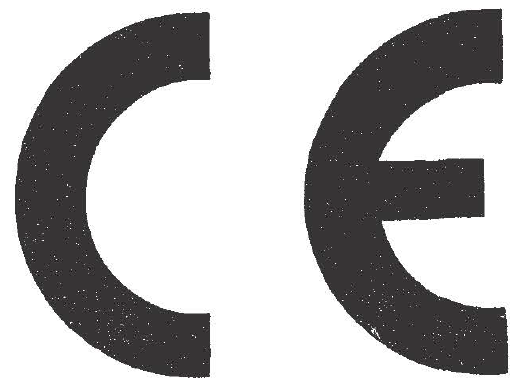

# Règlement grand-ducal du 10 août 1992 concernant les produits de construction.

Nous JEAN, par la grâce de Dieu, Grand-Duc de Luxembourg, Duc de Nassau;

Vu la [loi modifiée du 9 août 1971](https://legilux.public.lu/eli/etat/leg/loi/1971/08/09/n2/jo) concernant l’exécution et la sanction des décisions et des directives ainsi que la sanction des règlements des Communautés européennes en matière économique, technique, agricole, forestière, sociale et en matière de transports ;

Vu la [directive du Conseil 89/106/CEE](https://legilux.public.lu/eli/dir_ue/1989/106/jo) du 21 décembre 1988 relative au rapprochement des dispositions législatives, réglementaires et administratives des Etats membres concernant les produits de construction ;

Vu l’avis de la Chambre de Commerce ;

Vu l’avis de la Chambre des Métiers ;

Notre Conseil d’Etat entendu ;

De l’assentiment de la Commission de travail de la Chambre des Députés ;

Sur le rapport de Notre Ministre du Travail, de Notre Ministre de la Justice, de Notre Ministre des Travaux Publics, et après délibération du Gouvernement en Conseil ;

Arrêtons :

## CHAPITRE I — Champ d’application - Définitions - Exigences - Spécifications techniques - Libre circulation des marchandises

### Article premier

(1) Le présent règlement s’applique aux produits de construction dans la mesure où les exigences essentielles relatives aux ouvrages et visées à l’article 3 paragraphe (1) les concernent.

(2) Aux fins du présent règlement, on entend par

produit de construction tout produit qui est fabriqué en vue d’être incorporé de façon durable dans des ouvrages deconstruction, qui couvrent tant les bâtiments que les ouvrages du génie civil.

Les «produits de construction» sont ci-après dénommés «produits» ; les ouvrages de construction, qui couvrent tantles bâtiments que les ouvrages de génie civil, sont ci-après dénommés «ouvrages».

### Article 2

(1) Les produits visés à l’article 1er et destinés à être utilisés dans des ouvrages ne peuvent être mis sur le marché ques’ils sont aptes à l’usage prévu, c’est-à-dire s’ils ont des caractéristiques telles que les ouvrages dans lesquels ils doiventêtre incorporés, assemblés, utilisés ou installés puissent, à condition d’avoir été convenablement conçus et construits,satisfaire aux exigences essentielles visées à l’article 3 dans les cas où ces ouvrages font l’objet d’une réglementationcontenant de telles exigences.

(2) Lorsque des produits font l’objet d’autres dispositions légales ou réglementaires portant sur d’autres aspects, lamarque CE de conformité, ci-après dénommée «marque CE», visée à l’article 4 paragraphe (2) indique, dans ces cas, queles produits répondent également aux exigences de ces autres dispositions légales.

(3) Lorsqu’une disposition légale future concerne principalement d’autres aspects et seulement dans une moindremesure les exigences essentielles du présent règlement, elle doit comporter des dispositions garantissant qu’elle répondégalement aux exigences de ce dernier.

(4) Des exigences spéciales peuvent être prescrites dans le respect des dispositions du traité CEE pour assurer laprotection des travailleurs lors de l’utilisation des produits, pour autant que cela n’implique pas une modification desproduits non prévue par le présent règlement.

### Article 3

(1) Les exigences essentielles applicables aux ouvrages et susceptibles d’influencer les caractéristiques techniques d’unproduit sont énoncées en termes d’objectifs à l’annexe 1. Une, plusieurs ou l’ensemble de ces exigences peuvent s’appliquer ; elles doivent être respectées pendant une durée de vie raisonnable du point de vue économique.

(2) Les exigences essentielles sont précisées dans des documents (documents interprétatifs) destinés à établir les liensnécessaires entre les exigences essentielles indiquées au paragraphe (1) et les mandats de normalisation, les mandatsconcernant des guides d’agrément technique européen ou la reconnaissance d’autres spécifications techniques au sensdes articles 4 et 5.

### Article 4

(1) Aux fins du présent règlement, on entend par «spécifications techniques» les normes et les agréments techniques.

Aux fins du présent règlement, on entend par «normes harmonisées» les spécifications techniques adoptées par leCEN ou le CENELEC ou par ces deux organismes sur mandat de la Commission donné conformément à la [directive83/189/CEE](https://legilux.public.lu/eli/dir_ue/1983/189/jo) et selon les orientations générales concernant la coopération entre la Commission et ces deux organismes,signées le 13 novembre 1984.

(2) Les produits sont présumés aptes à l’usage s’ils permettent aux ouvrages pour lesquels ils sont utilisés, à conditionque ces derniers soient convenablement conçus et construits, de satisfaire aux exigences essentielles visées à l’article 3,et que ces produits portent la marque CE. La marque «CE» atteste :

a) qu’ils sont conformes aux normes nationales qui transposent les normes harmonisées et dont les références ontété publiées au Mémorial conformément au règlement grand-ducal relatif aux normes et aux règlements techniques ;

b) qu’ils sont conformes à un agrément technique européen délivré selon la procédure décrite au chapitre III ;

ou

c) qu’ils sont conformes aux spécifications techniques nationales visées au paragraphe (3), dans la mesure où iln’existe pas de spécifications harmonisées ; une liste de ces spécifications nationales est établie selon la procédureprévue à l’article 5 paragraphe (2).

(3) Le Ministre du Travail, sur avis de l’inspection du Travail et des Mines, peut communiquer à la Commission le textede leurs spécifications techniques nationales qu’il estime conforme aux exigences essentielles visées à l’article 3.

Les références desdites spécifications techniques sont publiées au Mémorial conformément au règlement grand-ducalrelatif aux normes et aux règlements techniques.

(4) Lorsqu’un fabricant, ou son mandataire établi dans la Communauté, n’a pas appliqué ou n’a appliqué que partiellement les spécifications techniques existantes mentionnées au paragraphe (2), selon lesquelles, conformément auxcritères énoncés à l’article 13 paragraphe (4), le produit doit faire l’objet d’une déclaration de conformité telle quedéfinie à l’annexe III point 2 sous ii), deuxième et troisième possibilités, les décisions correspondantes prises au titre del’article 13 paragraphe (4) et de l’annexe III s’appliquent, et l’aptitude d’un tel produit à son usage au sens de l’article 2paragraphe (1) est établie selon la procédure fixée à l’annexe III point 2 sous ii), deuxième possibilité.

(5) La marque CE signifie que les produits répondent aux exigences des paragraphes (2) et (4). C’est au fabricant, ou à son mandataire établi dans la Communauté, qu’incombe la responsabilité d’apposer la marque CE sur le produit lui-même, sur une étiquette fixée au produit, sur son emballage ou sur les documents commerciaux d’accompagnement.

Le modèle de marque CE et les conditions de son utilisation sont indiqués à l’annexe III.

Ne doivent pas porter la marque CE les produits figurant sur la liste des produits, établie par la Commission, qui ont une très faible incidence sur la santé et la sécurité et pour lesquels une déclaration de conformité aux «règles de l’art», émise par le fabricant, tiendra lieu d’autorisation de mise sur le marché.

### Article 5

(1) Lorsque le Ministre du Travail, sur avis de l’inspection du Travail et des Mines, ou la Commission estime que les normes harmonisées ou les agréments techniques européens visés à l’article 4 paragraphe (2) points a) et b), ou les mandats visés au chapitre II ne satisfont pas aux articles 2 et 3, la Commission indique aux Etats membres si les normes ou agréments en question doivent être retirés ou non des publications visées à l’article 7 paragraphe (3).

(2) Après réception de la communication visée à l’article 4 paragraphe (3), la Commission indique aux Etats membres si la spécification technique en question doit ou non bénéficier de la présomption de conformité et, dans l’affirmative, elle en publie les références au Journal officiel des Communautés européennes.

Si la Commission ou le Ministre du Travail, sur avis de l’inspection du Travail et des Mines, estime qu’une spécification technique ne remplit plus les conditions nécessaires pour être présumée conforme aux articles 2 et 3, la Commission indique aux Etats membres si la spécification technique nationale en question doit ou non continuer à bénéficier de la présomption de conformité et, dans la négative, si les références visées à l’article 4 paragraphe (3) doivent être retirées.

### Article 6

(1) Le Ministre du Travail, sur avis de l’inspection du Travail et des Mines, ne fait pas obstacle à la libre circulation, la mise sur le marché ou l’utilisation sur le territoire national des produits qui satisfont aux dispositions du présent règlement.

Le Ministre du Travail, sur avis de l’inspection du Travail et des Mines, veille à ce que l’utilisation de tels produits, conformément à leur destination, ne soit pas interdite par des règles ou conditions imposées par des organismes publics ou des organismes privés agissant en qualité d’entreprises publiques ou d’organismes publics du fait de leur position de monopole.

(2) Le Ministre du Travail, sur avis de l’inspection du Travail et des Mines, autorise toutefois la mise sur le marché sur le territoire national des produits non couverts par l’article 4 paragraphe (2) s’ils satisfont à des dispositions nationales conformes au traité, et ce, jusqu’à ce que les spécifications techniques européennes visées aux chapitres II et III en disposent autrement.

(3) Lorsque les spécifications techniques européennes, par elles-mêmes ou en raison des documents interprétatifs visés à l’article 3 paragraphe (3), comportent différentes classes correspondant à différents niveaux de performance, le Ministre du Travail, sur avis de l’inspection du Travail et des Mines, ne peut déterminer les niveaux de performance à respecter également sur le territoire national qu’à l’intérieur des classifications adoptées au niveau communautaire et à condition d’utiliser toutes les classes, certaines d’entre elles ou une seule classe.

## CHAPITRE II

### Article 7 — Normes harmonisées

(1) Pour assurer la qualité des normes harmonisées applicables aux produits, celles-ci doivent être établies par les organismes européens de normalisation selon les mandats que leur donne la Commission selon la procédure prévue par la [directive 83/189/CEE](https://legilux.public.lu/eli/dir_ue/1983/189/jo) et conformément aux orientations générales concernant la coopération entre la Commission et ces organismes, signées le 13 novembre 1984.

(2) Les normes ainsi établies doivent, compte tenu des documents interprétatifs, être exprimées, autant que possible, en termes de performance des produits.

(3) Dès que les normes ont été établies par les organismes européens de normalisation, la Commission en publie les références au Journal officiel des Communautés européennes, série C.

## CHAPITRE III

### Article 8 — Agrément technique européen

(1) L’agrément technique européen est l’appréciation technique favorable de l’aptitude d’un produit à l’usage prévu, fondée sur la satisfaction des exigences essentielles prévues pour les ouvrages dans lesquels le produit doit être utilisé.

(2) L’agrément technique européen peut être accordé :

a) pour les produits pour lesquels il n’existe ni norme harmonisée, ni norme nationale reconnue, ni mandat de norme européenne et pour lesquels la Commission estime qu’une norme ne peut pas ou ne peut pas encore être élaborée ;

et

b) pour les produits qui dérogent de manière significative aux normes harmonisées ou aux normes nationales reconnues.

Même dans le cas où un mandat pour une norme harmonisée a été délivré, le point a) n’exclut pas l’octroi de l’agrément technique européen pour des produits pour lesquels il existe des guides d’agrément technique. Cette disposition s’applique jusqu’à l’entrée en vigueur de la norme harmonisée dans les Etats membres de la CEE.

(3) Dans des cas particuliers, la Commission peut, par dérogation au paragraphe (2) point a), autoriser la délivrance d’un agrément technique européen pour des produits pour lesquels il existe un mandat en vue d’une norme harmonisée ou pour lesquels la Commission a établi qu’une norme harmonisée peut être élaborée. L’autorisation est valable pour une période déterminée.

(4) L’agrément technique européen est, en général, délivré pour cinq ans. Cette durée peut être prolongée.

### Article 9

(1) L’agrément technique européen pour un produit est fondé sur des examens, des essais et une appréciation s’appuyant sur les documents interprétatifs visés à l’article 3 paragraphe (3) ainsi que sur les guides visés à l’article 11 concernant ce produit ou la famille de produits correspondante.

(2) Lorsque les guides visés à l’article 11 n’existent pas ou n’existent pas encore, un agrément technique européen peut être délivré par référence aux exigences essentielles et aux documents interprétatifs lorsque l’appréciation du produit est adoptée par les organismes d’agrément, agissant conjointement dans le cadre de l’organisation visée à l’annexe II.

(3) L’agrément technique européen pour un produit est délivré par des organismes mandatés accrédités par le Ministre du Travail, sur avis de l’Inspection du Travail et des Mines, selon la procédure prévue à l’annexe II, sur demande du fabricant, ou de son mandataire établi dans la Communauté.

### Article 10

(1) Le Ministre du Travail, sur avis de l’Inspection du Travail et des Mines, communique aux autres Etats membres et à la Commission le nom et l’adresse des organismes qu’il habilite à délivrer les agréments techniques européens.

(2) Les organismes d’agrément doivent satisfaire aux exigences du présent règlement et doivent notamment être en mesure :

aash d’évaluer l’aptitude à l’emploi des nouveaux produits sur la base des connaissances scientifiques et pratiques,

bash de se prononcer sans parti pris par rapport aux intérêts des producteurs concernés ou de leurs mandataires,

et

aash de réaliser la synthèse des contributions de toutes les parties concernées en vue d’une appréciation équilibrée.

(3) La liste des organismes d’agrément compétents pour délivrer les agréments techniques européens, ainsi que toute modification de ladite liste sont publiées au Journal officiel des Communautés européennes, série C.

### Article 11

(1) La Commission donne à l’organisation regroupant les organismes d’agrément désignés par les Etats membres, des mandats pour l’établissement des guides d’agrément technique européen pour un produit ou une famille de produits.

(2) Les guides d’agrément technique européen pour un produit ou une famille de produits comportent notamment les éléments suivants :

a) la liste des documents interprétatifs pertinents visés à l’article 3 paragraphe (3) ;

b) les exigences concrètes auxquelles un produit doit répondre au sens des exigences essentielles visées à l’article 3 paragraphe (1) ;

c) les méthodes d’essai ;

d) la méthode d’évaluation et d’exploitation des résultats des essais ;

e) les procédures d’inspection et de conformité qui doivent répondre aux articles 13, 14 et 15 ;

f) la période de validité de l’agrément technique européen.

(3) Les guides d’agrément technique européen sont publiés par le Ministre du Travail, sur avis de l’Inspection du Travail et des Mines.

## CHAPITRE IV

### Article 12 — Documents interprétatifs

Les documents interprétatifs visés à l’article 3 paragraphe (3) publiés par la Commission au Journal officiel des Communautés européennes, série C, élaborés par des comités techniques auxquels participent les Etats membres :

a) précisent les exigences essentielles visées à l’article 3 et définies à l’annexe I en harmonisant la terminologie et les notions techniques de base et en indiquant des classes ou niveaux pour chaque exigence, lorsque cela est nécessaire et si l’état des connaissances scientifiques et techniques le permet ;

b) indiquent des méthodes de corrélation entre ces niveaux ou classes d’exigences et les spécifications techniques visées à l’article 4 : méthodes de calcul et de détermination, règles techniques de conception, etc. ;

c) servent de référence pour l’établissement de normes harmonisées et de guides d’agrément technique européen et pour la reconnaissance de spécifications techniques nationales conformément à l’article 4 paragraphe (3).

## CHAPITRE V

### Article 13 — Attestation de conformité

(1) Il incombe au fabricant, ou à son mandataire établi dans la Communauté, d’attester que les produits sont conformes aux exigences d’une spécification technique au sens de l’article 4.

(2) Les produits qui font l’objet d’une attestation de conformité sont présumés conformes aux spécifications techniques au sens de l’article 4. Cette conformité est établie au moyen d’essais ou d’autres vérifications sur la base des spécifications techniques, conformément à l’annexe III.

(3) Le fait d’attester la conformité d’un produit suppose :

a) que le fabricant dispose, à l’usine, d’un système de contrôle de la production permettant d’assurer que la production est conforme aux spécifications techniques pertinentes ;

ou

b) que, pour certains produits mentionnés dans les spécifications techniques pertinentes, en plus du système de contrôle de la production appliqué à l’usine, un organisme agréé de certification est intervenu dans l’évaluation et la surveillance des contrôles de la production ou des produits eux-mêmes.

(4) La procédure choisie parmi celles visées au paragraphe (3) et déterminée par la Commission est applicable à un produit ou groupe de produits déterminés conformément aux dispositions particulières indiquées à l’annexe III, en fonction :

a) de l’importance du rôle du produit par rapport aux exigences essentielles, et notamment celles qui ont trait à la santé et à la sécurité ;

b) de la nature du produit ;

c) de l’incidence que la variabilité des caractéristiques du produit peut avoir sur la capacité du produit à remplir la fonction pour laquelle il a été conçu ;

d) des probabilités de défauts de fabrication du produit. Dans chaque cas, la procédure la moins onéreuse possible qui soit compatible avec la sécurité est choisie.

La procédure ainsi déterminée est indiquée dans les mandats ainsi que dans les spécifications techniques ou dans la publication de celles-ci.

(5) En cas de fabrication à la pièce (et non pas en série), une déclaration de conformité telle que visée à l’annexe III point 2 sous i) troisième possibilité suffit, sauf dispositions contraires prévues par les spécifications techniques, pour les produits qui ont des implications particulièrement importantes pour la santé et la sécurité.

### Article 14

(1) Conformément à l’annexe III, les procédures décrites donnent lieu :

a) dans le cas de l’article 13 paragraphe (3) point a), à la présentation d’une déclaration de conformité du produit par le fabricant, ou son mandataire établi dans la Communauté ;

ou

b) dans le cas de l’article 13 paragraphe (3) point b), à la délivrance, par l’organisme agréé de certification, d’un certificat de conformité pour un système de contrôle de la production et de surveillance ou pour le produit lui-même.

Les modalités des procédures d’attestation de conformité sont fixées à l’annexe III.

(2) La déclaration de conformité du fabricant ou le certificat de conformité donnent au fabricant ou à son mandataire établi dans la Communauté le droit d’apposer la marque CE sur le produit lui-même, sur une étiquette jointe à celui-ci, sur l’emballage ou sur les documents commerciaux d’accompagnement. Le modèle de la marque CE et les modalités de son utilisation dans le cadre des différentes procédures d’attestation de conformité figurent à l’annexe III.

### Article 15

(1) Le Ministre de Travail, sur avis de l’Inspection du Travail et des Mines, veille à l’utilisation correcte de la marque CE.

(2) Lorsqu’il est constaté que la marque CE a été apposée indûment sur un produit qui ne satisfait pas ou ne satisfait plus aux prescriptions du présent règlement, le Ministre du Travail, sur avis de l’Inspection du Travail et des Mines, veille, si besoin est, à interdire l’utilisation de la marque CE et à retirer de la circulation les produits non vendus, ou à faire effacer la marque, tant que le produit en cause ne respecte pas les critères de conformité.

Le Ministre du Travail, sur avis de l’Inspection du Travail et des Mines, en informe immédiatement les autres Etats membres et la Commission, en fournissant tous les détails qualitatifs et quantitatifs nécessaires à l’identification du produit non conforme.

(3) Le Ministre du Travail, sur avis de l’Inspection du Travail et des Mines, prend toutes les mesures nécessaires pour interdire l’apposition sur les produits ou sur leur emballage de marques susceptibles d’être confondues avec la marque CE.

## CHAPITRE VI

### Article 16 — Procédures spéciales

(1) Lorsque, pour un produit déterminé, il n’existe pas de spécifications techniques telles que définies à l’article 4 l’Etat membre de destination, procédant sur demande, cas par cas, considère ce produit comme conforme aux dispositions nationales en vigueur s’il a satisfait aux essais et aux contrôles effectués dans l’Etat membre de fabrication par un organisme agréé selon les méthodes en vigueur dans l’Etat membre de destination ou reconnus comme équivalentes par le Ministre du Travail, sur avis de l’Inspection du Travail et des Mines.

(2) L’Etat membre de fabrication indique à l’Etat membre de destination, dont la réglementation s’applique aux essais et aux contrôles à effectuer, l’organisme qu’il a l’intention d’agréer à cette fin. L’Etat membre de destination et l’Etat membre de fabrication se communiquent tous les renseignements nécessaires.A l’issue de l’échange de renseignements, l’Etat membre de fabrication agrée l’organisme ainsi désigné. Si un Etat membre a des doutes, il justifie sa position et informe la Commission.

(3) Le Ministre du Travail, sur avis de l’Inspection du Travail et des Mines, veille à ce que les organismes désignés s’accordent mutuellement toute l’assistance nécessaire.

(4) Lorsque le Ministre du Travail, sur avis de l’Inspection du Travail et des Mines, constate qu’un organisme agréé n’effectue pas les essais et les contrôles conformément aux dispositions nationales, il en informe l’Etat membre dans lequel l’organisme a été agréé. S’il ne juge pas suffisantes les mesures prises par cet Etat membre, il peut interdire la mise sur le marché et l’utilisation du produit en cause ou les soumettre à des conditions particulières. Il en informe l’autre Etat membre et la Commission.

### Article 17

Les Etats membres de destination attachent aux rapports établis et aux attestations de conformité délivrés dans l’Etat membre de fabrication, selon la procédure prévue à l’article 16, la même valeur qu’aux documents nationaux correspondants.

## CHAPITRE VII

### Article 18 — Organismes agréés

(1) Le Ministre du Travail, après avoir demandé l’avis de l’Inspection du Travail et des Mines, désigne les organismes de certification, les organismes d’inspection et les laboratoires d’essai. Il veillera à ce que l’organisme de certification remplisse les conditions applicables au Grand-Duché de Luxembourg aux organismes mandatés et notamment qu’il soit constitué sous forme d’une association sans but lucratif.

Le laboratoire de l’Administration des Ponts et Chaussées est reconnu d’office comme laboratoire d’essai.

Le Ministre du Travail, sur avis de l’Inspection du Travail et des Mines, communique à la Commission une liste comportant le nom et l’adresse des organismes de certification, des organismes d’inspection et des laboratoires d’essai qui ont été désignés au Luxembourg pour les tâches qui doivent être exécutées aux fins des agréments techniques, des certificats de conformité, des inspections et des essais conformément au présent règlement.

(2) Les organismes de certification, les organismes d’inspection et les laboratoires d’essai doivent répondre aux critères énoncés à l’annexe IV.

(3) Le Ministre du Travail, sur avis de l’Inspection du Travail et des Mines, doit indiquer les produits relevant de la compétence des organismes et laboratoires visés au paragraphe 1 et la nature des tâches qui leur sont confiées.

## CHAPITRE VIII

### Article 19 — Clause de sauvegarde

(1) Lorsque le Ministre du Travail, sur avis de l’Inspection du Travail et des Mines, constate qu’un produit déclaré conforme au présent règlement ne satisfait pas aux exigences des articles 2 et 3, il prend toutes mesures utiles pour retirer ce produit du marché, pour interdire sa mise sur le marché ou pour en restreindre la libre circulation.

Le Ministre du Travail, sur avis de l’Inspection du Travail et des Mines, informe immédiatement la Commission de cette mesure, en indiquant les motifs de sa décision, et en précisant notamment si la non-conformité résulte :

a) du non-respect des articles 2 et 3, lorsque le produit ne correspond pas aux spécifications techniques visées à l’article 4 ;

b) d’une mauvaise application des spécifications techniques visées à l’article 4 ;

c) de lacunes propres aux spécifications techniques visées à l’article 4. L’information transmise à la Commission par le Ministre du Travail, sur avis de l’Inspection du Travail et des Mines, a pour effet de déclencher sur le plan communautaire la procédure prévue par la [directive 89/106/CEE](https://legilux.public.lu/eli/dir_ue/1989/106/jo), à l’article 21, paragraphe (2), (3) et (5).

(2) Le Ministre du Travail. sur avis de l’Inspection du Travail et des Mines, prend toutes mesures appropriées à l’encontre de celui qui a établi la déclaration de conformité et en informe la Commission ainsi que les autres Etats membres.

## CHAPITRE IX

### Article 20 — Dispositions finales

Toute décision prise en application du présent règlement et conduisant à restreindre la mise sur le marché d’un produit est motivée de façon précise. Elle est notifiée à l’intéressé, dans les meilleurs délais, avec l’indication des voies de recours ouvertes par les législations en vigueur au Luxembourg et des délais dans lesquels ces recours doivent être introduits.

### Article 21 — Sanctions pénales

Les infractions au présent règlement sont punies des peines prévues par la [loi modifiée du 9 août 1971](https://legilux.public.lu/eli/etat/leg/loi/1971/08/09/n2/jo) concernant l’exécution et la sanction des décisions et des directives ainsi que la sanction des règlements des Communautés européennes en matière économique, technique, agricole, forestière, sociale et en matière de transports.

### Article 22 — Exécution

Notre ministre du Travail, Notre ministre de la Justice, Notre ministre des Travaux publics sont chargés, chacun en ce qui le concerne, de l’exécution du présent règlement qui sera publié au Mémorial.

Le Ministre du Travail,   Jean-Claude Juncker   Le Ministre de la Justice,   Marc Fischbach   Le Ministre des Travaux Publics,   Robert Goebbels

Château de Berg, le 10 août 1992.   Jean

ANNEXE I

—

EXIGENCES ESSENTIELLES

Les produits de construction doivent permettre d’ériger des ouvrages qui, compte tenu des aspects économiques, soient (dans leur ensemble et dans leurs parties) aptes à l’usage et qui, à cet égard, remplissent les exigences essentielles indiquées ci-dessous lorsqu’elles existent. Sous réserve d’un entretien normal des ouvrages, ces exigences doivent être respectées pendant une durée de vie raisonnable du point de vue économique. En règle générale, elles supposent que les actions qui s’exercent sur l’ouvrage aient un caractère prévisible.

1\. **Résistance mécanique et stabilité**

L’ouvrage doit être conçu et construit de manière que les charges susceptibles de s’exercer pendant sa construction et son utilisation n’entraînent aucun des événements suivants:

a) effondrement de tout ou partie de l’ouvrage;

b) déformations d’une ampleur inadmissible:

c) endommagement d’autres parties de l’ouvrage ou d’installations ou d’équipements à demeure par suite de déformations importantes des éléments porteurs;

d) dommages résultant d’événements accidentels disproportionnés par rapport à leur cause première.

2\. **Sécurité en cas d’incendie**

L’ouvrage doit être conçu et construit de manière que, en cas d’incendie;

– la stabilité des éléments porteurs de l’ouvrage puisse être présumée pendant une durée déterminée,

– l’apparition et la propagation du feu et de la fumée à l’intérieur de l’ouvrage soient limitées,

– l’extension du feu à des ouvrages voisins soit limitée,

– les occupants puissent quitter l’ouvrage indemnes ou être secourus d’une autre manière,

– la sécurité des équipes de secours soit prise en considération.

3\. **Hygiène, santé et environnement**

L’ouvrage doit être conçu et construit de manière à ne pas constituer une menace pour l’hygiène ou la santé des occupants ou des voisins du fait notamment:

– d’un dégagement de gaz toxiques,

– de la présence dans l’air de particules ou de gaz dangereux,

– de l’émission de radiations dangereuses,

– de la pollution ou de la contamination de l’eau ou du sol,

– de défauts d’évacuation des eaux, des fumées ou des déchets solides ou liquides,

– de la présence d’humidité dans des parties de l’ouvrage ou sur les surfaces intérieures de l’ouvrage.

4\. **Sécurité d’utilisation**

L’ouvrage doit être conçu et construit de manière que son utilisation ou son fonctionnement ne présentent pas de risques inacceptables d’accidents tels que glissades, chutes, chocs, brûlures, électrocutions, blessures à la suite d’explosions.

5\. **Protection contre le bruit**

L’ouvrage doit être conçu et construit de manière que le bruit perçu par les occupants ou par des personnes se trouvant à proximité soit maintenu à un niveau tel que leur santé ne soit pas menacée et qu’il leur permette de dormir, de se reposer et de travailler dans des conditions satisfaisantes.

6\. **Economie d’énergie et isolation thermique**

L’ouvrage ainsi que ses installations de chauffage, de refroidissement et d’aération doivent être conçus et construits de manière que la consommation d’énergie requise pour l’utilisation de l’ouvrage reste modérée eu égard aux conditions climatiques locales, sans qu’il soit pour autant porté atteinte au confort thermique des occupants.

ANNEXE II

—

AGREMENT TECHNIQUE EUROPEEN

1\. Une demande d’agrément ne peut être introduite par un producteur ou son mandataire établi dans la Communauté qu’auprès d’un seul organisme habilité à cet effet.

2\. Les organismes d’agrément désignés par les Etats membres se regroupent en une organisation. Dans l’exécution de ces tâches, cette organisation est tenue à une étroite coordination avec la Commission. Si le Ministre du Travail désigne plus d’un organisme d’agrément, il lui incombe d’assurer la coordination de ces organismes; il désigne également l’organisme qui sera porte-parole au sein de l’organisation.

3\. Les règles de procédure communes pour l’introduction des demandes, la préparation et l’octroi des agréments sont élaborées par l’organisation formée par les différents organismes d’agrément. Elles sont adoptées par la Commission sur la base de l’avis du comité permanent de la construction.

4\. Dans le cadre de l’organisation dans laquelle ils sont regroupés, les organismes d’agrément s’accordent mutuellement tout soutien nécessaire. L’organisation est également chargée de la coordination sur des questions spécifiques relatives aux agréments techniques. Si besoin est, elle crée des sous-groupes à cet effet.

5\. Les agréments techniques européens sont publiés par les organismes d’agrément, qui en informent tous les autres organismes agréés.A la demande d’un organisme d’agrément reconnu, un exemplaire justificatif complet d’un agrément accordé lui est commmuniqué pour information.

6\. Les frais entraînés par la procédure d’agrément technique européen sont supportés par le demandeur selon la réglementation nationale.

ANNEXE III

—

ATTESTATION DE CONFORMITE AUX SPECIFICATIONS TECHNIQUES

1\. METHODES DE CONTROLE DE LA CONFORMITE

Lors de la détermination des procédures à suivre pour l’attestation de conformité d’un produit aux spécifications techniques en application de l’article 13, on utilise les méthodes de contrôle de la conformité indiquées ci-après. Ce sont les exigences prévues pour le produit ou le groupe de produits qui déterminent le choix des méthodes pour un système donné ainsi que leur combinaison, selon les critères énoncés à l’article 13 paragraphes 3 et 4:

a) essais de type initiaux du produit par le fabricant ou un organisme agréé;

b) essais d’échantillons prélevés dans l’usine selon un plan d’essais prescrit par le fabricant ou un organisme agréé;

c) essais par sondage d’échantillons prélevés dans l’usine, sur le marché ou sur un chantier par le fabricant ou un organisme agréé;

d) essais d’échantillons prélevés sur un lot prêt à être livré ou déjà livré par le fabricant ou un organisme agréé;

e) contrôle de la production en usine;

f) inspection initiale de l’usine et du contrôle de la production en usine par un organisme agréé;

g) surveillance, évaluation et appréciation permanentes du contrôle de la production en usine par un organisme agréé.

Dans le cadre du présent règlement, on entend par «contrôle de la production usine» un contrôle interne permanent de la production, effectué par le fabricant. L’ensemble des éléments, des exigences et des dispositions adoptés par le fabricant doivent être systématiquement consignés sous forme de régles et procédures écrites. Cette documentation sur le système de contrôle de la production doit assurer une compréhension commune des garanties de qualité et permettre de vérifier l’obtention des caractéristiques requises pour un produit ainsi que l’efficacité du système de contrôle de la production.

2\. SYSTEMES D’ATTESTATION DE CONFORMITE

i) Certification de conformité du produit par un organisme agréé de certification:

a) *(Tâches du fabricant)*

1\. contrôle de la production en usine;

2\. essais complémentaires d’échantillons prélevés dans l’usine par le fabricant selon un plan d’essais prescrit;

b) *(Tâches de l’organisme agréé)*

3\. essais de type initiaux du produit;

4\. inspection initiale de l’usine et du contrôle de la production en usine;

5\. surveillance continue, évaluation et acceptation du contrôle de la production en usine;

6\. éventuellement, essais par sondage d’échantillons prélevés dans l’usine, sur le marché ou sur le chantier;

ii) Déclaration de conformité du produit par le fabricant sur les bases suivantes:

aone **Première possibilité:**

a) *(Tâches du fabricant)*

1\. essais de type initiaux du produit;

2\. contrôle de la production en usine;

3\. éventuellement, essais d’échantillons prélevés dans l’usine selon un plan d’essais prescrit;

b) *(Tâches de l’organisme agréé)*

4\. Certification du contrôle de la production en usine sur les bases suivantes:

– inspection initiale de l’usine et du contrôle de la production en usine;

– éventuellement, surveillance, évaluation et agréation permanentes du contrôle de la production en usine.

bone **Deuxième possibilité:**

1\) essais de type initiaux du produit par un laboratoire agréé;

2\) contrôle de la production en usine.

cone **Troisième possibilité:**

1\) essais de type initiaux par le fabricant;

2\) contrôle de la production en usine.

3\. ORGANISMES CONCERNES PAR L’ATTESTATION DE CONFORMITE

Pour ce qui est de la fonction des organismes concernés par l’attestation de conformité, on distinguera: i) *l’organisme de certification,* organisme impartial, gouvernemental ou non gouvernemental, ayant la compétence et les attributions requises pour effectuer la certification de conformité selon les règles établies de procédure et de gestion; ii) *l’organisme d’inspection,* organisme impartial possédant l’organisation, le personnel, la compétence et l’intégrité requis pour exercer, selon des critères déterminés, des tâches telles qu’évaluation, recommandation d’acceptation et audit subséquent des opérations de contrôle de la qualité du fabricant, sélection et évaluation des produits *in situ* ou à l’usine ou ailleurs selon des critères spécifiques; iii) *le laboratoire d’essais,* laboratoire qui mesure, examine, teste, calibre ou détermine de toute autre manière les caractéristiques ou les performances des matériaux ou des produits.

Dans le cas i) et ii) (première possibilité) du paragraphe 2, les trois fonctions 3 i) à 3) iii) peuvent être exercées par un seul organisme ou par des organismes distincts, l’organisme d’inspection et/ou le laboratoire d’essai concernés par l’attestation de conformité exécutant alors leurs fonctions pour le compte de l’organisme de certification.

Pour les critères de compétence, d’objectivité et d’intégrité des organismes de certification, des organismes d’inspection et des laboratoires d’essais, voir annexe IV.

4\. MARQUE DE CONFORMITE CE, CERTIFICAT DE CONFORMITE CE, DECLARATION DE CONFORMITE CE

4.1 **Marque de conformité CE**

La marque de conformité CE est constituée par le symbole CE tel qu’il figure ci-dessous.

Elle est accompagnée:

– du nom ou de la marque distinctive du fabricant,

et, le cas échéant:

– d’indications permettant d’identifier les caractéristiques du produit, en fonction des specifications techniques,

– des deux derniers chiffres de l’année de fabrication,

– du symbole d’identification de l’organisme d’inspection concerné,

– du numéro du certificat de conformité CE.

4.2 **Certificat de conformité CE**

Le certificat de conformité CE indique en particulier:

– le nom et l’adresse de l’organisme de certification,

– le nom et l’adresse du fabricant, ou de son mandataire établi dans la Communauté,

– la description du produit (type, identification, utilisation, etc.),

– les dispositions auxquelles répond le produit,

– les conditions particulières d’utilisation du produit,

– le numéro du certificat,

– les conditions et la durée de validité du certificat, le cas échéant,

– le nom et la qualité de la personne habilitée à signer le certificat.

4.3 **Déclaration de conformité CE**

La déclaration de conformité CE indique en particulier:

– le nom et l’adresse du fabricant, ou de son mandataire établi dans la Communauté,

– la description du produit (type, identification, utilisation, etc.),

– les dispositions auxquelles répond le produit,

– les conditions particulières d’utilisation du produit,

– le numéro de la déclaration,

– le nom et l’adresse de l’organisme agréé, le cas échéant,

– le nom et la qualité de la personne habilitée à signer la déclaration pour le compte du fabricant, ou de son mandataire.

4.4 Le certificat et la déclaration de conformité sont présentés dans la ou les langues officielles de l’Etat membre dans lequel le produit est destiné à être utilisé.

ANNEXE IV

—

AGREMENT DES ORGANISMES DE CERTIFICATION, DES ORGANISMES D’INSPECTION ET DES LABORATOIRES D’ESSAI

Les organismes de certification, les organismes d’inspection et les laboratoires d’essai à désigner par le Ministre du travail, sur avis et proposition de l’Inspection du Travail et des Mines doivent remplir les conditions minimales suivantes:

1\) disponibilité en personnel ainsi qu’en moyens et équipement nécessaires;

2\) compétence technique et intégrité professionnelle du personnel;

3\) impartialité, dans l’exécution des essais, l’élaboration des rapports, la délivrance des certificats et l’exécution de la surveillance prévues par la présente directive, des cadres et du personnel technique par rapport à tous les milieux, groupements ou personnes, directement ou indirectement intéressés au domaine des produits de construction;

4\) respect du secret professionnel par le personnel;

5\) souscription d’une assurance de responsabilité civile à moins que cette responsabilité ne soit couverte par l’Etat en vertu du droit national.

Le respect des conditions visées aux points 1) et 2) est vérifié périodiquement par l’Inspection du Travail et des Mines.

Doc. parl. 3654; sess. ord. 1991-1992; [Dir. 89/106/CEE](https://legilux.public.lu/eli/dir_ue/1989/106/jo).
