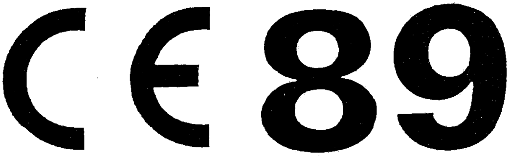

# Règlement grand-ducal du 10 août 1992 relatif aux équipements de protection individuelle.

Nous JEAN, par la grâce de Dieu, Grand-Duc de Luxembourg, Duc de Nassau;

Vu la [loi modifiée du 9 août 1971](https://legilux.public.lu/eli/etat/leg/loi/1971/08/09/n2/jo) concernant l’exécution et la sanction des décisions et des directives ainsi que la sanction des règlements des Communautés européennes en matière économique, technique, agricole, forestière, sociale et en matière de transports ;

Vu la [directive du Conseil 89/686/CEE](https://legilux.public.lu/eli/dir_ue/1989/686/jo) du 21 décembre 1989 concernant le rapprochement des législations des Etats membres relatives aux équipements de protection individuelle ;

Vu l’avis de la Chambre des Métiers ;

Vu la demande d’avis adressée en date du 8 juillet 1991 à la Chambre de Commerce ;

Notre Conseil d’Etat entendu ;

De l’assentiment de la Commission de travail de la Chambre des Députés ;

Sur le rapport de Notre ministre du Travail et de Notre ministre de la Justice, et après délibération du Gouvernement en Conseil ;

Arrêtons :

## CHAPITRE I — Champ d’application, mise sur le marché et libre circulation

### Art. 1er.

1\. Le présent règlement grand-ducal s’applique aux équipements de protection individuelle, ci-après dénommés «EPI».

Il fixe les conditions de la mise sur le marché, de la libre circulation intracommunautaire ainsi que les exigences essentielles de sécurité auxquelles les EPI doivent satisfaire en vue de préserver la santé et d’assurer la sécurité des utilisateurs.

L’Inspection du travail et des mines, ci-après dénommée «ITM», est l’autorité compétente au titre du présent règlement grand-ducal.

2\. Aux fins du présent règlement, on entend par EPI tout dispositif ou moyen destiné à être porté ou tenu par une personne en vue de la protéger contre un ou plusieurs risques susceptibles de menacer sa santé ainsi que sa sécurité.

Sont également considérés comme EPI :

a) l’ensemble constitué par plusieurs dispositifs ou moyens, associés de façon solidaire par le fabricant en vue de protéger une personne contre un ou plusieurs risques susceptibles d’être encourus simultanément ;

b) un dispositif ou moyen protecteur solidaire, de façon dissociable ou non dissociable, d’un équipement individuel non protecteur porté ou tenu par une personne en vue de déployer une activité ;

c) des composants interchangeables d’un EPI, indispensables à son bon fonctionnement et utilisés exclusivement pour cet EPI.

3\. Est considéré comme partie intégrante d’un EPI, tout système de liaison mis sur le marché avec l’EPI pour raccorder celui-ci à un autre dispositif extérieur, complémentaire, même lorsque ce système de liaison n’est pas destiné à être porté ou tenu en permanence par l’utilisateur pendant la durée d’exposition au(x) risque(s).

4\. Sont exclus du champ d’application du présent règlement :

aash les EPI couverts par un autre règlement que le présent et visant les mêmes objectifs de mise sur le marché, de libre circulation et de sécurité que le présent règlement.

bash indépendamment du motif d’exclusion visé au premier tiret, les genres d’EPI figurant dans la liste d’exclusion de l’annexe I.

### Art. 2.

1\. L’ITM prend toutes les dispositions utiles pour que les EPI visés à l’article 1er ne puissent être mis sur le marché et en service que s’ils préservent la santé et assurent la sécurité des utilisateurs, sans compromettre ni la santé ni la sécurité des autres personnes, des animaux domestiques ou des biens, lorsqu’ils sont entretenus convenablement et utilisés conformément à leur destination.

2\. Le présent règlement n’affecte pas la faculté de prescrire, dans le respect du traité, les exigences qui sont estimées nécessaires pour assurer la protection des utilisateurs, pour autant que cela n’implique pas des modifications des EPI par rapport aux dispositions du présent règlement.

3\. L’ITM ne fait pas obstacle, lors des foires, expositions, etc., à la présentation d’EPI qui ne sont pas conformes aux dispositions du présent règlement, pour autant qu’un panneau adéquat indique clairement la non-conformité de ces EPI ainsi que l’interdiction de les acquérir et/ou d’en faire quelque usage que ce soit avant leur mise en conformité par le fabricant ou par son mandataire établi dans la Communauté.

### Art. 3.

Les EPI visés à l’article 1er doivent satisfaire aux exigences essentielles de santé et de sécurité prévues à l’annexe II.

### Art. 4.

1\. L’ITM ne peut pas interdire, restreindre ou entraver la mise sur le marché d’EPI ou composants d’EPI qui satisfont aux dispositions du présent règlement et qui sont munis de la marque «CE».

2\. L’ITM ne peut pas interdire, restreindre ou entraver la mise sur le marché de composants d’EPI, non munis de la marque «CE», qui sont destinés à être incorporés dans les EPI, sous réserve que ces composants ne soient pas des composants essentiels, indispensables au bon fonctionnement des EPI.

### Art. 5.

1\. L’ITM considère conformes aux exigences essentielles visées à l’article 3 les EPI visés à l’article 8 paragraphe 3, qui sont munis de la marque «CE», pour lesquels le fabricant est en mesure de présenter, sur demande, la déclaration de conformité visée à l’article 12.

2\. L’ITM présume conformes aux exigences essentielles visées à l’article 3 les EPI visés à l’article 8, paragraphe 2, qui sont munis de la marque CE, pour lesquels le fabricant est en mesure de présenter, sur demande, outre la déclaration visée à l’article 12, l’attestation de l’organisme notifié, visé à l’article 9, déclarant leur conformité avec les normes nationales les concernant, transposant les normes harmonisées, appréciée au niveau de l’examen CE de type, selon l’article 10 paragraphe 4 point a) premier tiret et point b) premier tiret.

Lorsque le fabricant n’a pas appliqué ou n’a appliqué qu’en partie les normes harmonisées, ou en l’absence de ces normes, l’attestation de l’organisme notifié doit déclarer la conformité avec les exigences essentielles, selon l’article 10 paragraphe 4 point a) deuxième tiret et point b) deuxième tiret.

3\. Les EPI visés à l’article 8 paragraphe 2, pour lesquels des normes harmonisées ne sont pas disponibles, peuvent continuer à être soumis à titre transitoire, jusqu’au 31 décembre 1992 au plus tard, aux régimes nationaux en vigueur à la date d’adoption du présent règlement, sous réserve de la compatibilité de ces régimes avec les dispositions du traité.

4\. L’ITM faisant fonction d’organisme luxembourgeois de normalisation publie les références de ces normes nationales.

### Art. 6.

Lorsque le directeur de l’ITM ou la Commission estime que les normes harmonisées visées à l’article 5 ne satisfont pas entièrement aux exigences essentielles les concernant visées à l’article 3, la Commission ou l’ITM saisit le comité institué par la [directive 83/189/CEE](https://legilux.public.lu/eli/dir_ue/1983/189/jo) en exposant ses raisons. Le comité émet un avis d’urgence.

Au vu de l’avis du comité, la Commission notifie à l’ITM la nécessité de procéder ou non au retrait des normes concernées des publications visées à l’article 5.

### Art. 7.

1\. Lorsque le directeur de l’ITM constate que les EPI munis de la marque CE et utilisés conformément à leur destination risquent de compromettre la sécurité des personnes, des animaux domestiques ou des biens, il prend toutes les mesures utiles pour retirer ces EPI du marché, interdire leur mise sur le marché ou leur libre circulation.

Le directeur de l’ITM informe immédiatement la Commission de cette mesure, indique les raisons de sa décision et, en particulier, si la non-conformité résulte :

a) du non-respect des exigences essentielles visées à l’article 3 ;

b) d’une mauvaise application des normes visées à l’article 5 ;

c) d’une lacune des normes visées à l’article 5 elles-mêmes.

2\. Lorsqu’un EPI non conforme est muni de la marque CE, l’ITM prend à l’encontre de celui qui a apposé la marque les mesures appropriées et en informe la Commission ainsi que les autres Etats membres.

## CHAPITRE II — Procédures de certification

### Art. 8.

1\. Avant de mettre un modèle d’EPI sur le marché, le fabricant ou son mandataire établi dans la Communauté doit réunir la documentation technique visée à l’annexe III afin de pouvoir la soumettre si nécessaire à l’autorité compétente.

2\. Préalablement à la fabrication des EPI autres que ceux visés au paragraphe 3, le fabricant ou son mandataire établi dans la Communauté doit soumettre un modèle à l’examen CE de type visé à l’article 10.

3\. Sont exemptés de l’examen CE de type les modèles d’EPI de conception simple dont le concepteur présume que l’utilisateur peut juger par lui-même de l’efficacité contre des risques minimes dont les effets, lorsqu’ils sont graduels, peuvent être perçus en temps opportun et sans danger par l’utilisateur.

Entrent exclusivement dans cette catégorie les EPI qui ont pour but de protéger l’utilisateur contre :

aash les agressions mécaniques dont les effets sont superficiels (gants de jardinage, dés à coudre, etc.),

bash les produits d’entretien peu nocifs dont les effets sont facilement réversibles (gants de protection contre des solutions détergentes diluées, etc.),

cash les risques encourus lors de la manipulation des pièces chaudes n’exposant pas à une température supérieure à 50o C, ni à des chocs dangereux (gants, tabliers à usage professionnel, etc.),

dash les conditions atmosphériques qui ne sont ni exceptionnelles, ni extrêmes (couvre-chefs, vêtements de saison, chaussures et bottes, etc.),

eash les petits chocs et vibrations n’affectant pas des parties vitales du corps et qui ne peuvent pas provoquer de lésions irréversibles (couvre-chefs légers pour la protection du cuir chevelu, gants, chaussures légères, etc.),

fash le rayonnement solaire (lunettes de soleil).

4\. Les EPI fabriqués sont soumis :

a) au choix du fabricant, à l’une des deux procédures visées à l’article 11, dans le cas des EPI de conception complexe destinés à protéger contre des dangers mortels ou qui peuvent nuire gravement et de façon irréversible à la santé et dont le concepteur présume que l’utilisateur ne peut déceler à temps les effets immédiats. Entrent exclusivement dans cette catégorie :

aash les appareils de protection respiratoire filtrants qui protègent contre les aérosols solides, liquides, ou contre les gaz irritants, dangereux, toxiques ou radiotoxiques,

bash les appareils de protection respiratoire entièrement isolants de l’atmosphère, incluant ceux destinés à la plongée,

cash les EPI ne pouvant offrir qu’une protection limitée dans le temps contre les agressions chimiques, ou contre les rayonnements ionisants,

dash les équipements d’intervention dans les ambiances chaudes dont les effets sont comparables à ceux d’une température d’air égale ou supérieure à 100 o C, avec ou sans rayonnement infrarouge, flammes ou grosses projections de matières en fusion,

eash les équipements d’intervention dans les ambiances froides dont les effets sont comparables à ceux d’une température d’air inférieure ou égale à - 50 o C,

fash les EPI destinés à protéger contre les chutes de hauteurs,

gash les EPI destinés à protéger des risques électriques pour les travaux sous tension dangereuse ou ceux utilisés comme isolants contre une haute tension,

hash les casques et visières destinés aux usagers de motocycles,

à la déclaration de conformité CE du fabricant visée à l’article 12 pour tout EPI.

### Art. 9.

1\. Le directeur de l’ITM notifie à la Commission et aux autres Etats membres les organismes agréés chargés d’effectuer les procédures de certification visées à l’article 8. La Commission publie, pour information, au Journal Officiel des Communautés Européennes, la liste de ces organismes ainsi que le numéro distinctif qu’elle leur a attribué et elle en assure la mise à jour.

2\. L’ITM applique les critères prévus à l’annexe V pour l’évaluation des organismes à notifier. Les organismes qui satisfont aux critères d’évaluation prévus dans les normes harmonisées pertinentes sont présumés répondre aux dits critères.

3\. Le directeur de l’ITM doit retirer cet agrément ou ce mandat s’il constate que l’organisme concerné ne satisfait plus aux critères visés à l’annexe V. Il en informe immédiatement la Commission et les autres Etats membres.

### Examen «CE» de type

#### Art. 10.

1\. L’examen CE de type est la procédure par laquelle l’organisme mandaté constate et atteste que le modèle d’EPI satisfait aux dispositions du présent règlement le concernant.

2\. La demande d’examen CE de type est introduite par le fabricant ou son mandataire auprès d’un seul organisme de contrôle mandaté, pour le modèle considéré. Le mandataire doit être établi dans la Communauté.

3\. La demande comporte :

aash le nom et l’adresse du fabricant ou de son mandataire ainsi que le lieu de fabrication des EPI.

bash le dossier technique de fabrication visé à l’annexe III.

Elle est accompagnée du nombre de spécimens approprié du modèle à agréer.

4\. L’organisme mandaté procède à l’examen CE de type selon les modalités suivantes :

a) Examen du dossier technique du fabricant :

aash L’organisme mandaté effectue l’examen du dossier technique de fabrication pour vérifier son adéquation par rapport aux normes harmonisées visées à l’article 5.

bash Lorsque le fabricant n’a pas appliqué ou n’a appliqué qu’en partie les normes harmonisées, ou en l’absence de ces normes, l’organisme mandaté effectue les examens et essais appropriés pour vérifier la conformité du modèle avec les spécifications techniques utilisées par le fabricant, sous réserve de leur adéquation par rapport à ces exigences essentielles.

b) Examen du modèle :

Lors de l’examen du modèle, l’organisme s’assure que celui-ci a été élaboré conformément au dossier technique de fabrication et qu’il peut être utilisé en toute sécurité conformément à sa destination.

\- Il effectue les examens et essais appropriés pour vérifier la conformité du modèle avec les normes harmonisées.

\- Lorsque le fabricant n’a pas appliqué ou n’a appliqué qu’en partie les normes harmonisées, ou en l’absence de ces normes, l’organisme mandaté effectue les examens et essais appropriés pour vérifier la conformité du modèle avec les spécifications techniques utilisées par le fabricant, sous réserve de leur adéquation par rapport à ces exigences essentielles.

5\. Si le modèle répond aux dispositions le concernant, l’organisme établit une attestation d’examen CE de type qui est notifiée au demandeur. Cette autorisation reproduit les conclusions de l’examen, indique les conditions dont elle est éventuellement assortie et comprend les descriptions et dessins nécessaires à l’identification du modèle agréé.

Le dossier doit être tenu à la disposition des autorités compétentes pendant dix ans suivant la mise sur le marché des EPI.

6\. L’organisme qui refuse de délivrer une attestation CE de type en informe les autres organismes agréés. L’organisme qui retire une attestation CE de type en informe l’Etat membre qui l’a agréé. Celui-ci en informe les autres Etats membres et la Commission en exposant les motifs de cette décision.

### Contrôle des EPI fabriqués

#### Art. 11.

A. Système de garantie de qualité CE du produit final

1\. Le fabricant prend toutes les mesures nécessaires pour que le procédé de fabrication, y compris l’inspection finale des EPI et les essais, assure l’homogénéité de la production et la conformité de ces EPI avec le type décrit, dans le certificat d’approbation CE de type, et avec les exigences essentielles y afférentes du présent règlement.

2\. Un organisme mandaté choisi par le fabricant effectue les contrôles nécessaires. Ces contrôles sont effectués, au hasard, normalement au moins une fois par an.

3\. Un échantillonnage adéquat des EPI prélevé par l’organisme mandaté est examiné et des essais appropriés, définis dans les normes harmonisées, ou nécessaires pour attester la conformité avec les exigences essentielles du présent règlement, sont effectués pour vérifier la conformité des EPI.

4\. Lorsque l’organisme n’est pas celui qui a établi l’attestation d’examen CE de type concerné, il entre en contact avec l’organisme mandaté en cas de difficultés liées à l’appréciation de la conformité des échantillons.

5\. Le fabricant reçoit de l’organisme mandaté un rapport d’expertise. Dans le cas où le rapport conclut à une absence d’homogénéité de la production ou à l’absence de conformité des EPI examinés avec le type décrit dans le certificat d’approbation CE de type et avec les exigences essentielles applicables, l’organisme prend les mesures appropriées à la nature du ou des défauts constatés et il en informe l’Etat membre qui l’a notifié.

6\. Le fabricant est en mesure de présenter, sur demande, le rapport de l’organisme mandaté.

B. Système d’assurance qualité CE de la production avec surveillance

\*1. Le système*

a) Dans le cadre de cette procédure, le fabricant soumet une demande d’approbation de son système de qualité auprès d’un organisme mandaté de son choix.

La demande comprend :

aash toutes les informations relatives à la catégorie d’EPI envisagée, y compris, le cas échéant, la documentation relative au modèle approuvé,

bash la documentation sur le système de qualité,

cash l’engagement de remplir les obligations découlant du système de qualité et de maintenir son adéquation ainsi que son efficacité.

b) Dans le cadre du système de qualité, chaque EPI est examiné et les essais appropriés visés à la partie A paragraphe 3 sont effectués en vue de vérifier leur conformité avec les exigences essentielles y afférentes du présent règlement.

La documentation sur le système de qualité comprend en particulier une description adéquate :

aash des objectifs de qualité, de l’organigramme, des responsabilités des cadres et de leurs pouvoirs en matière de qualité des produits,

bash des contrôles et des essais qui doivent être effectués après la fabrication,

cash des moyens destinés à vérifier le fonctionnement efficace du système de qualité.

c) L’organisme évalue le système de qualité pour déterminer s’il répond aux dispositions visées au paragraphe 1 point b). Il présume la conformité avec ces dispositions pour les systèmes de qualité qui mettent en oeuvre la norme harmonisée correspondante.

L’organisme qui effectue les audits procède à toutes évaluations objectives nécessaires des éléments du système de qualité et vérifie en particulier si le système assure la conformité des EPI fabriqués avec le modèle approuvé.

La décision est notifiée au fabricant. Elle contient les conclusions du contrôle et la décision d’évaluation motivée.

d) Le fabricant informe l’organisme qui a approuvé le système de qualité de tout projet de modification du système de qualité.

L’organisme examine les modifications proposées et décide si le système de qualité modifié répond aux dispositions y afférentes. Il notifie sa décision au fabricant. La notification contient les conclusions du contrôle et la décision d’évaluation motivée.

\*2. La surveillance*

a) Le but de cette surveillance est de s’assurer que le fabricant remplit correctement les obligations qui découlent du système de qualité approuvé.

b) Le fabricant autorise l’organisme à accéder, à des fins d’inspection, aux lieux d’inspection, d’essai et de stockage des EPI et lui fournit toute information nécessaire, et notamment :

aash la documentation sur le système de qualité,

bash la documentation technique,

cash les manuels de qualité.

c) L’organisme procède périodiquement à des audits pour s’assurer que le fabricant maintient et applique le système de qualité approuvé et fournit un rapport d’audit au fabricant.

d) En outre, l’organisme peut faire des visites inopinées au fabricant. Au cours de ces visites, l’organisme fournit un rapport de visite et, le cas échéant, un rapport d’audit au fabricant.

e) Le fabricant est en mesure de présenter, sur demande, le rapport de l’organisme mandaté.

### Déclaration de conformité «CE» de la production

#### Art. 12.

La déclaration de conformité CE est la procédure par laquelle le fabricant :

1\) établit une déclaration selon le modèle de l’annexe VI, attestant que l’EPI mis sur le marché est conforme aux dispositions du présent règlement afin de pouvoir la présenter à l’ITM.

2\) appose sur chaque EPI la marque de conformité CE prévue à l’article 13.

## CHAPITRE III — Marque «CE»

### Art. 13.

1\. La marque CE est constituée par le sigle CE suivi des deux derniers chiffres de l’année au cours de laquelle la marque a été apposée et, en cas d’intervention d’un organisme mandaté ayant procédé à un examen CE de type visé à l’article 10, son numéro distinctif est ajouté.

L’annexe IV donne le modèle à utiliser.

2\. La marque CE doit être apposée sur chaque EPI fabriqué et sur son emballage, de façon visible, lisible et indélébile, pendant la durée de vie prévisible de cet EPI.

3\. Il est interdit d’apposer sur les EPI des marques ou inscriptions propres à créer une confusion avec la marque CE.

## CHAPITRE IV — Dispositions finales

### Art. 14.

Toute décision prise en application du présent règlement et conduisant à restreindre la mise sur le marché des EPI est motivée de façon précise. Elle est notifiée à l’intéressé, dans les meilleurs délais, avec l’indication des voies de recours ouvertes et des délais dans lesquels ces recours doivent être introduits.

### Art. 15 — Sanctions pénales.

Les infractions au présent règlement sont punies des peines prévues par la [loi modifiée du 9 août 1971](https://legilux.public.lu/eli/etat/leg/loi/1971/08/09/n2/jo) concernant l’exécution et la sanction des décisions et des directives ainsi que la sanction des règlements des Communautés Européennes en matière économique, technique, agricole, forestière, sociale et en matière de transports.

### Art. 16.

Notre ministre du Travail et Notre ministre de la Justice sont chargés, chacun en ce qui le concerne, de l’exécution du présent règlement qui sera publié au Mémorial.

Le Ministre du Travail,   Jean-Claude Juncker   Le Ministre de la Justice,   Marc Fischbach

Château de Berg, le 10 août 1992.   Jean

ANNEXE I

LISTE EXHAUSTIVE DES GENRES D’EPI N’ENTRANT PAS DANS LE CHAMP D’APPLICATION DU PRESENT REGLEMENT

1\. EPI conçus et fabriqués spécifiquement pour les forces armées ou de maintien de l’ordre (casques, boucliers, etc...)

2\. EPI d’auto-défense contre les agresseurs (générateurs aérosol, armes individuelles de dissuasion, etc...)

3\. EPI conçus et fabriqués pour un usage privé contre:

aash les conditions atmosphériques (couvre-chefs, vêtements de saison, chaussures et bottes, parapluies, etc...)

bash l’humidité, l’eau (gants de vaisselle, etc...)

cash la chaleur (gants, etc...)

4\. EPI destinés à la protection ou au sauvetage des personnes embarquées à bord des navires ou aéronefs, et qui ne sont pas portés en permanence.

ANNEXE II

EXIGENCES ESSENTIELLES DE SANTE ET DE SECURITE

1\. EXIGENCES DE PORTEE GENERALE APPLICABLES A TOUS LES EPI

Les EPI doivent assurer une protection adéquate contre les risques encourus.

1.1. **Principes de conception**

1.1.1. *Ergonomie*

Les EPI doivent être conçus et fabriqués de façon telle que dans les conditions d’emploi prévisibles auxquelles ils sont destinés, l’utilisateur puisse déployer normalement l’activité l’exposant à des risques, tout en disposant d’une protection de type approprié et d’un niveau aussi élevé que possible.

1.1.2. *Niveaux et classes de protection*

1.1.2.1. Niveaux de protection aussi élevés que possible

Le niveau de protection optimal à prendre en compte lors de la conception est celui au-delà duquel les contraintes résultant du port de l’EPI s’opposeraient à son utilisation effective pendant la durée d’exposition au risque, ou au déploiement normal de l’activité.

1.1.2.2. Classes de protection appropriées à différents niveaux d’un risque

Lorsque diverses conditions d’emploi prévisibles conduisent à distinguer plusieurs niveaux d’un même risque, des classes de protection appropriées doivent être prises en compte lors de la conception de l’EPI.

1.2. **Innocuité des EPI**

1.2.1. *Absence de risques et autres facteurs de nuisance «autogènes»*

Les EPI doivent être conçus et fabriqués de façon à ne pas engendrer de risques et autres facteurs de nuisance, dans les conditions prévisibles d’emploi.

1.2.1.1. Matériaux constitutifs appropriés

Les matériaux constitutifs des EPI et leurs éventuels produits de dégradation ne doivent pas avoir d’effets nocifs sur l’hygiène ou la santé de l’utilisateur.

1.2.1.2. Etat de surface adéquat de toute partie d’un EPI en contact avec l’utilisateur

Toute partie d’un EPI en contact ou susceptible d’entrer en contact avec l’utilisateur pendant la durée du port doit être dépourvue d’aspentes, arêtes vives, pointes saillantes, etc., susceptibles de provoquer une irritation excessive ou des blessures.

1.2.1.3. Entraves maximales admissibles pour l’utilisateur

Les EPI doivent s’opposer le moins possible aux gestes à accomplir, aux postures à prendre et à la perception des sens. En outre, ils ne doivent pas être à l’origine de gestes qui mettent l’utilisateur ou d’autres personnes en danger.

1.3. **Facteurs de confort et d’efficacité**

1.3.1. *Adaptation des EPI à la morphologie de l’utilisateur*

Les EPI doivent être conçus et fabriqués de façon telle qu’ils puissent être placés aussi aisément que possible sur l’utilisateur dans la position appropriée et s’y maintenir pendant la durée nécessaire prévisible du port, compte tenu des facteurs d’ambiance, des gestes à accomplir et des postures à prendre. Pour ce faire, les EPI doivent pouvoir s’adapter au mieux à la morphologie de l’utilisateur, par tout moyen approprié, tel que des systèmes de réglage et de fixation adéquats, ou une variété suffisante de tailles et pointures.

1.3.2. *Légèreté et solidité de construction*

Les EPI doivent être aussi légers que possible, sans préjudice de leur solidité de construction ni de leur efficacité.

Outre les exigences supplémentaires spécifiques, visées au point 3, auxquelles les EPI doivent satisfaire en vue d’assurer une protection efficace contre les risques à prévenir, ils doivent posséder une résistance suffisante contre les effets des facteurs d’ambiance inhérents aux conditions prévisibles d’emploi.

1.3.3. *Compatibilité nécessaire entre les EPI destinés à être portés simultanément par l’utilisateur*

Lorsque plusieurs modèles d’EPI de genres ou types différents sont mis sur le marché par un même fabricant en vue d’assurer simultanément la protection de parties voisines du corps, ils doivent être compatibles.

1.4. **Notice d’information du fabricant**

La notice d’information établie et délivrée obligatoirement par le fabricant avec les EPI mis sur le marché doit contenir, outre les nom et adresse du fabricant et/ou de son mandataire établi dans la Communauté, toute donnée utile concernant:

a) les instructions de stockage, d’emploi, de nettoyage, d’entretien, de révision et de désinfection. Les produits de nettoyage, d’entretien ou de désinfection préconisés par le fabricant ne doivent avoir, dans le cadre de leur mode d’emploi, aucun effet nocif sur les EPI ni sur l’utilisateur ;

b) les performances réalisées lors d’examens techniques visant à vérifier les niveaux ou classes de protection des EPI;

c) les accessoires utilisables avec les EPI, ainsi que les caractéristiques de pièces de rechange appropriées;

d) les classes de protection appropriées à différents niveaux de risques et les limites d’utilisation correspondantes;

e) la date ou le délai de péremption des EPI ou de certains de leurs composants;

f) le genre d’emballage approprié au transport des EPI;

g) la signification du marquage, lorsqu’il en existe un (voir le point 2.12.).

La notice d’information doit être rédigée de façon précise, compréhensible, et au moins dans la ou les langues officielles de l’Etat membre destinataire.

2\. EXIGENCES SUPPLEMENTAIRES COMMUNES A PLUSIEURS GENRES OU TYPES D’EPI

2.1. **EPI comportant les systèmes de réglage**

Lorsque les EPI comportent des systèmes de réglage, ceux-ci doivent être conçus et fabriqués de façon telle qu’après avoir été ajustés, ils ne puissent se dérégler indépendamment de la volonté de l’utilisateur dans les conditions prévisibles d’emploi.

2.2. **EPI «enveloppant» les parties du corps à protéger**

Les EPI «enveloppant» les parties du corps à protéger doivent être suffisamment aérés, dans la mesure du possible, pour limiter la transpiration résultant du port; à défaut, ils doivent être dotés si possible de dispositifs permettant d’absorber la sueur.

2.3. **EPI du visage, des yeux ou de voies respiratoires**

Les EPI du visage, des yeux ou des voies respiratoires doivent restreindre le moins possible le champ visuel et la vue de l’utilisateur.

Les systèmes oculaires de ces genres d’EPI doivent posséder un degré de neutralité optique compatible avec la nature des activités plus ou moins minutieuses et/ou prolongées de l’utilisateur.

Si besoin est, ils doivent être traités, ou dotés de dispositifs permettant d’éviter la formation de buée.

Les modèles d’EPI destinés aux utilisateurs faisant l’objet d’une correction oculaire doivent être compatibles avec le port de lunettes ou lentilles de contact correctrices.

2.4. **EPI sujet à un vieillissement**

Lorsque les performances visées par le concepteur pour les EPI à l’état neuf sont reconnues comme susceptibles d’être affectées de façon sensible par un phénomène de vieillissement, la date de fabrication et/ou, si possible, la date de péremption doivent être marquées, de façon indélébile et sans risques de mauvaise interprétation, sur chaque spécimen ou composant interchangeable d’EPI mis sur le marché, ainsi que sur l’emballage.

A défaut de pouvoir s’engager sur la «durée de vie» d’un EPI, le fabricant doit mentionner dans sa notice d’information toute donnée utile permettant à l’acquéreur ou à l’utilisateur de déterminer un délai de péremption raisonnablement praticable, compte tenu du niveau de qualité du modèle et des conditions effectives de stockage, d’emploi, de nettoyage, de révision et d’entretien.

Dans le cas où une altération rapide et sensible des performances des EPI est censée résulter du vieillissement imputable à la mise en oeuvre périodique d’un procédé de nettoyage préconisé par le fabricant, ce dernier doit apposer si possible sur chaque spécimen d’EPI mis sur le marché un marquage indiquant le nombre maximal de nettoyages au-delà duquel il y a lieu de réviser ou de réformer l’équipement; à défaut, le fabricant doit mentionner cette donnée dans sa notice d’information.

2.5. **EPI susceptibles d’être happés au cours de leur utilisation**

Lorsque les conditions d’emploi prévisibles incluent en particulier un risque de happement de l’EPI par un objet en mouvement susceptible d’engendrer de ce fait un danger pour l’utilisateur, l’EPI doit posséder un seuil de résistance approprié au-delà duquel la rupture d’un de ses éléments constitutifs permet d’éliminer le danger.

2.6. **EPI destinés à une utilisation dans des atmosphères explosibles**

Les EPI destinés à une utilisation dans des atmosphères explosibles doivent être conçus et fabriqués de façon telle qu’ils ne puissent être le siège d’un arc ou d’une étincelle d’origine électrique, électrostatique, ou résultant d’un choc, susceptibles d’enflammer un mélange explosible.

2.7. **EPI destinés à des interventions rapides ou devant être mis en place et/ou ôtés rapidement**

Ces genres d’EPI doivent être conçus et fabriqués de façon à pouvoir être mis en place et/ou ôtés dans un laps de temps aussi bref que possible.

Lorsqu’ils comportent des systèmes de fixation et d’extraction permettant de les maintenir en position appropriée sur l’utilisateur ou de les ôter, ceux-ci doivent pouvoir être manoeuvrés aisément et rapidement.

2.8. **EPI d’intervention dans des situations très dangereuses**

La notice d’information délivrée par le fabricant avec les EPI d’intervention dans les situations très dangereuses, visées à l’article 8 paragraphe 4 point a), doit comporter en particulier des données destinées à l’usage de personnes compétentes, entrainées et qualifiées pour les interpréter et les faire appliquer par l’utilisateur.

Elle doit décrire en outre la procédure à mettre en oeuvre pour vérifier sur l’utilisateur équipé que son EPI est correctement ajusté et apte à fonctionner.

Lorsque l’EPI comporte un dispositif d’alarme fonctionnant lorsqu’il y a défaut du niveau de protection normalement assuré, celui-ci doit être conçu et agencé de façon telle que l’alarme puisse être perçue par l’utilisateur dans les conditions prévisibles d’emploi pour lesquelles l’EPI est mis sur le marché.

2.9. **EPI comportant des composants réglables ou amovibles par l’utilisateur**

Lorsque des EPI comportent des composants réglables ou amovibles par l’utilisateur à des fins de rechange, ceux-ci doivent être conçus et fabriqués de manière à pouvoir être réglés, montés et démontés aisément sans outil.

2.10 **EPI raccordables à un autre dispositif complémentaire, extérieur à l’EPI**

Lorsque les EPI sont dotés d’un système de liaison raccordable à un autre dispositif complémentaire, leur organe de raccordement doit être conçu et fabriqué de manière à ne pouvoir être monté que sur un dispositif de type approprié.

2.11. **EPI comportant un système à circulation de fluide**

Lorsque des EPI comportent un système à circulation de fluide, celui-ci doit être choisi, ou conçu, et agencé de manière à assurer un renouvellement approprié du fluide au voisinage de l’ensemble de la partie du corps à protéger, quels que soient les gestes, postures ou mouvements de l’utilisateur dans les conditions prévisibles d’emploi.

2.12. **EPI portant une ou plusieurs marques de repérage ou de signalisation concernant directement ou indirectement la santé et la sécurité**

Les marques de repérage ou de signalisation concernant directement ou indirectement la santé et la sécurité, portées par ces genres ou types d’EPI, doivent être de préférence des pictogrammes ou idéogrammes harmonisés parfaitement lisibles et le demeurer pendant la «durée de vie» prévisible de ces EPI. Ces marques doivent être en outre complétées, précises et compréhensibles, afin d’éviter toute mauvaise interprétation; en particulier, lorsque de telles marques comportent des mots ou des phrases, ceux-ci doivent être rédigés dans la ou les langues officielles de l’Etat membre d’utilisation.

Lorsque les dimensions restreintes d’un EPI (ou composant d’EPI) ne permettent pas d’y apposer tout ou partie du marquage nécessaire, celui-ci doit être mentionné sur l’emballage et dans la notice d’information du fabricant.

2.13. **EPI vestimentaires approppriés à la signalisation visuelle de l’utilisateur**

Les EPI vestimentaires destinés à des conditions prévisibles d’emploi dans lesquelles il est nécessaire de signaler individuellement et visuellement la présence de l’utilisateur doivent comporter un ou plusieurs dispositifs ou moyens judicieusement placés, émetteurs d’un rayonnement visible direct ou réfléchi ayant une intensité lumineuse et des propriétés photométriques et colorimétriques appropriés.

2.14. **EPI «multirisques»**

Tout EPI destiné à protéger l’utilisateur contre plusieurs risques susceptibles d’être encourus simultanément doit être conçu et fabriqué de manière à satisfaire en particulier aux exigences essentielles spécifiques à chacun de ces risques (voir le point 3).

3\. EXIGENCES SUPPLEMENTAIRES SPECIFIQUES AUX RISQUES A PREVENIR

3.1. **Protection contre les chocs mécaniques**

3.1.1. *Chocs résultant de chutes ou projections d’objets, et impacts d’une partie du corps contre un obstacle.*

Les EPI appropriés à ce genre de risques doivent pouvoir amortir les effets d’un choc en évitant toute lésion, en particulier par écrasement ou pénétration de la partie protégée, tout au moins jusqu’à un niveau d’énergie du choc au-delà duquel les dimensions ou la masse excessives du dispositif amortisseur s’opposeraient à l’utilisation effective des EPI pendant la durée nécessaire prévisible du port.

3.1.2. *Chutes des personnes*

3.1.2.1. Prévention des chutes par glissade

Les semelles d’usure des articles chaussants appropriés à la prévention des glissades doivent être conçues, fabriquées ou dotées de dispositifs rapportés appropriés, de façon à assurer une bonne adhérence, par engrènement ou par frottement en fonction de la nature ou de l’état du sol.

3.1.2.2. Prévention des chutes de hauteurs

Les EPI destinés à prévenir les chutes de hauteurs ou leurs effets doivent comporter un dispositif de préhension du corps et un système de liaison raccordable à un point d’ancrage sûr. Ils doivent être conçus et fabriqués de façon telle que, lorsqu’ils sont utilisés dans les conditions prévisibles d’emploi, la dénivellation du corps soit aussi faible que possible pour éviter tout impact contre un obstacle, sans que la force de freinage n’atteigne pour autant le seuil d’occurrence de lésions corporelles, ni celui d’ouverture ou de rupture d’un composant de ces EPI d’où pourrait résulter la chute de l’utilisateur.

Ils doivent en outre assurer, à l’issue du freinage, une position correcte de l’utilisateur lui permettant, le cas échéant, d’attendre des secours.

Le fabricant doit préciser en particulier dans sa notice d’information toute donnée utile concernant:

– les caractéristiques requises pour le point d’ancrage sûr, ainsi que le «tirant d’air» minimal nécessaire en-dessous de l’utilisateur,

– la façon adéquate d’endosser le dispositif de préhension du corps et de raccorder son système de liaison au point d’ancrage sûr.

3.1.3. *Vibrations mécaniques*

Les EPI destinés à la prévention des effets des vibrations mécaniques doivent pouvoir en atténuer de façon appropriée les composantes vibratoires nocives pour la partie du corps à protéger.

La valeur efficace des accélérations transmises par ces vibrations à l’utilisateur ne doit en aucun cas excéder les valeurs limites recommandées en fonction de la durée d’exposition quotidienne maximale prévisible de la partie du corps à protéger.

3.2. **Protection contre la compression (statique) d’une partie du corps**

Les EPI destinés à protéger une partie du corps contre des contraintes de compression (statique) doivent pouvoir en atténuer les effets de façon à prévenir les lésions aïgues ou des affections chroniques.

3.3. **Protection contre les agressions physiques (frottement, piqûres, coupures, morsures)**

Les matériaux constitutifs et autres composants des EPI destinés à la protection de tout ou partie du corps contre des agressions mécaniques superficielles telles que des frottements, piqûres, coupures ou morsures, doivent être choisis ou conçus et agencés de façon telle que ces genres d’EPI possèdent une résistance à l’abrasion, à la perforation et à la coupure par tranchage (voir aussi le point 3.1.) appropriée aux conditions prévisibles d’emploi.

3.4. **Prévention des noyades (gilets de sécurité, brassières et combinaison de sauvetage)**

Les EPI destinés à la prévention des noyades doivent pouvoir faire remonter aussi vite que possible à la surface, sans porter atteinte à sa santé, l’utilisateur éventuellement épuisé ou sans connaissance plongé dans un milieu liquide et le faire flotter dans une position lui permettant de respirer dans l’attente des secours.

Les EPI peuvent présenter une flottabilité intrinsèque totale ou partielle ou encore obtenue par gonflage soit au moyen d’un gaz libéré automatiquement ou manuellement, soit à la bouche.

Dans les conditions prévisibles d’emploi:

– les EPI doivent pouvoir résister, sans préjudice à leur bon fonctionnement, aux effets de l’impact avec le milieu liquide ainsi qu’aux facteurs d’ambiance inhérents à ce milieu,

– les EPI gonflables doivent pouvoir se gonfler rapidement et complètement..

Lorsque des conditions prévisibles d’emploi particulières l’exigent, certains types d’EPI doivent satisfaire en outre à une ou plusieurs des exigences complémentaires suivantes:

– comporter l’ensemble des dispositifs de gonflage visés au deuxième alinéa et/ou un dispositif de signalisation lumineuse ou sonore,

– comporter un dispositif d’accrochage et de préhension du corps permettant d’extraire l’utilisateur du milieu liquide,

– être appropriées à un emploi prolongé pendant toute la durée de l’activité exposant l’utilisateur éventuellement habillé à un risque de chute ou nécessitant sa plongée dans le milieu liquide.

3.4.1. *Aides à la flottabilité*

Un vêtement assurant un degré de flottabilité efficace en fonction de son utilisation prévisible, d’un port sûr et apportant un soutien positif dans l’eau. Dans les conditions prévisibles d’emploi, cet EPI ne doit pas entraver la liberté des mouvements de l’utilisateur en lui permettant notamment de nager ou d’agir pour échapper à un danger ou secourir d’autres personnes.

3.5. **Protection contre les effets nuisibles du bruit**

Les EPI destinés à la prévention des effets nuisibles du bruit doivent pouvoir atténuer celui-ci de manière à ce que les niveaux sonores équivalents perçus par l’utilisateur n’excèdent en aucun cas les valeurs limites d’exposition quotidienne prescrites par la [directive 86/188/CEE](https://legilux.public.lu/eli/dir_ue/1986/188/jo) du Conseil, du 12 mai 1986, concernant la protection des travailleurs contre les risques dus à l’exposition au bruit pendant le travail.

Chaque EPI doit porter un étiquetage indiquant le niveau d’affaiblissement acoustique et la valeur de l’indice du confort procuré par l’EPI; en cas d’impossibilité, cet étiquetage doit être apposé sur l’emballage.

3.6. **Protection contre la chaleur et/ou le feu**

Les EPI destinés à préserver tout ou partie du corps contre les effets de la chaleur et/ou du feu doivent posséder un pouvoir d’isolation thermique et une résistance mécanique appropriés aux conditions prévisibles d’emploi.

3.6.1. *Matériaux constitutifs et autres composants des EPI*

Les matériaux constitutifs et autres composants appropriés à la protection contre la chaleur rayonnante et convective doivent être caractérisés par un coefficient de transmission approprié du flux thermique incident et par un degré d’incombustibilité suffisamment élevé, pour éviter tout risque d’auto-inflammation dans les conditions prévisibles d’emploi.

Lorsque la partie externe de ces matériaux et composants doit avoir un pouvoir réfléchissant, celui-ci doit être approprié au flux de chaleur émis par rayonnement dans le domaine de l’infrarouge.

Les matériaux et autres composants d’équipements destinés à des interventions de durée brève à l’intérieur d’ambiances chaudes et ceux d’EPI susceptibles de recevoir des projections de produits chauds, telles que de grosses projections de matières en fusion, doivent avoir en outre une capacité calorifique suffisante pour ne restituer la plus grande partie de la chaleur emmagasinée qu’après que l’utilisateur se soit éloigné du lieu d’exposition aux risques et débarrassé de son EPI.

Les matériaux et autres composants d’EPI susceptibles de recevoir de grosses projections de produits chauds doivent en outre amortir suffisamment les chocs mécaniques (voir le point 3.1.).

Les matériaux et autres composants d’EPI susceptibles d’être en contact accidentel avec une flamme et ceux qui entrent dans la fabrication d’équipements de lutte contre le feu doivent être caractérisés en outre par un degré d’ininflammabilité correspondant à la classe des risques encourus dans les conditions prévisibles d’emploi. Ils ne doivent pas fondre sous l’action de la flamme ni contribuer à la propagation de celle-ci.

3.6.2. *EPI complets, prêts à l’usage*

Dans les conditions prévisibles d’emploi:

1\) la quantité de chaleur transmise à l’utilisateur à travers son EPI doit être suffisamment faible pour que la chaleur accumulée pendant la durée du port dans la partie du corps à protéger n’atteigne en aucun cas le seuil de douleur ni celui d’occurrence d’une quelconque nuisance à la santé;

2\) les EPI doivent s’opposer si nécessaire à la pénétration de liquides ou vapeurs et ne pas être à l’origine de brûlures résultant de contacts entre leur enveloppe protectrice et l’utilisateur.

Lorsque des EPI comportent des dispositifs de réfrigération permettant d’absorber la chaleur incidente par évaporation d’un liquide ou par sublimation d’un solide, ils doivent être conçus de façon telle que les substances volatiles ainsi dégagées soient évacuées à l’extérieur de l’enveloppe protectrice et non pas vers l’utilisateur.

Lorsque des EPI comportent un appareil de protection respiratoire, celui-ci doit assurer valablement dans les conditions prévisibles d’emploi la fonction de protection qui lui est impartie.

Le fabricant doit indiquer en particulier dans la notice d’information relative à chaque modèle d’EPI destiné à des interventions de durée brève à l’intérieur d’ambiances chaudes toute donnée utile à la détermination de la durée d’exposition maximale admissible de l’utilisateur à la chaleur transmise par les équipements utilisés conformément à leur destination.

3.7. **Protection contre le froid**

Les EPI destinés à préserver tout ou partie du corps contre les effets du froid doivent posséder un pouvoir d’isolation thermique et une résistance mécanique appropriés aux conditions prévisibles d’emploi pour lesquelles ils sont mis sur le marché.

3.7.1. *Matériaux constitutifs et autres composants des EPI*

Les matériaux constitutifs et autres composants des EPI appropriés à la protection contre le froid doivent être caractérisés par un coefficient de transmission du flux thermique incident aussi faible que l’exigent les conditions prévisibles d’emploi. Les matériaux et autres composants souples des EPI destinés à des interventions à l’intérieur d’ambiances froides doivent conserver le degré de souplesse approprié aux gestes à accomplir et aux postures à prendre.

Les matériaux et autres composants d’EPI susceptibles de recevoir de grosses projections de produits froids doivent en outre amortir suffisamment les chocs mécaniques (voir le point 3.1.).

3.7.2. *EPI complets, prêts à l’usage*

Dans les conditions prévisibles d’emploi:

1\) le flux transmis à l’utilisateur à travers son EPI doit être tel que le froid accumulé pendant la durée du port en tout point de la partie du corps à protéger, y compris les extrémités des doigts ou des orteils dans le cas de la main ou du pied, n’atteigne en aucun cas le seuil de douleur ni celui d’occurrence d’une quelconque nuisance à la santé;

2\) les EPI doivent s’opposer dans la mesure du possible à la pénétration de liquides tels que, par exemple, l’eau de pluie, et ne doivent pas être à l’origine de lésions résultant de contacts entre leur enveloppe protectrice froide et l’utilisateur.

Lorsque des EPI comportent un appareil de protection respiratoire, celui-ci doit assurer valablement dans les conditions prévisibles d’emploi la fonction de protection qui lui est impartie.

Le fabricant doit indiquer en particulier dans la notice d’information relative à chaque modèle d’EPI destiné à des interventions de durée brève à l’intérieur d’ambiances froides toute donnée utile à la durée d’exposition maximale admissible de l’utilisateur au froid transmis par les équipements.

3.8. **Protection contre les chocs électriques**

Les EPI destinés à protéger tout ou partie du corps contre les effets du courant électrique doivent posséder un degré d’isolation approprié aux valeurs des tensions auxquelles l’utilisateur est susceptible d’être exposé dans les conditions prévisibles les plus défavorables.

A cet effet, les matériaux constitutifs et autres composants de ces genres d’EPI doivent être choisis, ou conçus, et agencés de façon telle que le courant de fuite mesuré à travers l’enveloppe protectrice dans des conditions d’essai mettant en oeuvre des tensions correspondant à celles susceptibles d’être rencontrées in situ soit aussi faible que possible, et en tout cas inférieur à une valeur conventionnelle maximale admissible correspondant au seuil de tolérance.

Les types d’EPI destinés exclusivement aux travaux ou manoeuvres sur des installations électriques sous tension ou susceptibles d’être sous tension doivent porter, ainsi que leur emballage, un marquage indiquant en particulier la classe de protection et/ou la tension d’utilisation y afférente, le numéro de série et la date de fabrication; les EPI doivent en outre comporter, à l’exérieur de l’enveloppe protectrice, un espace réservé au marquage ultérieur de la date de mise en service et à ceux des essais ou contrôles à effectuer de façon périodique.

Le fabricant doit indiquer en particulier dans sa notice d’information l’usage exclusif de ces types d’EPI, ainsi que la nature et la périodicité des essais diélectriques auxquels ceux-ci doivent être assujettis pendant leur «durée de vie».

3.9. **Protection contre les rayonnements**

3.9.1. *Rayonnements non ionisants*

Les EPI destinés à la prévention des effets aigus ou chroniques des sources de rayonnements non ionisants sur l’oeil doivent pouvoir absorber ou réfléchir la majeure partie de l’énergie rayonnée dans les longueurs d’onde nocives, sans altérer pour autant de façon excessive la transmission de la partie non nocive du spectre visible, la perception des contrastes et la distinction des couleurs, lorsque les conditions d’emploi prévisibles l’exigent.

A cet effet, les oculaires protecteurs doivent être conçus et fabriqués de manière à disposer notamment, pour chaque onde nocive, d’un facteur spectral de transmission tel que la densité d’éclairement énergétique du rayonnement susceptible d’atteindre l’oeil de l’utilisateur à travers le filtre soit aussi faible que possible et n’excède en aucun cas la valeur limite d’exposition maximale admissible.

En outre, les oculaires ne doivent pas se déteriorer ni perdre leurs propriétés sous l’effet du rayonnement émis dans les conditions d’emploi prévisibles et chaque spécimen mis sur le marché doit être caractérisé par le numéro d’échelon de protection auquel correspond la courbe de la distribution spectrale de son facteur de transmission.

Les oculaires appropriés à des sources de rayonnement du même genre doivent être classés dans l’ordre croissant de leurs numéros d’échelons de protection et le fabricant doit présenter en particulier dans sa notice d’information les courbes de transmission permettant de choisir l’EPI le plus approprié, compte tenu de facteurs inhérents aux conditions d’emploi effectives, tels que la distance par rapport à la source et la distribution spectrale de l’énergie rayonnée à cette distance.

Le numéro d’échelon de protection de chaque spécimen d’oculaire filtrant doit être marqué par le fabricant.

3.9.2. *Rayonnements ionisants*

3.9.2.1. Protection contre la contamination radioactive externe

Les matériaux constitutifs et autres composants des EPI destinés à protéger tout ou partie du corps contre les poussières, gaz, liquides radioactifs ou leurs mélanges doivent être choisis, ou conçus, et agencés de façon telle que ces équipements s’opposent efficacement à la penétration des contaminants dans les conditions prévisibles d’emploi.

L’étanchéité requise peut être obtenue, selon la nature ou l’état des contaminants, par l’imperméabilité de l’«enveloppe» protectrice et/ou par tout autre moyen approprié tel que des systèmes de ventilation et de pressurisation s’opposant à la rétrodiffusion de ces contaminants.

Lorsque des mesures de décontamination sont applicables aux EPI, ceux-ci doivent pouvoir en être l’objet de façon non préjudiciable à leur réemploi éventuel pendant la «durée de vie» prévisible de ces genres d’équipements.

3.9.2.2. Protection limitée contre l’irradiation externe

Les EPI destinés à protéger totalement l’utilisateur contre l’irradiation externe ou, à défaut, permettant d’atténuer suffisamment celle-ci ne peuvent être conçus que dans le cas de rayonnements électroniques (par exemple le rayonnement béta) ou photoniques (X, gamma) d’énergie relativement limitée.

Les matériaux constitutifs et autres composants de ces genres d’EPI doivent être choisis, ou conçus, et agencés de façon telle que le niveau de protection procuré à l’utilisateur soit aussi élevé que l’exigent les conditions prévisibles d’emploi, sans que les entraves aux gestes, postures ou déplacements de ce dernier n’entraînent pour autant un accroissement de la durée d’exposition (voir le point 1.3.2.).

Les EPI doivent porter un marquage de signalisation indiquant la nature ainsi que l’épaisseur du ou des matériaux constitutifs appropriés aux conditions prévisibles d’emploi.

3.10. **Protection contre les substances dangereuses et agents infectieux**

3.10.1. *Protection respiratoire*

Les EPI destinés à la protection des voies respiratoires doivent permettre d’alimenter l’utilisateur en air respirable lorsque ce dernier est exposé à une atmosphère polluée et/ou dont la concentration en oxygène est insuffisante.

L’air respirable fourni à l’utilisateur par son EPI est obtenu par des moyens appropriés, par exemple après filtration de l’air pollué à travers le dispositif ou moyen protecteur, ou par un apport provenant d’une source non polluée.

Les matériaux constitutifs et autres composants de ces genres d’EPI doivent être choisis, ou conçus, et agencés de façon telle que la fonction et l’hygiène respiratoires de l’utilisateur soient assurées de façon appropriée pendant la durée du port, dans les conditions prévisibles d’emploi.

Le degré d’étanchéité de la pièce faciale, les pertes de charge à l’inspiration ainsi que, pour les appareils filtrants, le pouvoir d’épuration, doivent être tels que, dans le cas d’une atmosphère polluée, la penétration des contaminants soit suffisamment faible pour ne pas porter atteinte à la santé ou l’hygiène de l’utilisateur.

Les EPI doivent comporter un marquage d’identification du fabricant et celui des caractéristiques propres à chaque type d’équipement permettant, avec le mode d’emploi, à tout utilisateur entrainé et qualifié d’en faire usage de façon appropriée.

En outre, dans le cas des appareils filtrants, le fabricant doit indiquer, dans sa notice d’information, la date limite de stockage du filtre à l’état neuf tel que conservé dans son emballage d’origine.

3.10.2. *Protection contre les contracts cutanés ou oculaire*

Les EPI destinés à éviter les contrats superficiels de tout ou partie du corps avec des substances dangereuses et agents infectieux doivent pouvoir s’opposer à la pénétration ou à la diffusion de telles substances au travers de l’enveloppe protectrice, dans les conditions d’emploi prévisibles pour lesquelles ces EPI sont mis sur le marché.

A cet effet, les matériaux constitutifs et autres composants de ces genres d’EPI doivent être choisis, ou conçus et agencés de manière à assurer dans la mesure du possible une totale etanchéité, autorisant, si besoin est, un usage quotidien éventuellement prolongé ou, à défaut une etanchéité limitée nécessitant une restriction de la durée du port.

Lorsqu’en raison de leur nature et des conditions prévisibles de leur mise en oeuvre certaines substances dangereuses ou agents infectieux sont dotés d’un pouvoir de pénétration élevé d’où résulte un laps de temps de protection limité pour les EPI appropriés, ceux-ci doivent être assujettis à des essais conventionnels permettant de les classer en fonction de leur efficacité. Les EPI réputés conformes aux spécifications d’essai doivent porter un marquage indiquant notamment les noms ou, à défaut, les codes des substances utilisées pour les essais ainsi que le temps de protection conventionnel y afférent. En outre, le fabricant doit en particulier mentionner dans sa notice d’information la signification, si besoin est, des codes, la description détaillée des essais conventionnels et toute donnée utile à la détermination de la durée maximale admissible du port dans les diverses conditions d’emploi prévisibles.

3.11. **Dispositifs de securité des équipements de plongée**

1\. Appareil respiratoire

L’appareil respiratoire doit permettre d’alimenter l’utilisateur en mélange gazeux respirable, dans les conditions prévisibles d’emploi et compte tenu notamment de la profondeur d’immersion maximale.

2\. Lorsque les conditions prévisibles d’emploi l’exigent, les équipements doivent comporter:

a) une combinaison assurant la protection de l’utilisateur contre la pression résultant de la profondeur d’immersion (voir le point 3.2.) et/ou contre le froid (voir le point 3.7.);

b) un dispositif d’alarme destiné à prévenir un temps opportun l’utilisateur d’un manque d’alimentation ultérieur en mélange gazeux respirable (voir le point 2.8.);

c) une combinaison de sauvetage permettant à l’utilisateur de remonter à la surface (voir le point 3.4.1.).

ANNEXE III

DOCUMENTATION TECHNIQUE DU FABRICANT

La documentation visée à l’article 8 paragraphe 1 doit comporter toute donnée utile sur les moyens mis en oeuvre par le fabricant en vue d’obtenir la conformité d’un EPI avec les exigences essentielles le concernant.

Dans le cas des modèles d’EPI visés à l’article 8 paragraphe 2, la documentation doit comporter en particulier:

1\) un dossier technique de fabrication constitué par:

a) les plans d’ensemble et de détail de l’EPI, accompagnés, le cas échéant de notes de calculs et des résultats d’essais des prototypes, dans la limite de ce qui est nécessaire à la vérification du respect des exigences essentielles;

b) la liste exhaustive des exigences essentielles de sécurité et de santé, et des normes harmonisées ou autres spécifications techniques prises en considération lors de la conception du modèle;

2\) la description des moyens de contrôle et d’essais qui seront mis en oeuvre dans l’usine du fabricant;

3\) un exemplaire de la notice d’information visée au point 1.4. de l’annexe II.

ANNEXE IV

MARQUE DE CONFORMITE «CE»

A. La marque de conformité «CE» est constituée par le symbole suivant :

|  |  |
|---|---|

Les différents éléments de la marque «CE» doivent avoir sensiblement la même dimension verticale, laquelle ne peut pas être inférieure à 5 mm.

ANNEXE V

CONDITIONS A REMPLIR PAR LES ORGANISMES MANDATES

(Article 9 paragraphe 2)

Conditions minimales que les organismes mandatés doivent remplir:

1\) disponibilité en personnel ainsi qu’en moyens et équipements nécessaires;

2\) compétence technique et intégrité professionnelle du personnel;

3\) indépendance quant à l’exécution des essais, à l’élaboration des rapports, à la délivrance des attestations et à la réalisation de la surveillance, prévus par la directive; des cadres et du personnel technique par rapport à tous les milieux, groupements ou personnes, directement ou indirectement intéressés au domaine des EPI;

4\) respect du secret professionnel par le personnel;

5\) souscription d’une assurance de responsabilité civile, à moins que cette responsabilité ne soit couverte par l’Etat sur la base du droit national.

Les conditions visées aux points 1 et 2 sont périodiquement vérifiées par l’ITM.

ANNEXE VI

MODELE DE LA DECLARATION DE CONFORMITE «CE»

<table>
<tr>
<td colspan="2">Le fabricant ou son mandataire établi dans la Communauté :</td>
</tr>
<tr>
<td colspan="2">____________________________________________________________________________________</td>
</tr>
<tr>
<td colspan="2">____________________________________________________________________________________</td>
</tr>
<tr>
<td colspan="2">____________________________________________________________________________________</td>
</tr>
<tr>
<td colspan="2">déclare que l’EPI neuf décrit ci-après :</td>
</tr>
<tr>
<td colspan="2">____________________________________________________________________________________</td>
</tr>
<tr>
<td colspan="2">____________________________________________________________________________________</td>
</tr>
<tr>
<td colspan="2">____________________________________________________________________________________</td>
</tr>
<tr>
<td colspan="2">____________________________________________________________________________________</td>
</tr>
<tr>
<td colspan="2">____________________________________________________________________________________</td>
</tr>
<tr>
<td colspan="2">est conforme aux dispositions de la <a href="https://legilux.public.lu/eli/dir_ue/1989/686/jo">directive 89/686/CEE</a> et, le cas échéant, à la norme nationale transposant la norme harmonisée no (pour les EPI visées à l’article 8 paragraphe 3)</td>
</tr>
<tr>
<td colspan="2">est identique à l’EPI ayant fait l’objet de l’attestation «CE» de type no délivrée par</td>
</tr>
<tr>
<td colspan="2">____________________________________________________________________________________</td>
</tr>
<tr>
<td colspan="2">____________________________________________________________________________________</td>
</tr>
<tr>
<td colspan="2">est soumis à la procédure visée à l’article 11 partie A/partie Bde la <a href="https://legilux.public.lu/eli/dir_ue/1989/686/jo">directive 89/686/CEE</a>, sous le contrôle de l’organisme notifié</td>
</tr>
<tr>
<td colspan="2">____________________________________________________________________________________</td>
</tr>
<tr>
<td colspan="2">____________________________________________________________________________________</td>
</tr>
<tr>
<td>Fait à , le</td>
<td></td>
</tr>
<tr>
<td></td>
<td>________________________</td>
</tr>
<tr>
<td></td>
<td>Signature</td>
</tr>
</table>

Doc. parl. 3546; sess. ord. 1991-1992; [Dir. 89/686/CEE](https://legilux.public.lu/eli/dir_ue/1989/686/jo).
