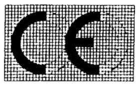

# Règlement grand-ducal du 21 avril 1993 concernant la compatibilité électromagnétique.

## Art. 1er.

Au sens du présent règlement on entend par:

1\) «*appareils*», tous les appareils électriques et électroniques, ainsi que les équipements et installations qui contiennent des composants électriques et/ou électroniques;

2\) «*perturbations électromagnétiques*», les phénomènes électromagnétiques susceptibles de créer des troubles de fonctionnement d’un dispositif, d’un appareil ou d’un système. Une perturbation électromagnétique peut être un bruit électromagnétique, un signal non désiré ou une modification du milieu de propagation lui-même;

3\) «*immunité*», l’aptitude d’un dispositif, d’un appareil ou d’un système à fonctionner sans dégradation de qualité en présence d’une perturbation électromagnétique;

4\) «*compatibilité électromagnétique*», l’aptitude d’un dispositif, d’un appareil ou d’un système à fonctionner dans son environnement électromagnétique de façcon satisfaisante et sans produire lui-même des perturbations électromagnétiques intolérables pour tout ce qui se trouve dans cet environnement;

5\) «*organisme compétent*», organisme qui peut apporter la démonstration de sa conformité aux normes harmonisées de la série EN 45000 par la présentation d’une attestation d’accréditation ou par d’autres moyens de preuve;

6\) «*organisme notifié*», organisme compétent qui est notifié par un Etat membre à la Commission et aux autres Etats membres;

7\) «*attestation CE de type*», document par lequel un organisme notifié certifie que le type d’appareil examiné répond aux dispositions du présent règlement, qui le concernent.

8\) «*norme harmonisée*», spécification technique (norme européenne ou document d’harmonisation), adoptée par le Comité Européen de Normalisation Electrotechnique (CENELEC) sur mandat de la Commission, conformément à la [directive 83/189/CEE](https://legilux.public.lu/eli/dir_ue/1983/189/jo) du Conseil, du 28 mars 1983, prévoyant une procédure d’information dans le domaine des normes et réglementations techniques telle qu’elle a été modifiée.

## Art. 2.

1\) Le présent règlement s’applique aux appareils susceptibles de créer des perturbations électromagnétiques ou dont le fonctionnement est susceptible d’être affecté par ces perturbations.

Il fixe les exigences de protection en la matière ainsi que les modalités de contrôle qui s’y rapportent.

2\) Dans la mesure où des exigences de protection spécifiées dans le présent règlement sont harmonisées, pour certains appareils, par des règlements spécifiques, le présent règlement ne s’applique pas ou cesse de s’appliquer, pour ces appareils et pour ces exigences de protection, dès l’entrée en vigueur de ces règlements spécifiques.

Constitue notamment un règlement spécifique au sens du présent paragraphe le [règlement grand-ducal du 5 février 1993](https://legilux.public.lu/eli/etat/leg/rgd/1993/02/05/n1/jo) relatif aux dispositifs médicaux implantables actifs.[^7]

3\) Les équipements radio utilisés par les radio-amateurs au sens de la définition no 53, article 1 du «règlement radio», qui fait partie de la convention internationale des télécommunications, sont exclus du champ d’application du présent règlement, sauf si l’équipement est disponible dans le commerce.

## Article 3

Le Service de l’Energie de l’Etat prend toutes les dispositions utiles pour que les appareils visés à l’article 2 ne puissent être mis sur le marché ou en service que s’ils sont munis du marquage «CE» prévu à l’article 9, qui indique leur conformité à l’ensemble des dispositions du présent règlement, y compris les procédures d’évaluation de leur conformité prévues à l’article 9, lorsqu’ils sont installés, entretenus convenablement et utilisés conformément à leur destination.[^8]

## Art. 4.

Les appareils visés à l’article 2 doivent être construits de telle sorte que:

a) les perturbations électromagnétiques générées soient limitées à un niveau permettant aux appareils de radio et de télécommunications et aux autres appareils de fonctionner conformément à leur destination;

b) les appareils aient un niveau adéquat d’immunité intrinsèque contre les perturbations électromagnétiques, leur permettant de fonctionner conformément à leur destination.

En particulier le niveau maximum des perturbations électromagnétiques générées par les appareils doit être tel qu’il ne gêne pas l’utilisation notamment des appareils suivants:

a) récepteurs de radio et de télévision privés

b) équipements industriels

c) équipement radio mobiles

d) équipements radio mobiles et radiotéléphoniques commerciaux

e) appareils médicaux et scientifiques

f) équipements des technologies de l’information

g) appareils ménagers et équipements électroniques ménagers

h) appareils radio pour l’aéronautique et la marine

i) équipements éducatifs électroniques

j) réseaux et appareils de télécommunications

k) émetteurs de radio et de télédiffusion

l) éclairage et lampes fluorescentes.

Les appareils, et notamment ceux visés aux points a) à l), devront être construits de manière à avoir un niveau adéquat d’immunité électromagnétique dans un environnement normal de compatibilité électromagnétique là où les appareils sont destinés à fonctionner, de façon à pouvoir être utilisés sans gêne compte tenu des niveaux de la perturbation générée par les appareils satisfaisant aux normes fixées à l’article 7.

Les informations nécessaires pour permettre une utilisation conforme à la destination de l’appareil doivent figurer dans une notice qui accompagne l’appareil.

## Art. 5.

Le Service de l’Energie de l’Etat ne fait obstacle, pour des motifs concernant la compatibilité électromagnétique, ni à la mise sur le marché, ni à la mise en service des appareils visés par le présent règlement qui satisfont à ses dispositions.

## Art. 6.

Les dispositions du présent règlement ne font pas obstacle à l’application des mesures spéciales suivantes:

a) les mesures concernant la mise en service et l’utilisation de l’appareil prises pour un site particulier afin de remédier à un problème de compatibilité électromagnétique existant ou prévisible;

b) les mesures concernant l’installation de l’appareil prises pour protéger les réseaux de télécommunications publics ou les stations réceptrices ou émettrices utilisées pour des raisons de sécurité.

## Art. 7.

1\. Le Service de l’Energie de l’Etat présume conformes aux exigences de protection visées à l’article 4 les appareils qui sont conformes

a) aux normes nationales les concernant, transposant les normes harmonisées dont les références ont fait l’objet d’une publication au Journal officiel des Communautés européennes ou

b) aux normes nationales les concernant, dans la mesure où, dans les domaines couverts par de telles normes, des normes harmonisées n’existent pas et pour autant que la Commission ait notifié au Service de l’Energie de l’Etat celles desdites normes qui bénéficient de la présomption de conformité aux exigences de protection visées à l’article 4.

2\. Le Service de l’Energie de l’Etat accepte que les appareils pour lesquels le fabricant n’a pas appliqué, ou n’a appliqué qu’en partie, les normes fixées à l’article 7, ou en l’absence de normes, soient présumés conformes aux exigences de protection visées à l’article 4 lorsque leur conformité avec ces exigences est attestée par le moyen d’attestation prévu à l’article 9 paragraphe 2.

## Art. 8.

1\. Lorsque le Service de l’Energie de l’Etat constate qu’un appareil accompagné de l’un des moyens d’attestation prévus à l’article 9 ne répond pas aux exigences de protection visées à l’article 4, il prend toutes les mesures utiles pour retirer du marché l’appareil en cause, en interdire la mise sur le marché ou en restreindre la libre circulation.

Le Service de l’Energie de l’Etat informe immédiatement la Commission de cette mesure et indique les raisons de sa décision et, en particulier, si la non-conformité résulte:

a) du non-respect des exigences visées à l’article 4, lorsque l’appareil ne correspond pas aux normes fixées à l’article 7;

b) d’une mauvaise application des normes fixées à l’article 7;

c) d’une lacune des normes fixées à l’article 7 elles-mêmes.

2\. Lorsque l’appareil non conforme est accompagné de l’un des moyens d’attestation visés à l’article 9, le Service de l’Energie de l’Etat prend à l’encontre de l’auteur de l’attestation les mesures appropriées et en informe la Commission et les autres Etats membres.

3\. En cas de constatation par le Service de l’Energie de l’Etat d’une non-conformité d’un matériel électrique avec les exigences du présent règlement, les frais de contrôle et d’essais qui ont été à la base de cette constatation de non-conformité sont à charge du constructeur ou, à défaut, de l’importateur dans l’Union européenne ou, à défaut, de celui qui a mis sur le marché le matériel électrique.[^13]

## Art. 9.

1\. Dans le cas d’appareils pour lesquels le fabricant a appliqué les normes fixées à l’article 7, la conformité des appareils avec les dispositions du présent règlement est attestée par une déclaration CE de conformité délivrée par le fabricant ou son mandataire établi dans la Communauté. Cette déclaration doit être tenue à la disposition du Service de l’Energie de l’Etat pendant dix ans suivant la mise sur le marché des appareils.

En outre, le fabricant ou son mandataire établi dans la Communauté appose la marquage «CE»[^1] de conformité sur l’appareil, à défaut sur l’emballage, sur sa notice d’emploi ou sur son bon de garantie.

Lorsque ni le fabricant, ni son mandataire ne sont établis dans la Communauté, l’obligation susmentionnée de tenir à disposition la déclaration CE de conformité incombe à toute personne qui met l’appareil sur le marché communautaire.

La déclaration CE de conformité doit comprendre les éléments suivants:

aash description de l’appareil ou des appareils visé(s)

bash référence des spécifications par rapport auxquelles la conformité est déclarée et, le cas échéant, mesures internes mises en oeuvre pour assurer la conformité des appareils avec les dispositions de la directive;

cash identification du signataire ayant reçu pouvoir pour engager le fabricant ou son mandataire;

dash le cas échéant, référence de l’attestation CE de type délivrée par un organisme notifié.

Le Service de l’Energie de l’Etat prend les mesures nécessaires pour interdire l’apposition sur les appareils, sur leur emballage, sur les notices d’emploi ou les bons de garantie de marquages susceptibles de tromper les tiers sur la signification et le graphisme du marquage «CE».Tout autre marquage peut être apposé sur l’appareil, l’emballage, sur la notice d’emploi ou le bon de garantie, à condition de ne pas réduire la lisibilité et la visibilité du marquage «CE».[^9]

Les dispositions relatives à la marquage «CE»[^2] de conformité figurent à l’annexe.

2\. Dans le cas d’appareils pour lesquels le fabricant n’a pas appliqué ou n’a appliqué qu’en partie les normes fixées à l’article 7 ou en l’absence de normes,le fabricant, ou son mandataire établi dans la Communauté, tient à la disposition du Service de l’Energie de l’Etat, dès la mise sur le marché, un dossier technique de construction. Ce dossier doit donner une description de l’appareil, exposer les modalités mises en oeuvre pour assurer la conformité de l’appareil avec les exigences de protection visées à l’article 4 et comprendre un rapport technique ou un certificat, l’un ou l’autre ayant été obtenu d’un organisme compétent.

Le dossier doit être tenu à la disposition du Service de l’Energie de l’Etat pendant dix ans suivant la mise sur le marché des appareils.

Lorsque ni le fabricant, ni son mandataire ne sont établis dans la Communauté, cette obligation de tenir à disposition le dossier technique incombe à toute personne qui met l’appareil sur le marché communautaire.

La conformité des appareils avec celui décrit dans le dossier technique est attestée conformément à la procédure prévue au paragraphe 1.

Le Service de l’Energie de l’Etat présume, sous réserve des dispositions du présent paragraphe, que ces appareils sont conformes aux exigences de protection visées à l’article 4.

3\. Toutefois, est autorisée, pour la période allant jusqu’au 31 décembre 1995, la mise sur le marché et/ou la mise en service des appareils visés par le présent règlement conformes à la réglementation nationale en vigueur à la date du 30 juin 1992.

4\. La conformité des appareils visés par l’article 2 paragraphe 2 de l’annexe du [règlement du 15 décembre 1988](https://legilux.public.lu/eli/etat/leg/rgd/1988/12/15/n4/jo) portant application de la [directive 86/361/CEE](https://legilux.public.lu/eli/dir_ue/1986/361/jo) avec les dispositions du présent règlement est attestée conformément à la procédure prévue au paragraphe 1, après que le fabricant, ou son mandataire établi dans la Communauté, ait obtenu une attestation CE de type concernant ces appareils, délivrée par un organisme notifié, dont la référence apparaît dans la déclaration CE de conformité.

5\. La conformité des appareils conçus pour l’émission des radiocommunications, telles que définies dans la convention de l’union internationale des télécommunications, avec les dispositions du présent règlement est attestée conformément à la procédure prévue au paragraphe 1, après que le fabricant, ou son mandataire établi dans la Communauté, ait obtenu une attestation CE de type concernant ces appareils, délivrée par un organisme notifié, dont la référence apparaît dans la déclaration CE de conformité.

Cette disposition ne s’applique pas aux appareils ci-dessus lorsqu’ils sont conçus et destinés exclusivement à des radio-amateurs au sens de l’article 2 paragraphe 3.

6\. Le Service de l’Energie de l’Etat notifie à la Commission et aux autres Etats membres les autorités compétentes visées au présent article et les organismes chargés de délivrer les attestations «CE de type» visées au présent article, ainsi que les tâches spécifiques pour lesquelles ces organismes ont été désignés et les numéros d’identification qui leur ont été attribués préalablement par la Commission.[^10]

7\. Sans préjudice de l’article 8:

a) tout constat par le Service de l’Energie de l’Etat de l’apposition indue du marquage «CE» entraîne pour le fabricant ou son mandataire établi dans la Communauté l’obligation de remettre le produit en conormité en ce qui concerne les dispositions sur le marquage «CE» et de faire cesser l’infraction dans les conditions fixées par cet Etat membre;

b) si la non-conformité persiste, le Service de l’Energie de l’Etat doit prendre toutes les mesures appropriées pour restreindre ou interdire la mise sur le marché du produit en cause ou assurer son retrait du marché selon les procédures prévues à l’article 8.[^11]

## Art. 10.

Le [règlement du 5 mars 1979](https://legilux.public.lu/eli/etat/leg/rgd/1979/03/09/n6/jo) portant application de la directive CEE du 4 novembre 1976 concernant le rapprochement des législations des Etats membres relatives aux perturbations radioélectriques produites par les appareils électro-domestiques, outils portatifs et appareils similaires tel qu’il a été modifié par le [règlement du 14 décembre 1989](https://legilux.public.lu/eli/etat/leg/rgd/1989/12/14/n2/jo) et le [règlement du 5 mars 1979](https://legilux.public.lu/eli/etat/leg/rgd/1979/03/09/n8/jo) portant application de la directive CEE du 4 novembre 1976 concernant le rapprochement des législations des Etats membres relatives à l’antiparasitage des luminiaires avec démarreur pour éclairage à fluorescence tel qu’il a été modifié par le [règlement du 14 décembre 1989](https://legilux.public.lu/eli/etat/leg/rgd/1989/12/14/n3/jo) sont abrogés à partir du 1er janvier 1996.

## Art. 11.

Les officiers de police judiciaire et les agents de la gendarmerie et de la police ainsi que les agents des douanes sont chargés de rechercher et de constater les infractions réprimées par le présent règlement.

## Art. 12.

Notre Ministre de l’Energie est chargé de l’exécution du présent règlement qui sera publié au Mémorial.

Marquage «CE» de conformité

aash Le marquage «CE» de conformité est constitué des initiales «CE» selon le graphisme suivant:

bash En cas de réduction ou d’agrandissement du marquage «CE», les proportions telles qu’elles ressortent du graphisme gradué figurant ci-dessus devront être respectées.

cash Lorsque les appareils font l’objet d’autres dispositions légales ou réglementaires portant sur d’autres aspects et prévoyant le marquage «CE» de conformité, celui-ci indique que les appareils sont également présumés conformes à ces autres dispositions légales ou réglementaires.

dash Toutefois, lorsqu’une ou plusieurs de ces dispositions légales ou réglementaires laissent le choix au fabricant, pendant une période transitoire, du régime à appliquer, le marquage «CE» indique la conformité aux seules dispositions légales ou réglementaires appliquées par le fabricant. Dans ce cas, les références des dispositions légales ou réglementaires appliquées, telles que publiées au Mémorial, doivent être inscrites sur les documents, notices ou instructions requis par ces dispositions et accompagnant ces appareils.

eash Les différents éléments du marquage «CE» doivent avoir sensiblement la même dimension verticale, laquelle ne peut être inférieure à 5 mm.[^12]

---

[^7]: [Règlement grand-ducal du 20 avril 1995 modifiant le règlement grand-ducal du 21 avril 1993 concernant la compatibilité électromagnétique.](https://legilux.public.lu/eli/etat/leg/rgd/1995/04/20/n3/jo)
[^8]: [Règlement grand-ducal du 20 avril 1995 modifiant le règlement grand-ducal du 21 avril 1993 concernant la compatibilité électromagnétique.](https://legilux.public.lu/eli/etat/leg/rgd/1995/04/20/n3/jo)
[^13]: [Règlement grand-ducal du 4 octobre 1999 complétant: 1. le règlement grand-ducal modifié du 27 août 1976 portant application de la directive CEE du 19 février 1973 concernant le rapprochement des législations des Etats membres relatives au matériel électrique destiné à être employé dans certaines limites de tension; 2. le règlement grand-ducal modifié du 21 avril 1993 concernant la compatibilité électromagnétique; 3. le règlement grand-ducal du 20 avril 1995 concernant les appareils et les systèmes de protection destinés à être utilisés en atmosphères explosibles.](https://legilux.public.lu/eli/etat/leg/rgd/1999/10/04/n3/jo)
[^1]: [Règlement grand-ducal du 20 avril 1995 modifiant le règlement grand-ducal du 21 avril 1993 concernant la compatibilité électromagnétique.](https://legilux.public.lu/eli/etat/leg/rgd/1995/04/20/n3/jo)
[^9]: [Règlement grand-ducal du 20 avril 1995 modifiant le règlement grand-ducal du 21 avril 1993 concernant la compatibilité électromagnétique.](https://legilux.public.lu/eli/etat/leg/rgd/1995/04/20/n3/jo)
[^2]: [Règlement grand-ducal du 20 avril 1995 modifiant le règlement grand-ducal du 21 avril 1993 concernant la compatibilité électromagnétique.](https://legilux.public.lu/eli/etat/leg/rgd/1995/04/20/n3/jo)
[^10]: [Règlement grand-ducal du 20 avril 1995 modifiant le règlement grand-ducal du 21 avril 1993 concernant la compatibilité électromagnétique.](https://legilux.public.lu/eli/etat/leg/rgd/1995/04/20/n3/jo)
[^11]: [Règlement grand-ducal du 20 avril 1995 modifiant le règlement grand-ducal du 21 avril 1993 concernant la compatibilité électromagnétique.](https://legilux.public.lu/eli/etat/leg/rgd/1995/04/20/n3/jo)
[^12]: [Règlement grand-ducal du 20 avril 1995 modifiant le règlement grand-ducal du 21 avril 1993 concernant la compatibilité électromagnétique.](https://legilux.public.lu/eli/etat/leg/rgd/1995/04/20/n3/jo)
