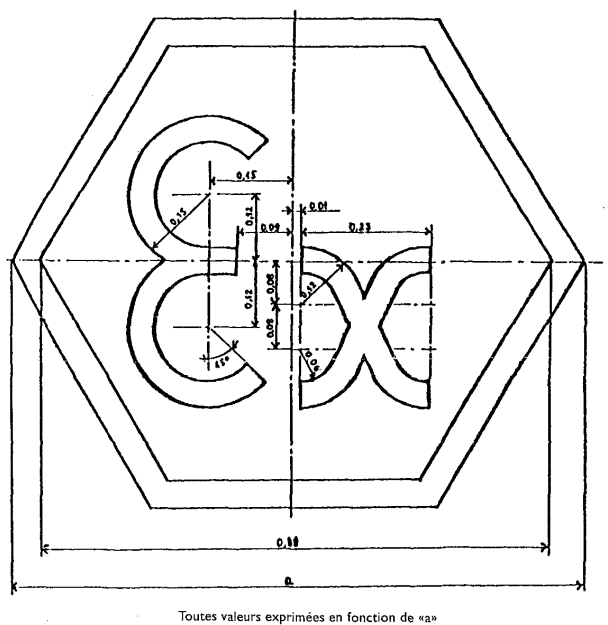

# Règlement grand-ducal du 29 juillet 1993 relatif au matériel électrique utilisable en atmosphère explosible mettant en oeuvre certains modes de protection.

Nous JEAN, par la grâce de Dieu, Grand-Duc de Luxembourg, Duc de Nassau;

Vu la [loi du 9 août 1971](https://legilux.public.lu/eli/etat/leg/loi/1971/08/09/n2/jo) concernant l’exécution et la sanction des décisions et des directives ainsi que la sanction des règlements des Communautés européennes en matière économique, technique, agricole, forestière, sociale et en matière de transports, telle qu’elle a été modifiée dans la suite;

Vu la [directive du Conseil 79/196/CEE](https://legilux.public.lu/eli/dir_ue/1979/196/jo) du 6 février 1979 concernant le rapprochement des législations des Etats membres relatives au matériel électrique utilisable en atmosphère explosible mettant en oeuvre certains modes de protection, telle qu’elle a été adaptée au progrès technique par les [directives de la Commission 84/47/CEE](https://legilux.public.lu/eli/dir_ue/1984/47/jo) du 16 janvier 1984, [88/571/CEE](https://legilux.public.lu/eli/dir_ue/1988/571/jo) du 10 novembre 1988 et [90/487/CEE](https://legilux.public.lu/eli/dir_ue/1990/487/jo) du 17 septembre 1990;

Vu le [règlement grand-ducal du 13 novembre 1981](https://legilux.public.lu/eli/etat/leg/rgd/1981/11/13/n2/jo) portant application de la [directive du Conseil 79/196/CEE](https://legilux.public.lu/eli/dir_ue/1979/196/jo) concernant le rapprochement des législations des Etats membres relatives au matériel électrique utilisable en atmosphère explosible mettant en oeuvre certains modes de protection, tel qu’il a été modifié le 26 avril 1987;

Vu le [règlement grand-ducal du 13 novembre 1981](https://legilux.public.lu/eli/etat/leg/rgd/1981/11/13/n1/jo) portant application de la [directive du Conseil 76/117/CEE](https://legilux.public.lu/eli/dir_ue/1976/117/jo) concernant le rapprochement des législations des Etats membres relatives au matériel électrique utilisable en atmosphère explosible;

Vu les avis de la Chambre de Commerce, de la Chambre des Métiers et de la Chambre de Travail;

Notre Conseil d’Etat entendu;

De l’assentiment de la Commission de travail de la Chambre des Députés;

Sur le rapport de Notre Ministre de l’Energie et de Notre Ministre de la Justice et après délibération du Gouvernement en Conseil;

Arrêtons:

## Art. 1er.

Le présent règlement concerne le matériel électrique utilisable en atmosphère explosible qui met en oeuvre un ou plusieurs des modes de protection suivants:

— immersion dans l’huile «o»,

— surpression interne «p»,

— remplissage pulvérulant «q»,

— enveloppe antidéflagrante «d»,

— sécurité augmentée «e»,

— sécurité intrinsèque «i»,

— systèmes électriques de sécurité intrinsèque«i»,

— encapsulage «m».

## Art. 2.

Il n’est pas fait obstacle, pour des motifs de sécurité concernant sa construction, à la vente ou à la libre circulation ou à l’usage conforme à sa destination du matériel électrique destiné à être utilisé en atmosphère explosible qui est conforme aux prescriptions du présent règlement et du [règlement du 13 novembre 1981](https://legilux.public.lu/eli/etat/leg/rgd/1981/11/13/n1/jo) portant réglementation générale concernant le matériel électrique utilisable en atmosphère explosible en ce qui concerne les aspects de sécurité couverts par le présent règlement.

## Art. 3.

Aux fins du présent règlement, les normes harmonisées au sens de l’article 4 paragraphe 3 du [règlement du 13 novembre 1981](https://legilux.public.lu/eli/etat/leg/rgd/1981/11/13/n1/jo) visé à l’article 2 sont celles dont les références sont reprises en annexe I.

## Art. 4.

1\. Le matériel électrique utilisable en atmosphère explosible au sens du présent règlement est soumis aux procédures visées à l’article 4 du paragraphe 1 du [règlement du 13 novembre 1981](https://legilux.public.lu/eli/etat/leg/rgd/1981/11/13/n1/jo) prémentionné. Les informations transmises aux organismes agréés, dans le cadre de ces procédures, sont confidentielles.

2\. Aux fins du présent règlement, la marque distinctive communautaire visée à l’article 4 paragraphe 1 et à l’article 7 du [règlement du 13 novembre 1981](https://legilux.public.lu/eli/etat/leg/rgd/1981/11/13/n1/jo) précité doit être conforme à l’annexe II; cette marque doit être apposée, sur chaque matériel, de manière à être visible, lisible et durable.

3\. L’utilisation, pour le matériel faisant l’objet du présent règlement, de marques ou inscriptions propres à créer une confusion avec la marque figurant à l’annexe II est interdite.

## Art. 5.

Dans le délai d’un mois à compter de la délivrance du certificat de conformité ou de contrôle, une copie de ce certificat est communiquée à la Commission des Communautés européennes. Celle-ci reçoit aussi, à sa demande, copie du dossier technique définitif du matériel et des procès-verbaux des examens ou contrôles que celui-ci aura subis. Ces renseignements sont à traiter confidentiellement.

## Art. 6.

1\. Si l’organisme qui a délivré le certificat de conformité ou de contrôle révoque celui-ci pour des raisons invoquées à l’article 5 paragraphe 2 et à l’article 6 paragraphe 4 du [règlement du 13 novembre 1981](https://legilux.public.lu/eli/etat/leg/rgd/1981/11/13/n1/jo) portant réglementation générale concernant le matériel électrique utilisable en atmosphère explosible, il doit informer les destinataires désignés et notifiés par les autres Etats membres en vertu de la [directive 76/117/CEE](https://legilux.public.lu/eli/dir_ue/1976/117/jo) et la Commission des Communautés européennes de cette révocation.

2\. La révocation de même que le refus de délivrer un certificat de conformité ou de contrôle sont immédiatement communiqués à l’intéressé, avec l’indication des voies de recours ouvertes et des délais dans lesquels ces recours peuvent être introduits. La révocation est motivée de façon précise.

## Art. 7.

Toutefois jusqu’au 31 décembre 2009, continuent à être appliquées les mesures prévues à l’article 4 du [règlement grand-ducal du 13 novembre 1981](https://legilux.public.lu/eli/etat/leg/rgd/1981/11/13/n1/jo) visé à l’article 2 aux matériels dont la conformité aux normes harmonisées est justifiée par la délivrance du certificat de conformité visé à l’article 5 du [règlement grand-ducal précité](https://legilux.public.lu/eli/etat/leg/rgd/1981/11/13/n1/jo), si ce certificat a été délivré avant le 1er janvier 1993.

## Art. 8.

Le service de l’énergie de l’Etat est chargé de contrôler l’application des dispositions du présent règlement et du [règlement grand-ducal du 13 novembre 1981](https://legilux.public.lu/eli/etat/leg/rgd/1981/11/13/n1/jo) portant application de la [directive du Conseil 76/117/CEE](https://legilux.public.lu/eli/dir_ue/1976/117/jo).

## Art. 9.

Les officiers de police judiciaire, les agents de la gendarmerie et de la police ainsi que les agents des douanes sont chargés de rechercher et de constater les infractions au présent règlement.

## Art. 10.

Les infractions aux dispositions du présent règlement sont punies d’un emprisonnement de huit jours à un an et d’une amende de deux mille cinq cent un à deux cent mille francs ou d’une de ces peines seulement.

Les tribunaux pourront, en outre, prononcer la confiscation des biens ayant servi à l’infraction ainsi que les bénéfices illicites.

Le livre Ier du [code pénal](https://legilux.public.lu/eli/etat/leg/code/penal) ainsi que la [loi du 18 juin 1879](https://legilux.public.lu/eli/etat/leg/loi/1879/06/18/n2/jo) portant attribution aux cours et tribunaux de l’approciation des circonstances atténuantes, telle qu’elle a été modifiée par la [loi du 16 mai 1904](https://legilux.public.lu/eli/etat/leg/loi/1904/05/16/n3/jo), sont applicables.

## Art. 11.

Le [règlement grand-ducal du 13 novembre 1981](https://legilux.public.lu/eli/etat/leg/rgd/1981/11/13/n2/jo) portant application de la [directive du Conseil 79/196/CEE](https://legilux.public.lu/eli/dir_ue/1979/196/jo), tel qu’il a été adapté au progrès technique par le [règlement grand-ducal du 26 avril 1987](https://legilux.public.lu/eli/etat/leg/rgd/1987/04/26/n5/jo), est abrogé.

## Art. 12.

Notre Ministre de l’Energie et Notre Ministre de la Justice sont chargés, chacun en ce qui le concerne, de l’exécution du présent règlement qui sera publié au Mémorial.

Le Ministre de l’Energie,   Alex Bodry   Le Ministre de la Justice,   Marc Fischbach

Cabasson, le 29 juillet 1993.   Jean

ANNEXE I

\**Normes harmonisées**

Les normes harmonisées auxquelles un matériel doit être conforme selon son mode de protection sont les normes européennes dont les références figurent dans le tableau ci-dessous.

\*Normes européennes*

\*(établies par CENELEC, rue de Stassart, 35 B-1050 Bruxelles)*

| Numéro |  |  | Edition | Date |
|---|---|---|---|---|
| EN 50014 | – | Matériel électrique pour atmosphère explosible:règles générales | I | Mars 1971 |
|  | – | Amendement 1 |  | Juillet 1979 |
|  | – | Amendement 2 |  | Juin 1982 |
|  | – | Amendement 3 et 4 |  | Décembre 1982 |
|  | – | Amendement 5 |  | Février 1986 |
| EN 50015 | – | Matériel électrique pour atmosphère explosible: imersion dans l’huile «o» | I | Mars 1977 |
|  | – | Amendement I |  | Juillet 1979 |
| EN 50016 | – | Matériel électrique pour atmosphère explosible: supression interne «p» | I | Mars 1977 |
|  | – | Amendement 1 |  | Juillet 1979 |
| EN 50017 | – | Matériel électrique pour atmosphère explosible: remplissage pulvérulent «q» | 1 | Mars 1977 |
|  | – | Amendement 1 |  | Juillet 1979 |
| EN 50018 | – | Matériel électrique pour atmosphère explosible: enveloppe antidéflagrante «d»I |  | Mars 1977 |
|  | – | Amendement 1 |  | Juillet 1979 |
|  | – | Amendement 2 |  | Décembre 1982 |
|  | – | Amendement 3 |  | Novembre 1985 |
| EN 50019 | – | Matériel électrique pour atmosphère explosible: sécurité augmentée «e» | I | Mars 1977 |
|  | – | Amendement 1 |  | Juillet 1979 |
|  | – | Amendement 2 |  | Septembre 1983 |
|  | – | Amendement 3 |  | Décembre 1985 |
| EN 50020 | – | Matériel électrique pour atmosphère explosible: sécurité intrinsèque «i» | I | Mars 1977 |
|  | – | Amendement 1 |  | Juillet 1979 |
|  | – | Amendement 2 |  | Décembre 1985 |
| EN 50028 | – | Matériel électrique pour atmosphère explosible: encapsulage «m» | I | Février 1987 |
| EN 50039 | – | Matériel électrique pour atmosphère explosible: système électriques de sécurité intrinsèque «i» | I | Mars 1980 |
| EN 50050 | – | Equipement manuel de protection électrostatique | I | Janvier 1986 |
| EN 50053 PARTIE 1 | – | Pistolets manuels de projection électrostatique de peinture avec une énergie limite de 0,24 mJ et leur associé | I | Février 1987 (*) |
| EN 50053 PARTIE 2 | – | Pistolets manuels de projection électrostatique de poudre avec une énergie limite de 5 mJ et leur associé | I | Juin 1989 (*) |
| EN 50053 PARTIE 3 | – | Pistolets manuels de projection électrostatique de flock avec une énergie limite de 0,24 mJ ou 5 mJ et leur associé | I | Juin 1989 (*) |

(*) Seuls les paragraphes relatifs à la construction du matériel prévus dans les normes EN 50053 parties 1, 2 et 3 sont d’application.

ANNEXE II

\**Marque communautaire**

Doc. parl. 3773; sess. ord. 1992-1993; [Dir. 84/47](https://legilux.public.lu/eli/dir_ue/1984/47/jo), [88/571](https://legilux.public.lu/eli/dir_ue/1988/571/jo) et [90/487](https://legilux.public.lu/eli/dir_ue/1990/487/jo).
