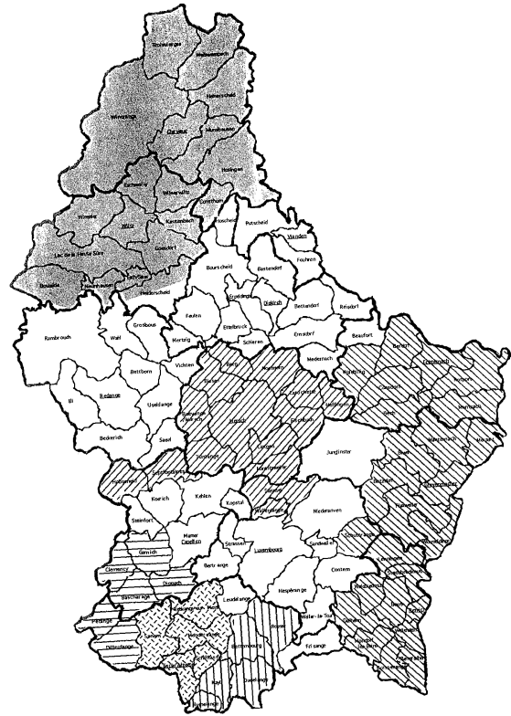

# Règlement grand-ducal du 13 juin 1994 pris en exécution de loi du 3 juin 1994 portant création du régime préparatoire de l’enseignement secondaire technique.

Nous JEAN, par la grâce de Dieu, Grand-Duc de Luxembourg, Duc de Nassau;

Vu l’article 6 de la [loi modifiée du 4 septembre 1990](https://legilux.public.lu/eli/etat/leg/loi/1990/09/04/n1/jo) portant réforme de l’enseignement secondaire technique et de la formation professionnelle continue;

Notre Conseil d’État entendu;

Sur le rapport de Notre ministre de l’Éducation nationale et après délibération du Gouvernement en conseil;

Arrêtons:

## Art. 1er.

Sous l’autorité du directeur du lycée technique, le chargé de direction du régime préparatoire est compétent pour les volets pédagogique et administratif du régime préparatoire. Il assume notamment les charges suivantes:

aash la mise en oeuvre de l’organisation et des mesures pédagogiques spécifiques au régime préparatoire ;

bash l’établissement et la modification des horaires du personnel enseignant ;

cash les mesures de remplacement des enseignants temporairement empêchés de donner leurs cours ;

dash la surveillance générale des élèves et le contrôle des absences ;

eash l’acquisition et la surveillance des équipements scolaires ;

fash l’organisation des services scolaires et des activités périscolaires.

Le chargé de direction est nommé par le ministre de l’Éducation nationale pour un mandat renouvelable de cinq années.

## Art. 2.

Le régime préparatoire de l’enseignement secondaire technique fonctionne dans les lycées techniques suivants : Lycée technique du Centre, Lycée technique de Bonnevoie, Lycée technique d’Esch/Alzette, Lycée technique Nic.-Biever, Lycée technique Mathias-Adam, Lycée technique de Mersch, Lycée technique d’Ettelbrück, Lycée du Nord, Lycée technique Joseph-Bech.

Les zones géographiques de recrutement des différents lycées techniques à régime préparatoire sont définies aux annexes A et B du présent règlement.

## Art. 3.

En cas de vacance respectivement d’un poste d’instituteur d’enseignement préparatoire et d’instituteur d’économie familiale dans le régime préparatoire, le ministre procède à un appel public de candidatures.

Il est procédé au classement des candidats au poste d’instituteur d’enseignement préparatoire d’après l’échelle d’appréciation figurant à l’annexe C du présent règlement.

Les candidats sont nommés à la fonction d’instituteur d’enseignement préparatoire d’après leur ordre de classement.

Un règlement ministériel détermine l’ordre d’ancienneté des instituteurs d’enseignement préparatoire.

Pour l’instituteur d’enseignement préparatoire qui réintègre l’enseignement primaire ou spécial les années passées dans l’enseignement préparatoire lui sont bonifiées dans leur totalité comme années d’ancienneté en vue de l’application des [règlements grand-ducaux du 28 avril 1986](https://legilux.public.lu/eli/etat/leg/rgd/1986/04/28/n5/jo) fixant les modalités de nomination des instituteurs de [l’enseignement primaire](https://legilux.public.lu/eli/etat/leg/rgd/1986/04/28/n4/jo) et d’enseignement spécial.

## Art. 4.

Le volume de la tâche hebdomadaire normale des enseignants du régime préparatoire de l’enseignement secondaire technique est fixé à 22 leçons. La composition de cette tâche ainsi que les modalités de mise en compte des différentes composantes sont réglées par le ministre de l’Éducation nationale par analogie aux dispositions correspondantes en vigueur dans l’enseignement secondaire technique, mais en tenant compte des spécificités liées au tutorat et à la concertation.

Le tutorat comprend

aash une tâche de soutien pédagogique, dont notamment : animation de groupe, activités dirigées, appui scolaire ;

bash une tâche de suivi individualisé des élèves.

La concertation comprend tant le travail d’équipe en coopération avec les intervenants dans l’établissement que les relations avec les instances et acteurs externes à l’établissement.

## Art. 5.

Le présent règlement entre en vigueur à partir de l’année scolaire 1994/95.

## Art. 6.

Notre ministre de l’Éducation nationale est chargé de l’exécution du présent règlement qui sera publié au Mémorial.

Le Ministre de l’Education Nationale,   Marc Fischbach

Château de Berg, le 13 juin 1994.   Jean

ANNEXE A

\**Définition des zones de recrutement :**

\*Lycée technique de Bonnevoie et Lycée technique du Centre*

Communes de : Luxembourg, Bertrange, Capellen, Contern, Frisange, Junglinster, Hesperange, Kehlen, Koerich, Kopstal, Leudelange, Niederanven, Sandweiler, Schuttrange, Steinfort, Strassen,Weiler-la-Tour

\*Lycée technique d’Esch/Alzette*

Communes de : Esch/Alzette, Mondercange, Reckange/Mess, Sanem, Schifflange

\*Lycée technique Nic.-Biever*

Communes de : Dudelange, Bettembourg, Kayl, Roeser, Rumelange

\*Lycée technique Mathias-Adam*

Communes de : Pétange, Bascharage, Clemency, Differdange, Dippach, Garnich

\*Lycée technique de Mersch*

Communes de : Mersch, Hobscheid, Bissen, Boevange, Colmar-Berg, Fischbach, Heffingen, Larochette, Lintgen, Lorentzweiler, Nommern, Septfontaines, Steinsel, Tuntange, Walferdange

\*Lycée technique d’Ettelbrück*

Communes de : Diekirch, Bastendorf, Beaufort, Beckerich, Bettborn, Bettendorf, Bourscheid, Ell, Ermsdorf, Erpeldange, Ettelbruck, Feulen, Fouhren, Grosbous, Heiderscheid, Hoscheid, Medernach, Mertzig, Putscheid, Rambrouch, Rédange, Reisdorf, Saeul, Schieren, Useldange, Vianden, Vichten, Wahl

\*Lycée du Nord*

Communes de : Wiltz, Boulaide, Clervaux, Consthum, Esch/Sûre, Eschweiler, Goesdorf, Heinerscheid, Hosingen, Kautenbach, Lac Hte Sûre, Munshausen, Neunhausen, Troisvierges, Weiswampach, Wilwerwiltz, Wincrange, Winseler

\*Lycée technique Joseph-Bech*

Communes de : Grevenmacher, Bech, Berdorf, Betzdorf, Biwer, Bous, Burmerange, Consdorf, Dalheim, Echternach, Flaxweiler, Lenningen, Manternach, Mertert, Mompach, Mondorf, Remerschen, Remich, Rosport, Stadtbredimus, Waldbredimus, Waldbillig, Wellenstein, Wormeldange

(Remarque : des classes de cette zone de recrutement pourront être organisées à Echternach)

Annexe B

ANNEXE C

<table>
<tr>
<td colspan="7"><b>Echelle d’appréciationconcernant le classement pour les postes d’instituteurd’enseignement préparatoire</b></td>
</tr>
<tr>
<td colspan="2"><i>Variables retenues</i></td>
<td></td>
<td colspan="2"><i>Echelle appliquée</i></td>
<td></td>
<td><i>Maximum</i></td>
</tr>
<tr>
<td colspan="2">1.—<b>Ancienneté</b></td>
<td colspan="4">Pour chacune des premières quinze années de service: 1 point</td>
<td>20</td>
</tr>
<tr>
<td></td>
<td></td>
<td colspan="4">Pour chacune des dix années suivantes: 0,5 point</td>
<td></td>
</tr>
<tr>
<td colspan="2">2.— <b>Brevets ou certificats</b></td>
<td colspan="4">Mentions obtenues et points correspondants</td>
<td></td>
</tr>
<tr>
<td></td>
<td></td>
<td>satisfaisant</td>
<td>bien</td>
<td>distinction</td>
<td>grade distinction</td>
<td></td>
</tr>
<tr>
<td colspan="2">Brevet d’aptitude pédagogique</td>
<td>14</td>
<td>15</td>
<td>16</td>
<td>17</td>
<td></td>
</tr>
<tr>
<td colspan="2">Certificat d’études pédagogiques</td>
<td>14</td>
<td>15</td>
<td>16</td>
<td>17</td>
<td></td>
</tr>
<tr>
<td colspan="2">Brevet d’enseignement complémentaire ou spécialo</td>
<td>14</td>
<td>15</td>
<td>16</td>
<td>17</td>
<td></td>
</tr>
<tr>
<td colspan="2">Brevet d’enseignement postscolaireo</td>
<td>15</td>
<td>—</td>
<td>16</td>
<td>17</td>
<td></td>
</tr>
<tr>
<td colspan="2">Certificat de perfectionnement, option enseignement primaire</td>
<td></td>
<td></td>
<td>23</td>
<td></td>
<td>25</td>
</tr>
<tr>
<td colspan="2">Certificat de perfectionnement, option enseignement primaire,classes spéciales</td>
<td></td>
<td></td>
<td>23</td>
<td></td>
<td></td>
</tr>
<tr>
<td colspan="2">Certificat de spécialisationo</td>
<td></td>
<td></td>
<td>23</td>
<td></td>
<td></td>
</tr>
<tr>
<td colspan="2">Brevet d’enseignement moyeno</td>
<td>22</td>
<td>23</td>
<td>24</td>
<td>25</td>
<td></td>
</tr>
<tr>
<td colspan="2">Brevet d’enseignement primaire supérieuro</td>
<td>23</td>
<td>—</td>
<td>24</td>
<td>25</td>
<td></td>
</tr>
<tr>
<td colspan="2">3.— <b>Notes d’inspection</b></td>
<td>satisfaisant</td>
<td>bien</td>
<td>très bien</td>
<td>excellent</td>
<td></td>
</tr>
<tr>
<td colspan="2">Méthodes</td>
<td>5</td>
<td>7</td>
<td>9</td>
<td>10</td>
<td></td>
</tr>
<tr>
<td colspan="2">Dévouement</td>
<td>5</td>
<td>7</td>
<td>9</td>
<td>10</td>
<td>20</td>
</tr>
<tr>
<td colspan="2"><i>Remarques:</i></td>
<td></td>
<td></td>
<td></td>
<td></td>
<td></td>
</tr>
<tr>
<td colspan="2">1.— <b>Brevets ou certificats</b></td>
<td></td>
<td></td>
<td></td>
<td></td>
<td></td>
</tr>
<tr>
<td>1.1.—</td>
<td colspan="6">Les détenteurs d’un brevet marqué d’un signe o bénéficient d’un supplément de quatre points, par dépassement éventuel du maximum.</td>
</tr>
<tr>
<td>1.2.—</td>
<td colspan="6">Les instituteurs, sortis de l’Ecole Normale, détenteurs du brevet d’aptitude pédagogique délivré avec la mention «satisfaisant», ont droit à quinze points.</td>
</tr>
<tr>
<td>1.3.—</td>
<td colspan="6">Les détenteurs du certificat d’études pédagogiques qui leur a été délivré conformément au <a href="https://legilux.public.lu/eli/etat/leg/rgd/1985/05/09/n1/jo">règlement grand-ducal du 9 mai 1985</a> déterminant le programme et les modalités des épreuves supplémentaires pour l’obtention du certificat d’études pédagogiques ont droit à leur mention obtenue à l’examen pour l’obtention du brevet d’aptitude pédagogique.</td>
</tr>
<tr>
<td>1.4.—</td>
<td colspan="6">Si la mention obtenue lors de l’examen pour l’obtention du brevet d’enseignement postscolaire ou du brevet d’enseignement complémentaire ou d’enseignement spécial est inférieure à celle obtenue à I’examen pour l’obtention du brevet d’aptitude pédagogique, la mention du brevet d’aptitude pédagogique est prise en compte.</td>
</tr>
<tr>
<td>1.5.—</td>
<td colspan="6">Les détenteurs des anciens certificats ou diplômes de spécialisation obtenus par les candidats ayant suivi régulièrement pendant une année scolaire au moins une préparation théorique et pratique, soit dans la pédagogie de l’enseignement complémentaire, soit dans celle de l’enseignement spécial, ont droit à leur mention obtenue à l’examen pour l’obtention du brevet d’aptitude pédagogique.</td>
</tr>
<tr>
<td>1.6.—</td>
<td colspan="6">Par mesure transitoire, les détenteurs du brevet d’aptitude pédagogique, option enseignement primaire, ayant été préposés à une classe de I enseignement complémentaire au moment de la mise en vigueur de la <a href="https://legilux.public.lu/eli/etat/leg/loi/1983/09/06/n1/jo">loi du 6 septembre 1983</a>, bénéficient, sur présentation d’un certificat afférent délivré par l’administration communale compétente, de deux points supplémentaires pour chaque année dans l’enseignement complémentaire, jusqu’à un maximum de six points.</td>
</tr>
<tr>
<td colspan="2"><b>2.— Notes d’inspection</b></td>
<td></td>
<td></td>
<td></td>
<td></td>
<td></td>
</tr>
<tr>
<td>2.1.—</td>
<td colspan="6">En principe, la moyenne des points répondant aux notes d’inspection des deux années précédant la date de la candidature entrera en ligne de compte.</td>
</tr>
<tr>
<td>2.2.—</td>
<td colspan="6">Les candidats qui ne sont sortis de l’Institut supérieur d’études et de recherches pédagogiques que depuis une année pourront présenter les notes de l’année courante.</td>
</tr>
<tr>
<td>2.3.—</td>
<td colspan="6">Aucune note d’inspection ne sera attribuée aux candidats de la promotion de l’année courante.</td>
</tr>
<tr>
<td>2.4.—</td>
<td colspan="6">Le personnel enseignant qui demande un arrêt de travail est censé demander les notes d’inspection et les conserver. Les candidats qui, après une interruption de service, reprennent leur fonction d’instituteur, pourront présenter les notes de leur dernière année de service. S’ils ne peuvent pas présenter ces notes, il sera compté uniformément quinze points.</td>
</tr>
<tr>
<td>2.5.—</td>
<td colspan="6">Les candidats qui sont sortis de l’Institut supérieur d’études et de recherches pédagogiques depuis une année au moins et qui n’ont pas encore exercé la fonction d’instituteur, ont droit à dix points.</td>
</tr>
<tr>
<td colspan="2">3.— <b>Total des points</b></td>
<td></td>
<td></td>
<td></td>
<td></td>
<td></td>
</tr>
<tr>
<td colspan="7">Lorsque le total des points attribués à un candidat conformément à l’échelle d’appréciation renferme une fraction de points, celle-ci n’est pas à arrondir.</td>
</tr>
</table>
