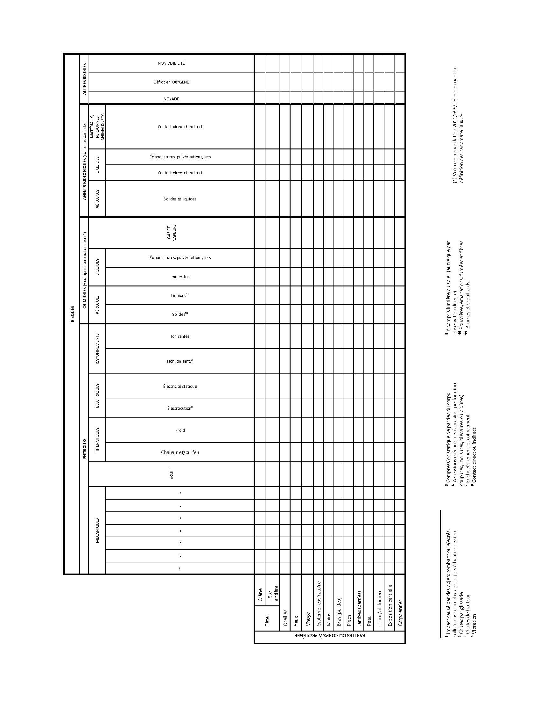

# Règlement grand-ducal du 4 novembre 1994 concernant les prescriptions minimales de sécurité et de santé pour l'utilisation par les travailleurs au travail d'équipements de protection individuelle.

## SECTION I — DISPOSITIONS GÉNÉRALES

### Article premier — Objet

Le présent règlement fixe des prescriptions minimales de sécurité et de santé pour l’utilisation par les travailleurs au travail d’équipements de protection individuelle.

### Article 2 — Définition

1\. Aux fins du présent règlement, on entend par équipement de protection individuelle tout équipement destiné à être porté ou tenu par le travailleur en vue de le protéger contre un ou plusieurs risques susceptibles de menacer sa sécurité ou sa santé au travail, ainsi que tout complément ou accessoire destiné à cet objectif.

2\. Sont exclus de la définition visée au paragraphe 1 :

a) les vêtements de travail ordinaires et uniformes qui ne sont pas spécifiquement destinés à protéger la sécurité et la santé du travailleur ;

b) les équipements des services de secours et de sauvetage;

c) les équipements de protection individuelle des militaires, des policiers et des personnes des services de maintien de l’ordre;

d) les équipements de protection individuelle des moyens de transports routiers;

e) le matériel de sport;

f) le matériel d’autodéfense ou de dissuasion;

g) les appareils portatifs pour la détection et la signalisation de risques et facteurs de nuisance.

### Article 3 — Règle générale

Les équipements de protection individuelle doivent être utilisés lorsque les risques ne peuvent pas être évités ou suffisamment limités par des moyens techniques de protection collective ou par des mesures, méthodes ou procédés d’organisation du travail.

## SECTION II — OBLIGATIONS DES EMPLOYEURS

### Article 4 — Dispositions générales

1\. Tout équipement de protection individuelle doit être conforme à la réglementation en matière de sécurité et de santé le concernant.

Dans tous les cas, un équipement de protection individuelle doit :

a) être approprié par rapport aux risques à prévenir, sans induire lui-même un risque accru;

b) répondre aux conditions existant sur le lieu de travail;

c) tenir compte des exigences ergonomiques et de santé du travailleur ;

d) convenir au porteur, après tout ajustement nécessaire.

2\. En cas de risques multiples exigeant le port simultané de plusieurs équipements de protection individuelle, ces équipements doivent être compatibles et maintenir leur efficacité par rapport au(x) risque(s) correspondant(s).

3\. Les conditions dans lesquelles un équipement de protection individuelle doit être utilisé, notamment celles concernant la durée du port, sont déterminées en fonction de la gravité du risque, de la fréquence de l’exposition au risque et des caractéristiques du poste de travail de chaque travailleur ainsi que des performances de l’équipement de protection individuelle.

4\. Un équipement de protection individuelle est en principe destiné à un usage personnel.

Si les circonstances exigent l’utilisation d’un équipement de protection individuelle par plusieurs personnes, des mesures appropriées doivent être prises pour qu’une telle utilisation ne pose aucun problème de santé ou d’hygiène aux différents utilisateurs.

5\. Des informations adéquates sur chaque équipement de protection individuelle, qui sont nécessaires à l’application des paragraphes 1 et 2, doivent être fournies et être disponibles dans l’entreprise et/ou l’établissement.

6\. Les équipements de protection individuelle doivent être fournis gratuitement par l’employeur qui assure leur bon fonctionnement et leur état hygiénique satisfaisant par les entretiens, réparations et remplacements nécessaires.

7\. L’employeur informe préalablement le travailleur des risques contre lesquels le port de l’équipement de protection individuelle le protège.

8\. L’employeur assure une formation et organise, le cas échéant, un entraînement au port des équipements de protection individuelle.

9\. Les équipements de protection individuelle, sauf dans des cas particuliers et exceptionnels, ne peuvent être utilisés que pour les usages prévus.

Ils doivent être utilisés conformément aux notices d’instruction.

Les notices d’instruction doivent être compréhensibles pour les travailleurs.

### Article 5 — Appréciation de l’équipement de protection individuelle

1\. Avant le choix d’un équipement de protection individuelle, l’employeur est tenu de procéder à une appréciation de l’équipement de protection individuelle qu’il envisage d’utiliser pour évaluer dans quelle mesure il répond aux conditions de l’article 4 paragraphes 1 et 2.

Cette appréciation comprend :

a) l’analyse et l’évaluation des risques qui ne peuvent pas être évités par d’autres moyens;

b) la définition des caractéristiques nécessaires pour que les équipements de protection individuelle répondent aux risques visés au point a), compte tenu des éventuelles sources de risques que peuvent constituer les équipements de protection individuelle;

c) l’évaluation des caractéristiques des équipements de protection individuelle concernés qui sont disponibles, en comparaison avec les caractéristiques visées au point b).

2\. L’appréciation prévue au paragraphe 1 doit être revue en fonction des changements intervenant dans les éléments qui la composent.

### Article 6 — Règles d’utilisation

1\. Sans préjudice des articles 3, 4 et 5, les annexes I, II, III et IV concernant l’utilisation des équipements de protection individuelle et/ou les règles concernant les cas et situations dans lesquels l’employeur doit fournir les équipements de protection individuelle, compte tenu du [règlement grand-ducal du 10 août 1992](https://legilux.public.lu/eli/etat/leg/rgd/1992/08/10/n9/jo) relatif aux équipements de protection individuelle constituent les règles générales à observer.

Ces règles indiquent notamment les circonstances ou les situations de risque dans lesquelles, sans préjudice de la priorité des moyens de protection collective, l’utilisation des équipements de protection individuelle est nécessaire.

2\. Les règles générales concernant l’utilisation des équipements de protection individuelle et/ou des règles concernant les cas et situations dans lesquels l’employeur doit fournir les équipements de protection individuelle sont à considérer comme des mesures d’exécution d’ordre technique telles que prévues à l’article 14 de la [loi du 17 juin 1994](https://legilux.public.lu/eli/etat/leg/loi/1994/06/17/n3/jo) concernant la sécurité et la santé des travailleurs au travail.

### Article 7 — Information des travailleurs

Sans préjudice de l’article 15 de la [loi du 17 juin 1994](https://legilux.public.lu/eli/etat/leg/loi/1994/06/17/n3/jo) concernant la sécurité et la santé des travailleurs au travail, les travailleurs et/ou leurs délégués désignés conformément à la [loi du 18 mai 1979](https://legilux.public.lu/eli/etat/leg/loi/1979/05/18/n1/jo) portant réforme des délégations du personnel sont informés de toutes les mesures à prendre en ce qui concerne la sécurité et la santé des travailleurs lors de l’utilisation par les travailleurs au travail d’équipements de protection individuelle.

### Article 8 — Consultation et participation des travailleurs

La consultation et la participation des travailleurs et/ou de leurs représentants sur les matières couvertes par le présent règlement et de ses annexes doit s’effectuer en conformité de la [loi du 18 mai 1979](https://legilux.public.lu/eli/etat/leg/loi/1979/05/18/n1/jo) portant réforme des délégations du personnel et de la [loi du 6 mai 1974](https://legilux.public.lu/eli/etat/leg/loi/1974/05/06/n1/jo) instituant des comités mixtes dans les entreprises du secteur privé et organisant la représentativité des salariés dans les sociétés anonymes.

### Article 9 — Sanctions pénales

Les infractions au présent règlement sont punies des peines prévues par l’article 12 de la [loi du 17 juin 1994](https://legilux.public.lu/eli/etat/leg/loi/1994/06/17/n3/jo) concernant la sécurité et la santé des travailleurs au travail.

### Article 10 — Exécution

Notre ministre du Travail, Notre ministre de la Justice et Notre ministre de la Santé sont chargés, chacun en ce qui le concerne, de l’exécution du présent règlement qui sera publié au Mémorial.

\**Annexe I**

\**RISQUES EN FONCTION DES PARTIES DU CORPS À PROTÉGER PAR LES EPI (*)**

\*(*) Cette liste de risques/parties du corps ne saurait être exhaustive.*

\*L’évaluation des risques déterminera la nécessité de fournir un EPI et ses caractéristiques conformément aux dispositions du présent règlement grand-ducal*.

[^1]

\**ANNEXE II**

\**LISTE NON EXHAUSTIVE DES TYPES D’ÉQUIPEMENTS DE PROTECTION INDIVIDUELLE AU REGARD DES RISQUES DONT ILS PRÉMUNISSENT**

\***Équipements protecteurs de la TÊTE***

1\. Casques et/ou casquettes/cagoules/coiffures de protection contre :

a. les impacts causés par des objets tombant ou éjectés ;

b. la collision avec un obstacle ;

c. les risques mécaniques (perforation, abrasion) ;

d. la compression statique (écrasement latéral) ;

e. les risques thermiques (feu, chaleur, froid, solides chauds, y compris les métaux fondus) ;

f. l’électrocution et pour les travaux sous tension ;

g. les risques chimiques ;

h. les rayonnements non ionisants (UV, IR, solaires ou soudage par radiation lumineuse).

2\. Résilles contre le risque d’enchevêtrement.

\***Équipements*** ***protecteurs de l’OUÏE***

1\. Protège-oreilles (y compris les protège-oreilles attachés à un casque, les protège-oreilles à atténuation active du bruit, les protège-oreilles avec entrée audio électrique) ;

2\. Bouchons d’oreille (y compris notamment les bouchons d’oreille dépendant du niveau, les bouchons d’oreille adaptés à l’individu).

\***Équipements protecteurs des*** ***YEUX et du VISAGE***

Lunettes et écrans faciaux (lentilles sur prescription, le cas échéant) de protection contre :

1\. les risques mécaniques ;

2\. les risques thermiques ;

3\. les rayonnements non ionisants (UV, IR, solaires ou soudage par radiation lumineuse) ;

4\. les rayonnements ionisants ;

5\. les aérosols solides et les liquides d’agents chimiques et biologiques.

\***Équipements protecteurs de l’APPAREIL RESPIRATOIRE***

1\. Dispositifs filtrants de protection contre :

a. les particules ;

b. les gaz ;

c. les particules et les gaz ;

d. les aérosols solides et/ou liquides.

2\. Appareils isolants, y compris avec approvisionnement d’air ;

3\. Dispositif d’auto-sauvetage ;

4\. Équipement de plongée.

\***Équipements protecteurs des MAINS et des BRAS***

1\. Gants (y compris les mitaines et les protections des bras) contre :

a. les risques mécaniques ;

b. les risques thermiques (chaleur, flamme et froid) ;

c. l’électrocution et pour les travaux sous tension (antistatiques, conducteurs, isolants) ;

d. les risques chimiques ;

e. les risques biologiques ;

f. les rayonnements ionisants et la contamination radioactive ;

g. les rayonnements non ionisants (UV, IR, solaires ou soudage par radiation lumineuse) ;

h. les risques de vibration.

2\. Doigtiers.

\***Équipements protecteurs des*** ***PIEDS et JAMBES et antidérapants***

1\. Chaussures (par exemple, notamment dans certaines circonstances, des bottes pouvant être munies d’embouts en acier) pour la protection contre :

a. les risques mécaniques ;

b. les risques de glissade ;

c. les risques thermiques (chaleur, flamme et froid) ;

d. l’électrocution et pour les travaux sous tension (antistatiques, conducteurs, isolants) ;

e. les risques chimiques ;

f. les risques de vibration ;

g. les risques biologiques.

2\. Protecteurs amovibles du cou-de-pied contre les risques mécaniques ;

3\. Genouillères contre les risques mécaniques ;

4\. Guêtres de protection contre les risques mécaniques, thermiques et chimiques et contre les agents biologiques ;

5\. Accessoires (par exemple, pointes, crampons).

\***PROTECTION DE LA PEAU – CRÈMES-BARRIÈRES***[^note_2_0_0]

Il pourrait y avoir des crèmes-barrières pour protéger contre :

1\. les rayonnements non ionisants (UV, IR, solaires ou soudage par radiation lumineuse) ;

2\. les rayonnements ionisants ;

3\. les substances chimiques ;

4\. les agents biologiques ;

5\. les risques thermiques (chaleur, flamme et froid).

\***Équipements protecteurs du CORPS/autres protecteurs de la PEAU***

1\. Équipements de protection individuelle pour la protection contre les chutes de hauteur, tels que les antichutes à rappel automatique, les harnais antichutes, les ceintures à cuissardes, les ceintures de maintien au travail et de retenue et les longes de maintien au travail, les absorbeurs d’énergie, les antichutes mobiles incluant un support d’assurage, les dispositifs de réglage de corde pour maintien au poste de travail, les dispositifs d’ancrage qui ne sont pas conçus pour être fixés de manière permanente et qui ne nécessitent pas d’opération de fixation avant utilisation, les connecteurs, les longes et les harnais de sauvetage ;

2\. Vêtements de protection, y compris de protection du corps entier (c’est-à-dire combinaisons) ou d’une partie du corps (c’est-à-dire guêtres, pantalons, vestes, gilets, tabliers, genouillères, cagoules) protégeant contre :

a. les risques mécaniques ;

b. les risques thermiques (chaleur, flamme et froid) ;

c. les substances chimiques ;

d. les agents biologiques ;

e. les rayonnements ionisants et la contamination radioactive ;

f. les rayonnements non ionisants (UV, IR, solaires ou soudage par radiation lumineuse) ;

g. l’électrocution et pour les travaux sous tension (antistatiques, conducteurs, isolants) ;

h. l’enchevêtrement et le coincement.

3\. Gilets de sauvetage pour la prévention de la noyade et aides à la flottabilité ;

4\. EPI pour signaler visuellement la présence de l’utilisateur.[^2]

\**ANNEXE III**

\**LISTE NON EXHAUSTIVE DES ACTIVITÉS ET SECTEURS D’ACTIVITÉS POUVANT NÉCESSITER LA MISE À DISPOSITION D’ÉQUIPEMENTS DE PROTECTION INDIVIDUELLE (*)**

\**(*)* L’évaluation des risques déterminera la nécessité de fournir un EPI et ses caractéristiques conformément aux dispositions du présent règlement grand-ducal.*

\**1.** **RISQUES PHYSIQUES**

<table>
<tr>
<td>Risques</td>
<td>Partie du corps affectée Type d’EPI</td>
<td>Exemples d’activités pour lesquelles l’utilisation du type d’EPI correspondant peut être nécessaire (*)</td>
<td>Industrie et secteur</td>
</tr>
<tr>
<td colspan="4"><b>PHYSIQUES – MÉCANIQUES</b></td>
</tr>
<tr>
<td rowspan="3"><b>Impact causé par des objets tombant ou éjectés, collision avec un obstacle et jets à haute pression</b></td>
<td>Crâne <b>Casque protecteur</b></td>
<td>Travaux sur, sous ou à proximité d’échafaudage et de postes de travail situés en hauteur ; Travaux de gros-œuvre et de construction routière ; Coffrage et décoffrage ; Montage et mise en place d’échafaudages ; Travaux de montage et de mise en place ; Démolitions ; Travaux de démolition à l’explosif ; Travaux en fosses, tranchées, puits et galeries ; Activités dans des ascenseurs, sur des engins de levage, des grues et des moyens de transport ; Travaux dans des exploitations de fond, dans des carrières, des exploitations au jour ; Travaux dans des fours industriels, des conteneurs, des appareils, des silos, des trémies et des canalisations ; Chaînes d’abattage et de découpe dans les abattoirs ; Manipulation de charges ou transport et stockage ; Travaux forestiers ; Travaux sur des ponts métalliques, des bâtiments métalliques de grande hauteur, des ouvrages hydrauliques en acier, dans des installations de hauts fourneaux, des aciéries, des laminoirs, de grands conteneurs, des canalisations de grand diamètre, des chaudières et des centrales électriques ; Terrassements et travaux au rocher ; Manipulation de pistolets de scellement ; Activités dans des installations de hauts fourneaux, des installations de réduction directe, des aciéries, des laminoirs, des usines métallurgiques, des martelleries, des ateliers d’estampage et des fonderies ; Travaux impliquant le déplacement à bicyclette ou sur des deux-roues à propulsion mécanique.</td>
<td>Construction ; Génie civil ; Fabrication, installation et maintenance de machines ; Construction navale ; Travaux miniers ; Production d’énergie ; Construction et maintenance d’infrastructures ; Sidérurgie ; Abattoirs ; Manœuvres de trains ; Ports, transport et logistique ; Industrie forestière.</td>
</tr>
<tr>
<td>Yeux et/ou visage <b>Lunettes de protection et écrans faciaux</b></td>
<td>Travaux de soudage, de ponçage et de coupage ; Martelage manuel ; Travaux de percement et de burinage ; Taille et traitement de pierres ; Manipulation de pistolets de scellement ; Utilisation de machines travaillant par enlèvement de copeaux lors de la transformation de matériaux produisant des copeaux courts ; Travaux d’estampage ; Enlèvement et fragmentation de tessons ; Travail au jet projetant des abrasifs granuleux ; Utilisation de débroussailleuse ou de tronçonneuse à chaîne ; Interventions dentaires et chirurgicales.</td>
<td>Construction ; Génie civil ; Fabrication, installation et maintenance de machines ; Construction navale ; Travaux miniers ; Production d’énergie ; Construction et maintenance d’infrastructures ; Sidérurgie ; Industries de travail du métal et du bois ; Taille de pierres ; Jardinage ; Soins de santé ; Sylviculture.</td>
</tr>
<tr>
<td>Pieds et jambes (parties) <b>Chaussures (souliers/bottes, etc.) avec coquille de sécurité ou embout de protection</b> <b>Chaussures avec protection du métatarse</b></td>
<td>Travaux de gros-œuvre et de construction routière ; Travaux de coffrage et de décoffrage ; Montage et mise en place d’échafaudages ; Démolitions ; Travaux de démolition à l’explosif ; Travaux et transformation de pierres ; Travaux sur les chaînes d’abattage et de découpe ; Transport et stockage ; Manipulation de moules dans l’industrie céramique ; Manipulations de blocs de viande congelée et de fûts métalliques de conserves ; Fabrication, manipulation et traitement de verre plat et de verre creux ; Travaux de transformation et d’entretien ; Travaux forestiers ; Travaux de construction en béton et en éléments préfabriqués comprenant le coffrage et le décoffrage ; Activités sur des chantiers et des aires de stockage ; Travaux sur toiture ; Travaux sur des ponts métalliques, des bâtiments métalliques de grande hauteur, des poteaux, des tours, dans des ascenseurs, des constructions hydrauliques en acier, des installations de hauts fourneaux, des aciéries, des laminoirs, de grands conteneurs, des canalisations de grand diamètre, sur des grues, des chaudières et de centrales électriques ; Travaux de construction de fours, montage d’installations de chauffage, de ventilation et de structures métalliques ; Travaux dans des installations de hauts fourneaux, de réduction directe, des aciéries, des laminoirs, des usines métallurgiques, des martelleries, des ateliers d’estampage, des presses à chaud et des tréfileries ; Travaux dans des carrières, des exploitations au jour et de déplacement de terrils ; Manipulation de moules dans l’industrie céramique ; Travaux de revêtement à proximité du four dans l’industrie céramique ; Manœuvre de trains.</td>
<td>Construction ; Génie civil ; Fabrication, installation et maintenance de machines ; Construction navale ; Travaux miniers ; Production d’énergie ; Construction et maintenance d’infrastructures ; Sidérurgie ; Abattoirs ; Entreprises de logistique ; Industrie manufacturière ; Industrie du verre ; Industrie forestière.</td>
</tr>
<tr>
<td><b>Chutes par glissade</b></td>
<td>Pieds <b>Chaussures antidérapantes</b></td>
<td>Travaux sur surfaces glissantes ; Travaux en environnements humides.</td>
<td>Construction ; Génie civil ; Construction navale ; Abattoirs ; Nettoyage ; Industries alimentaires ; Jardinage ; Industrie de la pêche.</td>
</tr>
<tr>
<td><b>Chutes de hauteur</b></td>
<td>Corps entier <b>EPI conçus pour prévenir ou arrêter les chutes de hauteur</b></td>
<td>Travaux sur échafaudages ; Montage de pièces préfabriquées ; Travaux sur des poteaux ; Travaux sur toiture ; Travaux sur surfaces verticales ou pentues ; Travaux dans des cabines de grutier situées en hauteur ; Travaux dans des cabines de conducteur de transstockeurs ; Travaux à des emplacements de tours de forage situés en hauteur ; Travaux dans des puits et des canalisations.</td>
<td>Construction ; Génie civil ; Construction navale ; Entretien d’infrastructures.</td>
</tr>
<tr>
<td><b>Vibrations</b></td>
<td>Mains <b>Gants de protection</b></td>
<td>Travaux avec outils guidés à la main</td>
<td>Industries manufacturières ; Travaux de construction ; Génie civil.</td>
</tr>
<tr>
<td rowspan="2"><b>Compression statique de parties du corps</b></td>
<td>Genou (parties de la jambe) <b>Genouillères</b></td>
<td>Mise en place de blocs, de tuiles et de pavés sur le sol</td>
<td>Construction ; Génie civil.</td>
</tr>
<tr>
<td>Pieds <b>Chaussures avec coquilles</b></td>
<td>Démolitions ; Manutention de charges.</td>
<td>Construction ; Génie civil ; Transport de stockage ; Maintenance.</td>
</tr>
<tr>
<td rowspan="5"><b>Agressions mécaniques (abrasion, perforation, coupures, morsures, blessures ou piqûres)</b></td>
<td>Yeux et/ ou visage <b>Lunettes de protection et écrans faciaux</b></td>
<td>Travaux avec outils guidés à la main ; Soudage et forgeage ; Travaux de ponçage et de découpage ; Burinage ; Taille et transformation de pierres ; Utilisation de machines travaillant par enlèvement de copeaux lors de la transformation de matériaux produisant des petits copeaux ; Travaux d’estampage ; Enlèvement et fragmentation de tessons ; Travail au jet projetant des abrasifs granuleux ; Utilisation de débroussailleuses ou de tronçonneuses à chaîne.</td>
<td>Construction ; Génie civil ; Construction navale ; Travaux miniers ; Production d’énergie ; Entretien d’infrastructures ; Sidérurgie ; Industries de travail du métal et du bois ; Taille de pierres ; Jardinage ; Sylviculture.</td>
</tr>
<tr>
<td>Mains <b>Gants de protection contre les risques mécaniques</b></td>
<td>Travaux avec ossatures en acier ; Manipulation d’objets à arrêtes vives, mais non lors d’utilisation de machines où le gant risque d’être pris ; Utilisation régulière de couteaux à main dans la production et les abattoirs ; Remplacement de couteaux dans les machines de coupe ; Travaux forestiers ; Travaux de jardinage.</td>
<td>Construction ; Génie civil ; Construction navale ; Maintenance d’infrastructures ; Industries manufacturières ; Industrie alimentaire ; Abattage ; Industrie forestière.</td>
</tr>
<tr>
<td>Avant-bras <b>Protection du bras</b></td>
<td>Travaux de désossement et de découpage</td>
<td>Industrie alimentaire ; Abattage.</td>
</tr>
<tr>
<td>Tronc/abdomen/jambe <b>Tablier de protection, guêtres</b> <b>Pantalons résistants à la pénétration (pantalons résistants à la coupure)</b></td>
<td>Utilisation régulière de couteaux à main dans la production et les abattoirs ; Travaux forestiers.</td>
<td>Industrie alimentaire ; Abattage ; Industrie forestière.</td>
</tr>
<tr>
<td>Pieds <b>Chaussures résistantes à la pénétration</b></td>
<td>Travaux de gros-œuvre et de construction routière ; Démolition ; Coffrage et décoffrage ; Travaux forestiers.</td>
<td>Construction ; Génie civile ; Construction navale ; Travaux miniers ; Industrie forestière.</td>
</tr>
<tr>
<td><b>Enchevêtrement et coincement</b></td>
<td>Corps entier <b>Vêtement de protection en cas de risque d’enchevêtrement avec des pièces mobiles</b></td>
<td>S’enchevêtrer dans des pièces de machines ; Être pris dans des pièces de machines ; Être pris par les vêtements dans des pièces de machines ; Être happé.</td>
<td>Construction de machines ; Construction d’engins lourds ; Ingénierie ; Construction ; Agriculture.</td>
</tr>
<tr>
<td colspan="4"><b>PHYSIQUES – BRUIT</b></td>
</tr>
<tr>
<td><b>Bruit</b></td>
<td>Oreilles <b>Protecteurs de l’ouïe</b></td>
<td>Utilisation de presses à métaux ; Travaux impliquant l’usage d’engins à air comprimé ; Activités du personnel au sol dans les aéroports ; Travaux avec des outils électriques ; Travaux de démolition à l’explosif ; Travaux de battage ; Travaux du bois et du textile.</td>
<td>Industrie métallurgique ; Industrie manufacturière ; Construction ; Génie civil ; Industrie aéronautique ; Travaux miniers.</td>
</tr>
<tr>
<td colspan="4"><b>PHYSIQUES – THERMIQUES</b></td>
</tr>
<tr>
<td rowspan="6"><b>Chaleur et/ou feu</b></td>
<td>Visage/tête entière <b>Masques de soudage, casques/casquettes de protection contre la chaleur ou le feu, cagoules de protection contre la chaleur et/ou les flammes</b></td>
<td>Travaux en présence de hautes températures, de chaleur rayonnante ou de feu ; Manipulation de masses en fusion ou séjour à proximité de celles-ci ; Travaux avec pistolets de soudure de matières plastiques.</td>
<td>Industrie sidérurgique ; Industrie métallurgique ; Services de maintenance ; Industrie manufacturière.</td>
</tr>
<tr>
<td>Tronc/abdomen/jambes <b>Tablier de protection, guêtres</b></td>
<td>Soudage et forgeage ; Travaux de moulage.</td>
<td>Industrie sidérurgique ; Industrie métallurgique ; Services de maintenance ; Industrie manufacturière.</td>
</tr>
<tr>
<td>Main <b>Gants de protection contre la chaleur et /ou les flammes</b></td>
<td>Soudage et forgeage ; Travaux en présence de hautes températures, de chaleur rayonnante ou de feu ; Manipulation de masses en fusion ou séjour à proximité de celles-ci.</td>
<td>Industrie sidérurgique ; Industrie métallurgique ; Services de maintenance ; Industrie manufacturière.</td>
</tr>
<tr>
<td>Avant-bras <b>Manchons</b></td>
<td>Soudage et forgeage ; Manipulation de masses en fusion ou séjour à proximité de celles-ci.</td>
<td>Industrie sidérurgique ; Industrie métallurgique ; Services de maintenance ; Industrie manufacturière.</td>
</tr>
<tr>
<td>Pieds <b>Chaussures de protection contre la chaleur et/ou les flammes</b></td>
<td>Manipulation de masses en fusion ou séjour à proximité de celles-ci</td>
<td>Industrie sidérurgique ; Industrie métallurgique ; Services de maintenance ; Industrie manufacturière.</td>
</tr>
<tr>
<td>Corps entier/partie du corps <b>Vêtements de protection contre la chaleur et/ou les flammes</b></td>
<td>Travaux en présence de hautes températures, de chaleur rayonnante ou de feu</td>
<td>Industrie sidérurgique ; Industrie métallurgique ; Industrie forestière.</td>
</tr>
<tr>
<td rowspan="2"><b>Froid</b></td>
<td>Main <b>Gants de protection contre le froid</b> Pieds <b>Chaussures contre le froid</b></td>
<td>Travaux à l’air libre dans des conditions de froid extrême ; Travaux en chambres frigorifiques ; Travaux avec des liquides cryogéniques.</td>
<td>Construction ; Génie civil ; Construction navale ; Travaux miniers ; Industrie alimentaire ; Secteurs de l’agriculture et de la pêche.</td>
</tr>
<tr>
<td>Corps entier/parties du corps, y compris la tête <b>Vêtements de protection contre le froid</b></td>
<td>Travaux à l’air libre par temps froid ; Travaux en chambres frigorifiques.</td>
<td>Construction ; Génie civil ; Construction navale ; Travaux miniers ; Industrie alimentaire ; Secteurs de l’agriculture et de la pêche ; Transport et stockage.</td>
</tr>
<tr>
<td colspan="4"><b>PHYSIQUES – ÉLECTRIQUES</b></td>
</tr>
<tr>
<td><b>Électrocution</b> <b>(contact direct ou indirect)</b></td>
<td>Tête entière <b>Casques électriquement isolants</b> Mains <b>Gants électriquement isolants</b> Pieds <b>Chaussures électriquement isolantes</b> Corps entier/mains/pieds <b>EPI conducteurs destinés à être portés par des personnes qualifiées pendant des travaux sous des tensions nominales du réseau électrique allant jusqu’à 800kV CA et 600 kV CC</b></td>
<td>Travaux sous tension ou à proximité de pièces sous tension ; Travaux sur le réseau électrique.</td>
<td>Production d’énergie ; Transmission et distribution d’énergie électrique ; Maintenance d’installations industrielles ; Construction ; Génie civil.</td>
</tr>
<tr>
<td><b>Électricité statique</b></td>
<td>Mains <b>Gants antistatiques</b> Pieds <b>Chaussures antistatiques/conductrices</b> Corps entier <b>Vêtements antistatiques</b></td>
<td>Manipulation de matières plastiques et de caoutchouc ; Versement, collecte ou chargement dans un conteneur ; Travaux à proximité d’éléments hautement chargés tels que les bandes transporteuses ; Manipulation d’explosifs.</td>
<td>Industrie manufacturière ; Industrie des aliments pour animaux ; Usine de mise en sacs et d’emballage ; Production, stockage ou transport d’explosifs.</td>
</tr>
<tr>
<td colspan="4"><b>PHYSIQUES – RAYONNEMENTS</b></td>
</tr>
<tr>
<td rowspan="3"><b>Rayonnements non ionisants, y compris la lumière du soleil (autre que l’observation directe)</b></td>
<td>Tête <b>Casquettes et casques</b></td>
<td>Travaux en plein air</td>
<td>Pêche et agriculture ; Construction ; Génie civil.</td>
</tr>
<tr>
<td>Yeux <b>Lunettes de protection et écrans faciaux</b></td>
<td>Activités en milieu de chaleur rayonnante ; Opérations de fonderie ; Travaux au laser ; Travaux en plein air ; Soudage et découpage au chalumeau ; Soufflage de verre ; Lampes germicides.</td>
<td>Industrie sidérurgique ; Industrie manufacturière ; Pêche et agriculture.</td>
</tr>
<tr>
<td>Corps entier (peau) <b>EPI de protection contre les UV naturels et artificiels</b></td>
<td>Travaux en plein air ; Soudage électrique ; Lampes germicides ; Lampes au xénon.</td>
<td>Construction ; Génie civil ; Construction navale ; Travaux miniers ; Production d’énergie ; Maintenance d’infrastructures ; Pêche et agriculture ; Industrie forestière ; Jardinage ; Industrie alimentaire ; Industrie des plastiques ; Imprimerie.</td>
</tr>
<tr>
<td rowspan="5"><b>Rayonnements ionisants</b></td>
<td>Yeux <b>Lunettes de protection contre les rayonnements ionisants</b> Mains <b>Lunettes de protection contre les rayonnements ionisants</b></td>
<td>Activités dans des installations de radiographie ; Activités dans le domaine du diagnostic médical radiologique ; Travaux avec des produits radioactifs.</td>
<td>Soins de santé ; Services vétérinaires ; Usine de traitement de déchets radioactifs ; Production d’énergie.</td>
</tr>
<tr>
<td>Tronc/abdomen/parties du corps <b>Tablier de protection contre les rayons X/Survêtement/Veste/Jupe de protection contre les rayons X</b></td>
<td>Activités dans des installations de radiographie ; Activités dans le domaine du diagnostic médical radiologique.</td>
<td>Soins de santé ; Services vétérinaires ; Soins dentaires ; Urologie ; Chirurgie ; Radiologie interventionnelle ; Laboratoires.</td>
</tr>
<tr>
<td>Tête <b>Coiffures & casquettes</b> <b>EPI de protection contre, par exemple, le développement de tumeurs du cerveau</b></td>
<td>Poste de travail et installations de radiologie médicale</td>
<td>Soins de santé ; Services vétérinaires ; Soins dentaires ; Urologie ; Chirurgie ; Radiologie interventionnelle.</td>
</tr>
<tr>
<td>Exposition partielle <b>EPI pour la protection de la glande thyroïde</b> <b>EPI pour la protection des gonades</b></td>
<td>Activités dans des installations de radiographie ; Activités dans le domaine du diagnostic médical radiologique.</td>
<td>Soins de santé ; Services vétérinaires.</td>
</tr>
<tr>
<td>Corps entier <b>Vêtements de protection contre les rayonnements ionisants</b></td>
<td>Activités dans le domaine du diagnostic médical radiologique ; Travaux avec des produits radioactifs.</td>
<td>Production d’énergie ; Usine de traitement de déchets radioactifs.</td>
</tr>
</table>

\**II. RISQUES CHIMIQUES (y compris nanomatériaux)**

<table>
<tr>
<td>Risques</td>
<td>Partie du corps affectée Type d’EPI</td>
<td>Exemples d’activités pour lesquelles l’utilisation du type d’EPI correspondant peut être nécessaire (*)</td>
<td>Industrie et secteur</td>
</tr>
<tr>
<td colspan="4"><b>CHIMIQUE – AÉROSOLS</b></td>
</tr>
<tr>
<td rowspan="4"><b>Solides (poussière, émanations, fumées, fibres et nanomatériaux)</b></td>
<td>Système respiratoire <b>Dispositifs de protection du système respiratoire contre les particules</b></td>
<td>Démolition ; Travaux de démolition à l’explosif ; Ponçage et polissage de surfaces ; Travaux en présence d’amiante ; Utilisation de matériaux consistant en/contenant des nanoparticules ; Soudage ; Ramonage de cheminées ; Travaux au garnissage de fours et de poches, lorsque de la poussière peut se dégager ; Travaux à proximité de la coulée en poche lorsque des fumées de métaux lourds peuvent se dégager ; Travaux au gueulard de hauts fourneaux.</td>
<td>Construction ; Génie civil ; Construction navale ; Travaux miniers ; Sidérurgie ; Industrie de travail du métal et du bois ; Industrie automobile ; Taille de pierres ; Industrie pharmaceutique ; Services de santé ; Préparation de cytostatiques.</td>
</tr>
<tr>
<td>Mains <b>Gants de protection contre les risques chimiques et crèmes-barrières en tant que protection complémentaire/accessoire</b></td>
<td>Travaux en présence d’amiante ; Utilisation de matériaux consistant en/contenant des nanoparticules.</td>
<td>Construction ; Génie civil ; Construction navale ; Maintenance d’installations industrielles.</td>
</tr>
<tr>
<td>Corps entier <b>Vêtements de protection contre les particules solides</b></td>
<td>Démolition ; Travaux en présence d’amiante ; Utilisation de matériaux consistant en/contenant des nanoparticules ; Ramonage de cheminées ; Préparation de produits phytopharmaceutiques.</td>
<td>Construction ; Génie civil ; Construction navale ; Maintenance d’installations industrielles ; Agriculture.</td>
</tr>
<tr>
<td>Yeux <b>Lunettes de protection et écrans faciaux</b></td>
<td>Travail du bois ; Travaux routiers.</td>
<td>Industrie minière ; Industries de travail du métal et du bois ; Génie civil.</td>
</tr>
<tr>
<td rowspan="3"><b>Liquides (brumes et brouillards)</b></td>
<td>Système respiratoire <b>Dispositifs de protection du système respiratoire contre les particules</b></td>
<td>Traitement de surfaces (par exemple, vernissage/peinture, projection d’abrasifs) ; Nettoyage de surfaces.</td>
<td>Industrie métallurgique ; Industrie manufacturière ; Secteur automobile.</td>
</tr>
<tr>
<td>Mains <b>Gants de protection contre les risques chimiques</b></td>
<td>Traitement de surfaces ; Nettoyage de surfaces ; Manipulation de dispositifs à jet de liquide ; Manipulation de produits acides et alcalins, de désinfectants et de détergents corrosifs.</td>
<td>Industrie métallurgique ; Industrie manufacturière ; Secteur automobile.</td>
</tr>
<tr>
<td>Corps entier <b>Vêtements de protection contre les risques chimiques</b></td>
<td>Traitement de surfaces ; Nettoyage de surfaces.</td>
<td>Industrie métallurgique ; Industrie manufacturière ; Secteur automobile.</td>
</tr>
<tr>
<td colspan="4"><b>CHIMIQUES – LIQUIDES</b></td>
</tr>
<tr>
<td rowspan="4"><b>Immersion</b> <b>Éclaboussures,</b> <b>pulvérisations,</b> <b>jets</b></td>
<td>Mains <b>Gants de protection contre les risques chimiques</b></td>
<td>Manipulation de dispositifs à jet de liquide ; Manipulation de produits acides et alcalins, de désinfectants et de détergents corrosifs ; Manipulation d’enduits ; Travaux de tannage ; Travaux dans les salons de coiffure et de beauté.</td>
<td>Industrie du textile et de la confection ; Industrie du nettoyage ; Industrie automobile ; Secteurs des soins esthétiques et de la coiffure.</td>
</tr>
<tr>
<td>Avant-bras <b>Manchons de protection contre les risques chimiques</b></td>
<td>Manipulation de produits acides et alcalins, de désinfectants et de détergents corrosifs</td>
<td>Nettoyage ; Industrie chimique ; Industrie du nettoyage ; Industrie automobile.</td>
</tr>
<tr>
<td>Pieds <b>Bottes de protection contre les risques chimiques</b></td>
<td>Manipulation de dispositifs à jet de liquide ; Manipulation de produits acides et alcalins, de désinfectants et de détergents corrosifs.</td>
<td>Industrie du textile et de la confection ; Industrie du nettoyage ; Industrie automobile.</td>
</tr>
<tr>
<td>Corps entier <b>Vêtements de protection contre les risques chimiques</b></td>
<td>Manipulation de dispositifs à jet de liquide ; Manipulation de produits acides et alcalins, de désinfectants et de détergents corrosifs.</td>
<td>Nettoyage ; Industrie chimique ; Industrie du nettoyage ; Industrie automobile ; Agriculture.</td>
</tr>
<tr>
<td colspan="4"><b>CHIMIQUES – GAZ ET VAPEURS</b></td>
</tr>
<tr>
<td rowspan="4"><b>Gaz et vapeurs</b></td>
<td>Système respiratoire <b>Dispositifs de protection du système respiratoire contre les gaz</b></td>
<td>Traitement de surfaces (par exemple, vernissage/peinture, projection d’abrasifs) ; Nettoyage de surface ; Travaux dans les locaux de fermentation et de distillation ; Travaux à l’intérieur de réservoirs et de digesteurs ; Travaux dans des conteneurs, des pièces exiguës des fours industriels chauffés au gaz, dans la mesure où il peut y avoir des risques d’intoxication au gaz ou d’insuffisance d’oxygène ; Ramonage de cheminées ; Désinfectants et détergents corrosifs ; Travaux à proximité de convertisseurs et de conduites de gaz de hauts fourneaux.</td>
<td>Industrie métallurgique ; Secteur automobile ; Industrie manufacturière ; Industrie du nettoyage ; Production de boissons alcoolisées ; Stations d’épuration ; Installation de traitement de déchets ; Industrie chimique ; Industrie pétrochimique.</td>
</tr>
<tr>
<td>Mains <b>Gants de protection contre les risques chimiques</b></td>
<td>Traitement de surfaces ; Nettoyage de surfaces ; Travaux dans les locaux de fermentation et de distillation ; Travaux à l’intérieur de réservoirs et de digesteurs ; Travaux dans des conteneurs, des pièces exiguës des fours industriels chauffés au gaz, dans la mesure où il peut y avoir des risques d’intoxication au gaz ou d’insuffisance d’oxygène.</td>
<td>Industrie métallurgique ; Secteur automobile ; Industrie manufacturière ; Production de boissons alcoolisées ; Stations d’épuration ; Installation de traitement de déchets ; Industrie chimique ; Industrie pétrochimique.</td>
</tr>
<tr>
<td>Corps entier <b>Vêtements de protection contre les risques chimiques</b></td>
<td>Traitement de surfaces ; Nettoyage de surfaces ; Travaux dans des locaux de fermentation et de distillation ; Travaux à l’intérieur de réservoirs et de digesteurs ; Travaux dans des conteneurs, des pièces exiguës des fours industriels chauffés au gaz, dans la mesure où il peut y avoir des risques d’intoxication au gaz ou d’insuffisance d’oxygène.</td>
<td>Industrie métallurgique ; Secteur automobile ; Industrie manufacturière ; Production de boissons alcoolisées ; Stations d’épuration ; Installation de traitement de déchets ; Industrie chimique ; Industrie pétrochimique.</td>
</tr>
<tr>
<td>Yeux <b>Lunettes de protection et écrans faciaux</b></td>
<td>Peinture au pistolet ; Travail du bois ; Activités minières.</td>
<td>Secteur automobile ; Industrie manufacturière ; Industrie minière ; Industrie chimique ; Industrie pétrochimique.</td>
</tr>
</table>

\**III. AGENTS BIOLOGIQUES**

<table>
<tr>
<td>Risques</td>
<td>Partie du corps affectée Type d’EPI</td>
<td>Exemples d’activités pour lesquelles l’utilisation du type d’EPI correspondant peut être nécessaire (*)</td>
<td>Industrie et secteur</td>
</tr>
<tr>
<td colspan="4"><b>AGENTS BIOLOGIQUES (contenu dans des) – AÉROSOLS</b></td>
</tr>
<tr>
<td rowspan="2"><b>Solides et liquides</b></td>
<td>Système respiratoire <b>Dispositifs de protection du système respiratoire contre les particules</b></td>
<td>Activités qui impliquent le contact avec des fluides et tissus du corps humain et d’animaux ; Travaux en présence d’agents biologiques.</td>
<td>Soins de santé ; Cliniques vétérinaires ; Laboratoires d’analyse clinique ; Laboratoires de recherche ; Maisons de retraite ; Assistances résidentielles ; Stations d’épuration ; Installation de traitement de déchets ; Industrie alimentaire ; Production biochimique.</td>
</tr>
<tr>
<td>Mains <b>Gants de protection contre les microorganismes</b> Corps entier/partie du corps <b>Vêtements de protection contre les agents biologiques</b> Yeux et/ou visage <b>Lunettes de protection et écrans faciaux</b></td>
<td>Activités qui impliquent le contact avec des fluides et tissus du corps humain et d’animaux ; Travaux en présence d’agents biologiques.</td>
<td>Soins de santé ; Cliniques vétérinaires ; Laboratoires d’analyse clinique ; Laboratoires de recherche ; Maisons de retraite ; Assistances résidentielles ; Stations d’épuration ; Installation de traitement de déchets ; Industrie alimentaire.</td>
</tr>
<tr>
<td colspan="4"><b>AGENTS BIOLOGIQUES (contenu dans des) – LIQUIDES</b></td>
</tr>
<tr>
<td><b>Contact direct et indirect</b></td>
<td>Mains <b>Gants de protection contre les microorganismes</b> Corps entier/partie du corps <b>Vêtements de protection contre les agents biologiques</b> Yeux et/ou visage <b>Lunettes de protection et écrans faciaux</b></td>
<td>Activités qui impliquent le contact avec des fluides et tissus du corps humain et d’animaux (morsures, piqûres) ; Travaux en présence d’agents biologiques.</td>
<td>Soins de santé ; Cliniques vétérinaires ; Laboratoires d’analyse clinique ; Laboratoires de recherche ; Maisons de retraite ; Assistances résidentielles ; Stations d’épuration ; Installation de traitement de déchets ; Industrie alimentaire ; Industrie forestière.</td>
</tr>
<tr>
<td rowspan="4"><b>Éclaboussures, pulvérisations, jets</b></td>
<td>Mains <b>Gants de protection contre les microorganismes</b></td>
<td>Activités qui impliquent le contact avec des fluides et tissus du corps humain et d’animaux ; Travaux en présence d’agents biologiques.</td>
<td>Soins de santé ; Cliniques vétérinaires ; Laboratoires d’analyse clinique ; Laboratoires de recherche ; Maisons de retraite ; Assistances résidentielles ; Stations d’épuration ; Installation de traitement de déchets ; Industrie alimentaire.</td>
</tr>
<tr>
<td>Avant-bras <b>Manchons de protection contre les microorganismes</b></td>
<td>Activités qui impliquent le contact avec des fluides et tissus du corps humain et d’animaux ; Travaux en présence d’agents biologiques.</td>
<td>Soins de santé ; Cliniques vétérinaires ; Laboratoires d’analyse clinique ; Laboratoires de recherche ; Maisons de retraite ; Assistances résidentielles ; Stations d’épuration ; Installation de traitement de déchets ; Industrie alimentaire.</td>
</tr>
<tr>
<td>Pieds/jambes <b>Surbottes et guêtres de protection</b></td>
<td>Activités qui impliquent le contact avec des fluides et tissus du corps humain et d’animaux ; Travaux en présence d’agents biologiques.</td>
<td>Soins de santé ; Cliniques vétérinaires ; Laboratoires d’analyse clinique ; Laboratoires de recherche ; Maisons de retraite ; Assistances résidentielles ; Stations d’épuration ; Installation de traitement de déchets ; Industrie alimentaire.</td>
</tr>
<tr>
<td>Corps entier <b>Vêtements de protection contre les agents biologiques</b></td>
<td>Activités qui impliquent le contact avec des fluides et tissus du corps humain et d’animaux ; Travaux en présence d’agents biologiques.</td>
<td>Soins de santé ; Cliniques vétérinaires ; Laboratoires d’analyse clinique ; Laboratoires de recherche ; Maisons de retraite ; Assistances résidentielles ; Stations d’épuration ; Installation de traitement de déchets ; Industrie alimentaire.</td>
</tr>
<tr>
<td colspan="4"><b>AGENTS BIOLOGIQUES (contenus dans les) – MATÉRIAUX, PERSONNES, ANIMAUX, ETC.</b></td>
</tr>
<tr>
<td><b>Contact direct et indirect</b></td>
<td>Mains <b>Gants de protection contre les microorganismes</b> Corps entier/partie du corps <b>Vêtements de protection contre les agents biologiques</b> Yeux et/ou visage <b>Lunettes de protection et écrans faciaux</b></td>
<td>Activités qui impliquent le contact avec des fluides et tissus du corps humain et d’animaux (morsures, piqûres) ; Travaux en présence d’agents biologiques.</td>
<td>Soins de santé ; Cliniques vétérinaires ; Laboratoires d’analyse clinique : Laboratoires de recherche ; Maisons de retraite ; Assistances résidentielles ; Stations d’épuration ; Installation de traitement de déchets ; Industrie alimentaire ; Industrie forestière.</td>
</tr>
</table>

\**IV. AUTRES RISQUES**

<table>
<tr>
<td>Risques</td>
<td>Partie du corps affectée Type d’EPI</td>
<td>Exemples d’activités pour lesquelles l’utilisation du type d’EPI correspondant peut être nécessaire (*)</td>
<td>Industrie et secteur</td>
</tr>
<tr>
<td><b>Non-visibilité</b></td>
<td>Corps entier <b>EPI pour signaler visuellement la présence de l’utilisateur</b></td>
<td>Travaux à proximité de véhicules en mouvement ; Travaux d’asphaltage et marquage de routes ; Travaux sur les voies ferrées ; Conduite de moyens de transport ; Activités du personnel au sol dans les aéroports.</td>
<td>Construction ; Génie civil ; Construction navale ; Travaux miniers ; Services de transport et transports de passagers.</td>
</tr>
<tr>
<td rowspan="2"><b>Déficience en oxygène</b></td>
<td>Système respiratoire <b>Appareils de protection respiratoire isolants</b></td>
<td>Travaux dans des espaces confinés ; Travaux dans des locaux de fermentation et de distillation ; Travaux à l’intérieur de réservoirs et de digesteurs ; Travaux dans des conteneurs, des pièces exiguës des fours industriels chauffés au gaz, dans la mesure où il peut y avoir des risques d’intoxication au gaz ou d’insuffisance d’oxygène ; Travaux dans des puits, des canaux et d’autres ouvrages souterrains du réseau d’égouts.</td>
<td>Production de boissons alcoolisées ; Génie civil ; Industrie chimique ; Industrie pétrochimique.</td>
</tr>
<tr>
<td>Système respiratoire <b>Equipements de plongée</b></td>
<td>Travaux sous-marins</td>
<td>Génie civil</td>
</tr>
<tr>
<td><b>Noyade</b></td>
<td>Corps entier <b>Gilet de sauvetage</b></td>
<td>Travaux au niveau d’une surface aquatique ou à proximité d’une surface aquatique ; Travaux en mer ; Travaux dans un aéroplane.</td>
<td>Industrie de la pêche ; Industrie aéronautique ; Construction ; Génie civil ; Construction navale ; Docks et ports.[^3]</td>
</tr>
</table>

\**ANNEXE IV**

Pour visualiser la suite de l'annexe, veuillez consulter la [version PDF du Mémorial](http://data.legilux.public.lu/filestore/eli/etat/leg/memorial/1994/a96/fr/pdf/eli-etat-leg-memorial-1994-a96-fr-pdf.pdf).

---

[^1]: [Règlement grand-ducal du 17 mars 2021 modifiant le règlement grand-ducal du 4 novembre 1994 concernant les prescriptions minimales de sécurité et de santé pour l’utilisation par les travailleurs au travail d’équipements de protection individuelle.](https://legilux.public.lu/eli/etat/leg/rgd/2021/03/17/a239/jo)
[^note_2_0_0]: Dans certaines circonstances, à la suite de l’évaluation des risques, des crèmes-barrières pourraient être utilisées conjointement avec d’autres EPI dans le but de protéger la peau des travailleurs des risques liés. Les crèmes-barrières sont des EPI au titre de la directive [89/656/CEE](https://legilux.public.lu/eli/dir_ue/1989/656/jo) car ce type d’équipement peut être considéré dans certaines circonstances comme « complément ou accessoire » au sens de l’article 2 de la [directive 89/656/CEE](https://legilux.public.lu/eli/dir_ue/1989/656/jo). Cependant, les crèmes-barrières ne sont pas des EPI selon la définition de l’article 3, paragraphe 1, du [règlement (UE) 2016/425](https://legilux.public.lu/eli/reg_ue/2016/425/jo).
[^2]: [Règlement grand-ducal du 17 mars 2021 modifiant le règlement grand-ducal du 4 novembre 1994 concernant les prescriptions minimales de sécurité et de santé pour l’utilisation par les travailleurs au travail d’équipements de protection individuelle.](https://legilux.public.lu/eli/etat/leg/rgd/2021/03/17/a239/jo)
[^3]: [Règlement grand-ducal du 17 mars 2021 modifiant le règlement grand-ducal du 4 novembre 1994 concernant les prescriptions minimales de sécurité et de santé pour l’utilisation par les travailleurs au travail d’équipements de protection individuelle.](https://legilux.public.lu/eli/etat/leg/rgd/2021/03/17/a239/jo)
