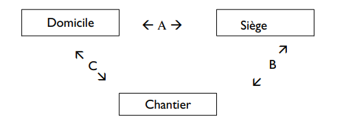

# Règlement grand-ducal du 23 septembre 1996 portant déclaration d'obligation générale de la convention collective de travail pour les métiers d'installateur sanitaire, d'installateur de chauffage et de climatisation conclue entre les syndicats OGB-L et LCGB d'une part et les fédérations réunies des patrons installateurs sanitaires et des patrons installateurs de chauffage et de climatisation du Grand-Duché de Luxembourg, d'autre part.

Nous JEAN, par la grâce de Dieu, Grand-Duc de Luxembourg, Duc de Nassau;

Vu l’article 9 de la [loi du 12 juin 1965](https://legilux.public.lu/eli/etat/leg/loi/1965/06/12/n3/jo) concernant les conventions collectives de travail et l’article 22 modifié de l’[arrêté grand-ducal du 6 octobre 1945](https://legilux.public.lu/eli/etat/leg/agd/1945/10/06/n9/jo) ayant pour objet l’institution, les attributions et le fonctionnement d’un Office national de conciliation;

Sur proposition concordante des membres permanents et des membres spéciaux de chacune des parties représentées à la Commission paritare de conciliation et sur avis des chambres professionnelles compétentes;

Vu l’article 27 de la [loi du 8 février 1961](https://legilux.public.lu/eli/etat/leg/loi/1961/02/08/n1/jo) portant organisation du Conseil d’Etat et considérant qu’il y a urgence;

Sur le rapport de Notre ministre du Travail et de l’Emploi et après délibération du Gouvernement en Conseil;

Arrêtons:

## Art. 1er.

La convention collective de travail pour les métiers d’installateur sanitaire, d’installateur de chauffage et de climatisation conclue entre les syndicats OGB-L et LCGB d’une part et les fédérations réunies des patrons installateurs sanitaires et des patrons installateurs de chauffage et de climatisation d’autre part, est déclarée d’obligation générale pour l’ensemble de la profession pour laquelle elle a été établie.

## Art. 2.

Le ministre du Travail et de l’Emploi est chargé de l’exécution du présent règlement qui sera publié au Mémorial avec la convention collective de travail prémentionnée.

Le Ministre du Travail et de l’Emploi,   Jean-Claude Juncker

Château de Berg, le 23 septembre 1996.   Jean

CONVENTION COLLECTIVE DE TRAVAIL POUR LES METIERS D’INSTALLATEUR SANITAIRE ET D’INSTALLATEUR DE CHAUFFAGE ET DE CLIMATISATION

conclue le 13 février 1996 entre les

Fédérations réunies des patrons installateurs sanitaires et des patrons installateurs de chauffage et de climatisation du Grand-Duché de Luxembourg, a.s.b.l.

et

le syndicat OGB-L et le syndicat LCGB

Sommaire

<table>
<tr>
<td>1.</td>
<td colspan="2">But de la convention</td>
</tr>
<tr>
<td>2.</td>
<td colspan="2">Champ d’application</td>
</tr>
<tr>
<td>3.</td>
<td colspan="2">Engagement et période d’essai</td>
</tr>
<tr>
<td>4.</td>
<td colspan="2">Résiliation du contrat de travail avec préavis</td>
</tr>
<tr>
<td>5.</td>
<td colspan="2">Résiliation pour motif grave</td>
</tr>
<tr>
<td>6.</td>
<td colspan="2">Conditions de travail</td>
</tr>
<tr>
<td>7.</td>
<td colspan="2">Durée de travail</td>
</tr>
<tr>
<td>8.</td>
<td colspan="2">Protection des jeunes travailleurs</td>
</tr>
<tr>
<td>9.</td>
<td colspan="2">Qualification et classification</td>
</tr>
<tr>
<td>10.</td>
<td colspan="2">Rémunération</td>
</tr>
<tr>
<td>11.</td>
<td colspan="2">Salaires</td>
</tr>
<tr>
<td>12.</td>
<td colspan="2">Travail à la tâche</td>
</tr>
<tr>
<td>13.</td>
<td colspan="2">Majorations pour travail supplémentaire</td>
</tr>
<tr>
<td>14.</td>
<td colspan="2">Majorations pour travaux effectués sous conditions aggravantes et insalubres</td>
</tr>
<tr>
<td>15.</td>
<td colspan="2">Prime de fin d’année</td>
</tr>
<tr>
<td>16.</td>
<td colspan="2">Jours fériés légaux</td>
</tr>
<tr>
<td>17.</td>
<td colspan="2">Congé annuel</td>
</tr>
<tr>
<td>18.</td>
<td colspan="2">Congé extraordinaire</td>
</tr>
<tr>
<td>19.</td>
<td colspan="2">Interruptions de travail en cas d’accident de travail</td>
</tr>
<tr>
<td>20.</td>
<td colspan="2">Sécurité sur les chantiers</td>
</tr>
<tr>
<td>21.</td>
<td colspan="2">Travail clandestin</td>
</tr>
<tr>
<td>22.</td>
<td colspan="2">Arbitrage - accords particuliers - négociations particulières</td>
</tr>
<tr>
<td></td>
<td></td>
<td></td>
</tr>
<tr>
<td colspan="2">Annexe 1</td>
<td>Salaires tarifaires</td>
</tr>
<tr>
<td colspan="2">Annexe 2</td>
<td>Exemple pour la calcul du temps de voyage et des indemnités kilométriques</td>
</tr>
</table>

\**1. But de la convention collective de travail.**

1.1. S’inspirant du souci d’harmoniser les rapports entre les parties contractantes et en vue de la sauvegarde de la paix sociale, la présente convention a pour objet de définir, dans le cadre des dispositions légales en vigueur, les conditions de travail et de salaire des ouvriers pour autant qu’ils travaillent dans le métier d’installateur sanitaire, et/ou le métier d’installateur de chauffage et de climatisation.

1.2. Les parties signataires conviennent également que la présente convention constitue un instrument en vue d’endiguer et de combattre le travail clandestin dans les professions concernées.

\**2. Champ d’application.**

2.1. La présente convention collective de travail s’applique à toutes les entreprises luxembourgeoises ou étrangères exerçant le métier d’installateur sanitaire, et/ou d’installateur de chauffage et de climatisation travaillant sur le territoire du Grand-Duché de Luxembourg.

2.2. La présente convention s’applique à tous les ouvriers effectuant des travaux d’installation sanitaire, d’installation de chauffage et de climatisation sur le territire du Grand-Duché de Luxembourg.

\**3. Engagement et période d’essai.**

3.1. Tout engagement se fait conformément aux dispositions de la [loi du 24 mai 1989](https://legilux.public.lu/eli/etat/leg/loi/1989/05/24/n1/jo) sur le contrat de travail et conformément aux dispositions de la présente convention collective. Lors de l’engagement tout ouvrier reçoit un exemplaire de la convention collective de travail en vigueur.

3.2. L’engagement commence par une période d’essai fixée conformément aux dispositions légales.

Les 4 premières semaines après l’engagement sont à considérer comme période d’essai qui fait partie intégrante de tout contrat de travail sans qu’il y ait besoin de préciser formellement par écrit. La période de préavis pour résilier le contrat à l’essai de quatre semaines est de 4 jours.

Il sera loisible aux parties contractantes de convenir d’un commun accord et par écrit d’une période d’essai plus longue conformément aux dispositions de la [loi du 24 mai 1989](https://legilux.public.lu/eli/etat/leg/loi/1989/05/24/n1/jo) sur le contrat de travail.

Pendant les 2 (deux) premières semaines il ne peut être mis fin unilatéralement au contrat sauf pour motif grave conformément à l’article 27 de la [loi du 24 mai 1989](https://legilux.public.lu/eli/etat/leg/loi/1989/05/24/n1/jo) sur le contrat de travail respectivement pour un des motifs tel que précisé à l’article 5.2. de la présente convention collective.

\**4. Résiliation du contrat de travail avec préavis.**

4.1. Le contrat de travail conclu sans détermination de durée peut cesser à l’initiative des deux parties contractantes, sous réserve de l’application des règles définies dans la [loi du 24 mai 1989](https://legilux.public.lu/eli/etat/leg/loi/1989/05/24/n1/jo) sur le contrat de travail.

4.2. L’employeur qui décide de résilier le contrat de travail de son salarié doit lui notifier le licencement par lettre recommandée à la poste, sous peine d’irrégularité pour vice de forme. Toutefois, la signature apposée par le salarié sur le double de la lettre de licenciement vaut accusé de réception de la notification.

Lorsque l’employeur occupe 150 salariés au moins, il doit convoquer le salarié concerné à un entretien préalable conformément à l’article 19 de la [loi du 24 mai 1989](https://legilux.public.lu/eli/etat/leg/loi/1989/05/24/n1/jo).

En cas de résiliation du contrat de travail par l’employeur, le contrat prend fin:

– à l’expiration d’un délai de préavis de deux mois pour le salarié qui justifie auprès du même employeur d’une ancienneté de services continus inférieure à cinq ans;

– à l’expiration d’un délai de préavis de quatre mois pour le salarié qui justifie auprès du même employeur d’une ancienneté de services continus comprise entre cinq ans et moins de dix ans;

– à l’expiration d’un délai de préavis de six mois pour le salarié qui justifie auprès du même employeur d’une ancienneté de services continus de dix ans au moins.

4.3. Le salarié qui résilie son contrat de travail doit notifier la lettre de dénonciation à son employeur par lettre recommandée à la poste. Toutefois la signature apposée par l’employeur sur le double de la lettre de démission vaut accusé de réception de la notification.

En cas de résiliation du contrat de travail par le salarié, le contrat de travail prend fin à l’expiration d’un délai de préavis égal à la moitié du délai correspondant à celui applicable en cas de licenciement du salarié par l’employeur, tel que spécifié au point 2 du présent article.

4.4. Les délais de préavis prennent cours à l’égard du salarié par l’employeur:

– le quinzième jour du mois de calendrier au cours duquel la résiliation a été notifiée lorsque la notification est antérieure à ce jour.

– le premier jour du mois de calendrier qui suit celui au cours duquel la résiliation a été notifiée, lorsque la notification est postérieure au quatorzième jour du mois.

4.5. Dans un délai d’un mois à compter de la notification du licenciement, le salarié peut, par lettre recommandée, demander à l’employeur les motifs du licenciement.

L’employeur est tenu d’énoncer avec précision par lettre recommandée, au plus tard un mois après la notification de la lettre recommandée, le ou les motifs de licenciement liés à l’aptitude ou à la conduite du travailleur ou fondés sur les nécessités du fonctionnement de l’entreprise, de l’établissement ou du service qui doivent être réels et sérieux.

A défaut de motivation écrite formulée avant l’expiration du délai visé à l’alinéa qui précède, le licenciement est abusif.

4.6. Le salarié lié par un contrat de travail à durée indéterminée qui est licencié avec préavis par son employeur, sans qu’il y ait eu un licenciement pour motif grave et sans que le salarié ne puisse prétendre à une pension de vieillesse ou d’invalidité, a droit à une indemnité de départ après une ancienneté de services continus de cinq ans au moins auprès du même employeur.

Cette indemnité de départ ne peut être inférieure à:

– un mois de salaire après une ancienneté de services continus de cinq années au moins;

– deux mois de salaire après une ancienneté de services continus de dix années au moins;

– trois mois de salaire après une ancienneté de services continus de quinze années au moins.

L’indemnité est calaculée sur la base des salaires effectivement versés au salarié pour les douze derniers mois qui précèdent immédiatement celui de la notification de la résiliation. Sont compris dans les salaires servant au calcul de l’indemnité de départ, les indemnités pécuniaires de maladie ainsi que les primes et suppléments courants, à l’exclusion des rémunérations pour heures supplémentaires, des gratifications et de toutes indemnités pour frais accessoires exposés. L’employeur est tenu de régler l’indemnité au moment où le salarié quitte effectivement le travail.

4.7. L’employeur occupant moins de 20 salariés peut opter dans la lettre de licenciement soit pour le versement des indemnités visées au paragraphe 7, soit pour la prolongation des délais de préavis visés au paragraphe 3 du présent article qui, dans ce cas, sont portés:

– à cinq mois par le salarié justifuant auprès du même employeur d’une ancienneté de services continus de cinq années au moins;

– à huit mois pour le salarié justifiant auprès du même employeur d’une ancienneté de services continus de dix années au moins;

– à neuf mois pour le salarié justifiant auprès du même employeur d’une ancienneté de services continus de quinze années au moins.

4.8. Pendant le délai de préavis émanant de l’employeur, le salarié peut demander le congé qui lui est nécessaire pour la recherche d’un nouvel emploi sans que la durée de ce congé puisse excéder six jours ouvrables pour la durée du préavis.

Le temps d’absence est intégralement indemnisé à la condition que le travailleur licencié se soit inscrit comme demandeur d’emploi à l’Administration de l’Emploi et qu’il justifie la présentation à une offre d’emploi et qu’il présente les certificats en question au patron.

4.9. En cas de résiliation du contrat à l’initiative de l’employeur ou du salarié, l’employeur peut accorder au salarié une dispense de travail pendant le délai du préavis. La dispense doit être mentionnée dans la lettre recommandée de licenciement ou dans un autre écrit remis au salarié.

4.10. Le contrat de travail d’un salarié ne peut être résilié ni pour cause d’exercice d’un mandat de délégué, ni pour cause d’affiliation à un syndicat, ni pour cause de participation à une grève légale.

Le contrat de travail ne peut être résilié pour cause d’incapacité de travail par suite d’accident ou de maladie du salarié pendant les 26 premières semaines à dater du jour de la survenance de l’incapacité s’il a introduit sa déclaration d’incapacité de travail dans les délais prévus par la loi.

4.11. A la demande du salarié l’employeur doit délivrer un certificat de travail qui mentionne la nature et la durée de l’emploi et qui ne doit pas contenir de mention tendancieuse ou défavorable au salarié.

\**5. Résiliation pour motif grave** **.**

5.1. Chacune des parties au contrat de travail peut résilier le contrat tant à durée indéterminée qu’à durée déterminée sans préavis pour un ou plusieurs motifs graves procédant du fait ou de la faute de l’autre partie.

Est considéré comme constituant un motif grave pour l’application du présent article et pour l’application de l’article 3.2. tout fait ou faute qui rend immédiatement et définitivement impossible le maintien des relations de travail.

5.2. L’employeur peut licencier un salarié sans préavis notamment pour une des raisons ci-énumérées:

lorsqu’il

1° a présenté lors de l’embauchage des papiers faux ou falsifiés;

2° a dissimulé un contrat de travail antérieur qui l’engage encore;

3° a quitté son travail sans autorisation préalable de son supérieur;

4° refuse d’exécuter les ordres de son supérieur;

5° porte intentionnellement ou par négligence atteinte à la sécurité de l’entreprise, à celle de ses collègues ou à la sienne ou cause intentionnellement des dégâts corporels ou matériels;

6° se rend coupable de voies de fait ou d’injures graves envers ses collègues, ses supérieurs ou des tiers sur son lieu de travail;

7° se rend coupable d’actes malhonnêtes ou contraires aux bonnes moeurs sur son lieu de travail;

8° se trouve pendant les heures de travail sous l’influence d’alcool ou de stupéfiants;

9° ne s’est pas présenté à son lieu de travail, sans permission, pendant trois jours consécutifs;

10° se rend coupable d’absences répétées sans permission malgré avertissement écrit par lettre recommandée;

11° procède à des travaux tombant sous le coup de la législation sur le travail clandestin.

5.3. Le salarié peut résilier son contrat de travail sans préavis dans les cas suivants:

1° lorsqu’il est incapable de continuer son emploi sans qu’il y ait faute de sa part;

2° si ses préposés se sont rendus coupables à son égard de voies de fait ou d’injures graves;

3° s’il doit chômer par suite de manque de travail ou de perturbations dans l’entreprise pendant plus de deux jours de travail consécutifs ou pendant plus de trois jours de travail pendant une période de quatorze jours;

4° si le salarié échu est retenu sans motif légitime ou si les droits du salarié dans le domaine de la sécurité sociale ne sont pas respectés;

5° si l’on exige de lui l’exécution d’un acte malhonnête:

6° si les dispositions de la présente convention collective ne sont pas respectées à son égard.

5.4. La notification de la résiliation immédiate pour motif grave doit être effectuée au moyen d’une lettre recommandée à la poste énonçant avec précision le ou les faits reprochés et les circonstances qui sont de nature à leur attribuer le caractère de motif grave. Toutefois, la signature apposée par le salarié ou l’employeur sur le double de la lettre de licenciement respectivement de démission vaut accusé de réception de la notification. A défaut de motivation écrite le licenciement est abusif.

5.5. L’employeur peut prononcer avec effet immédiat et sans autre forme la mise à pied conservatoire du salarié avec maintien des salaires, indemnités et autres avantages jusqu’au jour de la notification du licenciement.

5.6. Le licenciement pour motif grave doit être notifié au plus tôt le jour qui suit la mise à pied et au plus tard huit jours après la mise à pied.

5.7. Le ou les faits ou fautes susceptibles de justifier une résiliation pour motif grave ne peuvent être invoqués au-delà d’un délai d’un mois à compter du jour où la partie qui l’invoque en a eu connaissance à moins que ce fait n’ait donné lieu à des poursuites pénales au cours du mois.

Le délai prévu à l’alinéa qui précède n’est pas applicable lorqu’une partie invoque un fait ou une faute antérieure à l’appui d’un nouveau fait ou d’une nouvelle faute.

\**6. Conditions de travail.**

6.1.1. L’employeur assure la transport des ouvriers à partir du siège de l’entreprise vers le chantier et retour, respectivement couvre les frais de transport des ouvriers selon les modalités décrites ci-dessous. Il prendra en charge les frais d’hébergement et de repas si le retour ne peut s’effectuer le même jour.

6.1.2. La distance aller et retour est déterminée selon la carte officielle des distances.

6.1.3. Si l’ouvrier se rend du siège au chantier, le temps de trajet et, le cas échéant, l’indemnité kilométrique sont calculés suivant 6.1.5. respectivement 6.1.6. pour la distance aller et retour entre le siège et le chantier.

6.1.4. Si l’ouvrier se rend directement du domicile au chantier sans passer par le siège, la distance aller et retour à prendre en compte pour le calcul du temps de voyage et, le cas échéant, de l’indemnité kilométrique est calculée comme suit: *la distance aller et retour entre le domicile et le chantier moins la distance aller et retour entre le domicile et le siège*. Le temps de trajet et, le cas échéant, l’indemnité kilométrique sont calculés suivant 6.1.5. respectivement 6.1.6.

6.1.5. Le temps de trajet aller et retour est payé au taux horaire normal à raison de 1 minute par kilomètre comme temps de travail non productif ne donnant pas droit à majoration pour travail supplémentaire. Le temps de trajet n’est pas dû si le trajet est effectué pendant le temps normal de travail.

6.1.6. Lorsque le salarié utilise sa propre voiture sur demande expresse de l’employeur, il lui sera attribué une indemnité kilométrique de 7,5.- Flux/km aller et retour. S’il effectue le transport de quantités de matériel de travail considérables, il lui est en outre versé une indemnité mensuelle de 600,- Flux.

6.2. Lors de l’exécution de son travail, le salarié est obligé de respecter scupuleusement toutes les consignes de sécurité et de prendre les mesures de sécurité nécessaires pour accomplir son travail sans s’exposer soi même ou d’autres personnes à des risques de quelque nature que ce soit.

6.3. Le salarié doit effectuer le travail qui lui est confié selon les règles de l’art avec le plus grand soin. Il doit suivre les instructions de ses supérieurs.

6.4. Le salarié doit prendre soin de l’outillage et des voitures de service mis à disposition par son patron. L’outillage reste la propriété de l’employeur et doit être rendu à celui-ci lorsque l’ouvrier quitte l’entreprise. Le salarié est responsable de l’outillage qui lui est confié. Il est responsable des véhicules de service qui lui sont confiés et il est tenu d’observer les stipulations du code de la route.

6.5. Le début et la fin de l’horaire de travail sont déterminés par règlement intérieur de l’entreprise élaboré en accord avec le comité mixte ou, à défaut, la délégation du personnel ou, à défaut, les travailleurs concernés. Le salarié est tenu de respecter cet horaire scrupuleusement.

6.6. Le fait d’appartenir à une organisation syndicale ne doit pas porter préjudice au salarié.

6.7. Si l’entreprise organise un service de dépannage, celui-ci est réglé par un accord individuel entre l’employeur et l’ouvrier.

\**7. Durée de travail.**

7.1. La durée de travail hebdomadaire est réglementée par les dispositions de la [loi du 9 décembre 1970](https://legilux.public.lu/eli/etat/leg/loi/1970/12/09/n1/jo) portant réduction et réglementation de la durée du travail des ouvriers occupés dans les secteurs public et privé de l’économie.

Toutes les heures de travail effectuées au-delà de la durée normale de 40 heures par semaine sont considérées comme heures supplémentaires et doivent être rémunérées avec le supplément correspondant.

Ne sont pas considérées comme heures supplémentaires les heures de récupération et le temps de trajet entre le siège de l’entreprise et le lieu où s’effectue le travail. La récupération d’heures non travaillées peut également être effectuée le samedi.

7.2. Il est loisible à l’employeur de prévoir le samedi comme journée libre au plan horaire hebdomadaire.

7.3. Des travaux urgents d’entretien, de dépannage ou de réparation peuvent s’effectuer en dehors de l’horaire de travail, qui sera établi en accord avec le délégation ou, à défaut, avec les travailleurs.

\**8. Protection des jeunes travailleurs.**

8.1. Les conditions de travail et de salaire pour les jeunes travailleurs en-dessous de 18 ans sont réglées par les dispositions de la [loi du 28 octobre 1969](https://legilux.public.lu/eli/etat/leg/loi/1969/10/28/n1/jo), modifiée par les [lois du 12 novembre 1971](https://legilux.public.lu/eli/etat/leg/loi/1971/11/12/n3/jo), [30 juillet 1972](https://legilux.public.lu/eli/etat/leg/loi/1972/07/30/n1/jo), [26 juillet 1975](https://legilux.public.lu/eli/etat/leg/loi/1975/07/26/n1/jo) et par le [règlement grand-ducal du 30 juillet 1972](https://legilux.public.lu/eli/etat/leg/rgd/1972/07/30/n1/jo) ([texte coordonné du 10 septembre 1981](https://legilux.public.lu/eli/etat/leg/tc/1981/10/27/n1/jo)).

\**9. Qualification et classification.**

9.1. Le classement dans les différents groupes de qualification est fonction de la formation et des connaissances, de la compétence et de l’expérience du salarié.

–  *Apprentis*

Adolescents ayant souscrit à un contrat d’apprentissage, conformément à l’[arrêté grand-ducal du 8 octobre 1945](https://legilux.public.lu/eli/etat/leg/agd/1945/10/08/n5/jo) portant révision de la [loi du 5 janvier 1929](https://legilux.public.lu/eli/etat/leg/loi/1929/01/05/n2/jo) sur l’apprentissage dans un des métiers faisant l’objet de la présente convention collective.

– *Jeunes ouvriers:*

Adolescents n’ayant pas atteint l’âge de 18 ans et n’ayant pas souscrit à un contrat d’apprentissage.

– *Ouvriers non-qualifiés (NQ1-NQ4):*

Ouvriers dont l’âge est de 18 ans accomplis au moins et qui n’ont pas de qualification professionnelle reconnue (travailleurs auxiliaires, manoeuvres).

– *Ouvriers semi-qualifiés (SQ1-SQ2):*

Ouvriers non détenteurs d’un certificat de qualification reconnu mais qui sont aptes à effectuer des travaux sur base de connaissances acquises dans le métier et qui ont une pratique de 4 années au moins après 18 ans d’âge révolus et les chauffeurs-livreurs et aide-magasiniers.

– *Artisans qualifiés (Q1-Q2):*

Artisans détenteurs du C.A.T.P. pendant les deux premières années après la réussite à l’examen de fin d’apprentissage.

– *Artisans qualifiés (Q3-Q6):*

Artisans détenteurs du C.A.T.P. depuis plus de 2 ans ainsi que les ouvriers semi-qualifiés après une pratique de 6 années après 18 ans d’âge révolus sous condition de justifier de connaissances professionnelles correspondantes.

– *Ouvriers hautement qualifiés (HQ):*

Artisans, notamment les détenteurs d’un brevet de maîtrise qui sont aptes à effectuer tous les travaux de façon indépendante, d’assumer des responsabilités additionnelles et capables de diriger d’autres salariés de l’entreprise.

\**10. Rémunération.**

10.1. Conformément à l’article 4 de la [loi du 12 juin 1965](https://legilux.public.lu/eli/etat/leg/loi/1965/06/12/n3/jo) sur les conventions collectives, et dans le sens de la [loi du 27 mai 1975](https://legilux.public.lu/eli/etat/leg/loi/1975/05/27/n3/jo) sur la généralisation de l’échelle mobile des salaires, les salaires tarifaires ainsi que les salaires effectifs seront adaptés aux fluctuations de l’indice pondéré des prix à la consommation.

10.2. Des retenues sur salaire ne peuvent être effectuées que pour les cas prévus par la loi.

10.3. La période de salaire correspond à un mois de calendrier. Le décompte du mois écoulé doit être effectué au plus tard le 10 du mois suivant. Si le jour de paye coïncide avec un jour férié légal, le salaire doit être avancé la veille. Des acomptes semi-mensuels peuvent être versés.

10.4. Au décompte du mois sera joint une fiche de salaire indiquant la période de salaire, le nombre d’heures effectuées, le salaire horaire et les majorations, de manière à ce que le salarié puisse facilement vérifier son salaire.

\**11. Salaires.**

11.1. Les salaires horaires appliqués conformément à la présente convention collective de travail correspondent aux groupes de qualification du salarié selon l’article 9.

11.2. Les salaires horaires définis par la convention figurent en annexe et représentent des salaires horaires minima.

11.3. Les salaires tarifaires figurant en annexe seront adaptés à l’échelle mobile des salaires.

\**12. Travail à la tâche.**

12.1. Le travail à la tâche est permis avec l’accord du salarié.

12.2. Les salaires à la tâche sont à calculer de telle sorte que pour un travail convenu et une durée de travail régulière, le salarié atteigne au moins 125% de son salaire horaire normal. Si le travail à la tâche se révèle irréalisable, le salaire horaire normal lui reste acquis pour les heures prestées.

12.3. En cas de prestation d’un travail à la tâche, le salaire horaire est payé comme acompte. La réception du travail à la tâche doit avoir lieu au plus tard un jour après l’achèvement du travail en question. Le calcul et le règlement du solde se feront le jour suivant du paiement usuel du salaire.

12.4. Le travail à la tâche n’est pas autorisé pour les apprentis et les jeunes travailleurs. Ceux-ci peuvent toutefois assister le travailleur à la tâche, étant entendu que leur rémunération est calaculée à l’heure.

\**13. Majorations pour travail supplémentaire.**

13.1. Sont soumis à majoration toutes les heures dépassant l’horaire hebdomadaire normal, sauf les heures de récupération et le temps de trajet.

13.2. Les heures supplémentaires sont admises dans le cadre des dispositions légales. Les salariés sont alors obligés d’effectuer les heures supplémentaires autorisées par les autorités compétentes. Ceci vaut également pour le travail effectué les dimanches et jours fériés légaux.

13.3. Pour les heures supplémentaires dans le sens de cette convention, une majoration de 25% est à appliquer.

13.4. Le travail de dimanche est à rémunérer avec une majoration du taux horaire de 70%.

13.5. Le travail occasionnel de nuit effectué entre 22.00 heures et 6.00 heures est à rémunérer avec une majoration du taux horaire de 50%.

13.6. Le travail de nuit effectué régulièrement est rémunéré avec une majoration de 25%.

13.7. Les heures de travail prestées un jour férié légal sont indemnisées avec un supplément de 100%.

\**14. Majorations pour travaux effectués sous conditions aggravantes et insalubres**

14.1. Pour la prestation de travaux insalubres, le salarié a droit à une majoration salariale de 25%. Cette majoration se limite au temps effectivement consacré aux travaux suivants:

aone *Chauffage central*

– démontage d’anciennes chaudières au charbon ou au mazout

– remplacement de sections sur d’anciennes chaudières au charbon ou mazout

– nettoyage de chaudières au mazout

\*Installations sanitaires*

– démontage de WC et de tuyauteries d’évacuation

– débouchage de tuyauteries d’évacuation

– débouchage de WC ou d’urinoirs

– inspection de fosses septiques

– nettoyage de séparateurs.

\*Climatisation*

– nettoyage ou remplacement de filtres d’air.

\**15. Prime de fin d’année.**

15.1. Il sera attribuée à tout salarié dont l’ancienneté d’entreprise est d’au moins 3 années, période d’apprentissage incluse, une prime de fin d’année dont le montant est fonction du salaire annuel brut effectivement gagné et déclarée aux aux assurances sociales.

15.2. La date de référence pour la détermination de l’ancienneté est le 31 décembre.

15.3. Le montant de la prime s’élève aux pourcentages du salaire annuel brut tel que repris au schéma suivant:

aone 0,5% du salaire annuel brut total après 3 années d’ancienneté d’entreprise

bone 1,0% du salaire annuel brut total après 4 années d’ancienneté d’entreprise

cone 2,0% du salaire annuel brut total après 7 années d’ancienneté d’entreprise

done 2,5% du salaire annuel brut total après 10 années d’ancienneté d’entreprise

eone 3,0% du salaire annuel brut total après 15 années d’ancienneté d’entreprise

15.4. Si le salarié est entré aux services de l’employeur avant le 1er juillet, cette année est considérée comme année d’ancienneté entière.

15.5. La prime sera également attribuée aux salariés qui, au cours de l’année, quittent l’entreprise comme bénéficiaires d’une pension de vieillesse ou d’invalidité permanente.

15.6. Une interruption du contrat de travail pour cause de maladie excédant 26 semaines, ne portera pas atteinte à l’ancienneté de l’entreprise si le réembauchage s’effectuera endéans une année après la fin du contrat.

15.7. Il en est de même si le salarié est réembauché endéans un délai de 3 mois après une résiliation du contrat de travail par l’employeur avec préavis.

15.8. La prime n’est pas due si le salarié résilie son contrat sans se conformer aux dispositions de la [loi du 24 mai 1989](https://legilux.public.lu/eli/etat/leg/loi/1989/05/24/n1/jo) sur le contrat de travail ainsi qu’en cas de licenciement pour faute grave.

15.9. La prime n’est pas due si le salarié s’est absenté de son travail sans permission préalable pendant plus de 2 journées au cours de l’année de référence.

15.10. L’employeur est libre de payer une prime de fin d’année aux salariés dont l’ancienneté n’atteint pas les 3 années requises.

\**16. Jours fériés légaux.**

16.1. Sont considérés comme jours fériés légaux: le 1er janvier, le lundi de Pâques, le 1er mai, le lundi de Pentecôte, l’Ascension, la fête nationale, l’Assomption, la Toussaint, Noël et le lendemain de Noël.

16.2. Les salariés qui ne se sont pas présentés au travail sans permission préalable la veille ou le lendemain d’un jour férié légal perdent le droit au payement de ce jour férié chômé. La même stipulation vaut pour le salaril qui a été absent plus de trois jours, sans permission préalable, dans une période de 25 jours ouvrables avant le jour férié.

16.3. L’indemnisation des jours fériés ainsi que l’attribution de jours fériés de remplacement sont soumises aux dispositions de la [loi y relative du 10 avril 1976](https://legilux.public.lu/eli/etat/leg/loi/1976/04/10/n1/jo) portant réforme de la réglementation des jours fériés légaux.

16.4. Pour le travail effectué un jour férié, le salarié a droit, en plus de l’indemnité prévue par la loi, sauf jour compensatoire, au payement des heures effectivement prestées avec une majoration de 100%.

\**17. Congé annuel.**

17.1. Le congé annuel est soumis aux dispositions de la [loi du 22 avril 1966](https://legilux.public.lu/eli/etat/leg/loi/1966/04/22/n1/jo), modifiée et complétée par la [loi du 26 juillet 1975](https://legilux.public.lu/eli/etat/leg/loi/1975/07/26/n1/jo).

17.2. Le droit au congé naît après trois mois de travail ininterrompu auprès du même employeur.

17.3. En général, le payement des congés est effectué en même temps que la paye qui suit les congés, respectivement lorsque le salarié quitte l’entreprise.

17.4. Un congé collectif de 14 jours qui débutera le premier lundi du mois d’août sera appliqué chaque année.

17.5. Une dérogation au congé collectif est possible moyennant l’accord de la délégation du personnel et des salariés concernés pour les travaux de dépannage, de maintenance et de réparation.

La délégation doit être informée de chaque dérogation.

17.6. Les demandes de congé doivent être introduites par écrit dans les délais suivants:

aone au moins 48 heures à l’avance pour deux jours de congé sauf cas de force majeure

bone au moins 2 semaines à l’avance pour trois à cinq jours de congé

cone au moins 1 mois à l’avance pour tout congé au-delà de cinq jours.

17.7. Pour les visites médicales urgentes pendant les heures de travail le salarié a droit à 4 fois 2 heures par an.

\**18. Congé extraordinaire.**

18.1. Le salarié a droit à un congé extraordinaire fixé à:

| 18.1.1. *1 jour:* | pour le décès des frères et soeurs, grands-parents des deux côtés, petits-enfants, beau-frères et belle-soeurs |
|---|---|
| 18.1.2. *2 jours:* | pour la naissance d’un enfant légalement reconnu, le mariage d’un enfant et en cas de déménagement (un simple changement de logis n’est pas à assimiler à un déménagement); |
| 18.1.3. *3 jours:* | pour le décès du conjoint, des parents, beaux-parents, enfants, beau-fils et belle-filles; |
| 18.1.4. *6 jours:* | pour le mariage du salarié. |

18.2. Les congés extraordinaires ne peuvent être pris qu’au moment où l’événement donnant droit au congé se produit, ils ne pourront pas être reportés sur le congé ordinaire.

\**19. Interruptions de travail en cas d’accident de travail.**

19.1. Les interruptions de travail dues aux accidents de travail sont soumises aux dispositions suivantes:

– si le salarié est victime d’un accident de travail entraînant une interruption de travail, le journée où l’accident a eu lieu sera payée intégralement.

– la perte de salaire effective sera remboursée lors du sauvetage et du transport d’un accidenté dans l’entreprise ou au chantier ou lors du constat des autorités au sujet d’un accident de travail.

\**20. Sécurité sur les chantiers.**

20.1. Les employeurs et les salariés sont obligés d’observer toutes les prescriptions relatives à la prévention d’accidents et de prendre en outre toutes les mesures de précaution nécessaires pour éviter au maximum tout accident éventuel.

20.2. Les salariés sont tenus de faire usage du matériel et de l’équipement de sécurité mis à leur dispositions et de collaborer activement dans le sens d’une sécurité maximale sur les chantiers. Les salariés sont personnellement responsables des accidents qui se seraient produits du fait et de la négligence de leur part des consignes de sécurité.

Ils sont encore responsables s’ils n’ont pas observé les consignes de sécurité générales de l’entreprise pour autant qu’il en existe.

20.3. Le salarié est tenu de signaler à l’employeur tout matériel ou équipement défectueux et de l’avertir immédiatement de tout risque extraordinaire.

20.4. Le salarié reconnaît les règles de sécurité et de prévention d’accidents dont le texte lui a été remis par l’entreprise au moment de son engagement.

\**21. Travail clandestin.**

21.1. Il est interdit à tout salarié d’effectuer du travail clandestin tel que défini dans la [loi du 3 août 1977](https://legilux.public.lu/eli/etat/leg/loi/1977/08/03/n1/jo) ayant pour objet d’interdire le travail clandestin.

21.2. Les salariés qui font du travail clandestin peuvent être licenciés sans préavis.

21.3. En cas de preuve de travail clandestin, dans le sens de la [loi du 3 août 1977](https://legilux.public.lu/eli/etat/leg/loi/1977/08/03/n1/jo) interdisant le travail clandestin, les sanctions prévues à l’article 15 de la [loi du 22 avril 1966](https://legilux.public.lu/eli/etat/leg/loi/1966/04/22/n1/jo) respectivement [du 26 juillet 1975](https://legilux.public.lu/eli/etat/leg/loi/1975/07/26/n1/jo) sur les congés sont applicables.

\**22. Arbitrage - Accords particuliers - Négociations particulières.**

22.1. La présente convention collective entre en vigueur le 1er février 1996 et remplace la convention collective qui était signée le 6 mai 1992.

22.2. La présente convention collective restera en validité jusqu’au 31.12.1996.

22.3. Des conditions plus avantageuses déjà existantes restent en vigueur et ne sont pas entravées par la convention.

22.4. La convention collective pourra être dénoncée dans son ensemble ou partiellement en respectant un préavis de six semaines.

22.5. Les parties contractantes s’engagent à entamer les pourparlers concernant le renouvellement de la convention collective au plus tard six semaines avant son expiration.

<table>
<tr>
<td colspan="2">Luxembourg, le 13 février 1996.</td>
</tr>
<tr>
<td>Pour les Fédérations réunies des Patrons Installateurs Sanitaires et des Patrons Installateurs de Chauffage et de Climatisation du Grand-Duché de Luxembourg</td>
<td>Pour les Syndicats Contractants</td>
</tr>
<tr>
<td>Paul <i>Reckinger</i>, président central</td>
<td>Valerio <i>De Matteis</i> OGB-L</td>
</tr>
<tr>
<td>Marcel <i>Mond</i>, président de la section «sanitaire»</td>
<td>Joao <i>Ricacho</i> LCGB</td>
</tr>
<tr>
<td>Jean <i>Birgen</i>, président de la section «chauffage»</td>
<td></td>
</tr>
</table>

ANNEXE 1

\**Salaires tarifaires** (indice 525,29)

| NQ1 | 255,38 |
|---|---|
| NQ2 | 261,81 |
| NQ3 | 267,06 |
| SQ1 | 286,08 |
| SQ2 | 297,51 |
| Q1 | 314,13 |
| Q2 | 318,20 |
| Q3 | 324,57 |
| Q4 | 337,56 |
| Q5 | 361,18 |
| Q6 | 386,47 |
| HQ | 428,98 |

ANNEXE 2

\**Exemple pour le calcul du temps de voyage et des indemnités kilométriques**

| **Distances** | A: 10 km |
|---|---|
|  | B: 15 km |
|  | C: 30 km |

\**Trajet Siège-Chantier**

indemnité kilométrique: 30x7,5 Flux

temps de voyage: 30 minutes

\**Trajet Domicile-Chantier**

indemnité kilométrique: 2x(30-10)=40x7,5 Flux

temps de voyage: 2x(30-10)=40 minutes
