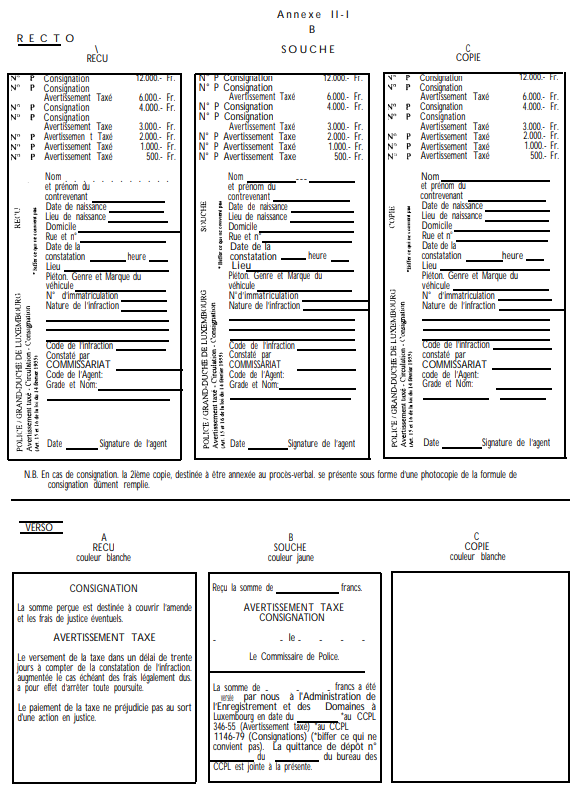
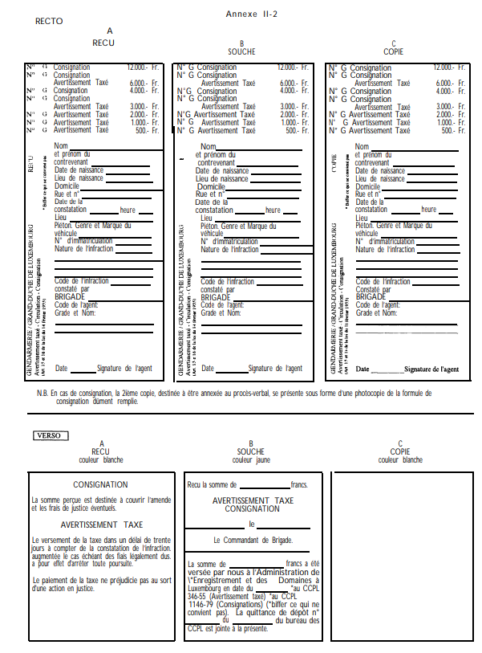
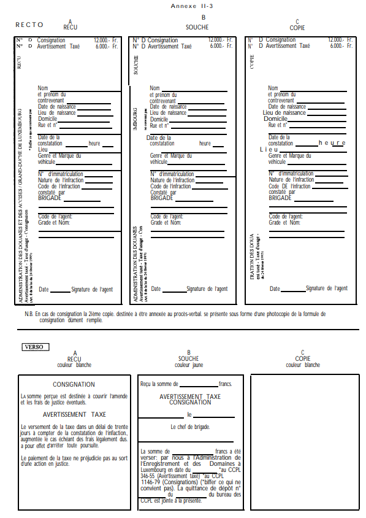

# Règlement grand-ducal du 5 juin 1998 modifiant \n a) l'arrêté grand-ducal du 23 novembre 1955 portant règlement de la circulation sur toutes les voies publiques; \n b) le règlement grand-ducal du 26 août 1993 relatif aux avertissements taxés, aux consignations pour contrevenants non résidents et aux mesures d'exécution de la législation sur la mise en fourrière des véhicules en matière de circulation routière.

Nous JEAN, par la grâce de Dieu, Grand-Duc de Luxembourg, Duc de Nassau;

Vu la [loi du 14 février 1955](https://legilux.public.lu/eli/etat/leg/loi/1955/02/14/n3/jo) concernant la réglementation de la circulation sur toutes les voies publiques, telle qu'elle a été modifiée et complétée dans la suite;

Vu la [loi du 13 juin 1994](https://legilux.public.lu/eli/etat/leg/loi/1994/06/13/n2/jo) sur le régime des peines;

Vu la [loi du 24 février 1995](https://legilux.public.lu/eli/etat/leg/loi/1995/02/24/n1/jo) portant approbation et application de l'Accord relatif à la perception d'un droit d'usage pour l'utilisation de certaines routes par des véhicules utilitaires lourds, fait à Bruxelles le 9 février 1994;

Vu l'[arrêté grand-ducal du 23 novembre 1955](https://legilux.public.lu/eli/etat/leg/agd/1955/11/23/n1/jo) portant règlement de la circulation sur toutes les voies publiques, tel qu'il a été modifié et complété dans la suite;

Vu le [règlement grand-ducal du 26 août 1993](https://legilux.public.lu/eli/etat/leg/rgd/1993/08/26/n1/jo) relatif aux avertissements taxés, aux consignations pour contrevenants non résidents et aux mesures d'exécution de la législation sur la mise en fourrière des véhicules, tel qu'il a été modifié et complété dans la suite;

Notre Conseil d'Etat entendu;

Sur le rapport de Notre Ministre des Transports, de Notre Ministre des Finances, de Notre Ministre du Budget, Ministre de la Justice, de Notre Ministre de l’Intérieur et de Notre Ministre de la Force Publique et après délibération du Gouvernement en Conseil;

Arrêtons:

## Article 1

1\. L'article 2 modifié de l'[arrêté grand-ducal du 23 novembre 1955](https://legilux.public.lu/eli/etat/leg/agd/1955/11/23/n1/jo) portant règlement de la circulation sur toutes les voies publiques est complété par une nouvelle rubrique 48°, libellée comme suit:

> 48° - *Véhicule historique:* tout véhicule automoteur dont l'année de construction remonte à plus de 25 ans; pour les motocycles, les camions, les tracteurs de semi-remorque, les tracteurs agricoles et industriels et les machines automotrices ce délai est porté à 30 ans.

2\. Le troisième alinéa sous a) de l'article 62 modifié de l'[arrêté grand-ducal du 23 novembre 1955](https://legilux.public.lu/eli/etat/leg/agd/1955/11/23/n1/jo) précité est remplacé par le texte suivant:

> Ces dispositions ne s'appliquent pas aux véhicules historiques, à condition qu'il soit fait usage de plaques non réfléchissantes, et que les lettres et chiffres soient reproduits en couleur blanche sur fond noir. Sur ces plaques l'apposition de l'emblème prévu à l'alinéa qui suit n'est pas obligatoire. Les véhicules automoteurs immatriculés avant le 1er janvier 1974, mais dont l'année de construction au 1er juillet 1998 remonte à moins de 25 ans ou à moins de 30 ans, pourront continuer à être munis de plaques d'identité non réfléchissantes, reproduisant les chiffres et les lettres en couleur blanche sur fond noir, en attendant de tomber sous les prévisions du présent alinéa.

3\. Le deuxième alinéa du chiffre 1) de l'article 64 modifié de l'[arrêté grand-ducal du 23 novembre 1955](https://legilux.public.lu/eli/etat/leg/agd/1955/11/23/n1/jo) est remplacé par le texte suivant:

> Cette plaque porte des lettres et chiffres de couleur noire sur fond jaune réfléchissant. Les motocycles considérés comme véhicules historiques au sens de l'article 2 sous 48° peuvent être munis d'une plaque non réfléchissante portant des lettres et chiffres de couleur blanche sur fond noir. La plaque et le numéro d'immatriculation ont les dimensions fixées à l'article 62, réduites du tiers, la longueur de référence pour la plaque étant 340 mm.

## Article 2

1\. La première phrase de l'alinéa 1 de l'article 1er modifié du [règlement grand-ducal du 26 août 1993](https://legilux.public.lu/eli/etat/leg/rgd/1993/08/26/n1/jo) relatif aux avertissements taxés, aux consignations pour contrevenants non résidents et aux mesures d'exécution de la législation sur la mise en fourrière des véhicules en matière de circulation routière est remplacée par le texte suivant:

> Les montants de la taxe à percevoir pour l'avertissement taxé prévu par l'article 15 modifié de la [loi du 14 février 1955](https://legilux.public.lu/eli/etat/leg/loi/1955/02/14/n3/jo) concernant la réglementation de la circulation sur toutes les voies publiques sont fixés à cinq cents, mille, deux mille, trois mille et six mille francs selon la gravité de l'infraction constatée.

2\. L'article 1er modifié du [règlement grand-ducal du 26 août 1993](https://legilux.public.lu/eli/etat/leg/rgd/1993/08/26/n1/jo) précité est complété par un deuxième alinéa nouveau, libellé comme suit:

> La détermination des parts des communes dans le montant total des avertissements taxés décernés du chef des infractions reprises aux rubriques (107) 30, (107) 31, (107) 32 et (107) 35 du catalogue annexé se fait annuellement au prorata des avertissements taxés de l'espèce décernés sur le territoire des communes concernées par les membres de la gendarmerie et de la police; la gendarmerie et la police tiennent à cet effet la statistique afférente et en adressent à la fin de chaque année une copie comportant des données dépersonnalisées au ministre des Finances.

3\. L'article 2 du [règlement grand-ducal du 26 août 1993](https://legilux.public.lu/eli/etat/leg/rgd/1993/08/26/n1/jo) précité est remplacé par la texte suivant:

> **Art. 2.**
>
> Lorsque le montant de l'avertissement taxé ne peut pas être perçu sur le lieu même de l'infraction, le contrevenant s'en acquittera dans le délai imparti soit dans le bureau de gendarmerie ou de police lui désigné par l'agent verbalisant, soit par versement ou virement de la taxe sur un des comptes-chèques postaux spécialement ouverts à cet effet au nom de la gendarmerie, de la police ou de l'administration des douanes et des accises.

4\. Le troisième alinéa de l'article 3 du [règlement grand-ducal du 26 août 1993](https://legilux.public.lu/eli/etat/leg/rgd/1993/08/26/n1/jo) précité est remplacé par le texte suivant:

> Toutes les taxes perçues par les membres de la gendarmerie, de la police et de l'administration des douanes et des accises sont transmises sans retard à un compte-chèque postal déterminé de l'administration de l'Enregistrement et des Domaines à Luxembourg.

5\. Les paragraphes 2., 3. et 4. de l'article 4 du [règlement grand-ducal du 26 août 1993](https://legilux.public.lu/eli/etat/leg/rgd/1993/08/26/n1/jo) précité sont remplacés par le texte suivant:

> 2\. La copie est remise respectivement au commandant de la gendarmerie, au directeur de la police ou au directeur de l'administration des douanes et des accises.
>
> 3\. L'information au procureur d'Etat des avertissements taxés donnés se fait moyennant l'établissement par le commandant de la gendarmerie, par le directeur de la police et par le directeur de l'administration des douanes et des accises de relevés mensuels.
>
> 4\. La souche reste dans le carnet de formules.
>
> Du moment que le carnet est épuisé, il est renvoyé avec toutes les souches et les quittances de dépôt y relatives, par les membres de la gendarmerie au commandant de la gendarmerie, par les membres de la police au directeur de la police et par les membres de l'administration des douanes et des accises au directeur de l'administration des douanes et des accises.
>
> Si une ou plusieurs formules n'ont pas abouti à l'établissement d'un avertissement taxé, elles doivent être renvoyées en entier et porter une mention afférente.
>
> En cas de versement ou de virement de la taxe à un des comptes-chèques postaux prévus à l'article 2, le titre de virement ou de versement fait fonction de souche.

6\. L'article 5 du [règlement grand-ducal du 26 août 1993](https://legilux.public.lu/eli/etat/leg/rgd/1993/08/26/n1/jo) précité est remplacé par le texte suivant:

> **«**Art. 5.****
>
> Chaque unité de la gendarmerie, de la police et de l'administration des douanes et des accises doit tenir un registre spécial indiquant les formules mises à sa disposition, les avertissements taxés donnés et les formules annulées.
>
> Le commandant de la gendarmerie, le directeur de la police et le directeur de l'administration des douanes et des accises établissent au début de chaque mois, en triple exemplaire, un bordereau récapitulatif portant sur les perceptions du mois précédent; ce bordereau récapitulatif indique les nom et prénoms du contrevenant, date et heure de l'infraction, le montant de la taxe perçue et la date du paiement ainsi que, le cas échéant, le numéro d'immatriculation ayant servi à commettre l'infraction. Un exemplaire de ce bordereau est transmis à l'administration de l'Enregistrement et des Domaines. Un autre exemplaire sert de relevé d'information au procureur d'Etat dans les conditions du paragraphe 3. de l'article 4.
>
> Le commandant de la gendarmerie, le directeur de la police et le directeur de l'administration des douanes et des accises établissent au 31 décembre de chaque année un inventaire des opérations de l'année écoulée. Un exemplaire de cet inventaire est adressé à l'administration de l'Enregistrement et des Domaines avec les formules annulées. Un autre exemplaire est transmis au procureur d'Etat."

7\. L'article 7 du [règlement grand-ducal du 26 août 1993](https://legilux.public.lu/eli/etat/leg/rgd/1993/08/26/n1/jo) précité est remplacé par le texte suivant:

> **«**Art. 7.****
>
> 1\. La somme à consigner est perçue moyennant une formule spéciale publiée en annexe du présent règlement et composée d'un reçu, de deux copies et d'une souche.
>
> Ces formules, dûment numérotées, sont reliées en carnets de 15 exemplaires que l'administration de l'Enregistrement et des Domaines met à la disposition du commandant de la gendarmerie, du directeur de la police et du directeur de l'administration des douanes et des accises.
>
> Toutes les sommes à consigner perçues par les membres de la gendarmerie, de la police et de l'administration des douanes et des accises sont versées sans retard entre les mains du receveur de l'Enregistrement.
>
> 2\. Le reçu est immédiatement remis au contrevenant contre paiement de la somme à consigner fixée conformément aux dispositions de l'article 6.
>
> 3\. La première copie est remise au receveur de l'Enregistrement en même temps que le montant de la somme à consigner. Les frais d'encaissement éventuels en sont déduits, lorsque la somme à consigner est réglée par chèque; dans ce dernier cas, la pièce justificative renseignant sur ces frais est annexée à la copie.
>
> 4\. La deuxième copie certifiée par le receveur de l'Enregistrement est annexée au procès-verbal établi en la matière.
>
> 5\. La souche, dûment certifiée par le receveur de l'Enregistrement ou, en cas de virement postal de la somme à consigner, par le préposé du bureau des postes, reste dans le carnet de formules. Du moment que le carnet est épuisé, il est renvoyé avec toutes les souches dûment certifiées par les membres de la gendarmerie au commandant de la gendarmerie, par les membres de la police au directeur de la police et par les membres de l'administration des douanes et des accises au directeur de l'administration des douanes et des accises.
>
> Si une ou plusieurs formules n'ont pas abouti à la perception d'une somme à consigner, elles doivent être renvoyées en entier et porter une mention afférente.
>
> 6\. Chaque unité de la gendarmerie, de la police et de l'administration des douanes et des accises doit tenir un registre spécial indiquant les formules mises à sa disposition, les sommes à consigner perçues et les formules annulées.
>
> Le commandant de la gendarmerie, le directeur de la police et le directeur de l'administration des douanes et des accises établissent au début de chaque mois, en double exemplaire, un bordereau récapitulatif portant sur les perceptions du mois précédent. Un exemplaire de ce bordereau est transmis à l'administration de l'Enregistrement et des Domaines.
>
> Le commandant de la gendarmerie, le directeur de la police et le directeur de l'administration des douanes et des accises établissent au 31 décembre de chaque année un inventaire des opérations de l'année écoulée. Un exemplaire de cet inventaire est adressé à l'administration de l'Enregistrement et des Domaines avec les formules annulées."

8\. Le premier alinéa de l'article 8 du [règlement grand-ducal du 26 août 1993](https://legilux.public.lu/eli/etat/leg/rgd/1993/08/26/n1/jo) précité est remplacé par le texte suivant:

> **Art. 8.**
>
> Il n'y a lieu à consignation que lorsque le contrevenant non résident ne s'acquitte pas entre les mains des membres de la gendarmerie, de la police ou de l'administration des douanes et des accises du montant de l'avertissement taxé, augmenté, le cas échéant, des frais d'enlèvement et de garde qui résultent de la mise en fourrière du véhicule ayant servi à commettre l'infraction en cause.

9\. Les rubriques (107)30 à 107(32) du catalogue des avertissements taxés formant l'Annexe I du [règlement grand-ducal du 26 août 1993](https://legilux.public.lu/eli/etat/leg/rgd/1993/08/26/n1/jo) précité sont remplacées par le texte suivant:

> <table>
> <tr>
> <td rowspan="2">Référ. aux Articles</td>
> <td rowspan="2">Nature de l’infraction</td>
> <td colspan="4">Montant de la taxe</td>
> </tr>
> <tr>
> <td>I</td>
> <td>II</td>
> <td>III</td>
> <td>IV</td>
> </tr>
> <tr>
> <td>(107)</td>
> <td></td>
> <td></td>
> <td></td>
> <td></td>
> <td></td>
> </tr>
> <tr>
> <td></td>
> <td>Défaut de payer la taxe de stationnement ou de parcage dans l’hypothèse d’un parcomètre à distribution de tickets:</td>
> <td></td>
> <td></td>
> <td></td>
> <td></td>
> </tr>
> <tr>
> <td>- 30</td>
> <td>le temps d’immobilisation du véhicule sans paiement de la taxe n’excédant pas 30 minutes</td>
> <td>500</td>
> <td></td>
> <td></td>
> <td></td>
> </tr>
> <tr>
> <td>- 31</td>
> <td>le temps d’immobilisation du véhicule sans paiement de la taxe excédant 30 minutes</td>
> <td></td>
> <td>1.000</td>
> <td></td>
> <td></td>
> </tr>
> <tr>
> <td>- 32</td>
> <td>défaut de payer tout ou partie de la taxe de stationnement ou de parcage dans l’hypothèse d’un parcomètre à minuterie</td>
> <td></td>
> <td>1.000</td>
> <td></td>
> <td></td>
> </tr>
> <tr>
> <td></td>
> <td>inobservation de la durée réglementaire de stationnement ou de parcage dans l’hypothèse où la durée d’immobilisation est contrôlée au moyen du disque de stationnement:</td>
> <td></td>
> <td>1.000</td>
> <td></td>
> <td></td>
> </tr>
> <tr>
> <td>- 33</td>
> <td>le dépassement n’excédant pas 30 minutes</td>
> <td>500</td>
> <td></td>
> <td></td>
> <td></td>
> </tr>
> <tr>
> <td>- 34</td>
> <td>le dépassement excédant 30 minutes</td>
> <td></td>
> <td>1.000</td>
> <td></td>
> <td></td>
> </tr>
> <tr>
> <td>- 35</td>
> <td>inobservation de l’obligation d’exposer visiblement le ticket de stationnement ou de parcage derrière le pare-brise du véhicule et d’en assurer la visibilité de l’extérieur</td>
> <td></td>
> <td>1.000</td>
> <td></td>
> <td></td>
> </tr>
> <tr>
> <td>- 36</td>
> <td>inobservation de l’obligation d’exposer visiblement le disque de stationnement derrière le pare-brise du véhicule et d’en assurer la visibilité de l’extérieur</td>
> <td></td>
> <td>1.000</td>
> <td></td>
> <td></td>
> </tr>
> </table>

10\. Le catalogue des avertissements taxés formant l'annexe I modifiée du [règlement grand-ducal du 26 août 1993](https://legilux.public.lu/eli/etat/leg/rgd/1993/08/26/n1/jo) précité est complété par une nouvelle partie E., libellée comme suit:

> \**«E. [loi du 24 février 1995](https://legilux.public.lu/eli/etat/leg/loi/1995/02/24/n1/jo) portant approbation et application de l'Accord relatif à la perception d'un droit d'usage pour l'utilisation de certaines routes par des véhicules lourds, fait à Bruxelles le 9 février 1994.»**
>
> <table>
> <tr>
> <td rowspan="2">Référ. aux Articles</td>
> <td rowspan="2">Nature de l’infraction</td>
> <td colspan="4">Montant de la taxe</td>
> <td></td>
> </tr>
> <tr>
> <td>I</td>
> <td>II</td>
> <td>III</td>
> <td>IV</td>
> <td></td>
> </tr>
> <tr>
> <td>- 01</td>
> <td>défaut de paiement de la taxe d’usage</td>
> <td></td>
> <td></td>
> <td></td>
> <td>6.000</td>
> <td></td>
> </tr>
> <tr>
> <td>- 02</td>
> <td>défaut d’exhiber sur réquisition le certificat de paiement ou d’exemption du droit d’usage</td>
> <td></td>
> <td></td>
> <td></td>
> <td>6.000</td>
> <td>»</td>
> </tr>
> </table>

11\. Les Annexes II-1 et II-2 modifiées du [règlement grand-ducal du 23 août 1993](https://legilux.public.lu/eli/etat/leg/rgd/1993/08/26/n1/jo) précité sont remplacées par les formules reproduites à l'annexe du présent règlement.

Le [règlement grand-ducal du 23 août 1993](https://legilux.public.lu/eli/etat/leg/rgd/1993/08/26/n1/jo) est en outre complété par une nouvelle Annexe II-3 qui est également reprise à l'annexe précitée.

## Article 3

Notre Ministre des Transports, Notre Ministre des Finances, Notre Ministre du Budget, Ministre de la Justice, Notre Ministre de l’Intérieur et Notre Ministre de la Force Publique sont chargés, chacun en ce qui le concerne, de l'exécution du présent règlement qui sera publié au Mémorial et qui entrera en vigueur le 1er juillet 1998.

La Ministre des Transports,   Mady Delvaux-Stehres   Le Ministre des Finances,   Jean-Claude Juncker   Le Ministre du Budget,   Ministre de la Justice,   Luc Frieden   Le Ministre de l’Intérieur,   Michel Wolter   Le Ministre de la Force Publique,   Alex Bodry

Château de Fischbach, le 5 juin 1998.   Pour le Grand-Duc:   Son Lieutenant-Représentant   Henri   Grand-Duc héritier

