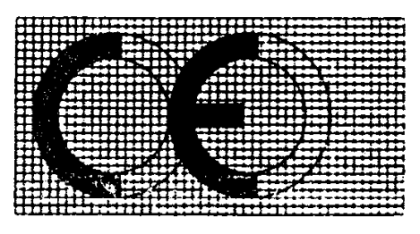

# Règlement grand-ducal du 17 août 1998 concernant les exigences en matière de rendement énergétique des réfrigérateurs, congélateurs et appareils combinés à usage ménager.

Nous JEAN, par la grâce de Dieu, Grand-Duc de Luxembourg, Duc de Nassau;

Vu la [loi modifiée du 9 août 1971](https://legilux.public.lu/eli/etat/leg/loi/1971/08/09/n2/jo) concernant l’exécution et la sanction des décisions et des directives ainsi que la sanction des règlements des Communautés européennes en matière économique, technique, agricole, forestière, sociale et en matière de transports;

Vu la [directive 96/57/CE](https://legilux.public.lu/eli/dir_ue/1996/57/jo) du Parlement Européen et du Conseil, du 3 septembre 1996, concernant les exigences en matière de rendement énergétique des réfrigérateurs, congélateurs et appareils combinés électriques à usage ménager;

Vu les avis de la Chambre de Commerce, de la Chambre des Employés Privés, de la Chambre des Métiers et de la Chambre de Travail;

Notre Conseil d’Etat entendu;

De l’assentiment de la Commission de Travail de la Chambre des Députés;

Sur le rapport de Notre Ministre ayant l’énergie dans ses attributions et après délibération du Gouvernement en Conseil;

Arrêtons:

## Art. 1er.

Le présent règlement s’applique aux nouveaux réfrigérateurs, conservateurs et congélateurs à usage ménager et à leurs combinaisons, alimentés sur secteur, définis à l’annexe I et ci-après dénommés «appareils de réfrigération». Les appareils qui peuvent aussi être alimentés par d’autres sources d’énergie, et notamment par des accumulateurs, ainsi que les appareils de réfrigération à usage ménager utilisant le principe d’absorption et les appareils fabriqués selon des spécifications particulières sont exclus.

## Art. 2.

1\. Le Service de l’Energie de l’Etat prend toutes les mesures nécessaires pour garantir que les appareils de réfrigération couverts par le présent règlement ne peuvent être mis sur le marché que si la consommation d’électricité de l’appareil en question est inférieure ou égale à la consommation électrique maximale admise pour sa catégorie, dont la valeur est calculée conformément aux procédures définies à l’annexe I.

2\. Le fabricant d’un appareil de réfrigération concerné par le présent règlement, son mandataire établi dans la Communauté ou la personne responsable de la mise sur le marché communautaire de l’appareil en question est tenu de veiller à ce que chaque appareil mis sur le marché soit conforme à l’exigence visée au paragraphe 1.

## Art. 3.

1\. Le Service de l’Energie de l’Etat ne peut pas interdire, restreindre ou empêcher la mise sur le marché des appareils de réfrigération qui portent le marquage « CE » attestant leur conformité à toutes les dispositions du présent règlement.

2\. Jusqu’à preuve du contraire, le Service de l’Energie de l’Etat présume conformes à l’ensemble des dispositions du présent règlement les appareils de réfrigération munis du marquage « CE » conformément à l’article 5.

3.a) Lorsque les appareils de réfrigération font l’objet d’autres règlements portant sur d’autres aspects et prévoyant l’apposition du marquage « CE », celui-ci indique que les appareils de réfrigération sont également présumés, jusqu’à preuve du contraire, conformes aux dispositions de ces autres règlements.

b) Toutefois, lorsqu’un ou plusieurs de ces règlements laissent le choix au fabricant, pendant une période transitoire, du régime à appliquer, le marquage « CE » indique la conformité aux dispositions des seuls règlements transposant les directives appliquées par le fabricant. Dans ce cas, les références des directives appliquées, telles que publiées au Journal officiel des Communautés européennes, doivent être inscrites sur les documents, notices ou instructions accompagnant les appareils de réfrigération.

## Art. 4.

Les procédures d’évaluation de la conformité et les obligations relatives au marquage « CE » des appareils de réfrigération sont établies à l’annexe II.

## Art. 5.

1\. Lorsque les appareils sont mis sur le marché, ils doivent avoir le marquage « CE ». Celui-ci est constitué des initiales « CE ». L’annexe III donne le modèle à utiliser. Le marquage « CE » est apposé de façon visible, lisible et indélébile sur l’appareil de réfrigération et, le cas échéant, sur l’emballage.

2\. Il est interdit d’apposer sur les appareils de réfrigération des marquages susceptibles de tromper les tiers sur la signification et le graphisme du marquage « CE ». Tout autre marquage peut être apposé sur les appareils, leur emballage, leur mode d’emploi ou d’autres documents, à condition de ne pas réduire la visibilité et la lisibilité du marquage « CE ».

## Art. 6.

1\. Tout constat par le Service de l’Energie de l’Etat de l’apposition indue du marquage « CE » entraîne pour le fabricant ou son mandataire établi dans la Communauté l’obligation de remettre le produit en conformité et de faire cesser l’infraction dans les conditions imposées par le Service de l’Energie de l’Etat. Lorsque ni le fabricant ni son mandataire ne sont établis dans la Communauté, cette obligation incombe à la personne responsable de la mise sur le marché communautaire de l’appareil de réfrigération.

2\. Si la non-conformité persiste, le Service de l’Energie de l’Etat prend, en application de l’article 7, toutes les mesures nécessaires pour restreindre ou interdire la mise sur le marché du produit en cause ou pour assurer son retrait du marché.

## Art. 7.

1\. Toute décision prise au titre du présent règlement qui comporte une restriction de mise sur le marché d’appareils de réfrigération en précise les motifs. La partie concernée reçoit immédiatement notification de cette décision et est informée simultanément des possibilités et délais de recours en justice en vertu de la législation en vigueur.

2\. Le Service de l’Energie de l’Etat informe sans délai la Commission d’une telle mesure et motive sa décision.

## Art. 8.

1\. Les dispositions du présent règlement sont applicables à partir du 3 septembre 1999.

2\. Jusqu’au 3 septembre 1999, le Service de l’Energie de l’Etat autorise la mise sur le marché des appareils de réfrigération qui respectent les mêmes conditions que celles qui étaient appliquées au 3 septembre 1996.

## Art. 9.

Notre Ministre ayant l’énergie dans ses attributions est chargé de l’exécution du présent règlement qui sera publié au Mémorial.

Le Ministre de l’Energie,   Robert Goebbels

Cabasson, le 17 août 1998.   Pour le Grand-Duc: Son Lieutenant-Représentant   Henri   Grand-Duc héritier

\*ANNEXES*

\*ANNEXE I*

MÉTHODE DE CALCUL DE LA CONSOMMATION D’ÉLECTRICITÉ MAXIMALE ADMISE  POUR UN APPAREIL DE RÉFRIGÉRATION ET PROCÉDURE DE VÉRIFICATION DE LA  CONFORMITÉ

La consommation d'électricité d'un appareil de réfrigération (qui peut exprimée en kWh par 24 heures) dépend de la catégorie d'appareils à laquelle il appartient [par exemple réfrigérateur une étoile (*), congélateur coffre, etc.], de son volume et du rendement énergétique de sa construction (épaisseur de l'isolation, rendement du compresseur, etc.) et de la différence entre la température autour de l'appareil et celle à l'intérieur. La fixation des normes de rendement énergétique doit donc prévoir des tolérances pour les facteurs endogènes principaux qui influencent la consommation énergétique (c'est-à-dire la catégorie et le volume de l'appareil). C'est pourquoi les consommations d'électricité maximales admises pour un appareil de réfrigération sont définies par une équation linéaire qui est fonction du volume de l'appareil, avec définition d'une équation différente pour chaque catégorie d'appareils.

Pour calculer la consommation d'électricité maximale admise d'un appareil donné, il faut donc commencer par classer cet appareil dans l'une des catégories de la liste suivante:

| Catégorie | Description |
|---|---|
| 1 | Réfrigérateur sans compartiment basse température (1) |
| 2 | Réfrigérateur *avec* compartiment de rafraîchissement à 5° C et/ou 12° C |
| 3 | Réfrigérateur avec compartiment basse température sans étoile |
| 4 | Réfrigérateur avec compartiment basse température une étoile(*) |
| 5 | Réfrigérateur avec compartiment basse température deux étoiles(**) |
| 6 | Réfrigérateur avec compartiment basse température trois étoiles(***) |
| 7 | Réfrigérateur/congélateur avec compartiment de congélation (****) |
| **8** | Congélateur armoire |
| 9 | Congélateur coffre |
| 10 | Réfrigérateur/congélateur comportant plus de deux portes, ou autres appareils non décrits ci-dessus |

<table>
<tr>
<td></td>
<td></td>
</tr>
<tr>
<td colspan="2">(1) Tout compartiment d'une température inférieure ou égale à -6° C.</td>
</tr>
</table>

Étant donné que les appareils de réfrigération contiennent différents compartiments maintenus à températures différentes (qui influenceront nettement la consommation d'électricité), la consommation maximale admise d'électricité est en réalité définie en fonction du volume *ajusté*, qui est une somme pondérée des volumes des différents compartiments.

Ainsi, aux fins de la présente directive, le volume ajusté (Vadj) de l'appareil est calculé selon la formule:

Vadj = ∑ Vc   x   Wc   x   Fc   x   Cc

Wc = ( 25 - Tc ) / 20

Tc étant la température nominale de chaque compartiment (en °C)

Vc étant le volume utile d'un type donné de compartiment dans l'appareil et Fc étant un facteur valant **1,2**  Pour les compartiments à froid ventilé et 1 pour les autres compartiments

<table>
<tr>
<td>Cc = 1</td>
<td>pour les appareils de réfrigération appartenant aux classes climatiques normales (N) et subnormales (SN)</td>
</tr>
<tr>
<td colspan="2">Cc = Xcpour les appareils de réfrigération appartenant à la classe climatique subtropicale (ST)</td>
</tr>
<tr>
<td colspan="2">Cc = Ycpour les appareils de réfrigération appartenant à la classe climatique tropicale (T)</td>
</tr>
</table>

Les coefficients de pondération Xc et Ycpour les différents types de compartiment sont les suivants:

Tableau des coefficients de pondération Xc et Ycselon la température du campartiment

|  | Xc | Yc |
|---|---|---|
| Compartiment de rafraîchissement | 1,25 | 1,35 |
| Compartiment pour denrées fraîches | 1,20 | 1,30 |
| Compartiment 0 °C | 1,15 | 1,25 |
| Compartiment sans étoile | 1.15 | 1,25 |
| Compartiment (*) | 1,08 | 1,15 |
| Compartiment (**) | I,08 | 1,15 |
| Compartiment (***) et (****) | 1,05 | 1.10 |

Le volume ajusté et les volumes utiles sont exprimés en litres.

La consommation maximale admise d'électricité (Emax exprimée en kWh par 24 heures et calculée jusqu'à la deuxième décimale), pour un appareil de volume ajusté Vadjest calculée selon les équations suivantes pour chaque catégorie d'appareils:

| Catégorie | Description | Emax (kWh/24 h) |
|---|---|---|
| 1 | Réfrigérateur sans compartiment basse température | (0,207 x Vadj + 218) / 365 |
| 2 | Réfrigérateur avec compartiment de rafraîchissement à 5° C et/ou 12° C | (0,207 x Vadj + 218) / 365 |
| 3 | Réfrigérateur sans étoile | (0,207 x Vadj + 218) / 365 |
| 4 | Réfrigérateur (*) | (0,557 x Vadj + 166) / 365 |
| 5 | Réfrigérateur (**) | **(0,402 x Vadj + 219) / 365** |
| 6 | Réfrigérateur (**) | (0573 x Vadj + 206) / 365 |
| 7 | Réfrigérateur/congélateur (****) | (0,697 x Vadj + 272) / 365 |
| 8 | Congélateur armoire | (0,434 x Vadj + 262) / 365 |
| 9 | Congélateur coffre | (0,480 x Vadj + 195) / 365 |

Pour les réfrigérateurs/congélateurs comportant plus de deux portes, ou autres appareils non décrits ci-dessus, la consommation maximale admise d'électricité (Emax est déterminée par la température et le nombre d'étoiles du compartiment dont la température est la plus basse comme suit:

| Température du compartiment le plus froid | Catégorie | Emax (kWh/24 h) |
|---|---|---|
| > - 6° C | 1/2/3 | (0,207 x Vadj + 218) / 365 |
| < - 6° C (*) | 4 | (0,557 x Vadj + 166) / 365 |
| < - 12° C (**) | 5 | (0,402 x Vadj + 219) / 365 |
| < - 18° C (***) | 6 | (0,573 x Vadj+ 206) / 365 |
| < - 18° C (****) | 7 | (0,697 x Vadj+ 272) / 365 |

Procédures d'essais destinées à vérifier la conformité de l'appareil aux exigences de consommation électrique de la présente directive

Si la consommation d'électricité d'un appareil de réfrigération soumis à la vérification est inférieure ou égale à la valeur Emax (consommation maximale d'électricité admise pour *sa* catégorie définie ci-dessus) majorée de 15 %, cet appareil est certifié conforme aux exigences de consommation électrique de la présente directive. Si la consommation est supérieure à la valeur Emax majorée de 15 %, il faut mesurer la consommation de trois autres appareils. Si la moyenne arithmétique dépasse la valeur de Ema x, majorée de 10 %, l'appareil est jugé non conforme à ces exigences.

Définitions

Les termes utilisés dans la présente annexe correspondent aux définitions de la norme européenne EN 153 édictée en juillet 1995 par le Comité européen de normalisation.

\*ANNEXE II*

PROCÉDURES D'ÉVALUATION DE LA CONFORMITÉ (MODULE A)

1\. Ce module décrit la procédure par laquelle le fabricant, ou son mandataire établi dans la Communauté, qui remplit les obligations prévues au point 2, assure et déclare que l'appareil de réfrigération satisfait aux exigences de la présente directive. Le fabricant appose le marquage «CE» sur chaque appareil de réfrigération qu'il produit et établit une déclaration de conformité.

2\. Le fabricant établit la documentation technique décrite au point 3; le fabricant ou son mandataire établi dans la Communauté tient cette documentation à la disposition des autorités nationales à des fins d'inspection pendant la durée d'au moins trois ans à compter de la dernière date de fabrication de l'appareil.

Lorsque ni le fabricant ni son mandataire ne sont établis dans la Communauté, cette obligation de tenir la documentation technique à disposition incombe à la personne responsable de la mise sur le marché communautaire de l’appareil de réfrigération.

3\. La documentation technique doit permettre l'évaluation de la conformité de l'appareil de réfrigération aux exigences de la présente directive. Elle devra couvrir, dans la mesure nécessaire à cette évaluation, la conception, la fabrication et le fonctionnement de l'appareil de réfrigération et comporter:

i) le nom et l'adresse du fabricant

ii) une description générale du modèle suffisante pour qu'il puisse être identifié sans ambiguïté;

iii) des informations, comprenant des dessins si nécessaire, sur les principales caractéristiques de la conception du modèle et notamment sur les points qui influencent sensiblement la consommation d'électricité, tels que les dimensions, le ou les volumes, les caractéristiques du compresseur, les particularités, etc.;

iv) le mode d'emploi éventuel;

v) 1es résultats des mesures de consommation d'électricité effectuées conformément au point 5;

vi) des détails précisant la conformité de ces mesures par rapport aux exigences de consommation d'énergie définies à l'annexe I.

4\. La documentation technique établie en application d'une autre réglementation communautai re peut être utilisée pour autant qu'elle satisfasse aux exigences de la présente annexe.

5\. Il incombe aux fabricants d'appareils de réfrigération d'établir la consommation électrique de chaque appareil de réfrigération couvert par la présente directive, conformémcnt aux procédures fixées par la nome européenne EN 153, et d'établir la conformité de l'appareil aux exigences de l'article 2.

6\. Le fabriant ou son mandataire conserve, avec la documentation technique, une copie de la déclaration de la conformité.

7\. Le fabricant prend toutes les mesures *nécessaires* pour que le procédé de fabrication assure la conformité des appareils de réfrigération fabriqués à la documentation technique visée au point 2 et aux exigences de la directive qui leur sont applicables.

\***ANNEXE III***

MARQUAGE «CE» DE CONFORMITÉ

Le marquage «CE» de conformité est constitué des initiales «CE» selon le graphisme suivant:

En cas de réduction ou d'agrandissement du marquage «CE», les proportions telles qu'elles ressortent du graphisme gradué figurant ci-dessus doivent être respectées.

Les différents éléments du marquage «CE» doivent avoir sensiblement la même hauteur, qui ne peut être inférieure à 5 millimètres.

Doc. parl. 4309; sess. ord. 1996-1997 et 1997-1998; [Dir. 96/57](https://legilux.public.lu/eli/dir_ue/1996/57/jo)
