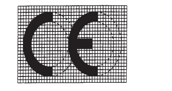

# Règlement grand-ducal du 4 février 2000 concernant les équipements hertziens et les équipements terminaux de télécommunications et la reconnaissance mutuelle de leur conformité.

Nous JEAN, par la grâce de Dieu, Grand-Duc de Luxembourg, Duc de Nassau;

Vu la [loi modifiée du 9 août 1971](https://legilux.public.lu/eli/etat/leg/loi/1971/08/09/n2/jo) concernant l’exécution et la sanction des décisions et des directives ainsi que la sanction des règlements des Communautés européennes en matière économique, technique, agricole, forestière, sociale et en matière de transports;

Vu la [directive 1999/5/CE](https://legilux.public.lu/eli/dir_ue/1999/5/jo) du Parlement européen et du Conseil du 9 mars 1999 concernant les équipements hertziens et les équipements terminaux de télécommunications et la reconnaissance mutuelle de leur conformité;

Vu les avis de la Chambre de commerce, de la Chambre des employés privés et de la Chambre de travail;

Vu la demande d’avis adressée à la Chambre des métiers;

Notre Conseil d’Etat entendu;

De l’assentiment de la Commission de travail de la Chambre des Députés;

Sur le rapport de Notre ministre de l’Economie et de Notre ministre d’Etat et après délibération du Gouvernement en Conseil;

Arrêtons:

## CHAPITRE Ier

### Art. 1er — Champ d’application et objectif.

1\. Le présent règlement établit un cadre réglementaire pour la mise sur le marché, la libre circulation et la mise en service dans la Communauté européenne des équipements hertziens et des équipements terminaux de télécommunications.

2\. Lorsqu’un appareil au sens de l’article 2, point a), comprend, comme partie intégrante ou comme accessoire:

a) un dispositif médical au sens de l’article 1er du [règlement grand-ducal du 11 août 1996](https://legilux.public.lu/eli/etat/leg/rgd/1996/08/11/n12/jo) relatif aux dispositifs médicaux;

ou

b) un dispositif médical implantable actif au sens de l’article 1er du [règlement grand-ducal modifié du 5 février 1993](https://legilux.public.lu/eli/etat/leg/rgd/1993/02/05/n1/jo) relatif aux dispositifs médicaux implantables actifs, l’appareil est régi par le présent règlement sans préjudice de l’application des règlements grand-ducaux précités.

3\. Lorsqu’un appareil constitue un élément ou une entité technique séparée d’un véhicule au sens du [règlement grand-ducal modifié du 3 février 1998](https://legilux.public.lu/eli/etat/leg/rgd/1998/02/03/n1/jo) portant exécution des directives C.E. relatives à la réception des véhicules à moteur et leurs remorques ainsi que des tracteurs agricoles et forestiers à roues, qui transpose notamment la [directive 72/245/CEE](https://legilux.public.lu/eli/dir_ue/1972/245/jo) concernant les parasites radioélectriques (compatibilité électromagnétique) produits par les véhicules, ou un élément ou une entité technique séparée d’un véhicule au sens de l’article 1er de la [directive modifiée 92/61/CEE](https://legilux.public.lu/eli/dir_ue/1992/61/jo) relative à la réception des véhicules à moteur à deux ou trois roues, l’appareil est régi par le présent règlement sans préjudice de l’application respectivement de la [directive 72/245/CEE](https://legilux.public.lu/eli/dir_ue/1972/245/jo) ou de la [directive 92/61/CEE](https://legilux.public.lu/eli/dir_ue/1992/61/jo), telles qu’elles ont été transposées dans le droit luxembourgeois.

4\. Le présent règlement ne s’applique pas aux équipements énumérés à l’annexe I.

5\. Le présent règlement ne s’applique pas aux appareils utilisés exclusivement dans des activités ayant trait à la sécurité publique, la défense, la sécurité de l’Etat (y compris le bien-être économique de l’Etat lorsque les activités ont trait à la sécurité de l’Etat) ou aux activités de l’Etat dans le domaine du droit pénal.

### Art. 2 — Définitions.

Aux fins du présent règlement, on entend par:

a) «appareil», tout équipement qui est, soit un «équipement hertzien», soit un «équipement terminal de télécommunications», soit les deux;

b) «équipement terminal de télécommunications», un produit permettant la communication, ou un composant pertinent d’un produit, destiné à être connecté directement ou indirectement par un quelconque moyen à des interfaces de réseaux publics de télécommunications (à savoir des réseaux de télécommunications servant entièrement ou en partie à la fourniture de services de télécommunications accessibles au public);

c) «équipement hertzien», un produit, ou un composant pertinent d’un produit, qui permet de communiquer par l’émission et/ou la réception d’ondes hertziennes en utilisant le spectre attribué aux communications radio terrestres ou spatiales;

d) «ondes hertziennes», des ondes électromagnétiques dont les fréquences sont situées entre 9 kilohertz et 3 000 gigahertz et qui se propagent dans l’espace sans guide artificiel;

e) «interface»,

(i) un point de terminaison d’un réseau, c’est-à-dire un point de raccordement physique par lequel les usagers obtiennent l’accès à un réseau public de télécommunications, et/ou

(ii) une interface radio, précisant le trajet radioélectrique entre les équipements hertziens,

et leurs spécifications techniques.

f) «catégorie d’équipements», une catégorie désignant certains types d’appareils considérés comme semblables en vertu du présent règlement et les interfaces auxquelles les appareils sont destinés. Les appareils peuvent appartenir à plusieurs catégories d’équipements;

g) «dossier technique de construction», un dossier décrivant l’appareil et donnant des informations et des explications quant à la façon dont les exigences essentielles applicables ont été observées;

h) «norme harmonisée», une spécification technique adoptée par un organisme de normalisation agréé dans le cadre d’un mandat délivré par la Commission européenne, et dépourvue de caractère obligatoire;

i) «perturbation», toute interférence qui compromet le fonctionnement d’un service de radionavigation ou d’autres services de sécurité ou qui porte gravement atteinte ou fait obstruction à un service de radiocommunications fonctionnant conformément à la réglementation communautaire ou nationale applicable, ou qui interrompt un tel service de manière répétée;

j) «Commission», la Commission européenne;

### Art. 3 — Exigences essentielles.

1\. Les exigences essentielles ci-après sont applicables à tous les appareils:

a) la protection de la santé et de la sécurité de l’utilisateur et de toute autre personne, y compris les objectifs, en ce qui concerne les exigences de sécurité, définies par le [règlement grand-ducal modifié du 27 août 1976](https://legilux.public.lu/eli/etat/leg/rgd/1976/08/27/n2/jo) portant application de la [directive CEE du 19 février 1973](http://data.europa.eu/eli/dir/1973/23/oj) concernant le rapprochement des législations des Etats membres relatives au matériel électrique destiné à être employé dans certaines limites de tension, mais sans seuil inférieur de tension;

b) les exigences de protection, en ce qui concerne la compatibilité électromagnétique, prévues par le [règlement grand-ducal modifié du 21 avril 1993](https://legilux.public.lu/eli/etat/leg/rgd/1993/04/21/n2/jo) concernant la compatibilité électromagnétique;

2\. Les équipements hertziens sont en outre construits de telle sorte qu’ils utilisent efficacement le spectre attribué aux communications radio terrestres/ou spatiales ainsi que les ressources orbitales pour éviter les interférences dommageables.

### Art. 4 — Notification et publication des spécifications des interfaces.

1\. Le ministre ayant dans ses attributions les communications notifie à la Commission les interfaces qu’il a réglementées, dans la mesure où lesdites interfaces n’ont pas été notifiées en vertu des dispositions de la [directive 98/34/CE](https://legilux.public.lu/eli/dir_ue/1998/34/jo).

2\. Le ministre ayant dans ses attributions les communications notifie à la Commission les types d’interfaces qui sont offerts par les exploitants de réseaux publics de télécommunications. L’Institut Luxembourgeois des Télécommunications veille à ce que ces exploitants publient des spécifications techniques régulièrement mises à jour, précises et suffisantes de ces interfaces avant de rendre les services accessibles au public par ces interfaces. Les spécifications sont suffisamment détaillées pour permettre la conception des équipements terminaux de télécommunications capables d’utiliser tous les services fournis par l’interface correspondante. Les spécifications comprennent, entre autres, toutes les informations nécessaires pour permettre aux fabricants de réaliser, s’ils le désirent, les essais pertinents pour les exigences essentielles applicables aux équipements terminaux de télécommunications. L’Institut Luxembourgeois des Télécommunications veille à ce que ces spécifications soient rendues aisément accessibles par les exploitants.

### Art. 5 — Normes harmonisées.

Lorsqu’un appareil est conforme aux normes harmonisées pertinentes ou à certaines parties de celles-ci, dont les numéros de référence ont été publiés au Mémorial, le Service de l’Energie de l’Etat présume que les exigences essentielles visées à l’article 3 et couvertes par ces normes harmonisées ou certaines parties de celles-ci sont respectées.

### Art. 6 — Mise sur le marché.

1\. Le ministre ayant dans ses attributions le Service de l’Energie de l’Etat veille à ce que les appareils ne soient mis sur le marché qu’à condition d’être conformes aux exigences essentielles appropriées visées à l’article 3 et aux autres dispositions pertinentes du présent règlement lorsqu’ils sont installés et entretenus de façon appropriée et qu’ils sont utilisés conformément à leur destination. Ils ne sont pas soumis à d’autres exigences quant à la mise sur le marché.

2\. Le ministre ayant dans ses attributions le Service de l’Energie de l’Etat veille à ce que le fabricant ou la personne responsable de la mise sur le marché de l’appareil fournisse à l’utilisateur des informations sur l’usage auquel l’appareil est destiné, accompagnées de la déclaration de conformité aux exigences essentielles. Lorsqu’il s’agit d’équipements hertziens, ces informations sont suffisantes pour permettre d’identifier sur l’emballage et la notice d’utilisation de l’appareil les Etats membres ou la zone géographique à l’intérieur d’un Etat membre dans lesquels l’équipement est destiné à être utilisé, et il alerte l’utilisateur grâce au marquage apposé sur l’appareil et visé à l’annexe VII, point 5, sur la possibilité que l’utilisation de l’équipement hertzien soit soumise dans certains Etats membres à des restrictions ou à des exigences en vue de l’autoriser. Lorsqu’il s’agit d’équipements terminaux de télécommunications, ces informations sont suffisantes pour permettre d’identifier les interfaces des réseaux publics de télécommunications auxquelles les équipements sont destinés à être raccordés. Pour tous les appareils, ces informations sont mises en évidence.

3\. Dans le cas d’équipements hertziens utilisant des bandes de fréquences dont l’utilisation n’est pas harmonisée dans l’ensemble de la Communauté, le fabricant ou son mandataire établi dans la Communauté ou la personne responsable de la mise sur le marché des équipements informe le ministre ayant dans ses attributions les communications de son intention de commercialiser ces équipement sur le marché luxembourgeois.

La notification est faite au moins quatre semaines avant le début de la mise sur le marché et comprend des informations sur les caractéristiques hertziennes des équipements (en particulier, bandes de fréquences, espacement des canaux, type de modulation et puissance RF) et le numéro d’identification de l’organisme notifié visé aux annexes IV et V.

### Art. 7 — Mise en service et droit de connexion.

1\. Le ministre ayant dans ses attributions le Service de l’Energie de l’Etat autorise la mise en service des appareils conformément à l’usage auquel ils sont destinés lorsqu’ils sont conformes aux exigences essentielles appropriées visées à l’article 3 et aux autres dispositions pertinentes du présent règlement.

2\. Nonobstant le paragraphe 1, et sans préjudice des conditions attachées aux autorisations pour la fourniture du service concerné conformément à la législation en vigueur, le ministre ayant dans ses attributions le Service de l’Energie de l’Etat ne peut limiter la mise en service d’équipements hertziens que pour des raisons liées à l’utilisation efficace et appropriée du spectre radio, à la nécessité d’éviter des interférences dommageables, ou à des questions liées à la santé publique.

3\. Sans préjudice du paragraphe 4, le ministre ayant dans ses attributions le Service de l’Energie de l’Etat veille à ce que les exploitants de réseaux publics de télécommunications ne refusent pas la connexion des équipements terminaux de télécommunications aux interfaces appropriées pour des raisons techniques lorsque ces équipements sont conformes aux exigences applicables de l’article 3.

4\. Lorsque le ministre ayant dans ses attributions le Service de l’Energie de l’Etat estime qu’un appareil, déclaré conforme au présent règlement, occasionne un dommage grave à un réseau ou des perturbations radioélectriques, ou une atteinte au réseau ou à son fonctionnement, l’exploitant peut être autorisé à refuser la connexion d’un tel appareil, à la déconnecter ou à le retirer du service. Le ministre ayant dans ses attributions le Service de l’Energie de l’Etat notifie chaque autorisation de ce type à la Commission.

5\. En cas d’urgence, l’exploitant peut déconnecter un appareil si la protection du réseau exige que l’équipement soit déconnecté sans délai, et si une solution de rechange peut être offerte à l’utilisateur sans délai et sans frais pour ce dernier. L’exploitant en informe immédiatement le ministre ayant dans ses attributions le Service de l’Energie de l’Etat.

### Art. 8 — Libre circulation des appareils.

1\. Le ministre ayant dans ses attributions le Service de l’Energie de l’Etat n’interdit pas, ne limite pas ou n’entrave pas la mise sur le marché et la mise en service d’appareils portant le marquage CE visé à l’annexe VII, qui prouve leur conformité avec toutes les dispositions du présent règlement, y compris les procédures d’évaluation de la conformité définies au chapitre II, et cela sans préjudice des dispositions de l’article 6, paragraphe 3, de l’article 7, paragraphe 2, et de l’article 9, paragraphe 3.

2\. Lors des foires commerciales, expositions, démonstrations, etc., le ministre ayant dans ses attributions le Service de l’Energie de l’Etat ne crée pas d’obstacle à la présentation d’appareils qui ne sont pas conformes au présent règlement, à condition qu’un signe visible indique clairement que ces appareils ne peuvent être commercialisés ou mis en service avant d’avoir été rendus conformes.

3\. Lorsque l’appareil est soumis à d’autres règlements concernant d’autres aspects et qui prévoient également l’apposition du marquage CE, ce dernier indique que cet appareil satisfait également aux dispositions des autres règlements. Toutefois, si un ou plusieurs de ces règlements permettent au fabricant, pendant une période transitoire, de choisir le régime qu’il applique, le marquage CE indique que l’appareil satisfait seulement aux dispositions des règlements transposant les directives appliquées par le fabricant. Dans ce cas, les références de ces directives, telles que publiées au Journal officiel des Communautés européennes, doivent figurer dans les documents, notices ou instructions requis par ces directives et accompagnant ces produits.

### Art. 9 — Sauvegardes.

1\. Lorsque le ministre ayant dans ses attributions le Service de l’Energie de l’Etat constate qu’un appareil relevant du champ d’application du présent règlement n’est pas conforme aux exigences de celui-ci, il prend toutes les mesures utiles pour retirer l’appareil du marché ou du service, en interdire la mise sur le marché ou la mise en service ou en restreindre la liberté de circulation.

Dans ce cas de non-conformité, les frais de contrôle et d’essais du seront à charge du constructeur ou, à défaut, de l’importateur ou, à défaut, de celui qui a mis l’appareil sur le marché.

2\. Le ministre ayant dans ses attributions le Service de l’Energie de l’Etat notifie immédiatement à la Commission toute mesure prise à cet égard en la motivant et en indiquant si la non-conformité est due:

a) à une application inadéquate des normes harmonisées visées à l’article 5;

b) aux insuffisances des normes harmonisées visées à l’article 5;

c) à la non-conformité aux exigences visées à l’article 3, lorsque l’appareil ne satisfait pas aux normes harmonisées visées à l’article 5.

3\. a) Nonobstant les dispositions de l’article 6, le ministre ayant dans ses attributions le Service de l’Energie de l’Etat peut, dans le respect des dispositions du traité instituant la Communauté européenne et notamment de ses articles 30 et 36, arrêter toute mesure appropriée en vue:

(i) d’interdire ou de restreindre la mise sur le marché luxembourgeois,

et/ou

(i) d’exiger le retrait du marché luxembourgeois

d’équipements hertziens, y compris de types d’équipements hertziens, qui ont provoqué, ou dont il estime raisonnablement, qu’ils vont provoquer des interférences dommageables, y compris des interférences avec des services existants ou prévus sur les bandes de fréquences attribuées au niveau national.

b) Lorsque le ministre ayant dans ses attributions le Service de l’Energie de l’Etat prend des mesures conformément au point a), il en informe immédiatement la Commission en indiquant les raisons qui l’ont incité à le faire.

## CHAPITRE II

### Art 10 — Procédures d’évaluation de la conformité.

1\. Les procédures d’évaluation de la conformité visées dans le présent article sont utilisées pour établir la conformité des appareils à toutes les exigences essentielles pertinentes visées à l’article 3.

2\. Au choix du fabricant, la conformité des appareils aux exigences essentielles visées à l’article 3, paragraphe 1, points a) et b), peut être démontrée en utilisant les procédures spécifiées respectivement dans le [règlement grand-ducal modifié du 27 août 1976](https://legilux.public.lu/eli/etat/leg/rgd/1976/08/27/n2/jo) portant application de la [directive CEE du 19 février 1973](http://data.europa.eu/eli/dir/1973/23/oj) concernant le rapprochement des législations des Etats membres relatives au matériel électrique destiné à être employé dans certaines limites de tension et le [règlement grand-ducal modifié du 21 avril 1993](https://legilux.public.lu/eli/etat/leg/rgd/1993/04/21/n2/jo) concernant la compatibilité électromagnétique lorsque les appareils relèvent de ces règlements, en lieu et place des procédures décrites ci-après.

3\. Les équipements terminaux de télécommunications qui n’utilisent pas le spectre attribué aux communications radio terrestres/spatiales ou les éléments récepteurs d’équipements hertziens sont soumis, au choix du fabricant, aux procédures décrites à l’annexe II, à celles de l’annexe IV ou à celles de l’annexe V.

4\. Lorsqu’un fabricant a appliqué les normes harmonisées visées à l’article 5, les équipements hertziens qui ne relèvent pas du paragraphe 3 sont soumis, au choix du fabricant, aux procédures visées à l’annexe III, à l’annexe IV ou à l’annexe V.

5\. Lorsqu’un fabricant n’a pas appliqué les normes harmonisées visées à l’article 5, ou ne les a appliquées que partiellement, les équipments hertziens qui ne relèvent pas du paragraphe 3 du présent article sont soumis, au choix du fabricant, aux procédures visées à l’annexe IV ou à l’annexe V.

6\. Les registres et la correspondance relatifs aux procédures d’évaluation de la conformité visées aux paragraphes 2 à 5 doivent être rédigés dans une langue officielle du Grand-Duché ou dans une langue acceptée par l’organisme notifié concerné.

### Art. 11 — Organismes notifiés et autorités de surveillance.

1\. Le ministre ayant dans ses attributions les communications notifie à la Commission les organismes qu’il a désignés pour effectuer les tâches pertinentes visées à l’article 10. Il détermine les organismes à désigner en appliquant les critères définis à l’annexe VI.

2\. Le Ministre ayant dans ses attributions les communications notifie à la Commission les autorités qui effectuent les tâches de surveillance liées à la mise en oeuvre du présent règlement.

## CHAPITRE III

### Art. 12 — Marquage «CE».

1\. Les appareils conformes à toutes les exigences essentielles applicables portent le marquage «CE» de conformité prévu à l’annexe VII. Ce marquage est apposé sous la responsabilité du fabricant, de son mandataire établi dans la Communauté ou de la personne responsable de la mise sur le marché de l’appareil.

En cas d’application des procédures visées à l’annexe III, à l’annexe IV ou à l’annexe V, le marquage est accompagné du numéro d’identification de l’organisme notifié visé à l’article 11, paragraphe 1. Les équipements hertziens sont en outre accompagnés, le cas échéant, de l’identificateur de la catégorie d’équipements lorsqu’un tel identificateur à été attribué. Tout autre marquage peut être apposé, à condition de ne pas réduire la visibilité et la lisibilité du marquage «CE».

2\. Qu’ils soient conformes ou non aux exigences essentielles applicables, les appareils ne peuvent porter aucun marquage susceptible de tromper les tiers sur la signification et la graphisme du marquage «CE» représenté à l’annexe VII.

3\. Le ministre ayant dans ses attributions le Service de l’Energie de l’Etat prend les mesures adéquates à l’encontre de toute personne ayant apposé un marquage non conforme aux paragraphes 1 et 2. S’il n’est pas possible d’identifier la personne qui a apposé ce marquage, les mesures appropriées peuvent être prises à l’encontre du détenteur de l’appareil au moment où la non-conformité a été découverte.

4\. Les appareils sont identifiés par le fabricant sur la base du type, du lot et/ou des numéros de série, et par le nom du fabricant ou de la personne responsable de la mise sur le marché.

### Art. 13 — Dispositions transitoires.

1\. Les normes visées par le [règlement grand-ducal modifié du 27 août 1976](https://legilux.public.lu/eli/etat/leg/rgd/1976/08/27/n2/jo) portant application de la [directive CEE du 19 février 1973](http://data.europa.eu/eli/dir/1973/23/oj) concernant le rapprochement des Etats membres relatives au matériel électrique destiné à être employé dans certaines limites de tension ou le [règlement grand-ducal modifié du 21 avril 1993](https://legilux.public.lu/eli/etat/leg/rgd/1993/04/21/n2/jo) concernant la compatibilité électromagnétique peuvent être utilisées comme base pour présumer la conformité aux exigences essentielles visées à l’artice 3, paragraphe 1, points a) et b). Les réglementations techniques communes visées par le [règlement grand-ducal du 23 avril 1997](https://legilux.public.lu/eli/etat/leg/rgd/1997/04/23/n1/jo) relatif aux équipements terminaux de télécommunications et aux équipements de stations terrestres de communications par satellite, incluant la reconnaissance mutuelle de leur conformité peuvent être utilisées comme base pour présumer la conformité aux autres exigences essentielles visées à l’article 3.

2\. Le ministre ayant dans ses compétences le Service de l’Energie de l’Etat ne fait pas obstacle à la mise sur le marché et la mise en service d’appareils conformes aux dispositions du [règlement grand-ducal du 23 avril 1997](https://legilux.public.lu/eli/etat/leg/rgd/1997/04/23/n1/jo) relatif aux équipements terminaux de télécommunications et aux équipement de stations terrestres de communications par satellite, incluant la reconnaissance mutuelle de leur conformité ou aux règles en vigueur et qui ont été mis sur le marché pour la première fois avant l’entrée en vigueur du présent règlement ou au plus tard deux ans après son entrée en vigueur.

3\. Outre les exigences essentielles mentionnées à l’article 3, paragraphe 1, le ministre ayant dans ses compétences le Service de l’Energie de l’Etat peut demander de continuer, pendant une période pouvant aller jusqu’au 7 octobre 2002, et dans le respect des dispositions du traité instituant la Communauté européenne à exiger que les équipements terminaux de télécommunications ne puissent pas provoquer une détérioration inacceptable d’un service de téléphonie vocale accessible dans le cadre du service universel tel que défini par le [règlement grand-ducal du 26 mai 1998](https://legilux.public.lu/eli/etat/leg/rgd/1998/05/26/n1/jo) sur le service universel de télécommunications.

Le ministre ayant dans ses attributions le Service de l’Energie de l’Etat informe la Commission des motifs pour lesquels il demande de maintenir cette exigence, de la date à laquelle le maintien de cette exigence ne sera plus nécessaire pour le service concerné et des mesures prévues pour respecter ce délai.

### Art. 14 — Abrogation.

1\. Le [règlement grand-ducal du 23 avril 1997](https://legilux.public.lu/eli/etat/leg/rgd/1997/04/23/n1/jo) relatif aux équipements terminaux de télécommunications et aux équipements de stations terrestres de communications par satellite, incluant la reconnaissance mutuelle est abrogée.

2\. Le présent règlement n’est pas un règlement spécifique au sens de l’article 2, paragraphe 2, du [règlement grand-ducal du 21 avril 1993 précité](https://legilux.public.lu/eli/etat/leg/rgd/1993/04/21/n2/jo) concernant la compatibilité électromagnétique. Les dispositions du [règlement grand-ducal du 21 avril 1993 précité](https://legilux.public.lu/eli/etat/leg/rgd/1993/04/21/n2/jo) ne s’appliquent pas, à partir du 8 avril 2000, aux appareils relevant du présent règlement, à l’exception des exigences en matière de protection prévues à l’article 4 et à l’annexe III et de la procédure d’évaluation de la conformité visée à l’article 10, paragraphes 1 et 2, et à l’annexe I du [règlement grand-ducal du 21 avril 1993 précité](https://legilux.public.lu/eli/etat/leg/rgd/1993/04/21/n2/jo).

3\. Les dispositions du [règlement grand-ducal modifié du 27 août 1976](https://legilux.public.lu/eli/etat/leg/rgd/1976/08/27/n2/jo) portant application de la [directive CEE du 19 février 1973](http://data.europa.eu/eli/dir/1973/23/oj) concernant le rapprochement des Etats membres relatives au matériel électrique destiné à être employé dans certaines limites de tension ne s’appliquent pas, à partir du 8 avril 2000, aux appareils relevant du présent règlement, à l’exception des objectifs relatifs aux exigences de sécurité énoncés à l’article 2 et à l’annexe I et de la procédure d’évaluation de la conformité visée à l’annexe III, point B, et à l’annexe IV du [règlement grand-ducal du 27 août 1976](https://legilux.public.lu/eli/etat/leg/rgd/1976/08/27/n2/jo).

### Art. 15.

Les infractions aux articles 9 et 12 du présent règlement sont punies d’une amende de 10.001 à 1.000.000 F.

### Art. 16.

Le présent règlement entre en vigueur le 8 avril 2000.

### Art. 17.

Notre ministre de l’Economie et Notre ministre ayant dans ses attributions les communications sont chargés de l’exécution du présent règlement qui sera publié au Mémorial.

Le Ministre de l’Economie,   Henri Grethen   Le Ministre d’Etat,   Jean-Claude Juncker

Palais de Luxembourg, le 4 février 2000.   Pour le Grand-Duc:   Son Lieutenant-Représentant   Henri   Grand-Duc héritier

ANNEXE I

\**Equipements non visés par le présent règlement au sens de l’article 1er, paragraphe 4**

1\. Equipements hertziens utilisés par les radioamateurs au sens de l’article 1er, définition 53, du règlement de radiocommunications de l’Union internationale des télécommunications (UIT), à moins qu’il ne s’agisse d’équipements disponibles dans le commerce.

Les kits de pièces détachés à assembler par des radioamateurs et les équipements commerciaux modifiés par des radioamateurs et pour leur usage ne sont pas considérés comme des équipements disponibles dans le commerce.

2\. Equipements relevant de la [directive 96/98/CE](https://legilux.public.lu/eli/dir_ue/1996/98/jo) du Conseil du 20 décembre 1996 relative aux équipements marins.

3\. Fils et câbles.

4\. Equipements de réception radio destinés à être utilisés exclusivement pour la réception de services de radiodiffusion sonore et élévisuelle.

5\. Produits, équipements ou éléments au sens de l’article 2 du [règlement (CEE) n° 3922/91](https://legilux.public.lu/eli/reg_ue/1991/3922/jo) du Conseil du 16 décembre 1991 relatif à l’harmonisation de règles techniques et de procédures administratives dans le domaine de l’aviation civile.

6\. Equipements et systèmes pour la gestion du trafic aérien au sens de l’article 1er du [règlement grand-ducal du 11 mars 1999](https://legilux.public.lu/eli/etat/leg/rgd/1999/03/11/n2/jo) portant exécution des directives du Conseil et de la Commission de l’Union européenne relatives à la définition et à l’utilisation de spécifications techniques compatibles pour l’acquisition d’équipements et de systèmes pour la gestion du trafic aérien.

ANNEXE II

\**Procédure d’évaluation de la conformité visée à l’article 10, paragraphe 3**

Module A (contrôle interne de la fabrication)

1\. Ce module décrit la procédure par laquelle le fabricant, ou son mandataire établi dans la Communauté, qui remplir les obligations prévues au point 2, assure et déclare que les produits en question satisfont aux exigences de la directive qui leur sont applicables. Le fabricant ou son mandataire établi dans la Communauté appose le marquage «CE» sur chaque produit et établit par écrit une déclaration de conformité.

2\. Le fabricant établit la documentation technique décrite au point 4; le fabricant, ou son mandataire établi dans la Communauté, tient cette documentation à la disposition des autorités nationales de tout Etat membre à des fins d’inspection pendant une durée d’au moins dix ans à compter de la dernière date de fabrication du produit.

3\. Lorsque ni le fabricant ni son mandataire ne sont établis dans la Communauté, cette obligation de tenir la documentation technique à disposition incombe à la personne responsable de la mise du produit sur le marché communautaire.

4\. La documentation technique doit permettre l’évaluation de la conformité du produit aux exigences essentielles. Elle doit couvrir la conception, la fabrication et le fonctionnement du produit, et comporter notamment:

– une description générale du produit,

– des dessins de conception et de fabrication, ainsi que des schémas des composants, sous-ensembles, circuits, etc.,

– les descriptions et explications nécessaires à la compréhension des dessins et schémas susmentionnés et du fonctionnement du produit,

– une liste des normes visées à l’article 5, appliquées entièrement ou en partie, ainsi qu’une description et explication des solutions adoptées pour satisfaire aux exigences essentielles de la directive lorsque les normes visées à l’article 5 n’ont pas été appliquées ou n’existent pas,

– les résultats des calculs de conception, des contrôles effectués, etc.

– les rapports d’essais.

5\. Le fabricant ou son mandataire conserve, avec la documentation technique, un exemplaire de la déclaration de conformité.

6\. Le fabricant prend toutes les mesures nécessaires pour que le procédé de fabrication assure la conformité des produits manufacturés à la documentation technique visée au point 2, et aux exigences de la présente directive qui leur sont applicables.

ANNEXE III

\**Procédure d’évaluation de la conformité visée à l’article 10, paragraphe 4**

\*(Contrôle interne de la fabrication plus essais spécifiques de l’appareil)*

La présente annexe comprend l’annexe II complétée par les exigences supplémentaires suivantes:

Pour chaque type d’appareil, toutes les séries d’essais radio essentielles doivent être effectuées par le fabricant ou pour le compte de celui-ci. Le choix des séries d’essais jugées essentielles relève de la responsabilité d’un organisme notifié choisi par le fabricant, sauf si elles sont définies dans des normes harmonisées. L’organisme notifié tient dûment compte des précédentes décisions rendues par des organismes notifiés agissant de concert.

Le fabricant ou son mandataire établi dans la Communauté ou la personne responsable de la mise sur le marché de l’appareil déclare que les essais ont été effectués et que l’appareil est conforme aux exigences essentielles et il appose le numéro d’identification de l’organisme notifié au cours du processus de fabrication.

ANNEXE IV

\**Procédure d’évaluation de la conformité visée à l’article 10, paragraphe 5**

\*(Dossier de construction technique)*

La présente annexe comprend l’annexe III complétée par les exigences supplémentaires suivantes:

La documentation technique décrite au point 4 de l’annexe II et la déclaration de conformité aux séries d’essais radio spécifiques visée à l’annexe III constituent un dossier de construction technique.

Le fabricant, son mandataire établi dans la Communauté ou la personne responsable de la mise sur le marché de l’appareil, soumet le dossier à un ou plusieurs organismes notifiés; chacun de ces organismes doit être informé des autres organismes auxquels le dossier a été soumis.

L’organisme notifié examine le dossier et, s’il apparaît que le respect des exigences de la directive n’est pas suffisamment établi, il peut adresser un avis au fabricant, ou à son mandataire ou à la personne responsable de la mise sur le marché de l’appareil, et il informe en conséquence les autres organismes notifiés auxqueles le dossier a été soumis. Cet avis est donné dans un délai de quatre semaines à compter de la réception du dossier par l’organisme notifié. A la réception de cet avis, ou au terme de la période de quatre semaines, l’appareil peut être mis sur le marché, sans préjudice des dispositions de l’article 6, paragraphe 3, et de l’article 9, paragraphe 3.

Le fabricant ou son mandataire établi dans la Communauté ou la personne responsable de la mise sur le marché de l’appareil tient le dossier à la disposition des autorités nationales de tout Etat membre à des fins d’inspection pendant une durée d’au moins dix ans à compter de la dernière date de fabrication de l’appareil.

ANNEXE V

\*Procédure d’évaluation de la conformité visée à l’article 10*

\*Assurance qualité complète*

1\. L’assurance qualité complète est la procédure par laquelle le fabricant qui remplit les obligations du point 2 assure et déclare que les produits considérés satisfont aux exigences de la directive qui leur sont applicables.

Le fabricant appose les marquages prévus à l’article 12, paragraphe 1, sur chaque produit et établit une déclaration écrite de conformité.

2\. Le fabricant met en oeuvre un système de qualité approuvé pour la conception, la fabrication et l’inspection finale des produits et les essais comme spécifié au point 3, et il est soumis à la surveillance visée au point 4.

3\. Système de qualité

3.1. Le fabricant soumet une demande d’évaluation de son système de qualité auprès d’un organisme notifié.

Cette demande comprend:

– toutes les informations appropriées pour les produits envisagés,

– la documentation sur le système de qualité.

3.2. Le système de qualité doit assurer la conformité des produits aux exigences de la directive qui leur sont applicables. Tous les éléments, exigences et dispositions adoptés par le fabricant doivent figurer dans une documentation tenue de manière systèmatique et rationnelle sous la forme de mesures, de procédures et d’instructions écrites. Cette documentation sur le système de qualité permet une interprétation uniforme des mesures et des procédures de qualité telles que programmes, plans, manuels et dossiers de qualité.

Elle comprend en particulier une description adéquate:

– des objectifs de qualité, de l’organigramme, des responsabilités des cadres et de leurs pouvoirs en matière de qualité de la conception et des produits,

– des spécifications techniques, y compris les normes harmonisées, les réglementations techniques et les spécifications d’essai pertinentes qui seront appliquées et, lorsque les normes visées à l’article 5, paragraphe 1, ne sont pas appliquées entièrement, des moyens qui seront utilisés pour que les exigences essentielles de la directive qui s’appliquent aux produits soient respectées,

– des techniques de contrôle et de vérification de la conception, des procédés et des actions systématiques qui seront utilisés lors de la conception des produits appartenant à la catégorie de produits couverte,

– des techniques correspondantes de fabrication, de contrôle de la qualité et d’assurance de la qualité, des procédés et actions systématiques qui seront utilisés,

– des contrôles et des essais qui seront effectués avant, pendant et après la fabrication et de la fréquence à laquelle ils auront lieu, ainsi que, le cas échéant, des résultats des essais effectués avant la fabrication,

– des moyens permettant de s’assurer que les installations d’essais et de contrôle répondent aux exigences appropriées pour l’exécution de l’essai nécessaire,

– des dossiers de qualité tels que les rapports d’inspection et les données d’essais et d’étalonnage, les rapports sur la qualification du personnel concerné, etc.,

– des moyens permettant de vérifier la réalisation de la qualité requise en matière de conception et de produit, ainsi que le fonctionnement efficace du système de qualité.

3.3. L’organisme notifié évalue le système de qualité pour déterminer s’il répond aux exigences visées au point 3.2. Il présume la conformité à ces exigences pour les systèmes de qualité qui mettent en oeuvre la norme harmonisée correspondante.

L’organisme notifié examine en particulier si le système de contrôle de la qualité assure la conformité des produits aux exigences de la directive à la lumière de la documentation pertinente fournie au sujet des points 3.1 et 3.2, y compris, le cas échéant, des résultats des essais fournis par le fabricant.

L’équipe d’auditeurs comporte au moins un membre ayant acquis, en tant qu’évaluateur, l’expérience de la technologie du produit concerné. La procédure d’évaluation comporte une visite dans les locaux du fabricant.

La décision est notifiée au fabricant. La notification contient les conclusions du contrôle et la décision d’évaluation motivée.

3.4. Le fabricant s’engage à remplir les obligations découlant du système de qualité tel qu’il est approuvé et à le maintenir de sorte qu’il demeure adéquat et efficace.

Le fabricant ou son mandataire informe l’organisme notifié qui a approuvé le système de qualité de tout projet d’adaptation de celui-ci.

L’organisme notifié évalue les modifications proposées et décide si le système de qualité modifié répondra encore aux exigences visées au point 3.2 ou si une nouvelle évaluation est nécessaire.

Il notifie sa décision au fabricant. La notification contient les conclusions du contrôle et la décision d’évaluation motivée.

4\. Surveillance CE sous la responsabilité de l’organisme notifié.

4.1. Le but de la surveillance est de s’assurer que le fabricant remplit correctement les obligations qui découlent du système de qualité approuvé.

4.2. Le fabricant autorise l’organisme notifié à accéder, à des fins d’inspection, aux lieux de conception, de fabrication, d’inspection, d’essais et de stockage et lui fournit toutes les informations nécessaires, en particulier:

– la documentation sur le système de qualité,

– les dossiers de qualité prévus dans la partie du système de qualité consacrée à la conception, tels que les résultats d’analyses, des calculs, des essais, etc.,

– les dossiers de qualité prévus par la partie du système de qualité consacrée à la fabrication, tels que les rapports d’inspection et les données d’essais, les données d’étalonnage, les rapports sur la qualification du personnel concerné, etc.

4.3. L’organisme notifié procède à des audits à des intervalles raisonnables, afin de s’assurer que le fabricant maintient et applique le système de qualité, et fournit un rapport d’audit au fabricant.

4.4. En outre, l’organisme notifié peut effectuer des visites inopinées chez le fabricant. A l’occasion de telles visites, l’organisme notifié peut effectuer des essais pour vérifier le bon fonctionnement du système de qualité, si nécesaire. Il fournit au fabricant un rapport de visite et, s’il y a eu essai, un rapport d’essai.

5\. Le fabricant tient à la disposition des autorités nationales pendant une durée d’au moins dix ans à compter de la dernière date de fabrication du produit:

– la documentation visée au point 3.1, deuxième alinéa, deuxième tiret,

– les adaptations visées au point 3.4, deuxième alinéa,

– les décisions et rapports de l’organisme notifié visés au point 3.4, dernier alinéa, et aux points 4.3 et 4.4.

6\. Chaque organisme notifié tient à la disposition des autres organismes notifiés les informations pertinentes concernant les approbations de systèmes de qualité délivrées et retirées, y compris les références au(x) produit(s) concerné(s).

ANNEXE VI

\**Critères minimaux à appliquer par les Etats membres dans la désignation des organismes notifiés conformément à l’article 11, paragraphe 1**

1\. L’organisme notifié, son directeur et le personnel chargé d’effectuer les tâches pour lesquelles l’organisme notifié a été désigné ne peuvent être un concepteur, un fabricant, un fournisseur ou un installateur d’équipements hertziens ou d’équipements terminaux de télécommunication, ni un exploitant de réseaux ou un fournisseur de services, ni le mandataire d’aucun d’entre eux. Ils doivent être indépendants et ne peuvent participer directement à la conception, à la construction, à la commercialisation ou à l’entretien d’équipements hertziens ou d’équipements terminaux de télécommunication, ni représenter les parties engagées dans ces activités. Ces dispositions n’excluent pas la possibilité d’échanges d’informations techniques entre le fabricant et l’organisme notifié.

2\. L’organisme notifié et son personnel doivent effectuer les tâches pour lesquelles l’organisme notifié a été désigné avec la plus haute intégrité professionnelle et la plus grande compétence technique; ils doivent être à l’abri de toute pression et de tout risque de corruption, notamment financière, susceptibles d’influencer leur jugement ou les résultats des inspections, notamment de la part de personnes ou de groupes de personnes intéressées par ces résultats.

3\. L’organisme notifié doit disposer du personnel et des installations nécessaires pour effectuer convenablement les travaux administratifs et techniques associés aux tâches pour lesquelles il a été désigné.

4\. Le personnel chargé des inspections doit:

– avoir une bonne formation technique et professionnelle,

– avoir une connaissance satisfaisante des exigences relatives aux essais ou inspections effectués, ainsi qu’une expérience suffisante de ces essais ou inspections,

– être à même d’établir les certificats, registres et rapports exigés pour authentifier l’exécution des inspections.

5\. L’impartialité des membres du personnel d’inspection doit être garantie. Leur rémunération ne doit pas dépendre du nombre ni des résultats des essais ou inspections effectués.

6\. L’organisme notifié doit contracter une assurance de responsabilité, sauf lorsque sa responsabilité est assumée par l’Etat conformément au droit national, ou lorsque l’Etat membre lui-même est directement responsable.

7\. Le personnel de l’organisme notifié est tenu au secret professionnel pour toute information obtenue dans l’exécution de ses tâches (sauf vis-à-vis des autorités administratives compétentes de l’Etat membre dans lequel il exerce ses activités) en vertu de la présente directive ou de toute disposition de droit national qui en assure la mise en oeuvre.

ANNEXE VII

\**Marquage des équipements visé à l’article 12, paragraphe 1**

1\. Le marquage «CE» de conformité est constitué des initiales «CE» selon le graphisme suivant:

En cas de réduction ou d’agrandissement du marquage «CE», les proportions telles qu’elles ressortent du graphisme gradué figurant ci-dessus doivent être respectées.

2\. La hauteur du marquage «CE» ne peut être inférieure à 5 mm, sauf s’il est impossible de respecter cette dimension en raison de la nature de l’appareil.

3\. Le marquage «CE» est apposé sur le produit ou sur sa plaque d’identification. En outre, ce marquage est apposé sur son emballage, le cas échéant, et sur les documents d’accompagnement.

4\. Le marquage «CE» est apposé de façon visible, lisible et indélébile.

5\. L’identificateur de la catégorie d’équipements se présente sous une forme que décidera la Commission conformément à la procédure définie à l’artice 14 de la directive.

Le cas échéant, il comprend un élément destiné à informer l’utilisateur que l’appareil utilise des bandes de fréquences radio dont l’utilisation n’est pas harmonisée dans l’ensemble de la Communauté.

Il a la même hauteur que les initiales «CE».

Doc. parl. [4583](https://legilux.public.lu/eli/etat/proj/pr/19990125) ; sess. ord. 1998-1999 et 1999-2000; [Dir. 1999/5](https://legilux.public.lu/eli/dir_ue/1999/5/jo).
