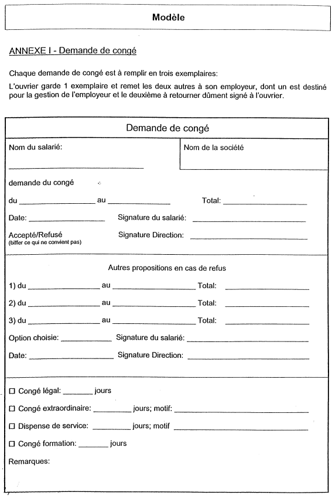

# Règlement grand-ducal du 2 octobre 2000 portant déclaration d’obligation générale de la convention collective de travail pour le métier de nettoyeur de bâtiment conclue entre les syndicats OGB-L et LCGB, d’une part et la FÉDÉRATION LUXEMBOURGEOISE DES ENTREPRISES DE NETTOYAGE, d’autre part.

Nous JEAN, par la grâce de Dieu, Grand-Duc de Luxembourg, Duc de Nassau;

Vu l’article 9 de la [loi du 12 juin 1965](https://legilux.public.lu/eli/etat/leg/loi/1965/06/12/n3/jo) concernant les conventions collectives de travail et l’article 22 modifié de l’[arrêté grand-ducal du 6 octobre 1945](https://legilux.public.lu/eli/etat/leg/agd/1945/10/06/n9/jo) ayant pour objet l’institution, les attributions et le fonctionnement d’un Office national de conciliation;

Sur proposition concordante des membres permanents et des membres spéciaux de chacune des parties représentées à la Commission paritaire de conciliation et sur avis des chambres professionnelles compétentes;

Vu l’article 2 (1) de la [loi du 12 juillet 1996](https://legilux.public.lu/eli/etat/leg/loi/1996/07/12/n3/jo) portant réforme du Conseil d’Etat et considérant qu’il y a urgence;

Sur le rapport de Notre ministre du Travail et de l’Emploi et après délibération du Gouvernement en Conseil;

Arrêtons:

## Article 1er.

La convention collective de travail pour le métier de nettoyeur de bâtiment conclue entre les syndicats OGB-L et LCGB, d’une part et la Fédération Luxembourgeoise des Entreprises de Nettoyage de Bâtiments, d’autre part, est déclarée d’obligation générale pour l’ensemble du métier pour lequel elle a été établie.

## Article 2.

Notre ministre du Travail et de l’Emploi est chargé de l’exécution du présent règlement qui sera publié au Mémorial avec la convention collective de travail prémentionnée.

Le Ministre du Travail et de l’Emploi,   François Biltgen

Palais de Luxembourg, le 2 octobre 2000.   Pour le Grand-Duc:   Son Lieutenant-Représentant   Henri   Grand-Duc héritier

FEDERATION LUXEMBOURGEOISE DES ENTREPRISES DE NETTOYAGE DE BATIMENTS

CONVENTION COLLECTIVE  applicable à partir du 1er janvier 2000

14 décembre 1999

## Chapitre I — But et champ d’application

### Article 1 — But

La présente convention collective a pour objet de régler les relations et les conditions de travail et de rémunération des ouvriers travaillant auprès d’une entreprise de nettoyage de bâtiments en vue de sauvegarder la paix sociale dans le secteur et de lutter contre le travail clandestin et la concurrence déloyale.

### **Article 2** — Champ d’application

2.1. La présente convention s’applique à toutes les entreprises de nettoyage de bâtiments luxembourgeoises ou étrangères ou toute autre société exerçant l’activité de nettoyage de bâtiments travaillant sur le territoire du Grand-Duché de Luxembourg à titre ponctuel ou continu.

2.2. La présente convention s’applique à tou(te)s les ouvriers(ères) occupé(e)s par une entreprise telle que définie sub. 2.1.

2.3. Les apprenti(e)s, dont le statut est régi par les dispositions légales en vigueur, ainsi que les étudiant(e)s occupé(e)s en qualité d’auxiliaires pendant les périodes des vacances scolaires ne sont pas réglementés par la présente convention.

2.4. Le terme d’ouvrier vise à la fois les personnes de sexe masculin et féminin.

## Chapitre II — Le contrat de travail

### Article 3 — Engagement et période d’essai

3.1. L’engagement se fera conformément aux dispositions légales en vigueur. Tout ouvrier, briguant un poste de travail, est soumis avant son embauchage à un examen médical fait par le médecin du travail.

L’examen médical d’embauchage a pour objet de déterminer si le candidat est apte ou inapte à l’occupation envisagée ou, le cas échéant, de fixer les conditions sous lesquelles il peut être déclaré apte.

3.2. Sans préjudice des dispositions spécifiques de la présente convention collective, la relation de travail est réglementée par la [loi modifiée du 24 mai 1989](https://legilux.public.lu/eli/etat/leg/loi/1989/05/24/n1/jo) sur le contrat de travail.

3.3. Conformément aux dispositions légales en vigueur, tout poste de travail doit obligatoirement être déclaré à l’Administration de l’Emploi. En cas de publication dans la presse écrite ou parlée ou par tout autre moyen de publication ou de communication, l’offre d’emploi doit être déclarée à l’Administration de l’Emploi au moins trois jours ouvrables à l’avance. Toutefois, il est loisible à l’employeur d’embaucher du personnel qui n’est pas inscrit comme demandeur d’emploi à l’Administration de l’Emploi.

3.4. L’engagement se fera par un contrat écrit en double exemplaire dont un est destiné à l’ouvrier et l’autre à l’employeur.

3.5. Les mentions à figurer dans le contrat de travail sont celles énumérées à l’article 1 de la [loi du 15 mai 1995](https://legilux.public.lu/eli/etat/leg/loi/1995/05/15/n1/jo) portant modification de la [loi du 24 mai 1989](https://legilux.public.lu/eli/etat/leg/loi/1989/05/24/n1/jo) sur le contrat de travail.

3.6. A l’engagement, chaque ouvrier reçoit un exemplaire de la convention collective et, le cas échéant, un exemplaire du règlement d’ordre intérieur.

3.7. La période d’essai

3.7.1. Les quatre premières semaines sont d’office à considérer comme période d’essai. Toutefois, il sera loisible à l’employeur et à l’ouvrier de convenir d’un commun accord une période plus longue sans pour autant pouvoir dépasser 6 mois. Par dérogation à ce principe, la période maximale d’essai pour l’ouvrier dont le niveau de formation professionnelle n’atteint pas celui du certificat d’aptitude technique et professionnel de l’enseignement technique ne pourra pas dépasser trois mois.

Dans tous les cas, la durée de la période d’essai doit être renseignée dans le contrat de travail et exprimée en semaines si elle est inférieure à 1 mois et exprimée en mois si elle est supérieure à 1 mois.

3.7.2. La période d’essai ne peut être renouvelée. En cas de suspension de l’exécution du contrat pendant, la période d’essai, cette période est prolongée d’une durée égale à celle de la suspension sans pouvoir excéder un mois.

3.7.3. Le contrat de travail peut être résilié pendant la période d’essai en respectant les formes prévues aux articles 4.1.1. et 4.1.2. et les délais de préavis suivants: Il est égal à autant de jours que la durée de l’essai convenue au contrat compte de semaines.

Il est égal à 4 jours par mois d’essai convenu au contrat sans pouvoir être inférieur à 15 jours et sans devoir excéder 1 mois.

Il ne peut être mis fin unilatéralement au contrat de travail pendant la période minimale d’essai de deux semaines, sauf pour motif grave tel que défini à l’article 27 de la [loi du 24 mai 1989](https://legilux.public.lu/eli/etat/leg/loi/1989/05/24/n1/jo) sur le contrat de travail.

3.8. Il est dans l’intérêt de l’ouvrier et de l’employeur d’offrir aux ouvriers des chances d’avancement. Les directions respectives s’engagent à examiner d’abord les possibilités de promotions internes avant de procéder au recrutement de personnel externe.

### Article 4 — Cessation de contrat

4.1. Résiliation du contrat de travail à durée indéterminée avec préavis.

La résiliation du contrat de travail pourra se faire par l’employeur et par l’ouvrier, tout en respectant les conditions définies ci-après.

4.1.1. Résiliation du contrat de travail par l’ouvrier

L’ouvrier doit résilier le contrat de travail par lettre recommandée à la poste. Toutefois, la signature apposée par l’employeur sur le double de la lettre de démission vaut accusé de réception de la notification.

4.1.2. Résiliation du contrat de travail par l’employeur

L’employeur qui décide de licencier doit, sous peine d’irrégularité pour vice de forme, notifier le licenciement à l’ouvrier par lettre recommandée à la poste. Toutefois, la signature apposée par l’ouvrier sur le double de la lettre de licenciement vaut accusé de réception de la notification.

4.2. Les délais de préavis Ancienneté de services Résiliation du contrat de travail par l’employeur Résiliation du contrat de travail par l’ouvrier < 5 années 2 mois 1 mois ≥ 5 années 4 mois 2 mois ≥10 années 6 mois 3 mois

Le délai de préavis commence à courir:

aot le quinzième jour du mois de calendrier au cours duquel la résiliation a été notifiée, lorsque la notification est antérieure à ce jour;

bot le premier jour du mois de calendrier qui suit celui au cours duquel la résiliation a été notifiée, lorsque la notification est postérieure au quatorzième jour du mois.

4.3. L’indemnité de départ

L’ouvrier lié par un contrat de travail à durée indéterminée qui est licencié par l’employeur sans que ce dernier y est autorisé par l’article 27 de la [loi du 24 mai 1989](https://legilux.public.lu/eli/etat/leg/loi/1989/05/24/n1/jo) sur le contrat de travail a droit à l’échéance du préavis à une indemnité de départ après une ancienneté de services continus de cinq années au moins auprès du même employeur lorsqu’il ne peut faire valoir des droits à une pension de vieillesse normale, la pension de vieillesse anticipée n’étant pas considérée comme pension pour les besoins de l’application du présent alinéa.

L’indemnité de départ est égale à:

aash un mois de salaire après une ancienneté de services continus de cinq ans au moins; - deux mois de salaire après une ancienneté de services continus de dix ans au moins; - trois mois de salaire après une ancienneté de services continus de quinze ans au moins.

bash six mois de salaire après une ancienneté de servies continue de 20 ans au moins.

L’employeur occupant moins de 20 salariés (total des ouvriers et des employés) peut opter dans la lettre de licenciement soit pour le versement de l’indemnité de départ visée ci-devant, soit pour la prolongation des délais de préavis visés à l’article 4.2. qui, dans ce cas, sont portés à:

cash cinq mois pour l’ouvrier justifiant auprès du même employeur d’une ancienneté de services continus de cinq années au moins;

dash huit mois pour l’ouvrier justifiant auprès du même employeur d’une ancienneté de services continus de dix années au moins;

eash neuf mois pour l’ouvrier justifiant auprès du même employeur d’une ancienneté de services continus de quinze années au moins.

4.4. La motivation du licenciement avec préavis

L’ouvrier a le droit de demander, par lettre recommandée et endéans un mois à compter de la notification du licenciement, les motifs du licenciement.

L’employeur est tenu d’énoncer avec précision, par lettre recommandée, le ou les motifs du licenciement liés à l’aptitude ou à la conduite de l’ouvrier ou fondés sur les nécessités du fonctionnement de l’entreprise, de l’établissement ou du service. Ces motifs doivent être réels et sérieux. L’énonciation des motifs par l’employeur doit intervenir par lettre recommandée au plus tard 1 mois après la notification de la lettre recommandée émanant de l’ouvrier.

4.5. Le licenciement immédiat pour motif grave

Le contrat de travail peut être résilié sans préavis ou avant l’expiration du terme pour un ou plusieurs motifs graves procédant du fait ou de la faute de l’autre partie. Tout fait ou toute faute qui rend immédiatement et définitivement impossible le maintien des relations de travail est considéré comme motif grave.

La notification de la résiliation immédiate pour motif grave doit être effectuée au moyen d’une lettre recommandée à la poste énonçant avec précision le ou les faits reprochés au salarié et les circonstances qui sont de nature à leur attribuer le caractère du motif grave. Toutefois, la signature apposée par le salarié sur le double de la lettre de licenciement vaut accusé de réception de la notification. A défaut de motivation écrite le licenciement est abusif.

Le licenciement immédiat du salarié pour motif grave doit être précédé de l’entretien préalable visé à l’article 4.6. dans les cas ou la loi le rend obligatoire.

L’employeur peut prononcer avec effet immédiat et sans autre forme la mise à pied conservatoire du salarié avec maintien des salaires, traitements, indemnités et autres avantages jusqu’au jour de la notification du licenciement.

Sous réserve des dispositions de l’article 4.6. le licenciement pour motif grave doit être notifié au plus tôt le jour qui suit la mise à pied et au plus tard huit jours après cette mise à pied.

Le ou les faits ou fautes susceptibles de justifier une résiliation pour motif grave ne peuvent être invoqués au-delà d’un délai d’un mois à compter du jour où la partie qui l’invoque en a eu connaissance à moins que ce fait n’ait donné lieu dans le mois à l’exercice de poursuites pénales.

Le délai prévu à l’alinéa qui précède n’est pas applicable lorsqu’une partie invoque un fait ou une faute antérieure à l’appui d’un nouveau fait ou d’une nouvelle faute.

4.6. L’entretien préalable au licenciement

L’employeur qui occupe 150 salariés au moins qui envisage de licencier un ouvrier, doit, avant toute décision, convoquer l’ouvrier par lettre recommandée ou par un écrit dûment certifié par récépissé en lui indiquant l’objet de la convocation. Une copie de la lettre de convocation est à adresser à la délégation principale de l’entreprise, s’il en existe, sinon à l’Inspection du Travail.

La lettre de convocation à l’entretien préalable indique la date, l’heure et le lieu de l’entretien. De même, elle doit informer l’ouvrier qu’il a le droit de se faire assister lors de l’entretien préalable par un membre du personnel de l’entreprise ou par un représentant d’une organisation syndicale représentative sur le plan national représentée au sein de la délégation du personnel de l’établissement.

L’employeur ou son représentant a le droit de se faire assister par un membre du personnel ou par un représentant d’une organisation professionnelle patronale, à condition d’en informer l’ouvrier dans la lettre de convocation.

L’employeur peut fixer le jour de l’entretien préalable au plus tôt au 2e jour ouvrable travaillé qui suit celui de l’envoi de la lettre recommandée ou de la remise contre récépissé de la convocation.

Au cours de l’entretien préalable, l’employeur ou son représentant est obligé d’indiquer le ou les motifs de la décision envisagée et de recueillir les explications de l’ouvrier ainsi que celles de la personne qui l’assiste.

Le licenciement avec préavis ou pour motif grave doit être notifié au plus tôt le jour qui suit celui de l’entretien préalable et au plus tard 8 jours après cet entretien.

Si le salarié dûment convoqué ne se présente pas, le licenciement peut être notifié au plus tôt le jour qui suit celui fixé pour l’entretien préalable et au plus tard 8 jours après le jour fixé pour l’entretien.

4.7 Dispositions complémentaires

4.7.1. La résiliation du contrat de travail de l’ouvrier de la part de l’employeur ne peut avoir lieu pendant les 26 semaines d’une incapacité de travail due à une maladie (et de 52 semaines d’une incapacité de travail due à un accident de travail) à partir du jour de survenance de l’incapacité de travail.

4.7.2. Il est loisible aux deux parties de mettre fin au contrat de travail immédiatement et de commun accord.

4.7.3. La partie, c’est-à-dire l’employeur ou l’ouvrier, qui aura mis fin au contrat à durée indéterminée sans y être autorisée par l’article 27 de la [loi du 24 mai 1989](https://legilux.public.lu/eli/etat/leg/loi/1989/05/24/n1/jo) sur le contrat de travail ou sans respecter le délai de préavis légal prévu à l’article 4.2., doit à l’autre partie une indemnité compensatoire de préavis égale à la rémunération correspondant à la durée du préavis ou, le cas échéant, à la partie de délai restant à courir.

4.7.4. Au plus tard à l’expiration du contrat, l’employeur remettra à l’ouvrier tous les documents délivrés au bureau du personnel à l’engagement, le cas échéant un certificat émis par l’Administration de l’Emploi, ainsi qu’un certificat contenant exclusivement la date de son entrée en service et celle de sa sortie, la nature de l’emploi occupé ou, le cas échéant, des emplois successivement occupés ainsi que les périodes pendant lesquelles ces emplois ont été occupés. Aucune mention tendancieuse ou défavorable à l’ouvrier ne doit figurer sur le certificat. Le paiement des salaires et indemnités dû se fera ensemble avec la remise de la carte d’impôts à la fin du contrat, mai au plus tard dans les 5 jours ouvrables.

4.7.5. Pendant la période de préavis émanant de l’employeur, l’ouvrier peut demander le congé qui lui est nécessaire pour la recherche d’un nouvel emploi sans que la durée de ce congé puisse excéder six (6) jours ouvrables pour la durée du préavis. Les heures de congé sont intégralement indemnisées à la condition que l’ouvrier licencié se soit inscrit comme demandeur d’emploi à l’Administration de l’Emploi et qu’il justifie la présentation à une offre d’emploi.

4.7.6. Le licenciement collectif pour cause économique s’effectue suivant les dispositions de la [loi du 23 juillet 1993](https://legilux.public.lu/eli/etat/leg/loi/1993/07/23/n1/jo) portant diverses mesures en faveur de l’emploi.

### Article 5 — Transfert du contrat d’entretien

5.1. En matière de transfert du contrat d’entretien, suite à une adjudication ou à la décision du client, l’obligation de transfert du contrat de travail est applicable uniquement aux chantiers qui occupent plus de 24 ouvriers.

5.2. Les principes suivants sont applicables:

a) l’entreprise qui obtient le contrat d’entretien a l’obligation de reprendre 75 % des ouvriers occupés et présents aux chantiers depuis au moins une année. L’entreprise qui perd le chantier a l’obligation de garder les ouvriers qui se trouvent au moment du transfert du contrat d’entretien notamment en congé de maladie, congé de maternité, congé parental et congé pour raisons familiales.

b) l’entreprise qui reprend le chantier n’a l’obligation de reprendre les ouvriers que si elle obtient des informations précises sur le salaire, l’ancienneté et le nombre des ouvriers qu’elle doit reprendre au moins huit jours ouvrables avant la prise de possession du chantier.

c) le repreneur a le droit de refuser le transfert du contrat de travail des ouvriers que le client refuse sur base d’une motivation claire et objective ou par d’autres motifs à justifier par le repreneur.

d) l’entreprise qui perd le chantier a le droit de garder, le cas échéant, ses ouvriers.

e) les ouvriers qui ne seront pas repris par la nouvelle entreprise continueront leur relation de travail avec son employeur.

f) les ouvriers repris par la nouvelle entreprise garderont tous leurs droits et obligations résultant de leurs contrats de travail. Ils n’ont pas le droit de refuser le transfert de leur contrat de travail

5.3. Pour une correcte application des dispositions du présent article, une Commission paritaire constituée par des représentants patronaux et des représentants syndicaux signataires de cette convention collective sera chargée de la surveillance du transfert du contrat d’entretien.

### Article 6 — Révision du contrat de travail

6.1. Toute modification en défaveur de l’ouvrier portant sur une clause essentielle du contrat de travail doit, à peine de nullité, être notifiée à l’ouvrier dans les formes et délais visés aux articles 4.1.2., 4.2. et 4.6. de la présente convention et indiquer la date à laquelle elle sort ses effets.

Dans ce cas, l’ouvrier peut demander à l’employeur les motifs de la modification et l’employeur est tenu d’énoncer ces motifs dans les formes et délais prévus à l’article 4.4. de la présente convention.

6.2. Une modification immédiate pour motif grave doit être notifiée à l’ouvrier, à peine de nullité, dans les formes et délais prévus aux articles 4.1.2., 4.2. et 4.5. de la présente convention.

6.3. La résiliation du contrat de travail découlant du refus de l’ouvrier d’accepter la modification lui notifiée constitue un licenciement susceptible du recours judiciaire visé à l’article 28 de la [loi du 24 mai 1989](https://legilux.public.lu/eli/etat/leg/loi/1989/05/24/n1/jo) sur le contrat de travail (la résiliation abusive du contrat de travail par l’employeur).

### Article 7 — La durée du travail

Dispositions générales

7.1. La durée de travail normale hebdomadaire est réglementée par la [loi modifiée du 9 décembre 1970](https://legilux.public.lu/eli/etat/leg/loi/1970/12/09/n1/jo) portant réduction et réglementation de la durée de travail des ouvriers occupés dans les secteurs public et privé de l’économie et la [loi modifiée du 26 février 1993](https://legilux.public.lu/eli/etat/leg/loi/1993/02/26/n4/jo) concernant le travail volontaire à temps partiel.

7.2. Sauf convention contraire, signée entre parties, le samedi est considéré comme jour ouvrable ouvré.

7.3. Coupures non rémunérées et pauses

7.3.1. Conformément à la [loi du 12 février 1999](https://legilux.public.lu/eli/etat/leg/loi/1999/02/12/n1/jo) concernant la mise en oeuvre du plan d’action national en faveur de l’emploi 1998, l’horaire de travail journalier ne peut être entrecoupé que d’une seule période de temps de repos non rémunérée.

7.3.2. Tout ouvrier bénéficie, dans le cas où la durée de travail journalière est supérieure à six heures, d’un temps de repos non-rémunéré de trente minutes ou minimum.

Contrat de travail à temps partiel

7.4. Toute durée normale de travail à temps partiel sera établie par contrat individuel fait en double exemplaire dont un étant destiné au salarié.

7.5. La durée normale du travail fixée au contrat de travail des ouvriers occupés à temps partiel peut, avec l’accord de l’ouvrier, être augmenté de 50% par rapport au nombre d’heures fixées par le contrat de travail, sans pouvoir dépasser le maximum de quarante heures par semaine suivant les besoins de l’entreprise sans qu’il y ait lieu de payer des heures supplémentaires.

Contrat de travail à temps plein

7.6. Aux fins de compenser les variations de l’activité, la durée hebdomadaire normale de travail des ouvriers occupés à plein temps peut varier dans le cadre d’une période de référence de 3 mois consécutifs.

7.7. La durée hebdomadaire moyenne normale de travail sur cette période ne peut pas dépasser 40 heures.

7.8. Le travail peut être réparti sur un nombre quelconque de jours sans préjudice des dispositions prévues au paragraphe suivant du présent article sans toutefois excéder 5 jours par semaine sauf accord de l’ouvrier et sans préjudice des dispositions légales en vigueur relatives au repos hebdomadaire.

7.9. L’employeur pourra en accord avec les ouvriers concernés, modifier la durée de travail sans pour autant dépasser la durée de travail journalière de 10 heures et la durée de travail hebdomadaire de 48 heures.

7.10. L’employeur doit établir un plan d’organisation de travail qui porte sur l’activité prévisible de l’entreprise sur deux semaines et qui sera remis par l’entreprise aux ouvriers concernés au plus tard le vendredi précédent la période de deux semaines. Ledit plan règle l’organisation de travail des ouvriers de l’ensemble ou de parties de l’entreprise.

7.11. Tout écart positif à la durée hebdomadaire de 40 heures est enregistré en tant que crédit d’heures qui sera compensé, pendant la période de référence de 3 mois, selon les modalités prévues aux alinéas suivants du présent article.

7.12. Le crédit d’heures, pendant la période de référence de 3 mois, ne pourra pas excéder 40 heures.

7.13. S’il est fait recours à un modèle de durée de travail tel que décrit aux paragraphes précédents, la rémunération mensuelle est calculée sur base d’une durée de travail hebdomadaire de 40 heures.

7.14. Chaque mois la fiche de salaire ou un autre document informera le salarié sur le nombre d’heures effectuées, les jours de compensation accordés et l’état de son compte-crédit d’heures.

7.15. Le crédit d’heures sera compensé par un ou plusieurs jours complets de repos à raison de 8 heures par jour en fonction du nombre d’heures totalisées.

7.16. L’employeur informera l’ouvrier sur les jours de compensation:

a) au moins de 48 heures à l’avance pour un jour de compensation;

b) au moins I semaine à l’avance pour deux jours ou plus de compensation.

7.17. Les demandes de compensation émanant des ouvriers doivent être introduites par écrit dans les délais suivants:

a) au moins 48 heures à l’avance pour un jour de compensation;

b) au moins 2 semaines à l’avance pour deux jours ou plus de compensation.

7.18. L’employeur peut refuser l’octroi des jours de compensation si les besoins du service ou les désirs justifiés d’autres salariés de l’entreprise s’y opposent.

7.19. Le crédit d’heures pourra également être compensé par une réduction de la durée journalière de travail qui ne pourra pas être inférieure à 4 heures. L’horaire réduit sera communiqué à l’ouvrier au plus tard le vendredi précédant la période de deux semaines.

7.20. Sont considérées comme heures supplémentaires et donnent lieu à la majoration de 25%:

• le crédit d’heures qui n’a pu être compensé à la fin de la période de référence de 3 mois consécutifs

• les heures dépassant la durée journalière de 10 heures et la durée hebdomadaire de 48 heures

• le travail presté au-delà des limites fixées par le plan d’organisation du travail pour la journée et/ou la semaine sauf en cas de l’accord des ouvriers concernés ou en cas d’événements imprévisibles ou en cas de force majeure. Sont notamment considérés comme événements imprévisibles les cas suivants:

aash le remplacement d’un ouvrier malade ou toute absence non autorisée d’un ouvrier

bash l’obtention d’une commande urgente ou supplémentaire après la fixation du plan d’organisation de travail.

7.21. A la fin de chaque période de référence le compte-crédit d’heures sera remis à zéro et le débit d’heures ne sera pas pris en considération.

7.22. La rémunération du crédit d’heures sera versée à la fin de la période de référence.

\*Durée de travail des jeunes travailleurs*

7.23. La durée de travail des jeunes travailleurs est réglementée par les dispositions de la [loi du 28 octobre 1969](https://legilux.public.lu/eli/etat/leg/loi/1969/10/28/n1/jo) concernant la protection des enfants et des jeunes travailleurs.

### Article 8 — Heures supplémentaires, travail de nuit et dimanche

8.1. Toutes les heures de travail effectuées au-delà de la durée normale de quarante heures par semaine sont considérées comme heures supplémentaires et doivent être rémunérées avec le supplément correspondant.

Toutefois, dans les cas prévus par la présente convention, seul le travail effectué en dehors des conditions et au-delà des limites fixées à l’article 7, doit être considéré comme travail supplémentaire. Le temps de trajet tel que défini à l’article 20.3. n’est pas considéré comme temps de travail et ne rentre pas dans la computation des heures de travail. Les prestations supplémentaires ne sont rémunérées que dans la mesure où elles ont été ordonnées et dans les limites fixées par le chef de service.

La rémunération des prestations supplémentaires se fera avec un supplément de 25%. Toutefois, les heures supplémentaires peuvent être compensées dans la mesure du possible, en remplacement du salaire majoré de 25%, par du temps de repos rémunéré, à raison d’une heure et demie de temps libre rémunéré par heure supplémentaire travaillée.

8.2. Le travail de dimanche est rémunéré avec un supplément de 70% par heure effectuée du dimanche.

8.3. Le travail des jours fériés légaux est rémunéré avec le supplément prévu par la [loi du 10 avril 1976](https://legilux.public.lu/eli/etat/leg/loi/1976/04/10/n1/jo) portant réforme de la réglementation des jours fériés légaux qui est de 100% par heure effectuée le jour férié.

8.4. Le travail de nuit régulier est à rémunérer avec une majoration du taux horaire de 15%.

## Chapitre IV — Qualification et classification

### Article 9

9\. Principes

9.1. La classification est attribuée par l’entreprise suivant la convention collective de travail.

9.2. Au cas où l’accès à la classification supérieure se fait en cours de mois, elle ne prendra effet que le premier du mois suivant.

9.3. Classification des fonctions

Groupe 1

Ouvrier(ière) Nettoyeur(euse)

Echelon 1

Travaux de nettoyage courant et régulier ne nécessitant aucune connaissance ou formation spécifique.

Listing non exhaustif des tâches

aash nettoyage général et courant des locaux;

bash dépoussiérage des sols par balayage et aspiration;

cash lavage de toute surface horizontale et verticale;

dash maintenance des abords;

eash lavage désinfectant de toutes surfaces;

fash enlèvement et évacuation des déchets;

gash approvisionnement des sanitaires;

hash lavage de la vaisselle;

iash ainsi que tout travail ne nécessitant aucune technicité particulière.

Echelon 2

Travaux de nettoyage courant et régulier ou occasionnel nécessitant une formation particulière.

Listing non exhaustif des tâches

aash shampoinnage mécanisé des revêtements textiles et tapis;

bash décapage mécanisé des sols lisses et mise en cire, entretien par spray méthode;

cash cristallisation des pierres marbrières;

dash nettoyage par produit spécifique et agréé de l’appareillage informatique;

eash biodécontamination de toutes surfaces;

fash travaux de nettoyage de sols réalisés par auto-laveuse intégrant la gestion et la maintenance complète de la machine;

gash travaux de nettoyage réalisés en zone sensible de milieu agro-alimentaire;

hash traitement antistatique des sols textiles.

Groupe 2

Laveur(euse) de vitres

Echelon 1

Nettoyage de vitreries utilisant des moyens techniques et d’accès simples à une hauteur maximale de 8 m.

Listing non exhaustif des tâches

aash lavage de toute vitrerie par raclettage

bash nettoyage, essuyage des châssis

Echelon 2

Nettoyage de vitreries nécessitant des moyens techniques particuliers à une hauteur supérieure à 8 m.

Listing non exhaustif des tâches

aash lavage de toute vitrerie et châssis par raclettage au moyen d’échelle (plus de 8 m) ou avec l’aide d’échafaudages (fixe ou mobile), de camions de nacelle, de nacelles de toit, d’une plate-forme élévatrice, d’un siège mobile et façade.

bash lavage de toute surface vitrée nécessitant l’emploi de produit de haute technicité

cash travaux de mise en état sur vitrerie et châssis après la fin du chantier

dash lavage complet de façade vitrée ou non vitrée

Groupe 3

Maîtrise

Echelon 1

Responsable technique d’une équipe de nettoyage composée de minimum 10 personnes.

aash est responsable de l’approvisionnement chantier

bash veille à l’application du programme de travail

cash est chargé de faire réceptionner les travaux par client

dash rend compte à sa direction sur les résultats qualitatifs d’exploitation

eash participe aux travaux

Echelon 2

Responsable technique et contrôle de plusieurs équipes de nettoyage dont l’effectif est supérieur à 50 personnes.

Même descriptif que sous E1) auquel s’ajoutent

aash doit être responsable de toute maîtrise classée E1

bash maintien d’un contact suivi avec le responsable client

cash est responsable de la gestion du site

dash fait assurer les règles de sécurité sur le site de travail

eash s’implique partiellement dans les travaux suivant les besoins de l’entreprise

## Chapitre V — Structures des salaires

### Article 10 — Salaires

<table>
<tr>
<td></td>
<td></td>
<td></td>
<td></td>
<td></td>
<td colspan="2">Coefficient</td>
<td>Salaire</td>
<td>Salaire horaire</td>
</tr>
<tr>
<td>10.1.</td>
<td></td>
<td><i>Groupe 1</i></td>
<td></td>
<td></td>
<td></td>
<td></td>
<td></td>
<td></td>
</tr>
<tr>
<td></td>
<td></td>
<td>Ouvrier(ière)</td>
<td>Nettoyeur(euse)</td>
<td>1er échelon</td>
<td>SSM</td>
<td>100</td>
<td>48.050</td>
<td>277,75</td>
</tr>
<tr>
<td></td>
<td></td>
<td></td>
<td></td>
<td>2e échelon</td>
<td>SSM</td>
<td>105</td>
<td>50.452</td>
<td>291,63</td>
</tr>
<tr>
<td></td>
<td></td>
<td><i>Groupe 2</i></td>
<td></td>
<td></td>
<td></td>
<td></td>
<td></td>
<td></td>
</tr>
<tr>
<td></td>
<td></td>
<td>Laveur(euse)</td>
<td></td>
<td>1er échelon</td>
<td>SSM</td>
<td>110</td>
<td>52.855</td>
<td>305,52</td>
</tr>
<tr>
<td></td>
<td></td>
<td></td>
<td></td>
<td>2e échelon</td>
<td>SSM</td>
<td>120</td>
<td>57.660</td>
<td>333,29</td>
</tr>
<tr>
<td></td>
<td></td>
<td><i>Groupe 3</i></td>
<td></td>
<td></td>
<td></td>
<td></td>
<td></td>
<td></td>
</tr>
<tr>
<td></td>
<td></td>
<td>Maîtrise</td>
<td></td>
<td>1er échelon</td>
<td>SSM</td>
<td>120</td>
<td>57.660</td>
<td>333,29</td>
</tr>
<tr>
<td></td>
<td></td>
<td></td>
<td></td>
<td>2e échelon</td>
<td>SSM</td>
<td>125</td>
<td>60.063</td>
<td>347,18</td>
</tr>
</table>

10.2. Tous les salaires payables sur la base de cette convention sont liés à l’évolution de l’indice des prix à la consommation.

10.3. L’employeur est obligé de remettre à l’ouvrier pour chaque mois un décompte exact et détaillé quant au mode de calcul du salaire exprimant la période de travail, le nombre d’heures effectuées, le salaire horaire, les majorations, les primes et tout autre émolument en espèces et en nature. Les fiches de salaire sont à rédiger de sorte que l’ouvrier puisse les contrôler.

Sur le décompte mensuel figureront aussi le nombre total de jours de congé, le nombre de congés pris et celui restant à une date bien arrêtée.

### Article 11 — Paiement des salaires

11.1. Le paiement des salaires se fait par virement ordonné par l’employeur.

11.2. Le paiement du salaire est effectué par le virement d’un acompte correspondant au 3/4 du salaire brut de base payable au 25 du mois en cours si l’ouvrier en fait la demande et d’un décompte versé le 10 et au plus tard le 15 du mois suivant. La fiche de salaire sera envoyée à la même date que le décompte.

11.3. Les erreurs éventuelles devront être rectifiées au plus tard lors du prochain décompte.

11.4. En cas de décès de l’ouvrier, l’intégralité du salaire en cours ainsi que les allocations prévues par les dispositions légales sont à payer aux ayants droit.

## Chapitre  VI — Jours fériés, congés et dispenses de service

### Article 12 — Les jours fériés légaux

12.1. La rémunération des jours fériés légaux se fait conformément aux dispositions légales y relatives.

12.2. Sont considérés comme jours fériés légaux: le Nouvel An, le Lundi de Pâques, le 1er mai, l’Ascension, le Lundi de Pentecôte, la Fête Nationale, l’Assomption, la Toussaint, Noël, et le lendemain de Noël, respectivement les jours fériés de rechange correspondants.

### Article 13 — Congé de récréation

13.1. Le congé annuel est soumis aux dispositions de la [loi du 22 avril 1966](https://legilux.public.lu/eli/etat/leg/loi/1966/04/22/n1/jo), modifiée et complétée par la [loi du 26 juillet 1975](https://legilux.public.lu/eli/etat/leg/loi/1975/07/26/n1/jo), qui fait partie intégrante de la convention.

13.2. Le congé de récréation annuel pour un travail régulier de 40 heures par semaine s’élève à vingt-cinq jours ouvrables.

13.3. Le droit au congé naît après trois mois de travail ininterrompu auprès du même employeur.

13.4. La demande de congé pour l’année de calendrier doit être introduite moyennant un formulaire approprié (voir modèle de l’annexe I) jusqu’au 31 mars au plus tard. Une réponse doit être soumise à l’ouvrier jusqu’au 31 mai.

13.5. Le congé doit être pris obligatoirement jusqu’au 31 mars de l’année suivante sauf arrangement écrit contraire entre parties.

### Article 14 — Congé extraordinaire

Le salarié a droit à un congé extraordinaire de:

a) 1 jour pour le décès de grands-parents de part et d’autre, des petits-enfants, d’un frère, d’une soeur, beau-frère, belle-soeur;

b) 2 jours pour la naissance d’un enfant légalement reconnu, le mariage d’un enfant, le déménagement (un simple changement de logis n’est pas à assimiler à un déménagement) et en cas d’accueil d’un enfant de moins de 16 ans en vue de son adoption, sauf si l’ouvrier est bénéficiaire du congé d’accueil en cas d’adoption.

c) 3 jours pour le décès du conjoint, des parents, enfants, beaux-parents, gendre, belle-fille.

d) 6 jours pour le mariage du salarié.

### Article 15 — La protection de la maternité de la femme au travail

15.1. A l’accouchement respectivement la reconnaissance d’un enfant, l’ouvrier a droit à un congé d’éducation dit «baby-years». Dans ce cas, l’ouvrier a la priorité de réemploi pendant une période d’un an maximum.

15.2. Cette disposition implique que la réembauche devra se faire à un poste de qualification similaire à celui occupé précédemment et avec maintien de la même rémunération.

### Article 16 — Interruption du travail et dispense de service

16.1. Si l’ouvrier est victime d’un accident de travail entraînant une incapacité de travail, il a droit au paiement de la journée de l’accident excepté si les heures concernées sont prises en charge par l’assurance-accident.

16.2. En cas de sauvetage et de transport d’une personne accidentée dans l’entreprise, ainsi que lors de manifestations locales en rapport avec des accidents dans l’entreprise, le manque à gagner de la journée est indemnisé.

### Article 17 — Formation professionnelle

17.1. En application de l’article V de la [loi modifiée du 12 juin 1965](https://legilux.public.lu/eli/etat/leg/loi/1965/06/12/n3/jo) concernant les conventions collectives de travail, si l’entreprise dispose d’un plan de formation, celui-ci prévoit les conditions d’accès aux mesures de formation continue pour les ouvriers absents en raison d’une interruption de carrière du fait notamment d’une maternité, d’une mesure de formation ou d’un congé sabbatique.

Le cas échéant, les modalités de l’accès à ces mesures de formation sont déterminées par des accords avec la délégation du personnel ou, à défaut, le personnel concerné.

17.2. En application de l’article V de la [loi modifiée du 12 juin 1965](https://legilux.public.lu/eli/etat/leg/loi/1965/06/12/n3/jo) concernant les conventions collectives de travail, les signataires de la présente s’engagent à favoriser les lignes directrices du Plan d’Action National en Faveur de l’Emploi en ce qui concerne la politique de formation, l’insertion des chômeurs et le développement des possibilités de formation tout au long de la vie. A cet effet, elles analyseront les mesures ainsi créées et feront, le cas échéant, des propositions de développement de mesures nouvelles.

Le résultat de cette analyse est reproduit en annexe de la convention collective.

17.3. L’employeur accorde aux délégués titulaires du personnel un dit congé de formation sans perte de rémunération pour participer aux activités de formation professionnelle organisées par les organisations syndicales, les Chambres Professionnelles, l’Ecole Supérieure du Travail (EST), l’Office Luxembourgeois pour l’Accroissement de la Productivité (OLAP) et autres et visant au perfectionnement de leurs connaissances économiques, sociales et techniques dans leur rôle de représentants de travailleurs.

Ce congé est mis en compte suivant l’article 26 de la [loi des délégations du personnel du 18 mai 1979](https://legilux.public.lu/eli/etat/leg/loi/1979/05/18/n1/jo).

## Chapitre VII — Maladie

### Article 18 — Maladie

18.1. L’ouvrier incapable de travailler pour cause de maladie ou d’accident et en cas de prolongation de l’incapacité, est obligé d’en informer le bureau du personnel le jour même de son incapacité et ce avant le commencement du travail sauf en cas de force majeure (p.ex.: accident de trajet).

Le 3e jour de son absence au plus tard, l’ouvrier est obligé de remettre à son employeur un certificat médical attestant son incapacité de travail et sa durée prévisible.

18.2. L’employeur est tenu d’avancer, pour compte de l’assurance maladie, l’indemnité pécuniaire de maladie se rapportant au mois de calendrier de la survenance de l’incapacité de travail et aux trois mois subséquents. L’indemnité pécuniaire de maladie est calculée par référence à la rémunération brute que l’ouvrier aurait gagnée en cas de continuation du travail pendant le congé de maladie. Dans le cas où l’employeur ne peut pas se baser sur les heures prestées, la rémunération de référence est établie sur la moyenne des salaires touchés pendant les trois mois de calendrier précédant la survenance de l’incapacité de travail.

18.3. Si l’ouvrier reprend son travail après une absence ininterrompue de plus de six semaines pour cause de maladie ou d’accident, l’employeur est tenu d’en avertir le médecin du travail. Le médecin peut soumettre le travailleur à un examen médical ayant pour but d’apprécier son aptitude à reprendre son ancien emploi ou de déterminer l’opportunité d’une mutation, d’une réadaptation ou d’une adaptation du poste de travail.

## Chapitre VIII — Avantages spéciaux

### Article 19 — Prime pour travaux pénibles, dangereux et insalubres

19.1. Une prime pour travaux pénibles, dangereux et insalubres de 50,- LUF (indice: 562,68) par heure est payée aux ouvriers pour les travaux suivants:

a) Vidage et nettoyage de fonds de greniers, de caves et de dépôts

b) Nettoyage lors duquel les ouvriers doivent porter un équipement spécial du fait qu’ils sont exposés à l’inhalation de poussières, de vapeur, fumées ou autres

c) Nettoyage suite à un incendie ou une inondation

19.2. La prime est payable avec le décompte du mois concerné.

### Article 20 — Déplacements

20.1. L’occupation de l’ouvrier ne se limite pas à un chantier fixe. L’ouvrier pourra être affecté avec motivation écrite à un autre lieu de travail au Grand-Duché de Luxembourg ou dans la région frontalière suivant les besoins de l’entreprise.

20.2. Pour tous les déplacements exceptionnels de l’ouvrier du siège de l’entreprise vers le lieu de travail ou d’un chantier à un autre dans sa voiture personnelle et sur demande écrite de l’employeur, il sera payé une indemnité de 8,- LUF par kilomètre parcouru.

La fédération mettra à disposition de ses membres un formulaire type pour demander à l’ouvrier de se déplacer, le cas échéant, avec sa voiture personnelle.

20.3. Si, à la demande écrite de l’employeur, l’ouvrier transporte des collègues de travail avec sa voiture personnelle, outre l’indemnité kilométrique, l’ouvrier a droit au paiement du temps de voyage comme temps de travail non productif sans que pour autant ces heures ne soient mises au compte pour le calcul des heures supplémentaires.

### Article 21 — Prime de fin d’année

21.1. Les parties signataires de la présente convention s’engagent à entamer les négociations sur l’introduction éventuelle d’une prime de fin d’année qui entrera, le cas échéant, en vigueur à une date à déterminer d’un commun accord.

## Chapitre IX — Autres conventions

### Article 22 — Egalité entre hommes et femmes

22.1. Conformément à la [loi du 8 décembre 1981](https://legilux.public.lu/eli/etat/leg/loi/1981/12/08/n1/jo) relative à l’égalité de traitement entre hommes et femmes, l’employeur assurera l’égalité de traitement en matière de conditions d’accès à l’emploi, à la formation et à la promotion professionnelle.

22.2. De même, l’employeur est tenu d’assurer, pour un même travail ou un travail de valeur égale, l’égalité de rémunération entre les hommes et les femmes.

22.3. Conformément à la [loi du 7 juillet 1998](https://legilux.public.lu/eli/etat/leg/loi/1998/07/07/n1/jo) modifiant la [loi du 18 mai 1979](https://legilux.public.lu/eli/etat/leg/loi/1979/05/18/n1/jo) portant réforme des délégations du personnel, chaque délégation désigne immédiatement après son entrée en fonctions parmi ses membres et pour la durée de son mandat, un(e) délégué(e) à l’égalité.

### Article 23 — Sécurité et santé, vêtements de travail

23.1. Sécurité et santé

23.1.1. Les dispositions concernant la sécurité et santé au travail sont définies par la [loi du 17 juin 1994](https://legilux.public.lu/eli/etat/leg/loi/1994/06/17/n3/jo) concernant la sécurité et la santé des travailleurs au travail.

23.1.2. L’employeur est obligé d’observer les prescriptions relatives à la prévention d’accidents et à la protection de la santé. A cet effet, il mettra à disposition des ouvriers tout le matériel et les vêtements requis.

23.1.3. La première maxime à respecter sera toujours de garantir un travail sans accident et sain, conformément aux dispositions y relatives.

23.1.4. L’ouvrier est obligé d’utiliser l’équipement mis à sa disposition et de respecter toutes les consignes de sécurité et les modes d’emploi des machines et produits qu’il utilise.

23.1.5. En cas d’accident de travail, l’employeur ou son remplaçant et le délégué à la sécurité doivent en être avisés immédiatement, afin que toutes les dispositions puissent être immédiatement prises. L’employeur doit établir et communiquer dans les meilleurs délais à l’inspection du Travail et des Mines, des rapports concernant les accidents de travail dont ont été victimes ses travailleurs.

Lors de l’établissement de la déclaration d’accident, l’ouvrier accidenté doit apporter son concours afin que ladite déclaration puisse se faire le plus vite possible.

23.1.6. Les ouvriers qui, à la suite d’un accident ou d’une maladie ne peuvent plus remplir leurs postes antérieurs parce qu’ils ne sont plus capables d’un plein rendement, seront affectés, dans la mesure du possible, à un travail correspondant à leurs capacités intellectuelles et physiques.

23.2. Vêtements de travail

23.2.1. L’ouvrier est obligé de porter les vêtements de travail mis gratuitement à disposition par l’employeur. Ces vêtements seront échangés au fur et à mesure de leur usure normale et entretenus au bon soin de l’ouvrier. Au cas où l’ouvrier quitte l’entreprise sans rendre le vêtement de travail, le montant équivalent à cette fourniture lui sera retiré du salaire.

## Chapitre X — Dispositions finales

### Article 24 — Règlements intérieurs

24.1. Les dispositions des différents règlements intérieurs ne doivent pas être en contradiction avec celles du présent contrat. Des conventions particulières, contraires à l’esprit du présent contrat ou qui seraient moins favorables sont inadmissibles.

24.2. Les règlements intérieurs sont affichés aux entrées principales de l’établissement.

### Article 25 — Durée et résiliation de la convention collective

25.1. La présente convention entre en application à partir du ler janvier 2000.

25.2. La présente convention est conclue pour une durée de 3 ans et pourra être dénoncée dans son ensemble ou partiellement moyennant un préavis de 3 mois.

25.3. Au cas où la présente convention est dénoncée, les parties s’engagent à entamer les négociations au plus tard 3 mois avant l’arrivée à terme de la présente. La partie qui propose un renouvellement ou une modification de la présente convention doit formuler ses propositions par écrit à l’autre partie.

25.4. Pendant les négociations en vue de la conclusion d’une nouvelle convention collective, la présente convention reste en vigueur. Elle cesse ses effets uniquement à partir de la date où une non-conciliation est prononcée.

### Article 26 — Dispositions finales

26.1. Les avantages extra-légaux acquis par l’ouvrier avant la mise en vigueur de la présente convention ne peuvent être abrogés à l’égard de l’ouvrier.

26.2. L’annexe I à cette convention fait partie intégrante.

Fait à Luxembourg, le 14 décembre 1999.

|  | Pour la FEDERATION LUXEMBOURGEOISE DES | Pour les syndicats: |  |
|---|---|---|---|
|  | ENTREPRISES DE NETTOYAGE DE BATIMENTS: | OGB-L |  |
|  | *Le président,* Jos. *Nosbusch* | Eduardo *Dias* |  |
|  | *Le membre,* | LCGB |  |
|  | Mireille *Schroeder-Meyers* | Paul *De Araujo* |  |

