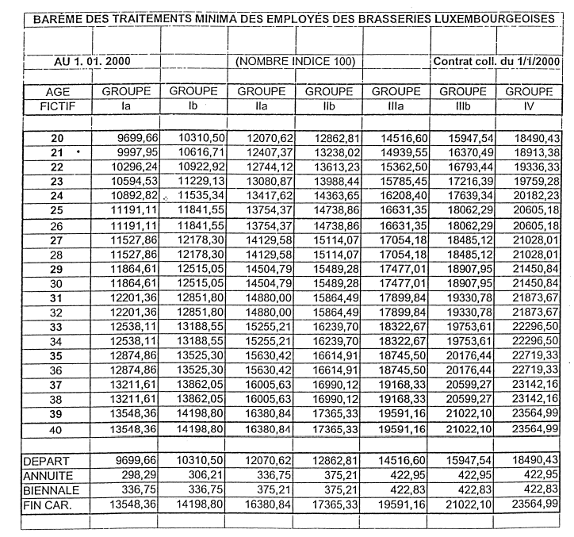

# Règlement grand-ducal du 2 octobre 2000 portant déclaration d'obligation générale de la convention collective de travail pour les employés des brasseries luxembourgeoises conclue entre les syndicats OGB-L et LCGB, d'une part et la FEDERATION DES BRASSEURS LUXEMBOURGEOIS, d'autre part.

Nous JEAN, par la grâce de Dieu, Grand-Duc de Luxembourg, Duc de Nassau;

Vu l’article 9 de la [loi du 12 juin 1965](https://legilux.public.lu/eli/etat/leg/loi/1965/06/12/n3/jo) concernant les conventions collectives de travail et l’article 22 modifié de l’[arrêté grand-ducal du 6 octobre 1945](https://legilux.public.lu/eli/etat/leg/agd/1945/10/06/n9/jo) ayant pour objet l’institution, les attributions et le fonctionnement d’un Office national de conciliation;

Sur proposition concordante des membres permanents et des membres spéciaux de chacune des parties représentées à la Commission paritaire de conciliation et sur avis des chambres professionnelles compétentes;

Vu l’article 2 (1) de la [loi du 12 juillet 1996](https://legilux.public.lu/eli/etat/leg/loi/1996/07/12/n3/jo) portant réforme du Conseil d’Etat et considérant qu’il y a urgence;

Sur le rapport de Notre ministre du Travail et de l’Emploi et après délibération du Gouvernement en Conseil;

Arrêtons:

## Art. 1er.

La convention collective de travail pour les employés des brasseries luxembourgeoises conclue entre les syndicats OGB-L et LCGB, d’une part et la Fédération des Brasseurs Luxembourgeois, d’autre part, est déclarée d’obligation générale pour l’ensemble de la profession pour laquelle elle a été établie.

## Art. 2.

Notre ministre du Travail et de l’Emploi est chargé de l’exécution du présent règlement qui sera publié au Mémorial avec la convention collective de travail prémentionnée.

Le Ministre du Travail et de l’Emploi,   François Biltgen

Palais de Luxembourg, le 2 octobre 2000.   Pour le Grand-Duc: Son Lieutenant-Représentant   Henri   Grand-Duc héritier

CONVENTION COLLECTIVE DU 1er JANVIER 2000 APPLICABLE  AUX EMPLOYES DES BRASSERIES LUXEMBOURGEOISES

La Fédération des Brasseurs Luxembourgeois, d’une part,

et les syndicats OGB-L et LCGB, d’autre part,

ont élaboré un texte d’une nouvelle convention collective applicable aux employés travaillant de façon permanente dans les brasseries luxembourgeoises.

Dans leurs discussions et au cours de leurs négociations, les partis ont analysé les points suivants et sont arrivés aux conclusions suivantes:

\**1) Organisation du travail**

Les partis ont convenu d’adapter les dispositions de la Convention collective de travail concernant l’organisation du travail et plus particulièrement la période de référence en accord avec les dispositions de la [loi du 12 février 1999](https://legilux.public.lu/eli/etat/leg/loi/1999/02/12/n1/jo) concernant la mise en oeuvre du Plan d’Action National en faveur de l’Emploi 1998 (PAN).

\**2) Politique de formation et insertion professionnelle**

Le sujet de la formation a fait l’objet de discussions entre les partenaires sociaux. Les partenaires sociaux ont convenu que des actions de formation pour les employés des brasseries luxembourgeoises pourront être entreprises. Le contenu et la durée de ces actions de formation seront déterminés au cas le cas.

Concernant les mesures de formation continue pour les salariés absents en raison d’une interruption de carrière, il a été convenu que ces derniers feront l’objet d’un encadrement dont la durée et les mesures d’application concrètes sont fonction de la complexité du poste à pourvoir et de la durée de l’interruption de l’activité professionnelle du salarié concerné.

Pour ce qui est des mesures d’insertion de demandeurs d’emploi dans les entreprises couvertes par la Convention collective, les brasseries vont essayer d’avoir recours, dans la mesure du possible, à des demandeurs d’emploi résidents lors de leurs actions de recrutement de personnel nouveau.

\**3) Egalité de traitement entre hommes et femmes**

Les partis ont constaté que les dispositions contractuelles concernant l’accès à l’emploi, les conditions de rémunération, etc., garantissent l’égalité de traitement entre hommes et femmes.

A côté des sujets de discussion et de négociation susmentionnés, des modifications et améliorations ont été retenues. Un texte coordonné applicable à partir du 1er janvier 2000 à l’ensemble du personnel employé occupé dans les brasseries luxembourgeoises a été élaboré qui prend la teneur suivante:

CONVENTION COLLECTIVE DU 1er JANVIER 2000 APPLICABLE  AUX EMPLOYES DES BRASSERIES LUXEMBOURGEOISES

\**CHAMP D’APPLICATION**

## Article 1

La présente convention règle les relations et les conditions générales de travail entre les brasseries luxembourgeoises, membres de la Fédération des Brasseurs Luxembourgeois, et les employés travaillant pour leur compte de façon permanente.

## Article 2

Conformément à l’article 5, alinéa 2, de la [loi du 12 juin 1965](https://legilux.public.lu/eli/etat/leg/loi/1965/06/12/n3/jo), les conditions de travail et de rémunération des employés appartenant aux cadres supérieurs ne sont pas réglementées par la présente convention. Il en est de même pour les employés rémunérés entièrement ou partiellement sur commission.

\**DUREE - DENONCIATION**

## Article 3

La présente convention est conclue pour une durée de deux ans. La convention se poursuivra par tacite reconduction d’année en année, sauf préavis de l’une ou l’autre des parties donné par lettre recommandée trois mois avant son échéance.

En cas de dénonciation, la convention restera en vigueur jusqu’à la signature d’une nouvelle convention entre les parties contractantes. Dans ce cas, les parties contractantes devront, en vue de la fixation des nouvelles stipulations, entrer en négociation six semaines avant que la convention originaire ne vienne à échéance.

La partie qui dénoncera la convention devra joindre à sa lettre de dénonciation un nouveau projet de convention sur les points sujets à révision.

\**EMBAUCHAGE**

## Article 4

Le contrat de louage de service entre employeurs et employés soit à durée déterminée, soit à durée indéterminée, soit à l’essai, doit être conclu par écrit.

Le contrat doit être passé en double exemplaire, dont le premier est destiné à l’employeur, le deuxième à l’employé, et spécifier:

a) la nature de l’emploi et les caractéristiques du travail à exécuter

b) la durée du contrat ou l’indication qu’il est conclu, soit pour une durée indéterminée, soit à l’essai

c) le traitement de début

d) les clauses dérogatoires ou complémentaires dont les parties auront convenu

e) la classification dans le barème de la présente convention.

Lors de son entrée dans l’établissement, toute personne embauchée reçoit un exemplaire de la convention collective.

\**PERIODE D’ESSAI**

## Article 5

L’engagement à l’essai d’un employé sera réglé selon les dispositions de l’article 34 de la [loi du 24 mai 1989](https://legilux.public.lu/eli/etat/leg/loi/1989/05/24/n1/jo) sur le contrat de travail.

\**CESSATION DU CONTRAT**

## Article 6

La cessation ou la résiliation du contrat se fera conformément aux dispositions légales en vigueur. L’employeur qui a mis fin au contrat définitif de louage en informera sans délai la délégation des employés respectivement son Président ou Secrétaire.

1\) Par ailleurs, il a été convenu de prévoir pour des cas de rigueur, c’est-à-dire la dénonciation de contrats d’employés de plus de 50 ans, que la délégation du personnel employés en référera à la direction pour trouver avec cette dernière la meilleure solution à des cas d’espèce.

2\) De prévoir, pour des cas de rigueur, par exemple lors d’une nécessité de dégagement du personnel touchant des employés âgés, des consultations entre direction et délégation de la brasserie concernée en vue d’une indemnité de départ supplémentaire éventuelle.

\**DUREE DE TRAVAIL**

## Article 7

En dehors des situations visées à l’article 6 de la [loi modifiée du 12 novembre 1971](https://legilux.public.lu/eli/etat/leg/loi/1971/11/12/n1/jo) comprenant les lois portant règlement légal du louage de service des employés privés, la durée hebdomadaire normale de travail est de 40 heures, réparties sur 5 jours de travail (lundi au vendredi).

Afin de tenir compte des spécificités du secteur et de la diversité des entreprises du secteur, la semaine de 40 heures peut être modifiée. Il en résulte, en principe, une augmentation du nombre des heures de travail à prester pendant les mois d’été et une diminution du nombre d’heures à prester pendant les mois d’hiver.

La durée de travail peut être calculée sur base d’une période de référence allant de quatre semaines à une année et est en moyenne de quarante (40) heures par semaine. Les périodes de référence dans les différentes brasseries feront l’objet d’accords subordonnés à conclure dans les entreprises entre les différentes directions et les syndicats contractants. Ces accords seront annexés à la présente convention collective et feront partie intégrante de celle-ci.

Les modalités de l’établissement des plans d’organisation du travail sont réglées par les accords annexés. Les différents plans d’organisation du travail (en abréviation «POT») sont élaborés par la direction et sont soumis à la délégation du personnel au moins cinq (5) jours avant le début de la période couverte par le POT.

Il peut être travaillé plus que quarante (40) heures par semaine, toutefois la durée du travail maximale ne pourra pas dépasser dix (10) heures par jour ni quarante-huit (48) heures par semaine.

Les heures supplémentaires peuvent être

aash payées avec une majoration du salaire de 50% (cinquante), ou,

bash dans la mesure du possible, compensées par du temps de repos rémunéré à raison d’une heure et demie de temps libre par heure supplémentaire travaillée, ou,

cash rétribuées par une forme mixte de ces deux premières formules.

Les heures de repos sont, en accord avec l’employeur, à compenser avant la fin de la période de référence.

Sont à considérer comme heures supplémentaires:

aash les heures prestées en dehors du POT, sauf si ces heures ont été prestées en cas d’événements imprévisibles ou en cas de force majeure;

bash en cas d’événements imprévisibles ou en cas de force majeure, les prestations d ‘heures de travail au-delà de dix (10) heures/jour, quarante-huit (48) heures/semaine ou quarante (40) heures en moyenne à la fin de la période de référence.

En cas d’événements imprévisibles et en cas de force majeure, le POT peut être modifié à bref délai dans le respect des règles légales. Les heures de travail prestées au-delà du POT initial dans la mesure où elles n’excèdent pas dix (10) heures par jour et quarante-huit (48) par semaine, peuvent être compensées à l’intérieur de la période de référence et ne sont ainsi pas à considérer comme heures supplémentaires.

Les travaux à exécuter sur un samedi, sont réglés auparavant entre la direction et la délégation du personnel. Les majorations éventuelles sur les salaires sont définies entre la direction et la délégation du personnel.

Le(s) congé(s) collectif(s) est/sont en principe fixé(s) au début de l’année ensemble avec la délégation du personnel. En cas de nécessité toutefois, des changements pourront être appliqués en cours d’année.

Sont considérés comme jours fériés le Nouvel An, le Lundi de Pâques, le 1er Mai, l’Ascension, le Lundi de Pentecôte, la Fête Nationale, l’Assomption, la Toussaint, le Jour de Noël et la St. Etienne.

Pour ce qui est du Jour des Morts, ce jour n’est dû en tant que jour libre que lorsqu’il tombe un jour ouvrable, c’est à-dire qu’il n’est pas dû s’il tombe sur un samedi, un dimanche.

Sont accordés comme jours fériés:

aash le lundi de la fête locale ou bien de la localité du site de la brasserie ou bien de celle du domicile de l’employé. Si ce jour est déjà férié, il convient de fixer un autre jour après accord entre la direction et la délégation.

bash le lundi de Carnaval.

Cependant, il a été convenu entre les partenaires sociaux que le lundi de la fête locale et le lundi de Carnaval ne trouveront application qu’aussi longtemps que le législateur n’aura pas augmenté la durée légale du congé annuel de récréation.

D’autre part, il a été convenu de recommander aux directions et délégations des employés des brasseries de discuter des possibilités - adaptées aux conditions particulières de chaque brasserie - quant à l’introduction éventuelle d’un système d’horaire mobile.

## **Article 7B** - — Service permanence

Afin de procéder aux interventions nécessaires aux installations et équipements et afin de garantir la commercialisation des produits de la brasserie pendant les ‘week-end’, un service de permanence est introduit dans les brasseries. Cette permanence est à organiser et les modalités d’application sont à régler entre direction et délégation du personnel.

Par service de permanence on entend la possibilité pour le service du personnel de pouvoir joindre une ou plusieurs personnes qui devront se rendre dans les plus brefs délais à leur poste de travail.

Le service de permanence est organisé hebdomadairement par le service du personnel.

La rémunération forfaitaire est arrêtée entre la direction et la délégation du personnel.

Par ailleurs, les heures effectivement prestées sont à rémunérer. En outre, les particularités du travail du dimanche, des jours fériés et de nuit et le temps de déplacement vers le lieu de travail sont à considérer.

\**TRAVAIL SUPPLEMENTAIRE**

## Article 8

L’employeur ne peut demander des prestations d’heures supplémentaires que conformément aux dispositions légales en vigueur.

\**CONGE ANNUEL**

## Article 9

L’employé a droit à un congé annuel selon les prescriptions légales.

La durée du congé est de vingt-six (26) jours. Un (1) jour de congé supplémentaire est accordé après vingt (20) années d’ancienneté auprès de la même brasserie.

Un report du congé sur l’année suivante n’est autorisé que jusqu’au 31 mars de l’année suivant celle pour laquelle le congé est dû. La date du congé doit être fixée de commun accord avec la direction, qui tiendra compte dans la mesure du possible des désirs des employés.

Les brasseries se déclarent d’accord pour accorder le congé entier à celui qui quitte l’entreprise et cesse définitivement ses activités professionnelles pour cause d’accident, invalidité, retraite, si la fin de la relation de travail se situe après le 31 mars de l’année en cours.

Cependant, l’intéressé doit encore avoir été au service actif de son employeur (brasserie) au 31 décembre de l’année précédente.

\**CONGE EXTRAORDINAIRE**

## Article 10

L’employé, obligé de s’absenter de son travail pour des raisons d’ordre personnel, aura droit à un congé extraordinaire fixé à:

aash selon usage, pour les donneurs de sang, à fixer avec la délégation de l’entreprise;

bash un jour pour le décès d’un parent ou allié au deuxième degré;

cash deux jours pour le père en cas de naissance d’un enfant légitime ou naturel reconnu, le mariage d’un enfant, en cas de déménagement (le simple changement de logis n’est pas à considérer comme déménagement);

dash trois jours pour le décès du conjoint ou d’un parent ou allié du premier degré;

eash six jours pour le mariage de l’employé, le tout avec pleine conservation de sa rémunération;

fash les parents ou alliés du deuxième degré sont les suivants:

aash les grands-pères et grands-mères alliés;

bash les petits-fils et petites-filles, parents ou alliés;

cash les frères et soeurs, beaux-frères et belles-soeurs.

\**OBLIGATIONS DES EMPLOYES**

## Article 11

Les employés s’obligent à consacrer leur activité professionnelle, leur savoir et leurs capacités entièrement au service de leur patron. Ils doivent se tenir strictement aux heures de service prévues et respecter les instructions émanant de leurs préposés hiérarchiques.

Ils sont soumis à la stricte observation du secret professionnel.

Ils ne peuvent avoir d’emploi ou d’occupation rémunérée en dehors de la brasserie sans en informer préalablement la direction de celle-ci, qui appréciera, après consultation de la délégation des employés, si cette activité est compatible ou non avec la profession d’employé de brasserie.

\**CLASSIFICATION DES EMPLOYES**

## Article 12

Le personnel des brasseries est divisé en quatre groupes. Les critères de classification sont repris dans l’annexe I.

La notion des études accomplies n’intervient que comme élément d’appréciation au début de la carrière, en l’absence des autres facteurs composant le critère de chacun des groupes.

Lorsqu’il y a cumul de fonctions d’une façon permanente, c’est la fonction supérieure exercée en ordre principal qui détermine la classification. Lorsque ce cumul ne se présente qu’accessoirement ou passagèrement et n’excède pas la durée d’un an, c’est la fonction - exercée en ordre principal qui détermine la classification.

Lors de la mise en application de la présente convention, chaque employé est informé dans quel groupe et dans quel échelon il a été classé. Toute modification ultérieure de ce classement lui sera communiquée sans délai.

Chaque employé ayant travaillé pendant 5 ans au Groupe Ib) peut accéder au Groupe IIa), à condition qu’il n’y ait pas plus de deux remarques écrites négatives concernant ses aptitudes professionnelles - lui notifiées par écrit - dans son dossier personnel.

## Article 13

La présente convention collective assure le principe de l’égalité de rémunération, c’est-à-dire que les dispositions y prévues et notamment les taux de traitement s’appliquent sans discrimination du sexe pour des prestations identiques.

\**REMUNERATION DU TRAVAIL**

## Article 14

La rémunération mensuelle de l’employé comprend d’une façon générale:

1\) Le traitement de base découlant de sa classification dans le barème des traitements

2\) La prime de ménage qui est due.

Le traitement de base peut être majoré selon le mérite de l’employé.

Les dispositions figurant au tableau de l’annexe II ont pour objet de déterminer les rémunérations minima des employés masculins et féminins tombant sous la classification prévue dans l’annexe I.

Toutes les rémunérations y figurant sont établies sur la base du nombre indice 100 et représentent des traitements mensuels minima, la prime de ménage prévue n’y étant pas comprise.

Tous les traitements ainsi que la prime de ménage suivent les variations du nombre indice d’après le régime applicable aux traitements des fonctionnaires publics.

3\) Tout employé qui perçoit une rente d’invalidité permanente et qui est obligé de mettre entièrement fin à ses activités professionnelles ainsi que tout employé ayant atteint l’âge de la retraite, et qui prend sa retraite conformément aux dispositions légales, bénéficiera pour chaque année pendant laquelle il a travaillé dans la même brasserie, d’une prime de 1.100,- LUF.

Cette prime n’est pas payable à celui qui continue à travailler dans l’entreprise au-delà de 65 ans.

Lors du décès de l’employé avant l’âge légal de la retraite, le paiement de cette prime s’effectuera en faveur de la veuve (du veuf), de l’(des) enfant(s), du (des) parent(s), respectivement du (des) frère(s) et de la (des) soeur(s).

Dans les brasseries accordant une pension complémentaire à leurs employés, la prise en compte ou non de cette prime est à discuter entre direction et délégation.

## Article 15

1\) A titre de compensation pour l’abolition de certains automatismes dans l’augmentation des salaires suivant l’âge et l’ancienneté de service contenue dans l’ancienne convention collective de travail, il est alloué aux salariés engagés avant le 1er janvier 2000, au moment où ces derniers ont atteint l’âge fictif de 40 ans, une augmentation de salaire unique et forfaitaire de:

aash 5% pour les employés, qui au 1er janvier 2000, gagnent entre 54.000,- et 84.999,- LUF

bash 3% pour les employés, qui au 1er janvier 2000, gagnent entre 85.000,- et 129.999,- LUF

cash 2% pour les employés, qui au 1er janvier 2000, gagnent entre 130.000,- et 163.000,- LUF

Cette disposition ne s’applique que pour les employés qui, au 1er janvier 2000, n’ont pas encore atteint l’âge fictif de 60 ans suivant l’ancien système.

2\) Les traitements mensuels individuels subiront une augmentation linéaire de:

a) 519,- LUF (indice 562,38) à partir du 1er janvier 2000

b) 865,- LUF (indice 562,38) à partir du 1er janvier 2001.

Le nouveau barème applicable à tous les employés des brasseries, tenant compte de l’augmentation à partir du 1er janvier 2000 dont mention sub. 2) et de l’abolition de certains automatismes dont mention sub. 1), figure à l’annexe II.

## Article 16

1\) Est à considérer comme employé adulte tout salarié ayant atteint l’âge de 18 ans accomplis et qui est entièrement apte à tout travail normal.

Par rapport aux travailleurs adultes, les jeunes travailleurs exécutant des travaux de même nature bénéficient des taux minima suivants. de 17 à 18 ans: 80% de 16 à 17 ans: 70% de 15 à 16 ans: 60%.

2\) Lorsqu’un employé est engagé après l’âge de début de carrière, il est tenu compte pour le calcul de son traitement initial de la différence entre son âge réel et l’âge de début de carrière. Cette différence lui est bonifiée comme ancienneté de service:

a) pour la totalité du temps passé au service d’une brasserie

b) pour la moitié du temps passé ailleurs qu’au service d’une brasserie

La bonification d’ancienneté de service ne peut dépasser 12 ans.

3\) L’échéance pour le paiement des annuités est fixée au 1er janvier de chaque année. Les biennales échoient au 1er janvier des années paires.

Pour le mode de calcul, qui est à convenir entre l’employeur et ses employés, il est tenu compte, lors de la première fixation, du laps de temps écoulé entre la date d’entrée en service et la première échéance.

4\) L’employeur, en application de mesures disciplinaires individuelles et exceptionnelles, peut suspendre une majoration annuelle ou biennale. La Direction informera l’intéressé et le Président de la Délégation des employés des causes exactes de ces mesures.

5\) L’employé dont le traitement avant la mise en vigueur de la convention est supérieur à celui prévu par le barème minimum ci-devant établi, bénéficiera à l’avenir des annuités et biennales du groupe dans lequel il est classé jusqu’à ce qu’il ait atteint le plafond.

\**PRIME DE MENAGE**

## Article 17

Il est alloué aux employés mariés et aux employés veufs de l’un ou l’autre sexe une prime de ménage qui s’élève à 1.250,- LUF (nombre indice 100).

Les employés célibataires âgés de 28 ans au moins touchent 60% de cette prime.

La prime de ménage est due à partir du premier jour du mois pendant lequel le mariage a été contracté et, en ce qui concerne les célibataires, à partir du premier jour du mois pendant lequel l’âge de 28 ans est atteint.

Avec l’introduction de la prime de ménage toutes autres primes généralement quelconques payées par les brasseries se trouvent supprimées.

\**TREIZIEME MOIS**

## Article 18

L’employé aura droit à une allocation dite de «treizième mois» dont le montant ne peut être inférieur au traitement que l’employeur doit à l’employé pour le dernier mois de l’année. Elle est payable suivant les usages établis.

Lorsqu’un employé quitte son patron au courant de l’année, il touchera autant de douzièmes qu’il aura travaillé de mois durant l’année en cours.

En cas d’entrée en retraite en cours de l’année, l’employé touche l’intégralité du treizième mois de l’année précédente.

## Article 19

Les brasseries accordent à l’employé deux caisses de bière gratuite par semaine. Il est accordé aux employés pensionnés trois (3) casiers de bière gratuite par an. Le droit à l’attribution gratuite se prescrit par 3 mois.

\**REMUNERATION DU TRAVAIL SUPPLEMENTAIRE ET DE NUIT**

## Article 20

Ces rémunérations sont dues d’après les dispositions légales en la matière.

\**DISPOSITIONS DIVERSES**

## Article 21

Les conditions de travail et de salaires existantes qui sont plus favorables restent inchangées. Néanmoins, les dispositions contenues dans la présente convention remplacent pour tous les salariés concernés les dispositions ayant existé antérieurement concernant les articles 12, 14 et 15.

## Article 22

Pour autant que les relations et les conditions de travail ne soient pas réglées dans la présente convention, les parties se réfèrent aux dispositions légales.

## Article 23

Les difficultés d’application de la présente convention sont réglées entre employeur et délégation des employés.

En cas de désaccord, ces difficultés seront réglées par les parties contractantes de la présente convention collective.

## Article 24

La présente convention collective entre en vigueur avec effet au 1er janvier 2000.

<table>
<tr>
<td colspan="2">Fait en trois exemplaires à Luxembourg, le 15 mai 2000.</td>
</tr>
<tr>
<td colspan="2">FEDERATION DES BRASSEURS LUXEMBOURGEOIS</td>
</tr>
<tr>
<td colspan="2"><i>Le Président,</i></td>
</tr>
<tr>
<td colspan="2">Raymond <i>Martin</i></td>
</tr>
<tr>
<td>ONOFHANGEGE</td>
<td>LETZEBURGER CHRESCHTLECHEN</td>
</tr>
<tr>
<td>GEWERKSCHAFTSBOND</td>
<td>GEWERKSCHAFTSBOND</td>
</tr>
<tr>
<td>LETZEBUERG (OGB-L)</td>
<td>(LCGB)</td>
</tr>
<tr>
<td><i>Le Secrétaire syndical,</i></td>
<td><i>Le Secrétaire syndical,</i></td>
</tr>
<tr>
<td>Tom <i>Jungen</i></td>
<td>Paul <i>De Araujo</i></td>
</tr>
</table>

ANNEXE I

\**Classification des employés des brasseries luxembourgeoises**

\**GROUPE I**

<table>
<tr>
<td>Critère:</td>
<td>exécution d’un travail simple d’ordre secondaire et suivant des formules ou règles nettement établies</td>
</tr>
<tr>
<td>Etudes:</td>
<td>inférieures au niveau prévu pour le groupe II</td>
</tr>
<tr>
<td colspan="2">Ce groupe comprend deux sous-groupes:</td>
</tr>
<tr>
<td></td>
<td>a) débutants sans formation professionnelle b) employés du groupe Ia) ayant une pratique de 3 années.</td>
</tr>
</table>

L’accession au groupe Ib) peut être accordée aux employés du groupe Ia) qui se distinguent par leur travail, leur zèle et leur assiduité.

Chaque employé ayant travaillé pendant 5 ans au groupe Ib) peut accéder au Groupe IIa), à condition qu’il n’a pas plus de deux remarques écrites négatives concernant ses aptitudes professionnelles - lui notifiées par écrit - dans son dossier personnel.

\**GROUPE II**

<table>
<tr>
<td>Critère:</td>
<td>exécution de travaux comportant une responsabilité limitée par un contrôle direct et constant.</td>
</tr>
<tr>
<td>Etudes:</td>
<td>réussite en classe de 3e de l’enseignement secondaire classique respectivement en classe d’11e de l’enseignement secondaire technique, CATP, études équivalentes.</td>
</tr>
<tr>
<td colspan="2">Ce groupe comprend deux sous-groupes:</td>
</tr>
<tr>
<td></td>
<td>a) agents exécutant un travail simple b) agents exécutant un travail plus diversifié.</td>
</tr>
</table>

Après 5 ans de service en IIa) l’employé peut avancer en IIb).

\**GROUPE III**

Le groupe III comprend deux sous-groupes:

<table>
<tr>
<td colspan="2">Groupe IIIa)</td>
</tr>
<tr>
<td>Critère:</td>
<td>exécution d’un travail autonome exigeant raisonnement et initiative</td>
</tr>
<tr>
<td>Etudes:</td>
<td>diplôme de fin d’études secondaires, études équivalentes</td>
</tr>
</table>

<table>
<tr>
<td colspan="2">Groupe IIIb)</td>
</tr>
<tr>
<td>Critère:</td>
<td>exécution d’un travail autonome exigeant raisonnement et initiative; comportant partiellement la responsabilité de son exécution</td>
</tr>
<tr>
<td>Etudes:</td>
<td>diplôme de fin d’études secondaires, études équivalentes.</td>
</tr>
</table>

\**GROUPE IV**

| Critère: | exécution d’un travail autonome exigeant raisonnement et initiative, comportant la responsabilité de son exécution |
|---|---|
| Etudes: | diplôme de fin d’études secondaires, études universitaires, études équivalentes. |

ANNEXE II

