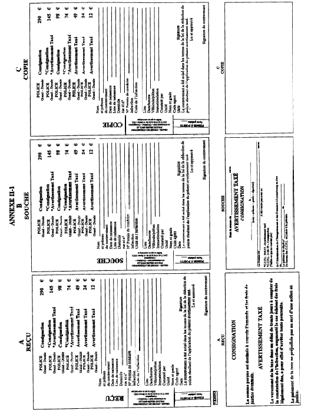
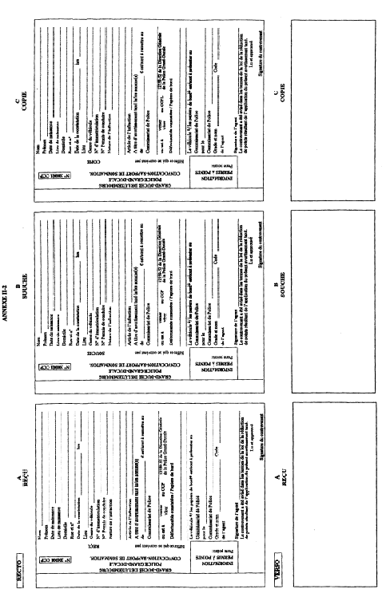
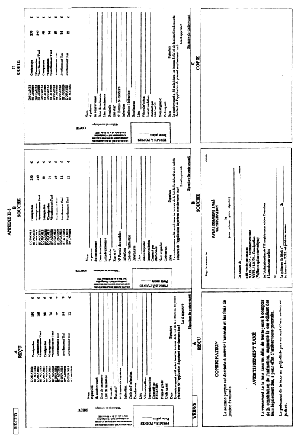
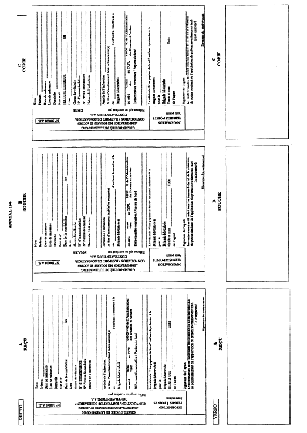

# Règlement grand-ducal du 2 août 2002 modifiant le règlement grand-ducal du 26 août 1993 relatif aux avertissements taxés, aux consignations pour contrevenants non résidents et aux mesures d’exécution de la législation sur la mise en fourrière des véhicules en matière de circulation routière.

Nous Henri, Grand-Duc de Luxembourg, Duc de Nassau;

Vu la [loi du 14 février 1955](https://legilux.public.lu/eli/etat/leg/loi/1955/02/14/n3/jo) concernant la réglementation de la circulation sur toutes les voies publiques, telle qu'elle a été modifiée et complétée dans la suite;

Vu la [loi du 13 juin 1994](https://legilux.public.lu/eli/etat/leg/loi/1994/06/13/n2/jo) relative au régime des peines;

Vu l'[arrêté grand-ducal du 23 novembre 1955](https://legilux.public.lu/eli/etat/leg/agd/1955/11/23/n1/jo) portant règlement de la circulation sur toutes les voies publiques, tel qu'il a été modifié et complété dans la suite;

Vu l’avis de la Chambre des Fonctionnaires et Employés Publics du 17 novembre 2000, celui de la Chambre de Travail du 15 décembre 2000, celui de la Chambre de Commerce du 17 janvier 2001, celui de la Chambre des Employés Privés du 13 février 2001 et celui de la Chambre des Métiers du 16 février 2001 ;

Notre Conseil d'Etat entendu;

Sur le rapport de Notre Ministre des Transports, de Notre Ministre de l'Intérieur et de Notre Ministre de la Justice et après délibération du Gouvernement en Conseil;

Arrêtons:

## Article I

L’intitulé du [règlement grand-ducal du 26 août 1993](https://legilux.public.lu/eli/etat/leg/rgd/1993/08/26/n1/jo) relatif aux avertissements taxés, aux consignations pour contrevenants non résidents et aux mesures d’exécution de la législation sur la mise en fourrière des véhicules en matière de circulation routière est remplacé par le texte suivant:

> [Règlement grand-ducal du 26 août 1993](https://legilux.public.lu/eli/etat/leg/rgd/1993/08/26/n1/jo) relatif aux avertissements taxés, aux consignations pour contrevenants non résidents ainsi qu’aux mesures d’exécution de la législation en matière de mise en fourrière des véhicules et en matière de permis à points.

## Article II

Le paragraphe 2. de l’article 2 modifié du [règlement grand-ducal du 26 août 1993 précité](https://legilux.public.lu/eli/etat/leg/rgd/1993/08/26/n1/jo) est remplacé par le texte suivant :

> 2\. Lorsque le montant de l’avertissement taxé ne peut pas être perçu sur le lieu même de l’infraction, la convocation est donnée d’après une formule spéciale publiée en annexe du présent règlement et composée d’un reçu, d’une copie et d’une souche.
>
> Les formules, dûment numérotées, sont reliées en carnets de 15 exemplaires.
>
> Le contrevenant s’en acquittera dans le délai imparti au bureau de police ou des douanes et accises lui désigné par l’agent verbalisant, soit par versement ou virement de la taxe sur un des comptes chèques postaux spécialement ouverts à cet effet au nom de la police ou des douanes et accises.

## Article III

Le premier alinéa de l'article 3 modifié du [règlement grand-ducal du 26 août 1993 précité](https://legilux.public.lu/eli/etat/leg/rgd/1993/08/26/n1/jo) est remplacé par le texte suivant :

> Sans préjudice des dispositions des articles 4 et 4bis applicables en cas de règlement par versement ou virement postal, l’avertissement taxé est donné d’après les formules spéciales publiées en annexe du présent règlement, composées, d’un reçu, d’une copie et d’une souche.

## Article IV

1\. Le premier alinéa du paragraphe 1 de l’article 4 modifié du [règlement grand-ducal du 26 août 1993 précité](https://legilux.public.lu/eli/etat/leg/rgd/1993/08/26/n1/jo) est remplacé par le texte suivant :

> 1\. Lorsque l’avertissement taxé n’est pas susceptible d’entraîner une réduction de points dans les conditions de l’article 2bis de la [loi du 14 février 1955 précitée](https://legilux.public.lu/eli/etat/leg/loi/1955/02/14/n3/jo) le reçu est remis au contrevenant, contre le paiement de la somme due en vertu du catalogue des avertissements taxés repris en annexe, après radiation de la rubrique «permis à points».

2\. Ledit article 4 est complété in fine par un paragraphe 5., libellé comme suit :

> 5\. Lorsque l’avertissement taxé n’est pas susceptible d’entraîner une réduction de points dans les conditions de l’article 2 bis de la [loi du 14 février 1955 précitée](https://legilux.public.lu/eli/etat/leg/loi/1955/02/14/n3/jo) et que le montant de l’avertissement taxé ne peut pas être perçu sur le lieu même de l’infraction, le contrevenant se verra remettre la convocation après radiation de la rubrique «permis à points».
>
> En cas d’établissement d’un procès-verbal, la copie est annexée audit procès-verbal et sera transmise au procureur d’Etat.
>
> La souche reste dans le carnet de formules. Du moment que le carnet est épuisé, il est renvoyé avec toutes les souches par les membres de la police grand-ducale au directeur général de la police et par les membres de l’administration des douanes et accises au directeur de cette administration.

## Article V

Le [règlement grand-ducal modifié du 26 août 1993 précité](https://legilux.public.lu/eli/etat/leg/rgd/1993/08/26/n1/jo) est complété par un nouvel article 4bis libellé comme suit:

> ****Art. 4 bis.**-**
>
> 1\. Lorsque le paiement de l'avertissement taxé est susceptible d'entraîner une réduction des points, le membre de la police grand-ducale ou de l'administration des douanes et accises informe le contrevenant de la réduction de points qu'entraîne le règlement de la taxe. Il fait en outre signer par celui-ci la déclaration sur les formules spéciales publiées en annexe du présent règlement moyennant laquelle le contrevenant déclare avoir été avisé dans les termes de la loi de la réduction de points résultant de l'application de l'avertissement taxé en cause, la formule étant complétée par les mots «lu et approuvé».
>
> Par ailleurs, le contrevenant se voit remettre le reçu contre paiement de la somme due en vertu du catalogue des avertissements taxés repris en annexe, la rubrique permis à points dûment remplie.
>
> 2\. Lorsque la taxe est réglée par versement ou par virement à un des comptes chèques postaux prévus à l'article 2, le récépissé en cas de versement et la copie en cas de virement servent de reçu au contrevenant. Le règlement de la taxe par virement ou versement ne dispense pas le membre de police grand-ducale ou de l'administration des douanes et accises de faire signer par le contrevenant la déclaration dont question au premier alinéa du paragraphe 1.
>
> 3\. Lorsque l’avertissement taxé est susceptible d’entraîner une réduction de points et que le montant ne peut pas être perçu sur le lieu même de l’infraction le contrevenant se verra remettre la convocation, la rubrique permis à points dûment remplie.
>
> En cas d’établissement d’un procès-verbal, la copie est annexée audit procès-verbal et sera transmise au procureur d’Etat.
>
> La souche reste dans le carnet de formules. Du moment que le carnet est épuisé, il est renvoyé avec toutes les souches par les membres de la police grand-ducale au directeur général de la police et par les membres de l’administration des douanes et accises au directeur de cette administration.
>
> 4\. L’information au procureur d’Etat des avertissements taxés donnés se fait moyennant l’établissement par le directeur général de la police grand-ducale et par le directeur de l’administration des douanes et accises de relevés mensuels.
>
> 5\. La souche reste dans le carnet de formules.
>
> Du moment que le carnet est épuisé, il est renvoyé avec toutes les souches et les quittances de dépôt y relatives, par les membres de la police grand-ducale au directeur général de la police grand-ducale et par les membres de l’administration des douanes et accises au directeur de cette administration.
>
> Si une ou plusieurs formules n’ont pas abouti à l’établissement d’un avertissement taxé, elles doivent être renvoyées en entier et porter une mention afférente.
>
> En cas de versement ou de virement de la taxe à l’un des comptes chèques postaux prévus à l’article 2, le titre de virement ou de versement fait fonction de souche, ensemble avec la déclaration mentionnée aux paragraphes 1. et 2..

## Article VI

1\. Le deuxième alinéa de l’article 5 modifié du [règlement grand-ducal du 26 août 1993 précité](https://legilux.public.lu/eli/etat/leg/rgd/1993/08/26/n1/jo) est remplacé par le texte suivant :

> Le directeur général de la police grand-ducale et le directeur de l’administration des douanes et accises établissent au début de chaque mois, en triple exemplaire, un bordereau récapitulatif portant sur les perceptions du mois précédent ; ce bordereau récapitulatif indique les noms et prénoms du contrevenant, le numéro de son permis de conduire et de son adresse exacte, la date et l’heure de l’infraction, le montant de la taxe perçue et la date du paiement, le numéro d’immatriculation du véhicule ayant, le cas échéant, servi à commettre l’infraction. Un exemplaire de ce bordereau est transmis à l’administration de l’enregistrement et des domaines, et un autre exemplaire sert de relevé d'information au procureur d’Etat dans les conditions du paragraphe 3 des articles respectivement des paragraphes 3. et 4. des articles 4 et 4bis.

2\. Il est intercalé entre le deuxième et le troisième alinéa dudit article 5 un nouvel alinéa libellé comme suit:

> Le directeur général de la police grand-ducale et le directeur de l’administration des douanes et accises établissent au début de chaque mois en triple exemplaire un relevé des avertissements taxés donnés, susceptibles d’entraîner une réduction de points. Tant le procureur d’Etat que le ministre des Transports reçoivent un exemplaire de ce relevé.

## Article VII

Le [règlement grand-ducal du 26 août 1993 précité](https://legilux.public.lu/eli/etat/leg/rgd/1993/08/26/n1/jo) est complété par un nouveau chapitre IV libellé comme suit:

> **«CHAPITRE IV Les mesures d’exécution en matière de permis à points**
>
> ****Art. 12.**-**
>
> Le catalogue regroupant les contraventions et déterminant les montants de la taxe à percevoir pour les différentes contraventions qui est reproduit à l’Annexe I du présent règlement, comporte en outre l'indication du nombre de points à retirer pour les contraventions donnant lieu à une réduction du nombre de points dont tout permis de conduire est affecté en vertu du paragraphe 2 de l’article 2bis de la [loi du 14 février 1955 précitée](https://legilux.public.lu/eli/etat/leg/loi/1955/02/14/n3/jo).
>
> ****Art. 13.**-**
>
> Les membres de la police grand-ducale et de l'administration des douanes et accises qui décernent un avertissement taxé pour une contravention donnant lieu à une réduction de points en vertu du paragraphe 2 de l’article 2bis de la [loi du 14 février 1955 précitée](https://legilux.public.lu/eli/etat/leg/loi/1955/02/14/n3/jo), en informent par voie informatique le ministre des Transports dans les 15 jours suivant le règlement de la taxe.
>
> Lorsque le contrevenant qui a sa résidence normale au Luxembourg, est titulaire d'un permis de conduire luxembourgeois ou d’un permis de conduire délivré par un autre Etat membre de l'Espace Economique Européen dûment enregistré, cette communication comporte toutes les données utiles à l'identification du contrevenant et notamment ses noms, prénoms, date et lieu de naissance et le numéro de son permis de conduire ainsi que la nature de la ou des infractions commises et les références aux articles tels que prévues au catalogue annexé au présent règlement.
>
> Lorsque le contrevenant qui a sa résidence normale au Luxembourg, est titulaire d'un permis de conduire délivré par un autre Etat membre de l'Espace Economique Européen et non dûment enregistré ou d'un permis de conduire délivré par un pays tiers à l'Espace Economique Européen et non dûment transcrit, ou que le contrevenant n'a pas sa résidence normale au Luxembourg, la communication comporte outre les indications mentionnées à l'alinéa 2 du présent article, l'adresse exacte de l'intéressé.
>
> Lorsque le contrevenant n'est pas en possession d'un permis de conduire valable pour la catégorie de véhicule qu’il a conduit, ou lorsqu’il ne satisfait pas aux réquisitions des agents chargés du contrôle d'exhiber son permis de conduire, la communication comporte, outre l'adresse exacte de l'intéressé ainsi que les indications mentionnées à l'alinéa 2, la mention des catégories de véhicules pour lesquelles le contrevenant dispose d’un permis de conduire valable ou la mention de la cause de l'omission de présenter le permis de conduire.
>
> ****Art. 14.**-**
>
> Le procureur général d’Etat informe le ministre des Transports de toute condamnation judiciaire qui est devenue irrévocable pour une des infractions reprises au paragraphe 2 de l’article 2bis de la [loi du 14 février 1955 précitée](https://legilux.public.lu/eli/etat/leg/loi/1955/02/14/n3/jo).
>
> La communication qui a lieu dans les 30 jours suivant la date à laquelle la condamnation est devenue irrévocable, consiste dans la transmission de la décision judiciaire intervenue.
>
> ****Art. 15.**-**
>
> 1\. Le ministre des Transports procède à l’imputation des points retirés et en informe l’intéressé endéans les huit jours ouvrables à compter des communications prévues aux articles 13 et 14.
>
> Cette information est faite sous pli fermé et recommandé, accompagné d’un avis de réception dans le cas d'une déduction de points. Elle est faite par simple lettre postale en cas de reconstitution partielle ou intégrale des points. Dans le cas d'une personne qui n'a pas sa résidence normale au Luxembourg, cette information est valablement faite, lorsqu'elle est adressée selon les modalités qui précèdent à l'adresse indiquée suivant le cas dans la décision judiciaire ou dans la communication prévue à l'article 13.
>
> 2\. L'information prévue au dernier alinéa du paragraphe 2. de l'article 2bis de la [loi du 14 février 1955 précitée](https://legilux.public.lu/eli/etat/leg/loi/1955/02/14/n3/jo) mentionne le libellé de l'infraction et le nombre de points déduits ainsi que les date et lieu des faits. Elle indique en outre si la déduction des points intervient sur base d'une décision judiciaire ou sur base d'un avertissement taxé. Dans le premier cas l'instance judiciaire, la date de la décision ainsi que la date où cette décision est devenue irrévocable sont mentionnées. Dans le second cas, la date du paiement de la taxe est mentionnée.
>
> L'information indique en outre le nombre résiduel de points et comporte, le cas échéant, un rappel sommaire des antécédents ayant entraîné une perte de points. Elle énonce, la possibilité éventuelle de la reconstitution partielle de points ainsi que les voies de recours.
>
> 3\. L'information prévue au premier alinéa du paragraphe 4. dudit article 2bis mentionne la date du cours de formation ainsi que le nombre de points restitués. Elle énonce le nouveau nombre de points dont dispose l'intéressé.
>
> 4\. L'information prévue à l'alinéa premier du paragraphe 5. dudit article 2bis mentionne la date où la reconstitution du nombre intégral de 12 points est devenue effective.

## Article VIII

1\. A l’article 2 du [règlement grand-ducal du 26 août 1993 précité](https://legilux.public.lu/eli/etat/leg/rgd/1993/08/26/n1/jo), le terme bureau de gendarmerie ou de police est remplacé par bureau de la police grand-ducale.

2\. Aux articles 3, 4, 5 et 7 dudit [règlement grand-ducal du 26 août 1993 précité](https://legilux.public.lu/eli/etat/leg/rgd/1993/08/26/n1/jo), le terme commandant de la gendarmerie et/ou directeur de la police est remplacé par directeur général de la police grand-ducale.

3\. Aux articles 7 et 8 dudit [règlement grand-ducal du 26 août 1993 précité](https://legilux.public.lu/eli/etat/leg/rgd/1993/08/26/n1/jo), le terme membres de la gendarmerie et de la police est remplacé par membres de la police grand-ducale.

4\. A l’article 9 dudit [règlement grand-ducal du 26 août 1993 précité](https://legilux.public.lu/eli/etat/leg/rgd/1993/08/26/n1/jo), le terme unité de gendarmerie et de la police est remplacé par unité de la police grand-ducale.

## Article IX

Le chapitre IV. «Dispositions finales» du [règlement grand-ducal du 26 août 1993 précité](https://legilux.public.lu/eli/etat/leg/rgd/1993/08/26/n1/jo) prend le numéro V, et les articles 12 et 13 sont numérotés 16 et 17.

## Article X

Le relevé des contraventions du catalogue des avertissements taxés repris à l’Annexe I du [règlement grand-ducal du 26 août 1993 précité](https://legilux.public.lu/eli/etat/leg/rgd/1993/08/26/n1/jo) est complété à droite par une colonne supplémentaire, intitulée Réduction de points en vertu de l’article 2bis de la [loi modifiée du 14 février 1955](https://legilux.public.lu/eli/etat/leg/loi/1955/02/14/n3/jo).

Ce relevé est modifié comme suit:

> <table>
> <tr>
> <td rowspan="2">Réfère  aux  Articles</td>
> <td rowspan="2">Nature de l’infraction</td>
> <td colspan="4">Montant de la taxe</td>
> <td rowspan="2">Réduction de points  en vertu de l’art. 2bis  de la loi modifiée du 14 février 1955</td>
> </tr>
> <tr>
> <td>I</td>
> <td>II</td>
> <td>III</td>
> <td>IV</td>
> </tr>
> <tr>
> <td>12+</td>
> <td></td>
> <td></td>
> <td></td>
> <td></td>
> <td></td>
> <td></td>
> </tr>
> <tr>
> <td>12bis</td>
> <td>Inobservation de la limitation de vitesse de 25 km/h par un ensemble de véhicules couplés, à l’état chargé, composé d’un tracteur industriel et d’une remorque dont la masse maximale autorisée ou la masse en charge dépasse la masse à vide de celui-ci,</td>
> <td></td>
> <td></td>
> <td></td>
> <td></td>
> <td></td>
> </tr>
> <tr>
> <td>-06[^n]</td>
> <td>...-le dépassement étant supérieur à 15 km/h</td>
> <td></td>
> <td></td>
> <td></td>
> <td>145</td>
> <td>2</td>
> </tr>
> <tr>
> <td></td>
> <td>Inobservation par le conducteur d’un véhicule spécial de génie civil ou à usage public spécial dépassant les puissances, les masses maximales et les charges utiles réglementaires :</td>
> <td></td>
> <td></td>
> <td></td>
> <td></td>
> <td></td>
> </tr>
> <tr>
> <td>-19[^n]</td>
> <td>...-de la limitation de vitesse de 40 km/h, le dépassement étant supérieur à 15 km/h</td>
> <td></td>
> <td></td>
> <td></td>
> <td>145</td>
> <td>2</td>
> </tr>
> <tr>
> <td>14</td>
> <td>Traction d’une remorque destinée au transport de personnes à plus de 25 km/h, sauf par un autobus ou un autocar:</td>
> <td></td>
> <td></td>
> <td></td>
> <td></td>
> <td></td>
> </tr>
> <tr>
> <td>-03[^n]</td>
> <td>...-dépassement supérieur à 15 km/h</td>
> <td></td>
> <td></td>
> <td></td>
> <td>145</td>
> <td>2</td>
> </tr>
> <tr>
> <td>23</td>
> <td></td>
> <td></td>
> <td></td>
> <td></td>
> <td></td>
> <td></td>
> </tr>
> <tr>
> <td>-01</td>
> <td>Usage de pneumatiques ne présentant pas sur toute leur surface de roulement des rainures apparentes</td>
> <td></td>
> <td></td>
> <td></td>
> <td>145</td>
> <td>2</td>
> </tr>
> <tr>
> <td>-02</td>
> <td>Usage de pneumatiques faisant apparaître de la toile ou présentant une déchirure profonde sur leur flanc</td>
> <td></td>
> <td></td>
> <td></td>
> <td>145</td>
> <td>2</td>
> </tr>
> <tr>
> <td>-03</td>
> <td>Usage sur un véhicule automoteur autre qu’une machine, ou sur une remorque, de pneumatiques ne présentant pas des rainures principales d’une profondeur d’au moins 1,6 mm</td>
> <td></td>
> <td></td>
> <td></td>
> <td>145</td>
> <td>2</td>
> </tr>
> <tr>
> <td>-04</td>
> <td>Usage de pneumatiques présentant d’autres défectuosités</td>
> <td></td>
> <td></td>
> <td></td>
> <td>145</td>
> <td>2</td>
> </tr>
> <tr>
> <td>23bis</td>
> <td>Usage sur une voiture automobile à personnes, un véhicule utilitaire ou une remorque y attelée:</td>
> <td></td>
> <td></td>
> <td></td>
> <td></td>
> <td></td>
> </tr>
> <tr>
> <td>-01</td>
> <td></td>
> <td></td>
> <td></td>
> <td></td>
> <td></td>
> <td></td>
> </tr>
> <tr>
> <td></td>
> <td>de pneumatiques de structures différentes sur un même essieu</td>
> <td></td>
> <td></td>
> <td></td>
> <td>145</td>
> <td>2</td>
> </tr>
> <tr>
> <td>-02</td>
> <td>de pneumatiques à structure diagonale ou diagonale-ceinturée sur l'essieu arrière si des pneumatiques à structure radiale sont sont montés sur l’essieu avant</td>
> <td></td>
> <td></td>
> <td></td>
> <td>145</td>
> <td>2</td>
> </tr>
> <tr>
> <td>-03</td>
> <td>de pneumatiques à structure diagonale sur l’essieu arrière si des pneumatiques à structure diagonale - ceinturée sont montés sur l’essieu avant</td>
> <td></td>
> <td></td>
> <td></td>
> <td>145</td>
> <td>2</td>
> </tr>
> <tr>
> <td>-04</td>
> <td>Usage sur un autre véhicule de pneumatiques de structure différente sur un essieu à roues non jumelées ou sur un même côté d’un essieu à roues jumelées</td>
> <td></td>
> <td></td>
> <td></td>
> <td>145</td>
> <td>2</td>
> </tr>
> <tr>
> <td>52</td>
> <td></td>
> <td></td>
> <td></td>
> <td></td>
> <td></td>
> <td></td>
> </tr>
> <tr>
> <td>-06</td>
> <td>Transport sur la place derrière le conducteur d’un motocycle d’une personne âgée de moins de 12 ans ou dont la taille ne permet pas un usage adéquat des repose-pieds</td>
> <td></td>
> <td></td>
> <td>74</td>
> <td></td>
> <td></td>
> </tr>
> <tr>
> <td>-07</td>
> <td>Transport sur la place derrière le conducteur d’un motocycle d’une personne dont la taille ne permet pas un usage adéquat des repose-pieds</td>
> <td></td>
> <td></td>
> <td>74</td>
> <td></td>
> <td></td>
> </tr>
> <tr>
> <td>-08</td>
> <td>Longueur non réglementaire du siège d’un motocycle</td>
> <td></td>
> <td></td>
> <td>74</td>
> <td></td>
> <td></td>
> </tr>
> <tr>
> <td>92</td>
> <td></td>
> <td></td>
> <td></td>
> <td></td>
> <td></td>
> <td></td>
> </tr>
> <tr>
> <td>-01</td>
> <td>Défaut de carte d’immatriculation luxembourgeoise pour un véhicule automoteur ou une remorque appartenant à une personne ayant sa résidence normale ou son siège social au Luxembourg ou mis à disposition d’une telle personne</td>
> <td></td>
> <td></td>
> <td></td>
> <td>145</td>
> <td>2</td>
> </tr>
> <tr>
> <td>-03</td>
> <td>Maintien en circulation d’un véhicule immatriculé provisoirement au Luxembourg au-delà du délai de validité de la carte d'immatriculation qui le couvre</td>
> <td></td>
> <td></td>
> <td></td>
> <td>145</td>
> <td>2</td>
> </tr>
> <tr>
> <td>95</td>
> <td></td>
> <td></td>
> <td></td>
> <td></td>
> <td></td>
> <td></td>
> </tr>
> <tr>
> <td>-03</td>
> <td>Défaut de solliciter une nouvelle carte d’immatriculation en cas de modification des spécifications y figurant</td>
> <td></td>
> <td></td>
> <td></td>
> <td>145</td>
> <td>2</td>
> </tr>
> <tr>
> <td>-04</td>
> <td>Défaut de représenter au ministre des Transports un véhicule dont les spécifications ont été modifiées</td>
> <td></td>
> <td></td>
> <td></td>
> <td>145</td>
> <td>2</td>
> </tr>
> <tr>
> <td>98</td>
> <td></td>
> <td></td>
> <td></td>
> <td></td>
> <td></td>
> <td></td>
> </tr>
> <tr>
> <td>-01</td>
> <td>Usage d’un véhicule non couvert par un certificat de contrôle technique valable</td>
> <td></td>
> <td></td>
> <td></td>
> <td>145</td>
> <td>2</td>
> </tr>
> <tr>
> <td>-02</td>
> <td>Usage d’un véhicule non couvert par un certificat de contrôle technique valable lors du déplacement vers la station de contrôle technique à défaut de convocation au contrôle technique</td>
> <td></td>
> <td></td>
> <td></td>
> <td>145</td>
> <td>2</td>
> </tr>
> <tr>
> <td>107</td>
> <td></td>
> <td></td>
> <td></td>
> <td></td>
> <td></td>
> <td></td>
> </tr>
> <tr>
> <td>-01</td>
> <td>Inobservation d’un signal de priorité - << Cédez le passage>></td>
> <td></td>
> <td></td>
> <td></td>
> <td>145</td>
> <td>2</td>
> </tr>
> <tr>
> <td>-02</td>
> <td>- << Arrêt >></td>
> <td></td>
> <td></td>
> <td></td>
> <td>145</td>
> <td>2</td>
> </tr>
> <tr>
> <td></td>
> <td>Inobservation d’un signal d’interdiction ou de restriction</td>
> <td></td>
> <td></td>
> <td></td>
> <td></td>
> <td></td>
> </tr>
> <tr>
> <td>-10</td>
> <td>- << Interdiction de dépassement >></td>
> <td></td>
> <td></td>
> <td></td>
> <td>145</td>
> <td>2</td>
> </tr>
> <tr>
> <td></td>
> <td>Limitation de la vitesse</td>
> <td></td>
> <td></td>
> <td></td>
> <td></td>
> <td></td>
> </tr>
> <tr>
> <td>-12[^n]</td>
> <td>- à 50 km/h ou moins, le dépassement étant supérieur à 15 km/h</td>
> <td></td>
> <td></td>
> <td></td>
> <td>145</td>
> <td>2</td>
> </tr>
> <tr>
> <td>-14[^n]</td>
> <td>- à plus de 50 km/h, le dépassement étant supérieur à 20 km/h</td>
> <td></td>
> <td></td>
> <td></td>
> <td>145</td>
> <td>2</td>
> </tr>
> <tr>
> <td>109</td>
> <td></td>
> <td></td>
> <td></td>
> <td></td>
> <td></td>
> <td></td>
> </tr>
> <tr>
> <td>-01</td>
> <td>Inobservation d’un signal lumineux rouge</td>
> <td></td>
> <td></td>
> <td></td>
> <td>145</td>
> <td>2</td>
> </tr>
> <tr>
> <td></td>
> <td>Inobservation par un conducteur qui emprunte une chaussée ou une voie de circulation réservée aux autobus, aux taxis, aux véhicules en service urgent, aux ambulances, aux voitures de médecins en service, aux voitures de location servant au ramassage scolaire ainsi qu’aux fourgons blindés et aux voitures de service qui les escortent, d’un signal lumineux particulier</td>
> <td></td>
> <td></td>
> <td></td>
> <td></td>
> <td></td>
> </tr>
> <tr>
> <td>-04</td>
> <td>- sous forme de barre horizontale</td>
> <td></td>
> <td></td>
> <td></td>
> <td>145</td>
> <td>2</td>
> </tr>
> <tr>
> <td>-05</td>
> <td>- sous forme de disque</td>
> <td></td>
> <td>49</td>
> <td></td>
> <td></td>
> <td></td>
> </tr>
> <tr>
> <td>-06</td>
> <td>Inobservation des feux rouges clignotants à un passage à niveau</td>
> <td></td>
> <td></td>
> <td></td>
> <td>145</td>
> <td>2</td>
> </tr>
> <tr>
> <td>115+116</td>
> <td></td>
> <td></td>
> <td></td>
> <td></td>
> <td></td>
> <td></td>
> </tr>
> <tr>
> <td>-01</td>
> <td>Défaut de suivre les injonctions des membres de la police grand-ducale chargés de contrôler la circulation</td>
> <td></td>
> <td></td>
> <td></td>
> <td>145</td>
> <td>2</td>
> </tr>
> <tr>
> <td>-02</td>
> <td>Défaut de suivre les injonctions des agents de l’administration des douanes et accises contrôlant les dispositions légales relatives soit à la vignette prévue par la législation portant approbation et application de l’accord relatif à la perception d’un droit d’usage pour l’utilisation de certaines routes par des véhicules utilitaires lourds, soit à la surcharge des véhicules, soit aux documents de bord et d’équipements spéciaux des véhicules</td>
> <td></td>
> <td></td>
> <td></td>
> <td>145</td>
> <td>2</td>
> </tr>
> <tr>
> <td>123</td>
> <td></td>
> <td></td>
> <td></td>
> <td></td>
> <td></td>
> <td></td>
> </tr>
> <tr>
> <td>-02</td>
> <td>- Gêne ou entrave de la marche des piétons qui marquent l'intention de s'engager dans la chaussée ou qui s'y sont déjà engagés lors d’un changement de direction</td>
> <td></td>
> <td></td>
> <td></td>
> <td>145</td>
> <td>2</td>
> </tr>
> <tr>
> <td>125</td>
> <td></td>
> <td></td>
> <td></td>
> <td></td>
> <td></td>
> <td></td>
> </tr>
> <tr>
> <td>-10</td>
> <td>Dépassement ou tentative de dépassement devant un passage pour piétons</td>
> <td></td>
> <td></td>
> <td></td>
> <td>145</td>
> <td>2</td>
> </tr>
> <tr>
> <td>126</td>
> <td></td>
> <td></td>
> <td></td>
> <td></td>
> <td></td>
> <td></td>
> </tr>
> <tr>
> <td></td>
> <td>Dépassement ou tentative de dépassement</td>
> <td></td>
> <td></td>
> <td></td>
> <td></td>
> <td></td>
> </tr>
> <tr>
> <td>-01</td>
> <td>- causant un danger ou une gêne à la circulation en sens inverse</td>
> <td></td>
> <td></td>
> <td></td>
> <td>145</td>
> <td>2</td>
> </tr>
> <tr>
> <td>-02</td>
> <td>- par visibilité insuffisante</td>
> <td></td>
> <td></td>
> <td></td>
> <td>145</td>
> <td>2</td>
> </tr>
> <tr>
> <td>-03</td>
> <td>- aux intersections</td>
> <td></td>
> <td></td>
> <td></td>
> <td>145</td>
> <td>2</td>
> </tr>
> <tr>
> <td>-04</td>
> <td>- à l’approche du sommet d’une côte</td>
> <td></td>
> <td></td>
> <td></td>
> <td>145</td>
> <td>2</td>
> </tr>
> <tr>
> <td>-05</td>
> <td>- dans un virage à visibilité insuffisante</td>
> <td></td>
> <td></td>
> <td></td>
> <td>145</td>
> <td>2</td>
> </tr>
> <tr>
> <td>-06</td>
> <td>- sur un passage à niveau ou à son approche</td>
> <td></td>
> <td></td>
> <td></td>
> <td>145</td>
> <td>2</td>
> </tr>
> <tr>
> <td>-07</td>
> <td>- d’un usager de la route qui effectue un croisement, un dépassement ou un contournement</td>
> <td></td>
> <td></td>
> <td></td>
> <td>145</td>
> <td>2</td>
> </tr>
> <tr>
> <td>-08</td>
> <td>- dans un tunnel</td>
> <td></td>
> <td></td>
> <td></td>
> <td>145</td>
> <td>2</td>
> </tr>
> <tr>
> <td>-09</td>
> <td>- sur un pont</td>
> <td></td>
> <td></td>
> <td></td>
> <td>145</td>
> <td>2</td>
> </tr>
> <tr>
> <td>133</td>
> <td></td>
> <td></td>
> <td></td>
> <td></td>
> <td></td>
> <td></td>
> </tr>
> <tr>
> <td>-03</td>
> <td>Usage de l’avertisseur sonore et des avertissements lumineux au-delà de la durée nécessaire</td>
> <td></td>
> <td>49</td>
> <td></td>
> <td></td>
> <td></td>
> </tr>
> <tr>
> <td>136</td>
> <td></td>
> <td></td>
> <td></td>
> <td></td>
> <td></td>
> <td></td>
> </tr>
> <tr>
> <td>-03</td>
> <td>Refus de céder la priorité aux usagers venant de la droite aux intersections et dans les sens giratoires</td>
> <td></td>
> <td></td>
> <td></td>
> <td>145</td>
> <td>2</td>
> </tr>
> <tr>
> <td>-06</td>
> <td>Refus de céder la priorité en traversant une zone piétonne ou en s’y engageant :</td>
> <td></td>
> <td></td>
> <td></td>
> <td></td>
> <td></td>
> </tr>
> <tr>
> <td></td>
> <td>- aux piétons</td>
> <td></td>
> <td></td>
> <td></td>
> <td>145</td>
> <td>2</td>
> </tr>
> <tr>
> <td>-07</td>
> <td>Refus en obliquant vers la gauche, de céder la priorité aux usagers circulant en sens opposé et continuant en ligne droite ou obliquant vers la droite</td>
> <td></td>
> <td></td>
> <td></td>
> <td>145</td>
> <td>2</td>
> </tr>
> <tr>
> <td>137</td>
> <td>En sortant d’une propriété riveraine, d’un endroit réservé au parcage ou d’une zone piétonne, en exécutant des manœuvres, en se remettant en marche après un arrêt, stationnement ou parcage ou en effectuant une marche arrière:</td>
> <td></td>
> <td></td>
> <td></td>
> <td></td>
> <td></td>
> </tr>
> <tr>
> <td>-05</td>
> <td>- défaut de céder le passage à un piéton</td>
> <td></td>
> <td></td>
> <td></td>
> <td>145</td>
> <td>2</td>
> </tr>
> <tr>
> <td>139</td>
> <td></td>
> <td></td>
> <td></td>
> <td></td>
> <td></td>
> <td></td>
> </tr>
> <tr>
> <td></td>
> <td>Inobservation de la limite de vitesse de 50 km/h à l’intérieur d'une agglomération:</td>
> <td></td>
> <td></td>
> <td></td>
> <td></td>
> <td></td>
> </tr>
> <tr>
> <td>-04[^n]</td>
> <td>- le dépassement étant supérieur à 15 km/h</td>
> <td></td>
> <td></td>
> <td></td>
> <td>145</td>
> <td>2</td>
> </tr>
> <tr>
> <td></td>
> <td>Inobservation de la limite de vitesse de 75 km/h à l’extérieur d'une agglomération par un camion, un autobus ou un ensemble de véhicules couplés</td>
> <td></td>
> <td></td>
> <td></td>
> <td></td>
> <td></td>
> </tr>
> <tr>
> <td>-06[^n]</td>
> <td>- le dépassement étant supérieur à 20 km/h</td>
> <td></td>
> <td></td>
> <td></td>
> <td>145</td>
> <td>2</td>
> </tr>
> <tr>
> <td></td>
> <td>Inobservation de la limite de vitesse de 90 km/h à l’extérieur d'une agglomération par un autre véhicule</td>
> <td></td>
> <td></td>
> <td></td>
> <td></td>
> <td></td>
> </tr>
> <tr>
> <td>-08[^n]</td>
> <td>- le dépassement étant supérieur à 20 km/h</td>
> <td></td>
> <td></td>
> <td></td>
> <td>145</td>
> <td>2</td>
> </tr>
> <tr>
> <td></td>
> <td>Inobservation de la limite de vitesse sur une autoroute de 90km/h par temps normal et de 75 km/h par temps de pluie ou en cas d'autres précipitations par un camion, un autobus, un autocar ou un ensemble de véhicules couplés</td>
> <td></td>
> <td></td>
> <td></td>
> <td></td>
> <td></td>
> </tr>
> <tr>
> <td>-10[^n]</td>
> <td>- le dépassement étant supérieur à 20 km/h</td>
> <td></td>
> <td></td>
> <td></td>
> <td>145</td>
> <td>2</td>
> </tr>
> <tr>
> <td></td>
> <td>Inobservation de la limite de vitesse sur une autoroute de 130 km/h par temps normal ou de 110 km/h par temps de pluie ou en cas d'autres précipitations par un autre véhicule</td>
> <td></td>
> <td></td>
> <td></td>
> <td></td>
> <td></td>
> </tr>
> <tr>
> <td>-12[^n]</td>
> <td>- le dépassement étant supérieur à 25 km/h</td>
> <td></td>
> <td></td>
> <td></td>
> <td>145</td>
> <td>2</td>
> </tr>
> <tr>
> <td></td>
> <td>Conduite d’un cyclomoteur à une vitesse supérieure à 45 km/h</td>
> <td></td>
> <td></td>
> <td></td>
> <td></td>
> <td></td>
> </tr>
> <tr>
> <td>-14[^n]</td>
> <td>- le dépassement étant supérieur à 15 km/h</td>
> <td></td>
> <td></td>
> <td></td>
> <td>145</td>
> <td>2</td>
> </tr>
> <tr>
> <td></td>
> <td>Conduite d’une machine automotrice d’un poids propre inférieur ou égal à 400 kg à une vitesse dépassant 25 km/h</td>
> <td></td>
> <td></td>
> <td></td>
> <td></td>
> <td></td>
> </tr>
> <tr>
> <td>-16[^n]</td>
> <td>- le dépassement étant supérieur à 15 km/h</td>
> <td></td>
> <td></td>
> <td></td>
> <td>145</td>
> <td>2</td>
> </tr>
> <tr>
> <td></td>
> <td>Conduite d’une machine automotrice d’un poids propre supérieur à 400 kg à une vitesse dépassant 40 km/h</td>
> <td></td>
> <td></td>
> <td></td>
> <td></td>
> <td></td>
> </tr>
> <tr>
> <td>-18[^n]</td>
> <td>- le dépassement étant supérieur à 15 km/h</td>
> <td></td>
> <td></td>
> <td></td>
> <td>145</td>
> <td>2</td>
> </tr>
> <tr>
> <td></td>
> <td>Conduite d’une machine automotrice ou d'un véhicule spécial d’une masse maximale autorisée supérieure à 12.000 kg et munis d'une suspension mécanique à une vitesse supérieure à 40 km/h, si la masse maximale autorisée sur un ou plusieurs essieux est supérieure à 11,5t:</td>
> <td></td>
> <td></td>
> <td></td>
> <td></td>
> <td></td>
> </tr>
> <tr>
> <td>-20[^n]</td>
> <td>- le dépassement étant supérieur à 15 km/h</td>
> <td></td>
> <td></td>
> <td></td>
> <td>145</td>
> <td>2</td>
> </tr>
> <tr>
> <td></td>
> <td>Conduite d'une machine automotrice ou d'un véhicule spécial d'une masse maximale autorisée supérieure à 12.000 kg et munis d'une suspension pneumatique à une vitesse supérieure à 40 km/h, si la masse maximale autorisée sur un ou plusieurs essieux est supérieure à 12t</td>
> <td></td>
> <td></td>
> <td></td>
> <td></td>
> <td></td>
> </tr>
> <tr>
> <td>-22[^n]</td>
> <td>- le dépassement étant supérieur à 15 km/h</td>
> <td></td>
> <td></td>
> <td></td>
> <td>145</td>
> <td>2</td>
> </tr>
> <tr>
> <td></td>
> <td>Circulation, par le titulaire d’un permis de conduire de la sous catégorie A1 ou des catégories A ou B, en période de stage, avant la participation à un cours de formation ou pendant la prorogation ou le renouvellement de la période de stage, ou par le candidat circulant sous le régime de la conduite accompagnée, à plus de 90 km/h sur une autoroute ou à plus de 75 km/h sur les autres voies publiques</td>
> <td></td>
> <td></td>
> <td></td>
> <td></td>
> <td></td>
> </tr>
> <tr>
> <td>-24[^n]</td>
> <td>- le dépassement étant supérieur à 20 km/h</td>
> <td></td>
> <td></td>
> <td></td>
> <td>145</td>
> <td>2</td>
> </tr>
> <tr>
> <td></td>
> <td>Conduite d’un véhicule équipé de pneus crampons à une vitesse supérieure à 90 km/h sur une autoroute ou 60 km/h sur les autres voies publiques:</td>
> <td></td>
> <td></td>
> <td></td>
> <td></td>
> <td></td>
> </tr>
> <tr>
> <td>-26[^n]</td>
> <td>- le dépassement étant supérieur à 20 km/h</td>
> <td></td>
> <td></td>
> <td></td>
> <td>145</td>
> <td>2</td>
> </tr>
> <tr>
> <td></td>
> <td>Inobservation de la limite de vitesse de 20 km/h dans une zone piétonne ou dans une zone résidentielle</td>
> <td></td>
> <td></td>
> <td></td>
> <td></td>
> <td></td>
> </tr>
> <tr>
> <td>-28[^n]</td>
> <td>- le dépassement étant supérieur à 15 km/h</td>
> <td></td>
> <td></td>
> <td></td>
> <td>145</td>
> <td>2</td>
> </tr>
> <tr>
> <td>142</td>
> <td></td>
> <td></td>
> <td></td>
> <td></td>
> <td></td>
> <td></td>
> </tr>
> <tr>
> <td>-02</td>
> <td>Défaut de s’arrêter devant un passage pour piétons lorsqu'un piéton marque son intention de s’y engager ou qu’il y est engagé</td>
> <td></td>
> <td></td>
> <td>145</td>
> <td>2</td>
> <td></td>
> </tr>
> <tr>
> <td>156</td>
> <td></td>
> <td></td>
> <td></td>
> <td></td>
> <td></td>
> <td></td>
> </tr>
> <tr>
> <td>-01</td>
> <td>Circulation sur autoroute d’un véhicule automoteur ou d’un ensemble de véhicules ne pouvant réaliser en palier une vitesse de 40 km/h au moins</td>
> <td></td>
> <td></td>
> <td>145</td>
> <td>2</td>
> <td></td>
> </tr>
> <tr>
> <td>-02</td>
> <td>Circulation sur autoroute d’un tracteur agricole</td>
> <td></td>
> <td></td>
> <td>145</td>
> <td>2</td>
> <td></td>
> </tr>
> <tr>
> <td>-03</td>
> <td>Circulation sur autoroute d’un cycle, d’un cyclomoteur d’un quadricycle léger ou d’un véhicule traîné par une machine</td>
> <td></td>
> <td></td>
> <td>145</td>
> <td>2</td>
> <td></td>
> </tr>
> <tr>
> <td></td>
> <td>Circulation sur autoroute, sauf autorisation particulière</td>
> <td></td>
> <td></td>
> <td></td>
> <td></td>
> <td></td>
> </tr>
> <tr>
> <td>-04</td>
> <td>- d’une machine automotrice ou d’un véhicule spécial d’une masse maximale autorisée supérieure à 12.000 kg munis d'une suspension mécanique et dont la masse maximale autorisée sur un ou plusieurs essieux est supérieure à 11,5t</td>
> <td></td>
> <td></td>
> <td></td>
> <td>145</td>
> <td>2</td>
> </tr>
> <tr>
> <td>-05</td>
> <td>- d’une machine automotrice ou d’un véhicule spécial d’une masse maximale autorisée supérieure à 12.000 kg munis d'une suspension pneumatique et dont la masse maximale autorisée sur un ou plusieurs essieux est supérieure à 12t</td>
> <td></td>
> <td></td>
> <td></td>
> <td>145</td>
> <td>2</td>
> </tr>
> <tr>
> <td>-06</td>
> <td>- d’un véhicule automoteur traînant un véhicule forain ou une roulotte dont la vitesse est limitée à 25 km/h</td>
> <td></td>
> <td></td>
> <td></td>
> <td>145</td>
> <td>2</td>
> </tr>
> <tr>
> <td>-07</td>
> <td>- d’un véhicule effectuant des essais techniques ou scientifiques</td>
> <td></td>
> <td></td>
> <td></td>
> <td>145</td>
> <td>2</td>
> </tr>
> <tr>
> <td>-08</td>
> <td>- d’un véhicule automoteur participant à une compétition sportive ou à un défilé publicitaire</td>
> <td></td>
> <td></td>
> <td></td>
> <td>145</td>
> <td>2</td>
> </tr>
> <tr>
> <td>-09</td>
> <td>- d’un véhicule d’instruction pendant l’apprentissage pratique de conduite automobile, si le candidat n’a pas encore accompli au moins cinq leçons</td>
> <td></td>
> <td></td>
> <td></td>
> <td>145</td>
> <td>2</td>
> </tr>
> <tr>
> <td>-10</td>
> <td>- d’un véhicule effectuant le remorquage d’unvéhicule tombé en panne ou accidenté en dehors de l’autoroute</td>
> <td></td>
> <td></td>
> <td></td>
> <td>145</td>
> <td>2</td>
> </tr>
> <tr>
> <td>-11</td>
> <td>Défaut d’utiliser les accès ou les sorties d’autoroute spécialement aménagés et signalés comme tels</td>
> <td></td>
> <td></td>
> <td></td>
> <td>145</td>
> <td>2</td>
> </tr>
> <tr>
> <td>-12</td>
> <td>Défaut de céder le passage en s’engageant sur l’autoroute</td>
> <td></td>
> <td></td>
> <td></td>
> <td>145</td>
> <td>2</td>
> </tr>
> <tr>
> <td>-13</td>
> <td>Défaut, en quittant l’autoroute, d’emprunter à temps la voie de circulation de droite et de s’engager au plus tôt sur la voie de décélération</td>
> <td></td>
> <td></td>
> <td></td>
> <td>145</td>
> <td>2</td>
> </tr>
> <tr>
> <td>-14</td>
> <td>Circulation sur une bande de terrain ou un raccordement reliant les chaussées d’une autoroute</td>
> <td></td>
> <td></td>
> <td></td>
> <td>145</td>
> <td>2</td>
> </tr>
> <tr>
> <td>-15</td>
> <td>Inobservation de l’interdiction de faire demi-tour ou marche arrière sur une autoroute</td>
> <td></td>
> <td></td>
> <td></td>
> <td>145</td>
> <td>2</td>
> </tr>
> <tr>
> <td>-16</td>
> <td>Immobilisation d’un véhicule sur une chaussée, un accotement, un accès ou une sortie d’une autoroute</td>
> <td></td>
> <td></td>
> <td></td>
> <td>145</td>
> <td>2</td>
> </tr>
> <tr>
> <td></td>
> <td>En s’immobilisant par cas fortuit sur une autoroute:</td>
> <td></td>
> <td></td>
> <td></td>
> <td></td>
> <td></td>
> </tr>
> <tr>
> <td>-17</td>
> <td>- défaut de ranger le véhicule en dehors et àdroite de la chaussée</td>
> <td></td>
> <td></td>
> <td></td>
> <td>145</td>
> <td>2</td>
> </tr>
> <tr>
> <td>-18</td>
> <td>- défaut d’avertir à temps les autres conducteurs de l’encombrement de la chaussée</td>
> <td></td>
> <td></td>
> <td></td>
> <td>145</td>
> <td>2</td>
> </tr>
> <tr>
> <td>-19</td>
> <td>Défaut d’utiliser de nuit ainsi que de jour en cas de visibilité insuffisante les mesures de sécurité comprenant des moyens lumineux ou réfléchissants pour signaler le véhicule</td>
> <td></td>
> <td></td>
> <td></td>
> <td>145</td>
> <td>2</td>
> </tr>
> <tr>
> <td>-20</td>
> <td>- défaut de ménager un couloir médian pour permettre le passage des véhicules en service urgent quand la densité de la circulation l’exige</td>
> <td></td>
> <td></td>
> <td></td>
> <td>145</td>
> <td>2</td>
> </tr>
> <tr>
> <td>-21</td>
> <td>Inobservation des prescriptions fixées par la réglementation ou l’autorisation ministérielle afférente pour les véhicules dépassant les poids et dimensions réglementaires</td>
> <td></td>
> <td></td>
> <td></td>
> <td>145</td>
> <td>2</td>
> </tr>
> <tr>
> <td>156ter</td>
> <td></td>
> <td></td>
> <td></td>
> <td></td>
> <td></td>
> <td></td>
> </tr>
> <tr>
> <td>-01</td>
> <td>Circulation sur une route pour véhicules automoteurs d’un véhicule automoteur ou d’un ensemble de véhicules ne pouvant réaliser en palier une vitesse de 40 km/h au moins</td>
> <td></td>
> <td></td>
> <td></td>
> <td>145</td>
> <td>2</td>
> </tr>
> <tr>
> <td>-02</td>
> <td>Circulation sur une route pour véhicules automoteurs d’un tracteur agricole</td>
> <td></td>
> <td></td>
> <td></td>
> <td>145</td>
> <td>2</td>
> </tr>
> <tr>
> <td>-03</td>
> <td>Circulation sur une route pour véhicules automoteurs d’un cycle, d’un cyclomoteur, d’un quadricycle léger ou d’un véhicule traîné par une machine</td>
> <td></td>
> <td></td>
> <td></td>
> <td>145</td>
> <td>2</td>
> </tr>
> <tr>
> <td></td>
> <td>Circulation sur une route pour véhicules automoteurs, sauf autorisation particulière</td>
> <td></td>
> <td></td>
> <td></td>
> <td></td>
> <td></td>
> </tr>
> <tr>
> <td>-04</td>
> <td>- d’une machine automotrice ou d’un véhicule spécial d’une masse maximale autorisée supérieure à 12.000 kg munis d’une suspension mécanique et dont la masse maximale autorisée sur un ou plusieurs essieux est supérieure à 11,5t</td>
> <td></td>
> <td></td>
> <td></td>
> <td>145</td>
> <td>2</td>
> </tr>
> <tr>
> <td>-05</td>
> <td>- d’une machine automotrice ou d’un véhicule spécial d’une masse maximale autorisée supérieure à 12.000 kg munis d’une suspension pneumatique et dont la masse maximale autorisée sur un ou plusieurs essieux est supérieure à 12t</td>
> <td></td>
> <td></td>
> <td></td>
> <td>145</td>
> <td>2</td>
> </tr>
> <tr>
> <td>-06</td>
> <td>- d’un véhicule automoteur traînant un véhicule forain ou une roulotte dont la vitesse est limitée à 25 km/h</td>
> <td></td>
> <td></td>
> <td></td>
> <td>145</td>
> <td>2</td>
> </tr>
> <tr>
> <td>-07</td>
> <td>Défaut d’utiliser les accès ou les sorties des routes pour  véhicules automoteurs spécialement aménagés et signalés comme tels</td>
> <td></td>
> <td></td>
> <td></td>
> <td>145</td>
> <td>2</td>
> </tr>
> <tr>
> <td>-08</td>
> <td>Défaut de céder le passage en s’engageant sur une route pour véhicules automoteurs</td>
> <td></td>
> <td></td>
> <td></td>
> <td>145</td>
> <td>2</td>
> </tr>
> <tr>
> <td>-09</td>
> <td>Défaut, en quittant la route pour véhicules automoteurs, de s’engager au plus tôt sur la voie de décélération</td>
> <td></td>
> <td></td>
> <td></td>
> <td>145</td>
> <td>2</td>
> </tr>
> <tr>
> <td>-10</td>
> <td>Inobservation de l’interdiction de faire demi-tour ou marche-arrière sur une route pour véhicules automoteurs</td>
> <td></td>
> <td></td>
> <td></td>
> <td>145</td>
> <td>2</td>
> </tr>
> <tr>
> <td>-11</td>
> <td>Immobilisation d’un véhicule sur la chaussée, un accotement ou une chaussée d’accès d’une route pour véhicules automoteurs</td>
> <td></td>
> <td></td>
> <td></td>
> <td>145</td>
> <td>2</td>
> </tr>
> <tr>
> <td></td>
> <td>En cas d’immobilisation d’un véhicule par cas fortuit sur une route pour véhicules automoteurs</td>
> <td></td>
> <td></td>
> <td></td>
> <td></td>
> <td></td>
> </tr>
> <tr>
> <td>-12</td>
> <td>- défaut de ranger le véhicule en dehors et à droite de la chaussée</td>
> <td></td>
> <td></td>
> <td></td>
> <td>145</td>
> <td>2</td>
> </tr>
> <tr>
> <td>-13</td>
> <td>- d’avertir à temps les autres conducteurs de l’encombrement de la chaussée</td>
> <td></td>
> <td></td>
> <td></td>
> <td>145</td>
> <td>2</td>
> </tr>
> <tr>
> <td>-14</td>
> <td>- défaut d’utiliser pendant la nuit ou de jour, lorsque les circonstances notamment d’ordre atmosphérique l'exigent, les mesures de sécurité comprenant des moyens lumineux ou réfléchissants pour signaler le véhicule</td>
> <td></td>
> <td></td>
> <td></td>
> <td>145</td>
> <td>2</td>
> </tr>
> <tr>
> <td>160</td>
> <td></td>
> <td></td>
> <td></td>
> <td></td>
> <td></td>
> <td></td>
> </tr>
> <tr>
> <td>-25</td>
> <td>Défaut pour un conducteur de cyclomoteur, de quadricycle léger, de tricycle, de quadricycle et de motocycle, avec ou sans side-cars, de porter un casque de protection réglementaire</td>
> <td></td>
> <td>49</td>
> <td></td>
> <td></td>
> <td>1</td>
> </tr>
> <tr>
> <td>-26</td>
> <td>Défaut pour un passager adulte de cyclomoteur, de quadricycle léger, de tricycle, de quadricycle et de motocycle, avec ou sans side-cars, de porter un casque de protection réglementaire</td>
> <td></td>
> <td>49</td>
> <td></td>
> <td></td>
> <td></td>
> </tr>
> <tr>
> <td>-27</td>
> <td>Fait pour un conducteur de cyclomoteur, de quadricycle léger, de tricycle, de quadricycle et de motocycle de transporter une personne mineure qui ne porte pas de façon réglementaire un casque de protection homologué</td>
> <td></td>
> <td>49</td>
> <td></td>
> <td></td>
> <td>1</td>
> </tr>
> <tr>
> <td>-28</td>
> <td>Port non réglementaire d’un casque de protection</td>
> <td>24</td>
> <td></td>
> <td></td>
> <td></td>
> <td></td>
> </tr>
> <tr>
> <td>-29</td>
> <td>Conduite incorrecte d’une charrette à bras</td>
> <td>24</td>
> <td></td>
> <td></td>
> <td></td>
> <td></td>
> </tr>
> <tr>
> <td>160bis</td>
> <td></td>
> <td></td>
> <td></td>
> <td></td>
> <td></td>
> <td></td>
> </tr>
> <tr>
> <td>-01</td>
> <td>Défaut pour un passager adulte de porter la ceinture de sécurité de façon réglementaire</td>
> <td></td>
> <td>49</td>
> <td></td>
> <td></td>
> <td></td>
> </tr>
> <tr>
> <td>-02</td>
> <td>Défaut pour un conducteur de porter la ceinture de sécurité de façon réglementaire</td>
> <td></td>
> <td>49</td>
> <td></td>
> <td></td>
> <td>1</td>
> </tr>
> <tr>
> <td>-03</td>
> <td>Transport d’une personne mineur qui ne porte pas la ceinture de sécurité de façon réglementaire</td>
> <td></td>
> <td>49</td>
> <td></td>
> <td></td>
> <td>1</td>
> </tr>
> <tr>
> <td>-04</td>
> <td>Transport d’un enfant de moins de 3 ans dans une voiture automobile à personnes, une camionnette, un véhicule utilitaire, un véhicule spécial, ou un cyclomoteur à trois roues, un quadricycle léger, un tricycle ou un quadricycle munis d'une carrosserie, autrement que dans le dispositif de retenue spécial homologué</td>
> <td></td>
> <td>49</td>
> <td></td>
> <td></td>
> <td>1</td>
> </tr>
> <tr>
> <td>-05</td>
> <td>Inobservation par le conducteur d’une voiture automobile à personnes, d’une camionnette, d’un véhicule utilitaire, d’un véhicule spécial, ou d’un cyclomoteur à trois roues, d’un quadricycle léger, d’un tricycle ou d’un quadricycle munis d’une carrosserie, de l’interdiction de faire ou de laisser prendre place un enfant de moins de 3 ans à l'avant, à défaut de ceintures à l'avant, si des places sont disponibles à l'arrière</td>
> <td></td>
> <td>49</td>
> <td></td>
> <td></td>
> <td>1</td>
> </tr>
> <tr>
> <td>-06</td>
> <td>Transport d’un enfant de 3 à 11 ans dont la taille n’atteint pas 150 cm à l'avant d’une voiture automobile à personnes, d’une camionnette, d’un véhicule utilitaire, d’un véhicule spécial, ou d’un cyclomoteur à trois roues, d’un quadricycle léger, d’un tricycle ou d’un quadricycle munis d’une carrosserie, si une place est disponible à l’arrière et que l’enfant n’est pas placé dans un dispositif de retenue homologué</td>
> <td></td>
> <td>49</td>
> <td></td>
> <td></td>
> <td>1</td>
> </tr>
> <tr>
> <td>-07</td>
> <td>Transport d’un enfant de 3 à 11 ans dont la taille n’atteint pas 150 cm aux places autres que celles de la rangée avant sans utiliser un dispositif de retenue homologué lorsqu’un tel dispositif est disponible à bord du véhicule</td>
> <td></td>
> <td>49</td>
> <td></td>
> <td></td>
> <td>1</td>
> </tr>
> <tr>
> <td>-08</td>
> <td>Transport d’un enfant de 3 à 11 ans dont la taille n'atteint pas 150 cm aux places autres que celles de la rangée avant sans utiliser la ceinture de sécurité de façon réglementaire, lorsqu’un dispositif de retenue homologué n’est pas disponible à bord du véhicule</td>
> <td></td>
> <td>49</td>
> <td></td>
> <td></td>
> <td>1</td>
> </tr>
> <tr>
> <td>-09</td>
> <td>Transport d’un enfant de 3 à 11 ans dont la taille atteint au moins 150 cm sans utiliser la ceinture de sécurité de façon réglementaire</td>
> <td></td>
> <td>49</td>
> <td></td>
> <td></td>
> <td>1</td>
> </tr>
> <tr>
> <td>-10</td>
> <td>Défaut pour les passagers d’une voiture automobile à personnes, d’un véhicule utilitaire, d’une camionnette, d’un véhicule spécial, ou d’un cyclomoteur à trois roues, d’un quadricycle léger, d’un tricycle ou d’un quadricycle munis d’une carrosserie, d’utiliser en priorité les places équipées d’une ceinture de sécurité</td>
> <td></td>
> <td>49</td>
> <td></td>
> <td></td>
> <td></td>
> </tr>
> <tr>
> <td>-11</td>
> <td>Inobservation par un conducteur d’une voiture automobile à personnes, d’un véhicule utilitaire, d’une camionnette, d’un véhicule spécial, ou d’un cyclomoteur à trois roues, d’un quadricycle léger, d’un tricycle ou d’un quadricycle munis d’une carrosserie, de l’interdiction de transporter une personne mineure sans utiliser en priorité les places équipées d’une ceinture de sécurité</td>
> <td></td>
> <td>49</td>
> <td></td>
> <td></td>
> <td>1</td>
> </tr>
> <tr>
> <td>-12</td>
> <td>Transport d’un enfant dans un dispositif de retenue homologué tourné vers l’arrière sur une place équipée d’un coussin gonflable de type frontal, non munie d’un système automatique désactivant le coussin gonflable</td>
> <td></td>
> <td>49</td>
> <td></td>
> <td></td>
> <td>1</td>
> </tr>
> <tr>
> <td>-13</td>
> <td>Transport d’un enfant dans un dispositif de retenue non réglementaire</td>
> <td></td>
> <td>49</td>
> <td></td>
> <td></td>
> <td>1</td>
> </tr>
> <tr>
> <td>-14</td>
> <td>Transport non réglementaire d’un enfant dans un dispositif de retenue</td>
> <td></td>
> <td>49</td>
> <td></td>
> <td></td>
> <td>1</td>
> </tr>
> <tr>
> <td>-15</td>
> <td>Défaut de présenter l’autorisation ministérielle dispensant du port de la ceinture de sécurité</td>
> <td>24</td>
> <td></td>
> <td></td>
> <td></td>
> <td></td>
> </tr>
> <tr>
> <td>162ter</td>
> <td>En zone résidentielle</td>
> <td></td>
> <td></td>
> <td></td>
> <td></td>
> <td></td>
> </tr>
> <tr>
> <td>-04</td>
> <td>- défaut pour un conducteur de s’arrêter en cas de nécessité pour ne pas mettre en danger ni gêner un piéton</td>
> <td></td>
> <td></td>
> <td></td>
> <td>145</td>
> <td>2</td>
> </tr>
> <tr>
> <td>162quat</td>
> <td>En zone piétonne</td>
> <td></td>
> <td></td>
> <td></td>
> <td></td>
> <td></td>
> </tr>
> <tr>
> <td>-06</td>
> <td>- défaut pour un conducteur de s’arrêter en cas de nécessité pour ne pas mettre en danger ni gêner un piéton</td>
> <td></td>
> <td></td>
> <td></td>
> <td>145</td>
> <td>2</td>
> </tr>
> </table>

## Article XI

Les Annexes II-1, II-2 et II-3 modifiées du [règlement grand-ducal du 23 août 1993 précité](https://legilux.public.lu/eli/etat/leg/rgd/1993/08/26/n1/jo) sont remplacées par les formules reproduites à l'annexe du présent règlement.

Le [règlement grand-ducal du 23 août 1993](https://legilux.public.lu/eli/etat/leg/rgd/1993/08/26/n1/jo) est en outre complété par une nouvelle Annexe II-4 qui est également reprise à l’annexe précitée.

## Article XII

Notre Ministre des Transports, Notre Ministre de l'Intérieur et Notre Ministre de la Justice sont chargés, chacun en ce qui le concerne, de l’exécution du présent règlement qui sera publié au Mémorial et qui entrera en vigueur le 1er novembre 2002.

Le Ministre des Transports,   Henri Grethen   Le Ministre de l’Intérieur,   Michel Wolter   Le Ministre de la Justice,   Luc Frieden

Cabasson, le 2 août 2002.   Henri

---

[^n]: le dépassement de la limitation réglementaire de la vitesse est considéré comme délit conformément à l'article 11bis sous 3. de la [loi modifiée du 14 février 1955](https://legilux.public.lu/eli/etat/leg/loi/1955/02/14/n3/jo) concernant la réglementation de la circulation sur toutes les voies publiques si le dépassement de la vitesse en question est commis endéans l'année suivant le jour où une précédente condamnation du chef d'une contravention grave ou d'un délit en matière de dépassement de la limitation de la vitesse est devenue irrévocable ou où le contrevenant s'est acquitté d'un avertissement taxé encouru du chef d'une même contravention grave et que la vitesse constatée dépasse de plus de 50% le maximum réglementaire de la vitesse autorisée, la vitesse constatée étant d'au moins 20 km/h supérieure à ce maximum.
