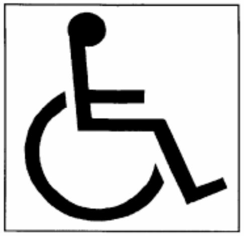
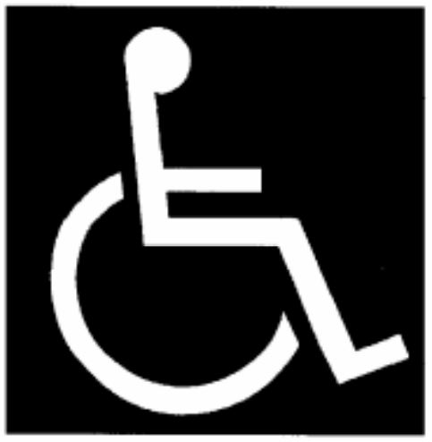

# Règlement grand-ducal du 17 septembre 2004 portant modification du règlement grand-ducal modifié du 9 janvier 2001 transposant la directive 98/18/CE du Conseil du 17 mars 1998 établissant des règles et normes de sécurité pour les navires à passagers.

Nous Henri, Grand-Duc de Luxembourg, Duc de Nassau,

Vu la [loi modifiée du 9 novembre 1990](https://legilux.public.lu/eli/etat/leg/loi/1990/11/09/n1/jo) ayant pour objet la création d’un registre public maritime luxembourgeois;

Vu la [directive 2003/24/CE](https://legilux.public.lu/eli/dir_ue/2003/24/jo) du Parlement européen et du Conseil du 14 avril 2003 modifiant la [directive 98/18/CE](https://legilux.public.lu/eli/dir_ue/1998/18/jo) du Conseil établissant des règles et normes de sécurité pour les navires à passagers;

Vu la [directive 2003/75/CE](https://legilux.public.lu/eli/dir_ue/2003/75/jo) de la Commission du 29 juillet 2003 modifiant l’annexe I de la [directive 98/18/CE](https://legilux.public.lu/eli/dir_ue/1998/18/jo) du Conseil établissant des règles et normes de sécurité pour les navires à passagers;

Notre Conseil d’Etat entendu;

Sur le rapport de Notre Ministre des Transports et après délibération du Gouvernement en conseil.

Arrêtons:

## Art. 1er.

L’article 1er du [règlement grand-ducal modifié du 9 janvier 2001](https://legilux.public.lu/eli/etat/leg/rgd/2001/01/09/n2/jo) transposant la [directive 98/18/CE](https://legilux.public.lu/eli/dir_ue/1998/18/jo) du Conseil du 17 mars 1998 établissant des règles et normes de sécurité pour les navires à passagers est remplacé par le texte suivant:

> 1\) «conventions internationales»: la convention internationale de 1974 pour la sauvegarde de la vie humaine en mer ([convention SOLAS de 1974](https://www.imo.org/fr/About/Conventions/Pages/International-Convention-for-the-Safety-of-Life-at-Sea-(SOLAS)%2C-1974.aspx)), et la convention internationale de 1966 sur les lignes de charge, ainsi que les protocoles et les modifications de ces conventions, dans leurs versions actualisées;
>
> 2\) «recueil de règles de stabilité à l’état intact»: le «recueil de règles de stabilité à l’état intact de tous les types de navires visés par des instruments de l’OMI», contenu dans la résolution A.749 (18) de l’assemblée de l’OMI du 4 novembre 1993, dans sa version actualisée;
>
> 3\) «recueil HSC»: le «recueil international de règles de sécurité applicables aux engins à grande vitesse» contenu dans la résolution MSC 36 (63) du comité de la sécurité maritime de l’OMI du 20 mai 1994, dans sa version actualisée;
>
> 4\) «recueil DSC»: le «recueil de règles de sécurité applicables aux engins à portance dynamique», contenu dans la résolution MSC 373(10) du comité de la sécurité maritime de l’OMI, du 14 novembre 1977, dans sa version actualisée;
>
> 5\) «SMDSM»: le système mondial de détresse et de sécurité en mer tel qu’il figure dans le chapitre IV de la [convention SOLAS de 1974](https://www.imo.org/fr/About/Conventions/Pages/International-Convention-for-the-Safety-of-Life-at-Sea-(SOLAS)%2C-1974.aspx), dans sa version actualisée;
>
> 6\) «navire à passagers»: tout navire qui transporte plus de douze passagers;
>
> 7\) «engin à passagers à grande vitesse»: tout engin à grande vitesse tel que défini dans la règle X/1 de la [convention SOLAS de 1974](https://www.imo.org/fr/About/Conventions/Pages/International-Convention-for-the-Safety-of-Life-at-Sea-(SOLAS)%2C-1974.aspx), dans sa version actualisée, qui transporte plus de douze passagers; ne sont pas considérés comme engins à grande vitesse les navires à passagers de classe B, C ou D, qui effectuent des voyages nationaux dans des zones maritimes lorsque:
>
> aash leur déplacement correspondant à la ligne de flottaison est de moins de 500 m3, et
>
> bash leur vitesse maximale, telle que définie au point 1.4.30 du recueil HSC, est inférieure à 20 nœuds;
>
> 8\) «navire neuf»: tout navire dont la quille est posée, ou qui se trouve à un stade de construction équivalent à la date ou après la date du 1er juillet 1998. On entend par «stade de construction équivalent», le stade auquel:
>
> 1\. la construction identifiable à un navire particulier commence et
>
> 2\. le montage du navire a commencé, employant au moins 50 tonnes ou un pour cent de la masse estimée de tous les matériaux de structure, si cette dernière valeur est inférieure;
>
> 9\) «navire existant»: tout navire qui n’est pas un navire neuf;
>
> 10\) «passager»: toute personne autre que:
>
> 1\. le capitaine et les membres d’équipage ou les autres personnes employées ou occupées en quelque qualité que ce soit à bord d’un navire pour les besoins de ce navire et
>
> 2\. les enfants de moins d’un an;
>
> 11\) «longueur du navire»: sauf disposition expresse contraire, la longueur égale à 96 pour cent de la longueur totale à la flottaison située à une distance du dessus de quille égale à 85 pour cent du creux minimal sur quille ou à la distance entre la face avant de l’étrave et l’axe de la mèche du gouvernail à cette flottaison, si cette valeur est supérieure. Dans les navires conçus pour naviguer avec une quille inclinée, la flottaison à laquelle cette longueur est mesurée doit être parallèle à la flottaison en charge prévue;
>
> 12\) «hauteur d’étrave»: la hauteur d’étrave définie à la règle 39 de la convention internationale de 1966 sur les lignes de charge comme la distance verticale au droit de la perpendiculaire avant, entre la flottaison correspondant au franc-bord d’été assigné et à l’assiette prévue et le livet en abord du pont exposé;
>
> 13\) «navire muni d’un pont complet»: tout navire doté d’un pont complet, exposé aux intempéries et à la mer, qui a des moyens permanents de fermeture de toutes les ouvertures de la partie exposée et au-dessous duquel toutes les ouvertures sur les bordés du navire sont équipées de moyens permanents de fermeture au moins étanches aux intempéries;
>
> Le pont complet peut être un pont étanche à l’eau ou une structure équivalente consistant en un pont non étanche à l’eau entièrement couvert d’une structure étanche aux intempéries d’une résistance adéquate pour maintenir l’étanchéité aux intempéries et équipée de systèmes permanents de fermeture étanches aux intempéries;
>
> 14\) «voyage international»: tout voyage par mer d’un port d’un Etat membre de la Communauté européenne vers un port situé hors de cet Etat membre, ou inversement;
>
> 15\) «voyage national»: tout voyage effectué dans des zones maritimes entre un port d’un Etat membre de la Communauté européenne et le même port ou un autre port de cet Etat membre;
>
> 16\) «zone maritime»: une zone telle que définie conformément à l’article 3. Toutefois, pour l’application des dispositions relatives aux radiocommunications, les définitions des zones maritimes sont celles figurant dans la règle 2 du chapitre IV de la [convention SOLAS de 1974](https://www.imo.org/fr/About/Conventions/Pages/International-Convention-for-the-Safety-of-Life-at-Sea-(SOLAS)%2C-1974.aspx);
>
> 17\) «zone portuaire»: toute zone qui n’est pas une zone maritime telle que définie par les Etats membres de la Communauté européenne et qui s’étend jusqu’aux installations portuaires permanentes les plus éloignées formant partie intégrante du système portuaire ou jusqu’aux limites définies par les caractéristiques géographiques naturelles protégeant un estuaire ou une zone abritée similaire;
>
> 18\) «refuge»: toute zone naturellement ou artificiellement abritée qui peut être utilisée comme abri par un navire ou un engin soumis à des conditions qui risquent de mettre en danger sa sécurité;
>
> 19\) «administration de l’Etat du pavillon»: les autorités compétentes de l’Etat dont le navire ou l’engin est autorisé à battre pavillon. Pour le Grand-Duché de Luxembourg, il s’agit du Commissariat aux affaires maritimes;
>
> 20\) «Etat d’accueil»: l’Etat membre de la Communauté européenne au départ ou à destination du ou des ports desquels un navire ou un engin battant pavillon d’un Etat membre de la Communauté européenne autre que cet Etat effectue un voyage national;
>
> 21\) «organisme agréé»: tout organisme agréé conformément à l’article 3 du [règlement grand-ducal du 8 septembre 1997](https://legilux.public.lu/eli/etat/leg/rgd/1997/09/08/n4/jo) transposant la [directive 94/57/CE](https://legilux.public.lu/eli/dir_ue/1994/57/jo) établissant des règles et normes communes concernant les organismes habilités à effectuer l’inspection et la visite des navires et les activités pertinentes des administrations maritimes;
>
> 22\) «un mille»: 1.852 mètres;
>
> 23\) «hauteur significative de la vague»: la hauteur moyenne de la vague calculée sur la base du tiers constitué par les vagues les plus élevées observées sur une période donnée;
>
> 24\) «directive»: la [directive 98/18/CE](https://legilux.public.lu/eli/dir_ue/1998/18/jo) du Conseil du 17 mars 1998 établissant des règles et normes de sécurité pour les navires à passagers;
>
> 25\) «compagnie»: le propriétaire du navire ou tout autre organisme ou personne auquel le propriétaire du navire a confié la responsabilité de l’exploitation du navire;
>
> 26\) «[loi du 9 novembre 1990](https://legilux.public.lu/eli/etat/leg/loi/1990/11/09/n1/jo)»: [loi du 9 novembre 1990](https://legilux.public.lu/eli/etat/leg/loi/1990/11/09/n1/jo) ayant pour objet la création d’un registre public maritime luxembourgeois, modifiée par la [loi du 14 avril 1992](https://legilux.public.lu/eli/etat/leg/loi/1992/04/14/n3/jo) instituant un code disciplinaire et pénal pour la marine marchande et la [loi du 17 juin 1994](https://legilux.public.lu/eli/etat/leg/loi/1994/06/17/n5/jo) modifiant et complétant la [loi du 9 novembre 1990](https://legilux.public.lu/eli/etat/leg/loi/1990/11/09/n1/jo) ayant pour objet la création d’un registre public maritime luxembourgeois;
>
> 27\) «navire roulier à passagers»: un navire transportant plus de douze passagers, doté d’espaces rouliers à cargaison ou d’espaces de catégorie spéciale, tels que définis à la règle II-2/A/2 figurant à l’annexe I du présent règlement;
>
> 28\) «âge»: l’âge du navire, exprimé en nombres d’années écoulées depuis sa date de livraison;
>
> 29\) «personne à mobilité réduite»: toute personne ayant des difficultés particulières pour utiliser les transports publics, y compris les personnes âgées, les personnes handicapées, les personnes souffrant de handicaps sensoriels et les personnes en fauteuil roulant, les femmes enceintes et les personnes accompagnées d’enfants en bas âge.

## Art. 2.

L’article 3, paragraphe 2 du [règlement grand-ducal modifié du 9 janvier 2001](https://legilux.public.lu/eli/etat/leg/rgd/2001/01/09/n2/jo) précité est remplacé par le texte suivant:

> «2. La liste des zones maritimes est établie par chaque Etat membre de la Communauté européenne disposant d’une côte maritime qui les publie dans une base de données publique consultable sur le site Internet de l’autorité maritime compétente de cet Etat membre.»

## Art. 3.

Les articles suivants sont ajoutés au [règlement grand-ducal modifié du 9 janvier 2001](https://legilux.public.lu/eli/etat/leg/rgd/2001/01/09/n2/jo) précité:

> ***«Article 5 bis.* — *Prescriptions de stabilité et retrait progressif des navires rouliers à passagers***
>
> 1\. Tous les navires rouliers à passagers des classes A, B et C dont la quille a été posée le 1eroctobre 2004 ou après cette date, ou qui se trouvent alors à un stade de construction équivalent, se conforment aux dispositions des articles 6, 8 et 9 de la [directive 2003/25/CE](https://legilux.public.lu/eli/dir_ue/2003/25/jo) du Parlement européen et du Conseil du 14 avril 2003 relative aux prescriptions spécifiques de stabilité applicables aux navires rouliers à passagers.
>
> 2\. Tous les navires rouliers à passagers des classes A et B dont la quille a été posée avant le 1er octobre 2004 ou qui se trouvent à un stade de construction équivalent avant cette date se conforment d’ici au 1er octobre 2010 aux dispositions des articles 6, 8 et 9 de la [directive 2003/25/CE](https://legilux.public.lu/eli/dir_ue/2003/25/jo), ou doivent être retirés du service à cette date, ou à une date ultérieure, à laquelle ils atteignent l’âge de trente ans, mais en tout cas pour le 1eroctobre 2015 au plus tard.
>
> ***Article 5 ter.* — Prescriptions de sécurité pour les personnes à mobilité réduite**
>
> 1\. Les mesures appropriées sont prises, fondées, autant que possible, sur les lignes directrices de l’annexe III, afin de garantir aux personnes à mobilité réduite un accès sûr à tous les navires à passagers neufs des classes A, B, C et D et à tous les engins à passagers à grande vitesse neufs servant aux transports publics et dont la quille est posée le 1eroctobre 2004 ou après cette date ou qui se trouvent alors à un stade de construction équivalent.
>
> 2\. Au plus tard le 17 mai 2006, le membre du gouvernement ayant dans ses attributions les affaires maritimes soumet à la Commission européenne un rapport sur la mise en œuvre du présent article en ce qui concerne tous les navires à passagers battant pavillon luxembourgeois visés au paragraphe 1.»

## Art. 4.

L’article 5, paragraphe 3, point g) du [règlement grand-ducal modifié du 9 janvier 2001](https://legilux.public.lu/eli/etat/leg/rgd/2001/01/09/n2/jo) précité est supprimé avec effet au 1er janvier 2005.

## Art. 5.

La section 5-1 du chapitre III de l’annexe I du [règlement grand-ducal modifié du 9 janvier 2001](https://legilux.public.lu/eli/etat/leg/rgd/2001/01/09/n2/jo) précité est remplacée par l’annexe I du présent règlement.

## Art. 6.

Les annexes II et III du présent règlement sont ajoutées au [règlement grand-ducal modifié du 9 janvier 2001](https://legilux.public.lu/eli/etat/leg/rgd/2001/01/09/n2/jo) précité.

## Art. 7.

Notre Ministre de l’Economie et du Commerce Extérieur est chargé de l’exécution du présent règlement qui sera publié au Mémorial.

Le Ministre de l’Economie et du Commerce Extérieur,   Jeannot Krecké

Palais de Luxembourg, le 17 septembre 2004.   Henri

\**ANNEXE I**

> \**«5-1 Prescriptions applicables aux navires rouliers à passagers (règle 26)**
>
> NAVIRES ROULIERS DES CLASSES B, C ET D, CONSTRUITS AVANT LE 1ER JANVIER 2003:
>
> 1\. Les navires rouliers à passagers construits avant le 1er janvier 2003 sont conformes aux exigences des paragraphes 6.2, 6.3, 6.4, 7, 8 et 9 au plus tard à la date de la première visite périodique effectuée après le 1er janvier 2006.
>
> Avant cette date, les paragraphes 2, 3, 4 et 5 sont applicables pour les navires rouliers construits avant le 1er janvier 2003.
>
> Sans préjudice de ce qui précède, lorsque des engins ou dispositifs de sauvetage sont remplacés sur des navires de ce type, ou lorsque ces navires font l’objet de réparations, modifications ou transformations d’importance majeure qui impliquent le remplacement de leurs engins ou dispositifs de sauvetage existants ou tout ajout à ces derniers, ces engins ou dispositifs de sauvetage sont conformes aux exigences correspondantes des paragraphes 6, 7, 8 et 9.
>
> 2\. *Radeaux de sauvetage*
>
> 2.1 Les radeaux de sauvetage des navires rouliers à passagers doivent être desservis par des dispositifs d’évacuation en mer conformes aux prescriptions de la règle SOLAS III/48.5 telle qu’en vigueur au 17 mars 1998 ou par des dispositifs de mise à l’eau conformes aux prescriptions de la règle SOLAS III/48.6 telle qu’en vigueur au 17 mars 1998, qui soient également répartis sur chaque bord du navire.
>
> La communication doit être assurée entre le poste d’embarquement et la plate-forme.
>
> 2.2 Tous les radeaux de sauvetage des navires rouliers à passagers doivent être munis de dispositifs d’amarrage leur permettant de surnager librement, qui satisfont aux prescriptions de la règle SOLAS III/23 telle qu’en vigueur au 17 mars 1998.
>
> 2.3 Tous les radeaux de sauvetage des navires rouliers à passagers doivent être munis d’une rampe d’accès satisfaisant aux prescriptions de la règle SOLAS III/39.4.1 ou de la règle SOLAS III/40.4.1 en vigueur au 17 mars 1998, selon le cas.
>
> 2.4 Tous les radeaux de sauvetage des navires rouliers à passagers doivent être soit des radeaux du type à redressement automatique, soit des radeaux réversibles munis d’une tente qui sont stables sur houle et peuvent être exploités en toute sécurité quel que soit le côté sur lequel ils flottent. Lorsqu’ils sont justifiés par le parcours abrité des voyages et les conditions climatiques favorables de la zone et de la période d’exploitation, le commissaire aux affaires maritimes peut autoriser des radeaux de sauvetage gonflables, ouverts et réversibles pour autant que ceux-ci satisfassent entièrement aux prescriptions de l’annexe 10 du Recueil international de règles de sécurité applicables aux engins à grande vitesse.
>
> A titre de variante, le navire doit avoir à son bord, en plus de son chargement normal de radeaux, des radeaux de sauvetage à redressement automatique ou des radeaux de sauvetage réversibles munis d’une tente, ayant une capacité totale suffisante pour recevoir au moins 50 % des personnes que ne peuvent recevoir les embarcations de sauvetage. Cette capacité supplémentaire à bord de radeaux de sauvetage doit être déterminée sur la base de la différence entre le nombre total de personnes à bord et le nombre de personnes que peuvent recevoir les embarcations de sauvetage.
>
> Tous les radeaux de sauvetage en question doivent être approuvés par le commissaire aux affaires maritimes compte tenu des recommandations adoptées par l’OMI dans la circulaire MSC/Circ. 809, publiée à l’annexe III du présent règlement et conformément à l’article 67 de la [loi modifiée du 9 novembre 1990](https://legilux.public.lu/eli/etat/leg/loi/1990/11/09/n1/jo) ayant pour objet la création d’un registre public maritime luxembourgeois.
>
> 3\. *Canots de secours rapides*
>
> 3.1 Au moins un des canots de secours prévus à bord des navires rouliers à passagers doit être un canot de secours rapide approuvé par le commissaire aux affaires maritimes compte tenu des recommandations adoptées par l’OMI dans la circulaire MSC/Circ. 809 et conformément à l’article 67 de la [loi modifiée du 9 novembre 1990](https://legilux.public.lu/eli/etat/leg/loi/1990/11/09/n1/jo) ayant pour objet la création d’un registre public maritime luxembourgeois.
>
> 3.2 Chaque canot de secours rapide doit être desservi par un engin de mise à l’eau approprié approuvé par le commissaire aux affaires maritimes, conformément à l’article 67 de la [loi modifiée du 9 novembre 1990](https://legilux.public.lu/eli/etat/leg/loi/1990/11/09/n1/jo) ayant pour objet la création d’un registre public maritime luxembourgeois. Lorsqu’elle approuve de tels engins, le commissaire aux affaires maritimes doit tenir compte du fait que les canots de secours rapides doivent pouvoir être mis à l’eau et récupérés même dans des conditions météorologiques très défavorables et elle doit aussi tenir compte des recommandations adoptées par l’OMI.
>
> 3.3 Deux équipages au moins par canot de secours rapide doivent être formés et s’exercer régulièrement, compte tenu de la section A-VI/2, tableau A-VI/2-2, «Normes de compétence minimale spécifiée en matière d’exploitation des canots de secours rapides» du code de formation des gens de mer, de délivrance des brevets et de veille (code STCW) et des recommandations adoptées par l’OMI dans la résolution A.771 (18) dans sa version modifiée, notamment en ce qui concerne tous les aspects du sauvetage, de la manutention, de la manœuvre, de l’exploitation de ces canots dans diverses conditions et de leur redressement après chavirement.
>
> 3.4 Lorsque l’agencement ou la taille d’un navire roulier à passagers existant sont tels qu’il n’est pas possible d’installer le canot de secours rapide prescrit au point 3.1, le canot de secours rapide peut être installé à la place d’une embarcation de sauvetage existante qui est acceptée en tant que canot de secours ou à la place d’embarcations destinées à être utilisées en cas d’urgence, sous réserve que toutes les conditions énoncées ci-après soient remplies:
>
> 3.4.1 le canot de secours rapide ainsi installé est desservi par un engin de mise à l’eau conforme aux dispositions du point 3.2;
>
> 3.4.2 la réduction de la capacité des embarcations et radeaux de sauvetage causée par cette substitution est compensée par l’installation de radeaux de sauvetage capables de recevoir un nombre de personnes au moins égal à celui que l’embarcation de sauvetage ainsi remplacée aurait pu recevoir, et
>
> 3.4.3 ces radeaux de sauvetage sont desservis par les dispositifs de mise à l’eau ou d’évacuation en mer existants.
>
> 4\. *Moyens de récupération*
>
> 4.1 Chaque navire roulier à passagers doit être muni de moyens efficaces permettant de récupérer rapidement les survivants se trouvant dans l’eau et de transférer des survivants à bord du navire à partir d’unités de sauvetage ou d’embarcations ou de radeaux de sauvetage.
>
> 4.2 Les moyens permettant de transférer les survivants à bord du navire peuvent faire partie soit d’un dispositif d’évacuation en mer, soit d’un dispositif prévu pour le sauvetage.
>
> Ces moyens doivent être approuvés par le commissaire aux affaires maritimes compte tenu des recommandations adoptées par l’OMI dans la circulaire MSC/Circ. 810, publiée à l’annexe III du présent règlement et conformément à l’article 67 de la [loi modifiée du 9 novembre 1990](https://legilux.public.lu/eli/etat/leg/loi/1990/11/09/n1/jo) ayant pour objet la création d’un registre public maritime luxembourgeois.
>
> 4.3 Lorsque la glissière du dispositif d’évacuation en mer est destinée à servir de moyen de transfert des survivants jusqu’au pont du navire, elle doit être munie de lignes à main ou d’échelles pour aider les personnes à remonter.
>
> 5\. *Brassières de sauvetage*
>
> 5.1 Nonobstant les prescriptions des règles SOLAS III/7.2 et III/22.2, un nombre suffisant de brassières de sauvetage doit être entreposé à proximité des postes de rassemblement afin que les passagers ne soient pas obligés de retourner dans leur cabine pour y prendre leur brassière de sauvetage.
>
> 5.2 A bord des navires rouliers à passagers, toutes les brassières de sauvetage doivent être munies d’un appareil lumineux satisfaisant aux prescriptions de la règle SOLAS III/32.2 en vigueur au 17 mars 1998.
>
> NAVIRES ROULIERS DES CLASSES B, C ET D, CONSTRUITS APRÈS LE 1ER JANVIER 2003:
>
> 6\. *Radeaux de sauvetage*
>
> 6.1 Les radeaux de sauvetage des navires rouliers à passagers doivent être desservis par des dispositifs d’évacuation en mer conformes aux prescriptions de la section 6.2 du Recueil LSA ou par des dispositifs de mise à l’eau conformes aux prescriptions du paragraphe 6.1.5 du Recueil LSA, qui soient également répartis sur chaque bord du navire.
>
> La communication doit être assurée entre le poste d’embarquement et la plate-forme.
>
> 6.2 Tous les radeaux de sauvetage des navires rouliers à passagers doivent être munis de dispositifs d’amarrage leur permettant de surnager librement, qui satisfont aux prescriptions de la règle SOLAS III / 13.4.
>
> 6.3 Tous les radeaux de sauvetage des navires rouliers à passagers doivent être munis d’une rampe d’accès satisfaisant aux prescriptions du paragraphe 4.2.4.1 ou 4.3.4.1 du Recueil LSA, selon le cas.
>
> 6.4 Tous les radeaux de sauvetage des navires rouliers à passagers doivent être soit des radeaux du type à redressement automatique, soit des radeaux réversibles munis d’une tente qui sont stables sur houle et peuvent être exploités en toute sécurité quel que soit le côté sur lequel ils flottent. Lorsqu’ils sont justifiés par le parcours abrité des voyages et les conditions climatiques favorables de la zone et de la période d’exploitation, le commissaire aux affaires maritimes peut autoriser des radeaux de sauvetage gonflables, ouverts et réversibles pour autant que ceux-ci satisfassent entièrement aux prescriptions de l’annexe 10 du Recueil international de règles de sécurité applicables aux engins à grande vitesse.
>
> A titre de variante, le navire doit avoir à son bord, en plus de son chargement normal de radeaux, des radeaux de sauvetage à redressement automatique ou des radeaux de sauvetage réversibles munis d’une tente, ayant une capacité totale suffisante pour recevoir au moins 50 pour cent des personnes que ne peuvent recevoir les embarcations de sauvetage. Cette capacité supplémentaire à bord de radeaux de sauvetage doit être déterminée sur la base de la différence entre le nombre total de personnes à bord et le nombre de personnes que peuvent recevoir les embarcations de sauvetage. Tous les radeaux de sauvetage en question doivent être approuvés par le commissaire aux affaires maritimes compte tenu des recommandations adoptées par l’OMI dans la circulaire MSC/Circ. 809 et conformément à l’article 67 de la [loi modifiée du 9 novembre 1990](https://legilux.public.lu/eli/etat/leg/loi/1990/11/09/n1/jo) ayant pour objet la création d’un registre public maritime luxembourgeois.
>
> 7\. *Canots de secours rapides*
>
> 7.1 Au moins un des canots de secours prévus à bord des navires rouliers à passagers doit être un canot de secours rapide approuvé par le commissaire aux affaires maritimes compte tenu des recommandations adoptées par l’OMI dans la circulaire MSC/Circ. 809 et conformément à l’article 67 de la [loi modifiée du 9 novembre 1990](https://legilux.public.lu/eli/etat/leg/loi/1990/11/09/n1/jo) ayant pour objet la création d’un registre public maritime luxembourgeois.
>
> 7.2 Chaque canot de secours rapide doit être desservi par un engin de mise à l’eau approprié approuvé par le commissaire aux affaires maritimes. Lorsqu’il approuve de tels engins, le commissaire aux affaires maritimes doit tenir compte du fait que les canots de secours rapides doivent pouvoir être mis à l’eau et récupérés même dans des conditions météorologiques très défavorables et elle doit aussi tenir compte des recommandations adoptées par l’OMI.
>
> 7.3 Deux équipages au moins par canot de secours rapide doivent être formés et s’exercer régulièrement, compte tenu de la section A-VI/2, tableau A-VI/2-2, «Normes de compétence minimale spécifiée en matière d’exploitation des canots de secours rapides» du code de formation des gens de mer, de délivrance des brevets et de veille (code STCW) et des recommandations adoptées par l’OMI dans la résolution A.771 (18) dans sa version modifiée, notamment en ce qui concerne tous les aspects du sauvetage, de la manutention, de la manœuvre, de l’exploitation de ces canots dans diverses conditions et de leur redressement après chavirement.
>
> 7.4 Lorsque l’agencement ou la taille d’un navire roulier à passagers existant sont tels qu’il n’est pas possible d’installer le canot de secours rapide prescrit au point 3.1, le canot de secours rapide peut être installé à la place d’une embarcation de sauvetage existante qui est acceptée en tant que canot de secours ou à la place d’embarcations destinées à être utilisées en cas d’urgence, sous réserve que toutes les conditions énoncées ci-après soient remplies:
>
> 7.4.1 le canot de secours rapide ainsi installé est desservi par un engin de mise à l’eau conforme aux dispositions du point 3.2;
>
> 7.4.2 la réduction de la capacité des embarcations et radeaux de sauvetage causée par cette substitution est compensée par l’installation de radeaux de sauvetage capables de recevoir un nombre de personnes au moins égal à celui que l’embarcation de sauvetage ainsi remplacée aurait pu recevoir, et
>
> 7.4.3 ces radeaux de sauvetage sont desservis par les dispositifs de mise à l’eau ou d’évacuation en mer existants.
>
> 8\. *Moyens de récupération*
>
> 8.1 Chaque navire roulier à passagers doit être muni de moyens efficaces permettant de récupérer rapidement les survivants se trouvant dans l’eau et de transférer des survivants à bord du navire à partir d’unités de sauvetage ou d’embarcations ou de radeaux de sauvetage.
>
> 8.2 Les moyens permettant de transférer les survivants à bord du navire peuvent faire partie soit d’un dispositif d’évacuation en mer, soit d’un dispositif prévu pour le sauvetage.
>
> Ces moyens doivent être approuvés par le commissaire aux affaires maritimes compte tenu des recommandations adoptées par l’OMI dans la MSC/Circ. 810 et conformément à l’article 67 de la [loi modifiée du 9 novembre 1990](https://legilux.public.lu/eli/etat/leg/loi/1990/11/09/n1/jo) ayant pour objet la création d’un registre public maritime luxembourgeois.
>
> 8.3 Lorsque la glissière du dispositif d’évacuation en mer est destinée à servir de moyen de transfert des survivants jusqu’au pont du navire, elle doit être munie de lignes à main ou d’échelles pour aider les personnes à remonter.
>
> 9\. *Brassières de sauvetage*
>
> 9.1 Nonobstant les prescriptions des règles SOLAS III/7.2 et III/22.2, un nombre suffisant de brassières de sauvetage doit être entreposé à proximité des postes de rassemblement afin que les passagers ne soient pas obligés de retourner dans leur cabine pour y prendre leur brassière de sauvetage.
>
> 9.2 A bord des navires rouliers à passagers, toutes les brassières de sauvetage doivent être munies d’un appareil lumineux satisfaisant aux prescriptions du paragraphe 2.2.3 du Recueil LSA."

\**ANNEXE II**

> \***«ANNEXE III***
>
> \**LIGNES DIRECTRICES CONCERNANT LES PRESCRIPTIONS DE SÉCURITÉ APPLICABLES**
>
> \**AUX NAVIRES À PASSAGERS ET AUX ENGINS À PASSAGERS À GRANDE VITESSE À**
>
> \**L’EGARD DES PERSONNES À MOBILITÉ RÉDUITE**
>
> \*(visées à l’article 5 ter)*
>
> Pour l’application des lignes directrices figurant à la présente annexe, il y a lieu de tenir compte de la circulaire MSC/735 du 24 juin 1996 de l’OMI intitulée «Recommandation relative à la conception et à l’exploitation des navires à passagers en fonction des besoins spécifiques des personnes âgées et des handicapés», publiée à l’annexe IV du présent règlement.
>
> 1\. **Accès au navire**
>
> Les navires devraient être construits et équipés de manière à ce que les personnes à mobilité réduite puissent embarquer et débarquer facilement et en toute sécurité, et devraient garantir l’accès d’un pont à l’autre sans assistance ou au moyen de rampes ou d’ascenseurs. La direction de l’accès destiné aux personnes à mobilité réduite devrait être indiquée aux autres points d’accès au navire et à des endroits appropriés dans l’ensemble du navire.
>
> 2\. **Signalétique**
>
> La signalétique prévue à bord des navires pour aider les passagers devrait être placée à la portée des personnes à mobilité réduite (y compris des personnes souffrant de handicaps sensoriels), être facile à lire et être placée à des endroits stratégiques.
>
> 3\. **Moyens de transmission de messages**
>
> Les bateaux devraient être équipés de moyens embarqués permettant à l’exploitant de transmettre aux personnes atteintes de différentes formes de mobilité réduite des annonces verbales et visuelles concernant notamment les retards, les changements d’horaire et les services offerts à bord.
>
> 4\. **Alarme**
>
> Le système d’alarme et les boutons d’alarme/d’appel doivent être conçus de façon à être accessibles à tous les passagers à mobilité réduite, notamment aux personnes souffrant de handicaps sensoriels et aux personnes ayant des troubles de l’apprentissage, et à alerter ces passagers.
>
> 5\. **Prescriptions supplémentaires garantissant la mobilité à l’intérieur du navire**
>
> Les mains courantes, coursives, passages, ouvertures de communication et portes doivent se prêter au déplacement d’une personne en fauteuil roulant. Les ascenseurs, ponts à véhicules, salons des passagers, logements et toilettes doivent être conçus pour être accessibles de manière raisonnable et proportionnée aux personnes à mobilité réduite.»

\**ANNEXE III**

> \***«ANNEXE IV***
>
> Circulaire MSC 735 de l’OMI (24 juin 1996): Recommandation relative à la conception et à l’exploitation des navires à passagers en fonction des besoins spécifiques des personnes âgées et des handicapés.
>
> Circulaire MSC 809 de l’OMI (30 juin 1997): Recommandation relative aux radeaux de sauvetage réversibles munis d’une tente, aux radeaux à redressement automatique et aux canots de secours rapides, y compris la mise à l’essai, à bord des navires rouliers à passagers.
>
> Circulaire MSC 810 de l’OMI (30 juin 1997): Recommandation sur les moyens de récupération à bord des navires rouliers à passagers.»

\**RECOMMANDATION RELATIVE A LA CONCEPTION ET A L’EXPLOITATION DES NAVIRES**

\**A PASSAGERS EN FONCTION DES BESOINS SPECIFIQUES ET DE LA SECURITE DES**

\**PERSONNES AGEES ET DES HANDICAPES**

1 En cas d’urgence à bord d’un navire à passagers, la plupart des passagers sont censés pouvoir se diriger par leurs propres moyens des locaux d’habitation au pont d’embarquement. Il faudrait donner une attention particulière à l’intégration des passagers dont la mobilité est réduite - notamment les personnes infirmes, très jeunes, âgées et handicapées, au reste des passagers lors de la conception des navires à passagers et de l’élaboration des plans d’urgence les concernant.

2 Il faudrait, aux fins de sécurité, que les navires à passagers neufs soient dans la mesure du possible conçus de manière à ce que les personnes âgées et les handicapés ne soient confrontés à aucun obstacle dans les locaux de réunion et dans les échappées vers les postes de rassemblement.

3 Il faudrait donner aux membres d’équipage appelés à aider des personnes âgées et les handicapés à bord des consignes types d’aide requise en cas d’urgence.

4 A bord des navires disposant de cabines à passagers:

.1 il faudrait de préférence attribuer aux personnes âgées et handicapées susceptibles d’avoir besoin d’aide en cas d’urgence, des cabines situées à proximité du pont d’embarquement afin que l’on puisse les aider à se rendre aux postes de rassemblement le plus rapidement et le plus facilement possible, et

.2 il faudrait préparer lors de chaque voyage une liste des cabines occupées par des passagers auxquels l’équipage devra venir en aide dans une situation d’urgence.

5 L’appendice à la présente annexe contient des directives relatives à la conception et à l’exploitation des navires à passagers neufs en fonction des besoins spécifiques des personnes âgées et des handicapés. Ces directives s’appliquent tout particulièrement aux transbordeurs rouliers à passagers qui font partie du système de transports publics. Sous réserve des modifications nécessaires, ces directives pourront également être utiles lors de la planification de la construction et de l’exploitation d’autres types de navires à passagers.

APPENDICE

\**DIRECTIVES RELATIVES A LA CONCEPTION ET A L’EXPLOITATION DES NAVIRES A**

\**PASSAGERS NEUFS EN FONCTION DES BESOINS SPECIFIQUES DES PERSONNES AGEES ET**

\**DES HANDICAPES**

\**INTRODUCTION**

1 On observe une prise de conscience croissante des difficultés qu’éprouvent les personnes âgées et les handicapés à participer à la vie socio-économique et de la nécessité de les atténuer. Il convient, pour intégrer les personnes âgées et les handicapés au reste des passagers, d’étudier avec soin la conception des navires à passagers neufs. Compte tenu des différences considérables entre les navires à passagers tels que les transbordeurs rouliers et les navires de croisière, tant du point de vue de la conception, de la construction, des ports où ils sont amenés à faire escale, des caractéristiques des passagers et du mode d’exploitation, ces navires devraient être examinés séparément. Les paragraphes suivants contiennent des recommandations sur la conception et l’exploitation des navires à passagers neufs, en particulier les transbordeurs qui font partie du système de transports publics.

\**RENSEIGNEMENTS GENERAUX A DONNER AVANT L’EMBARQUEMENT**

2 Il faudrait donner au public en général et aux passagers éventuels des renseignements généraux concernant les services et l’assistance offerts aux personnes âgées et aux handicapés sur une route donnée et ce, sous une forme adaptée aux malvoyants, par exemple au moyen de caractères imprimés de grande dimension et de bandes sonores.

\**ACCES AUX GARES MARITIMES**

3 Pour tenir compte des besoins spécifiques des personnes âgées et des handicapés, y compris les utilisateurs de fauteuils roulants, lors de la création d’une gare maritime destinée à accueillir des navires à passagers, il faut notamment:

.1 assurer, dans la mesure du possible, la disponibilité de moyens de transport publics à l’usage des personnes âgées et des handicapés à des prix comparables à ceux payés par les autres voyageurs;

.2 faciliter, dans la mesure du possible, l’utilisation des services de taxis et des moyens de transport privés pour cette catégorie de passagers;

.3 assurer la libre circulation entre les entrées et les sorties de la gare maritime, de préférence sans changement de niveau;

.4 assurer le plein accès à toutes les zones de service, telles que les boutiques hors taxe, les toilettes, les restaurants et les magasins. Les toilettes devraient aussi pouvoir être utilisées par les personnes se déplaçant en fauteuil roulant et leur accompagnateur (homme ou femme);

.5 veiller à ce que l’aménagement des toilettes, des fontaines d’eau potable, des téléphones et des panneaux de commande des ascenseurs soit adapté aux besoins des handicapés moteur, ainsi que des passagers malentendants et malvoyants;

.6 prévoir, à l’intention des personnes âgées et des handicapés, des sièges réservés et, notamment, des endroits pour les fauteuils roulants; la hauteur des sièges devrait être adaptée et des accoudoirs devraient être prévus pour aider les passagers atteints d’une infirmité;

.7 prévoir, pour les véhicules des passagers handicapés, des emplacements spécialement marqués sur les ponts-garages des transbordeurs rouliers offrant un libre accès jusqu’aux ascenseurs;

.8 veiller à ce que toutes les instructions visuelles (c’est-à-dire les renseignements relatifs à la sécurité) soient affichées de la façon la mieux dimensionnée et la plus claire possible à l’intention des malentendants et de ceux dont la vue est diminuée et, chaque fois que cela est nécessaire, des annonces précédées d’une tonalité pour attirer l’attention devraient être faites par haut-parleur à l’intention des aveugles et de ceux dont la vue est fortement diminuée;

.9 prévoir des moyens appropriés pour communiquer aux malentendants des renseignements concernant la sécurité et le transport dont ils pourraient ne pas avoir connaissance autrement;

.10 améliorer la communication avec les handicapés sensoriels, en réservant des zones spéciales où seraient centralisées toutes les aides et les installations d’interprétation nécessaires et, lorsque cela est possible, prévoir un circuit dans le système de communication sonore pour le branchement des appareils de correction auditive;

.11 fournir au personnel des compagnies de navigation, des ports, des services d’immigration et des douanes une formation adaptée, ainsi que des renseignements et des instructions normalisés sur la façon de venir en aide aux passagers handicapés.

\**ACCES AU NAVIRE**

4 Le navire devrait être construit et équipé de manière à ce que les utilisateurs de fauteuils roulants et autres personnes handicapées puissent embarquer et débarquer facilement en toute sécurité, soit sans assistance, soit à l’aide de rampes, d’élévateurs ou d’ascenseurs. La pente maximale des rampes pour fauteuils roulants devrait être de 1/20. Le navire devrait posséder au moins une voie d’accès pouvant être empruntée par des handicapés et des utilisateurs de fauteuils roulants. Cette voie d’accès devrait être dépourvue d’escaliers et de marches et être signalée par le symbole agréé au plan international des installations et autres facilités à l’usage des handicapés. Une notice explicative sur la façon de se rendre à cette voie d’accès devrait être affichée sur toutes les autres voies d’accès au navire et à tous les autres emplacements appropriés à bord du navire.

\**TRIAGE DES VOITURES**

5 Pour ce qui est des transbordeurs, les voitures conduites par des handicapés ou ayant des passagers handicapés à leur bord, devraient être identifiées par une marque distinctive à l’entrée de l’aire de triage et être orientées vers un couloir de triage distinct avant d’embarquer sur le navire. Le préposé à l’entrée de l’aire de triage devrait pouvoir communiquer avec le responsable de l’aire de triage et le personnel à bord du navire. Les couloirs de triage ne devraient pas comporter de rebord (différence de niveau) risquant d’empêcher les handicapés de sortir d’une voiture en stationnement. L’équipage devrait diriger les passagers handicapés vers une place de stationnement spéciale à bord du navire et leur venir en aide, notamment pour sortir le fauteuil roulant de la voiture. L’équipage devrait également leur venir en aide à l’arrivée.

\**STATIONNEMENT DES VOITURES A BORD**

6 Les transbordeurs devraient disposer de places de stationnement spéciales permettant aux utilisateurs de fauteuils roulants de sortir de leurs voitures. Le nombre de places pourrait évoluer en fonction de la demande. Les places de stationnement peuvent également être utilisées par des handicapés qui n’utilisent pas de fauteuils roulants. Les utilisateurs de fauteuils roulants devraient pouvoir circuler librement des places de stationnement aux installations pour passagers.

\**ASCENSEURS**

7 Il devrait y avoir au moins un ascenseur du pont-garage à un pont permettant de se diriger librement vers les espaces ouverts au public, les cabines et les toilettes. Les dimensions au sol des ascenseurs devraient être d’au moins 110 cm de large et 140 cm de profondeur. Ils devraient être munis de portes automatiques laissant une ouverture d’au moins 90 cm. Une main courante devrait être installée sur trois côtés à 90-100 cm au-dessus du sol. Les commandes devraient être placées à 90-120 cm environ au-dessus du sol, à au moins 50 cm de l’angle de l’ascenseur, une poignée étant située à proximité. Ils devraient être munis d’un strapontin placé à portée des commandes. Le plancher de l’ascenseur devrait être au même niveau que ce celui du pont, le palier desservant l’ascenseur étant au même niveau que ce dernier et mesurant au moins 150 x 150 cm. Les ascenseurs ne peuvent être remplacés par des escaliers mécaniques.

8 Les boutons du panneau de commande devraient mesurer au moins 2 cm de diamètre et être éclairés. Ils ne devraient pas être trop faciles à manoeuvrer. Ils devraient être d’une couleur contrastée à la couleur du panneau de commande. Les boutons pour l’arrêt en cas d’urgence et pour le signal d’alarme devraient être d’une forme nettement distincte des autres boutons de l’ascenseur. Celui de l’arrêt d’urgence devrait être rouge et celui du signal d’alarme devrait être jaune. Les boutons devraient porter de gros caractères en relief.

\**AMENAGEMENTS**

9 Les ouvertures desservant les locaux de réunion devraient être assez larges pour laisser passer librement les fauteuil roulants; l’ouverture libre devrait être d’au moins 80 cm. Il devrait s’agir de portes automatiques ou en position ouverte lorsque cela ne va pas à l’encontre des prescriptions en matière de sécurité. Il conviendrait d’éviter les obstacles tels que les hiloires dans les locaux à passagers et de les éliminer partout ailleurs, par exemple au moyen de rampes ou d’hiloires rétractables. Toutefois, les hiloires prescrites en vertu de la Convention sur les lignes de charge ou de toute autre norme de sécurité ne peuvent être enlevées. Les rampes et les hiloires devraient être d’une couleur contrastée.

10 Les escaliers devraient être construits de manière à être faciles à monter pour les personnes âgées et les handicapés. Ils ne devraient pas être trop raides et à pas fermés. Les marches devraient être conçues avec un degré élevé de sécurité en ce qui concerne la hauteur, la profondeur, la couleur, l’éclairage et le risque de dérapage. Eu égard aux personnes âgées et aux malvoyants, le rebord de chaque marche devrait être d’une couleur vive contrastée (sur une largeur d’environ 25 mm à la verticale et à l’horizontale). Il conviendrait de prévoir des deux côtés des escaliers des mains courantes ayant un profil rond de 45 à 50 mm de diamètre construites en un matériau de prise facile et d’une couleur contrastée; les mains courantes devraient se prolonger au-delà des escaliers sur 300 mm à ses deux extrémités. Elles devraient être fixées à une hauteur de 850 mm au-dessus des marches. Il conviendrait de prévoir un écart d’au moins 45 mm entre la cloison et la barre de la main courante. Des indications tactiles devraient être prévues aux deux extrémités de chaque série de marches.

11 Pour chaque centaine de passagers que le navire est autorisé à transporter, il faudrait réserver au moins une place pour un fauteuil roulant afin que l’utilisateur du fauteuil roulant puisse voyager dans son fauteuil parmi les autres passagers. L’on devrait pouvoir mettre le fauteuil roulant dans un emplacement sûr.

12 Au moins 4 % des sièges du navire réservés aux passagers devraient être adaptés aux personnes handicapées. Ces sièges devraient être suffisamment spacieux et munis de poignées pouvant servir de support pour s’asseoir ou se lever du siège. Ces poignées devraient être d’une couleur contrastée. Lorsque l’espace disponible ne laisse pas assez de place aux personnes qui ont des jambes raides, le siège situé devant le siège spécialement adapté devrait être amovible. Lorsque les sièges sont disposés en rangées, les accoudoirs qui peuvent représenter un obstacle à une personne handicapée devraient pouvoir être relevés. Les sièges réservés aux personnes âgées et aux handicapés devraient être situés à proximité des échappées et des toilettes.

\**COURSIVES, PORTES ET MAINS COURANTES**

13 Il conviendrait de prévoir suffisamment d’espace libre pour permettre aux personnes âgées et aux handicapés de se déplacer, notamment à bord des navires qui sont en mer pour des périodes prolongées. Les coursives devraient être munies de mains courantes situées à 90 cm du sol, de préférence de chaque côté de la coursive. La main courante ne devrait pas comporter d’angle et posséder un diamètre d’environ 3,5-5cm. Les mains courantes devraient être d’une couleur opposée à celle du fond et il conviendrait de veiller à prévoir des indications tactiles pour fournir des orientations/renseignements aux passagers malvoyants. Des supports peuvent aussi être nécessaires dans d’autres parties du navire, notamment dans les restaurants, sur le dossier des sièges et dans les toilettes. Les coursives devraient être suffisamment larges pour que les fauteuils roulants puissent dépasser d’autres personnes.

\**PONT ET PLANCHER**

14 Les ponts et les planchers devraient être au même niveau et revêtus de surfaces antidérapantes. Lorsqu’une dénivellation est nécessaire, les marches ne devraient pas être d’une hauteur supérieure à 3 cm ou il faudrait prévoir à chaque marche une rampe grillagée ou l’équivalent et des poignées.

\**CABINES**

15 Les navires munis de cabines devraient disposer d’un certain nombre de cabines adaptées aux utilisateurs de fauteuils roulants. L’espace libre situé en face du lit ou du siège de repos devrait mesurer au moins 140 cm. Il faudrait utiliser des lits plutôt que des couchettes (rebord frontal surbaissé) afin de permettre à la personne handicapée de s’asseoir sur le lit pour se déshabiller. Lorsque l’on utilise des couchettes, la couchette inférieure devrait disposer au-dessus d’elle d’un espace libre d’au moins 110 cm de haut pour permettre de s’asseoir. Le lit devrait être situé à 50 cm du sol. L’interrupteur de la lampe de chevet se trouvant au-dessus du lit devrait être placé de manière que l’on puisse l’atteindre depuis un fauteuil roulant et depuis le lit. Les interrupteurs devraient être faciles à atteindre et placés à 90 cm du sol. Des poignées devraient être placées au niveau du lit. La porte de la cabine devrait coulisser latéralement ou s’ouvrir vers l’extérieur, à moins que la cabine soit assez spacieuse pour accommoder un fauteuil roulant tout en permettant à la porte de se rabattre vers l’intérieur. L’ouverture de la porte devrait être d’au moins 90 cm. Lorsque la cabine est munie d’un lavabo il devrait être installé de la même façon que le lave-mains situé dans les toilettes décrites ci-dessous. La cabine devrait être équipée de moyens permettant de demander de l’aide.

\**SANITAIRES**

16 En fonction de ses dimensions et de son utilisation, un navire devrait disposer d’un certain nombre de toilettes destinées aux utilisateurs de fauteuils roulants, si possible sur chaque pont à passagers. Ces toilettes peuvent être situées à l’écart des autres toilettes et peuvent être utilisées indistinctement par les hommes ou par les femmes. Des renseignements permettant de se rendre à ces toilettes devraient être affichés à l’entrée des toilettes qui ne sont pas adaptées aux utilisateurs de fauteuils roulants. Les portes devraient s’ouvrir vers l’extérieur ou coulisser latéralement; on devrait pouvoir les déverrouiller de l’extérieur en cas d’urgence à l’aide d’une clé même lorsque la porte indique «occupé». Il devrait y avoir une distance d’au moins 110 cm des toilettes au mur ou aux aménagements leur faisant face et un espace libre de 90 cm sur l’un des côtés des toilettes. Le siège des toilettes devrait se situer de 45 à 48 cm du sol. Un support pliant ou se rabattant latéralement devrait être placé de chaque côté du siège. Le lave-mains devrait être installé à portée du siège à 80 cm du sol au maximum. Il devrait être monté assez solidement pour pouvoir servir d’appui. Une glace devrait être placée à une hauteur adéquate, le rebord inférieur étant à 90 cm du sol et le rebord supérieur à 190 cm du sol. Le fauteuil roulant devrait pouvoir être glissé sous le lave-mains, la hauteur utile en dessous du lave-mains étant de 70 à 75 cm. Le savon, les serviettes, etc., devraient être placés à environ 90 à 100 cm du sol. Chaque cabinet de toilette devrait être muni d’un dispositif permettant de demander de l’aide.

\**AFFECTATION DES CABINES**

17 A bord des navires munis de cabines, il faudrait attribuer aux personnes âgées et aux handicapés qui risquent d’avoir besoin d’aide en cas d’urgence des cabines situées à proximité du pont d’embarquement afin de pouvoir les aider à se rendre à un engin de sauvetage le plus rapidement et le plus facilement possible. Il faudrait disposer d’une liste des cabines occupées par les passagers auxquels l’équipage risque d’avoir à venir en aide.

18 Les cabines et les toilettes adaptées aux utilisateurs de fauteuils roulants devraient être situées dans les espaces ouverts qui se trouvent entre les sections des cabines. Des portes automatiques seraient préférables. Les portes munies de pompes devraient être à ouverture automatique. Idéalement, la somme de la largeur de la coursive plus la largeur d’une ouverture d’accès à une coursive ou d’une ouverture de porte formant un angle de 90° par rapport à la coursive devrait être de 220 cm. Dans les locaux d’habitation les coursives de la section cabine font traditionnellement 90 cm de large. La difficulté que posent les portes de cabine et de toilette situées dans ces coursives aux utilisateurs de fauteuils roulants peut, en dernier ressort, être résolue au moyen de portes d’une ouverture de 100 cm coulissant latéralement. Cette ouverture supérieure est nécessaire pour permettre aux fauteuils roulants de pivoter pour entrer dans la cabine.

\**FORMATION DE L’EQUIPAGE**

19 L’équipage devrait recevoir une formation et des consignes précises sur l’aide à apporter aux personnes âgées et aux handicapés en situation d’urgence.

\**MESURES DESTINEES AUX PERSONNES SOUFFRANT D’ALLERGIE**

20 L’ameublement et la literie devraient être autant que possible construits en matériaux ne provoquant pas d’allergie. L’utilisation de quelques locaux devrait être interdite aux passagers accompagnés d’animaux à poil.

\**INFORMATION**

21 Lorsqu’il existe un guichet d’information, celui-ci devrait être situé à une hauteur maximale de 90 cm. Une boucle d’induction devrait être installée au guichet d’information.

22 Des affiches et des panneaux présentant l’information destinée aux passagers sous une forme simple devraient être affichés selon que de besoin, notamment sur les voies d’accès au navire. Le graphisme devrait en être simple, en caractères gras de grande dimension et d’une couleur opposée à celle du fond (par exemple, noir sur jaune). Les panneaux devraient être placés à une hauteur convenable du sol, soit environ 150 à 160 cm, et être bien éclairés. Les annonces devraient être prononcées d’une voix claire et distincte. Il faudrait envisager également d’utiliser d’autres moyens d’information (braille, moyens tactiles, bandes sonores) à l’intention des aveugles et des malvoyants.

23 Le navire devrait être muni d’un matériel permettant de communiquer dans chaque port les renseignements aux malvoyants comme aux malentendants.

\**SERVICE DISPONIBLE**

24 L’on devrait pouvoir acheter n’importe quelle catégorie de titre de transport à la gare maritime ou à bord du navire auprès des services compétents.

25 Il devrait être possible, dans les navires offrant un service de restauration, de servir les personnes âgées et les handicapés à table. Les tables devraient être conçues de manière que les utilisateurs de fauteuils roulants puissent y accéder librement.

26 Les chiens d’aveugles devraient être autorisés dans les locaux à passagers, y compris dans les zones où se trouvent les services de restauration.

27 Lorsque des téléphones sont mis à la disposition des passagers, l’un de ces téléphones au moins devrait être accessible aux utilisateurs de fauteuils roulants et il devrait être marqué en conséquence.

Symboles signalant le matériel, des installations et des facilités à

l’usage des personnes handicapées

\**RECOMMANDATION RELATIVE AUX RADEAUX DE SAUVETAGE REVERSIBLES**

\**MUNIS D’UNE TENTE, AUX RADEAUX A REDRESSEMENT AUTOMATIQUE**

\**ET AUX CANOTS DE SECOURS RAPIDES, Y COMPRIS LA MISE A L’ESSAI, A BORD DES**

\**NAVIRES ROULIERS A PASSAGERS**

1 **APPLICATION**

La présente Recommandation s’applique aux radeaux de sauvetage réversibles munis d’une tente, aux radeaux de sauvetage à redressement automatique et aux canots de secours rapides prescrits par la règle II/24-1 de la [Convention SOLAS](https://www.imo.org/fr/About/Conventions/Pages/International-Convention-for-the-Safety-of-Life-at-Sea-(SOLAS)%2C-1974.aspx) .

2 **RADEAUX DE SAUVETAGE REVERSIBLES MUNIS D’UNE TENTE**

2.1 Sauf disposition contraire de la présente section, tous les radeaux de sauvetage réversibles munis d’une tente devraient satisfaire aux prescriptions du paragraphe 4.1 et, s’ils sont gonflables, aux prescriptions du paragraphe 4.2 ou, s’ils sont rigides, aux prescriptions du paragraphe 4.3.

2.2 Les prescriptions des paragraphes 4.2.5.2 et 4.2.6.2 ne s’appliquent pas aux radeaux de sauvetage réversibles munis d’une tente de type gonflable et les prescriptions du paragraphe 4.3.5.1 ne s’appliquent pas aux radeaux de sauvetage réversibles munis d’une tente de type rigide.

2.3 Le radeau de sauvetage réversible muni d’une tente flottante devrait être à assèchement automatique. Le radeau de sauvetage devrait pouvoir être utilisé sans danger à tout moment par des personnes n’ayant reçu aucune formation.

2.4 Le canot de sauvetage réversible muni d’une tente devrait pouvoir être exploité en toute sécurité quel que soit le côté sur lequel il flotte. Le radeau de sauvetage devrait être muni d’une tente sur chacun des deux côtés de son plancher, s’il y a lieu, laquelle devrait se mettre en position lorsque le radeau est mis à l’eau et flotte. Les deux tentes devraient satisfaire aux prescriptions des paragraphes 4.1.1.5, 4.1.3.3 et 4.1.3.4.

2.5 L’armement requis aux termes du paragraphe 4.1.5 devrait être aisément accessible quel que soit le côté sur lequel flotte le radeau de sauvetage réversible muni d’une tente; à cette fin, il devrait soit être placé dans une enveloppe qui soit accessible de l’un ou de l’autre des côtés, soit être installé en double sur chaque côté du radeau de sauvetage.

2.6 Le radeau de sauvetage réversible muni d’une tente avec son armement complet devrait pouvoir à tout moment flotter en position droite sur houle, quelles que soient ses conditions de chargement.

2.7 Les radeaux de sauvetage réversibles munis d’une tente n’ont pas besoin d’être disposés de manière à pouvoir être transférés aisément d’un bord à l’autre et par conséquent, ils ne sont pas soumis à la limite de poids de 185 kg indiquée au paragraphe 4.1.2.2.

2.8 A bord des navires rouliers à passagers exploités sur des routes fixes en eaux peu profondes, pour satisfaire à la prescription selon laquelle les radeaux de sauvetage doivent être disposés de manière à ne pas être entraînés sous l’eau par le navire qui coule, on peut utiliser une bosse de radeau de sauvetage dont la longueur soit au moins égale à la profondeur maximale de l’eau plus 20 %.

3 **RADEAUX DE SAUVETAGE A REDRESSEMENT AUTOMATIQUE**

3.1 Sauf disposition contraire de la présente section, tous les radeaux de sauvetage à redressement automatique devraient satisfaire aux prescriptions du paragraphe 4.1 et, s’ils sont gonflables, aux prescriptions du paragraphe 4.2 ou, s’ils sont rigides, aux prescriptions du paragraphe 4.3.

3.2 Les prescriptions des paragraphes 4.2.5.2 et 4.2.6.2 ne s’appliquent pas aux radeaux de sauvetage à redressement automatique de type gonflable. Les prescriptions du paragraphe 4.3.5.1 ne s’appliquent pas aux radeaux de sauvetage à redressement automatique de type rigide.

3.3 Le radeau de sauvetage avec son armement complet devrait se retourner automatiquement lorsqu’il a chaviré et devrait se retrouver en position droite sur la surface de l’eau, qu’il se soit gonflé à l’envers sous l’eau ou à la surface de l’eau ou qu’il ait chaviré pour une raison quelconque après s’être gonflé.

3.4 Le radeau de sauvetage à redressement automatique de type gonflable devrait être à assèchement automatique. Le radeau de sauvetage devrait pouvoir être utilisé en toute sécurité à tout moment par des personnes n’ayant reçu aucune formation.

3.5 Les radeaux de sauvetage à redressement automatique n’ont pas besoin d’être disposés de manière à pouvoir être transférés aisément d’un bord à l’autre et par conséquent, ils ne sont pas soumis à la limite de poids de 185 kg indiquée au paragraphe 4.1.2.2.

3.6 A bord des navires rouliers à passagers exploités sur des routes fixes en eaux peu profondes, pour satisfaire à la prescription selon laquelle les radeaux de sauvetage doivent être disposés de manière à ne pas être entraînés sous l’eau par le navire qui coule, on peut utiliser une bosse de radeau de sauvetage dont la longueur soit au moins égale à la profondeur maximale de l’eau plus 20 %.

4 **CANOTS DE SECOURS RAPIDES**

Les dispositions de la présente section devraient être appliquées aux canots de secours rapides en remplacement des dispositions des Directives sur les canots de secours rapides (résolution A.656(16)).

4.1 **Prescriptions applicables aux canots de secours rapides**

4.1.1 Le canot de secours rapide et ses engins de mise à l’eau devraient être conçus de manière à ce que le canot puisse être mis à l’eau et récupéré en toute sécurité dans des conditions météorologiques et de mer défavorables.

4.1.2 Sauf disposition contraire de la présente section, tous les canots de secours rapides devraient satisfaire aux prescriptions de la section 5.1, à l'exception des paragraphes 4.4.1.5.3, 4.4.1.6, 4.4.1.6.8, 4.4.7.2, 5.1.1.6 et 5.1.1.10.

4.1.3 Nonobstant le paragraphe 5.1.1.3.1, les canots de secours rapides devraient avoir une coque d’une longueur qui ne soit ni inférieure à 6 m ni supérieure à 8,5 m, y compris les structures gonflables.

4.1.4 Les canots de secours rapides avec leur armement complet devraient pouvoir manoeuvrer pendant au moins 4 heures à une vitesse d’au moins 20 noeuds en eau calme avec un équipage de trois personnes et à une vitesse d’au moins 8 noeuds avec leur plein chargement en personnes et en armement.

4.1.5 Les canots de secours rapides devraient être du type à redressement automatique ou pouvoir être redressés aisément par deux membres de l’équipage au plus.

4.1.6 Les canots de secours rapides devraient être du type autovideur ou pouvoir être écopés rapidement.

4.1.7 Les canots de secours rapides devraient être manoeuvrés au moyen d’une barre à un poste de barre éloigné de la barre franche. Ils devraient également être pourvus d’un système de gouverne d’urgence commandant directement le gouvernail, le réacteur hydrodynamique ou le moteur hors-bord.

4.1.8 Les moteurs des canots de secours rapides devraient s’arrêter automatiquement ou être arrêtés par la manette de dégagement d’urgence du barreur en cas de chavirement. Lorsque le canot s’est redressé, chaque moteur devrait pouvoir être remis en marche à condition que la manette de dégagement d’urgence du barreur, s’il en existe une, ait été réenclenchée. Le dispositif d’alimentation en combustible et le circuit d’huile de graissage devraient être conçus de manière à ce qu’il ne s’échappe pas plus de 250 ml de combustible ou d’huile de graissage du système propulsif, en cas de chavirement du canot de secours.

4.1.9 Les canots de secours rapides devraient, si possible, être munis d’un dispositif fixe de suspension en un seul point pouvant être actionné facilement et sans danger ou d’un dispositif équivalent.

4.1.10 Tout canot de secours rigide devrait être construit de manière que, lorsqu’il est suspendu à l’élingue ou au croc de levage, il ait une résistance suffisante pour supporter une charge, sans déformation résiduelle lorsque cette charge est enlevée, dont la masse représente quatre fois son plein chargement en personnes et en armement.

4.1.11 L’armement normal du canot de secours rapide devrait inclure un appareil de radiocommunication à ondes métriques qui soit étanche à l’eau et laisse les mains libres.

4.1.12 L’équipage du canot de secours rapide devrait être composé, au minimum, du barreur et de deux membres de l’équipage ayant reçu la formation voulue et ayant participé régulièrement aux exercices requis compte tenu du Code de formation des gens de mer, de délivrance des brevets et de veille (Code STCW) et des recommandations adoptées par l’Organisation.

4.2 **Dispositifs de mise à l’eau des canots de secours rapides**

4.2.1 Tout dispositif de mise à l’eau des canots de secours rapides devrait satisfaire aux prescriptions des paragraphes 6.1.1 et 6.1.2, à l’exception du paragraphe 6.1.2.10.

4.2.2 Le dispositif de mise à l’eau devrait être muni d’un dispositif destiné à amortir les forces dues à l’interaction avec les vagues lorsque le canot de secours rapide est mis à l’eau ou récupéré. Ce dispositif devrait comprendre un élément souple destiné à atténuer les forces d’impact et un élément d’amortissement destiné à neutraliser les oscillations.

4.2.3 Le treuil devrait être pourvu d’un dispositif tenseur automatique à grande vitesse qui empêche le câble de se détendre dans toutes les conditions de mer dans lesquelles le canot de secours rapide est destiné à être exploité.

4.2.4 Les freins du treuil devraient avoir une action progressive. Lorsque le canot de secours rapide est abaissé à la vitesse maximale et que les freins sont serrés brusquement, la force dynamique supplémentaire qui s’exerce sur le câble à retardement ne devrait pas être supérieure à 0,5 fois la charge de service du dispositif de mise à l’eau.

4.2.5 La vitesse d’amenage d’un canot de secours rapide avec son plein chargement en armement et en personnes ne devrait pas dépasser 1 m/s. Nonobstant les prescriptions du paragraphe 6.1.1.9, la vitesse de hissage d’un canot de secours muni de tout son armement et avec six personnes à bord ne devrait pas être inférieure à 0,8 m/s. Le dispositif devrait également pouvoir hisser le canot de secours avec le nombre maximal de personnes que le canot de secours peut recevoir, tel que calculé conformément au paragraphe 4.4.2.

4.2.6 Il devrait rester au moins trois tours de câble sur le treuil une fois le canot de secours rapide amené jusqu’à l’eau alors que le navire est à sa flottaison d’exploitation la moins élevée et a une assiette pouvant atteindre 10° et une gîte pouvant atteindre 20° d’un bord ou de l’autre.

5 **MISE A L’ESSAI DES RADEAUX DE SAUVETAGE REVERSIBLES MUNIS D’UNE TENTE, DES RADEAUX DE SAUVETAGE A REDRESSEMENT AUTOMATIQUE ET DES CANOTS DE SECOURS RAPIDES**

Les radeaux de sauvetage réversibles munis d’une tente, les radeaux de sauvetage à redressement automatique et les canots de secours rapides devraient être mis à l’essai conformément aux dispositions de la Recommandation sur la mise à l’essai des radeaux de sauvetage réversibles munis d’une tente, des radeaux de sauvetage à redressement automatique et des canots de secours rapides qui figure en appendice.

APPENDICE

\**RECOMMANDATION SUR LA MISE A L’ESSAI DES RADEAUX DE  SAUVETAGE REVERSIBLES MUNIS D’UNE TENTE, DES RADEAUX  DE SAUVETAGE A REDRESSEMENT AUTOMATIQUE ET DES  CANOTS DE SECOURS RAPIDES A BORD DES  NAVIRES ROULIERS A PASSAGERS**

Les radeaux de sauvetage réversibles munis d’une tente, les radeaux à redressement automatique et les canots de secours rapides des navires rouliers à passagers devraient être mis à l’essai conformément aux dispositions de la Recommandation sur la mise à l’essai des engins de sauvetage (résolution A.689(17)), modifiée de la manière indiquée ci-après:

1   Ajouter ce qui suit à la fin du paragraphe 5.2:

> «A moins que les deux côtés du radeau de sauvetage réversible muni d’une tente n’aient des configurations identiques, il faudrait soumettre à cet essai les deux côtés du radeau de sauvetage.»

2   Ajouter ce qui suit à la fin du paragraphe 5.7:

> «A moins que les deux côtés du radeau de sauvetage réversible muni d’une tente n’aient des configurations identiques, il faudrait soumettre à cet essai les deux côtés du radeau de sauvetage.»

3   Ajouter ce qui suit à la fin du paragraphe 5.8:

> «A moins que les deux côtés du radeau de sauvetage réversible muni d’une tente n’aient des configurations identiques, il faudrait soumettre à cet essai les deux côtés du radeau de sauvetage.»

4   Ajouter ce qui suit à la fin du paragraphe 5.11:

> «A moins que les deux côtés du radeau de sauvetage réversible muni d’une tente n’aient des configurations identiques, il faudrait soumettre à cet essai les deux côtés du radeau de sauvetage.»

5   Ajouter ce qui suit à la fin du paragraphe 5.12:

> «A moins que les deux côtés du radeau de sauvetage réversible muni d’une tente n’aient des configurations identiques, il faudrait soumettre à cet essai les deux côtés du radeau de sauvetage.»

6   Remplacer le début du paragraphe 5.17.2 par ce qui suit:

> «5.17.2 Cet essai n’est pas requis pour un radeau de sauvetage réversible muni d’une tente. Pour cet essai, le radeau de sauvetage devrait être retourné de façon à simuler le gonflage en position retournée.»

7   Remplacer le paragraphe 5.17.2.2 par ce qui suit:

> «.2 On devrait ensuite complètement remplir d’eau la tente du radeau de sauvetage. Excepté dans le cas d’un radeau de sauvetage à redressement automatique, on peut à cette fin affaisser partiellement, si nécessaire, les supports de la tente. Un radeau de sauvetage à redressement automatique devrait se redresser automatiquement dans cet état. Si le radeau de sauvetage gonflable, autre qu’un radeau de sauvetage à redressement automatique, ne se redresse pas automatiquement, on devrait le laisser en position retournée pendant au moins 10 min avant d’essayer de le redresser.»

8   Remplacer le paragraphe 5.17.13 par ce qui suit :

> «5.17.13 Les matériaux mis à l’essai devraient satisfaire aux prescriptions suivantes:
>
> .1 Le textile devrait porter des indications permettant d’en identifier le fabricant et le numéro du lot de fabrication.
>
> .2 Critères d’essai et de performance
>
> .2.1 Les échantillons d’essai devraient être sélectionnés au hasard et les éprouvettes prélevées sur chaque échantillon conformément à la norme ISO pertinente ou aux prescriptions prévues pour chaque essai séparément.
>
> .2.2 Le textile utilisé pour la fabrication des chambres à air, des supports gonflables de tente et des planchers devrait satisfaire aux prescriptions suivantes:
>
> .2.2.1 *Résistance à la traction*
>
> A l’issue de l’essai réalisé selon la méthode décrite dans la norme ISO 1421, la résistance minimale à la traction devrait être de 2255 N/50 mm de largeur dans le sens de la chaîne et dans celui de la trame. L’allongement maximal correspondant devrait être de 30 % sur une longueur entre repères de 200 mm, l’allongement devant être exprimé en pourcentage de la longueur initiale d’essai entre les mâchoires. Si le plancher gonflable est constitué de deux couches de textile revêtu, le plancher principal devrait être conforme aux spécifications énoncées. La couche interne/externe peut avoir une résistance minimale à la traction de 1470 N/50 mm de largeur dans le sens de la chaîne et dans celui de la trame.
>
> .2.2.2 *Résistance au déchirement*
>
> A l’issue de l’essai réalisé à l’aide de l’appareillage décrit dans la norme ISO 1421, la résistance minimale au déchirement devrait être de 1030 N dans le sens de la chaîne et dans celui de la trame.
>
> Si le plancher gonflable est constitué de deux couches de textile revêtu, le plancher principal devrait être conforme aux spécifications énoncées. La couche interne/externe peut avoir une résistance minimale au déchirement de 735 N dans le sens de la chaîne et dans celui de la trame.
>
> Il conviendrait de préparer les éprouvettes comme suit:
>
> .1 découper, dans l’échantillon, trois éprouvettes dans le sens de la chaîne et trois éprouvettes dans celui de la trame, chacune de 76 ± 1 mm de largeur et de 400 mm de longueur, la longueur étant choisie sensiblement parallèle à la direction des fils de chaîne et à celle des fils de trame. Répartir les éprouvettes choisies sur toute la longueur et toute la largeur de l’échantillon. Faire une fente de 12,5 mm au milieu de chaque éprouvette, perpendiculairement à la longueur; et
>
> .2 bien serrer les éprouvettes de façon uniforme entre les mors, situés à 200 mm de distance les uns des autres, de manière à aligner l’axe longitudinal des éprouvettes sur la direction de la traction. Mettre en marche la machine comme indiqué dans la norme ISO 1421. Enregistrer la charge maximale subie comme charge de résistance au déchirement par enroulement et calculer la moyenne des résultats obtenus pour les trois éprouvettes.
>
> .2.2.3 *Réceptivité de la surface et adhérence du revêtement de surface*
>
> .1 A l’issue de l’essai réalisé suivant la méthode décrite dans la norme ISO 2411, la réceptivité de la surface sur les deux faces ne devrait pas être inférieure à 75 N/50 mm de largeur.
>
> .2 Une charge minimale de 75 N/50 mm est requise pour l’essai relatif à l’adhérence du revêtement de surface à l’état sec.
>
> .3 Une charge minimale de 50 N/50 mm est requise pour l’essai relatif à l’adhérence du revêtement de surface à l’état humide, tel que décrit au paragraphe 2.2.3.8.
>
> .4 Chacune des faces revêtues devrait être mise à l’essai. Les éprouvettes devraient être préparées comme indiqué dans la norme ISO 2411, de manière à ce qu’il y ait adhérence entre deux faces revêtues semblables.
>
> .5 L’adhésif utilisé et son mode d’application devraient faire l’objet d’un accord entre le fabricant de radeaux de sauvetage et le fabricant de textile fini et devraient être les mêmes que ceux employés pour la fabrication des radeaux.
>
> .6 L’adhérence entre l’adhésif ou la soudure et le revêtement de chacune des éprouvettes devrait tout d’abord être mesurée pour permettre de déterminer la réceptivité de la surface.
>
> .7 Il convient ensuite de mesurer l’adhérence du revêtement au textile de base en incisant une couche de revêtement pour amorcer le mode de séparation requis.
>
> .8 Après l’essai prévu à l’alinéa .4 pour vérifier l’adhérence du revêtement au textile de base, l’éprouvette devrait être immergée pendant 24 h dans une solution aqueuse à 3 % de chlorure de sodium, à une température de 20 ± 2ºC. A la fin de cette période d’immersion, l’éprouvette devrait être retirée de la solution et, encore à l’état humide, faire l’objet d’un essai suivant la méthode spécifiée dans la norme ISO 2411.
>
> .2.2.4 *Effets du vieillissement*
>
> .1 Essai de pliage. A l’issue de l’essai prescrit ci-dessous, les éprouvettes ne devraient pas présenter de fissures, de délaminage ou de fragilité visibles lorsqu’elles sont examinées sous un grossissement de x 2.
>
> .2 Essai de traction. A l’issue de l’essai prescrit ci-dessous, la résistance à la traction après vieillissement devrait correspondre à 90 % au moins de la résistance initiale.
>
> .3.1 Résistance aux ultraviolets. On procédera à cet essai conformément aux méthodes spécifiées dans la norme ISO 4892-4:1994 - Lampes à arc au carbone à flamme nue, comme suit:
>
> .1 Exposer les échantillons conditionnés, pendant 100 heures, à une lampe à arc au carbone fermée sans filtres "Corex-D". Les carbones doivent être du type arc "à lumière solaire" et revêtus de cuivre, No 22 pour la paire d’électrodes supérieures et No 13 pour la paire d’électrodes inférieures, ou d’un type équivalent. Seule la surface extérieure prévue du tissu devrait être exposée à l’arc de l’appareillage d’essai. Exposer les éprouvettes à un jet d’eau pulvérisée, en faisant fonctionner l’appareillage de telle sorte que les éprouvettes soient exposées à des cycles successifs de 102 minutes de lumière sans pulvérisation d’eau et de 18 minutes de lumière avec pulvérisation d’eau. La température du thermomètre à panneau noir doit être de 80 +5ºC. La durée totale de l’exposition devrait être de 100 h.
>
> .2 Après exposition, soumettre le matériau à un essai de résistance à la traction conformément à la procédure décrite au paragraphe .2.2.1. Sa résistance à la traction ne devrait pas être inférieure à 90 % de sa résistance initiale avant vieillissement.
>
> .3 Courber le matériau exposé, avec à l’extérieur le côté ayant le revêtement le plus épais, autour d’un mandrin de 3,2 mm et l’examiner pour voir s’il présente des fissures. Le matériau ne devrait pas présenter de fissures.
>
> .3.2 A titre de variante, cet essai peut être réalisé conformément aux méthodes spécifiées dans la norme ISO 4892-2 relative à la mise à l’essai au moyen de sources à arc au xénon. Les éprouvettes devraient être exposées dans les conditions spécifiées ci-dessous à l’aide d’un appareillage doté de lampes à arc au xénon refroidies par eau produisant un éclairement énergétique contrôlé pendant une durée d’exposition totale de 150 h.
>
> | Conditions d’exposition | Cycle obscurité (1 heure) | Cycle lumière (2 heures) |
> |---|---|---|
> | Eclairement magnétique automatique (filtre Q/B) | Nul | 0,55 W/m2 à une longueur d’onde de 340 nm |
> | Température du panneau noir | 38 ± 2°C | 70 ± 2°C |
> | Température de la lampe à sec | 38 ± 2°C | 47 ± 2°C |
> | Humidité relative | 95 ± 5 % | 50 ± 5 % |
> | Eau de conditionnement | 40 ± 4°C | 45 ± 4°C |
> | Pulvérisation d’eau | 60 min sur le devant et le dos de l’éprouvette | 40 min - 20 min - 60 min non devant de non l’éprouvette |
>
> Seule la surface extérieure prévue du tissu devrait être exposée à l’arc de l’appareillage. Après exposition, le matériau devrait être soumis à un essai de résistance à la traction conformément à la procédure décrite au paragraphe .2.2.1. Sa résistance à la traction ne devrait pas être inférieure à 90 % de sa résistance initiale avant vieillissement. Courber le matériau exposé, avec à l’extérieur le côté ayant le revêtement plus épais, autour d’un mandrin de 3,2 mm et l’examiner pour voir s’il présente des fissures. Le matériau ne devrait pas présenter de fissures.
>
> Les prescriptions relatives au comportement des matériaux qui sont spécifiées dans cette clause se rapportent au comportement de chaque éprouvette dans des conditions d’essai particulières. Etant donné que le faisceau lumineux est différent dans le cas de l’arc au carbone et dans le cas de l’arc au xénon, les résultats des essais réalisés avec l’une et l’autre de ces deux méthodes devraient être interprétés avec prudence.
>
> .4     Trois éprouvettes distinctes devraient faire l’objet des essais suivants:
>
> .1 stabilité dimensionnelle;
>
> .2 pliage: et
>
> .3 résistance à la traction.
>
> Pour les essais de stabilité dimensionnelle et de pliage (alinéas .1 et .2), découper, dans l’échantillon d’essai, quatre éprouvettes carrées d’au moins 100 mm de côté, les côtés étant sensiblement dans le sens de la chaîne et celui de la trame. Mesurer avec précision les dimensions des deux éprouvettes pour l’essai de stabilité dimensionnelle (alinéa .1). Pour l’essai de résistance à la traction (alinéa .3), découper deux séries d’éprouvettes comme indiqué au paragraphe .2.2.1.
>
> .5 A l’issue de l’essai prescrit ci-dessous, les dimensions des éprouvettes avant et après vieillissement ne devraient pas varier de plus de 2 %.
>
> .6 Essai de vieillissement
>
> .1 Suspendre librement une éprouvette pour chacun des essais de stabilité dimensionnelle et de pliage (alinéas .2.2.4.4.1 et .2.2.4.4.2) et une série d’éprouvettes pour l’essai de résistance à la traction (alinéa .2.2.4.3) à une température de 70 ± 2ºC, à l’air, pendant sept jours. Suspendre les autres éprouvettes au-dessus de l’eau, dans un récipient non hermétiquement clos, à une température de 70 ± 2ºC pendant sept jours.
>
> .2 Retirer du four de vieillissement les deux éprouvettes dont les dimensions ont été mesurées; après 15 min de repos à la température ambiante, mesurer à nouveau leurs dimensions et enregistrer le pourcentage de variation dans le sens de la chaîne et dans celui de la trame.
>
> .3 Retirer les deux autres éprouvettes. Après 15 min de repos à la température ambiante, les plier successivement en deux, parallèlement aux bords puis perpendiculairement à ceux-ci, de manière à réduire à un quart de sa dimension initiale la surface exposée de chaque éprouvette. Déplier chaque éprouvette et la replier suivant les mêmes pliures mais dans le sens inverse. Après chaque pliage, presser le pli entre le pouce et l’index: examiner les éprouvettes pour voir si elles présentent des fissures ou un délaminage ou si elles sont devenues poisseuses ou fragiles.
>
> .4 Pour l’essai de résistance à la traction, retirer les deux séries d’éprouvettes du four de vieillissement. Sécher les éprouvettes vieillies par exposition à l’humidité, à une température de 70 ± 2ºC, à l’air, pendant une heure, puis conditionner les deux séries d’éprouvettes pendant 24 h. Cet essai est réalisé conformément au paragraphe .2.2.1.
>
> .2.2.5 *Flexion à basse température*
>
> .1 A l’issue d’un essai réalisé à une température qui ne dépasse pas -50ºC selon la méthode décrite ci-dessous, l’éprouvette ne devrait pas présenter de fissures visibles lorsqu’elle est examinée sous un grossissement de x 2. Chacune des faces du textile revêtu devrait être soumise séparément à cet essai.
>
> .2 L’appareillage, la préparation des éprouvettes et la méthode d’essai devraient être conformes aux spécifications énoncées dans la norme ISO 4675, à l’exception de ce qui suit:
>
> .1 à l’issue d’un essai réalisé à la basse température spécifiée, aucune éprouvette ne devrait présenter de fissures; et
>
> .2 il faudrait découper six éprouvettes, trois dont le côté long soit sensiblement dans le sens de la chaîne et trois dont le côté long soit sensiblement dans le sens de la trame.
>
> .2.2.6 *Fissuration à la flexion*
>
> Après exposition de sa face externe à une solution aqueuse à 3 % de chlorure de sodium pendant sept jours, à une température de 20 ± 20°C, l’éprouvette devrait être mise à l’essai conformément à la norme ISO 7854. Après 200 000 flexions, elle ne devrait présenter aucune fissure ni délaminage visible lorsqu’elle est examinée sous un grossissement de x 2.
>
> .2.2.7 *Porosité*
>
> A l’issue de l’essai réalisé suivant la méthode prescrite ci-dessous, au cours duquel une pression de 27,5 kPa est appliquée et maintenue sous le tissu, l’éprouvette ne devrait présenter aucune trace de fuite pendant au moins 5 min.
>
> .1 Essai de porosité
>
> Il conviendrait de préparer et mettre à l’essai une éprouvette du tissu, conformément au paragraphe A.2.10.2 de la norme ISO TR 6065.
>
> .2.2.8 *Résistance aux huiles*
>
> .1 L’essai est réalisé selon la méthode prescrite ci-dessous. Après exposition de la surface externe à l’huile ASTM No 1, à une température de 20 ± 2ºC pendant deux heures, le revêtement ne devrait pas se séparer du textile et si l’on presse l’une contre l’autre deux surfaces exposées, elles ne devraient pas être poisseuses. Le revêtement ne devrait pas tacher lorsqu’on le frotte du doigt une seule fois.
>
> .2 L’essai devrait être effectué au moins 16 h après la vulcanisation ou le traitement.
>
> .3 L’appareillage, la préparation des éprouvettes et la méthode d’essai devraient être conformes aux spécifications énoncées au paragraphe A.2.5 de la norme ISO/TR 6065. Chacune des faces revêtues devrait être soumise à cet essai.
>
> .2.2.9 *Déformation de la trame*
>
> La trame du tissu ne devrait pas être déformée de plus de 100 mm, pour une largeur de tissu de 1,5 m. Il conviendrait de tracer un trait sur le tissu, perpendiculairement à la lisière et de mesurer la déformation de la trame, en biais et/ou courbe.
>
> .2.2.10 *Résistance au blocage*
>
> .1 L’essai est réalisé selon la méthode prescrite ci-dessous, mais sans l’épreuve de soulèvement du poids de 100 g.
>
> .2 La préparation des éprouvettes et la méthode d’essai devraient être conformes aux spécifications énoncées dans la norme ISO 5978; toutefois, la température devrait être de 70 ± 2ºC et la charge devrait être appliquée pendant sept jours.
>
> .2.2.11 *Résistance à l’hydrolyse, uniquement pour les matériaux comportant un revêtement thermoplastique*
>
> .1 Les essais réalisés selon les méthodes décrites ci-dessous devraient aboutir aux résultats suivants: .1 Adhérence du revêtement .2 Résistance au blocage .3 Essai de pliage 50 N/50 mm au minimum. 100 g au maximum. Pas de fissure, de délaminage ou de détérioration visible.
>
> .2 Il conviendrait d’appliquer les prescriptions ci-dessous aux tissus ou aux éprouvettes qui ont été placés sur l’eau contenue dans un récipient fermé, pendant 12 semaines à une température de 93ºC.
>
> .3 L’essai ci-après devrait être effectué après séchage des éprouvettes pendant une heure à une température de 80 ± 2ºC, et après conditionnement à une température de 20 ± 2ºC pendant 24 h, l’humidité relative étant de 65 %.
>
> .4 L’adhérence du revêtement des éprouvettes devrait être préparée et mise à l’essai conformément aux spécifications énoncées au paragraphe .2.2.3, lorsque les conditions requises au paragraphe .2.2.11.2 ont été remplies.
>
> .5 L’essai de résistance au blocage devrait être réalisé conformément aux spécifications énoncées au paragraphe .2.2.10.
>
> .6 Il conviendrait de découper deux échantillons carrés de 100 ± 2 mm dans le matériau conservé. Il faudrait plier les échantillons selon les instructions données à l’alinéa .2.2.4.6.3 et les examiner pour déterminer la présence de fissures ou d’un délaminage et vérifier s’ils sont devenus poisseux ou fragiles.
>
> .2.2.12 *Résistance à l’ozone*
>
> .1 A l’issue de l’essai réalisé selon la méthode prescrite ci-dessous, aucune fissure ne devrait être visible sous un grossissement de x 5.
>
> .2 La préparation des éprouvettes et la méthode d’essai devraient être conformes aux spécifications de la norme ISO 3011.
>
> Les critères applicables sont les suivants: .1  Concentration en ozone 50 pphm .2  Température 20 ± 2ºC .3  Durée de l'exposition 8 heures .4  Diamètre du mandrin épaisseur de l'échantillon x 6
>
> .2.3 Le tissu utilisé pour la fabrication des tentes extérieures devrait être conforme aux prescriptions suivantes:
>
> .2.3.1 *Résistance à la traction*
>
> A l’issue de l’essai réalisé selon la méthode prescrite au paragraphe .2.2.1, la résistance minimale à la traction devrait être de 930N/50 mm de largeur dans le sens de la chaîne et dans celui de la trame.
>
> .2.3.2 *Résistance au déchirement*
>
> A l’issue de l’essai réalisé selon la méthode prescrite au paragraphe .2.2.2, la résistance minimale au déchirement devrait être de 490 N dans le sens de la chaîne et dans celui de la trame.
>
> .2.3.3 *Flexion à basse température*
>
> A l’issue de l’essai à une température qui ne soit pas supérieure à -30ºC selon la méthode prescrite au paragraphe .2.2.5, l’éprouvette ne devrait pas présenter de fissure visible lorsqu’elle est examinée sous un grossissement de x 2.
>
> Chacune des faces du tissu revêtu devrait être soumise à l’essai séparément
>
> .2.3.4 *Imperméabilité*
>
> .1 Au cours de l’essai selon la méthode prescrite ci-dessous, l’eau ne devrait pas avoir filtré à travers le cône au bout de 30 min. Le tissu revêtu ne devrait contenir aucun matériau dont on sait qu’il est nuisible pour un survivant buvant de l’eau de pluie accumulée sur la tente.
>
> Le tissu peut être revêtu soit sur un côté soit sur les deux côtés.
>
> .2 L’éprouvette devrait mesurer 300 mm sur 300 mm et être mise à l’essai selon la méthode suivante:
>
> Plier l’éprouvette deux fois perpendiculairement aux bords et la déplier de manière à ce qu’elle forme un cône. Fixer le cône avec un trombone et l’insérer dans un entonnoir approprié placé sur un flacon. Verser 500 ml d’eau dans le cône. Enregistrer toute infiltration d’eau ayant traversé le cône au bout de 30 min.
>
> .2.3.5 *Réceptivité de la surface et adhérence du revêtement de surface*
>
> A l’issue de l’essai réalisé selon la méthode prescrite au paragraphe .2.2.3, la réceptivité de la surface des deux côtés ne devrait pas être inférieure à 25N/50 mm de la surface de largeur.
>
> Un minimum de 25N/50 mm est exigé pour l’adhérence du revêtement.
>
> .2.3.6 *Couleur*
>
> Il faudrait évaluer la tente du radeau de sauvetage après l’essai d’amarrage décrit au paragraphe 5.5 ou à l’aide d’une méthode équivalente utilisant la lumière artificielle afin de déterminer si la couleur du revêtement est suffisamment résistante.
>
> .2.3.7 *Effets du *vieillissement**
>
> .1 Essai de pliage. A l’issue de l’essai réalisé selon la méthode prescrite au paragraphe .2.2.4, il ne devrait pas y avoir de fissures, de délaminage ou de fragilité visibles lorsque les éprouvettes sont examinées sous un grossissement de x 2.
>
> .2 Résistance à la traction. A l’issue de l’essai réalisé selon la méthode prescrite au paragraphe .2.2.4, les éprouvettes devraient conserver au moins 90 % de leur résistance initiale à la traction dans le sens de la chaîne et dans celui de la trame.
>
> .2.4 Le tissu utilisé pour les tentes intérieures devrait être conforme aux prescriptions suivantes:
>
> .2.4.1 *Résistance à la traction*
>
> A l’issue de l’essai réalisé selon la méthode prescrite au paragraphe .2.2.1, la résistance minimale à la traction devrait être de 100 N/50 mm de largeur dans le sens de la chaîne et dans celui de la trame.
>
> .2.4.2 *Porosité*
>
> La tente intérieure constitue une barrière destinée à créer une couche d’air statique et devrait donc être d’une texture serrée ou avoir une faible porosité à l’air. »

9   Remplacer le texte actuel du paragraphe 5.17.9 et son titre par ce qui suit:

> "Essai de résistance des coutures.
>
> .1 Il faudrait démontrer que des échantillons de coutures, préparés dans les mêmes conditions que lors de la production, peuvent résister à une charge d’essai équivalente à la valeur minimale spécifiée pour l’essai de résistance à la traction des textiles utilisés pour la fabrication des radeaux de sauvetage.
>
> .2 Résistance de la soudure
>
> .2.1 Lors de l’essai réalisé à l’aide de la méthode décrite ci-dessous, la charge requise pour faire céder la soudure ne devrait pas être inférieure à 175 N;
>
> .2.2 Les éprouvettes devraient être préparées et mises à l’essai de la manière indiquée au paragraphe .3.3 ci-dessous;
>
> .3 Lorsque les matériaux utilisés sont revêtus de thermoplastique, les essais de résistance à l’hydrolyse devraient être réalisés avec des échantillons de coutures soudées. Les essais devraient être réalisés de la manière suivante:
>
> .3.1 A l’issue de l’essai réalisé à l’aide de la méthode décrite ci-dessous, la résistance de la soudure de l’échantillon de couture ne devrait pas être inférieure à 125 N/25 mm.
>
> .3.2 Méthode d’essai:
>
> .1 Placer les éprouvettes d’essai sur l’eau contenue dans un récipient fermé, pendant douze semaines, à une température de 93 ± 2ºC.
>
> .2 Après avoir conditionné les éprouvettes de la manière indiquée ci-dessus, sécher les éprouvettes pendant une heure à une température de 80 ± 2ºC et les conditionner à une température de 20 ± 2ºC pendant 24 h, l’humidité relative étant de 65 %.
>
> .3.3 Les échantillons soudés devraient être préparés de la façon suivante:
>
> Deux échantillons de tissu de 300 mm x 200 mm, le côté court étant parallèle à la direction des fils de chaîne, devraient être superposés endroit sur envers pour les tissus à double revêtement, ou endroit sur endroit pour les tissus à un seul revêtement ou à revêtement asymétrique. Ils devraient être soudés à l’aide d’un outil d’une largeur de 10 ± 1 mm et d’une longueur appropriée. Des éprouvettes de 25 mm de largeur devraient être découpées transversalement à la ligne de la soudure. Les échantillons soudés devraient être montés dans un appareil d’essai suivant les indications de la norme ISO 1421. La charge maximale à laquelle le tissu s’écaille devrait être enregistrée.»

10   Ajouter les nouvelles sections 5.18, 5.19, 5.20 et 5.21 ci-après:

> «5.18 **Essais supplémentaires applicables uniquement aux radeaux de sauvetage à redressement automatique**
>
> 5.18.1 Les radeaux de sauvetage à redressement automatique de type rigide devraient être soumis à l’essai de redressement décrit aux paragraphes 5.17.2.1 et 5.17.2.2.
>
> 5.18.2 Il faudrait prévoir un dispositif approprié qui permette de faire tourner le radeau de sauvetage sur son axe longitudinal en eau calme puis de le relâcher. Le radeau de sauvetage devrait être pourvu de son armement complet mais sans aucune personne à bord, ses entrées et ouvertures étant telles qu’elles étaient lorsqu’il était emballé, et dans le cas d’un radeau de sauvetage gonflable, le radeau devrait être complètement gonflé. Le radeau de sauvetage devrait être incliné progressivement jusqu’à un angle de gîte de 180º et devrait être relâché. Après avoir été relâché, le radeau de sauvetage devrait toujours se remettre en position droite sans aucune aide.
>
> 5.19 **Essai d’immersion applicable aux radeaux de sauvetage à redressement automatique et aux radeaux de sauvetage réversibles munis d’une tente**
>
> Le radeau de sauvetage devrait être immergé à une profondeur d’au moins 4 m et, s’il est du type gonflable, il devrait être immergé à cette profondeur emballé dans son enveloppe. Un radeau de sauvetage rigide devrait être lâché à cette profondeur et, s’il est du type gonflable, il faudrait commencer à le gonfler à cette profondeur. Le radeau de sauvetage devrait flotter à la surface, et se retrouver dans sa condition d’exploitation prévue, prêt à recevoir des personnes repêchées dans des conditions de mer correspondant à une hauteur de houle significative d’au moins 2 m et à un vent de force 6 sur l’échelle de Beaufort.
>
> 5.20 **Essais relatifs à la vitesse du vent**
>
> 5.20.1  L’Administration devrait exiger, pour une série de radeaux de sauvetage, qu’au moins:
>
> .1 un radeau de sauvetage d’une série de radeaux de sauvetage ayant une capacité de 6 à 25 personnes, à condition que les caractéristiques de leurs matériaux et de leur construction soient similaires; et
>
> .2 chaque radeau de sauvetage d’une capacité supérieure à 25 personnes, à moins qu’il puisse être démontré que cela est inutile du fait des caractéristiques de ses matériaux et de sa construction,
>
> soient mis à l’essai dans les conditions spécifié es dans les paragraphes qui suivent pour la vitesse du vent.
>
> 5.20.2   Le ou les radeaux de sauvetage, emballés avec l’entrée en position ouverte mais sans enveloppe, devraient être gonflés en étant exposés à un vent soufflant à une vitesse de 30 m/s et devraient être laissés dans cet état pendant 10 min.
>
> 5.20.3   Alors que le vent souffle à la vitesse indiquée ci-dessus, le ou les radeaux de sauvetage devraient, lorsque cela est possible, être débordés jusqu’à un angle d’environ 30º sur tribord et, à partir de cette position, jusqu’à un angle d’environ 30º sur bâbord puis être ramenés à la position initiale.
>
> 5.20.4   A l’issue de ces premiers essais, il ne devrait pas y avoir de séparation entre la voûte de support ou la tente et la chambre à air supérieure ou tout autre dommage qui gêne le bon fonctionnement du ou des radeaux.
>
> 5.20.5   Le ou les radeaux devraient ensuite être exposés à un vent soufflant à la vitesse indiquée ci-dessus pendant 5 min dans chacune des conditions suivantes:
>
> .1 avec l’entrée exposée au vent en position ouverte et les autres entrées, s’il en existe, en position fermée;
>
> .2 avec l’entrée exposée au vent en position fermée et les autres entrées, s’il en existe, en position ouverte;
>
> .3 avec toutes les entrées en position fermée.
>
> A l’issue de cet essai, le ou les radeaux de sauvetage ne devraient présenter aucun signe de dommage qui gênerait son (leur) bon fonctionnement.
>
> 5.21 **Essai d’assèchement automatique du plancher des radeaux de sauvetage réversibles munis d’une tente et des radeaux de sauvetage à redressement automatique.**
>
> 5.21.1   Il faudrait pomper de l’eau à l’intérieur du radeau de sauvetage, alors qu’il est à flot, à raison de 2 300 litres par minute pendant 1 minute.
>
> 5.21.2   Après l’arrêt du débit d’eau et l’évacuation de l’eau, il ne devrait pas y avoir une trop grande quantité d’eau dans le radeau de sauvetage.
>
> 5.21.3   Si un radeau de sauvetage est compartimenté par des bancs de nage ou par d’autres moyens, chacun des compartiments devrait être soumis à cet essai.»

11   Ajouter les nouvelles sections 7.4, 7.5 et 7.6 ci-après :

> **«7.4 Canots de secours rapides de type rigide**
>
> Les canots de secours rapides de type rigide devraient être soumis aux essais prescrits aux paragraphes 6.2 à 6.13 (excepté les paragraphes 6.4, 6.5.2, 6.6, 6.7.2, 6.8.1, 6.10.5, 6.10.6, 6.11.1), 6.15 (si le canot se redresse automatiquement) et 7.1.3, 7.2.4.2, 7.2.10, 7.2.11 (si le canot est équipé d’un moteur hors-bord) et 7.2.13 (sauf qu’un moteur plus puissant n’est pas requis dans le cas d’un canot équipé d’un moteur intérieur).
>
> 7.4.1 Essais de surcharge
>
> 7.4.1.1 Le canot, lorsqu’il est suspendu à l’élingue ou au croc de levage, devrait être chargé d’une masse convenablement répartie correspondant à quatre fois le poids de son armement et du plein chargement en personnes pour lequel il doit être approuvé. Les poids devraient être répartis en fonction de son chargement en service mais on n’est pas tenu de placer les poids représentant les personnes à 300 mm au-dessus des sièges.
>
> 7.4.1.2 La méthode qui consiste à remplir le canot d’eau ne devrait pas être acceptée. Cette méthode de chargement ne permet pas d’avoir une répartition convenable des poids. Les machines peuvent être enlevées afin d’éviter qu’elles ne soient endommagées, auquel cas des poids devraient être rajoutés pour tenir compte de ce fait.
>
> 7.4.1.3 A l’issue de l’essai, le canot ainsi que l’élingue ou le croc et dispositif de fermeture devraient être examinés et ne devraient présenter aucun signe d’endommagement.
>
> 7.4.2 Essais de fonctionnement
>
> Essai de fonctionnement du moteur et de consommation de carburant
>
> 7.4.2.1 Le canot devrait être chargé de poids égaux à la masse de l’armement et du nombre de personnes pour lequel il doit être approuvé. On devrait faire démarrer le moteur et faire des manoeuvres pendant au moins 4 h pour prouver que son fonctionnement est satisfaisant. On devrait démontrer que le canot peut remorquer à une vitesse de 2 noeuds le radeau de sauvetage le plus grand du navire chargé du nombre de personnes pour lequel il doit être approuvé et de son armement.
>
> 7.4.2.2 Le canot devrait être essayé à une vitesse de 8 noeuds au moins avec son plein chargement en personnes et en armement et de 20 noeuds avec un équipage de trois personnes pendant une période suffisante pour que l’on puisse déterminer la quantité de carburant consommée et vérifier que le réservoir de carburant a la capacité requise.
>
> 7.4.3 Essai de redressement (si le canot de secours rapide de type rigide ne se redresse pas automatiquement)
>
> Il faudrait démontrer qu’avec son moteur et, dans le cas d’un moteur hors-bord, sans son moteur et le carburant ou une masse équivalente qui représente le moteur et le réservoir de carburant, le canot de secours rapide de type rigide peut être redressé par deux membres au plus de son équipage s’il est à l’envers dans l’eau.
>
> **7.5 Canots de secours rapides de type gonflé**
>
> Les canots de secours rapides de type gonflé devraient être soumis aux essais prescrits aux paragraphes 6.3, 6.5.1, 6.7.1, 6.8.2, 6.10.1 à 6.10.4, 6.11 (excepté le paragraphe 6.11.1), 6.12, 6.13, 6.15 (si le canot se redresse automatiquement), 7.1.3, 7.2.2 à 7.2.11 (si le canot est équipé d’un moteur hors-bord), 7.2.12 (si le canot ne se redresse pas automatiquement), 7.2.13 à 7.2.19 et 7.4.2.
>
> **7.6 Canots de secours rapides de type rigide/gonflé**
>
> 7.6.1 Les canots de secours rapides de type rigide/gonflé devraient être soumis aux essais prescrits aux paragraphes 6.2 (pour la coque), 7.2.17 (pour la partie gonflée), 6.3, 6.5.1, 6.7.1, 6.8.2, 6.10.1 à 6.10.4, 6.11 (excepté le paragraphe 6.11.1), à 6.13, 6.15 (si le canot se redresse automatiquement), 7.1.3, 7.2.2 à 7.2.11 (si le canot est équipé d’un moteur hors-bord), 7.4.3 (si le canot ne se redresse pas automatiquement), 7.2.13 (sauf qu’un moteur plus puissant n’est pas requis dans le cas d’un canot équipé d’un moteur intérieur), 7.2.14, 7.2.18, 7.2.19, 7.4.1 et 7.4.2.
>
> 7.6.2 Les essais prescrits aux paragraphes 7.2.8, 7.2.9 et 7.2.18 ne sont pas applicables aux canots de secours rapides de type rigide/gonflé dont la flottaison est située au-dessous de la partie inférieure de la chambre à air gonflée.»

12   Remplacer la cinquième phrase du paragraphe 8.1.4 par ce qui suit:

> «Dans le cas d’un dispositif de mise à l’eau pour embarcation de sauvetage ou canot de secours, la charge d’essai ne devrait pas descendre de plus de 1 m lorsque l’on serre le frein. Dans le cas d’un dispositif de mise à l’eau pour canot de secours rapide, la charge d’essai devrait s’arrêter rapidement mais progressivement et la force dynamique résiduelle qui s’exerce sur le câble ne devrait pas être supérieure à 0,5 fois la charge de service du dispositif de mise à l’eau.»

13   Ajouter ce qui suit à la fin de la dernière phrase du paragraphe 8.1.5:

> «ou 0,8 m/s dans le cas d’un dispositif de mise à l’eau pour canot de secours rapide.»

14   Ajouter le nouveau paragraphe 8.1.8 ci-après:

> «8.1.8 Le dispositif de mise à l’eau pour canot de secours rapide devrait être mis à l’essai dans des conditions de mer correspondant à un vent de force 6 sur l’échelle de Beaufort et à une hauteur de houle significative d’au moins 3 m. Cet essai devrait comprendre la mise à l’eau et la récupération d’un canot de secours rapide et démontrer:
>
> .1 que le dispositif destiné à amortir les forces et les oscillations dues à l’interaction avec les vagues fonctionne de façon satisfaisante;
>
> .2 que le frein du treuil fonctionne de façon satisfaisante; et
>
> .3 que le dispositif de tensionnement fonctionne de façon satisfaisante.»

ANNEXE

\**RECOMMANDATION SUR LES MOYENS DE RECUPERATION  A BORD DES NAVIRES ROULIERS A PASSAGERS**

\**1 Champ d’application**

La présente recommandation devrait s’appliquer aux moyens de récupération à bord des navires rouliers à passagers qui sont prescrits par la règle III/24-1.4 de la [Convention SOLAS](https://www.imo.org/fr/About/Conventions/Pages/International-Convention-for-the-Safety-of-Life-at-Sea-(SOLAS)%2C-1974.aspx).

\**2 Prescriptions applicables aux moyens de récupération**

2.1 Les moyens de récupération devraient permettre d’assurer le transfert en toute sécurité de personnes, y compris de personnes en état d’incapacité, du niveau de l’eau jusqu’au pont du navire.

2.2 Les moyens de récupération devraient offrir une surface d’au moins 9 m2 au niveau de l’eau destinée à recevoir les personnes récupérées.

2.3 L’aire de récupération sur laquelle le moyen de récupération est mis à l’eau devrait être convenablement éclairée à partir du pont du navire.

2.4 Le moyen de récupération devrait être un des moyens suivants:

.1 un système d’évacuation en mer conforme aux prescriptions du paragraphe 6.2 offrant une plateforme flottante appropriée, munie d’une échelle ou d’un autre moyen permettant aux personnes valides de monter sur le pont, ainsi qu’un moyen mécanique pour hisser en toute sécurité des personnes allongées. Si un passage incliné de système d’évacuation en mer doit servir de moyen de transfert de la plateforme au pont du navire pour les personnes valides, ledit passage incliné devrait être muni de poignées adaptées ou d’échelles mobiles comportant des échelons à surface véritablement antidérapante.

.2 Un dispositif conforme aux prescriptions applicables aux radeaux de sauvetage sous bossoirs figurant aux paragraphes 4.1.3.1, 4.1.4.1, 4.1.5.1.1 et, dans le cas d’un dispositif gonflable, aux paragraphes 4.2.2, 4.2.2.1, 4.2.2.3, 4.2.2.4, 4.2.7, 4.2.8.1, 4.2.8.2 (s’il en est prévu) et 4.2.9.1, ou dans le cas d’un dispositif rigide, aux paragraphes 4.3.1, 4.3.2, 4.3.6.2, 4.3.6.3, 4.3.6.4, 4.3.6.6, 4.3.6.9, 4.3.6.10 et 4.3.7, qui permette de disposer d’une plate-forme flottante appropriée. Le dispositif devrait être utilisé avec un système de mise à l’eau satisfaisant aux prescriptions du paragraphe 6.1 ou un système équivalent, muni d’un treuil à moteur capable de hisser le dispositif chargé du niveau de l’eau jusqu’au pont du navire avec le nombre total de personnes pour lequel il est approuvé en tant que moyen de récupération, à une vitesse qui ne soit pas inférieure à 0,3 m/s. Un mécanisme de sécurité devrait être prévu afin d’empêcher que le système de mise à l’eau ne soit soumis à des contraintes excessives. En outre, le dispositif devrait satisfaire aux dispositions suivantes:

.2.1 le dispositif devrait être d’une couleur très visible et être protégé contre les avaries lorsqu’il se déplace contre le bordé du navire;

.2.2 les occupants devraient être protégés contre les blessures causées par le système de mise à l’eau;

.2.3 deux rampes d’accès satisfaisant aux dispositions du paragraphe 4.2.4.1 ou du paragraphe 4.3.4.1 devraient être prévues;

.2.4 le nombre maximum de personnes pouvant prendre place sur le dispositif devrait être marqué bien en évidence;

.2.5 le plancher devrait être du type à assèchement automatique;

.2.6 il devrait être prévu des moyens appropriés pour rapprocher le dispositif du bordé du navire;

.2.7 un couteau du type décrit au paragraphe 4.1.5.1.2 devrait être arrimé dans une poche située à proximité de la plaque de fixation de chaque rapprocheur;

.2.8 un aménagement particulier devrait être prévu pour combler l’espace séparant le dispositif chargé et le pont lorsque les personnes récupérées montent à bord;

.2.9 le dispositif devrait porter, à un emplacement très visible, une marque de nature à éviter toute confusion avec les radeaux de sauvetage;

.2.10 si le dispositif est gonflable, le système de gonflage devrait être déclenché rapidement à l’aide d’une commande manuelle; et

.2.11 il devrait être prévu un moyen d’empêcher les occupants de tomber du dispositif en cas de choc contre le bordé du navire.

.3 Un moyen de récupération approuvé par l’Administration qui satisfasse aux dispositions de la règle III/4.3 de la [Convention SOLAS](https://www.imo.org/fr/About/Conventions/Pages/International-Convention-for-the-Safety-of-Life-at-Sea-(SOLAS)%2C-1974.aspx).

\**3 Mise à l’essai**

3.1 Il conviendrait de démontrer que le moyen de récupération est capable de recevoir et de porter des personnes récupérées hors de l’eau au niveau de la mer.

3.2 Il conviendrait de démontrer que le moyen de récupération peut rapidement transférer des personnes du niveau de l’eau jusqu’au pont du navire.

3.3 Il conviendrait de démontrer que la conception d’un moyen de récupération conforme aux prescriptions du paragraphe 2.4.2 ci-dessus satisfait aux mêmes prescriptions en matière de structure qu’un radeau de sauvetage sous bossoirs de capacité équivalente et qui a été soumis aux essais prévus à la section 5 de la première partie de l’annexe à la résolution A.689(17).

3.4 Le système de rapprochement devrait être soumis à l’essai spécifié au paragraphe 5.6 de la première partie de l’annexe à la résolution A.689(17).

3.5 Il conviendrait de démontrer que le plancher du moyen de récupération est du type à assèchement automatique afin de veiller à réduire au minimum l’accumulation d’eau.

3.6 Il conviendrait de démontrer que le moyen de récupération est capable de hisser du niveau de l’eau jusqu’au pont du navire une masse égale à la masse du nombre de personnes pour lequel il est approuvé à la vitesse de 0,3 m/s.

3.7 Un moyen de récupération, satisfaisant aux prescriptions du paragraphe 2.4.2 ci-dessus, devrait être soumis aux essais spécifiés dans la partie 2 de l’annexe à la résolution A.689(17) pour les radeaux de sauvetage sous bossoirs et les systèmes de mise à l’eau.

[Dir. 2003/24/CE](https://legilux.public.lu/eli/dir_ue/2003/24/jo) et [Dir. 2003/75/CE](https://legilux.public.lu/eli/dir_ue/2003/75/jo)
