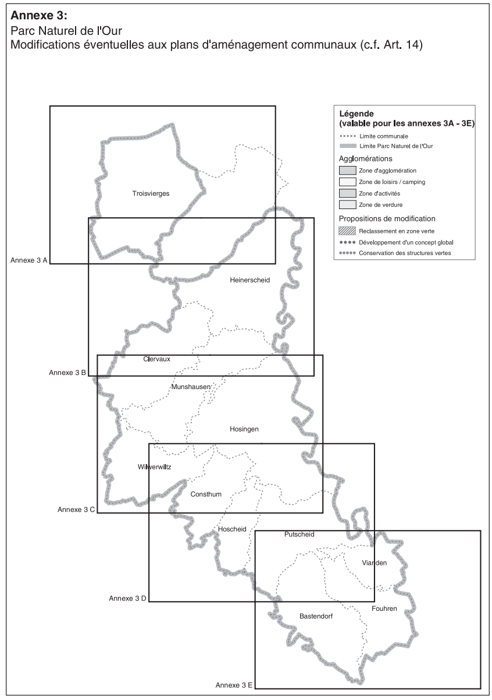

# Règlement grand-ducal du 9 juin 2005 portant déclaration du Parc Naturel de l'Our.

## Chapitre 1er — Objet et portée du parc naturel

### Art. 1er — Objet

Il est créé un Parc Naturel de l'Our, dénommé ci-après «le parc naturel».

### Art. 2 — Portée

La création du parc naturel entraîne la mise en oeuvre de son plan de développement, la mise en place des organismes chargés de son administration et de sa gestion, l'établissement et la mise en oeuvre du plan de gestion annuel ainsi que l'installation de la commission consultative.

### Art. 3 — Durée

Le statut de parc naturel est limité à dix ans, sauf renouvellement exprès pour une même période.

Le renouvellement se fait par règlement grand-ducal sur proposition du ministre ayant l’aménagement du territoire dans ses attributions et sur la base d’un bilan dressé par le comité du syndicat. Ce bilan est soumis à l’avis préalable de la commission consultative. Le règlement grand-ducal portant renouvellement du parc naturel est à prendre sur avis obligatoire du Conseil d’Etat et avec l’assentiment de la Conférence des présidents de la Chambre des députés conformément à l’article 11 de la [loi du 10 août 1993](https://legilux.public.lu/eli/etat/leg/loi/1993/08/10/n1/jo) relative aux parcs naturels.

Le renouvellement du statut de parc naturel ne concerne que le territoire des communes dont les conseils communaux ont, au moins trois mois avant l’expiration de la période initiale, exprimé leur volonté de faire partie du parc naturel pour une nouvelle période de dix ans.

## Chapitre 2 — Délimitation territoriale du parc naturel

### Art. 4.

Le Parc naturel regroupe le territoire et les sections cadastrales des communes de Clervaux, de Kiischpelt, du Parc Hosingen, de Putscheid, de Tandel, de Troisvierges, de Vianden et de Wincrange, sans préjudice d’une ou de plusieurs fusions entre des communes membres du Parc naturel et de la dénomination de la ou des nouvelles communes.

Si une ou plusieurs communes membres du Parc naturel fusionnent avec une ou plusieurs communes non membres, le territoire du Parc naturel sera d’office étendu au territoire entier de la nouvelle commune, indépendamment de sa dénomination.

Une liste des communes avec leurs sections cadastrales et une carte topographique indiquant les limites territoriales du Parc naturel figurent en annexe 1 et 2 du présent règlement.[^1]

## Chapitre 3 — Organismes chargés de l'administration et de la gestion du parc naturel

### Art. 5 — Le syndicat pour l'aménagement et la gestion du parc naturel

Le parc naturel est administré par un syndicat pour l'aménagement et la gestion du Parc Naturel de l'Our, au comité duquel siègent les représentants des départements ministériels et des administrations publiques concernées ainsi que des communes syndiquées, dénommé ci-après «le syndicat».

### Art. 6 — Le service du parc naturel

Le syndicat s'adjoint un service du parc naturel, dénommé ci-après «le service».

Le service est placé sous la surveillance et le contrôle du comité du syndicat. Il est chargé de la mise en oeuvre du plan de gestion annuel arrêté par le comité du syndicat.

Il comprend une équipe permanente qui regroupe le personnel administratif, technique et ouvrier nécessaire à l’accomplissement de sa mission.

Le service est composé d’une cellule administrative et de cellules thématiques, notamment une cellule agriculture, une cellule environnement naturel et une cellule développement régional.

Le nombre des agents à affecter à ces cellules est fixé par le comité du syndicat.

### Art. 7 — La direction du service du parc naturel

La direction du service est assurée par un chargé de direction, placé sous la surveillance du bureau. Celui-ci:

– assure la mise en oeuvre des décisions du comité;

– assure la gestion courante du parc naturel dont il rend compte à la demande du comité;

– dirige, coordonne et surveille les activités des cellules du service.

Le chargé de direction assiste aux réunions du comité avec voix consultative. En cas d’empêchement, il est remplacé par un autre membre du service.

### Art. 8 — La commission consultative

Il est institué une commission consultative, désignée ci-après par le terme «la commission», qui a pour mission d'assister le comité du syndicat dans l'exercice de ses attributions.

Elle a pour mission de donner dans le mois son avis sur le plan de gestion annuel et sur toutes les questions ou projets que le comité du syndicat lui soumet. Elle peut adresser de son initiative des propositions relatives au parc naturel ou qu’elle juge utiles à l’accomplissement de sa mission au même comité.

### Art. 9.

La commission comprend, comme représentants de la population locale, un habitant de chaque commune membre du syndicat ayant la qualité d’électeur dans la commune qu’il représente. La commission comprend, comme délégués des groupements d’intérêts locaux ou régionaux

a) un délégué d’un groupement agissant dans le domaine de l’agriculture;

b) un délégué d’un groupement agissant dans le domaine de la sylviculture;

c) un délégué d’un groupement agissant dans le domaine du tourisme;

d) un délégué d’un groupement agissant dans le domaine des petites et moyennes entreprises (PME);

e) un délégué d’un groupement agissant dans le domaine de la nature et de l’environnement humain;

f) un délégué d’un groupement agissant dans le domaine de la culture;

g) un délégué d’un groupement agissant dans le domaine de l’urbanisme;

h) un délégué d’un groupement agissant dans le domaine de l’énergie.

A chaque délégué est associé un suppléant qui peut remplacer le délégué en cas d’absence.

En vue de l’équilibre régional et thématique, la commission peut comprendre également jusqu’à quatre représentants des associations privées oeuvrant dans l’intérêt des objectifs poursuivis par le Parc naturel.

Le comité du syndicat décide quels groupements et quelles associations sont représentés dans la commission, ceci sur le vu des candidatures introduites après un appel public de candidatures.[^2]

### Art. 10 — Nomination des membres de la commission consultative

La nomination des membres de la commission est faite par le comité du syndicat, sur proposition des groupements et associations en ce qui concerne leurs représentants, respectivement sur base de candidatures introduites, suite à un appel public, par des particuliers pour assumer la représentation de la population locale.

### Art. 11.

La durée du mandat des membres de la commission est de cinq ans. Toutefois les groupements et associations peuvent révoquer leurs représentants en cours de mandat et les faire remplacer par d’autres délégués. En cas de vacance parmi les membres de la commission, il est pourvu au remplacement dans le délai d’un mois. Tout représentant élu en remplacement achève le terme de celui qu’il remplace.[^3]

### Art. 12 — Fonctionnement de la commission consultative

La première réunion d'une commission consultative nouvellement nommée est convoquée par le président du comité du syndicat qui la dirige jusqu'à la désignation du président de la commission.

En premier lieu, la commission élit parmi ses membres un président, un vice-président et un secrétaire qui restent en fonction pour toute la durée de leur mandat.

La commission se réunit sur la convocation de son président aussi souvent que l’exigent les affaires comprises dans ses attributions, mais au moins une fois par semestre.

Le président est tenu de convoquer la commission soit à la demande du comité du syndicat, soit à la demande de la moitié au moins des membres de la commission.

La convocation se fait par écrit et à domicile au moins cinq jours avant celui de la réunion. Elle mentionne le lieu, le jour et l’heure de la réunion et en contient l’ordre du jour. En cas d’urgence le délai de convocation peut être réduit par le président qui indique le motif de l’urgence dans l’invitation.

La commission est présidée par le président, et à défaut par le vice-président.

La commission ne peut prendre de décision que si la majorité de ses membres en fonction est présente. Elle décide à la majorité des voix des membres présents. Des avis séparés, reflétant la position d’un ou de plusieurs membres, peuvent être élaborés et doivent être annexés au procès-verbal de la réunion.

Cependant, si l’assemblée a été convoquée deux fois sans s’être trouvée en nombre requis, elle pourra, après une nouvelle et dernière convocation, quel que soit le nombre des membres présents, prendre une décision sur les objets mis pour la troisième fois à l’ordre du jour. Les deuxième et troisième convocations se font conformément aux règles prescrites ci-avant et il est fait mention si c’est pour la deuxième ou la troisième fois que la convocation a lieu.

Le procès-verbal de la réunion est rédigé par le secrétaire et signé par tous les membres présents lors de la prochaine réunion de la commission. Il mentionne les noms des membres présents et précise les décisions prises en indiquant le résultat du vote. Une expédition du procès-verbal est transmise au comité du syndicat.

Le président du syndicat ou un autre membre du bureau délégué par lui ainsi que le chargé de direction du service ou son délégué peuvent assister aux réunions de la commission avec voix consultative.

## Chapitre 4 — Mise en oeuvre des objectifs du parc naturel

### Art. 13.

Le syndicat veille à la réalisation des objectifs fixés à l’article 2 de la [loi modifiée du 10 août 1993](https://legilux.public.lu/eli/etat/leg/loi/1993/08/10/n1/jo) relative aux parcs naturels et à la mise en oeuvre des lignes directrices de l’étude détaillée pour le projet de Parc naturel et il en tient compte dans ses actions.

Le syndicat peut assumer toutes les missions nécessaires pour la mise en oeuvre des objectifs du Parc naturel et

a) assume une mission de promotion et de sensibilisation dans la région;

b) aide à coordonner l’action de l’Etat et des communes au niveau du Parc naturel;

c) travaille en étroite coopération avec les instances régionales et nationales;

d) instaure une plateforme de communication avec les acteurs oeuvrant dans l’intérêt poursuivi par le Parc naturel tels que les agriculteurs, les sylviculteurs, les producteurs régionaux, les entreprises ou les organisations travaillant dans le domaine du tourisme et de l’environnement;

e) intègre à sa démarche également les initiatives privées qui constituent un apport au Parc naturel.[^4]

## Chapitre 5 — Modifications à apporter aux plans d'aménagement communaux

### Art. 14.

Les communes dont le territoire fait partie du Parc naturel de l’Our s’engagent à un développement intégré et durable de la région et coordonnent leurs actions en ce qui concerne la réalisation de toute infrastructure ayant un impact régional. En outre, les communes veillent à une qualité élevée lors de la définition des prescriptions urbanistiques et paysagères pour les nouveaux quartiers d’habitation.

Les communes procèdent dans un délai de deux ans à la révision de leurs plans d’aménagement communaux respectifs dans la mesure où ceux-ci ne sont pas compatibles avec les objectifs du Parc naturel, conformément à l’article 12 de la [loi modifiée du 10 août 1993](https://legilux.public.lu/eli/etat/leg/loi/1993/08/10/n1/jo).[^5]

### Art. 15 — Information du public

Des copies du présent règlement sont déposées à la maison communale de chacune des communes où le public peut en prendre connaissance.

### Art. 16.

Notre ministre de l'Intérieur et de l'Aménagement du Territoire est chargé de l'exécution du présent règlement qui sera publié au Mémorial.

\**ANNEXE 1**

\**Liste des communes concernées par le Parc naturel de l’Our**

| **Communes concernées** | **Sections cadastrales** |
|---|---|
| Clervaux | CA: Clervaux CB: Eselborn CC: Weicherdange CD: Reuler CE: Urspelt CF: Mecher HA: Lieler HB: Kalborn HC: Heinerscheid HD: Fischbach HE: Grindhausen HF: Hupperdange MA: Siebenaler MB: Munshausen MC: Marnach MD: Roder ME: Drauffelt |
| Kiischpelt | KA: Alscheid KB: Merkholtz KC: Kautenbach WA: Enscherange WB: Pintsch WC: Lellingen WD: Wilwerwiltz |
| Parc Hosingen | CA: Holzthum CB: Consthum HdA: Hoscheid HdB: Markenbach HnA: Rodershausen HnB: Obereisenbach HnC: Untereisenbach HnD: Wahlhausen HnE: Hosingen HnF: Bockholtz HnG: Neidhausen HnH: Dorscheid |
| Putscheid | A: Weiler B: Putscheid C: Stolzembourg D: Bivels E: Nachtmanderscheid F: Gralingen G: Merscheid |
| Tandel | FA: Walsdorf FB: Fouhren FC: Longsdorf FD: Bettel BA: Landscheid BB: Brandenbourg-Ouest BC: Brandenbourg-Est BD: Bastendorf BE: Tandel |
| Troisvierges | A: Hautbellain B: Huldange C: Goedange D: Wilwerdange E: Drinklange F: Troisvierges G: Basbellain H: Biwisch |
| Vianden | A: Scheuerhof B: Vianden |
| Wincrange | AB: Asselborn AC: Sassel AD: Boxhorn AE: Rumlange AF: Stockem BA: Troine BB: Crendal BC: Lullange BD: Doennange et Deiffelt BE: Boevange BF: Hamiville BG: Wincrange HA: Hachiville HB: Weiler HC: Hoffelt OA: Allerborn OB: Brachtenbach OC: Derenbach OD: Oberwampach OE: Niederwampach |

\**ANNEXE 2**

\**Les limites du Parc naturel de l’Our**

*[image omitted (1.1 MB) — see the official version: https://legilux.public.lu/eli/etat/leg/rgd/2005/06/09/n1/consolide/20160327]*[^6]

*[image omitted (1.3 MB) — see the official version: https://legilux.public.lu/eli/etat/leg/rgd/2005/06/09/n1/consolide/20160327]*

*[image omitted (1.3 MB) — see the official version: https://legilux.public.lu/eli/etat/leg/rgd/2005/06/09/n1/consolide/20160327]*

*[image omitted (1.4 MB) — see the official version: https://legilux.public.lu/eli/etat/leg/rgd/2005/06/09/n1/consolide/20160327]*

*[image omitted (1.4 MB) — see the official version: https://legilux.public.lu/eli/etat/leg/rgd/2005/06/09/n1/consolide/20160327]*

*[image omitted (1.4 MB) — see the official version: https://legilux.public.lu/eli/etat/leg/rgd/2005/06/09/n1/consolide/20160327]*

---

[^1]: [Règlement grand-ducal du 17 mars 2016 portant renouvellement et modification du statut du Parc naturel de l'Our.](https://legilux.public.lu/eli/etat/leg/rgd/2016/03/17/n3/jo)
[^2]: [Règlement grand-ducal du 17 mars 2016 portant renouvellement et modification du statut du Parc naturel de l'Our.](https://legilux.public.lu/eli/etat/leg/rgd/2016/03/17/n3/jo)
[^3]: [Règlement grand-ducal du 17 mars 2016 portant renouvellement et modification du statut du Parc naturel de l'Our.](https://legilux.public.lu/eli/etat/leg/rgd/2016/03/17/n3/jo)
[^4]: [Règlement grand-ducal du 17 mars 2016 portant renouvellement et modification du statut du Parc naturel de l'Our.](https://legilux.public.lu/eli/etat/leg/rgd/2016/03/17/n3/jo)
[^5]: [Règlement grand-ducal du 17 mars 2016 portant renouvellement et modification du statut du Parc naturel de l'Our.](https://legilux.public.lu/eli/etat/leg/rgd/2016/03/17/n3/jo)
[^6]: [Règlement grand-ducal du 17 mars 2016 portant renouvellement et modification du statut du Parc naturel de l'Our.](https://legilux.public.lu/eli/etat/leg/rgd/2016/03/17/n3/jo)
