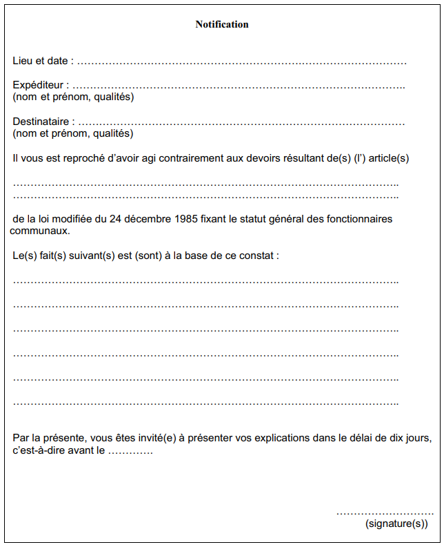
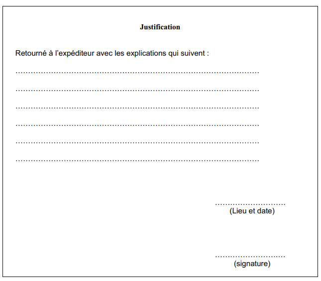

# Règlement grand-ducal du 11 septembre 2006 fixant les conditions et modalités de l'ordre de justification à adresser aux fonctionnaires communaux.

## Art. 1er.

Lorsqu’une infraction aux devoirs du fonctionnaire a été constatée, le collège des bourgmestre et échevins ou son délégué peut adresser un ordre de justification à l’agent présumé fautif concernant le ou les faits qui lui sont reprochés.

Sous peine de nullité, l’ordre de justification est expédié dans les sept jours ouvrables à partir du moment où le collège des bourgmestre et échevins ou son délégué a eu connaissance des faits qui sont reprochés au fonctionnaire fautif. Cette expédition se fait moyennant la formule annexée au présent règlement, sous enveloppe fermée, au lieu de service du fonctionnaire concerné ou, s’il est en congé pour plus de deux jours, par lettre recommandée à son domicile.

## Art. 2.

L’agent concerné est tenu de fournir par écrit ses explications sur le ou les faits lui reprochés à l’expéditeur dans les dix jours de la notification de l’ordre. Lorsque le fonctionnaire se trouve en congé au moment où l’ordre de justification lui est adressé, le délai de réponse est prolongé de la durée du congé visé.

## Art. 3.

Le refus ou l’abstention de prendre position dans le délai imparti vaut aveu du ou des faits reprochés sauf circonstances exceptionnelles.

Dans ce cas, le collège des bourgmestre et échevins ou son délégué est tenu de soumettre incessamment le dossier à l’autorité investie du pouvoir disciplinaire.

## Art. 4.

Selon la gravité des faits et la pertinence de la justification, le collège des bourgmestre et échevins décide, soit de verser le document au dossier personnel de l’agent, soit de ne pas l’y verser, soit d’en saisir l’autorité investie du pouvoir disciplinaire. La décision afférente est à prendre dans un délai de trois mois suivant la réception de la justification fournie par le fonctionnaire concerné.

## Art. 5.

Notre Ministre de l’Intérieur et de l’Aménagement du Territoire est chargé de l’exécution du présent règlement qui sera publié au Mémorial.

ANNEXE

| Service/Administration No Réf. : | **Recto** |
|---|---|

\**Ordre de justification**

| **Verso** |
|---|

[^1]

---

[^1]: [Règlement grand-ducal du 30 novembre 2007 modifiant a) le règlement grand-ducal modifié du 4 avril 1964 portant assimilation des traitements des fonctionnaires des communes, syndicats de communes et des établissements publics placés sous la surveillance des communes, à ceux des fonctionnaires de l'Etat, b) le règlement grand-ducal du 11 septembre 2006 fixant les conditions et modalités de l'ordre de justification à adresser aux fonctionnaires communaux.](https://legilux.public.lu/eli/etat/leg/rgd/2007/11/30/n5/jo)
