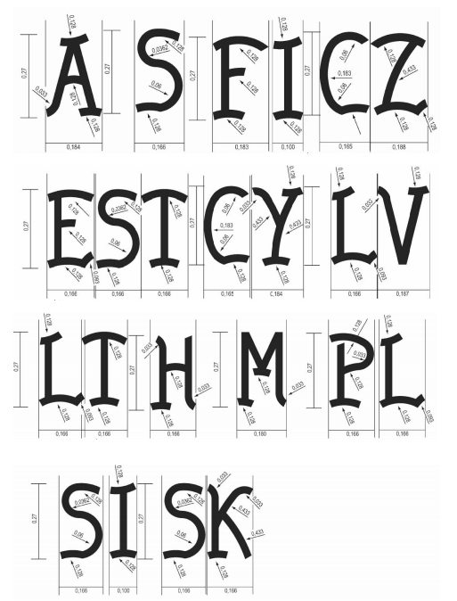

# Règlement grand-ducal du 30 novembre 2007 modifiant le règlement grand-ducal modifié du 13 juin 1973 portant application de la directive 71/316/CEE du Conseil du 26 juillet 1971 concernant le rapprochement des législations des Etats membres relatives aux dispositions communes aux instruments de mesurage et aux méthodes de contrôle métrologique (directive-cadre) telle que cette directive a été modifiée par celle du 19 décembre 1972.

Nous Henri, Grand-Duc de Luxembourg, Duc de Nassau,

Vu la [loi modifiée du 9 août 1971](https://legilux.public.lu/eli/etat/leg/loi/1971/08/09/n2/jo) concernant l’exécution et la sanction des décisions et des directives ainsi que la sanction des règlements des Communautés européennes en matière économique, technique, agricole, forestière, sociale et en matière de transports;

Vu la [directive 2007/13/CE](https://legilux.public.lu/eli/dir_ue/2007/13/jo) de la Commission européenne du 7 mars 2007 modifiant l’annexe II de la [directive 71/316/CEE](https://legilux.public.lu/eli/dir_ue/1971/316/jo) du Conseil concernant le rapprochement des législations des Etats membres relatives aux dispositions communes aux instruments de mesurage et aux méthodes de contrôle métrologique;

Vu l’avis de la Chambre de Commerce;

Notre Conseil d’Etat entendu;

De l’assentiment de la Conférence des présidents de la Chambre des députés;

Sur le rapport de Notre Ministre des Finances et après délibération du Gouvernement en Conseil;

Arrêtons:

## Art. 1er.

Les dessins visés à l’annexe II, point 3.2.1 du [règlement grand-ducal modifié du 13 juin 1973](https://legilux.public.lu/eli/etat/leg/rgd/1973/06/13/n2/jo) portant application de la [directive 71/316/CEE](https://legilux.public.lu/eli/dir_ue/1971/316/jo) du Conseil du 26 juillet 1971 concernant le rapprochement des législations des Etats membres relatives aux dispositions communes aux instruments de mesurage et aux méthodes de contrôle métrologique (directive-cadre) telle que cette directive a été modifiée par celle du [19 décembre 1972](https://legilux.public.lu/eli/dir_ue/1972/427/jo), sont complétés par les sigles «A» pour l’Autriche, «S» pour la Suède, «FI» pour la Finlande, «CZ» pour la République tchèque, «EST» pour l’Estonie, «CY» pour Chypre, «LV» pour la Lettonie, «LT» pour la Lituanie, «H» pour la Hongrie, «M» pour Malte, «PL» pour la Pologne, «SI» pour la Slovénie, «SK» pour la Slovaquie, reproduits ci-dessous:

## Art. 2.

Notre Ministre des Finances est chargé de l’exécution du présent règlement grand-ducal qui sera publié au Mémorial.

Le Ministre des Finances,   Jean-Claude Juncker

Château de Berg, le 30 novembre 2007.   Henri

Doc. parl. [5727](https://legilux.public.lu/eli/etat/proj/pr/20070093); sess. ord. 2006-2007 et 2007-2008; [Dir. 2007/13/CE](https://legilux.public.lu/eli/dir_ue/2007/13/jo)
