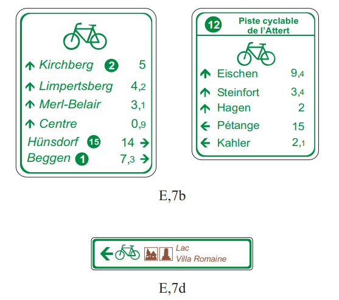
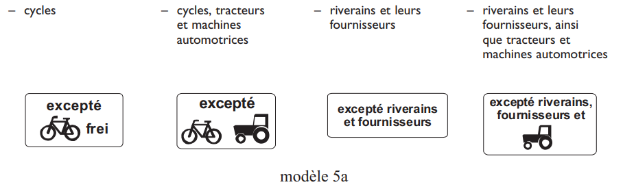

# Règlement grand-ducal du 9 juin 2008 modifiant\n 1) l'arrêté grand-ducal modifié du 23 novembre 1955 portant règlement de la circulation sur toutes les voies publiques,\n 2) le règlement grand-ducal modifié du 26 août 1993 relatif aux avertissements taxés, aux consignations pour contrevenants non résidents ainsi qu'aux mesures d'exécution de la législation en matière de mise en fourrière des véhicules et en matière de permis à points.

Nous Henri, Grand-Duc de Luxembourg, Duc de Nassau,

Vu la [loi modifiée du 14 février 1955](https://legilux.public.lu/eli/etat/leg/loi/1955/02/14/n3/jo) concernant la réglementation de la circulation sur toutes les voies publiques;

Vu l’[arrêté grand-ducal modifié du 23 novembre 1955](https://legilux.public.lu/eli/etat/leg/agd/1955/11/23/n1/jo) portant règlement de la circulation sur toutes les voies publiques;

Vu l’article 2, paragraphe 1er de la [loi modifiée du 12 juillet 1996](https://legilux.public.lu/eli/etat/leg/loi/1996/07/12/n3/jo) portant réforme du Conseil d’Etat et considérant qu’il y a urgence;

Les avis de la Chambre des Métiers, de la Chambre de Commerce et de la Chambre d’Agriculture ayant été demandés;

Sur le rapport de Notre Ministre des Transports, de Notre Ministre des Travaux Publics, de Notre Ministre de l’Intérieur et de l’Aménagement du Territoire et de Notre Ministre de la Justice et après délibération du Gouvernement en Conseil;

Arrêtons:

1\) **Modifications de l’[arrêté grand-ducal modifié du 23 novembre 1955](https://legilux.public.lu/eli/etat/leg/agd/1955/11/23/n1/jo) portant règlement de la circulation sur toutes les voies publiques**

## Art. 1er.

Les lettres M) et N) de l’article 49 de l’[arrêté grand-ducal modifié du 23 novembre 1955](https://legilux.public.lu/eli/etat/leg/agd/1955/11/23/n1/jo) portant règlement de la circulation sur toutes les voies publiques sont remplacées par le texte suivant:

> M) A partir du 15 juin 2008, et sans préjudice des dispositions du [règlement grand-ducal modifié du 31 janvier 2003](https://legilux.public.lu/eli/etat/leg/rgd/2003/01/31/n5/jo) sur les transports par route de marchandises dangereuses, les véhicules des catégories N1, N2 et N3 ainsi que les véhicules à usage spécial dont la masse maximale autorisée dépasse 3.500 kg doivent être munis d’un extincteur d’incendie portatif d’une capacité minimale de 2 kg de poudre ou d’une capacité correspondante pour un agent d’extinction équivalent, cet extincteur devant être solidement fixé dans la cabine de conduite, à portée de main du conducteur.
>
> Les véhicules de la catégorie N3 doivent en outre être munis d’un deuxième extincteur d’incendie portatif, d’une capacité minimale de 6 kg de poudre ou d’une capacité correspondante pour un agent d’extinction équivalent, cet extincteur devant être installé de telle manière sur le véhicule qu’il soit aisément accessible de l’extérieur du véhicule.
>
> Tout extincteur dont est muni un véhicule routier en vertu du présent paragraphe doit être pourvu d’un plombage qui permet de vérifier qu’il n’a pas été utilisé. En outre, il doit porter une marque de conformité en cours de validité et indiquant notamment l’année et le mois d’expiration de cette validité, cette marque devant avoir été apposée par un organisme agréée ou reconnu à cette fin dans un État membre de l’Espace Économique Européen.
>
> Pour les véhicules ayant été immatriculés avant le 15 juin 2008 et tombant sous l’application des dispositions du présent paragraphe, ces dispositions ne s’appliquent qu’à partir du 15 juin 2010.
>
> N) A partir du 15 juin 2008, les véhicules des catégories N2 et N3 ainsi que les véhicules à usage spécial dont la masse maximale autorisée dépasse 3.500 kg doivent être munis d’un coffret de secours contenant des objets et produits pharmaceutiques nécessaires aux premiers soins en cas d’accident.

## Art. 2.

A l’article 78 de l[’arrêté grand-ducal modifié du 23 novembre 1955 précité](https://legilux.public.lu/eli/etat/leg/agd/1955/11/23/n1/jo), un chiffre 6) au texte suivant est ajouté:

> 6\) une copie certifiée conforme du passeport, de la carte d’identité, du titre de voyage ou de tout autre document permettant l’identification de l’intéressé.

## Art. 3.

A l’article 81 de l’[arrêté grand-ducal modifié du 23 novembre 1955 précité](https://legilux.public.lu/eli/etat/leg/agd/1955/11/23/n1/jo), la deuxième phrase du deuxième alinéa du paragraphe 4. est remplacée par le libellé suivant:

> L’examinateur est tenu de vérifier l’identité du candidat sur base du passeport, de la carte d’identité, du titre de voyage ou de tout autre document permettant l’identification de l’intéressé.

## Art. 4.

A l’article 84 de l’[arrêté grand-ducal modifié du 23 novembre 1955 précité](https://legilux.public.lu/eli/etat/leg/agd/1955/11/23/n1/jo), la première phrase du paragraphe 2. est remplacée par le libellé suivant:

> 2\. Les titulaires de permis de conduire délivrés par les autorités d’un pays tiers à l’Espace Economique Européen qui sollicitent un permis de conduire luxembourgeois doivent produire les pièces visées à l’article 78 et remettre le ou les permis de conduire étrangers; la production de la pièce spécifiée sous 3) de l’article 78 n’est requise qu’en cas d’examen ou de réexamen pratique.

## Art. 5.

Au premier alinéa de l’article 100 de l’[arrêté grand-ducal modifié du 23 novembre 1955 précité](https://legilux.public.lu/eli/etat/leg/agd/1955/11/23/n1/jo), la première phrase est remplacée par le texte suivant:

> ****Art. 100****.****
>
> 1\. Le Ministre ayant les Travaux publics dans ses attributions et le Ministre ayant les Transports dans ses attributions peuvent ensemble prendre des mesures particulières, dans l’intérêt de la sécurité et de la commodité des usagers de la route et des riverains qui sont justifiées par l’état et la disposition des lieux sur des tronçons déterminés de la grande voirie ou de la voirie normale de l’Etat située en dehors des agglomérations.

## Art. 6.

La lettre e) du deuxième paragraphe de l’article 104 de l’[arrêté grand-ducal modifié du 23 novembre 1955 précité](https://legilux.public.lu/eli/etat/leg/agd/1955/11/23/n1/jo) est remplacée par le texte suivant:

> e) les usagers autres que ceux autorisés à circuler dans une zone piétonne peuvent traverser celle-ci aux endroits où le signal E,27a est complété par un panneau additionnel portant l’inscription «traversée autorisée», à condition de marquer l’arrêt avant de traverser la zone piétonne et de céder le passage aux piétons qui y circulent, conformément à l’article 136, paragraphe 5.;

## Art. 7.

L’article 107 de l’[arrêté grand-ducal modifié du 23 novembre 1955 précité](https://legilux.public.lu/eli/etat/leg/agd/1955/11/23/n1/jo) est modifié comme suit:

1\) Le texte de la rubrique 10. est remplacé par le texte suivant:

> Le signal D,10 indique aux conducteurs que la voie de circulation qui en est munie est réservée aux autobus, aux voitures de location ayant plus de 5 places assises, aux taxis, aux ambulances, aux véhicules des médecins en service, aux autocars servant au ramassage scolaire, aux autocars servant à l’enseignement de l’art de conduire ou à la réception de l’examen pratique en vue de l’obtention du permis de conduire ainsi qu’aux fourgons blindés et aux véhicules de service qui les escortent, et qu’il leur est interdit de circuler sur cette voie. Un panneau additionnel du modèle 6a peut autoriser les cycles à circuler sur la voie réservée.
>
> Le signal D,10a indique la fin d’une voie de circulation réservée aux véhicules des services réguliers de transport en commun.

2\) Les illustrations du signal E,5b, rubrique 4.c., sont remplacées par les illustrations suivantes:

> 

3\) Les illustrations du signal E,6b, rubrique 4.d., sont remplacées par les illustrations suivantes:

> 

4\) Les illustrations des signaux E,7b et E,7d, rubrique 4.e., sont remplacées par les illustrations suivantes:

> 

5\) Le deuxième alinéa de la rubrique 2.1. au chapitre IX «Symboles et inscriptions additionnels» est remplacé par les textes et illustrations suivants:

> Le modèle 5a, dont les illustrations ci-après sont des exemples, indique que le signal d’interdiction n’est pas applicable aux
>
> 

## Art. 8.

A l’article 164, paragraphe 2. de l’[arrêté grand-ducal modifié du 23 novembre 1955 précité](https://legilux.public.lu/eli/etat/leg/agd/1955/11/23/n1/jo), les lettres c), d) et e) sont remplacées par le texte suivant:

> c) sur les parties de la voie publique réservées aux piétons ou à d’autres usagers, sauf autorisation de l’autorité délivrée à titre temporaire;
>
> d) à moins de 12 mètres de part et d’autre des points d’arrêt signalés comme tels des autobus et des tramways, sauf signalisation ou marquage dérogatoires ou sauf autorisation de l’autorité délivrée à titre temporaire; cette interdiction ne s’applique pas aux autobus, tramways et voitures de location ayant plus de 5 places assises qui desservent ces points d’arrêt, aux taxis ainsi qu’aux véhicules assurant l’entretien, le nettoyage, le déneigement et le déblaiement de ces points d’arrêt ou de la voie publique, pour autant que le service de ces derniers l’exige et à condition que leur intervention soit signalée au moyen d’un ou de deux feux jaunes clignotants;
>
> e) sur les passages pour piétons et les passages pour cyclistes ainsi qu’à moins de 5 mètres de part et d’autre de ces passages, sauf autorisation de l’autorité délivrée à titre temporaire;

## Art. 9.

Le deuxième alinéa du paragraphe 10. de l’article 176 de l’[arrêté grand-ducal modifié du 23 novembre 1955 précité](https://legilux.public.lu/eli/etat/leg/agd/1955/11/23/n1/jo) est remplacé par le texte suivant:

> Tout véhicule routier qui est soumis à l’enregistrement au Luxembourg en vertu des dispositions du paragraphe 1. de l’article 92 et qui est en circulation au 17 décembre 2006, sans être couvert ni par une carte d’immatriculation ni par une carte d’identité, doit être mis en conformité avec les dispositions précitées au plus tard jusqu’au 31 décembre 2009.

2\) **Modifications du [règlement grand-ducal modifié du 26 août 1993](https://legilux.public.lu/eli/etat/leg/rgd/1993/08/26/n1/jo) relatif aux avertissements taxés, aux consignations pour contrevenants non résidents ainsi qu’aux mesures d’exécution de la législation en matière de mise en fourrière des véhicules et en matière de permis à points**

## Art. 10.

Le deuxième alinéa de l’article 1er du [règlement grand-ducal modifié du 26 août 1993](https://legilux.public.lu/eli/etat/leg/rgd/1993/08/26/n1/jo) relatif aux avertissements taxés, aux consignations pour contrevenants non résidents ainsi qu’aux mesures d’exécution de la législation en matière de mise en fourrière des véhicules et en matière de permis à points est remplacé par le texte suivant:

> La détermination des parts des communes dans le montant total des avertissements taxés décernés du chef des infractions reprises aux rubriques 107-38 à 107-44 du catalogue annexé se fait annuellement au prorata des avertissements taxés de l’espèce décernés sur le territoire des communes concernées par les membres de la police grand-ducale; la police grand-ducale tient à cet effet la statistique afférente et en adresse à la fin de chaque année une copie comportant des données dépersonnalisées au ministre ayant les Finances dans ses attributions.

## Art. 11.

La partie A. de l’annexe I «Catalogue des avertissements taxés» qui figure en annexe du [règlement grand-ducal modifié du 26 août 1993 précité](https://legilux.public.lu/eli/etat/leg/rgd/1993/08/26/n1/jo), est modifiée comme suit:

1\. A la rubrique 49, les infractions -23 et -24 ainsi que la note de bas de page sont remplacées par le libellé suivant:

> <table>
> <tr>
> <td>Référ. aux articles</td>
> <td>Nature de l’infraction</td>
> <td colspan="4">Montant de la taxe</td>
> <td rowspan="2">Réduction de points en vertu de l’art. 2bis de la <a href="https://legilux.public.lu/eli/etat/leg/loi/1955/02/14/n3/jo">loi modifiée du 14 février 1955</a></td>
> </tr>
> <tr>
> <td></td>
> <td></td>
> <td>I</td>
> <td>II</td>
> <td>III</td>
> <td>IV</td>
> </tr>
> <tr>
> <td>(49)</td>
> <td></td>
> <td></td>
> <td></td>
> <td></td>
> <td></td>
> <td></td>
> </tr>
> <tr>
> <td>-23</td>
> <td>Défaut d’un extincteur d’incendie portatif réglementaire à bord d’un véhicule des catégories N1 et N2 ou d’un véhicule à usage spécial dépassant 3.500 kg ou de deux extincteurs d’incendie portatifs réglementaires à bord d’un véhicule de la catégorie N3**</td>
> <td></td>
> <td></td>
> <td>74</td>
> <td></td>
> <td></td>
> </tr>
> <tr>
> <td>-24</td>
> <td>Défaut d’un coffret de secours réglementaire à bord d’un véhicule des catégories N2 et N3 ou d’un véhicule à usage spécial dépassant 3.500 kg*</td>
> <td></td>
> <td></td>
> <td>74</td>
> <td></td>
> <td></td>
> </tr>
> </table>
>
> \* Ces dispositions s’appliquent à partir du 15 juin 2008
>
> \** Pour les véhicules immatriculés avant le 15 juin 2008, cette disposition s’applique à partir du 15 juin 2010; pour les véhicules immatriculés à partir du 15 juin 2008, cette disposition s’applique à partir du 15 juin 2008.

2\. La note en bas de page * de la rubrique 70 est remplacée par le libellé suivant:

> \* Pour les véhicules en circulation au 17 décembre 2006, cette disposition s’applique à partir du 1er janvier 2010.

3\. La note en bas de page ** de la rubrique 92 est remplacée par le libellé suivant:

> \* Pour les véhicules en circulation au 17 décembre 2006, cette disposition s’applique à partir du 1er janvier 2010.

4\. La note en bas de page * de la rubrique 98 est remplacée par le libellé suivant:

> \* Pour les véhicules en circulation au 17 décembre 2006, cette disposition s’applique à partir du 1er janvier 2010.

## Art. 12.

Notre Ministre des Transports, Notre Ministre des Travaux Publics, Notre Ministre de l’Intérieur et de l’Aménagement du Territoire et Notre Ministre de la Justice sont chargés, chacun en ce qui le concerne, de l’exécution du présent règlement grand-ducal qui sera publié au Mémorial.

Le Ministre des Transports,   Lucien Lux   Le Ministre des Travaux Publics,   Claude Wiseler   Le Ministre de l’Intérieur et de  l’Aménagement du Territoire,   Jean-Marie Halsdorf   Le Ministre de la Justice,   Luc Frieden

Château de Berg, le 9 juin 2008.   Henri
