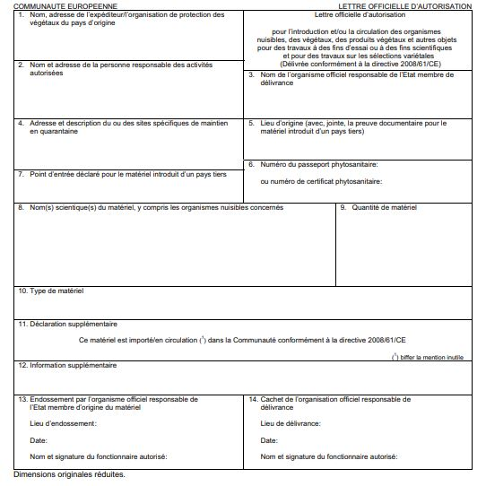

# Règlement grand-ducal du 14 novembre 2008 modifiant le règlement grand-ducal modifié du 9 janvier 2006 fixant les mesures de protection contre l’introduction et la propagation d’organismes nuisibles aux végétaux ou aux produits végétaux.

Nous Henri, Grand-Duc de Luxembourg, Duc de Nassau,

Vu la [loi du 14 juillet 1971](https://legilux.public.lu/eli/etat/leg/loi/1971/07/14/n2/jo) concernant la protection des végétaux et produits végétaux contre les organismes nuisibles;

Vu la [directive 2000/29/CE](https://legilux.public.lu/eli/dir_ue/2000/29/jo) du Conseil du 8 mai 2000 concernant les mesures de protection contre l’introduction dans la Communauté d’organismes nuisibles aux végétaux ou aux produits végétaux et contre leur propagation à l’intérieur de la Communauté modifiée en dernier lieu par la [directive 2008/64/CE](https://legilux.public.lu/eli/dir_ue/2008/64/jo) de la Commission du 27 juin 2008;

Vu la [directive 2008/61/CE](https://legilux.public.lu/eli/dir_ue/2008/61/jo) de la Commission du 17 juin 2008 fixant les conditions dans lesquelles certains organismes nuisibles, végétaux, produits végétaux et autres objets énumérés aux annexes I à V de la [directive 2000/29/CE](https://legilux.public.lu/eli/dir_ue/2000/29/jo) du Conseil peuvent être introduits ou circuler dans la Communauté ou dans certaines zones protégées de la Communauté pour des travaux à des fins d’essai ou à des fins scientifiques ou pour des travaux sur les sélections variétales;

Vu l’avis de la Chambre d’Agriculture;

Vu l’avis de la Chambre de Commerce;

Vu l’article 2 (1) de la [loi du 12 juillet 1996](https://legilux.public.lu/eli/etat/leg/loi/1996/07/12/n3/jo) portant réforme du Conseil d’Etat et considérant qu’il y a urgence;

Sur le rapport de Notre Ministre de l’Agriculture, de la Viticulture et du Développement rural et après délibération du Gouvernement en Conseil;

Arrêtons:

## Art. 1er.

Le [règlement grand-ducal modifié du 9 janvier 2006](https://legilux.public.lu/eli/etat/leg/rgd/2006/01/09/n1/jo) fixant les mesures de protection contre l’introduction et la propagation d’organismes nuisibles aux végétaux ou aux produits végétaux est modifié comme suit:

1\) A l’article 25, alinéa 4 point a) (ii):

Matériel circulant conformément à la [directive 95/44/CE](https://legilux.public.lu/eli/dir_ue/1995/44/jo) est remplacé par la phrase: Matériel circulant conformément à la [directive 2008/61/CE](http://legilux.public.lu/eli/dir_ue/2008/61/jo)

2\) A l’article 25, alinéa 4 point b) (ii):

Matériel circulant conformément à la [directive 95/44/CE](https://legilux.public.lu/eli/dir_ue/1995/44/jo) est remplacé par la phrase: Matériel circulant conformément à la [directive 2008/61/CE](https://legilux.public.lu/eli/dir_ue/2008/61/jo)

3\) A **l’****annexe I**, partie A, chapitre II, le point a) 3 est supprimé.

4\) **L’annexe II** est modifiée comme suit:

a) dans la partie A, le chapitre II est modifié comme suit:

i) à la rubrique a), le point 6.2 suivant est inséré après le point 6.1:

> | 6.2. *Helicoverpa armigera* (Hübner) | Végétaux de *Dendranthema* (DC.) Des Moul, *Dianthus* L., *Pelargonium* l’Hérit. ex Ait. et de la famille *Solanaceae* destinés à la plantation, à l’exception des semences; |
> |---|---|

ii) à la rubrique c), le point 2 est supprimé;

b) la partie B est modifiée comme suit:

i) à la rubrique a), le point 10 est supprimé;

ii) à la rubrique b), point 2, le texte de la troisième colonne (zones protégées) est remplacé par le texte suivant:

> «E, EE, F (Corse), IRL, I [Abruzzes, Pouilles, Basilicate, Calabre, Campanie, Emilie-Romagne (provinces de Parme et de Piacenza), Frioul-Vénétie Julienne, Latium, Ligurie, Lombardie (à l’exception de la province de Mantoue), Marches, Molise, Piémont, Sardaigne, Sicile, Toscane, Ombrie, Val d’Aoste, Vénétie (à l’exception de la province de Rovigo, des communes de Castelbaldo, de Barbona, de Piacenza d’Adige, de Vescovana, de S. Urbano, de Boara Pisani, de Masi dans la province de Padoue et de la région située au sud de l’autoroute A4 dans la province de Vérone)], LV, LT, A [Burgenland, Carinthie, Basse-Autriche, Tyrol (district de Lienz), Styrie et Vienne], P, SI (à l’exception des régions de Gorenjska, de Koroška, de Notranjska et de Maribor), SK [à l’exception des communes de Blahová, d’Horné Mýto et d’Okoč (comté de Dunajská Streda), de Hronovce et de Hronské Kl’ačany (comté de Levice), de Vel’ké Ripňany (comté de Topol’čany), de Málinec (comté de Poltár), de Hrhov (comté de Rožňava), de Kazimír, de Luhyňa, de Malý Horeš, de Svätuše et de Zatín (comté de Trebišov)], FI, UK (Irlande du Nord, île de Man et îles anglo-normandes)»;

iii) à la rubrique d), point 1, le texte de la troisième colonne (zones protégées) est remplacé par le texte suivant:

> «EL, F (Corse), M, P (à l’exception de Madère)».

5\) A l’annexe III, la partie B est modifiée comme suit:

a) au point 1, le texte de la deuxième colonne (zones protégées) est remplacé par le texte suivant:

> «E, EE, F (Corse), IRL, I [Abruzzes, Pouilles, Basilicate, Calabre, Campanie, Emilie-Romagne (provinces de Parme et de Piacenza), Frioul-Vénétie Julienne, Latium, Ligurie, Lombardie (à l’exception de la province de Mantoue), Marches, Molise, Piémont, Sardaigne, Sicile, Toscane, Ombrie, Val d’Aoste, Vénétie (à l’exception de la province de Rovigo, des communes de Castelbaldo, de Barbona, de Piacenza d’Adige, de Vescovana, de S. Urbano, de Boara Pisani, de Masi dans la province de Padoue et de la région située au sud de l’autoroute A4 dans la province de Vérone)], LV, LT, A [Burgenland, Carinthie, Basse-Autriche, Tyrol (district de Lienz), Styrie et Vienne], P, SI (à l’exception des régions de Gorenjska, de Koroška, de Notranjska et de Maribor), SK [à l’exception des communes de Blahová, d’Horné Mýto et d’Okoč (comté de Dunajská Streda), de Hronovce et de Hronské Kl’ačany (comté de Levice), de Vel’ké Ripňany (comté de Topol’čany), de Málinec (comté de Poltár), de Hrhov (comté de Rožňava), de Kazimír, de Luhyňa, de Malý Horeš, de Svätuše et de Zatín (comté de Trebišov)], FI, UK (Irlande du Nord, île de Man et îles anglo-normandes)»;

b) au point 2, le texte de la deuxième colonne (zones protégées) est remplacé par le texte suivant:

> «E, EE, F (Corse), IRL, I [Abruzzes, Pouilles, Basilicate, Calabre, Campanie, Emilie-Romagne (provinces de Parme et Piacenza), Frioul-Vénétie Julienne, Latium, Ligurie, Lombardie (à l’exception de la province de Mantoue), Marches, Molise, Piémont, Sardaigne, Sicile, Toscane, Ombrie, Val d’Aoste, Vénétie (à l’exception de la province de Rovigo, des communes de Castelbaldo, de Barbona, de Piacenza d’Adige, de Vescovana, de S. Urbano, de Boara Pisani, de Masi dans la province de Padoue et de la région située au sud de l’autoroute A4 dans la province de Vérone)], LV, LT, A [Burgenland, Carinthie, Basse-Autriche, Tyrol (district de Lienz), Styrie et Vienne], P, SI (à l’exception des régions de Gorenjska, de Koroška, de Notranjska et de Maribor), SK [à l’exception des communes de Blahová, d’Horné Mýto et d’Okoč (comté de Dunajská Streda), de Hronovce et de Hronské Kl’ačany (comté de Levice), de Vel’ké Ripňany (comté de Topol’čany), de Málinec (comté de Poltár), de Hrhov (comté de Rožňava), de Kazimír, de Luhyňa, de Malý Horeš, de Svätuše et de Zatín (comté de Trebišov)], FI, UK (Irlande du Nord, île de Man et îles anglo-normandes)».

6\) **L’annexe IV** est modifiée comme suit:

a) la partie A est modifiée comme suit:

i) au chapitre I, point 27.1, seconde colonne (exigences particulières), les mots *Heliothis armigera* Hübner sont remplacés par les mots *Helicoverpa armigera* (Hübner); ii) au chapitre II, point 20, seconde colonne (exigences particulières), les mots *Heliothis armigera* Hübner sont remplacés par les mots *Helicoverpa armigera* (Hübner);

b) la partie B est modifiée comme suit:

i) le point 17 est supprimé;

ii) le point 21 est modifié comme suit:

aash dans la deuxième colonne (exigences particulières), le point c) est remplacé par le texte suivant:

> «c) que les végétaux proviennent de l’un des cantons suisses suivants: Fribourg, Vaud, Valais; ou»,

bash le texte de la troisième colonne (zones protégées) est remplacé par le texte suivant:

> «E, EE, F (Corse), IRL, I [Abruzzes, Pouilles, Basilicate, Calabre, Campanie, Emilie-Romagne (provinces de Parme et de Piacenza), Frioul-Vénétie Julienne, Latium, Ligurie, Lombardie (à l’exception de la province de Mantoue), Marches, Molise, Piémont, Sardaigne, Sicile, Toscane, Ombrie, Val d’Aoste, Vénétie (à l’exception de la province de Rovigo, des communes de Castelbaldo, de Barbona, de Piacenza d’Adige, de Vescovana, de S. Urbano, de Boara Pisani, de Masi dans la province de Padoue et de la région située au sud de l’autoroute A4 dans la province de Vérone)], LV, LT, A [Burgenland, Carinthie, Basse-Autriche, Tyrol (district de Lienz), Styrie et Vienne], P, SI (à l’exception des régions de Gorenjska, de Koroška, de Notranjska et de Maribor), SK [à l’exception des communes de Blahová, d’Horné Mýto et d’Okoč (comté de Dunajská Streda), de Hronovce et de Hronské Kl’ačany (comté de Levice), de Vel’ké Ripňany (comté de Topol’čany), de Málinec (comté de Poltár), de Hrhov (comté de Rožnava), de Kazimír, de Luhyňa, de Malý Horeš, de Svätuše et de Zatín (comté de Trebišov)], FI, UK (Irlande du Nord, île de Man et îles anglo-normandes)»;

iii) le point 21.3 est modifié comme suit:

aash dans la deuxième colonne (exigences particulières), le point b) est remplacé par le texte suivant:

> «b) proviennent de l’un des cantons suisses suivants: Fribourg, Vaud, Valais; ou»,

bash le texte de la troisième colonne (zones protégées) est remplacé par le texte suivant:

> «E, EE, F (Corse), IRL, I [Abruzzes, Pouilles, Basilicate, Calabre, Campanie, Emilie-Romagne (provinces de Parme et Piacenza), Frioul-Vénétie Julienne, Latium, Ligurie, Lombardie (à l’exception de la province de Mantoue), Marches, Molise, Piémont, Sardaigne, Sicile, Toscane, Ombrie, Val d’Aoste, Vénétie (à l’exception de la province de Rovigo, des communes de Castelbaldo, de Barbona, de Piacenza d’Adige, de Vescovana, de S. Urbano, de Boara Pisani, de Masi dans la province de Padoue et de la région située au sud de l’autoroute A4 dans la province de Vérone)], LV, LT, A [Burgenland, Carinthie, Basse-Autriche, Tyrol (district de Lienz), Styrie et Vienne], P, SI (à l’exception des régions de Gorenjska, de Koroška, de Notranjska et de Maribor), SK [à l’exception des communes de Blahová, d’Horné Mýto et d’Okoč (comté de Dunajská Streda), de Hronovce et de Hronské Kl’ačany (comté de Levice), de Vel’ké Ripňany (comté de Topol’čany), de Málinec (comté de Poltár), de Hrhov (comté de Roznava), de Kazimír, de Luhyňa, de Malý Horeš, de Svätuše et de Zatín (comté de Trebišov)], FI, UK (Irlande du Nord, île de Man et îles anglo-normandes)»;

iv) le point 31 est modifié comme suit:

aash le texte de la troisième colonne (zones protégées) est remplacé par le texte suivant:

> «EL, F (Corse), M, P (à l’exception de Madère)».

7\) A **l’annexe XII** la partie B est remplacée par:

> \**Partie B**
>
> \**Modèle de lettre officielle d’autorisation, pour l’introduction et/ou la circulation**
>
> \**des organismes nuisibles, végétaux, produits végétaux et autres objets pour des travaux**
>
> \**à des fins d’essai ou à des fins scientifiques ou pour des travaux sur les sélections variétales**
>
> 

8\) A **l’annexe XII**, partie C, section IV, l’alinéa 3, tiret bactéries, point b:

> «b) *Pseudomonas solanacearum* (Smith) Smith »

est remplacé par:

> «b) *Ralstonia solanacearum (Smith)* Yabuuchi et al».

9\) A **l’annexe XII**, partie C, section IV, l’alinéa 5, point 5 est remplacé par:

> «5) Pour le matériel visé au point 1, la méthode permettant de détecter le *Ralstonia solanacearum* (Smith) Yabuuchi *et al.* est le programme de test défini dans l’annexe II du [règlement grand-ducal du 27 octobre 2000](https://legilux.public.lu/eli/etat/leg/rgd/2000/10/27/n6/jo) concernant la lutte contre Ralstonia solanacearum (Smith) Yabuuchi et al. Pour le matériel visé au point 2, il est possible d’appliquer cette méthode».

## Art. 2.

Notre Ministre de l’Agriculture, de la Viticulture et du Développement rural est chargé de l’exécution du présent règlement qui sera publié au Mémorial.

Le Ministre de l’Agriculture,  de la Viticulture et du Développement rural,   Fernand Boden

Palais de Luxembourg, le 14 novembre 2008.   Henri

[Dir. 2008/64/CE](http://legilux.public.lu/eli/dir_ue/2008/64/jo) et [2008/61/CE](http://legilux.public.lu/eli/dir_ue/2008/61/jo)
