# Règlement grand-ducal du 22 avril 2009 modifiant \n1) l'arrêté grand-ducal modifié du 23 novembre 1955 portant règlement de la circulation sur toutes les voies publiques, \n2) le règlement grand-ducal modifié du 26 août 1993 relatif aux avertissements taxés, aux consignations pour contrevenants non résidents ainsi qu'aux mesures d'exécution de la législation en matière de mise en fourrière des véhicules et en matière de permis à points.

Nous Henri, Grand-Duc de Luxembourg, Duc de Nassau,

Vu la [loi modifiée du 14 février 1955](https://legilux.public.lu/eli/etat/leg/loi/1955/02/14/n3/jo) concernant la réglementation de la circulation sur toutes les voies publiques;

Vu l’[arrêté grand-ducal modifié du 23 novembre 1955](https://legilux.public.lu/eli/etat/leg/agd/1955/11/23/n1/jo) portant règlement de la circulation sur toutes les voies publiques;

Vu les avis de la Chambre de Commerce du 16 octobre 2008, de la Chambre d’Agriculture du 21 octobre 2008, de la Chambre de Travail du 4 novembre 2008 et de la Chambre des Employés privés du 19 novembre 2008;

Les avis de la Chambre des Fonctionnaires et Employés publics et de la Chambre des Métiers ayant été demandés;

Notre Conseil d’Etat entendu;

Sur le rapport de Notre Ministre des Transports, de Notre Ministre des Travaux Publics, de Notre Ministre de l’Intérieur et de l’Aménagement du Territoire et de Notre Ministre de la Justice et après délibération du Gouvernement en Conseil;

Arrêtons:

## 1) — Modifications de l’arrêté grand-ducal modifié du 23 novembre 1955 portant règlement de la circulation sur toutes les voies publiques

### Art. 1er.

L’article 2 de l’[arrêté grand-ducal modifié du 23 novembre 1955](https://legilux.public.lu/eli/etat/leg/agd/1955/11/23/n1/jo) portant règlement de la circulation sur toutes les voies publiques est modifié comme suit:

1\. Au paragraphe 1. «*Voie publique*», une nouvelle rubrique 1.15. au libellé suivant est insérée après la rubrique 1.14.:

> 1.15. *Aire de service:* aire de repos et/ou de ravitaillement ouverte à la circulation publique et aménagée en bordure d’une autoroute ou d’une route pour véhicules automoteurs.

Les anciennes rubriques 1.15. à 1.17. sont en conséquence renumérotées respectivement 1.16. à 1.18.

2\. Au même paragraphe 1., deux nouvelles rubriques 1.19. et 1.20. aux libellés suivants sont insérées:

> 1.19. *Passage pour cyclistes*: partie de la chaussée qui est destinée aux cyclistes en vue de traverser la chaussée et qui est marquée comme telle.
>
> 1.20. *Passage pour piétons et cyclistes*: partie de la chaussée comportant un passage pour piétons et un passage pour cyclistes juxtaposés et qui est signalée et marquée comme telle.

Les anciennes rubriques 1.18. à 1.23. sont en conséquence renumérotées respectivement 1.21. à 1.26.

3\. Au même paragraphe 1., une nouvelle rubrique 1.27. au libellé suivant est insérée:

> 1.27. *Zone de rencontre:* ensemble de voies et places ouvertes à la circulation publique auquel des règles de circulation particulières sont applicables et dont les entrées et les sorties sont signalées comme telles.

Les anciennes rubriques 1.24. à 1.28. sont en conséquence renumérotées respectivement 1.28. à 1.32.

4\. Au paragraphe 2. «*Véhicules*», rubrique 2.2., la lettre b) qui précède la définition du véhicule routier d’occasion est remplacée par la lettre c).

### Art. 2.

L’article 38 de l’[arrêté grand-ducal modifié du 23 novembre 1955 précité](https://legilux.public.lu/eli/etat/leg/agd/1955/11/23/n1/jo) est remplacé par le texte suivant:

> **Art. 38.**
>
> Les cycles doivent être munis d’une sonnette. Les quadricycles légers doivent être munis d’un appareil avertisseur conforme à l’article 37. Les cyclomoteurs doivent être munis d’une sonnette ou d’un appareil avertisseur conforme à l’article 37.
>
> Le son de la sonnette doit pouvoir être entendu à une distance d’au moins 50 mètres.

### Art. 3.

Les articles 46 et 46bis de l’[arrêté grand-ducal modifié du 23 novembre 1955 précité](https://legilux.public.lu/eli/etat/leg/agd/1955/11/23/n1/jo) sont remplacés par un nouvel article 46 au texte suivant:

> **Art. 46.**
>
> 1\. Tout véhicule routier automoteur doit être aménagé de façon que la vue du conducteur soit suffisamment dégagée vers l’avant et vers les deux côtés, afin de lui permettre une conduite du véhicule en toute sécurité.
>
> 2\. Les lumières à l’intérieur du véhicule ne doivent pas gêner le conducteur.
>
> Aucun objet étranger à l’équipement normal du véhicule ne doit gêner la vue du conducteur, ni se trouver dans le champ de vision de celui-ci. Toutefois:
>
> a) un dispositif accessoire, tel que notamment un système de navigation, peut déborder dans le champ de vision du conducteur vers l’avant, à condition que ce dispositif ne dépasse pas 20 cm de côté et qu’il soit fixé de manière stable sur le tableau de bord, au montant du pare-brise près du conducteur ou sur le côté intérieur du pare-brise, de sorte qu’aucune partie du dispositif ne dépasse la zone autorisée telle que représentée sur le graphique ci-après. Les distances sont mesurées parallèlement au pare-brise; en cas de pare-brise incliné, la distance de 14 cm est mesurée verticalement à partir du tableau de bord.
>
> 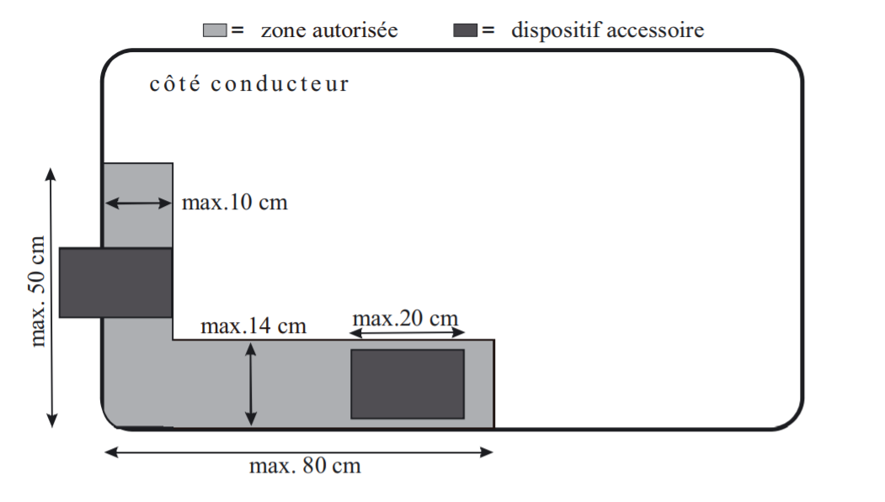
>
> b) une vignette délivrée à des fins spécifiques peut déborder dans le champ de vision du conducteur vers l’avant, à condition qu’aucune partie de la vignette ne dépasse la zone autorisée telle que représentée sur le graphique ci-après. Les distances sont mesurées parallèlement au pare-brise.
>
> 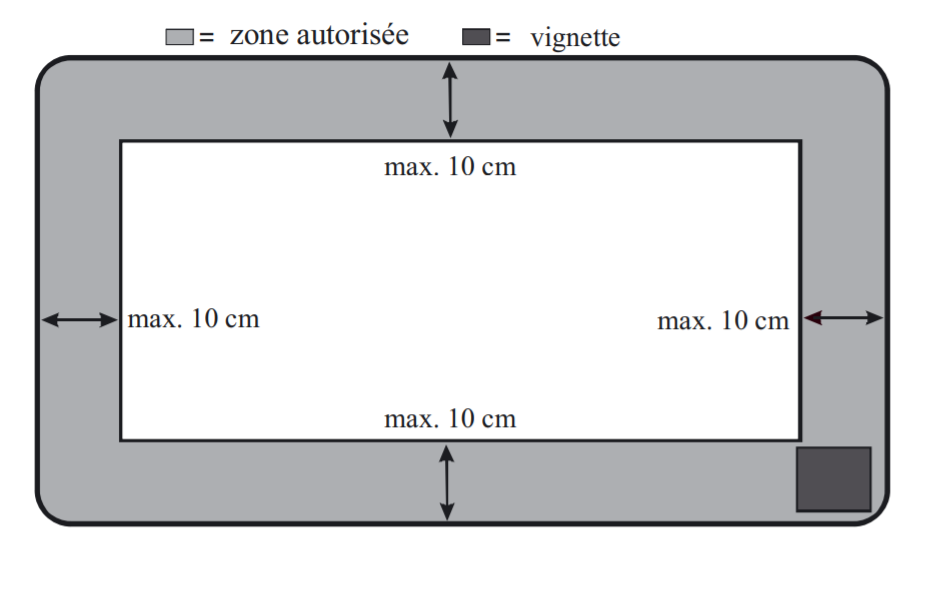
>
> c) un film en matière plastique peut être apposé sur le pare-brise ou un vitrage latéral à l’avant du véhicule, à condition que le film soit homologué à cette fin par l’autorité nationale compétente en la matière d’un Etat membre de l’Espace économique européen; sur le pare-brise, ce film ne doit pas dépasser la zone autorisée telle que représentée sous b).
>
> 3\. Pour autant que le véhicule en soit équipé, le pare-brise doit être en un produit inaltérable, parfaitement transparent et non susceptible de produire des éclats coupants en cas de bris. Les objets vus par transparence ne doivent pas apparaître déformés.
>
> Pour les véhicules des catégories M1, L5 et L7 immatriculés pour la première fois après le 1er octobre 1971, les prescriptions suivantes sont en outre applicables:
>
> aash Pour autant que le véhicule en soit équipé, le pare-brise doit être en verre lamellé ou trempé et répondre aux exigences du premier alinéa;
>
> bash Les vitrages latéraux à l’avant du véhicule doivent être en un produit inaltérable, parfaitement transparent et non susceptible de produire des éclats coupants en cas de bris; la déformation éventuelle des objets vus par transparence ne doit pas constituer une gêne pour le conducteur; lorsque les vitrages sont en verre, celui-ci doit être lamellé ou trempé;
>
> cash Les vitrages autres que le pare-brise et les vitrages latéraux à l’avant du véhicule doivent être en un produit inaltérable, non susceptible de produire des éclats coupants en cas de bris.
>
> 4\. Les vitrages qui satisfont aux exigences, soit de la [directive modifiée 92/22/CE](https://legilux.public.lu/eli/dir_ue/1992/22/jo) concernant les vitrages de sécurité et les matériaux pour vitrages des véhicules à moteur et de leurs remorques, soit du [règlement modifié (ECE) N°43](https://legilux.public.lu/eli/etat/leg/rgd/1983/01/30/n1/jo) concernant les prescriptions uniformes relatives à l’homologation du vitrage de sécurité et des matériaux pour vitrage destinés à être montés sur les véhicules à moteur et leurs remorques, sont réputés satisfaire aux exigences du présent article.

### Art. 4.

Le premier alinéa du paragraphe 2. de l’article 81 de l’[arrêté grand-ducal modifié du 23 novembre 1955 précité](https://legilux.public.lu/eli/etat/leg/agd/1955/11/23/n1/jo) est supprimé.

### Art. 5.

Les premier et deuxième alinéas de l’article 87 de l’[arrêté grand-ducal modifié du 23 novembre 1955 précité](https://legilux.public.lu/eli/etat/leg/agd/1955/11/23/n1/jo) sont modifiés comme suit:

> **Art. 87.**
>
> Sans préjudice des dispositions de l’article 83 relatives à la durée de validité du permis de conduire pendant la période de stage, les permis de conduire des catégories A, B, B+E et F et des sous-catégories A1, A2 et A3 sont valables jusqu’à l’âge de 60 ans des titulaires. Par la suite, ces permis ne sont délivrés ou renouvelés que pour une durée maximum de 10 ans, sans que la durée de validité dépasse l’âge de 70 ans des titulaires. A partir de l’âge de 70 ans des titulaires, ces permis ne sont plus renouvelés que pour une durée maximum de 3 ans, sans que la durée de validité dépasse l’âge de 79 ans des titulaires. A partir de l’âge de 79 ans des titulaires, ces permis ne sont plus renouvelés que d’année en année.
>
> Les permis de conduire des catégories C, C+E, D et D+E et des sous-catégories C1, C1+E, D1 et D1+E ont une durée de validité de 10 ans, sans que la durée de validité dépasse l’âge de 50 ans des titulaires. Par la suite, ces permis ne sont délivrés ou renouvelés que pour une durée maximum de 5 ans, sans que la durée de validité dépasse l’âge de 70 ans des titulaires. A partir de l’âge de 70 ans des titulaires, ces permis ne sont plus renouvelés que pour une durée maximum de 3 ans, sans que la durée de validité dépasse l’âge de 75 ans des titulaires. A partir de l’âge de 75 ans des titulaires, ces permis ainsi que le permis de conduire «instructeur» ne sont plus renouvelés. Par dérogation à ce qui précède, les permis de conduire des sous-catégories C1 et C1+E peuvent être renouvelés d’année en année au-delà de 75 ans.

### Art. 6.

Au paragraphe 2. de l’article 102 de l’[arrêté grand-ducal modifié du 23 novembre 1955 précité](https://legilux.public.lu/eli/etat/leg/agd/1955/11/23/n1/jo), le cinquième tiret est remplacé par le texte suivant:

> aash Lorsque la mise en place ou la bonne marche d’un chantier, ou la sécurité et la fluidité de la circulation à l’occasion d’un chantier sont ou risquent d’être entravées, le stationnement est interdit aux endroits visés, à l’exception du stationnement des véhicules utilisés en relation avec le chantier. Cette interdiction est indiquée par le signal C,18 complété par un panneau additionnel se référant à la présente disposition. Les dispositions de l’article 116 sont, le cas échéant, d’application.

### Art. 7.

Le premier alinéa de l’article 103 de l’[arrêté grand-ducal modifié du 23 novembre 1955 précité](https://legilux.public.lu/eli/etat/leg/agd/1955/11/23/n1/jo) est remplacé par le texte suivant:

> **Art. 103.**
>
> L’accès à la grande voirie, aux gares routières, aux pistes cyclables obligatoires, aux voies cyclables obligatoires, aux chemins obligatoires pour cyclistes et piétons, aux trottoirs et aux chantiers, ainsi que l’utilisation des passages pour piétons et des passages pour piétons et cyclistes sont réservés à des catégories d’usagers déterminées, conformément aux articles 2, 102, 107, 156, 156ter et 162quater.

### Art. 8.

Au paragraphe 2. de l’article 104 de l’[arrêté grand-ducal modifié du 23 novembre 1955 précité](https://legilux.public.lu/eli/etat/leg/agd/1955/11/23/n1/jo), la lettre f) est remplacée par le texte suivant:

> f) les usagers autres que ceux autorisés à emprunter un passage pour piétons ou un passage pour piétons et cyclistes pour traverser la chaussée, peuvent traverser le passage pour piétons ou le passage pour piétons et cyclistes dans le sens de leur marche, sous réserve de l’article 142.

### Art. 9.

L’article 107 de l’[arrêté grand-ducal modifié du 23 novembre 1955 précité](https://legilux.public.lu/eli/etat/leg/agd/1955/11/23/n1/jo) est modifié comme suit:

1\. Le chapitre I. ‘Signaux d’avertissement de danger’ est modifié comme suit:

1.1. Une nouvelle rubrique 11a. est insérée avec les texte et illustration suivants:

> 11a. **Approche d’un passage pour piétons et cyclistes**
>
> 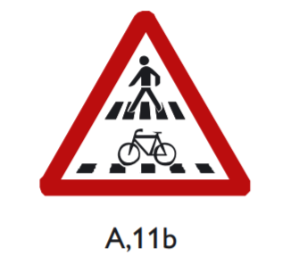
>
> Le signal A,11b indique l’approche d’un passage pour piétons et cyclistes. Les symboles sont inversés lorsque le signal est répété du côté gauche de la chaussée.

2\. Le chapitre V. ‘Signaux d’indication’ est modifié comme suit:

2.1. Une nouvelle rubrique 9. est insérée avec les texte et illustration suivants:

> 9\. **Passage pour piétons et cyclistes**
>
> 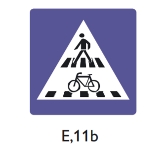
>
> Le signal E,11b indique l’aplomb d’un passage pour piétons et cyclistes. Les symboles sont inversés lorsque le signal est répété du côté gauche de la chaussée.
>
> L’aplomb des passages pour piétons et cyclistes doit être indiqué par le signal E,11b, sauf si la circulation est réglée par des signaux colorés lumineux. Lorsqu’une chaussée comporte un passage pour piétons et cyclistes des deux côtés d’une intersection, il suffit d’indiquer l’aplomb du premier passage pour chaque sens de la circulation. Si la configuration des lieux l’exige, l’approche d’un passage pour piétons et cyclistes est annoncée par le signal A,11b.

2.2. L’ancienne rubrique 24. est insérée comme nouvelle rubrique 10. avec les texte et illustration suivants:

> 10\. **Passage souterrain ou passage supérieur pour piétons**
>
> 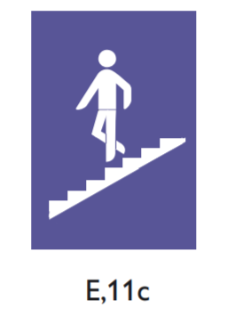
>
> Le signal E,11c indique la proximité d’un passage souterrain ou d’un passage supérieur pour piétons. Le symbole peut être adapté à la configuration des lieux.

2.3. Les anciennes rubriques 9. à 46. sont renumérotées 11. à 48.

2.4. L’ancienne rubrique 23., renumérotée 25., est remplacée par les texte et illustrations suivants:

> 25\. **Zone résidentielle**
>
> 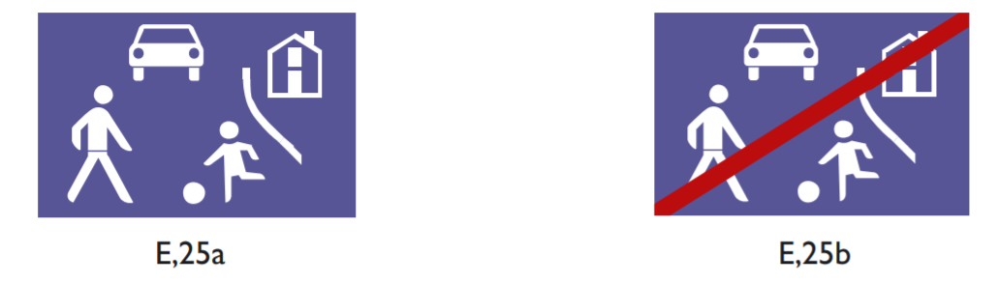
>
> Le signal E,25a indique l’endroit à partir duquel s’appliquent les règles de circulation particulières de zone résidentielle.
>
> Le signal E,25b indique l’endroit à partir duquel les règles de circulation particulières de zone résidentielle cessent d’être applicables. Il peut être placé au revers du signal E,25a.

2.5. L’ancienne rubrique 24., renumérotée 26., est remplacée par les texte et illustrations suivants:

> 26\. **Zone de rencontre**
>
> 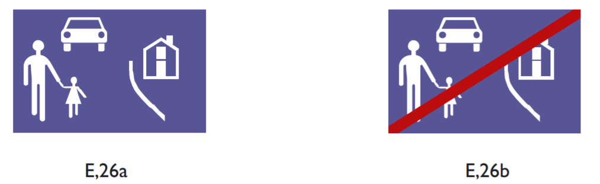
>
> Le signal E,26a indique l’endroit à partir duquel s’appliquent les règles de circulation particulières de zone de rencontre.
>
> Le signal E,26b indique l’endroit à partir duquel les règles de circulation particulières de zone de rencontre cessent d’être applicables. Il peut être placé au revers du signal E,26a.

3\. Le chapitre IX ‘Symboles et inscriptions additionnels’ est modifié comme suit:

3.1. Le deuxième alinéa de la rubrique 2.1. est remplacé par les texte et illustrations suivants:

> Le signal n’est applicable qu’aux
>
> | véhicules automoteurs dont la masse maximale autorisée ne dépasse pas la masse indiquée: | véhicules automoteurs dont la masse maximale autorisée ne dépasse pas la masse indiquée et aux autobus: |
> |---|---|
>
> 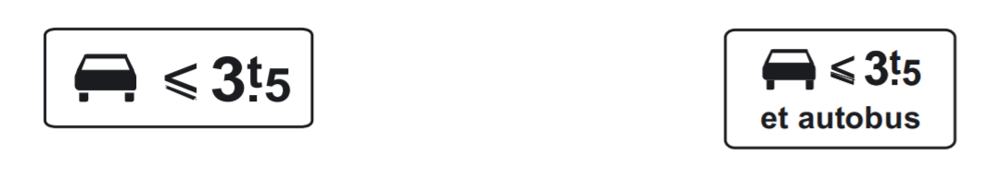
>
> | véhicules destinés au transport de choses et dont la masse maximale autorisée dépasse la masse indiquée: | motor-homes: |
> |---|---|
>
> 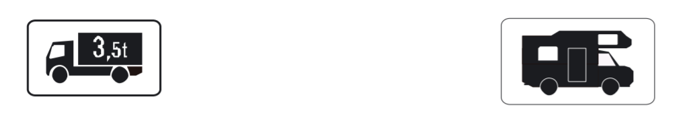
>
> modèle 1

3.2. Le deuxième alinéa de la rubrique 2.5. est remplacé par les texte et illustrations suivants:

> Le modèle 5a, dont les illustrations ci-après sont des exemples, indique que le signal d’interdiction n’est pas applicable aux
>
> 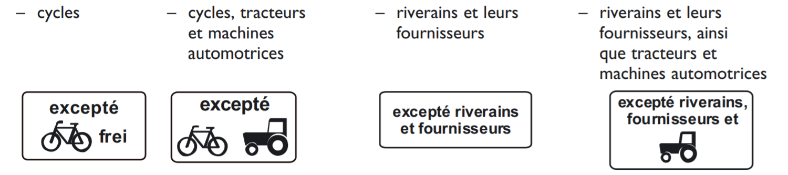
>
> modèle 5a

3.3. Les texte et illustrations des panneaux additionnels 7b et 7c de la rubrique 2.7. sont remplacés par les texte et illustrations suivants:

> Le modèle 7b, qui peut compléter les signaux C,18 et E,23 à E,23d, et qui porte le symbole du parcmètre à distribution de tickets, indique aux conducteurs qui stationnent ou parquent leur véhicule l’obligation de se conformer à la durée maximale de stationnement ou de parcage, l’obligation de payer une taxe de stationnement ou de parcage ainsi que l’obligation d’exposer le ticket de sorte que son côté recto soit lisible de l’extérieur par une personne placée devant le véhicule et de respecter la durée de stationnement ou de parcage autorisée en fonction du montant payé, telle qu’indiquée par l’heure limite inscrite sur le ticket. En cas de paiement de la taxe par voie électronique sans émission de ticket, le stationnement ou le parcage est autorisé pour la durée sollicitée par l’usager, dans la limite de la durée maximale autorisée et à condition, le cas échéant, qu’une vignette de paiement électronique définie par un règlement communal soit exposée de sorte que son côté recto soit lisible de l’extérieur par une personne placée devant le véhicule. Le symbole peut être suivi de l’inscription des jours et des heures pendant lesquels la limitation s’applique, de l’inscription de la durée maximale de stationnement ou de parcage autorisée et de l’inscription du nombre d’emplacements visés.
>
> Les dispositions de l’alinéa qui précède sont applicables sans préjudice d’éventuelles modalités particulières émises par les autorités communales en matière de stationnement ou de parcage et dûment approuvées par l’autorité supérieure.
>
> Les illustrations ci-après sont des exemples du modèle 7b:
>
> 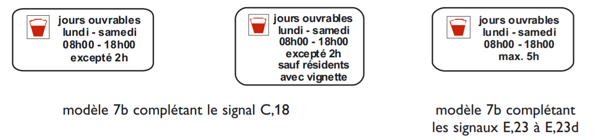
>
> Le modèle 7c, qui peut compléter les signaux C,18 et E,23, et qui porte le symbole du parcmètre à minuterie, indique aux conducteurs qui stationnent ou parquent leur véhicule l’obligation de se conformer à la durée maximale de stationnement ou de parcage ainsi que l’obligation de payer une taxe de stationnement ou de parcage et de respecter la durée de stationnement ou de parcage autorisée en fonction du montant payé, telle qu’indiquée par l’index du parcmètre à minuterie. En cas de paiement de la taxe par voie électronique sans émission de ticket, le stationnement ou le parcage est autorisé pour la durée sollicitée par l’usager, dans la limite de la durée maximale autorisée et à condition, le cas échéant, qu’une vignette de paiement électronique définie par un règlement communal soit exposée de sorte que son côté recto soit lisible de l’extérieur par une personne placée devant le véhicule. Le symbole peut être suivi de l’inscription des jours et des heures pendant lesquels la limitation s’applique, de l’inscription de la durée maximale de stationnement ou de parcage autorisée et de l’inscription du nombre d’emplacements visés.
>
> Les dispositions de l’alinéa qui précède sont applicables sans préjudice d’éventuelles modalités particulières émises par les autorités communales en matière de stationnement ou de parcage et dûment approuvées par l’autorité supérieure.
>
> Les illustrations ci-après sont des exemples du modèle 7c:
>
> 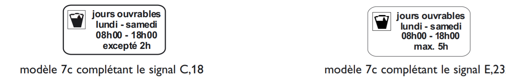

### Art. 10.

L’article 110 de l’[arrêté grand-ducal modifié du 23 novembre 1955 précité](https://legilux.public.lu/eli/etat/leg/agd/1955/11/23/n1/jo), est modifié comme suit:

1\. Le paragraphe 1. est modifié comme suit:

1.1. Une nouvelle lettre h) est insérée avec le texte suivant:

> h) Les lignes ou marques en dents de scie, transversales ou à angle aigu à l’axe de la chaussée, qui indiquent aux conducteurs la ligne à ne pas franchir lorsqu’ils doivent céder le passage aux véhicules qui circulent dans les deux sens sur la chaussée dont ils s’approchent.

Les anciennes lettres h) à j) sont respectivement renumérotées i) à k).

1.2. Une nouvelle lettre l) est insérée avec le texte suivant après l’ancienne lettre j), renumérotée k):

> l) Les passages pour piétons et cyclistes: ils comportent le marquage d’un passage pour piétons et d’un passage pour cyclistes juxtaposés; l’aplomb des passages pour piétons et cyclistes doit être indiqué par le signal E,11b, conformément à l’article 107.

Les anciennes lettres k) à o) sont respectivement renumérotées m) à q).

1.3. La lettre m), renumérotée o), est remplacée par le texte suivant:

> o) Les surfaces de lignes obliques parallèles délimitées par une ligne continue; elles indiquent qu’il est interdit d’entrer dans cette partie de la chaussée, sauf signalisation dérogatoire ou marquage d’une ligne guide autorisant le franchissement ou sauf autorisation de l’autorité délivrée à titre temporaire;

1.4. Le dernier alinéa est remplacé par le texte suivant:

> Les dispositions concernant les marques sous a), h), i), o) et p) ne sont pas applicables aux conducteurs de véhicules utilisés en service urgent et énumérés à l’article 39, pour autant que le service l’exige et à condition qu’ils tiennent compte en toute circonstance des exigences de la sécurité de la circulation.

2\. Le dernier alinéa du paragraphe 2. est remplacé par le texte suivant:

> Dans la mesure où elles visent les marques sous a), h), i), o) et p) du paragraphe 1., les marques sous b) du présent paragraphe ne sont pas applicables aux conducteurs de véhicules utilisés en service urgent et énumérés à l’article 39, pour autant que le service l’exige et à condition qu’ils tiennent compte en toute circonstance des exigences de la sécurité de la circulation.

### Art. 11.

Le paragraphe 5. de l’article 111 de l’[arrêté grand-ducal modifié du 23 novembre 1955 précité](https://legilux.public.lu/eli/etat/leg/agd/1955/11/23/n1/jo) est remplacé par le texte suivant:

> 5\. Les voies publiques suivantes sont considérées comme autoroutes et signalées comme telles:
>
> | – | A1, | de la croix de Gasperich jusqu’au point-frontière de Wasserbillig-Mesenich; |
> |---|---|---|
> | – | A3, | de Luxembourg-Sud jusqu’au point-frontière de Dudelange-Zoufftgen; |
> | – | A4, | de Luxembourg jusqu’à Esch-sur-Alzette; |
> | – | A6, | de la croix de Gasperich jusqu’au point-frontière de Kleinbettingen-Sterpenich; |
> | – | A7, | de la jonction de Grünewald jusqu’à l’échangeur de Waldhof et de l’échangeur de Lorentzweiler jusqu’à l’échangeur de Schieren; |
> | – | A13, | du giratoire Biff jusqu’au point-frontière de Schengen-Perl. |

### Art. 12.

La lettre m) du premier paragraphe de l’article 126 de l’[arrêté grand-ducal modifié du 23 novembre 1955 précité](https://legilux.public.lu/eli/etat/leg/agd/1955/11/23/n1/jo) est remplacée par le texte suivant:

> m) si l’usager à dépasser ralentit à l’approche d’un passage pour piétons, d’un passage pour piétons et cyclistes ou d’un passage pour cyclistes.

### Art. 13.

Les quatrième et cinquième alinéas de l’article 138 de l’[arrêté grand-ducal modifié du 23 novembre 1955 précité](https://legilux.public.lu/eli/etat/leg/agd/1955/11/23/n1/jo) sont remplacés par le texte suivant:

> Lors d’un arrêt dans une file de véhicules à la hauteur d’une intersection, il est interdit aux conducteurs d’immobiliser leur véhicule de manière à empêcher le passage des conducteurs qui circulent sur la chaussée transversale. Lors d’un arrêt dans une file de véhicules aux abords d’un passage à niveau, d’un passage pour piétons, d’un passage pour piétons et cyclistes ou d’un passage pour cyclistes, il est interdit aux conducteurs d’immobiliser leur véhicule sur ces passages. Le présent alinéa s’applique même si un signal coloré lumineux indique le passage libre.

### Art. 14.

Le deuxième alinéa du premier paragraphe de l’article 139 de l’[arrêté grand-ducal modifié du 23 novembre 1955 précité](https://legilux.public.lu/eli/etat/leg/agd/1955/11/23/n1/jo) est remplacé par le texte suivant:

> Les conducteurs ne doivent s’approcher qu’à vitesse modérée des passages pour piétons et des passages pour piétons et cyclistes.

### Art. 15.

L’article 141 de l’[arrêté grand-ducal modifié du 23 novembre 1955 précité](https://legilux.public.lu/eli/etat/leg/agd/1955/11/23/n1/jo) est remplacé par le texte suivant:

> **Art. 141.**
>
> 1\. Tout conducteur d’un véhicule en mouvement doit observer une distance suffisante, selon les circonstances, entre son véhicule et le véhicule qui précède, pour qu’en cas de ralentissement ou d’arrêt subits du véhicule qui précède, une collision puisse être évitée.
>
> Toutefois, à moins d’effectuer un dépassement,
>
> aash les conducteurs de véhicules automoteurs doivent, lorsqu’ils circulent en dehors d’une agglomération, maintenir entre eux une distance correspondant à un temps inter-véhiculaire d’au moins deux secondes;
>
> bash les conducteurs de véhicules automoteurs doivent observer une distance d’au moins 50 mètres en agglomération et d’au moins 100 mètres hors agglomération par rapport aux véhicules et ensembles de véhicules munis de panneaux orange prévus par le [règlement grand-ducal modifié du 31 janvier 2003](https://legilux.public.lu/eli/etat/leg/rgd/2003/01/31/n5/jo) sur les transports par route de marchandises dangereuses.
>
> Par dérogation, les convois de l’armée et de l’administration des services de secours peuvent être fractionnés en des groupes de longueur modérée, séparés par des distances suffisamment grandes pour ne pas gêner la circulation.
>
> 2\. Sans préjudice du premier alinéa du paragraphe premier, les conducteurs doivent, en cas de dégradation de la fluidité de la circulation dans un tunnel, maintenir une distance minimale de 5 mètres par rapport au véhicule qui précède, sauf si cela n’est pas possible en raison d’un arrêt d’urgence.

### Art. 16.

L’article 142 de l’[arrêté grand-ducal modifié du 23 novembre 1955 précité](https://legilux.public.lu/eli/etat/leg/agd/1955/11/23/n1/jo) est remplacé par le texte suivant:

> **Art. 142.**
>
> 1\. Aux passages pour piétons, aux passages pour piétons et cyclistes et aux passages pour cyclistes où la circulation est réglée par des agents chargés du contrôle de la circulation ou par des signaux colorés lumineux, les conducteurs doivent se conformer aux injonctions des agents chargés du contrôle de la circulation et aux indications des signaux colorés lumineux.
>
> Aux passages pour piétons et aux passages pour piétons et cyclistes où la circulation n’est pas réglée par des agents ou par des signaux colorés lumineux, les conducteurs doivent s’arrêter lorsqu’un piéton ou un cycliste marque son intention de s’engager sur le passage ou qu’il y est engagé.
>
> Aux passages pour cyclistes où la circulation n’est pas réglée par des agents ou par des signaux colorés lumineux, les cyclistes doivent céder le passage aux conducteurs qui circulent dans les deux sens sur la chaussée qu’ils traversent
>
> 2\. Tout conducteur doit ralentir, s’écarter ou s’arrêter en cas de besoin à l’approche d’enfants ou de personnes âgées ou handicapées qui circulent sur la voie publique ou à proximité immédiate.

### Art. 17.

A l’article 156, un nouveau paragraphe 10. est inséré avec le libellé ci-après; l’ancien paragraphe 10 est renuméroté 11.

> 10\. Les conducteurs de véhicules doivent disposer à tout moment d’une réserve en carburant suffisante qui leur permette de rallier en toute circonstance une aire de service.
>
> Les conducteurs de véhicules destinés au transport de choses et dont la masse maximale autorisée dépasse 3,5 t qui sont visés par le [règlement grand-ducal modifié du 5 mai 1994](https://legilux.public.lu/eli/etat/leg/rgd/1994/05/05/n1/jo) limitant la circulation de transit sur une partie de la voie publique doivent disposer à tout moment d’une réserve en carburant suffisante qui leur permette en toute circonstance de traverser le territoire du Grand-Duché de Luxembourg sur l’itinéraire de transit prescrit par le [règlement grand-ducal du 5 mai 1994 susmentionné](https://legilux.public.lu/eli/etat/leg/rgd/1994/05/05/n1/jo).

### Art. 18.

A l’article 156ter, un nouveau paragraphe 7. est inséré avec le libellé ci-après; l’ancien paragraphe 7 est renuméroté 8.

> 7\. Les conducteurs de véhicules doivent disposer à tout moment d’une réserve en carburant suffisante qui leur permette de rallier en toute circonstance une aire de service.
>
> Les conducteurs de véhicules destinés au transport de choses et dont la masse maximale autorisée dépasse 3,5 t qui sont visés par le [règlement grand-ducal modifié du 5 mai 1994](https://legilux.public.lu/eli/etat/leg/rgd/1994/05/05/n1/jo) limitant la circulation de transit sur une partie de la voie publique doivent disposer à tout moment d’une réserve en carburant suffisante qui leur permette en toute circonstance de traverser le territoire du Grand-Duché de Luxembourg sur l’itinéraire de transit prescrit par le [règlement grand-ducal du 5 mai 1994 susmentionné](https://legilux.public.lu/eli/etat/leg/rgd/1994/05/05/n1/jo).

### Art. 19.

L’article 160 de l’[arrêté grand-ducal modifié du 23 novembre 1955 précité](https://legilux.public.lu/eli/etat/leg/agd/1955/11/23/n1/jo) est remplacé par le texte suivant:

> **Art. 160.**
>
> 1\. Les conducteurs de véhicules autres que ceux sur rails doivent observer les prescriptions suivantes sur la voie publique:
>
> a) Il est interdit aux conducteurs de véhicules automoteurs autres qu’un motocycle ou un cyclomoteur de lâcher le volant simultanément des deux mains, tant que le véhicule est en mouvement.
>
> Il est interdit aux conducteurs de motocycles et de cyclomoteurs de lâcher le guidon simultanément des deux mains ou de retirer les pieds des repose-pieds ou des pédales, tant que le véhicule est en mouvement.
>
> b) Il est interdit aux conducteurs de véhicules de traîner ou de pousser des motocyclistes, des cyclomotoristes, des cyclistes ou des cycles non montés; il est interdit aux conducteurs de motocycles, de cyclomoteurs et de cycles de se faire traîner ou pousser par un véhicule.
>
> Il est interdit aux conducteurs de véhicules automoteurs de traîner une personne montée sur skis ou sur traîneau; il est interdit à toute personne montée sur skis ou sur traîneau de se faire traîner par un véhicule automoteur.
>
> c) Il est interdit aux conducteurs de véhicules automoteurs de circuler dans une descente en roue libre ou avec le moteur arrêté.
>
> d) Il est interdit aux conducteurs de véhicules automoteurs de circuler à deux de front, à moins qu’il n’y ait plus d’une voie de circulation dans le même sens.
>
> e) L’usage de l’échappement libre, la mise en marche bruyante ou l’essai bruyant du moteur sont interdits.
>
> f) Il est interdit de laisser tourner sans nécessité technique le moteur d’un véhicule immobilisé pendant un temps prolongé, à l’arrêt, en stationnement ou en parcage, même pour le faire chauffer ou faire chauffer l’habitacle du véhicule.
>
> g) Il est interdit de faire crisser sans nécessité les pneus d’un véhicule lors du démarrage, du freinage ou lors de la négociation d’un virage.
>
> h) Il est interdit de claquer bruyamment sans nécessité les portes, le capot ou le couvercle de malle d’un véhicule.
>
> i) Il est interdit de charger ou de décharger bruyamment un véhicule.
>
> j) Il est interdit de repasser sans nécessité au même endroit dans une agglomération.
>
> k) Il est interdit d’effectuer ou de faire effectuer des réparations à un véhicule, sauf en cas d’urgence.
>
> l) Il est interdit de laver ou de faire laver un véhicule.
>
> m) Il est interdit de laisser le moteur en marche ou de fumer pendant le ravitaillement en carburant du véhicule.
>
> n) Les conducteurs et les passagers de cyclomoteurs, de quadricycles légers, de tricycles, de quadricycles et de motocycles, avec ou sans side-cars, doivent porter un casque de protection homologué par un Etat membre des Communautés Européennes; ils doivent avoir fermé solidement les jugulaires du casque dès que le véhicule est en mouvement.
>
> Ces prescriptions ne sont pas applicables aux:
>
> 1° conducteurs et passagers de cyclomoteurs à trois roues, de quadricycles légers, de tricycles et de quadricycles, dès lors que ces véhicules sont munis d’une carrosserie;
>
> 2° conducteurs et passagers de cyclomoteurs à deux roues et de motocycles, dès lors que ces véhicules sont munis d’une carrosserie et équipés d’ancrages pour ceintures de sécurité et de ceintures de sécurité répondant aux exigences du paragraphe 1. de l’article 24quinquies et à condition pour le conducteur et les passagers d’utiliser ces ceintures conformément à l’article 160bis lorsque le véhicule est en circulation.
>
> o) Le conducteur d’une charrette à bras doit tirer celle-ci au lieu de la pousser lorsque le chargement de la charrette ne lui laisse pas une visibilité suffisante vers l’avant.
>
> 2\. Outre les prescriptions du paragraphe 1. sous b), les conducteurs de cycles doivent observer les prescriptions suivantes:
>
> a) Il leur est interdit de lâcher le guidon simultanément des deux mains ou de retirer les pieds des pédales tant que le cycle est en mouvement.
>
> b) Il leur est interdit de toucher un autre usager ou véhicule tant que le cycle est en mouvement.
>
> c) Il leur est interdit de circuler à plus de deux de front; toutefois, les concurrents participant à une course cycliste peuvent circuler à plusieurs de front, à condition d’emprunter la moitié droite de la chaussée; ceux-ci peuvent emprunter toute la largeur de la chaussée lorsqu’elle leur est réservée.
>
> d) Ils doivent se mettre en file:
>
> 1° à l’intérieur d’une agglomération;
>
> 2° entre la tombée de la nuit et le lever du jour;
>
> 3° dans les cas visés à l’article 120;
>
> 4° dès qu’ils doivent s’attendre au dépassement ou au croisement par un véhicule automoteur.
>
> e) Aux passages pour piétons et cyclistes où la circulation n’est pas réglée par des agents chargés du contrôle de la circulation ou par des signaux colorés lumineux, ils ne doivent s’engager sur le passage qu’avec prudence et en tenant compte de la distance et de la vitesse des véhicules qui s’en approchent; aux passages pour cyclistes où la circulation n’est pas réglée par des agents chargés du contrôle de la circulation ou par des signaux colorés lumineux, ils doivent céder le passage aux conducteurs qui circulent dans les deux sens sur la chaussée qu’ils traversent.
>
> f) Ils doivent mettre pied à terre en cas d’encombrement de la chaussée ou d’impossibilité de se conformer aux prescriptions du présent arrêté; ils doivent dans ce cas conduire le cycle à la main.

### Art. 20.

Les rubriques 7°, 9° et 10° du premier alinéa de l’article 162 de l’[arrêté grand-ducal modifié du 23 novembre 1955 précité](https://legilux.public.lu/eli/etat/leg/agd/1955/11/23/n1/jo) sont remplacées par le texte suivant:

> 7° Aux passages pour piétons et aux passages pour piétons et cyclistes, ils ne doivent traverser la chaussée en dehors de ces passages, à moins qu’ils ne se trouvent à une distance supérieure à 50 m d’un tel passage.
>
> 9° Aux passages pour piétons et aux passages pour piétons et cyclistes où la circulation est réglée par des signaux colorés lumineux, ils ne doivent s’engager sur le passage que si le feu vert est indiqué à leur intention.
>
> 10° Aux passages pour piétons et aux passages pour piétons et cyclistes où la circulation n’est pas réglée par des signaux colorés lumineux, ils ne doivent s’engager sur le passage qu’avec prudence et en tenant compte de la distance et de la vitesse des véhicules qui s’en approchent.

### Art. 21.

La phrase introductive de l’article 162ter de l’[arrêté grand-ducal modifié du 23 novembre 1955 précité](https://legilux.public.lu/eli/etat/leg/agd/1955/11/23/n1/jo) est remplacée par le texte suivant:

> **Art. 162ter.**
>
> En zone de rencontre et en zone résidentielle les règles suivantes sont d’application:

### Art. 22.

A l’article 164, paragraphe 2. de l’[arrêté grand-ducal modifié du 23 novembre 1955 précité](https://legilux.public.lu/eli/etat/leg/agd/1955/11/23/n1/jo), les lettres d) et e) sont remplacées par le texte suivant:

> d) à moins de 12 mètres de part et d’autre des points d’arrêt signalés comme tels des autobus et des tramways, sauf signalisation ou marquage dérogatoires ou sauf autorisation de l’autorité délivrée à titre temporaire; cette interdiction ne s’applique pas aux autobus, tramways et voitures de location ayant plus de 5 places assises, y compris celle du conducteur, qui desservent ces points d’arrêt, aux taxis ainsi qu’aux véhicules assurant l’entretien, le nettoyage, le déneigement et le déblaiement de ces points d’arrêt ou de la voie publique, pour autant que le service de ces derniers l’exige et à condition que leur intervention soit signalée au moyen d’un ou de deux feux jaunes clignotants;
>
> e) sur les passages pour piétons, sur les passages pour piétons et cyclistes et sur les passages pour cyclistes ainsi qu’à moins de 5 mètres de part et d’autre de ces passages, sauf signalisation dérogatoire temporaire ou sauf autorisation de l’autorité délivrée à titre temporaire;

### Art. 23.

Le paragraphe 2. de l’article 170bis de l’[arrêté grand-ducal modifié du 23 novembre 1955 précité](https://legilux.public.lu/eli/etat/leg/agd/1955/11/23/n1/jo) est remplacé par le texte suivant:

> 2\. Tout équipement téléphonique à l’usage du conducteur doit être fixé solidement dans le véhicule ou être intégré au casque de protection porté par le conducteur; les équipements téléphoniques prévoyant l’usage d’une oreillette sont réputés satisfaire aux exigences du présent paragraphe.
>
> Les équipements doivent répondre aux conditions d’utilisation suivantes: le conducteur n’est autorisé, dès que le véhicule est en mouvement, à lâcher le volant ou le guidon d’une main que pour les seules opérations de mise en service et d’arrêt de cet équipement; pour ce faire, il ne doit pas changer sensiblement sa position de conduite. Par ailleurs, l’écoute et la communication doivent lui permettre de garder les deux mains au volant ou au guidon.

### Art. 24.

Le paragraphe 1. de l’article 176 de l’[arrêté grand-ducal modifié du 23 novembre 1955 précité](https://legilux.public.lu/eli/etat/leg/agd/1955/11/23/n1/jo), est modifié comme suit:

1\. Un nouvel alinéa est ajouté in fine du paragraphe avec le libellé suivant:

> Les permis de conduire des catégories A, B, B+E et F et des sous-catégories A1, A2 et A3 délivrés avant le 1er janvier 2010 sont valables jusqu’à l’âge de 60 ans des titulaires. La durée de validité de ces permis de conduire peut être prorogée sans frais jusqu’à l’âge de 60 ans des titulaires sur convocation de la SNCT, sous condition de la production par le titulaire d’une photographie répondant aux critères sous 5) du deuxième alinéa de l’article 78 et de la remise de l’ancien permis de conduire.

## 2) — Modifications du règlement grand-ducal modifié du 26 août 1993 relatif aux avertissements taxés, aux consignations pour contrevenants non résidents ainsi qu’aux mesures d’exécution de la législation en matière de mise en fourrière des véhicules et en matière de permis à points

### Art. 25.

La partie A. de l’annexe I «Catalogue des avertissements taxés» qui figure en annexe du [règlement grand-ducal modifié du 26 août 1993 précité](https://legilux.public.lu/eli/etat/leg/rgd/1993/08/26/n1/jo), est modifiée comme suit:

1\. La rubrique 38 est remplacée par le libellé suivant:

> <table>
> <tr>
> <td rowspan="2"><i>Référ.</i> <i>aux</i> <i>ar**ticles</i></td>
> <td rowspan="2"><i>Nature de l’infraction</i></td>
> <td colspan="4"><i>Montant de la taxe</i></td>
> <td rowspan="2"><i>Réduction de points en vertu de l’art. 2bis de la</i> <a href="https://legilux.public.lu/eli/etat/leg/loi/1955/02/14/n3/jo"><i>loi modifiée du 14 février 1955</i></a></td>
> </tr>
> <tr>
> <td>I</td>
> <td>II</td>
> <td>III</td>
> <td>IV</td>
> </tr>
> <tr>
> <td>38</td>
> <td></td>
> <td></td>
> <td></td>
> <td></td>
> <td></td>
> <td></td>
> </tr>
> <tr>
> <td>-01</td>
> <td>Défaut d’une sonnette réglementaire sur un cycle</td>
> <td></td>
> <td></td>
> <td>74</td>
> <td></td>
> <td></td>
> </tr>
> <tr>
> <td>-02</td>
> <td>Défaut d’un avertisseur sonore réglementaire sur un quadricycle léger</td>
> <td></td>
> <td></td>
> <td>74</td>
> <td></td>
> <td></td>
> </tr>
> <tr>
> <td>-03</td>
> <td>Défaut d’une sonnette ou d’un avertisseur sonore réglementaires sur un cyclomoteur</td>
> <td></td>
> <td></td>
> <td>74</td>
> <td></td>
> <td></td>
> </tr>
> </table>

2\. La rubrique 46+46bis est remplacée par le libellé suivant:

> <table>
> <tr>
> <td rowspan="2"><i>Référ.</i> <i>aux</i> <i>ar**ticles</i></td>
> <td rowspan="2"><i>Nature de l’infraction</i></td>
> <td colspan="4"><i>Montant de la taxe</i></td>
> <td rowspan="2"><i>Réduction de points en vertu de l’art. 2bis de la</i> <a href="https://legilux.public.lu/eli/etat/leg/loi/1955/02/14/n3/jo"><i>loi modifiée du 14 février 1955</i></a></td>
> </tr>
> <tr>
> <td>I</td>
> <td>II</td>
> <td>III</td>
> <td>IV</td>
> </tr>
> <tr>
> <td>46</td>
> <td></td>
> <td></td>
> <td></td>
> <td></td>
> <td></td>
> <td></td>
> </tr>
> <tr>
> <td>-01</td>
> <td>Usage d’un véhicule routier automoteur n’assurant pas une vue du conducteur suffisamment dégagée vers l’avant ou vers les deux côtés</td>
> <td></td>
> <td></td>
> <td>74</td>
> <td></td>
> <td></td>
> </tr>
> <tr>
> <td>-02</td>
> <td>Présence dans un véhicule d’une lumière gênant le conducteur **</td>
> <td></td>
> <td>49</td>
> <td></td>
> <td></td>
> <td></td>
> </tr>
> <tr>
> <td>-03</td>
> <td>Présence dans un véhicule routier automoteur d’un objet étranger à l’équipement et gênant la vue du conducteur ou se trouvant dans le champ de vision de celui-ci</td>
> <td></td>
> <td>49</td>
> <td></td>
> <td></td>
> <td></td>
> </tr>
> <tr>
> <td>-04</td>
> <td>Présence dans un véhicule routier automoteur d’un dispositif accessoire, d’une vignette ou d’un film en plastique fixés de façon non réglementaire</td>
> <td></td>
> <td>49</td>
> <td></td>
> <td></td>
> <td></td>
> </tr>
> <tr>
> <td>-05</td>
> <td>Fixation dans un véhicule routier automoteur d’un dispositif accessoire ou d’un film en plastique non réglementaires</td>
> <td></td>
> <td>49</td>
> <td></td>
> <td></td>
> <td></td>
> </tr>
> <tr>
> <td>-06</td>
> <td>Présence dans un véhicule d’un pare-brise ou d’un vitrage latéral non réglementaires **</td>
> <td></td>
> <td></td>
> <td>74</td>
> <td></td>
> <td></td>
> </tr>
> </table>

3\. A la rubrique 80, les infractions 06 et 07 ainsi que la note en bas de page sont supprimées. Les infractions 08 à 10 sont respectivement renumérotées 06 à 08.

4\. A la rubrique 110, l’infraction 04 est remplacée par le libellé suivant:

> <table>
> <tr>
> <td rowspan="2"><i>Référ.</i> <i>aux</i> <i>ar**ticles</i></td>
> <td rowspan="2"><i>Nature de l’infraction</i></td>
> <td colspan="4"><i>Montant de la taxe</i></td>
> <td rowspan="2"><i>Réduction de points en vertu de l’art. 2bis de la</i> <a href="https://legilux.public.lu/eli/etat/leg/loi/1955/02/14/n3/jo"><i>loi modifiée du 14 février 1955</i></a></td>
> </tr>
> <tr>
> <td>I</td>
> <td>II</td>
> <td>III</td>
> <td>IV</td>
> </tr>
> <tr>
> <td>110</td>
> <td></td>
> <td></td>
> <td></td>
> <td></td>
> <td></td>
> <td></td>
> </tr>
> <tr>
> <td>-04</td>
> <td>Inobservation d’une ligne ou marque employées comme ligne à ne pas franchir en cas d’obligation de céder le passage ou comme ligne d’arrêt</td>
> <td></td>
> <td></td>
> <td>74</td>
> <td></td>
> <td></td>
> </tr>
> </table>

5\. A la rubrique 126, l’infraction 12 est remplacée par le libellé suivant:

> <table>
> <tr>
> <td rowspan="2"><i>Référ.</i> <i>aux</i> <i>ar**ticles</i></td>
> <td rowspan="2"><i>Nature de l’infraction</i></td>
> <td colspan="4"><i>Montant de la taxe</i></td>
> <td rowspan="2"><i>Réduction de points en vertu de l’art. 2bis de la</i> <a href="https://legilux.public.lu/eli/etat/leg/loi/1955/02/14/n3/jo"><i>loi modifiée du 14 février 1955</i></a></td>
> </tr>
> <tr>
> <td>I</td>
> <td>II</td>
> <td>III</td>
> <td>IV</td>
> </tr>
> <tr>
> <td>126</td>
> <td></td>
> <td></td>
> <td></td>
> <td></td>
> <td></td>
> <td></td>
> </tr>
> <tr>
> <td>-12</td>
> <td>d’un usager qui ralentit à l’approche d’un passage pour piétons, d’un passage pour piétons et cyclistes ou d’un passage pour cyclistes</td>
> <td></td>
> <td></td>
> <td></td>
> <td>145</td>
> <td>2</td>
> </tr>
> </table>

6\. A la rubrique 138, l’infraction 05 est remplacée par le libellé suivant:

> <table>
> <tr>
> <td rowspan="2"><i>Référ.</i> <i>aux</i> <i>ar**ticles</i></td>
> <td rowspan="2"><i>Nature de l’infraction</i></td>
> <td colspan="4"><i>Montant de la taxe</i></td>
> <td rowspan="2"><i>Réduction de points en vertu de l’art. 2bis de la</i> <a href="https://legilux.public.lu/eli/etat/leg/loi/1955/02/14/n3/jo"><i>loi modifiée du 14 février 1955</i></a></td>
> </tr>
> <tr>
> <td>I</td>
> <td>II</td>
> <td>III</td>
> <td>IV</td>
> </tr>
> <tr>
> <td>138</td>
> <td></td>
> <td></td>
> <td></td>
> <td></td>
> <td></td>
> <td></td>
> </tr>
> <tr>
> <td>-05</td>
> <td>Immobilisation d’un véhicule sur un passage à niveau, un passage pour piétons, un passage pour piétons et cyclistes ou un passage pour cyclistes</td>
> <td></td>
> <td>49</td>
> <td></td>
> <td></td>
> <td></td>
> </tr>
> </table>

7\. A la rubrique 139, l’infraction 03 est remplacée par le libellé suivant:

> <table>
> <tr>
> <td rowspan="2"><i>Référ.</i> <i>aux</i> <i>ar**ticles</i></td>
> <td rowspan="2"><i>Nature de l’infraction</i></td>
> <td colspan="4"><i>Montant de la taxe</i></td>
> <td rowspan="2"><i>Réduction de points en vertu de l’art. 2bis de la</i> <a href="https://legilux.public.lu/eli/etat/leg/loi/1955/02/14/n3/jo"><i>loi modifiée du 14 février 1955</i></a></td>
> </tr>
> <tr>
> <td>I</td>
> <td>II</td>
> <td>III</td>
> <td>IV</td>
> </tr>
> <tr>
> <td>139</td>
> <td></td>
> <td></td>
> <td></td>
> <td></td>
> <td></td>
> <td></td>
> </tr>
> <tr>
> <td>-03</td>
> <td>Défaut de s’approcher à vitesse modérée d’un passage pour piétons ou d’un passage pour piétons et cyclistes</td>
> <td></td>
> <td></td>
> <td></td>
> <td>145</td>
> <td></td>
> </tr>
> </table>

8\. A la rubrique 141, l’infraction 02 est remplacée par le libellé suivant:

> <table>
> <tr>
> <td rowspan="2"><i>Référ.</i> <i>aux</i> <i>ar**ticles</i></td>
> <td rowspan="2"><i>Nature de l’infraction</i></td>
> <td colspan="4"><i>Montant de la taxe</i></td>
> <td rowspan="2"><i>Réduction de points en vertu de l’art. 2bis de la</i> <a href="https://legilux.public.lu/eli/etat/leg/loi/1955/02/14/n3/jo"><i>loi modifiée du 14 février 1955</i></a></td>
> </tr>
> <tr>
> <td>I</td>
> <td>II</td>
> <td>III</td>
> <td>IV</td>
> </tr>
> <tr>
> <td>141</td>
> <td></td>
> <td></td>
> <td></td>
> <td></td>
> <td></td>
> <td></td>
> </tr>
> <tr>
> <td>-02</td>
> <td>Défaut pour les conducteurs d’un véhicule automoteur, qui circulent en dehors d’une agglomération, de maintenir entre eux une distance inter-véhiculaire d’au moins 2 secondes</td>
> <td></td>
> <td></td>
> <td>74</td>
> <td></td>
> <td></td>
> </tr>
> </table>

9\. La rubrique 142 est remplacée par le libellé suivant:

> <table>
> <tr>
> <td rowspan="2"><i>Référ.</i> <i>aux</i> <i>ar**ticles</i></td>
> <td rowspan="2"><i>Nature de l’infraction</i></td>
> <td colspan="4"><i>Montant de la taxe</i></td>
> <td rowspan="2"><i>Réduction de points en vertu de l’art. 2bis de la</i> <a href="https://legilux.public.lu/eli/etat/leg/loi/1955/02/14/n3/jo"><i>loi modifiée du 14 février 1955</i></a></td>
> </tr>
> <tr>
> <td>I</td>
> <td>II</td>
> <td>III</td>
> <td>IV</td>
> </tr>
> <tr>
> <td>142</td>
> <td></td>
> <td></td>
> <td></td>
> <td></td>
> <td></td>
> <td></td>
> </tr>
> <tr>
> <td>-01</td>
> <td>Défaut de s’arrêter devant un passage pour piétons ou un passage pour piétons et cyclistes lorsqu’un piéton marque son intention de s’y engager ou qu’il y est engagé</td>
> <td></td>
> <td></td>
> <td></td>
> <td>145</td>
> <td>2</td>
> </tr>
> <tr>
> <td>-02</td>
> <td>Défaut de s’arrêter devant un passage pour piétons ou un passage pour piétons et cyclistes lorsqu’un cycliste marque son intention de s’y engager ou qu’il y est engagé</td>
> <td></td>
> <td></td>
> <td></td>
> <td>145</td>
> <td></td>
> </tr>
> <tr>
> <td>-03</td>
> <td>Défaut de ralentir, de s’écarter ou de s’arrêter à l’approche d’enfants, de personnes âgées ou handicapées circulant sur la voie publique ou à proximité immédiate</td>
> <td></td>
> <td></td>
> <td>74</td>
> <td></td>
> <td></td>
> </tr>
> </table>

10\. A la rubrique 156, deux nouvelles infractions 19 et 20 sont insérées in fine avec les libellés suivants:

> <table>
> <tr>
> <td rowspan="2"><i>Référ.</i> <i>aux</i> <i>ar**ticles</i></td>
> <td rowspan="2"><i>Nature de l’infraction</i></td>
> <td colspan="4"><i>Montant de la taxe</i></td>
> <td rowspan="2"><i>Réduction de points en vertu de l’art. 2bis de la</i> <a href="https://legilux.public.lu/eli/etat/leg/loi/1955/02/14/n3/jo"><i>loi modifiée du 14 février 1955</i></a></td>
> </tr>
> <tr>
> <td>I</td>
> <td>II</td>
> <td>III</td>
> <td>IV</td>
> </tr>
> <tr>
> <td>156</td>
> <td></td>
> <td></td>
> <td></td>
> <td></td>
> <td></td>
> <td></td>
> </tr>
> <tr>
> <td>-19</td>
> <td>Défaut de disposer d’une réserve en carburant suffisante pour rallier une aire de service</td>
> <td></td>
> <td></td>
> <td>74</td>
> <td></td>
> <td></td>
> </tr>
> <tr>
> <td>-20</td>
> <td>Défaut pour le conducteur d’un véhicule automoteur visé par le <a href="https://legilux.public.lu/eli/etat/leg/rgd/1994/05/05/n1/jo">règlement grand-ducal modifié du 5 mai 1994</a> limitant la circulation de transit sur une partie de la voie publique de disposer d’une réserve en carburant suffisante pour traverser le Grand-Duché sur l’itinéraire prescrit</td>
> <td></td>
> <td></td>
> <td>74</td>
> <td></td>
> <td></td>
> </tr>
> </table>

11\. A la rubrique 156ter, deux nouvelles infractions 12 et 13 sont insérées in fine avec les libellés suivants:

> <table>
> <tr>
> <td rowspan="2"><i>Référ.</i> <i>aux</i> <i>ar**ticles</i></td>
> <td rowspan="2"><i>Nature de l’infraction</i></td>
> <td colspan="4"><i>Montant de la taxe</i></td>
> <td rowspan="2"><i>Réduction de points en vertu de l’art. 2bis de la</i> <a href="https://legilux.public.lu/eli/etat/leg/loi/1955/02/14/n3/jo"><i>loi modifiée du 14 février 1955</i></a></td>
> </tr>
> <tr>
> <td>I</td>
> <td>II</td>
> <td>III</td>
> <td>IV</td>
> </tr>
> <tr>
> <td>156ter</td>
> <td></td>
> <td></td>
> <td></td>
> <td></td>
> <td></td>
> <td></td>
> </tr>
> <tr>
> <td>-12</td>
> <td>Défaut de disposer d’une réserve en carburant suffisante pour rallier une aire de service</td>
> <td></td>
> <td></td>
> <td>74</td>
> <td></td>
> <td></td>
> </tr>
> <tr>
> <td>-13</td>
> <td>Défaut pour le conducteur d’un véhicule automoteur visé par le <a href="https://legilux.public.lu/eli/etat/leg/rgd/1994/05/05/n1/jo">règlement grand-ducal modifié du 5 mai 1994</a> limitant la circulation de transit sur une partie de la voie publique de disposer d’une réserve en carburant suffisante pour traverser le Grand-Duché sur l’itinéraire prescrit</td>
> <td></td>
> <td></td>
> <td>74</td>
> <td></td>
> <td></td>
> </tr>
> </table>

12\. La rubrique 160 est remplacée par le libellé suivant:

> <table>
> <tr>
> <th rowspan="2"><i>Référ.</i> <i>aux</i> <i>ar**ticles</i></th>
> <th rowspan="2"><i>Nature de l’infraction</i></th>
> <th colspan="4"><i>Montant de la taxe</i></th>
> <th rowspan="2"><i>Réduction de points en vertu de l’art. 2bis de la</i> <a href="https://legilux.public.lu/eli/etat/leg/loi/1955/02/14/n3/jo"><i>loi modifiée du 14 février 1955</i></a></th>
> </tr>
> <tr>
> <th>I</th>
> <th>II</th>
> <th>III</th>
> <th>IV</th>
> </tr>
> <tr>
> <td>160</td>
> <td></td>
> <td></td>
> <td></td>
> <td></td>
> <td></td>
> <td></td>
> </tr>
> <tr>
> <td>-01</td>
> <td>Inobservation par le conducteur d’un véhicule automoteur en mouvement autre qu’un motocycle ou un cyclomoteur de l’interdiction de lâcher le volant simultanément des deux mains</td>
> <td></td>
> <td>49</td>
> <td></td>
> <td></td>
> <td></td>
> </tr>
> <tr>
> <td>-02</td>
> <td>Inobservation par le conducteur d’un motocycle ou d’un cyclomoteur en mouvement de l’interdiction de lâcher le guidon simultanément des deux mains ou de retirer les pieds des repose-pieds ou des pédales</td>
> <td>24</td>
> <td></td>
> <td></td>
> <td></td>
> <td></td>
> </tr>
> <tr>
> <td>-03</td>
> <td>Inobservation par le conducteur d’un véhicule de l’interdiction de traîner ou de pousser un motocycliste, un cyclomotoriste, un cycliste ou un cycle non monté</td>
> <td></td>
> <td>49</td>
> <td></td>
> <td></td>
> <td></td>
> </tr>
> <tr>
> <td>-04</td>
> <td>Inobservation par le conducteur d’un motocycle, d’un cyclomoteur ou d’un cycle de l’interdiction de se faire traîner ou pousser par un véhicule</td>
> <td></td>
> <td>49</td>
> <td></td>
> <td></td>
> <td></td>
> </tr>
> <tr>
> <td>-05</td>
> <td>Inobservation par une personne montée sur skis ou sur traîneaux de l’interdiction de se faire traîner par un véhicule automoteur</td>
> <td></td>
> <td>49</td>
> <td></td>
> <td></td>
> <td></td>
> </tr>
> <tr>
> <td></td>
> <td>Inobservation sur la voie publique par le conducteur d’un véhicule automoteur de l’interdiction</td>
> <td></td>
> <td></td>
> <td></td>
> <td></td>
> <td></td>
> </tr>
> <tr>
> <td>-06</td>
> <td>de traîner des personnes montées sur skis ou sur traîneaux</td>
> <td></td>
> <td>49</td>
> <td></td>
> <td></td>
> <td></td>
> </tr>
> <tr>
> <td>-07</td>
> <td>de circuler en roue libre ou avec le moteur arrêté dans une descente</td>
> <td></td>
> <td>49</td>
> <td></td>
> <td></td>
> <td></td>
> </tr>
> <tr>
> <td>-08</td>
> <td>de circuler à deux de front lorsqu’il n’y a qu’une voie de circulation dans le même sens</td>
> <td></td>
> <td>49</td>
> <td></td>
> <td></td>
> <td></td>
> </tr>
> <tr>
> <td>-09</td>
> <td>de faire usage d’un échappement libre ou d’une mise en marche bruyante ou d’un essai bruyant du moteur</td>
> <td></td>
> <td>49</td>
> <td></td>
> <td></td>
> <td></td>
> </tr>
> <tr>
> <td>-10</td>
> <td>de laisser tourner sans nécessité technique le moteur lorsque le véhicule est immobilisé</td>
> <td></td>
> <td>49</td>
> <td></td>
> <td></td>
> <td></td>
> </tr>
> <tr>
> <td>-11</td>
> <td>de faire crisser les pneus sans nécessité</td>
> <td></td>
> <td>49</td>
> <td></td>
> <td></td>
> <td></td>
> </tr>
> <tr>
> <td>-12</td>
> <td>de claquer bruyamment et sans nécessité les portes, le capot ou le couvercle de malle</td>
> <td></td>
> <td>49</td>
> <td></td>
> <td></td>
> <td></td>
> </tr>
> <tr>
> <td>-13</td>
> <td>de charger ou décharger bruyamment le véhicule</td>
> <td></td>
> <td>49</td>
> <td></td>
> <td></td>
> <td></td>
> </tr>
> <tr>
> <td>-14</td>
> <td>de repasser sans nécessité au même endroit dans une agglomération</td>
> <td></td>
> <td>49</td>
> <td></td>
> <td></td>
> <td></td>
> </tr>
> <tr>
> <td>-15</td>
> <td>d’effectuer ou de faire effectuer des réparations à un véhicule</td>
> <td></td>
> <td>49</td>
> <td></td>
> <td></td>
> <td></td>
> </tr>
> <tr>
> <td>-16</td>
> <td>de laver ou de faire laver un véhicule</td>
> <td></td>
> <td>49</td>
> <td></td>
> <td></td>
> <td></td>
> </tr>
> <tr>
> <td>-17</td>
> <td>de laisser le moteur en marche ou de fumer pendant le ravitaillement en carburant du véhicule</td>
> <td></td>
> <td>49</td>
> <td></td>
> <td></td>
> <td></td>
> </tr>
> <tr>
> <td>-18</td>
> <td>Défaut pour le conducteur d’un cyclomoteur, d’un quadricycle léger, d’un tricycle, d’un quadricycle ou d’un motocycle avec ou sans side-car de porter un casque de protection réglementaire</td>
> <td></td>
> <td>49</td>
> <td></td>
> <td></td>
> <td>1</td>
> </tr>
> <tr>
> <td>-19</td>
> <td>Défaut pour le passager adulte d’un cyclomoteur, d’un quadricycle léger, d’un tricycle, d’un quadricycle ou d’un motocycle avec ou sans side-car de porter un casque de protection réglementaire</td>
> <td></td>
> <td>49</td>
> <td></td>
> <td></td>
> <td></td>
> </tr>
> <tr>
> <td>-20</td>
> <td>Fait pour le conducteur d’un cyclomoteur, d’un quadricycle léger, d’un tricycle, d’un quadricycle ou d’un motocycle avec ou sans side-car de transporter une personne mineure qui ne porte pas de façon réglementaire un casque de protection homologué</td>
> <td></td>
> <td>49</td>
> <td></td>
> <td></td>
> <td>1</td>
> </tr>
> <tr>
> <td>-21</td>
> <td>Port non réglementaire d’un casque de protection</td>
> <td>24</td>
> <td></td>
> <td></td>
> <td></td>
> <td></td>
> </tr>
> <tr>
> <td>-22</td>
> <td>Inobservation par le conducteur d’une charrette à bras de l’interdiction de pousser celle-ci au lieu de la tirer, lorsque le chargement ne laisse pas une visibilité suffisante</td>
> <td>24</td>
> <td></td>
> <td></td>
> <td></td>
> <td></td>
> </tr>
> <tr>
> <td></td>
> <td>Inobservation par le conducteur d’un cycle de l’interdiction</td>
> <td></td>
> <td></td>
> <td></td>
> <td></td>
> <td></td>
> </tr>
> <tr>
> <td>-23</td>
> <td>de lâcher le guidon simultanément des deux mains ou de retirer les pieds des pédales tant que le cycle est en mouvement</td>
> <td>24</td>
> <td></td>
> <td></td>
> <td></td>
> <td></td>
> </tr>
> <tr>
> <td>-24</td>
> <td>de toucher un autre usager ou véhicule tant que le cycle est en mouvement</td>
> <td>24</td>
> <td></td>
> <td></td>
> <td></td>
> <td></td>
> </tr>
> <tr>
> <td>-25</td>
> <td>de circuler à plus de deux de front</td>
> <td>24</td>
> <td></td>
> <td></td>
> <td></td>
> <td></td>
> </tr>
> <tr>
> <td></td>
> <td>Défaut pour le conducteur d’un cycle de se mettre en file</td>
> <td></td>
> <td></td>
> <td></td>
> <td></td>
> <td></td>
> </tr>
> <tr>
> <td>-26</td>
> <td>à l’intérieur d’une agglomération</td>
> <td></td>
> <td>49</td>
> <td></td>
> <td></td>
> <td></td>
> </tr>
> <tr>
> <td>-27</td>
> <td>entre la tombée de la nuit et le lever du jour</td>
> <td></td>
> <td>49</td>
> <td></td>
> <td></td>
> <td></td>
> </tr>
> <tr>
> <td>-28</td>
> <td>dans les cas visés à l’article 120 modifié de l’<a href="https://legilux.public.lu/eli/etat/leg/agd/1955/11/23/n1/jo">arrêté grand-ducal du 23 novembre 1955</a> précité</td>
> <td></td>
> <td>49</td>
> <td></td>
> <td></td>
> <td></td>
> </tr>
> <tr>
> <td>-29</td>
> <td>dès qu’ils doivent s’attendre au dépassement ou au croisement par un véhicule automoteur</td>
> <td>24</td>
> <td></td>
> <td></td>
> <td></td>
> <td></td>
> </tr>
> <tr>
> <td>-30</td>
> <td>Défaut pour le conducteur d’un cycle de s’engager sur un passage pour piétons et cyclistes avec prudence et en tenant compte de la vitesse des véhicules qui s’en approchent</td>
> <td>24</td>
> <td></td>
> <td></td>
> <td></td>
> <td></td>
> </tr>
> <tr>
> <td>-31</td>
> <td>Défaut pour le conducteur d’un cycle de céder le passage à un passage pour cyclistes où la circulation n’est pas réglée par des agents ou des signaux colorés lumineux</td>
> <td></td>
> <td></td>
> <td>74</td>
> <td></td>
> <td></td>
> </tr>
> <tr>
> <td>-32</td>
> <td>Défaut pour le conducteur d’un cycle de conduire le cycle à la main en cas d’encombrement de la chaussée</td>
> <td>24</td>
> <td></td>
> <td></td>
> <td></td>
> <td></td>
> </tr>
> </table>

13\. A la rubrique 162 l’infraction 10 est remplacée par le libellé suivant:

> <table>
> <tr>
> <td rowspan="2"><i>Référ.</i> <i>aux</i> <i>ar**ticles</i></td>
> <td rowspan="2"><i>Nature de l’infraction</i></td>
> <td colspan="4"><i>Montant de la taxe</i></td>
> <td rowspan="2"><i>Réduction de points en vertu de l’art. 2bis de la</i> <a href="https://legilux.public.lu/eli/etat/leg/loi/1955/02/14/n3/jo"><i>loi modifiée du 14 février 1955</i></a></td>
> </tr>
> <tr>
> <td>I</td>
> <td>II</td>
> <td>III</td>
> <td>IV</td>
> </tr>
> <tr>
> <td>162</td>
> <td></td>
> <td></td>
> <td></td>
> <td></td>
> <td></td>
> <td></td>
> </tr>
> <tr>
> <td>-10</td>
> <td>de traverser la chaussée en dehors d’un passage pour piétons, d’un passage pour piétons et cyclistes, d’un passage souterrain ou d’un passage supérieur, à moins de 50 mètres d’un tel passage</td>
> <td></td>
> <td>49</td>
> <td></td>
> <td></td>
> <td></td>
> </tr>
> </table>

14\. A la rubrique 162ter la phrase introductive est remplacée par le libellé suivant:

> <table>
> <tr>
> <td rowspan="2"><i>Référ.</i> <i>aux</i> <i>ar**ticles</i></td>
> <td rowspan="2"><i>Nature de l’infraction</i></td>
> <td colspan="4"><i>Montant de la taxe</i></td>
> <td rowspan="2"><i>Réduction de points en vertu de l’art. 2bis de la</i> <a href="https://legilux.public.lu/eli/etat/leg/loi/1955/02/14/n3/jo"><i>loi modifiée du 14 février 1955</i></a></td>
> </tr>
> <tr>
> <td>I</td>
> <td>II</td>
> <td>III</td>
> <td>IV</td>
> </tr>
> <tr>
> <td>162ter</td>
> <td></td>
> <td></td>
> <td></td>
> <td></td>
> <td></td>
> <td></td>
> </tr>
> <tr>
> <td></td>
> <td>En zone de rencontre et en zone résidentielle:</td>
> <td></td>
> <td></td>
> <td></td>
> <td></td>
> <td></td>
> </tr>
> </table>

15\. A la rubrique 164, les infractions 09 et 10 sont remplacées par le libellé suivant:

> <table>
> <tr>
> <td rowspan="2"><i>Référ.</i> <i>aux</i> <i>ar**ticles</i></td>
> <td rowspan="2"><i>Nature de l’infraction</i></td>
> <td colspan="4"><i>Montant de la taxe</i></td>
> <td rowspan="2"><i>Réduction de points en vertu de l’art. 2bis de la</i> <a href="https://legilux.public.lu/eli/etat/leg/loi/1955/02/14/n3/jo"><i>loi modifiée du 14 février 1955</i></a></td>
> </tr>
> <tr>
> <td>I</td>
> <td>II</td>
> <td>III</td>
> <td>IV</td>
> </tr>
> <tr>
> <td>164</td>
> <td></td>
> <td></td>
> <td></td>
> <td></td>
> <td></td>
> <td></td>
> </tr>
> <tr>
> <td>-09</td>
> <td>Arrêt sur un passage pour piétons, un passage pour piétons et cyclistes ou un passage pour cyclistes</td>
> <td></td>
> <td>49</td>
> <td></td>
> <td></td>
> <td></td>
> </tr>
> <tr>
> <td>-10</td>
> <td>Arrêt à moins de 5 mètres de part et d’autre d’un passage pour piétons, d’un passage pour piétons et cyclistes ou d’un passage pour cyclistes</td>
> <td>24</td>
> <td></td>
> <td></td>
> <td></td>
> <td></td>
> </tr>
> </table>

### Art. 26.

Notre Ministre des Transports, Notre Ministre des Travaux Publics, Notre Ministre de l’Intérieur et de l’Aménagement du Territoire et Notre Ministre de la Justice sont chargés, chacun en ce qui le concerne, de l’exécution du présent règlement grand-ducal qui sera publié au Mémorial.

Le Ministre des Transports,   Lucien Lux   Le Ministre des Travaux Publics,   Claude Wiseler   Le Ministre de l’Intérieur et de l’Aménagement du Territoire,   Jean-Marie Halsdorf   Le Ministre de la Justice,   Luc Frieden

Palais de Luxembourg, le 22 avril 2009.   Henri
