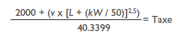
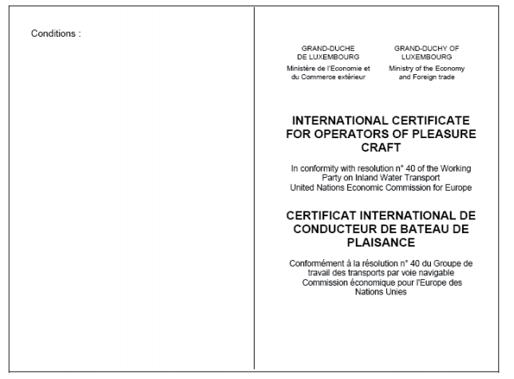
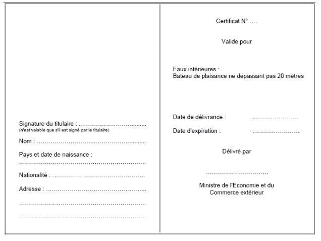
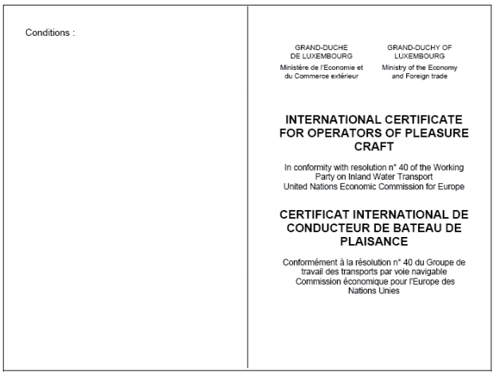
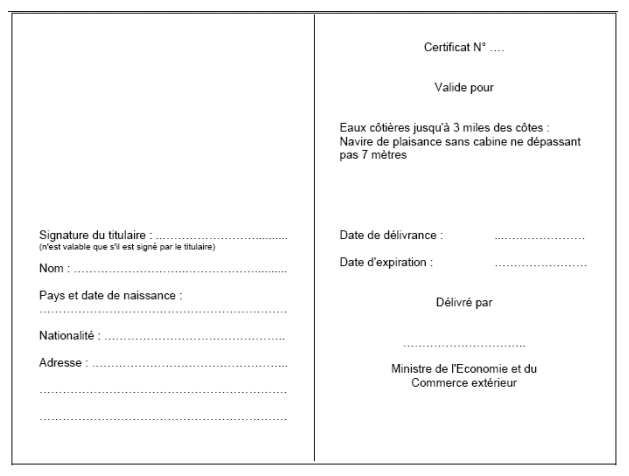
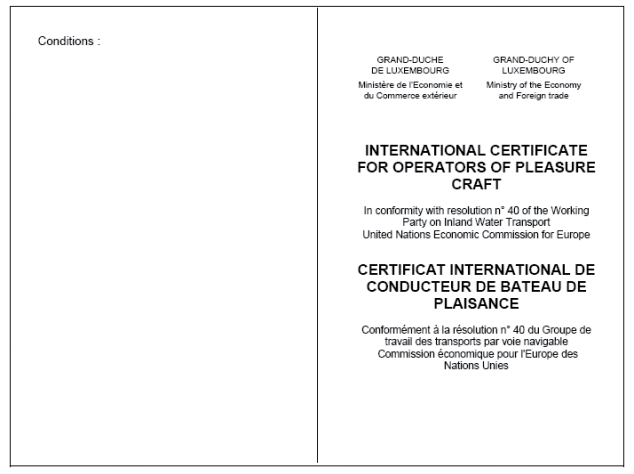
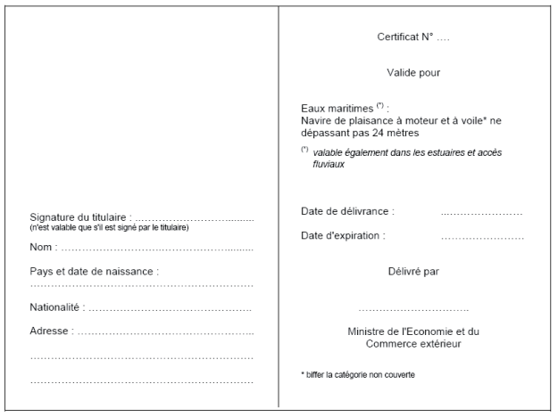

# Règlement grand-ducal du 8 octobre 2009 relatif à l’exécution de la loi du 23 septembre 1997 portant réglementation de la navigation de plaisance et portant modification de certaines autres dispositions légales et modifiant l’article 8 du règlement grand-ducal du 20 mars 1967 concernant l’exécution de l’article 54, nos 2 et 3 de la loi du 14 juillet 1966 sur l’immatriculation des bateaux de navigation intérieure et l’hypothèque fluviale.

Nous Henri, Grand-Duc de Luxembourg, Duc de Nassau,

Vu la [loi du 14 juillet 1966](https://legilux.public.lu/eli/etat/leg/loi/1966/07/14/n1/jo) sur l’immatriculation des bateaux de navigation intérieure et hypothèque fluviale;

Vu la [loi du 23 septembre 1997](https://legilux.public.lu/eli/etat/leg/loi/1997/09/23/n1/jo) portant réglementation de la navigation de plaisance et portant modification de certaines autres dispositions légales;

Vu l’avis de la Chambre de Commerce;

Notre Conseil d’Etat entendu;

Sur le rapport de Notre Ministre de l’Economie et du Commerce extérieur, de Notre Ministre de la Justice et après délibération du Gouvernement en conseil;

Arrêtons:

## **Chapitre** **1er** — Organismes chargés de la préparation à l’examen du permis de navigation

### Art. 1er.

Tout organisme établi au Grand-Duché de Luxembourg qui enseigne la conduite d’un bateau ou d’un navire de plaisance doit être agréé par le Ministre ayant les affaires maritimes dans ses attributions, ci-après dénommé le ministre.

Cet agrément mentionnera la personne responsable de l’enseignement ainsi que les personnes enseignant sous son autorité. L’agrément est strictement personnel et incessible.

La personne responsable doit établir une qualification et expérience suffisantes dans le domaine nautique.

Le ministre peut agréer des organismes situés au Luxembourg ou à l’étranger offrant des enseignements théoriques et/ou pratiques en vue de la préparation aux épreuves menant à la délivrance d’un permis de navigation luxembourgeois.

### Art. 2.

Les enseignants dispensant la formation théorique doivent être titulaires d’un permis de navigation valable ou de toute autre qualification correspondant au moins à ce niveau de formation; ils doivent posséder les qualités physiques, intellectuelles et morales nécessaires pour enseigner l’art de conduire. Les organismes offrant une formation pratique doivent répondre aux critères fixés à l’annexe C. Les organismes s’engagent à respecter ces critères pendant toute la durée de l’agrément. Le ministre peut charger le Commissaire aux affaires maritimes ou son délégué de contrôler ou de faire contrôler le respect des critères.

### Art. 3.

L’agrément a une validité de deux ans et peut être prolongé sur simple demande écrite.

Il peut être retiré, son octroi ou son renouvellement refusé s’il est établi que la personne responsable est inapte à exercer ses fonctions, si elle ne satisfait pas aux conditions fixées ou s’il est constaté à sa charge une des raisons pouvant donner lieu au retrait administratif du permis de navigation.

Les mesures prévues à l’alinéa qui précède peuvent pour les mêmes raisons être prises à l’encontre du personnel enseignant par modification de l’agrément.

### Art. 4.

La personne responsable est tenue de surveiller le travail des enseignants occupés à son service.

Elle veillera à la bonne formation des candidats par le ou les enseignants dont elle a la charge, ainsi qu’au strict respect par ces derniers des dispositions légales et réglementaires en vigueur.

### Art. 5.

La personne responsable doit tenir sous forme de registre un programme détaillé de l’enseignement avec inscription de l’identité des candidats instruits et de la durée des leçons théoriques; une liste de présence des candidats présents aux cours théoriques devra être tenue.

### Art. 6.

Le déroulement des cours théoriques et les installations ainsi que le matériel d’instruction peuvent être contrôlés par un délégué du ministre. Le responsable de l’organisme et les enseignants sont tenus de fournir toute assistance utile au cours de ces contrôles.

## Chapitre 2 — Catégories de permis et modalités d’obtention du permis de navigation

### Art. 7.

Le permis de navigation comprend trois catégories en distinguant selon le type de bâtiment de plaisance et la zone de navigation:

Le permis fluvial autorise son titulaire à conduire un bateau de plaisance de 20 mètres au plus en eaux intérieures. Le permis fluvial est également valable pour la conduite des embarcations autres que de plaisance visées par l’alinéa m) de l’article 1.01 du [Règlement de police pour la navigation de la Moselle](https://legilux.public.lu/eli/etat/leg/agd/1995/05/18/n1/jo).

Le permis côtier autorise son titulaire à conduire un navire de plaisance de 7 mètres au plus, et ne disposant pas d’une cabine habitable, en eaux maritimes jusqu’à trois miles nautiques des côtes.

Le permis mer autorise son titulaire à conduire un navire de plaisance de 24 mètres au plus en eaux maritimes sans limitation de zone de navigation.

En fonction de l’épreuve pratique choisie, le permis mer mentionnera la catégorie «voile et moteur» ou simplement «moteur».

Un brevet de formation délivré selon les critères de la Convention STCW est exigé pour la conduite d’un navire de plaisance de plus de 24 mètres.

Un endossement luxembourgeois sera délivré selon la procédure décrite dans le [règlement grand-ducal modifié du 16 novembre 2001](https://legilux.public.lu/eli/etat/leg/rgd/2001/11/16/n2/jo) transposant la [directive 94/58/CE](https://legilux.public.lu/eli/dir_ue/1994/58/jo) du Conseil du 22 novembre 1994 concernant le niveau minimal de formation des gens de mer telle que modifiée par la [directive 98/35/CE](https://legilux.public.lu/eli/dir_ue/1998/35/jo) du Conseil du 25 mai 1998.

Sans préjudice de l’article 13, les titulaires de permis de catégorie 1 et 2 gardent les prérogatives conférées par ces titres.

Si le navire de plaisance est utilisé à des fins commerciales ou professionnelles avec équipage, ce permis n’est pas valable lorsque la convention internationale de 1978 sur les normes de formation des gens de mer, de délivrance des brevets et de veille (STCW 1978) est d’application.

### Art. 8.

Pour obtenir un permis de navigation, le candidat devra adresser sa demande directement à l’organisme agréé.

Les demandes indiqueront les noms, prénoms, lieu et date de naissance, nationalité, domicile et/ou résidence, la catégorie de permis sollicitée.

Sont à joindre au dossier:

1\) un certificat médical datant de moins de 6 mois attestant que le candidat présente les aptitudes physiques et mentales requises; le certificat médical délivré en vue de l’obtention d’un permis de conduire est reconnu valable;

2\) un extrait de casier judiciaire datant de moins de 6 mois n’est requis que pour les personnes ayant atteint l’âge de 18 ans; pour les personnes qui ont leur résidence normale à l’étranger, et qui sont dans l’impossibilité de produire un extrait de casier judiciaire, celui-ci peut être remplacé par un document officiel qui est suffisamment concluant pour admettre que ces personnes offrent les garanties morales nécessaires pour obtenir un permis de navigation;

3\) une pièce attestant le paiement de la taxe spéciale prévue par la réglementation afférente;

4\) une photographie récente de 45/35 mm sur papier souple, la tête prise de face ayant au moins 20 mm de hauteur;

5\) un procès-verbal attestant de la réussite à l’examen.

S’il s’agit d’un mineur, la demande en obtention d’un permis de navigation doit être contresignée par la personne de tutelle.

### Art. 9.

La formation théorique des différentes catégories de permis porte sur les matières du programme de formation figurant à l’annexe A et comprendra au moins dix heures de cours.

Après accomplissement de la formation théorique, les candidats sont admis à se présenter à l’examen théorique pour l’obtention du permis de navigation. Des sessions d’examens théoriques sont organisées par la Commission de la navigation de plaisance visée à l’article 32 de la [loi du 23 septembre 1997](https://legilux.public.lu/eli/etat/leg/loi/1997/09/23/n1/jo) portant réglementation de la navigation de plaisance et portant modification de certaines autres dispositions légales, désignée ci-après Commission.

La formation pratique et le contrôle des connaissances porteront sur les manœuvres figurant à l’annexe B. L’organisme agréé adresse la fiche de contrôle à la Commission. Un membre de la Commission dûment mandaté par elle ou toute autre personne dûment mandatée par le ministre peut assister de plein droit en tant qu’observateur à l’enseignement pratique et au contrôle des connaissances.

### Art. 10.

Sont déclarés admissibles les candidats ayant obtenu les deux tiers des points aux épreuves théoriques et réussi avec succès les épreuves pratiques décrites à l’annexe B sans qu’une compensation entre les épreuves ne soit possible.

Les candidats ayant échoué à une épreuve peuvent se présenter à une prochaine session pour l’épreuve en question.

### Art. 11.

La Commission adresse les dossiers en vue de la délivrance du permis de navigation au ministre après vérification du dossier.

### Art. 12.

Le permis de navigation est délivré par le ministre au vu du dossier présenté par la Commission. Le modèle des permis est arrêté à l’annexe D.

### Art. 13.

Le permis de navigation a une durée de validité de dix ans; toutefois si le candidat qui demande un permis de navigation est âgé entre seize et cinquante ans, le permis de navigation est valable jusqu’à l’âge de soixante ans du titulaire.

La durée de validité de dix ans fixée ci-avant est étendue jusqu’au prochain anniversaire de naissance du titulaire. Pour obtenir le renouvellement de son permis de navigation, le titulaire doit présenter au ministre, ensemble avec sa demande, les pièces spécifiées à l’article 8 sous 1, 3 et 4 du présent règlement.

Si une enquête judiciaire s’impose, un permis de navigation d’une durée de validité de six mois peut être délivré.

## Chapitre 3 — Reconnaissance des permis et brevets étrangers

### Art. 14.

Les conducteurs d’un bateau ou navire de plaisance immatriculé au registre d’immatriculation des bateaux et navires de plaisance, ci-après registre, détenant un permis de navigation étranger doivent solliciter auprès du ministre un endossement de leur permis qui vaudra autorisation de naviguer sous pavillon luxembourgeois pour ce type de navire ou bateau.

Sans préjudice de l’application des dispositions adoptées par l’Union européenne en matière de reconnaissance de certificats, le ministre pourra publier une liste des permis étrangers bénéficiant de plein droit d’un endossement.

### Art. 15.

Pour les permis ne figurant pas sur la liste visée à l’article 14, le requérant devra documenter que le permis pour lequel il sollicite un endossement est équivalent au permis luxembourgeois correspondant. L’endossement délivré par le ministre pourra reprendre les limitations émises pour ce permis notamment en ce qui concerne la zone de navigation, le type de bateau ou navire et la limite de validité.

## Chapitre 4 — Taxes

### *Section 1. Taxes à percevoir en vue de l’examen des candidats au permis de navigation*

#### Art. 16.

Les taxes ci-après sont dues pour:

| 1. | la demande d’obtention d’un permis de navigation; | 48 euros. |
|---|---|---|
| 2. | l’endossement d’un permis de navigation étranger; | 36 euros. |
| 3. | le renouvellement ou le remplacement d’un permis de navigation ou d’un endossement d’un permis de navigation étranger; | 24 euros. |
| 4. | la demande d’obtention d’un permis de navigation après échec partiel ou total à un examen antérieur; | 24 euros. |

Ces taxes sont acquittées au moyen de timbres mobiles «Droit de Chancellerie» fournis par l’Administration de l’Enregistrement et des Domaines.

Les timbres mobiles sont apposés sur des demandes tenues à disposition des requérants. Ces taxes sont dues nonobstant les frais facturés par les organismes agréés pour la préparation à l’examen.

### Section 2. Taxes à percevoir lors des demandes en obtention d’un certificat d’identification ou d’un certificat d’immatriculation

#### Art. 17.

Les taxes ci-après sont dues pour:

<table>
<tr>
<td>1.</td>
<td>l’obtention d’un certificat d’identification d’une menue embarcation de plaisance;</td>
<td>24 euros.</td>
</tr>
<tr>
<td>2.</td>
<td>l’obtention d’un duplicata du certificat d’identification ou du certificat d’immatriculation;</td>
<td>24 euros.</td>
</tr>
<tr>
<td>3.</td>
<td>la prorogation du certificat d’identification;</td>
<td>24 euros.</td>
</tr>
<tr>
<td></td>
<td colspan="2">Ces taxes sont acquittées au moyen de timbres mobiles «Droit de Chancellerie» fournis par l’Administration de l’Enregistrement et des Domaines. Les timbres mobiles sont apposés sur des demandes tenues à disposition des requérants.</td>
</tr>
<tr>
<td>4.</td>
<td colspan="2">l’obtention d’un certificat d’immatriculation pour un bateau ou navire de plaisance, il est fait application de la formule ci-après:</td>
</tr>
<tr>
<td></td>
<td colspan="2"></td>
</tr>
<tr>
<td></td>
<td colspan="2">La variable v = 10 L = Longueur du bateau ou navire de plaisance kW = La puissance du ou des moteurs du bateau ou navire de plaisance exprimé en kilowatt.</td>
</tr>
<tr>
<td></td>
<td colspan="2">Aucune taxe n’est perçue à charge des administrations de l’Etat et des communes. La taxe est à acquitter auprès de l’Administration des Douanes et Accises suivant les modalités explicitées sur un formulaire de demande tenu à disposition des requérants.</td>
</tr>
</table>

### *Section 3. Taxes annuelles à percevoir à charge des propriétaires de bateaux ou de navires de plaisance immatriculés au registre*

#### Art. 18.

La taxe annuelle pour les bateaux et navires de plaisance est fixée comme suit:

1\. Une taxe annuelle prenant cours le jour de l’immatriculation est due, se composant du montant résultant de l’application de la formule suivante:

> 

La variable v = 5

L = Longueur du bateau ou navire de plaisance

kW = La puissance du ou des moteurs du bateau ou navire de plaisance exprimé en kilowatt.

Aucune taxe n’est perçue à charge des administrations de l’Etat et des communes; dans ce cas une attestation est délivrée pour une durée de cinq ans.

Pour une première immatriculation, la taxe annuelle n’est pas due pour la première année.

2\. La taxe est à acquitter auprès de l’Administration des Douanes et Accises. A cet effet l’administration adressera annuellement un ordre de paiement aux personnes ayant immatriculé le bateau ou navire de plaisance.

Sur proposition de l’Administration des Douanes et Accises, le ministre radiera le bateau ou navire de plaisance pour lequel les taxes prévues au présent article n’ont pas été payées à l’échéance. Le renouvellement de l’immatriculation dans ce cas est considéré comme une première immatriculation et frappé de la taxe prévue à l’article 17.

## Chapitre 5 — Refus et retrait du permis de navigation

### Art. 19.

L’examen prévu à l’article 35 de la [loi du 23 septembre 1997](https://legilux.public.lu/eli/etat/leg/loi/1997/09/23/n1/jo) portant réglementation de la navigation de plaisance et portant modification de certaines autres dispositions légales aura lieu d’après les dispositions suivantes:

Avant la mainlevée du retrait administratif ou la fin de l’interdiction de conduire judiciaire, l’intéressé devra refaire l’apprentissage tel que fixé à l’article 9 et dans les limites du jugement ou arrêt intervenu ou de la décision administrative.

L’examen théorique peut consister dans des épreuves orales ou écrites. Un contrôle des connaissances pratiques peut également être exigé.

### Art. 20.

L’exécution de toute interdiction de conduire judiciaire doit être commencée dans l’année à partir du jour où la décision judiciaire aura acquis l’autorité de la chose jugée.

Dans les cas prévus à l’alinéa 2 du point b) paragraphe 3) de l’article 37 de la [loi du 23 septembre 1997](https://legilux.public.lu/eli/etat/leg/loi/1997/09/23/n1/jo), portant réglementation de la navigation de plaisance et portant modification de certaines autres dispositions légales, l’exécution de toute interdiction de conduire judiciaire doit être commencée dans l’année à partir de l’élargissement du condamné.

A la fin de l’interdiction de conduire judiciaire, le procureur général d’Etat fait restituer le permis de navigation à l’intéressé.

En vue de l’obtention, du renouvellement ou de l’endossement d’un permis de navigation, le candidat doit se soumettre à un examen médical destiné à établir s’il ne souffre pas d’infirmités ou de troubles susceptibles d’entraver ses aptitudes ou capacités de conduire et s’il ne présente pas de signes d’alcoolisme ou d’autres intoxications.

## Chapitre 6 — Matériel de sécurité

### Art. 21.

Les bâtiments de plaisance doivent être équipés du matériel de sécurité minimum repris à l’annexe E.

## Chapitre 7 — Dispositions pénales

### Art. 22.

Les infractions aux dispositions de l’article 1er sont punies d’une amende de 251 à 2.500 euros. Les infractions aux dispositions des articles 2, 4, 5, 6, 7 et 18 avant-dernier alinéa sont punies d’une peine d’emprisonnement d’une durée de huit jours à un an et d’une amende de 251 à 2.500 euros ou d’une de ces peines seulement.

## Chapitre 8 — Dispositions modificatives, abrogatoires et transitoires

### Art. 23.

Le droit fixe, les rétributions et la rémunération prévus par l’article 8 du [règlement grand-ducal du 20 mars 1967](https://legilux.public.lu/eli/etat/leg/rgd/1967/03/20/n4/jo) concernant l’exécution de l’article 54, nos 2 et 3 de la [loi du 14 juillet 1966](https://legilux.public.lu/eli/etat/leg/loi/1966/07/14/n1/jo) sur l’immatriculation des bateaux de navigation intérieure et l’hypothèque fluviale, sont modifiés comme suit:

Le droit fixe se rapportant à la délivrance d’un certificat d’immatriculation et d’un duplicata est de 25 euros.

La rétribution prévue pour les rectifications est fixée à 15 euros.

La rétribution pour la délivrance d’un extrait du registre matricule est fixée à 25 euros.

La rémunération se rapportant à la délivrance d’extraits non certifiés ainsi qu’aux renseignements verbaux est fixée à 15 euros.

### Art. 24.

Le [règlement grand-ducal du 4 novembre 1997](https://legilux.public.lu/eli/etat/leg/rgd/1997/11/04/n4/jo) relatif à l’exécution de la [loi du 23 septembre 1997](https://legilux.public.lu/eli/etat/leg/loi/1997/09/23/n1/jo) portant réglementation de la navigation de plaisance et portant modification de certaines autres dispositions légales est abrogé.

### Art. 25.

Les nouvelles prescriptions relatives à la délivrance d’un permis de navigation ne seront applicables que pour les formations débutant après l’entrée en vigueur du présent règlement.

### Art. 26.

Notre Ministre de l’Economie et du Commerce extérieur et Notre Ministre de la Justice sont chargés, chacun en ce qui le concerne, de l’exécution du présent règlement qui sera publié au Mémorial.

Le Ministre de l’Economie et du Commerce extérieur,   Jeannot Krecké   Le Ministre de la Justice,   François Biltgen

Palais de Luxembourg, le 8 octobre 2009.   Henri

\**ANNEXE A – Programme de formation**

En vue de l’obtention d’un permis de navigation, le candidat doit avoir au moins les connaissances et les aptitudes de conduire décrites ci-après.

\***I: Permis de navigation fluvial***

A l’épreuve théorique, le candidat doit faire preuve d’une connaissance raisonnée au moins des matières suivantes:

a) Connaissances générales et administratives de la navigation en eaux intérieures:

aot les fleuves;

bot les canaux;

cot les lacs;

dot les écluses;

eot les utilisateurs des voies d’eau;

fot dispositions légales;

got règles d’utilisation de la radiotéléphonie;

hot dispositions en rapport avec la protection des eaux;

iot devoir général de vigilance et responsabilités du conducteur.

b) Règles de circulation:

aot règles propres aux bateaux de plaisance:

aash priorité;

bash règles de route;

bot croisements:

aash principes généraux;

bash définition de l’avalant et du montant;

cash croisement à droite;

dash croisement selon la règle du drapeau bleu;

eash croisement interdit par signaux;

cot dépassements et croisements sur les lacs et grands plans d’eau:

aash croisement entre bateaux à moteur;

bash croisement entre voiliers;

cash risque d’abordage;

dash dépassement: définition du rattrapant;

eash dépassement: manœuvre à effectuer;

dot autres règles de route:

aash route à suivre prescrite;

bash virage;

cash traversée de la voie navigable;

dash entrée et sortie du port;

eash plongeurs;

fash remous;

gash ralentir;

hash transport de matières dangereuses;

iash interdictions et prescriptions diverses;

eot passage des écluses, ponts et barrages:

aash ordre de passage;

bash priorité de passage;

cash éclusage des menues embarcations;

dash feux d’accès aux écluses;

eash feux de sortie d’une écluse;

fash prescriptions concernant le sassement;

gash écluses non gardées;

hash horaire des écluses;

iash passage des ponts fixes;

jash passes sans signalisation;

kash autres signaux;

lash passage des ponts mobiles;

fot règles diverses:

aash vitesse maximum;

got conduite en cas de circonstances particulières:

aash conduite par visibilité réduite (radar);

bash signaux de détresse;

cash obligation de dégager la voie navigable;

dash prescriptions diverses;

hot stationnement:

aash lieu de stationnement;

bash sécurité d’ancrage et d’amarrage;

cash interdiction de stationnement;

dash signaux d’ancrage et d’amarrage;

iot ski nautique:

aash zones de ski;

bash obligations du conducteur, de la deuxième personne à bord et du skieur;

cash arrêt de la pratique du ski;

dash signes de communication entre le skieur et le bateau.

c) Signalisation phonique:

aot émission de signaux phoniques;

bot types de signaux phoniques;

cot signaux de croisement;

dot signaux de dépassement;

eot signaux de virage;

fot signaux par visibilité réduite.

d) Signalisation visuelle et balisage:

aot signalisation d’interdiction;

bot signalisation d’obligation;

cot signalisation de restriction;

dot signalisation de recommandation;

eot signalisation d’indication;

fot balisage;

got feux de balisage.

e) Signalisation des bâtiments:

aot feux et marques des bâtiments;

bot signalisation normale de route;

cot signalisation des bâtiments transportant des matières dangereuses;

dot signalisation de stationnement;

eot bacs et engins flottants;

fot signalisations particulières.

f) Moteur, équipement et sécurité:

aot moteur à essence;

bot moteur diesel;

cot risques d’incendie, d’explosion, d’asphyxie;

dot prévention de ces risques.

g) Sécurité:

aot matériel de sécurité;

bot risques d’incendie;

cot collision;

dot homme par dessus bord;

eot envahissement par l’eau.

h) Manœuvres, mouillage, ancrage.

\***II: Permis de navigation côtier***

A l’épreuve théorique, le candidat doit faire preuve d’une connaissance raisonnée au moins des matières suivantes:

a) Les feux:

aot identification des feux;

bot autres feux;

cot portée des feux.

b) Le balisage:

aot marques latérales;

bot marques cardinales;

cot marques de danger isolé et marques spéciales;

dot marques diverses;

eot balisage des plages.

c) Position:

aot estimation de la position;

bot aides diverses.

d) Courants et marées:

aot l’effet du courant;

bot les marées: utilisation de l’annuaire des marées pour déterminer les heures et hauteurs des pleines et basses mers.

e) Règlement international pour prévenir les abordages en mer (COLREG):

aot règles de route et règles de barre;

bot feux et marques des navires;

cot principaux signaux.

f) Sécurité:

aot matériel de sécurité;

bot risques d’incendie;

cot homme à la mer;

dot collision;

eot envahissement par eau.

g) Météorologie:

aot notions de base de météorologie;

bot manœuvres dans le mauvais temps.

h) Manœuvres, mouillage, ancrage.

i) Législation:

aot législation luxembourgeoise concernant la plaisance en mer;

bot principes de prévention de la pollution.

\***III: Permis de navigation mer***

A l’épreuve théorique, le candidat doit faire preuve d’une connaissance raisonnée au moins des matières suivantes:

a) Cartographie:

aot définition de la carte marine;

bot le globe terrestre;

cot présentation de la carte;

dot symboles et abréviations;

eot mesure des distances;

fot la règle-rapporteur.

b) Les feux:

aot identification des feux;

bot le livre des feux;

cot autres feux;

dot portée des feux.

c) Le balisage:

aot marques latérales;

bot marques cardinales;

cot marques de danger isolé et marques spéciales;

dot marques diverses.

d) Ouvrages et documents nautiques.

e) Instruments:

aot le compas:

aash la déclinaison;

bash la déviation;

cash la courbe de déviation.

bot le sondeur;

cot le loch;

dot le récepteur G.P.S.;

eot l’émetteur/récepteur V.H.F.;

fot l’émetteur B.L.U.;

got le principe du radar.

f) Position:

aot estimation de la position;

bot aides diverses;

cot le relèvement;

dot le point par deux relèvements.

g) Navigation au large:

aot navigation à l’estime;

bot utilisation du GPS;

cot planification du voyage.

h) Courants et marées:

aot l’effet du courant: utilisation de la carte des courants de marée;

bot les marées: utilisation de l’annuaire des marées pour déterminer les heures et hauteurs des pleines et basses mers.

i) Règlement international pour prévenir les abordages en mer (COLREG):

aot règles de route et règles de barre;

bot feux et marques des navires;

cot principaux signaux.

j) Sécurité:

aot matériel de sécurité;

bot risques d’incendie;

cot homme à la mer;

dot collision;

eot envahissement par eau.

k) Météorologie:

aot notions de base de météorologie;

bot manœuvres dans le mauvais temps.

l) Manœuvres, mouillage, ancrage.

m) Législation:

aot législation luxembourgeoise concernant la plaisance en mer;

bot règles d’utilisation de la radiotéléphonie;

cot principes de prévention de la pollution.

\**ANNEXE B – Contrôle des connaissances pratiques**

A l’épreuve pratique, le candidat doit faire preuve de sa capacité à mettre en pratique les connaissances nautique et technique suivantes.

\**Connaissances pratiques nécessaires pour l’obtention du permis fluvial et du permis côtier**

1\. **Type de bateau**

1.1. Le bateau à déplacement

1.2. Le semi-glisseur

1.3. Le glisseur

2\. **Moteur, transmission, propulsion**

2.1. Le moteur hors-bord

2.2. Le moteur inboard

2.3. L’embrase Z-drive

2.4. L’arbre en ligne

2.5. L’hélice

2.6. La propulsion à jet

3\. **Pièces administratives/Documents de bord**

3.1. Le permis adéquat

3.2. L’assurance bateau

3.3. L’immatriculation

3.4. Le certificat de radiotéléphonie

4\. **Sécurité et environnement**

4.1. Eaux intérieures – Précautions concernant les passagers et l’équipage – Précautions concernant le bateau – Gréement et équipement de secours

4.2. Manœuvre «Homme à la mer»

4.3. La météo

4.4. Comportement en cas d’accident, de voie d’eau ou d’incendie à bord. Gestes de premiers secours

4.5. Traitement d’urgence d’un début de noyade (gestes pratiques)

4.6. Déchets, réservoirs et opérations de ravitaillement en carburant

4.7. Utilisation des signaux de détresse

4.8. Sécurité de transport terrestre, mise et sortie de l’eau

4.9. Gréement et matériel de sécurité

4.10. Utilisation des différents gilets de sécurité et moyens de sauvetage

5\. **Manœuvre du bateau à moteur**

5.1. La prise de poste, les contrôles à faire

aash Rôle et responsabilités du conducteur, des membres d’équipage et du propriétaire

5.2. La compréhension de l’influence du vent, du courant, d’un tirant d’eau limité ainsi que leurs interactions

5.3. Les écluses

aash Passage d’écluses aval et amont

5.4. Appareillage

aash Appareiller d’un catway

bash Appareiller latéralement entre deux bateaux

cash Appareiller d’un mouillage

5.5. Accostage

aash Accostage latéral: tribord et bâbord

bash Accostage en arrière au catway (culer à poste)

cash Accostage sur amarre avant et arrière

5.6. L’amarrage

aash Amarrage contre un quai

bash Amarrage sur un catway

cash Amarrage à couple

5.7. Les nœuds et fixations de cordage aux différents supports

5.8. Mouillage sur ancre

5.9. Le remorquage

6\. **Règles de navigation**

6.1. Vitesse adéquate

6.2. Priorités

6.3. Dépassements et croisements

6.4. Pratique de la radio VHF

6.5. L’entrée/sortie d’un port ou d’une écluse

\**Connaissances pratiques nécessaires pour l’obtention du permis mer**

\**Voile et moteur**

1\. **Avant le départ**

1.1. Planifier et anticiper un voyage

1.2. Fermer/ouvrir les vannes du bateau

2\. **Maîtriser les équipements**

2.1. Utilisation de la VHF

2.2. Maîtriser le GPS

2.3. Maîtriser la sonde de profondeur

2.4. Nettoyer le loch

2.5. Savoir utiliser le pilote automatique

2.6. Compas magnétique

3\. **Manœuvres**

3.1. Maîtriser le moteur

3.2. Amarrer le bateau dans le port

3.3. Exécuter une manœuvre d’ancrage

3.4 Exécuter une manœuvre d’amarrage à une bouée

3.5. Manœuvre «Homme à la mer»

3.6. Entrée dans un port ou une écluse

4\. **Sécurité**

4.1. Savoir manipuler la survie

4.2. Savoir manipuler les pyrotechniques

4.3. Savoir manipuler la balise

4.4. Savoir installer la barre de secours

4.5. Principes de base de la lutte contre l’incendie

\**Voile**

1\. **Manœuvres**

1.1. Faire envoyer et affaler les voiles

1.2. Exécuter un virement de bord

1.3. Exécuter un empannage

1.4. Décrire un cercle sous voile

1.5. Réduire la voile

\**ANNEXE C – Critères pour l’agrément des Organismes offrant une formation théorique et/ou pratique**

Les organismes désirant être agréés pour la délivrance de la formation pratique doivent:

aash être constitués légalement et pouvoir présenter une copie de leur acte constitutif;

bash avoir leur siège social dans un Etat membre de la Communauté européenne;

cash détenir une assurance responsabilité civile pour couvrir leurs activités;

dash répondre aux normes de sécurité en vigueur à l’endroit de la formation;

eash proposer des programmes d’enseignement en accord avec les annexes A et B;

fash présenter une copie des programmes de cours offerts, incluant le nombre d’heures et les sujets proposés;

gash permettre à un membre de la Commission dûment mandaté de vérifier leurs équipements et d’évaluer leur enseignement;

hash disposer de bateaux écoles construits au minimum selon des normes équivalentes à celles prescrites par la [directive modifiée 94/25/CE](https://legilux.public.lu/eli/dir_ue/1994/25/jo) du Parlement européen et du Conseil du 16 juin 1994 concernant le rapprochement des dispositions législatives, réglementaires et administratives des Etats membres relatives aux bateaux de plaisance.

ANNEXE D – Modèle des permis

\***Modèle du permis fluvial***

\***Modèle du permis côtier***

\***Modèle du permis mer***

\**ANNEXE E – Matériel de sécurité minimum**

\***Menues embarcations de plaisance***

| Gilet ou brassière de sauvetage par personne | 1 |
|---|---|
| Ecope | 1 |
| Ligne de mouillage | 1 |
| Paire d’aviron ou une pagaie ou une godille avec dispositif de nage | 1 |
| Chaumard ou taquet permettant le remorquage | 1 |
| Moyen lumineux de repérage | Disponible |
| Dispositif de sécurité pour couper l’allumage ou les gaz en cas d’éjection du pilote (uniquement si moteur > 4,5 kW) | 1 |

\**Véhicules nautiques à moteur** (type scooter, moto aquatique)

| Anneau et cordage pour le remorquage | 1 |
|---|---|
| Gilet ou brassière de sauvetage par personne | 1 |
| Feux automatiques à main | 2 |

\***Bateaux de plaisance autres que les véhicules nautiques à moteur***

\**Sécurité individuelle**

| Système permettant la remontée à bord d’une personne tombée à l’eau | Disponible |
|---|---|
| Aide à la flottabilité ou un gilet de sauvetage par personne présente à bord | 1 |
| Bouée de sauvetage avec feu de retournement | 1 |

\**Sécurité collective**

| Feux rouges automatiques à main | 3 |
|---|---|
| Miroir de signalisation | 1 |
| Lampe électrique étanche | 1 |
| Annexe et/ou aide à la flottaison offrant une flottabilité totale de 142 newtons par personne à bord (dispense si bateau conformeà la norme EN ISO 12217 ou 6185) | Disponible |

\**Sécurité du bateau**

| Seau rigide | 1 |
|---|---|
| Système permettant d’obturer un trou dans la coque | Disponible |
| Système de protection contre l’incendie conforme aux recommandations du constructeur | Disponible |
| Outillage et matériel pour de petits dépannages | Disponible |
| Système de pompage | Disponible |

\**Mouillage**

| Ligne de mouillage fixée au bateau et une ancre adaptées au bateau et au lieu de navigation | Disponible |
|---|---|

\**Navigation**

| Pavillon national | Disponible |
|---|---|
| 1 sonde à main ou tout autre moyen pour mesurer la profondeur de l’eau | Disponible |

\**Documents** (tenus à jour qui peuvent être rassemblés en un seul document)

| Livre des feux | Disponible |
|---|---|
| Carte des régions fréquentées | Disponible |

\**Navires de plaisance autres que les véhicules nautiques à moteur**

\**Sécurité individuelle**

| Système permettant la remontée à bord d’une personne tombée à l’eau | Disponible |
|---|---|
| Gilet de sauvetage par personne présente à bord | 1 |
| Bouée de sauvetage avec feu de retournement | 1 |
| Harnais par personne présente à bord pour les voiliers | 1 |
| Harnais par embarcation pour les navires à moteur | 1 |

\**Sécurité collective**

| Feux rouges automatiques à main | 3 |
|---|---|
| Miroir de signalisation | 1 |
| Lampe électrique étanche | 1 |
| Fusées parachute | 3 |
| Fumigènes | 2 |
| Radeau de sauvetage (conforme à la norme EN ISO 9650) ou une annexe gonflable automatique par bouteille | 1 |

\**Sécurité du navire**

| Seau rigide | 1 |
|---|---|
| Système permettant d’obturer un trou dans la coque | Disponible |
| Système de protection contre l’incendie conforme aux recommandations du constructeur | Disponible |
| Outillage et matériel pour de petits dépannages | Disponible |
| Système de pompage | Disponible |

\**Mouillage**

| Ligne de mouillage fixée au bateau et une ancre adaptées au bateau et au lieu de navigation | Disponible |
|---|---|

\**Navigation**

| Pavillon national | Disponible |
|---|---|
| 1 sonde à main ou tout autre moyen pour mesurer la profondeur de l’eau | Disponible |
| Matériel permettant de faire le point, de tracer et de suivre une route | Disponible |
| Compas magnétique pour une navigation au-delà de deux miles nautiques de la côte | 1 |
| Dispositif permettant de recevoir les prévisions météorologiques à bord | Disponible |

\**Documents** (tenus à jour qui peuvent être rassemblés en un seul document)

| Règlement International pour Prévenir les Abordages en mer | Disponible |
|---|---|
| Livre des feux | Disponible |
| Annuaire des marées ou équivalents | Disponible |
| Carte des régions fréquentées | Disponible |
| Journal de bord | 1 |
