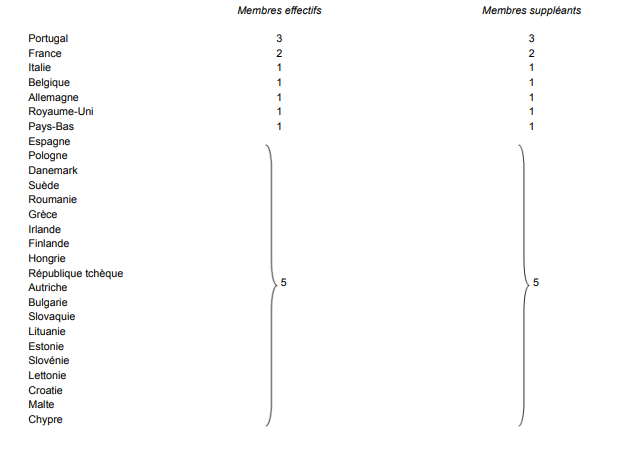

# Règlement grand-ducal du 15 novembre 2011 portant détermination des modalités de désignation des représentants des étrangers au Conseil national pour étrangers, ainsi que leur répartition par nationalités.

## Chapitre I — Répartition des représentants des étrangers au Conseil national pour étrangers

### Art. 1er.

(1) Sur base de l’importance proportionnelle des diverses nationalités présentes dans la population de résidence la plus récente du Grand-Duché de Luxembourg calculée par

e service central de la statistique et des études économiques, le nombre de représentants de pays qui font partie de l’Union européenne est fixé à 15.

(2) Le nombre des représentants de pays ne faisant pas partie de l’Union européenne est fixé à 7.

### Art. 2.

(1) Les représentants des Etats membres de l’Union européenne se répartissent comme suit:

[^1]

(2) Pour le Portugal, la France, l’Italie, la Belgique, l’Allemagne, le Royaume-Uni et les Pays-Bas, il y a autant de membres suppléants que de membres effectifs.

(3) Pour l’ensemble des autres Etats membres de l’Union européenne, il y a 5 membres effectifs et 5 membres suppléants qui sont proposés dans l’ordre du nombre de voix obtenues, étant donné que les 5 candidats ayant obtenu le plus de voix sont proposés comme membres effectifs, sans qu’il ne puisse y avoir plus d’un membre effectif ou suppléant proposé par Etat.

### Art. 3.

Pour l’ensemble des Etats hors Union européenne, il y a 7 membres effectifs et 7 membres suppléants qui sont proposés dans l’ordre du nombre de voix obtenues, étant donné que les 7 candidats ayant obtenu le plus de voix sont proposés comme membres effectifs, sans qu’il ne puisse y avoir plus d’un membre effectif ou suppléant proposé par Etat.

### Art. 4.

(1) Pour chaque membre du Conseil national pour étrangers, ci-après désigné «le conseil», il est nommé un suppléant. Le suppléant siège en lieu et place du membre effectif en cas d’empêchement de ce dernier. Des jetons de présence sont accordés aux membres effectifs et suppléants. Les membres suppléants ne touchent de jetons que pour les réunions auxquelles ils assistent en remplacement d’un membre effectif empêché. Une indemnité est versée au secrétaire du conseil.

(2) Les membres effectifs du conseil peuvent décider de se réunir en présence des membres suppléants pour des questions qui revêtent une importance particulière. Dans ces réunions, seuls les membres effectifs ou les membres qui siègent en lieu et place d’un membre effectif ont le droit de vote.

En cas de décès ou de démission d’un membre du conseil, son suppléant le remplace jusqu’au renouvellement du conseil.

(3) Le mandat individuel d’un représentant des étrangers prend fin, hormis le cas de décès ou de démission, dès qu’il acquiert la nationalité luxembourgeoise. Il en est de même en cas de transfert du domicile en dehors du territoire du Grand-Duché de Luxembourg. Dans ces cas, un membre suppléant remplace d’office le membre effectif. Le membre suppléant est remplacé suivant les dispositions prévues aux articles 25 et suivants, de façon à respecter les modalités de représentation fixées aux articles précédents.

## Chapitre II — Associations admises à proposer les représentants des étrangers au ministre ayant dans ses attributions l’Intégration

### Art. 5.

Sont admises à proposer les représentants des étrangers au ministre ayant dans ses attributions l’Intégration, désigné par la suite «le ministre», d’après les modalités ci-après désignées:

a) les associations des étrangers ayant une activité sociale, culturelle ou sportive, l’association des étrangers étant celle dont soit la majorité des membres fondateurs, soit la majorité des membres actuels, sont d’une nationalité autre que luxembourgeoise;

b) les associations œuvrant, à titre principal, en faveur des étrangers.

Les associations visées à l’alinéa qui précède doivent être inscrites auprès du département de l’intégration du Ministère de la famille, de l’intégration et à la Grande Région, ci-après « Ministère »[^2] au plus tard le quinzième jour avant le jour du scrutin et avoir produit le rapport d’activité annuel de l’exercice précédant le vote du nouveau conseil ainsi que la liste actuelle des membres.

### Art. 6.

Sont inscrites auprès du Ministère[^3] en vue d’exercer le droit de vote pour le conseil, les associations visées à l’article 5 ci-dessus, à condition qu’elles soient constituées conformément aux dispositions de la [loi modifiée du 21 avril 1928](https://legilux.public.lu/eli/etat/leg/loi/1928/04/21/n2/jo) sur les associations et les fondations sans but lucratif et que les statuts aient été publiés selon les dispositions de la même loi.

La demande d’inscription se fait sur papier libre, adressée au Ministère[^4] en joignant:

1\. une copie de l’acte de constitution

2\. une copie attestant la publication des statuts au Mémorial, Recueil des Sociétés et Associations

3\. la liste des administrateurs désignés en conformité des statuts pour l’exercice en cours.

Le Ministère[^5] donne acte à l’association de son inscription en cas de décision positive.

Le refus d’inscription est dûment motivé.

La liste des inscriptions est révisée annuellement.

## Chapitre III — Modalités de désignation des candidats

### Art. 7.

Les représentants des étrangers à proposer au ministre sont élus parmi les personnes figurant sur les listes de candidats déclarés, sauf ce qui est prévu aux articles 26 et suivants.

### 1 — Les candidatures

#### Art. 8.

Pour être candidat sur une liste électorale, il faut:

1\. être d’une nationalité autre que luxembourgeoise

2\. être âgé de 18 ans accomplis le jour du scrutin

3\. être domicilié au Grand-Duché de Luxembourg

4\. ne pas être placé sous un régime de tutelle des majeurs

5\. ne pas avoir subi de condamnation à une peine criminelle ou une condamnation en matière correctionnelle emportant privation du droit de vote.

La candidature peut être posée par la personne concernée elle-même ou par une ou plusieurs associations inscrites auprès du Ministère[^6] avec l’accord écrit du concerné.

#### Art. 9.

Au moins 40 jours avant la date fixée pour le scrutin, le Ministère[^7] fait un appel aux candidatures par publication dans les principaux quotidiens paraissant au Grand-Duché de Luxembourg, ainsi que dans les principaux journaux étrangers édités au Luxembourg et, en cas de besoin, par radio ou télédiffusion sur les chaînes s’adressant spécialement aux étrangers résidant au Luxembourg.

L’appel aux candidatures paraît également sur le site internet du Ministère[^8] et sur le guichet en ligne du Grand-Duché de Luxembourg.

#### Art. 10.

Les candidats figurant sur les listes doivent se déclarer ou être déclarés auprès du Ministère[^9] au moins huit jours avant la date fixée pour le scrutin. La déclaration marque les nom, prénom, nationalité, date de naissance, domicile et profession du candidat. Elle porte engagement de sa part de ne pas retirer sa candidature. Elle est datée et signée.

La déclaration de candidature est accompagnée:

1\. d’un acte de naissance

2\. d’une pièce documentant la nationalité du candidat

3\. d’un extrait du casier judiciaire.

La liste des candidats déclarés est affichée au Ministère[^10] du quinzième jour précédant les élections jusqu’au jour fixé pour les élections. Elle est provisoire jusqu’au huitième jour précédant les élections où elle est arrêtée définitivement. Elle peut être consultée par tout intéressé.

#### Art. 11.

Celui qui ne remplit pas les conditions des articles 8 et 10 ci-dessus n’est pas éligible.

Si l’éligibilité d’un candidat, du point de vue des condamnations encourues, paraît être douteuse, le ministre[^11] fait réviser d’urgence les conditions d’éligibilité par le Parquet et invite le candidat à présenter ses observations. Lorsque sur le vu des extraits de casier judiciaire ou de tout autre renseignement produit par le Parquet, l’inéligibilité est constatée, le directeur doit rayer le candidat en question de la liste.

### 2 — Constitution du bureau de vote

#### Art. 12.

Le bureau de vote est nommé par le ministre.

Il est composé de 5 membres, à savoir:

aone 3 fonctionnaires ou employés du Ministère[^12]

bone 2 représentants des étrangers à proposer par les membres sortants du conseil.

Ni les candidats, ni leurs parents ou alliés jusqu’au deuxième degré inclusivement, ne peuvent siéger comme membre du bureau de vote.

Le président du bureau de vote est désigné par le ministre.

Le bureau de vote établit une proposition de règlement d’ordre relatif au déroulement des opérations électorales pouvant contenir des instructions pour les électeurs.

Ce règlement est arrêté par le ministre.

### 3 — Scrutin

#### Art. 13.

Le jour du scrutin est fixé par le ministre.

#### Art. 14.

Chaque association inscrite auprès du Ministère[^13] a le droit de vote et dispose d’autant de voix qu’il y a de représentants à désigner.

#### Art. 15.

Chacune des associations désigne par information écrite à faire parvenir au Ministère[^14] au plus tard le quinzième jour avant la date du scrutin, les nom, prénom, profession, nationalité et domicile de son mandataire ayant qualité de voter en son nom. Ce dernier ne peut pas figurer sur la liste des candidatures.

#### Art. 16.

Les mandataires visés à l’article 15 sont convoqués par les soins du Ministère[^15] au moins huit jours avant le scrutin.

#### Art. 17.

Le jour du scrutin, l’assemblée des mandataires représentant les associations inscrites auprès du Ministère[^16] est présidée par le président du bureau de vote.

#### Art. 18.

Les bulletins de vote comportant les nom, prénom, nationalité et domicile de tous les candidats éligibles sont distribués aux mandataires.

#### Art. 19.

Les candidats ont le droit d’assister et de se présenter aux mandataires des associations durant un laps de temps prédéfini ne pouvant excéder 5 minutes par personne.

#### Art. 20.

Les présentations faites, il est procédé au vote. Les opérations de vote sont secrètes et s’effectuent dans un cadre adapté à garantir le secret des votes.

#### Art. 21.

Le vote s’effectue au scrutin majoritaire plurinominal à un tour.

#### Art. 22.

Chaque mandataire dispose de 22 voix conformément à l’article 14.

Nul ne peut être mandataire de plus d’une association.

Chaque candidat ne peut obtenir qu’une seule voix.

#### Art. 23.

Sont nuls:

1\. les bulletins qui expriment plus de suffrages qu’il n’y a de représentants à élire

2\. les bulletins qui ne contiennent l’expression d’aucun suffrage

3\. les bulletins dont les formes et dimensions auraient été altérées, qui contiendraient à l’intérieur un papier ou un objet quelconque ou dont l’auteur pourrait être rendu reconnaissable par un signe, une rature ou une marque quelconque.

#### Art. 24.

Les membres du bureau de vote recueillent tous les bulletins exprimés dans une urne spécialement destinée à ces fins.

#### Art. 25.

Le dépouillement des bulletins est public et se fait par proclamation orale en assemblée à la suite du vote. Les candidats ayant obtenu le plus de voix dans chacun des compartiments définis aux articles 1 à 4 sont représentants effectifs proposés, les suivants sont représentants suppléants proposés.

En cas d’égalité des voix, le départage se fait par tirage au sort.

#### Art. 26.

Pour autant que le scrutin ne dégage pas le nombre de représentants effectifs et suppléants visés aux articles 1 à 4, soit par manque de candidats, soit par défaut de voix obtenues, le ministre, après avoir consulté les associations d’étrangers ayant participé au vote et sur leur proposition, nomme les représentants manquants.

#### Art. 27.

Les représentants effectifs et suppléants désignés selon les articles qui précèdent sont proposés au nom des associations ayant participé au vote par l’intermédiaire du Ministère[^17] au ministre.

#### Art. 28.

Les représentants effectifs et suppléants des étrangers sont nommés respectivement membres effectifs et membres suppléants du conseil pour une durée de cinq ans par le ministre au vu des propositions lui transmises conformément à l’article 27.

#### Art. 29.

En cas de démission, de décès ou d’acquisition de la nationalité luxembourgeoise par des représentants effectifs et suppléants ainsi proposés et sous réserve de nomination par le ministre compétent, les candidats venant après ceux qui ont été désignés membres effectifs et membres suppléants, sont appelés, suivant le rang des voix obtenues, à prendre la place des membres défaillants, jusqu’à épuisement des candidatures. En cas d’épuisement d’icelles, il est procédé conformément aux dispositions de l’article 26.

Les membres ainsi nommés achèveront le mandat de leur prédécesseur.

#### Art. 30.

Le [règlement grand-ducal modifié du 29 mars 1995](https://legilux.public.lu/eli/etat/leg/rgd/1995/03/29/n1/jo) portant détermination des modalités de désignation des représentants des étrangers au Conseil national pour étrangers, ainsi que leur répartition par nationalités est abrogé.

#### Art. 31.

Le présent règlement entre en vigueur le jour de sa publication au Mémorial.

#### Art. 32.

Notre Ministre de la Famille et de l’Intégration est chargée de l’exécution du présent règlement qui sera publié au Mémorial.

---

[^1]: [Règlement grand-ducal du 17 mai 2017 modifiant le règlement grand-ducal du 15 novembre 2011 portant détermination des modalités de désignation des représentants des étrangers au Conseil national pour étrangers, ainsi que leur répartition par nationalités.](https://legilux.public.lu/eli/etat/leg/rgd/2017/05/17/a500/jo)
[^2]: [Règlement grand-ducal du 12 décembre 2019 modifiant : 1° le règlement grand-ducal modifié du 31 mars 2000 ayant pour objet 1) de fixer les modalités des contrats conventionnant des cours pour adultes et les conditions d’obtention d’un label de qualité et d’une subvention 2) de créer une Commission Consultative à l’Éducation des Adultes ; 2° le règlement grand-ducal modifié du 2 septembre 2011 1. fixant les conditions d’application et modalités d’exécution relatives au contrat d’accueil et d’intégration 2. modifiant le règlement grand-ducal du 15 mai 2001 fixant le montant du droit d’inscription à payer lors de l’admission à un cours d’éducation des adultes organisé par le Service de la Formation des Adultes 3. modifiant le règlement grand-ducal du 31 mars 2000 ayant pour objet 1) de fixer les modalités des contrats conventionnant des cours pour adultes et les conditions d’obtention d’un label de qualité et d’une subvention 2) de créer une Commission Consultative à l’Éducation des Adultes 4. modifiant le règlement grand-ducal du 3 août 2010 fixant les montants des droits d’inscription à payer lors de l’admission à un cours organisé par l’Institut national des langues ; 3° le règlement grand-ducal du 15 novembre 2011 relatif à l’organisation et au fonctionnement des commissions consultatives communales d’intégration ; 4° le règlement grand-ducal modifié du 15 novembre 2011 portant détermination des modalités de désignation des représentants des étrangers au Conseil national pour étrangers, ainsi que leur répartition par nationalités ; 5° le règlement grand-ducal du 23 avril 2013 ayant pour objet 1. de fixer le montant du droit d’inscription à payer lors de l’admission à un cours d’intérêt général organisé par le Service de la formation des adultes et 2. de modifier le règlement grand-ducal modifié du 31 mars 2000 ayant pour objet 1) de fixer les modalités des contrats conventionnant des cours pour adultes et les conditions d’obtention d’un label de qualité et d’une subvention 2) de créer une Commission Consultative à l’Éducation des Adultes ; 6° le règlement grand-ducal du 27 juin 2018 fixant le montant des droits d’inscription aux cours organisés par l’Institut national des langues.](https://legilux.public.lu/eli/etat/leg/rgd/2019/12/12/a908/jo)
[^3]: [Règlement grand-ducal du 12 décembre 2019 modifiant : 1° le règlement grand-ducal modifié du 31 mars 2000 ayant pour objet 1) de fixer les modalités des contrats conventionnant des cours pour adultes et les conditions d’obtention d’un label de qualité et d’une subvention 2) de créer une Commission Consultative à l’Éducation des Adultes ; 2° le règlement grand-ducal modifié du 2 septembre 2011 1. fixant les conditions d’application et modalités d’exécution relatives au contrat d’accueil et d’intégration 2. modifiant le règlement grand-ducal du 15 mai 2001 fixant le montant du droit d’inscription à payer lors de l’admission à un cours d’éducation des adultes organisé par le Service de la Formation des Adultes 3. modifiant le règlement grand-ducal du 31 mars 2000 ayant pour objet 1) de fixer les modalités des contrats conventionnant des cours pour adultes et les conditions d’obtention d’un label de qualité et d’une subvention 2) de créer une Commission Consultative à l’Éducation des Adultes 4. modifiant le règlement grand-ducal du 3 août 2010 fixant les montants des droits d’inscription à payer lors de l’admission à un cours organisé par l’Institut national des langues ; 3° le règlement grand-ducal du 15 novembre 2011 relatif à l’organisation et au fonctionnement des commissions consultatives communales d’intégration ; 4° le règlement grand-ducal modifié du 15 novembre 2011 portant détermination des modalités de désignation des représentants des étrangers au Conseil national pour étrangers, ainsi que leur répartition par nationalités ; 5° le règlement grand-ducal du 23 avril 2013 ayant pour objet 1. de fixer le montant du droit d’inscription à payer lors de l’admission à un cours d’intérêt général organisé par le Service de la formation des adultes et 2. de modifier le règlement grand-ducal modifié du 31 mars 2000 ayant pour objet 1) de fixer les modalités des contrats conventionnant des cours pour adultes et les conditions d’obtention d’un label de qualité et d’une subvention 2) de créer une Commission Consultative à l’Éducation des Adultes ; 6° le règlement grand-ducal du 27 juin 2018 fixant le montant des droits d’inscription aux cours organisés par l’Institut national des langues.](https://legilux.public.lu/eli/etat/leg/rgd/2019/12/12/a908/jo)
[^4]: [Règlement grand-ducal du 12 décembre 2019 modifiant : 1° le règlement grand-ducal modifié du 31 mars 2000 ayant pour objet 1) de fixer les modalités des contrats conventionnant des cours pour adultes et les conditions d’obtention d’un label de qualité et d’une subvention 2) de créer une Commission Consultative à l’Éducation des Adultes ; 2° le règlement grand-ducal modifié du 2 septembre 2011 1. fixant les conditions d’application et modalités d’exécution relatives au contrat d’accueil et d’intégration 2. modifiant le règlement grand-ducal du 15 mai 2001 fixant le montant du droit d’inscription à payer lors de l’admission à un cours d’éducation des adultes organisé par le Service de la Formation des Adultes 3. modifiant le règlement grand-ducal du 31 mars 2000 ayant pour objet 1) de fixer les modalités des contrats conventionnant des cours pour adultes et les conditions d’obtention d’un label de qualité et d’une subvention 2) de créer une Commission Consultative à l’Éducation des Adultes 4. modifiant le règlement grand-ducal du 3 août 2010 fixant les montants des droits d’inscription à payer lors de l’admission à un cours organisé par l’Institut national des langues ; 3° le règlement grand-ducal du 15 novembre 2011 relatif à l’organisation et au fonctionnement des commissions consultatives communales d’intégration ; 4° le règlement grand-ducal modifié du 15 novembre 2011 portant détermination des modalités de désignation des représentants des étrangers au Conseil national pour étrangers, ainsi que leur répartition par nationalités ; 5° le règlement grand-ducal du 23 avril 2013 ayant pour objet 1. de fixer le montant du droit d’inscription à payer lors de l’admission à un cours d’intérêt général organisé par le Service de la formation des adultes et 2. de modifier le règlement grand-ducal modifié du 31 mars 2000 ayant pour objet 1) de fixer les modalités des contrats conventionnant des cours pour adultes et les conditions d’obtention d’un label de qualité et d’une subvention 2) de créer une Commission Consultative à l’Éducation des Adultes ; 6° le règlement grand-ducal du 27 juin 2018 fixant le montant des droits d’inscription aux cours organisés par l’Institut national des langues.](https://legilux.public.lu/eli/etat/leg/rgd/2019/12/12/a908/jo)
[^5]: [Règlement grand-ducal du 12 décembre 2019 modifiant : 1° le règlement grand-ducal modifié du 31 mars 2000 ayant pour objet 1) de fixer les modalités des contrats conventionnant des cours pour adultes et les conditions d’obtention d’un label de qualité et d’une subvention 2) de créer une Commission Consultative à l’Éducation des Adultes ; 2° le règlement grand-ducal modifié du 2 septembre 2011 1. fixant les conditions d’application et modalités d’exécution relatives au contrat d’accueil et d’intégration 2. modifiant le règlement grand-ducal du 15 mai 2001 fixant le montant du droit d’inscription à payer lors de l’admission à un cours d’éducation des adultes organisé par le Service de la Formation des Adultes 3. modifiant le règlement grand-ducal du 31 mars 2000 ayant pour objet 1) de fixer les modalités des contrats conventionnant des cours pour adultes et les conditions d’obtention d’un label de qualité et d’une subvention 2) de créer une Commission Consultative à l’Éducation des Adultes 4. modifiant le règlement grand-ducal du 3 août 2010 fixant les montants des droits d’inscription à payer lors de l’admission à un cours organisé par l’Institut national des langues ; 3° le règlement grand-ducal du 15 novembre 2011 relatif à l’organisation et au fonctionnement des commissions consultatives communales d’intégration ; 4° le règlement grand-ducal modifié du 15 novembre 2011 portant détermination des modalités de désignation des représentants des étrangers au Conseil national pour étrangers, ainsi que leur répartition par nationalités ; 5° le règlement grand-ducal du 23 avril 2013 ayant pour objet 1. de fixer le montant du droit d’inscription à payer lors de l’admission à un cours d’intérêt général organisé par le Service de la formation des adultes et 2. de modifier le règlement grand-ducal modifié du 31 mars 2000 ayant pour objet 1) de fixer les modalités des contrats conventionnant des cours pour adultes et les conditions d’obtention d’un label de qualité et d’une subvention 2) de créer une Commission Consultative à l’Éducation des Adultes ; 6° le règlement grand-ducal du 27 juin 2018 fixant le montant des droits d’inscription aux cours organisés par l’Institut national des langues.](https://legilux.public.lu/eli/etat/leg/rgd/2019/12/12/a908/jo)
[^6]: [Règlement grand-ducal du 12 décembre 2019 modifiant : 1° le règlement grand-ducal modifié du 31 mars 2000 ayant pour objet 1) de fixer les modalités des contrats conventionnant des cours pour adultes et les conditions d’obtention d’un label de qualité et d’une subvention 2) de créer une Commission Consultative à l’Éducation des Adultes ; 2° le règlement grand-ducal modifié du 2 septembre 2011 1. fixant les conditions d’application et modalités d’exécution relatives au contrat d’accueil et d’intégration 2. modifiant le règlement grand-ducal du 15 mai 2001 fixant le montant du droit d’inscription à payer lors de l’admission à un cours d’éducation des adultes organisé par le Service de la Formation des Adultes 3. modifiant le règlement grand-ducal du 31 mars 2000 ayant pour objet 1) de fixer les modalités des contrats conventionnant des cours pour adultes et les conditions d’obtention d’un label de qualité et d’une subvention 2) de créer une Commission Consultative à l’Éducation des Adultes 4. modifiant le règlement grand-ducal du 3 août 2010 fixant les montants des droits d’inscription à payer lors de l’admission à un cours organisé par l’Institut national des langues ; 3° le règlement grand-ducal du 15 novembre 2011 relatif à l’organisation et au fonctionnement des commissions consultatives communales d’intégration ; 4° le règlement grand-ducal modifié du 15 novembre 2011 portant détermination des modalités de désignation des représentants des étrangers au Conseil national pour étrangers, ainsi que leur répartition par nationalités ; 5° le règlement grand-ducal du 23 avril 2013 ayant pour objet 1. de fixer le montant du droit d’inscription à payer lors de l’admission à un cours d’intérêt général organisé par le Service de la formation des adultes et 2. de modifier le règlement grand-ducal modifié du 31 mars 2000 ayant pour objet 1) de fixer les modalités des contrats conventionnant des cours pour adultes et les conditions d’obtention d’un label de qualité et d’une subvention 2) de créer une Commission Consultative à l’Éducation des Adultes ; 6° le règlement grand-ducal du 27 juin 2018 fixant le montant des droits d’inscription aux cours organisés par l’Institut national des langues.](https://legilux.public.lu/eli/etat/leg/rgd/2019/12/12/a908/jo)
[^7]: [Règlement grand-ducal du 12 décembre 2019 modifiant : 1° le règlement grand-ducal modifié du 31 mars 2000 ayant pour objet 1) de fixer les modalités des contrats conventionnant des cours pour adultes et les conditions d’obtention d’un label de qualité et d’une subvention 2) de créer une Commission Consultative à l’Éducation des Adultes ; 2° le règlement grand-ducal modifié du 2 septembre 2011 1. fixant les conditions d’application et modalités d’exécution relatives au contrat d’accueil et d’intégration 2. modifiant le règlement grand-ducal du 15 mai 2001 fixant le montant du droit d’inscription à payer lors de l’admission à un cours d’éducation des adultes organisé par le Service de la Formation des Adultes 3. modifiant le règlement grand-ducal du 31 mars 2000 ayant pour objet 1) de fixer les modalités des contrats conventionnant des cours pour adultes et les conditions d’obtention d’un label de qualité et d’une subvention 2) de créer une Commission Consultative à l’Éducation des Adultes 4. modifiant le règlement grand-ducal du 3 août 2010 fixant les montants des droits d’inscription à payer lors de l’admission à un cours organisé par l’Institut national des langues ; 3° le règlement grand-ducal du 15 novembre 2011 relatif à l’organisation et au fonctionnement des commissions consultatives communales d’intégration ; 4° le règlement grand-ducal modifié du 15 novembre 2011 portant détermination des modalités de désignation des représentants des étrangers au Conseil national pour étrangers, ainsi que leur répartition par nationalités ; 5° le règlement grand-ducal du 23 avril 2013 ayant pour objet 1. de fixer le montant du droit d’inscription à payer lors de l’admission à un cours d’intérêt général organisé par le Service de la formation des adultes et 2. de modifier le règlement grand-ducal modifié du 31 mars 2000 ayant pour objet 1) de fixer les modalités des contrats conventionnant des cours pour adultes et les conditions d’obtention d’un label de qualité et d’une subvention 2) de créer une Commission Consultative à l’Éducation des Adultes ; 6° le règlement grand-ducal du 27 juin 2018 fixant le montant des droits d’inscription aux cours organisés par l’Institut national des langues.](https://legilux.public.lu/eli/etat/leg/rgd/2019/12/12/a908/jo)
[^8]: [Règlement grand-ducal du 12 décembre 2019 modifiant : 1° le règlement grand-ducal modifié du 31 mars 2000 ayant pour objet 1) de fixer les modalités des contrats conventionnant des cours pour adultes et les conditions d’obtention d’un label de qualité et d’une subvention 2) de créer une Commission Consultative à l’Éducation des Adultes ; 2° le règlement grand-ducal modifié du 2 septembre 2011 1. fixant les conditions d’application et modalités d’exécution relatives au contrat d’accueil et d’intégration 2. modifiant le règlement grand-ducal du 15 mai 2001 fixant le montant du droit d’inscription à payer lors de l’admission à un cours d’éducation des adultes organisé par le Service de la Formation des Adultes 3. modifiant le règlement grand-ducal du 31 mars 2000 ayant pour objet 1) de fixer les modalités des contrats conventionnant des cours pour adultes et les conditions d’obtention d’un label de qualité et d’une subvention 2) de créer une Commission Consultative à l’Éducation des Adultes 4. modifiant le règlement grand-ducal du 3 août 2010 fixant les montants des droits d’inscription à payer lors de l’admission à un cours organisé par l’Institut national des langues ; 3° le règlement grand-ducal du 15 novembre 2011 relatif à l’organisation et au fonctionnement des commissions consultatives communales d’intégration ; 4° le règlement grand-ducal modifié du 15 novembre 2011 portant détermination des modalités de désignation des représentants des étrangers au Conseil national pour étrangers, ainsi que leur répartition par nationalités ; 5° le règlement grand-ducal du 23 avril 2013 ayant pour objet 1. de fixer le montant du droit d’inscription à payer lors de l’admission à un cours d’intérêt général organisé par le Service de la formation des adultes et 2. de modifier le règlement grand-ducal modifié du 31 mars 2000 ayant pour objet 1) de fixer les modalités des contrats conventionnant des cours pour adultes et les conditions d’obtention d’un label de qualité et d’une subvention 2) de créer une Commission Consultative à l’Éducation des Adultes ; 6° le règlement grand-ducal du 27 juin 2018 fixant le montant des droits d’inscription aux cours organisés par l’Institut national des langues.](https://legilux.public.lu/eli/etat/leg/rgd/2019/12/12/a908/jo)
[^9]: [Règlement grand-ducal du 12 décembre 2019 modifiant : 1° le règlement grand-ducal modifié du 31 mars 2000 ayant pour objet 1) de fixer les modalités des contrats conventionnant des cours pour adultes et les conditions d’obtention d’un label de qualité et d’une subvention 2) de créer une Commission Consultative à l’Éducation des Adultes ; 2° le règlement grand-ducal modifié du 2 septembre 2011 1. fixant les conditions d’application et modalités d’exécution relatives au contrat d’accueil et d’intégration 2. modifiant le règlement grand-ducal du 15 mai 2001 fixant le montant du droit d’inscription à payer lors de l’admission à un cours d’éducation des adultes organisé par le Service de la Formation des Adultes 3. modifiant le règlement grand-ducal du 31 mars 2000 ayant pour objet 1) de fixer les modalités des contrats conventionnant des cours pour adultes et les conditions d’obtention d’un label de qualité et d’une subvention 2) de créer une Commission Consultative à l’Éducation des Adultes 4. modifiant le règlement grand-ducal du 3 août 2010 fixant les montants des droits d’inscription à payer lors de l’admission à un cours organisé par l’Institut national des langues ; 3° le règlement grand-ducal du 15 novembre 2011 relatif à l’organisation et au fonctionnement des commissions consultatives communales d’intégration ; 4° le règlement grand-ducal modifié du 15 novembre 2011 portant détermination des modalités de désignation des représentants des étrangers au Conseil national pour étrangers, ainsi que leur répartition par nationalités ; 5° le règlement grand-ducal du 23 avril 2013 ayant pour objet 1. de fixer le montant du droit d’inscription à payer lors de l’admission à un cours d’intérêt général organisé par le Service de la formation des adultes et 2. de modifier le règlement grand-ducal modifié du 31 mars 2000 ayant pour objet 1) de fixer les modalités des contrats conventionnant des cours pour adultes et les conditions d’obtention d’un label de qualité et d’une subvention 2) de créer une Commission Consultative à l’Éducation des Adultes ; 6° le règlement grand-ducal du 27 juin 2018 fixant le montant des droits d’inscription aux cours organisés par l’Institut national des langues.](https://legilux.public.lu/eli/etat/leg/rgd/2019/12/12/a908/jo)
[^10]: [Règlement grand-ducal du 12 décembre 2019 modifiant : 1° le règlement grand-ducal modifié du 31 mars 2000 ayant pour objet 1) de fixer les modalités des contrats conventionnant des cours pour adultes et les conditions d’obtention d’un label de qualité et d’une subvention 2) de créer une Commission Consultative à l’Éducation des Adultes ; 2° le règlement grand-ducal modifié du 2 septembre 2011 1. fixant les conditions d’application et modalités d’exécution relatives au contrat d’accueil et d’intégration 2. modifiant le règlement grand-ducal du 15 mai 2001 fixant le montant du droit d’inscription à payer lors de l’admission à un cours d’éducation des adultes organisé par le Service de la Formation des Adultes 3. modifiant le règlement grand-ducal du 31 mars 2000 ayant pour objet 1) de fixer les modalités des contrats conventionnant des cours pour adultes et les conditions d’obtention d’un label de qualité et d’une subvention 2) de créer une Commission Consultative à l’Éducation des Adultes 4. modifiant le règlement grand-ducal du 3 août 2010 fixant les montants des droits d’inscription à payer lors de l’admission à un cours organisé par l’Institut national des langues ; 3° le règlement grand-ducal du 15 novembre 2011 relatif à l’organisation et au fonctionnement des commissions consultatives communales d’intégration ; 4° le règlement grand-ducal modifié du 15 novembre 2011 portant détermination des modalités de désignation des représentants des étrangers au Conseil national pour étrangers, ainsi que leur répartition par nationalités ; 5° le règlement grand-ducal du 23 avril 2013 ayant pour objet 1. de fixer le montant du droit d’inscription à payer lors de l’admission à un cours d’intérêt général organisé par le Service de la formation des adultes et 2. de modifier le règlement grand-ducal modifié du 31 mars 2000 ayant pour objet 1) de fixer les modalités des contrats conventionnant des cours pour adultes et les conditions d’obtention d’un label de qualité et d’une subvention 2) de créer une Commission Consultative à l’Éducation des Adultes ; 6° le règlement grand-ducal du 27 juin 2018 fixant le montant des droits d’inscription aux cours organisés par l’Institut national des langues.](https://legilux.public.lu/eli/etat/leg/rgd/2019/12/12/a908/jo)
[^11]: [Règlement grand-ducal du 12 décembre 2019 modifiant : 1° le règlement grand-ducal modifié du 31 mars 2000 ayant pour objet 1) de fixer les modalités des contrats conventionnant des cours pour adultes et les conditions d’obtention d’un label de qualité et d’une subvention 2) de créer une Commission Consultative à l’Éducation des Adultes ; 2° le règlement grand-ducal modifié du 2 septembre 2011 1. fixant les conditions d’application et modalités d’exécution relatives au contrat d’accueil et d’intégration 2. modifiant le règlement grand-ducal du 15 mai 2001 fixant le montant du droit d’inscription à payer lors de l’admission à un cours d’éducation des adultes organisé par le Service de la Formation des Adultes 3. modifiant le règlement grand-ducal du 31 mars 2000 ayant pour objet 1) de fixer les modalités des contrats conventionnant des cours pour adultes et les conditions d’obtention d’un label de qualité et d’une subvention 2) de créer une Commission Consultative à l’Éducation des Adultes 4. modifiant le règlement grand-ducal du 3 août 2010 fixant les montants des droits d’inscription à payer lors de l’admission à un cours organisé par l’Institut national des langues ; 3° le règlement grand-ducal du 15 novembre 2011 relatif à l’organisation et au fonctionnement des commissions consultatives communales d’intégration ; 4° le règlement grand-ducal modifié du 15 novembre 2011 portant détermination des modalités de désignation des représentants des étrangers au Conseil national pour étrangers, ainsi que leur répartition par nationalités ; 5° le règlement grand-ducal du 23 avril 2013 ayant pour objet 1. de fixer le montant du droit d’inscription à payer lors de l’admission à un cours d’intérêt général organisé par le Service de la formation des adultes et 2. de modifier le règlement grand-ducal modifié du 31 mars 2000 ayant pour objet 1) de fixer les modalités des contrats conventionnant des cours pour adultes et les conditions d’obtention d’un label de qualité et d’une subvention 2) de créer une Commission Consultative à l’Éducation des Adultes ; 6° le règlement grand-ducal du 27 juin 2018 fixant le montant des droits d’inscription aux cours organisés par l’Institut national des langues.](https://legilux.public.lu/eli/etat/leg/rgd/2019/12/12/a908/jo)
[^12]: [Règlement grand-ducal du 12 décembre 2019 modifiant : 1° le règlement grand-ducal modifié du 31 mars 2000 ayant pour objet 1) de fixer les modalités des contrats conventionnant des cours pour adultes et les conditions d’obtention d’un label de qualité et d’une subvention 2) de créer une Commission Consultative à l’Éducation des Adultes ; 2° le règlement grand-ducal modifié du 2 septembre 2011 1. fixant les conditions d’application et modalités d’exécution relatives au contrat d’accueil et d’intégration 2. modifiant le règlement grand-ducal du 15 mai 2001 fixant le montant du droit d’inscription à payer lors de l’admission à un cours d’éducation des adultes organisé par le Service de la Formation des Adultes 3. modifiant le règlement grand-ducal du 31 mars 2000 ayant pour objet 1) de fixer les modalités des contrats conventionnant des cours pour adultes et les conditions d’obtention d’un label de qualité et d’une subvention 2) de créer une Commission Consultative à l’Éducation des Adultes 4. modifiant le règlement grand-ducal du 3 août 2010 fixant les montants des droits d’inscription à payer lors de l’admission à un cours organisé par l’Institut national des langues ; 3° le règlement grand-ducal du 15 novembre 2011 relatif à l’organisation et au fonctionnement des commissions consultatives communales d’intégration ; 4° le règlement grand-ducal modifié du 15 novembre 2011 portant détermination des modalités de désignation des représentants des étrangers au Conseil national pour étrangers, ainsi que leur répartition par nationalités ; 5° le règlement grand-ducal du 23 avril 2013 ayant pour objet 1. de fixer le montant du droit d’inscription à payer lors de l’admission à un cours d’intérêt général organisé par le Service de la formation des adultes et 2. de modifier le règlement grand-ducal modifié du 31 mars 2000 ayant pour objet 1) de fixer les modalités des contrats conventionnant des cours pour adultes et les conditions d’obtention d’un label de qualité et d’une subvention 2) de créer une Commission Consultative à l’Éducation des Adultes ; 6° le règlement grand-ducal du 27 juin 2018 fixant le montant des droits d’inscription aux cours organisés par l’Institut national des langues.](https://legilux.public.lu/eli/etat/leg/rgd/2019/12/12/a908/jo)
[^13]: [Règlement grand-ducal du 12 décembre 2019 modifiant : 1° le règlement grand-ducal modifié du 31 mars 2000 ayant pour objet 1) de fixer les modalités des contrats conventionnant des cours pour adultes et les conditions d’obtention d’un label de qualité et d’une subvention 2) de créer une Commission Consultative à l’Éducation des Adultes ; 2° le règlement grand-ducal modifié du 2 septembre 2011 1. fixant les conditions d’application et modalités d’exécution relatives au contrat d’accueil et d’intégration 2. modifiant le règlement grand-ducal du 15 mai 2001 fixant le montant du droit d’inscription à payer lors de l’admission à un cours d’éducation des adultes organisé par le Service de la Formation des Adultes 3. modifiant le règlement grand-ducal du 31 mars 2000 ayant pour objet 1) de fixer les modalités des contrats conventionnant des cours pour adultes et les conditions d’obtention d’un label de qualité et d’une subvention 2) de créer une Commission Consultative à l’Éducation des Adultes 4. modifiant le règlement grand-ducal du 3 août 2010 fixant les montants des droits d’inscription à payer lors de l’admission à un cours organisé par l’Institut national des langues ; 3° le règlement grand-ducal du 15 novembre 2011 relatif à l’organisation et au fonctionnement des commissions consultatives communales d’intégration ; 4° le règlement grand-ducal modifié du 15 novembre 2011 portant détermination des modalités de désignation des représentants des étrangers au Conseil national pour étrangers, ainsi que leur répartition par nationalités ; 5° le règlement grand-ducal du 23 avril 2013 ayant pour objet 1. de fixer le montant du droit d’inscription à payer lors de l’admission à un cours d’intérêt général organisé par le Service de la formation des adultes et 2. de modifier le règlement grand-ducal modifié du 31 mars 2000 ayant pour objet 1) de fixer les modalités des contrats conventionnant des cours pour adultes et les conditions d’obtention d’un label de qualité et d’une subvention 2) de créer une Commission Consultative à l’Éducation des Adultes ; 6° le règlement grand-ducal du 27 juin 2018 fixant le montant des droits d’inscription aux cours organisés par l’Institut national des langues.](https://legilux.public.lu/eli/etat/leg/rgd/2019/12/12/a908/jo)
[^14]: [Règlement grand-ducal du 12 décembre 2019 modifiant : 1° le règlement grand-ducal modifié du 31 mars 2000 ayant pour objet 1) de fixer les modalités des contrats conventionnant des cours pour adultes et les conditions d’obtention d’un label de qualité et d’une subvention 2) de créer une Commission Consultative à l’Éducation des Adultes ; 2° le règlement grand-ducal modifié du 2 septembre 2011 1. fixant les conditions d’application et modalités d’exécution relatives au contrat d’accueil et d’intégration 2. modifiant le règlement grand-ducal du 15 mai 2001 fixant le montant du droit d’inscription à payer lors de l’admission à un cours d’éducation des adultes organisé par le Service de la Formation des Adultes 3. modifiant le règlement grand-ducal du 31 mars 2000 ayant pour objet 1) de fixer les modalités des contrats conventionnant des cours pour adultes et les conditions d’obtention d’un label de qualité et d’une subvention 2) de créer une Commission Consultative à l’Éducation des Adultes 4. modifiant le règlement grand-ducal du 3 août 2010 fixant les montants des droits d’inscription à payer lors de l’admission à un cours organisé par l’Institut national des langues ; 3° le règlement grand-ducal du 15 novembre 2011 relatif à l’organisation et au fonctionnement des commissions consultatives communales d’intégration ; 4° le règlement grand-ducal modifié du 15 novembre 2011 portant détermination des modalités de désignation des représentants des étrangers au Conseil national pour étrangers, ainsi que leur répartition par nationalités ; 5° le règlement grand-ducal du 23 avril 2013 ayant pour objet 1. de fixer le montant du droit d’inscription à payer lors de l’admission à un cours d’intérêt général organisé par le Service de la formation des adultes et 2. de modifier le règlement grand-ducal modifié du 31 mars 2000 ayant pour objet 1) de fixer les modalités des contrats conventionnant des cours pour adultes et les conditions d’obtention d’un label de qualité et d’une subvention 2) de créer une Commission Consultative à l’Éducation des Adultes ; 6° le règlement grand-ducal du 27 juin 2018 fixant le montant des droits d’inscription aux cours organisés par l’Institut national des langues.](https://legilux.public.lu/eli/etat/leg/rgd/2019/12/12/a908/jo)
[^15]: [Règlement grand-ducal du 12 décembre 2019 modifiant : 1° le règlement grand-ducal modifié du 31 mars 2000 ayant pour objet 1) de fixer les modalités des contrats conventionnant des cours pour adultes et les conditions d’obtention d’un label de qualité et d’une subvention 2) de créer une Commission Consultative à l’Éducation des Adultes ; 2° le règlement grand-ducal modifié du 2 septembre 2011 1. fixant les conditions d’application et modalités d’exécution relatives au contrat d’accueil et d’intégration 2. modifiant le règlement grand-ducal du 15 mai 2001 fixant le montant du droit d’inscription à payer lors de l’admission à un cours d’éducation des adultes organisé par le Service de la Formation des Adultes 3. modifiant le règlement grand-ducal du 31 mars 2000 ayant pour objet 1) de fixer les modalités des contrats conventionnant des cours pour adultes et les conditions d’obtention d’un label de qualité et d’une subvention 2) de créer une Commission Consultative à l’Éducation des Adultes 4. modifiant le règlement grand-ducal du 3 août 2010 fixant les montants des droits d’inscription à payer lors de l’admission à un cours organisé par l’Institut national des langues ; 3° le règlement grand-ducal du 15 novembre 2011 relatif à l’organisation et au fonctionnement des commissions consultatives communales d’intégration ; 4° le règlement grand-ducal modifié du 15 novembre 2011 portant détermination des modalités de désignation des représentants des étrangers au Conseil national pour étrangers, ainsi que leur répartition par nationalités ; 5° le règlement grand-ducal du 23 avril 2013 ayant pour objet 1. de fixer le montant du droit d’inscription à payer lors de l’admission à un cours d’intérêt général organisé par le Service de la formation des adultes et 2. de modifier le règlement grand-ducal modifié du 31 mars 2000 ayant pour objet 1) de fixer les modalités des contrats conventionnant des cours pour adultes et les conditions d’obtention d’un label de qualité et d’une subvention 2) de créer une Commission Consultative à l’Éducation des Adultes ; 6° le règlement grand-ducal du 27 juin 2018 fixant le montant des droits d’inscription aux cours organisés par l’Institut national des langues.](https://legilux.public.lu/eli/etat/leg/rgd/2019/12/12/a908/jo)
[^16]: [Règlement grand-ducal du 12 décembre 2019 modifiant : 1° le règlement grand-ducal modifié du 31 mars 2000 ayant pour objet 1) de fixer les modalités des contrats conventionnant des cours pour adultes et les conditions d’obtention d’un label de qualité et d’une subvention 2) de créer une Commission Consultative à l’Éducation des Adultes ; 2° le règlement grand-ducal modifié du 2 septembre 2011 1. fixant les conditions d’application et modalités d’exécution relatives au contrat d’accueil et d’intégration 2. modifiant le règlement grand-ducal du 15 mai 2001 fixant le montant du droit d’inscription à payer lors de l’admission à un cours d’éducation des adultes organisé par le Service de la Formation des Adultes 3. modifiant le règlement grand-ducal du 31 mars 2000 ayant pour objet 1) de fixer les modalités des contrats conventionnant des cours pour adultes et les conditions d’obtention d’un label de qualité et d’une subvention 2) de créer une Commission Consultative à l’Éducation des Adultes 4. modifiant le règlement grand-ducal du 3 août 2010 fixant les montants des droits d’inscription à payer lors de l’admission à un cours organisé par l’Institut national des langues ; 3° le règlement grand-ducal du 15 novembre 2011 relatif à l’organisation et au fonctionnement des commissions consultatives communales d’intégration ; 4° le règlement grand-ducal modifié du 15 novembre 2011 portant détermination des modalités de désignation des représentants des étrangers au Conseil national pour étrangers, ainsi que leur répartition par nationalités ; 5° le règlement grand-ducal du 23 avril 2013 ayant pour objet 1. de fixer le montant du droit d’inscription à payer lors de l’admission à un cours d’intérêt général organisé par le Service de la formation des adultes et 2. de modifier le règlement grand-ducal modifié du 31 mars 2000 ayant pour objet 1) de fixer les modalités des contrats conventionnant des cours pour adultes et les conditions d’obtention d’un label de qualité et d’une subvention 2) de créer une Commission Consultative à l’Éducation des Adultes ; 6° le règlement grand-ducal du 27 juin 2018 fixant le montant des droits d’inscription aux cours organisés par l’Institut national des langues.](https://legilux.public.lu/eli/etat/leg/rgd/2019/12/12/a908/jo)
[^17]: [Règlement grand-ducal du 12 décembre 2019 modifiant : 1° le règlement grand-ducal modifié du 31 mars 2000 ayant pour objet 1) de fixer les modalités des contrats conventionnant des cours pour adultes et les conditions d’obtention d’un label de qualité et d’une subvention 2) de créer une Commission Consultative à l’Éducation des Adultes ; 2° le règlement grand-ducal modifié du 2 septembre 2011 1. fixant les conditions d’application et modalités d’exécution relatives au contrat d’accueil et d’intégration 2. modifiant le règlement grand-ducal du 15 mai 2001 fixant le montant du droit d’inscription à payer lors de l’admission à un cours d’éducation des adultes organisé par le Service de la Formation des Adultes 3. modifiant le règlement grand-ducal du 31 mars 2000 ayant pour objet 1) de fixer les modalités des contrats conventionnant des cours pour adultes et les conditions d’obtention d’un label de qualité et d’une subvention 2) de créer une Commission Consultative à l’Éducation des Adultes 4. modifiant le règlement grand-ducal du 3 août 2010 fixant les montants des droits d’inscription à payer lors de l’admission à un cours organisé par l’Institut national des langues ; 3° le règlement grand-ducal du 15 novembre 2011 relatif à l’organisation et au fonctionnement des commissions consultatives communales d’intégration ; 4° le règlement grand-ducal modifié du 15 novembre 2011 portant détermination des modalités de désignation des représentants des étrangers au Conseil national pour étrangers, ainsi que leur répartition par nationalités ; 5° le règlement grand-ducal du 23 avril 2013 ayant pour objet 1. de fixer le montant du droit d’inscription à payer lors de l’admission à un cours d’intérêt général organisé par le Service de la formation des adultes et 2. de modifier le règlement grand-ducal modifié du 31 mars 2000 ayant pour objet 1) de fixer les modalités des contrats conventionnant des cours pour adultes et les conditions d’obtention d’un label de qualité et d’une subvention 2) de créer une Commission Consultative à l’Éducation des Adultes ; 6° le règlement grand-ducal du 27 juin 2018 fixant le montant des droits d’inscription aux cours organisés par l’Institut national des langues.](https://legilux.public.lu/eli/etat/leg/rgd/2019/12/12/a908/jo)
