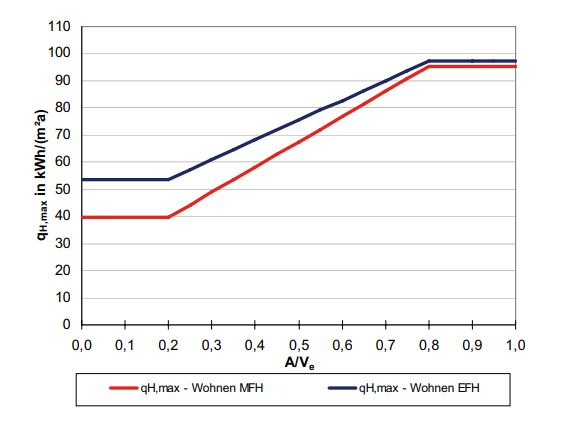
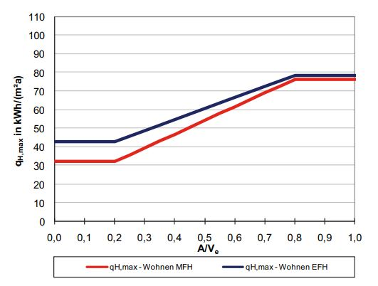
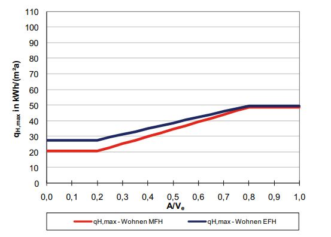
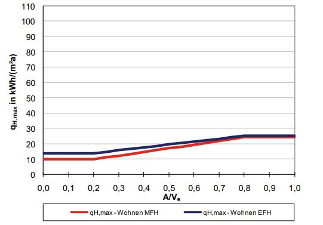
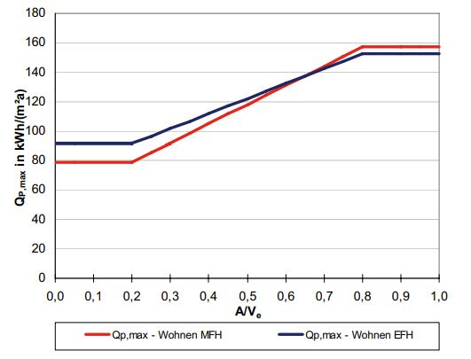
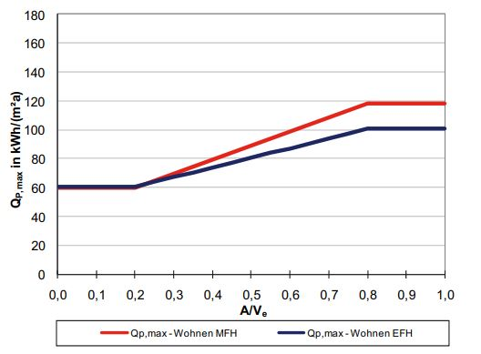
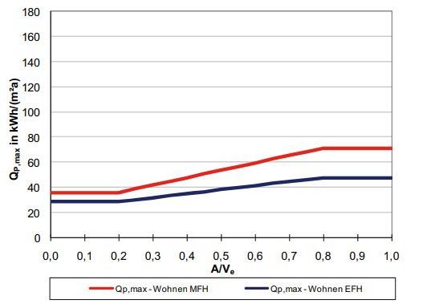

# Règlement grand-ducal du 5 mai 2012 modifiant\n 1. le règlement grand-ducal modifié du 30 novembre 2007 concernant la performance énergétique des bâtiments d’habitation;\n 2. le règlement grand-ducal du 31 août 2010 concernant la performance énergétique des bâtiments fonctionnels.

Nous Henri, Grand-Duc de Luxembourg, Duc de Nassau,

Vu la [loi modifiée du 5 août 1993](https://legilux.public.lu/eli/etat/leg/loi/1993/08/05/n1/jo) concernant l’utilisation rationnelle de l’énergie;

Vu la [directive 2010/31/UE](https://legilux.public.lu/eli/dir_ue/2010/31/jo) du Parlement européen et du Conseil du 19 mai 2010 sur la performance énergétique des bâtiments;

Vu les avis de la Chambre de Commerce et de la Chambre des Métiers;

Notre Conseil d’Etat entendu;

De l’assentiment de la Conférence des Présidents de la Chambre des Députés;

Sur le rapport de Notre Ministre de l’Economie et du Commerce extérieur et après délibération du Gouvernement en Conseil;

Arrêtons:

## Art. Ier.

Le [règlement grand-ducal modifié du 30 novembre 2007](https://legilux.public.lu/eli/etat/leg/rgd/2007/11/30/n7/jo) concernant la performance énergétique des bâtiments d’habitation est modifié comme suit:

1° L’article 6, paragraphe (2) est remplacé par la disposition suivante:

> (2) Les extensions de bâtiments d’habitation doivent respecter, complémentairement aux exigences minimales visées au paragraphe (1), les exigences définies au chapitre 2.1 de l’annexe, à condition que la surface de référence énergétique An de l’extension soit supérieure à 80 mètres carrés.

2° L’article 11 est complété par le paragraphe suivant:

> (4) Pour un bâtiment d’habitation ou une partie de bâtiment dans un bâtiment d’habitation proposé à la vente ou à la location, la classe de performance énergétique du bâtiment en fonction de l’indice de dépense d’énergie primaire et la classe d’isolation thermique du bâtiment en fonction de l’indice de dépense d’énergie chauffage conformément au chapitre 4.2 de l’annexe du présent règlement figurent dans les publicités paraissant dans les médias commerciaux. Le présent paragraphe devient obligatoire à partir du 1er juillet 2012.

3° Au chapitre 1.1 de l’annexe, le point 2) est remplacé comme suit:

> 2\) a) Ausser für die unter b) aufgeführten Erweiterungen ist für folgende Situationen der zulässige Höchstwert des Wärmedurchgangskoeffizienten aus Tabelle 1 mit einem Abminderungsfaktor 0,8 zu multiplizieren (Umax,BH = Umax * 0,8):
>
> aash Flächen mit Bauteilheizung (z.B. Fußbodenheizung, im Mauerwerk integrierte Wandheizung, etc.)
>
> bash Fenster mit vorgelagerten Heizkörpern.
>
> b) Für Erweiterungen mit einer Energiebezugsfläche An ≤ 80 m2, für welche die Anforderungen gemäß Kapitel 2 nicht gelten, ist der zulässige Höchstwert des Wärmedurchgangskoeffizienten aus Tabelle 1 mit den Abminderungsfaktoren fabm aus Tabelle 1a zu multiplizieren (Umax,BH = Umax * fabm).
>
> <table>
> <tr>
> <td colspan="5"><b>Abminderungsfaktoren fabm zur Bestimmung der zulässigen Höchstwerte der</b> <b>Wärmedurchgangskoeffizienten</b></td>
> </tr>
> <tr>
> <td>Datum der Beantragung der Baugenehmigung Bauteil</td>
> <td>bis 30.6.2012</td>
> <td>1.7.2012- 31.12.2014</td>
> <td>1.1.2015- 31.12.2016</td>
> <td>ab 1.1.2017</td>
> </tr>
> <tr>
> <td>Wand und horizontaler unterer Gebäudeabschluss</td>
> <td>0,80</td>
> <td>0,69</td>
> <td>0,56</td>
> <td>0,44</td>
> </tr>
> <tr>
> <td>Dach und horizontaler oberer Gebäudeabschluss</td>
> <td>0,80</td>
> <td>0,72</td>
> <td>0,60</td>
> <td>0,44</td>
> </tr>
> <tr>
> <td>Fenster oder Fenstertür inklusive Rahmen</td>
> <td>0,80</td>
> <td>0,73</td>
> <td>0,67</td>
> <td>0,57</td>
> </tr>
> <tr>
> <td>Tür inklusive Rahmen</td>
> <td>0,80</td>
> <td>0,70</td>
> <td>0,60</td>
> <td>0,50</td>
> </tr>
> <tr>
> <td>Lichtkuppeln</td>
> <td>0,80</td>
> <td>0,67</td>
> <td>0,56</td>
> <td>0,41</td>
> </tr>
> </table>
>
> \*Tabelle 1a Abminderungsfaktoren zur Bestimmung der zulässigen Höchstwerte der* *Wärmedurchgangskoeffizienten*

4° Au chapitre 1.1 de l’annexe, le point 4) est remplacé par le texte suivant:

> 4\) Ausgenommen sind großflächige Schaufenster (> 15 m2). Hier ist ein U-Wert für die Verglasung Ug von ≤ 1,30 W/m2K einzuhalten.

5° Au chapitre 1.1 de l’annexe, le point 6) est supprimé.

6° Au chapitre 1.3 de l’annexe, l’alinéa 3 est remplacé par le texte suivant:

> Werden für die Gebäudetypen 2, 3, 4 und 5 entsprechende n50 Werte gemäß Tabelle 2 als Berechnungsgrundlage herangezogen, ist ein Nachweis der Erreichung der Dichtheit nach DIN 13829 (Luftdichtheitstest), gemäß Verfahren A, durchführen zu lassen. Zur Qualitätskontrolle/-sicherung während der Bauphase empfiehlt sich ein Luftdichtheitstest gemäß Verfahren B.

7° Au chapitre 1.5 de l’annexe, l’alinéa 5 est complété par la phrase suivante:

> Wird das Gebäude und die Anlagentechnik nach dem Niedrigenergiehausstandard geplant, reduziert sich der einzuhaltende Grenzwert für die spezifische Leistungsaufnahme qL der Lüftungsanlage in Tabelle 4 um 0,05 W/(m³/h).

8° Le texte du chapitre 2.1 de l’annexe est remplacé comme suit:

> Für den gemäß Kapitel 5 berechneten spezifischen Heizwärmebedarf qH in kWh/m2a gelten folgende Grenzwertanforderungen qH,max:
>
> a) Folgende Anforderungen gelten für Wohngebäude, deren Baugenehmigung bis zum 30. Juni 2012 beantragt wird:
>
> <table>
> <tr>
> <td colspan="2"><b>Gebäudekategorie</b></td>
> <td><b>qH,max</b> [kWh/m²a] <b>0,2 < A/Ve < 0,8</b></td>
> <td><b>qH,max</b> [kWh/m²a] <b>A/Ve ≤ 0,2</b></td>
> <td><b>qH,max</b> [kWh/m²a] <b>A/Ve ≥ 0,8</b></td>
> </tr>
> <tr>
> <td>1</td>
> <td>Wohnen MFH</td>
> <td>21+93(A/Ve)</td>
> <td>39,6</td>
> <td>95,4</td>
> </tr>
> <tr>
> <td>2</td>
> <td>Wohnen EFH</td>
> <td>39+73(A/Ve)</td>
> <td>53,6</td>
> <td>97,4</td>
> </tr>
> </table>
>
> \*Tabelle 5a - Anforderungen an den spezifischen Heizwärmebedarf für Wohngebäude, deren* *Baugenehmigung bis zum 30. Juni 2012 beantragt wird*
>
> 
>
> \*Abbildung 2a - Anforderungen an den spezifischen Heizwärmebedarf für Wohngebäude,*  *deren Baugenehmigung bis zum 30. Juni 2012 beantragt wird*
>
> b) Folgende Anforderungen gelten für Wohngebäude, deren Baugenehmigung ab dem 1. Juli 2012 und bis zum 31. Dezember 2014 beantragt wird:
>
> <table>
> <tr>
> <td colspan="2"><b>Gebäudekategorie</b></td>
> <td><b>qH,max</b> [kWh/m²a] <b>0,2 < A/Ve < 0,8</b></td>
> <td><b>qH,max</b> [kWh/m²a] <b>A/Ve <i>*≤</b> 0,2*</i></td>
> <td><b>qH,max</b> [kWh/m²a] <b>A/Ve <i>*≥</b> 0,8*</i></td>
> </tr>
> <tr>
> <td>1</td>
> <td>Wohnen MFH</td>
> <td>17+74(A/Ve)</td>
> <td>31,8</td>
> <td>76,2</td>
> </tr>
> <tr>
> <td>2</td>
> <td>Wohnen EFH</td>
> <td>31+59(A/Ve)</td>
> <td>42,8</td>
> <td>78,2</td>
> </tr>
> </table>
>
> \*Tabelle 5b - Anforderungen an den spezifischen Heizwärmebedarf für Wohngebäude, deren* *Baugenehmigung ab dem 1. Juli 2012 und bis zum 31. Dezember 2014 beantragt wird*
>
> 
>
> \*Abbildung 2b - Anforderungen an den spezifischen Heizwärmebedarf für Wohngebäude, deren* *Baugenehmigung ab dem 1. Juli 2012 und bis zum 31. Dezember 2014 beantragt wird*
>
> c) Folgende Anforderungen gelten für Wohngebäude, deren Baugenehmigung ab dem 1. Januar 2015 und bis zum 31. Dezember 2016 beantragt wird:
>
> <table>
> <tr>
> <td colspan="2"><b>Gebäudekategorie</b></td>
> <td><b>qH,max</b> [kWh/m²a] <b>0,2 < A/Ve < 0,8</b></td>
> <td><b>qH,max</b> [kWh/m²a] <b>A/Ve <i>*≤</b> 0,2*</i></td>
> <td><b>qH,max</b> [kWh/m²a] <b>A/Ve <i>*≥</b> 0,8*</i></td>
> </tr>
> <tr>
> <td>1</td>
> <td>Wohnen MFH</td>
> <td>11+47(A/Ve)</td>
> <td>20,4</td>
> <td>48,6</td>
> </tr>
> <tr>
> <td>2</td>
> <td>Wohnen EFH</td>
> <td>20+37(A/Ve)</td>
> <td>27,4</td>
> <td>49,6</td>
> </tr>
> </table>
>
> \*Tabelle 5c - Anforderungen an den spezifischen Heizwärmebedarf für Wohngebäude, deren* *Baugenehmigung ab dem 1. Januar 2015 und bis zum 31. Dezember 2016 beantragt wird*
>
> 
>
> \*Abbildung 2c - Anforderungen an den spezifischen Heizwärmebedarf für Wohngebäude, deren* *Baugenehmigung ab dem 1. Januar 2015 und bis zum 31. Dezember 2016 beantragt wird*
>
> d) Folgende Anforderungen gelten für Wohngebäude, deren Baugenehmigung ab dem 1. Januar 2017 beantragt wird:
>
> <table>
> <tr>
> <td colspan="2"><b>Gebäudekategorie</b></td>
> <td><b>qH,max</b> [kWh/m²a] <b>0,2 < A/Ve < 0,8</b></td>
> <td><b>qH,max</b> [kWh/m²a] <b>A/Ve <i>*≤</b> 0,2*</i></td>
> <td><b>qH,max</b> [kWh/m²a] <b>A/Ve <i>*≥</b> 0,8*</i></td>
> </tr>
> <tr>
> <td>1</td>
> <td>Wohnen MFH</td>
> <td>5+24(A/Ve)</td>
> <td>9,8</td>
> <td>24,2</td>
> </tr>
> <tr>
> <td>2</td>
> <td>Wohnen EFH</td>
> <td>10+19(A/Ve)</td>
> <td>13,8</td>
> <td>25,2</td>
> </tr>
> </table>
>
> \*Tabelle 5d - Anforderungen an den spezifischen Heizwärmebedarf für Wohngebäude, deren* *Baugenehmigung ab dem 1. Januar 2017 beantragt wird*
>
> 
>
> \*Abbildung 2d - Anforderungen an den spezifischen Heizwärmebedarf für Wohngebäude, deren* *Baugenehmigung ab dem 1. Januar 2017 beantragt wird*

9° Le texte du chapitre 2.2 de l’annexe est remplacé comme suit:

> Für den gemäß Kapitel 5 berechneten spezifischen Gesamt-Primärenergiekennwert QP in kWh/m2a gelten folgende Grenzwertanforderungen QP,max:
>
> a) Folgende Anforderungen gelten für Wohngebäude, deren Baugenehmigung bis zum 30. Juni 2012 beantragt wird:
>
> <table>
> <tr>
> <td colspan="2"><b>Gebäudekategorie</b></td>
> <td><b>QP,max</b> [kWh/m²a] <b>0,2 < A/Ve < 0,8</b></td>
> <td><b>QP,max</b> [kWh/m²a] <b>A/Ve <i>*≤</b> 0,2*</i></td>
> <td><b>QP,max</b> [kWh/m²a] <b>A/Ve <i>*≥</b> 0,8*</i></td>
> </tr>
> <tr>
> <td>1</td>
> <td>Wohnen MFH</td>
> <td>53+130(A/Ve)</td>
> <td>79,0</td>
> <td>157,0</td>
> </tr>
> <tr>
> <td>2</td>
> <td>Wohnen EFH</td>
> <td>71+102(A/Ve)</td>
> <td>91,4</td>
> <td>152,6</td>
> </tr>
> </table>
>
> \*Tabelle 6a - Anforderungen an den Gesamt-Primärenergiekennwert für Wohngebäude, deren* *Baugenehmigung bis zum 30. Juni 2012 beantragt wird*
>
> 
>
> \*Abbildung 3a Anforderungen an den Gesamt-Primärenergiekennwert für Wohngebäude, deren* *Baugenehmigung bis zum 30. Juni 2012 beantragt wird*
>
> b) Folgende Anforderungen gelten für Wohngebäude, deren Baugenehmigung ab dem 1. Juli 2012 und bis zum 31. Dezember 2014 beantragt wird:
>
> <table>
> <tr>
> <td colspan="2"><b>Gebäudekategorie</b></td>
> <td><b>QP,max</b> [kWh/m²a] <b>0,2 < A/Ve < 0,8</b></td>
> <td><b>QP,max</b> [kWh/m²a] <b>A/Ve <i>*≤</b> 0,2*</i></td>
> <td><b>QP,max</b> [kWh/m²a] <b>A/Ve <i>*≥</b> 0,8*</i></td>
> </tr>
> <tr>
> <td>1</td>
> <td>Wohnen MFH</td>
> <td>40+98(A/Ve)</td>
> <td>59,6</td>
> <td>118,4</td>
> </tr>
> <tr>
> <td>2</td>
> <td>Wohnen EFH</td>
> <td>47+67(A/Ve)</td>
> <td>60,4</td>
> <td>100,6</td>
> </tr>
> </table>
>
> \*Tabelle 6b - Anforderungen an den Gesamt-Primärenergiekennwert für Wohngebäude, deren* *Baugenehmigung ab dem 1. Juli 2012 und bis zum 31. Dezember 2014 beantragt wird*
>
> 
>
> \*Abbildung 3b Anforderungen an den Gesamt-Primärenergiekennwert für Wohngebäude, deren*  *Baugenehmigung ab dem 1. Juli 2012 und bis zum 31. Dezember 2014 beantragt wird*
>
> c) Folgende Anforderungen gelten für Wohngebäude, deren Baugenehmigung ab dem 1. Januar 2015 beantragt wird:
>
> <table>
> <tr>
> <td colspan="2"><b>Gebäudekategorie</b></td>
> <td><b>QP,max</b> [kWh/m²a] <b>0,2 < A/Ve < 0,8</b></td>
> <td><b>QP,max</b> [kWh/m²a] <b>A/Ve <i>*≤</b> 0,2*</i></td>
> <td><b>QP,max</b> [kWh/m²a] <b>A/Ve <i>*≥</b> 0,8*</i></td>
> </tr>
> <tr>
> <td>1</td>
> <td>Wohnen MFH</td>
> <td>24+59(A/Ve)</td>
> <td>35,8</td>
> <td>71,2</td>
> </tr>
> <tr>
> <td>2</td>
> <td>Wohnen EFH</td>
> <td>22+32(A/Ve)</td>
> <td>28,4</td>
> <td>47,6</td>
> </tr>
> </table>
>
> \*Tabelle 6c - Anforderungen an den Gesamt-Primärenergiekennwert für Wohngebäude, deren* *Baugenehmigung ab dem 1. Januar 2015 beantragt wird*
>
> 
>
> \*Abbildung 3c - Anforderungen an den Gesamt-Primärenergiekennwert für Wohngebäude, deren*  *Baugenehmigung ab dem 1. Januar 2015 beantragt wird*

10° Au chapitre 5.2.1.3.1 de l’annexe, tableau 9, dernière ligne, le symbol / est remplacé par le chiffre 0.

## Art. II.

Le [règlement grand-ducal du 31 août 2010](https://legilux.public.lu/eli/etat/leg/rgd/2010/08/31/n1/jo) concernant la performance énergétique des bâtiments fonctionnels est modifié comme suit:

1° L’article 14 est complété par le paragraphe suivant:

> (5) Conformément à l’article 12 du présent règlement et pour une partie d’un bâtiment fonctionnel destinée à des fins d’habitation qui est proposée à la vente ou à la location, la classe de performance énergétique du bâtiment en fonction de l’indice de dépense d’énergie primaire et la classe d’isolation thermique du bâtiment en fonction de l’indice de dépense d’énergie chauffage, établis conformément au chapitre 4.2 de l’annexe du [règlement modifié du 30 novembre 2007](https://legilux.public.lu/eli/etat/leg/rgd/2007/11/30/n7/jo) concernant la performance énergétique des bâtiments d’habitation, figurent dans les publicités paraissant dans les médias commerciaux. Le présent paragraphe devient obligatoire à partir du 1er juillet 2012.

2° L’annexe du règlement est remplacée par l’annexe qui suit.

## Art. III.

Notre Ministre de l’Economie et du Commerce extérieur est chargé de l’exécution du présent règlement qui sera publié au Mémorial.

Le Ministre de l’Economie et du Commerce extérieur,   Etienne Schneider

Château de Berg, le 5 mai 2012.   Henri

Annexe

Pour visualiser l’annexe, veuillez consulter la [version pdf du Journal officiel](https://legilux.public.lu/eli/etat/leg/rgd/2012/05/05/n1/jo).

Doc. parl. [6312](https://legilux.public.lu/eli/etat/proj/pr/20110173); sess. ord. 2011-2012; [Dir. 2010/31/UE](https://legilux.public.lu/eli/dir_ue/2010/31/jo).
