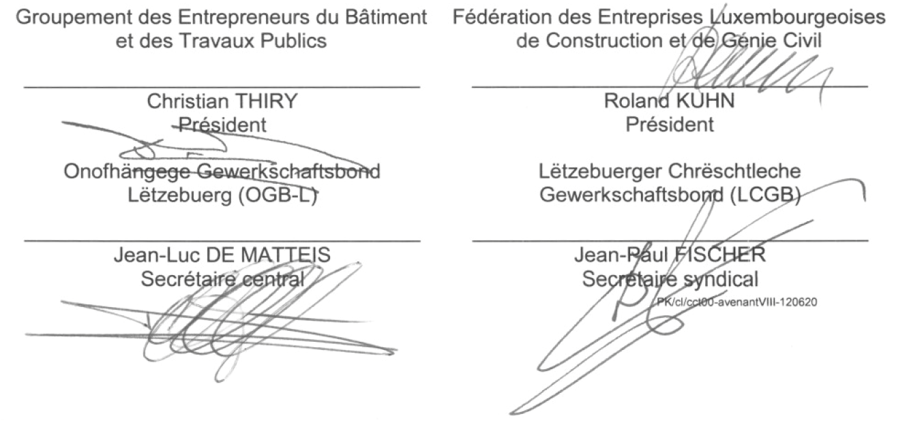

# Règlement grand-ducal du 12 décembre 2012 portant déclaration d’obligation générale d’un avenant VIII à la convention collective de travail pour le bâtiment ayant trait aux congés collectifs d’été et d’hiver conclu entre le Groupement des Entrepreneurs du Bâtiment et des Travaux Publics et la Fédération des Entreprises Luxembourgeoises de Construction et de Génie Civil, d’une part et les syndicats OGB-L et LCGB, d’autre part.

Nous Henri, Grand-Duc de Luxembourg, Duc de Nassau,

Vu l’article L.164-8 du [Code du Travail](https://legilux.public.lu/eli/etat/leg/code/travail);

Sur proposition concordante des assesseurs de l’Office National de Conciliation et sur avis des chambres professionnelles compétentes;

Vu l’article 2 (1) de la [loi du 12 juillet 1996](https://legilux.public.lu/eli/etat/leg/loi/1996/07/12/n3/jo) portant réforme du Conseil d’Etat et considérant qu’il y a urgence;

Sur le rapport de Notre Ministre du Travail, de l’Emploi et de l’Immigration et après délibération du Gouvernement en Conseil;

Arrêtons:

## Art. 1er.

L’avenant VIII à la convention collective de travail pour le bâtiment ayant trait aux congés collectifs d’été et d’hiver conclu entre le Groupement des Entrepreneurs du Bâtiment et des Travaux Publics et la Fédération des Entreprises Luxembourgeoises de Construction et de Génie Civil, d’une part et les syndicats OGB-L et LCGB, d’autre part, est déclaré d’obligation générale pour l’ensemble du secteur.

## Art. 2.

Notre Ministre du Travail, de l’Emploi et de l’Immigration est chargé de l’exécution du présent règlement qui sera publié au Mémorial avec l’avenant VIII à la convention collective de travail précité.

Le Ministre du Travail, de l’Emploi  et de l’Immigration,   Nicolas Schmit

Château de Berg, le 12 décembre 2012.   Henri

\**AVENANT VIII**   **Annexe V – Congés collectifs**

\**Le congé collectif officiel d’été** commence le dernier vendredi du mois de juillet pour une durée de 15 jours ouvrables plus le jour férié du 15 août.

\**Le congé collectif officiel d’hiver**, de 10 jours ouvrables, plus les jours fériés des 25 et 26 décembre et 1er janvier suivant, est fixé aux dates suivantes:

Pour l’année 2012 , le congé d’hiver est fixé comme suit:

2012: du 22.12.12 au 09.01.13 inclus

Les 2 jours de congé restant sont à prendre selon le désir du salarié avant le 31 mars de l’année suivante.

\**Dérogations au congé collectif officiel**

En accord avec la délégation du personnel ou, à défaut, avec les travailleurs concernés, il peut être dérogé aux périodes du congé collectif pour l’exécution des travaux suivants:

aot Travaux de réparation dans les écoles;

bot Travaux de réparation ou de transformation dans les usines pendant les arrêts de la production;

cot Travaux qui seront considérés urgents par la commission ad hoc.

Les demandes de dérogations (formulaires et explications sur www.itm.etat.lu), accompagnées de l’avis de la délégation du personnel ou, à défaut, des ouvriers concernés, doivent impérativement être adressées à l’Inspection du Travail et des Mines et des syndicats contractants, au plus tard 30 jours avant la date du début du congé collectif officiel.

Elles doivent renseigner sur le nombre d’ouvriers concernés, le chantier sur lequel il sera travaillé, le début et la durée des travaux.

La nouvelle période de congé fixée doit comporter un nombre de jours égal à celui de la période officielle.

Une commission ad hoc, composée de deux représentants des syndicats contractants, deux représentants des employeurs et un représentant de l’Inspection du Travail et des Mines, examinera les demandes et est seule compétente pour accorder les dérogations.

L’autorisation de dérogation doit visiblement être affichée à l’entrée du chantier.

Pour le fonctionnement des chantiers autorisés pendant les périodes de congé collectif, l’entreprise doit recourir aux volontaires.

Les parties signataires du présent contrat collectif peuvent demander, tant à l’Inspection du Travail et des Mines, à l’Administration des Douanes et Accises, qu’à la force publique, de fermer immédiatement les chantiers fonctionnant sans une autorisation délivrée par la commission ad hoc.

