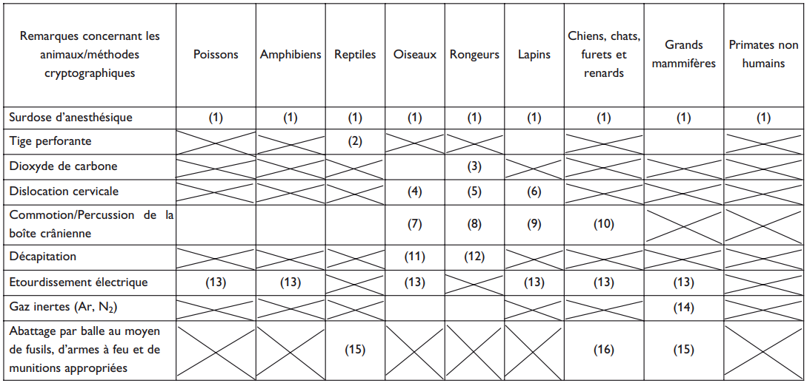

# Règlement grand-ducal du 11 janvier 2013 relatif à la protection des animaux utilisés à des fins scientifiques.

## CHAPITRE Ier — DISPOSITIONS GENERALES

### Art. 1er — Objet et champ d’application

1\. Le présent règlement grand-ducal établit des mesures pour la protection des animaux utilisés à des fins scientifiques ou éducatives.

A cet effet, il fixe des règles relatives aux aspects suivants:

a) le remplacement et la réduction de l’utilisation d’animaux dans les procédures et le raffinement des conditions d’élevage, d’hébergement, de soins et d’utilisation des animaux dans ces procédures;

b) l’origine, l’élevage, le marquage, les soins, l’hébergement et la mise à mort des animaux;

c) les opérations des éleveurs, fournisseurs et utilisateurs;

d) l’évaluation et l’autorisation de projets impliquant l’utilisation d’animaux dans des procédures.

2\. Le présent règlement grand-ducal s’applique lorsque des animaux sont utilisés ou destinés à être utilisés dans des procédures ou lorsqu’ils sont élevés spécifiquement pour que leurs organes ou tissus puissent être utilisés à des fins scientifiques.

Le présent règlement grand-ducal s’applique jusqu’à ce que les animaux visés au premier alinéa aient été mis à mort, placés ou relâchés dans un habitat ou un système d’élevage approprié.

3\. Le présent règlement grand-ducal s’applique aux animaux suivants:

a) animaux vertébrés non humains vivants, y compris:

i) les formes larvaires autonomes; et

ii) les formes fœtales de mammifères à partir du dernier tiers de leur développement normal;

b) les céphalopodes vivants.

4\. Le présent règlement grand-ducal s’applique aux animaux qui sont utilisés dans des procédures et sont à un stade de développement antérieur à celui visé au paragraphe 3, point a), si l’animal doit être laissé en vie au-delà de ce stade de développement et risque, à la suite des procédures menées, d’éprouver de la douleur, de la souffrance ou de l’angoisse ou de subir des dommages durables après avoir atteint ce stade de développement.

5\. Le présent règlement grand-ducal ne s’applique pas:

a) aux actes pratiqués dans les exploitations agricoles à des fins non expérimentales;

b) à la pratique de la médecine vétérinaire à des fins non expérimentales;

c) aux essais cliniques vétérinaires nécessaires aux fins d’une autorisation de mise sur le marché d’un médicament vétérinaire;

d) aux actes pratiqués à des fins d’élevage reconnues;

e) aux actes pratiqués dans le but premier d’identifier un animal;

f) aux pratiques qui ne sont pas susceptibles de causer une douleur, une souffrance, une angoisse ou des dommages durables équivalents ou supérieurs à ceux causés par l’introduction d’une aiguille conformément aux bonnes pratiques vétérinaires.

6\. Le présent règlement grand-ducal s’applique sans préjudice du [règlement grand-ducal modifié du 30 juillet 1994](https://legilux.public.lu/eli/etat/leg/rgd/1994/07/30/n2) relatif aux produits cosmétiques.

### Art. 2 — Définitions

Aux fins du présent règlement grand-ducal, on entend par:

1\. «procédure», toute utilisation, invasive ou non, d’un animal à des fins expérimentales ou à d’autres fins scientifiques, dont les résultats sont connus ou inconnus, ou à des fins éducatives, susceptible de causer à cet animal une douleur, une souffrance, une angoisse ou des dommages durables équivalents ou supérieurs à ceux causés par l’introduction d’une aiguille conformément aux bonnes pratiques vétérinaires.

Ceci inclut toute intervention destinée ou de nature à aboutir à la naissance ou à l’éclosion d’un animal ou à la création et à la conservation d’une lignée d’animaux génétiquement modifiés dans l’une de ces conditions, mais exclut la mise à mort d’animaux à la seule fin d’utiliser leurs organes ou tissus;

2\. «projet», un programme de travail ayant un objectif scientifique défini et impliquant une ou plusieurs procédures;

3\. «établissement», toute installation, tout bâtiment, tout groupe de bâtiments ou tout autre local, y compris, le cas échéant, un endroit non totalement clos ou couvert, ainsi que des installations mobiles;

4\. «éleveur», toute personne physique ou morale élevant des animaux visés à l’annexe I en vue de leur utilisation dans des procédures ou en vue de l’utilisation de leurs tissus ou organes à des fins scientifiques, ou élevant d’autres animaux principalement aux fins susmentionnées, dans un but lucratif ou non;

5\. «fournisseur», toute personne physique ou morale autre qu’un éleveur, fournissant des animaux en vue de leur utilisation dans des procédures ou en vue de l’utilisation de leurs tissus ou organes à des fins scientifiques, dans un but lucratif ou non;

6\. «utilisateur», toute personne physique ou morale utilisant des animaux dans des procédures, dans un but lucratif ou non;

7\. «autorité compétente», le Ministre ayant l’agriculture dans ses compétences;

8\. «administration compétente», l’Administration des services vétérinaires.

### Art. 3 — Principe de remplacement, de réduction et de raffinement

1\. Dans toute la mesure du possible, il doit être utilisé, au lieu d’une procédure, une méthode ou une stratégie d’expérimentation scientifiquement satisfaisante, n’impliquant pas l’utilisation d’animaux vivants.

2\. Le nombre d’animaux utilisés dans un projet doit être réduit au minimum sans compromettre les objectifs du projet.

3\. Il doit être procédé au raffinement des conditions d’élevage, d’hébergement et de soins, et des méthodes utilisées dans les procédures, afin d’éliminer ou de réduire au minimum toute douleur, souffrance ou angoisse ou tout dommage durable susceptible d’être infligé aux animaux.

4\. Le présent article est mis en œuvre, pour le choix des méthodes, conformément à l’article 12.

### Art. 4 — Finalités des procédures

Seules sont admises les procédures qui ont pour objet:

a) la recherche fondamentale;

b) des recherches translationnelles ou appliquées menées dans l’un des objectifs suivants:

i) la prévention, la prophylaxie, le diagnostic ou le traitement de maladies, de mauvais états de santé ou d’autres anomalies ou de leurs effets chez l’homme, les animaux ou les plantes;

ii) l’évaluation, la détection, le contrôle ou les modifications des conditions physiologiques chez l’homme, les animaux ou les plantes; ou

iii) le bien-être des animaux et l’amélioration des conditions de production des animaux élevés à des fins agronomiques;

c) l’une des finalités visées au point b) lors de la mise au point, de la production ou des essais de qualité, d’efficacité et d’innocuité de médicaments, de denrées alimentaires, d’aliments pour animaux et d’autres substances ou produits;

d) la protection de l’environnement naturel dans l’intérêt de la santé ou du bien-être de l’homme ou de l’animal;

e) la recherche en vue de la conservation des espèces;

f) l’enseignement supérieur ou la formation en vue de l’acquisition, de l’entretien ou de l’amélioration de compétences professionnelles;

g) les enquêtes médicolégales.

### Art. 5 — Méthodes de mise à mort

1\. Les animaux doivent être mis à mort en limitant au minimum la douleur, la souffrance et l’angoisse qu’ils éprouvent.

2\. Les animaux doivent être mis à mort dans l’établissement d’un éleveur, d’un fournisseur ou d’un utilisateur, par une personne compétente.

Toutefois, dans le cas d’une étude sur le terrain, un animal peut être mis à mort par une personne compétente en dehors d’un établissement.

3\. Pour les animaux visés par l’annexe IV, la méthode appropriée de mise à mort utilisée est celle spécifiée dans cette annexe.

4\. L’autorité compétente peut accorder des dérogations à l’exigence visée au paragraphe 3:

a) afin d’autoriser le recours à une autre méthode pour autant que, sur la base de données scientifiques, cette méthode soit considérée comme étant au moins aussi «douce»; ou

b) sur la base d’éléments scientifiques démontrant que la finalité de la procédure ne peut être atteinte par le recours à une méthode de mise à mort spécifiée à l’annexe IV.

5\. Les paragraphes 2 et 3 ne s’appliquent pas lorsqu’un animal doit être mis à mort en cas d’urgence pour des raisons liées au bien-être des animaux, à la santé publique, à la sécurité publique, à la santé animale ou à l’environnement.

## CHAPITRE II — DISPOSITIONS RELATIVES A L’UTILISATION DE CERTAINS ANIMAUX DANS DES PROCEDURES

### Art. 6 — Espèces menacées

1\. Les spécimens des espèces menacées énumérées à l’annexe A du [règlement (CE) n° 338/97](https://legilux.public.lu/eli/reg_ue/1997/338/jo) du Conseil du 9 décembre 1996 relatif à la protection des espèces de faune et de flore sauvages par le contrôle de leur commerce qui ne relèvent pas du champ d’application de l’article 7 paragraphe 1er[^1], [dudit règlement](https://legilux.public.lu/eli/reg_ue/1997/338/jo) ne sont pas utilisés dans des procédures, à l’exception de procédures répondant aux conditions suivantes:

a) la procédure poursuit l’une des finalités visées à l’article 4, point b) i), c) ou e), du présent règlement grand-ducal, et

b) il existe des éléments scientifiques démontrant que la finalité de la procédure ne peut être atteinte en utilisant d’autres espèces que celles énumérées dans cette annexe.

2\. Le paragraphe 1er ne s’applique pas aux espèces de primates non humains.

### Art. 7 — Primates non humains

1\. Sous réserve du paragraphe 2, les spécimens des primates non humains ne sont pas utilisés dans des procédures, à l’exception de procédures répondant aux conditions suivantes:

a) la procédure poursuit l’une des finalités visées:

i) à l’article 4, point b) i) ou c), du présent règlement grand-ducal et est appliquée en vue de la prévention, de la prophylaxie, du diagnostic ou du traitement d’affections humaines invalidantes ou potentiellement mortelles; ou

ii) à l’article 4, point a) ou e);

et

b) il existe des éléments scientifiques démontrant que la finalité de la procédure ne peut être atteinte en utilisant d’autres espèces que celles de primates non humains.

Aux fins du présent règlement grand-ducal, on entend par «condition clinique invalidante», une diminution des capacités physiques ou psychologiques normales d’une personne.

2\. Les spécimens des primates non humains énumérés à l’annexe A du [règlement (CE) no 338/97](https://legilux.public.lu/eli/reg_ue/1997/338/jo) précité qui ne relèvent pas du champ d’application de l’article 7 paragraphe 1er[^2], [dudit règlement](https://legilux.public.lu/eli/reg_ue/1997/338/jo) ne sont pas utilisés dans des procédures, à l’exception de procédures répondant aux conditions suivantes:

a) la procédure poursuit l’une des finalités visées:

i) à l’article 4, point b) i) ou c), du présent règlement grand-ducal et est appliquée en vue de la prévention, de la prophylaxie, du diagnostic ou du traitement d’affections humaines invalidantes ou potentiellement mortelles; ou

ii) à l’article 4, point e);

et

b) il existe des éléments scientifiques démontrant que la finalité de la procédure ne peut être atteinte en utilisant d’autres espèces que celles de primates non humains et en utilisant des espèces non énumérées dans cette annexe.

3\. Nonobstant les paragraphes 1er et 2, les grands singes ne sont pas utilisés dans des procédures, sous réserve du recours à la clause de sauvegarde figurant à l’article 50, paragraphe 2.

### Art. 8 — Animaux capturés dans la nature

1\. Les animaux capturés dans la nature ne sont pas utilisés dans des procédures.

2\. Des dérogations au paragraphe 1er peuvent être accordées par l’autorité compétente sur la base d’arguments scientifiques démontrant que l’objectif de la procédure ne peut être atteint en utilisant un animal qui a été élevé en vue d’une utilisation dans des procédures.

3\. La capture des animaux dans la nature est effectuée uniquement par une personne compétente employant des méthodes ne causant pas aux animaux de douleur, de souffrance, d’angoisse ou de dommage durable qui pourrait être évité.

Tout animal qui, lors de la capture ou après celle-ci, est blessé ou en mauvaise santé est examiné par un vétérinaire ou une autre personne compétente, et des mesures sont prises pour atténuer autant que possible la souffrance de l’animal. L’autorité compétente peut accorder des dérogations à l’exigence de prendre des mesures en vue d’atténuer autant que possible la souffrance de l’animal si cela est scientifiquement justifié.

### Art. 9 — Animaux élevés en vue d’une utilisation dans des procédures

1\. Les animaux appartenant aux espèces énumérées à l’annexe I ne peuvent être utilisés dans des procédures que lorsque ces animaux ont été élevés à cette fin.

Cependant, à partir des dates indiquées dans l’annexe II, les primates non humains énumérés dans ladite annexe ne peuvent être utilisés dans des procédures que lorsqu’ils sont issus de primates non humains qui ont été élevés en captivité ou que lorsqu’ils sont issus de colonies entretenues sans apport d’effectifs extérieurs.

Aux fins du présent article, on entend par «colonie entretenue sans apport d’effectifs extérieurs», une colonie dont les animaux sont élevés uniquement au sein de la colonie ou proviennent d’autres colonies sans être prélevés dans la nature et sont détenus de manière à être habitués à l’être humain.

2\. L’autorité compétente peut accorder des dérogations au paragraphe 1er sur la base d’éléments scientifiques.

### Art. 10 — Animaux d’espèces domestiques errants ou devenus sauvages

1\. Les animaux d’espèces domestiques errants ou devenus sauvages ne sont pas utilisés dans des procédures.

2\. L’autorité compétente ne peut accorder des dérogations au paragraphe 1er que pour autant que les conditions suivantes soient satisfaites:

a) il existe une nécessité essentielle de mener des études sur la santé et le bien-être de ces animaux ou sur des menaces sérieuses pour l’environnement ou la santé humaine ou animale; et

b) il existe des éléments scientifiques démontrant que la finalité de la procédure ne peut être atteinte qu’en utilisant un animal errant ou devenu sauvage.

## CHAPITRE III — PROCEDURES

### Art. 11 — Procédures

1\. Les procédures doivent être menées dans un établissement utilisateur.

L’autorité compétente peut accorder des dérogations au premier alinéa sur la base d’éléments scientifiques.

2\. Seules sont admises les procédures menées dans le cadre d’un projet.

### Art. 12 — Choix des méthodes

1\. Sans préjudice de la législation nationale interdisant certains types de méthodes, une procédure ne doit pas être menée si la législation de l’Union reconnaît une autre méthode ou stratégie d’expérimentation n’impliquant pas l’utilisation d’un animal vivant pour obtenir le résultat recherché.

2\. Le choix entre les procédures est guidé par le souci de sélectionner celles qui satisfont le mieux aux exigences suivantes:

a) utiliser le moins d’animaux possible;

b) utiliser les animaux les moins susceptibles de ressentir de la douleur, de la souffrance, de l’angoisse ou de subir des dommages durables;

c) causer le moins possible de douleur, de souffrance, d’angoisse ou de dommages durables,

et sont les plus susceptibles de fournir des résultats satisfaisants.

3\. Dans la mesure du possible, la mort doit être évitée en tant que point limite dans une procédure et remplacée par des points limites précoces adaptés. Lorsque la mort ne peut être évitée en tant que point limite, la procédure est conçue de façon:

a) à entraîner la mort du plus petit nombre d’animaux possible; et

b) à réduire le plus possible la durée et l’intensité de la souffrance de l’animal et, autant que faire se peut, à lui assurer une mort sans douleur.

### Art. 13 — Anesthésie

1\. Sauf si cela n’est pas approprié, toutes les procédures doivent être menées sous anesthésie générale ou locale et en recourant à des analgésiques ou à une autre méthode appropriée, afin de s’assurer que la douleur, la souffrance et l’angoisse soient limitées au minimum.

Les procédures entraînant des lésions graves susceptibles de causer une douleur sévère ne sont pas menées sans anesthésie.

2\. La décision relative à l’opportunité de recourir à l’anesthésie tient compte des éléments suivants:

a) si l’anesthésie est jugée plus traumatisante pour l’animal que la procédure elle-même; et

b) si l’anesthésie est incompatible avec la finalité de la procédure.

3\. Il ne doit pas être administré aux animaux des substances qui empêchent ou limitent leur capacité d’exprimer la douleur, sans un niveau adéquat d’anesthésie ou d’analgésie.

Dans ces cas, il convient de fournir des éléments scientifiques, accompagnés de précisions sur le protocole anesthésique ou analgésique.

4\. Un animal susceptible d’éprouver de la douleur lorsque l’anesthésie a cessé de produire son effet reçoit un traitement analgésique préventif et postopératoire ou est traité au moyen d’autres méthodes appropriées pour soulager la douleur, pour autant que cela soit compatible avec la finalité de la procédure.

5\. Dès que la finalité de la procédure a été atteinte, des mesures appropriées sont prises afin de limiter au minimum la souffrance de l’animal.

### Art. 14 — Classification des procédures selon leur degré de gravité

1\. Toutes les procédures doivent être réparties, cas par cas, en classe «sans réveil», «légère», «modérée» ou «sévère» sur la base des critères de classification énoncés à l’annexe VIII.

2\. Sous réserve du recours à la clause de sauvegarde figurant à l’article 50, paragraphe 3, une procédure ne doit pas être exécutée si elle implique une douleur, une souffrance ou une angoisse sévère susceptible de se prolonger et qui ne peut être soulagée.

### Art. 15 — Réutilisation

1\. Un animal déjà utilisé dans une ou plusieurs procédures ne doit pas être réutilisé dans une nouvelle procédure, lorsqu’un autre animal, auquel aucune procédure n’a été appliquée précédemment, pourrait aussi être utilisé, que si les conditions suivantes sont satisfaites:

a) la gravité réelle des procédures précédentes était «légère» ou «modérée»;

b) il est démontré que l’animal a pleinement retrouvé son état de santé et de bien-être général;

c) la nouvelle procédure est de classe «légère», «modérée» ou «sans réveil» et

d) la procédure est conforme à l’avis vétérinaire, en prenant en considération le sort de l’animal concerné sur toute sa durée de vie.

2\. Dans des circonstances exceptionnelles, par dérogation au paragraphe 1er, point a), et après un examen vétérinaire de l’animal, l’autorité compétente peut autoriser la réutilisation d’un animal pour autant que celui-ci n’ait pas été utilisé plus d’une fois dans une procédure entraînant une douleur sévère, de l’angoisse ou une souffrance équivalente.

### Art. 16 — Fin de la procédure

1\. Une procédure est réputée terminée lorsqu’aucune observation ne doit plus être faite ou, en ce qui concerne les nouvelles lignées d’animaux génétiquement modifiés, lorsqu’aucune douleur, aucune souffrance, aucune angoisse ou aucun dommage durable d’un niveau équivalent ou supérieur à celui causé par l’introduction d’une aiguille n’est plus observé ou escompté sur la descendance.

2\. A la fin d’une procédure, un vétérinaire ou une autre personne compétente telle que visée aux articles 22 et 23 décide si l’animal doit être gardé en vie. L’animal est mis à mort lorsqu’il est susceptible de continuer à éprouver une douleur, une souffrance ou une angoisse ou d’avoir des dommages durables d’un niveau modéré ou sévère.

3\. Lorsqu’un animal doit être gardé en vie, il reçoit les soins et l’hébergement appropriés à son état de santé.

### Art. 17 — Partage d’organes et de tissus

L’autorité compétente facilite, le cas échéant, la mise en place de programmes pour le partage d’organes et de tissus d’animaux mis à mort.

### Art. 18 — Mise en liberté et placement des animaux

L’autorité compétente peut autoriser que les animaux utilisés ou destinés à être utilisés dans des procédures soient placés ou relâchés dans un habitat approprié ou un système d’élevage adapté à l’espèce, pour autant que les conditions suivantes soient satisfaites:

a) l’état de santé de l’animal le permet;

b) il n’y a pas de danger pour la santé publique, la santé animale ou l’environnement; et

c) des mesures appropriées ont été prises pour préserver le bien-être de l’animal.

## CHAPITRE IV — AGREMENT

### Section 1 — Exigences concernant les éleveurs, les fournisseurs et les utilisateurs

#### Art. 19 — Agrément des éleveurs, des fournisseurs et des utilisateurs

1\. Tous les éleveurs, fournisseurs et utilisateurs doivent présenter une demande écrite, dans une des langues officielles du pays, à l’autorité compétente en vue d’un agrément et d’un enregistrement auprès d’elle. L’agrément peut être accordé pour une durée limitée.

L’agrément n’est accordé que si l’éleveur, le fournisseur ou l’utilisateur, ainsi que son établissement, satisfait aux exigences du présent règlement grand-ducal.

2\. L’agrément indique le nom de la personne chargée de veiller à la conformité avec les dispositions du présent règlement grand-ducal et de la ou des personnes visées à l’article 23, paragraphe 1er, et à l’article 24.

3\. Un renouvellement de l’agrément est requis dès qu’une modification significative de la structure ou de la fonction de l’établissement d’un éleveur, d’un fournisseur ou d’un utilisateur est susceptible d’affecter négativement le bien-être des animaux.

4\. Tout changement relatif à la ou aux personnes visées au paragraphe 2 doit être notifié à l’autorité compétente.

#### Art. 20 — Suspension et retrait de l’agrément

1\. Lorsqu’un éleveur, fournisseur ou utilisateur ne satisfait plus aux exigences fixées dans le présent règlement grand-ducal, l’autorité compétente peut retirer ou suspendre à titre temporaire ou définitif l’agrément à condition que l’éleveur, le fournisseur ou l’utilisateur ait été entendu par l’autorité compétente.

2\. En cas de suspension ou de retrait de l’agrément, le bien-être des animaux hébergés dans l’établissement concerné doit être garanti.

#### Art. 21 — Exigences relatives aux installations et aux équipements

1\. Tous les établissements éleveurs, fournisseurs ou utilisateurs doivent disposer d’installations et d’équipements adaptés aux espèces animales qui y sont hébergées et, lorsque des procédures y sont menées, au bon déroulement de ces procédures.

2\. La conception, la construction et le mode de fonctionnement des installations et des équipements visés au paragraphe 1er sont de nature à permettre un déroulement aussi efficace que possible des procédures, et visent à obtenir des résultats fiables en utilisant le moins d’animaux possible et en causant le minimum de douleur, de souffrance, d’angoisse ou de dommages durables.

3\. Aux fins de l’application des paragraphes 1er et 2, les exigences énoncées à l’annexe III doivent être respectées.

#### Art. 22 — Compétence du personnel

1\. Tout éleveur, fournisseur ou utilisateur doit disposer, sur place, d’un personnel en nombre suffisant.

2\. Le personnel doit disposer d’un niveau d’études et de formation adéquat avant d’exercer l’une des fonctions ci-après:

a) l’application de procédures aux animaux;

b) la conception de procédures et de projets;

c) le soin des animaux; ou

d) la mise à mort des animaux.

Les personnes exerçant les fonctions visées au point b) doivent bénéficier d’une formation relevant d’une discipline scientifique ayant trait au travail effectué et doivent disposer de connaissances spécifiques à l’espèce concernée.

Le personnel exerçant les fonctions visées aux points a), c) ou d) est supervisé dans l’accomplissement de ses tâches jusqu’à ce qu’il ait démontré qu’il possède les compétences requises.

Par l’agrément, les exigences énoncées au présent paragraphe doivent être remplies.

3\. Sur la base des éléments figurant à l’annexe V, l’autorité compétente publie des exigences minimales concernant le niveau d’études et de formation, ainsi que l’acquisition, l’entretien et la démonstration des compétences requises pour les fonctions énoncées au paragraphe 2.

#### Art. 23 — Exigences spécifiques applicables au personnel

1\. Tout éleveur, fournisseur ou utilisateur doit disposer, sur place, d’une ou de plusieurs personnes qui:

a) sont responsables de la surveillance du bien-être des animaux dans l’établissement et des soins qui leur sont donnés;

b) veillent à ce que le personnel s’occupant des animaux ait accès aux informations spécifiques aux espèces hébergées dans l’établissement;

c) sont responsables de veiller à ce que le personnel dispose d’un niveau d’études, des compétences et d’une formation continue adéquats et qu’il soit supervisé jusqu’à ce qu’il ait démontré qu’il possède les compétences requises.

2\. Les personnes visées à l’article 39, paragraphe 2, point b) doivent:

a) s’assurer que toute douleur, souffrance, angoisse ou tout dommage durable inutile infligé à un animal lors d’une procédure sont interrompus; et

b) s’assurer que les projets sont exécutés conformément à l’autorisation du projet ou, dans les cas visés à l’article 41, conformément à la demande adressée à l’autorité compétente ou à toute décision arrêtée par celle-ci et, en cas de non-conformité, veiller à ce que les mesures appropriées afin d’y remédier soient prises et consignées par écrit.

#### Art. 24 — Vétérinaire désigné

Tout éleveur, fournisseur ou utilisateur doit disposer de la part d’un vétérinaire désigné, compétent en médecine des animaux de laboratoire, ou d’un expert ayant les qualifications requises au cas où cela est plus approprié[^3], des conseils sur le bien-être et le traitement des animaux.

#### Art. 25 — Structure chargée du bien-être des animaux

1\. Tout éleveur, fournisseur ou utilisateur doit se doter d’une structure chargée du bien-être des animaux.

2\. La structure chargée du bien-être des animaux comprend au moins la ou les personnes responsables du bien-être des animaux et des soins qui leur sont donnés et, dans le cas d’un utilisateur, un scientifique. La structure chargée du bien-être des animaux doit bénéficier également des conseils du vétérinaire désigné ou de l’expert visé à l’article 24.

3\. L’autorité compétente peut autoriser les petits éleveurs, fournisseurs ou utilisateurs à réaliser par d’autres moyens les tâches énoncées à l’article 26, paragraphe 1er.

#### Art. 26 — Tâches de la structure chargée du bien-être des animaux

1\. La structure chargée du bien-être des animaux s’acquitte, au minimum, des tâches suivantes:

a) conseiller le personnel qui s’occupe des animaux sur des questions relatives au bien-être des animaux dans le cadre de l’acquisition, de l’hébergement, des soins et de l’utilisation d’animaux;

b) conseiller le personnel sur l’application des exigences de remplacement, de réduction et de raffinement et le tenir informé des développements techniques et scientifiques relatifs à l’application de ces exigences;

c) établir et réviser les processus opérationnels internes de contrôle, de rapport et de suivi en ce qui concerne le bien-être des animaux hébergés ou utilisés dans l’établissement;

d) suivre l’évolution et les résultats des projets en tenant compte des effets sur les animaux utilisés, en recensant les éléments qui contribuent au remplacement, à la réduction et au raffinement, et en fournissant des conseils en la matière; et

e) fournir des conseils sur les programmes de placement des animaux, y compris sur la nécessité de socialiser les animaux à placer.

2\. Les documents relatifs aux conseils donnés par la structure chargée du bien-être des animaux, ainsi que les décisions prises à cet égard, doivent être conservés pendant au moins trois ans.

Ces documents sont mis, sur demande, à la disposition de l’administration compétente.

#### Art. 27 — Stratégie d’élevage des primates non humains

Les éleveurs de primates non humains doivent mettre en place une stratégie en vue d’accroître la proportion d’animaux issus de primates non humains qui ont été élevés en captivité.

#### Art. 28 — Programme de placement et de mise en liberté des animaux

Lorsque l’autorité compétente autorise le placement d’animaux, les éleveurs, fournisseurs et utilisateurs, dont les animaux sont destinés à être placés, disposent d’un programme de placement assurant la socialisation des animaux à placer. Dans le cas d’animaux sauvages, le cas échéant, un programme de réadaptation est mis en place avant de les relâcher dans leur habitat.

#### Art. 29 — Registres des animaux

1\. Les éleveurs, fournisseurs et utilisateurs doivent tenir des registres dans lesquels sont consignés au moins:

a) le nombre et les espèces d’animaux élevés, acquis, fournis, utilisés dans des procédures, mis en liberté ou placés;

b) l’origine des animaux, en précisant notamment s’ils sont élevés en vue d’une utilisation dans des procédures;

c) les dates d’acquisition, de fourniture, de mise en liberté ou de placement des animaux;

d) les établissements ayant fourni les animaux;

e) les nom et adresse du destinataire des animaux;

f) le nombre et les espèces d’animaux qui sont morts ou ont été mis à mort dans chaque établissement. Dans le cas d’animaux qui sont morts, les causes de la mort, si elles sont connues, sont indiquées; et

g) pour ce qui est des utilisateurs, les projets dans lesquels des animaux sont utilisés.

2\. Les registres visés au paragraphe 1er sont conservés pendant au moins cinq ans et mis à la disposition de l’administration compétente sur demande.

#### Art. 30 — Informations relatives aux chiens, chats et primates non humains

1\. Tous les éleveurs, fournisseurs et utilisateurs doivent conserver les informations suivantes sur chaque chien, chat ou primate non humain:

a) identité;

b) lieu et date de naissance, si ces informations sont disponibles;

c) si l’animal est élevé en vue d’une utilisation dans des procédures; et

d) dans le cas d’un primate non humain, s’il est issu de primates non humains élevés en captivité.

2\. Chaque chien, chat ou primate non humain fait l’objet d’un dossier individuel, qui suit l’animal aussi longtemps que celui-ci est détenu aux fins du présent règlement grand-ducal.

Le dossier est établi à la naissance ou dès que possible après celle-ci, et contient toute information utile sur les antécédents reproductifs, vétérinaires et sociaux de l’animal concerné ainsi que sur les projets dans lesquels il a été utilisé.

3\. Les informations visées au présent article sont conservées pendant au moins trois ans après la mort ou le placement de l’animal et mises à la disposition de l’administration compétente sur demande.

En cas de placement, les informations utiles sur les antécédents vétérinaires et sociaux figurant dans le dossier individuel visé au paragraphe 2 accompagnent l’animal.

#### Art. 31 — Marquage et identification des chiens, chats et primates non humains

1\. Chaque chien, chat ou primate non humain est pourvu, au plus tard lors de son sevrage, d’une marque d’identification individuelle permanente, de la manière la moins douloureuse possible.

2\. Lorsqu’un chien, chat ou primate non humain non sevré est transféré d’un éleveur, fournisseur ou utilisateur à un autre et qu’il n’est pas possible, pour des raisons pratiques, de le marquer au préalable, un document spécifiant notamment l’identité de la mère est conservé par le destinataire jusqu’au marquage de l’animal.

3\. Lorsqu’un chien, chat ou primate non humain sevré non marqué arrive chez un éleveur, un fournisseur ou un utilisateur, il est marqué au plus tôt de façon permanente, de la manière la moins douloureuse possible.

4\. Sur demande de l’autorité compétente, l’éleveur, le fournisseur ou l’utilisateur indique les raisons pour lesquelles un animal n’est pas marqué.

#### Art. 32 — Soins et hébergement

1\. En ce qui concerne les soins et l’hébergement des animaux:

a) tous les animaux doivent bénéficier d’un logement, d’un environnement, d’une alimentation, d’un apport en eau et de soins appropriés à leur santé et à leur bien-être;

b) toute restriction de la capacité d’un animal de satisfaire ses besoins physiologiques et éthologiques doit être limitée au strict minimum;

c) les conditions physiques dans lesquelles les animaux sont élevés, détenus ou utilisés doivent faire l’objet d’un contrôle journalier;

d) des mesures doivent être prises pour mettre fin, dans les délais les plus brefs, à toute anomalie ou à toute douleur, toute souffrance, toute angoisse ou tout dommage durable constaté qui pourrait être évité; et

e) les animaux doivent être transportés dans des conditions appropriées.

2\. Aux fins du paragraphe 1er, les normes de soins et d’hébergement figurant à l’annexe III s’appliquent à compter des dates prévues à ladite annexe.

3\. L’autorité compétente peut prévoir des dérogations aux exigences du paragraphe 1er, point a), ou du paragraphe 2 pour des raisons scientifiques ou des raisons liées au bien-être des animaux ou à la santé animale.

### Section 2 — Inspections

#### Art. 33 — Inspections

1\. L’administration compétente procède à l’inspection régulière de tous les éleveurs, fournisseurs et utilisateurs, y compris de leurs établissements, afin de vérifier la conformité avec les exigences du présent règlement grand-ducal.

2\. L’administration compétente adapte la fréquence des inspections en fonction d’une analyse des risques propre à chaque établissement, en tenant compte:

a) du nombre d’animaux hébergés et de leur espèce;

b) des antécédents de l’éleveur, du fournisseur ou de l’utilisateur en matière de conformité avec les exigences du présent règlement grand-ducal;

c) du nombre et du type des projets menés par l’utilisateur en question; et

d) de toute information pouvant indiquer une non-conformité.

3\. Des inspections sont réalisées chaque année auprès d’au moins un tiers des utilisateurs, conformément à l’analyse des risques visée au paragraphe 2. Toutefois, les éleveurs, fournisseurs et utilisateurs de primates non humains sont inspectés au moins une fois par an.

4\. Une proportion appropriée des inspections sont effectuées sans avertissement préalable.

5\. Les comptes rendus de toutes les inspections sont conservés pendant au moins cinq ans.

#### Art. 34 — Contrôle des inspections effectuées par l’administration compétente

1\. Lorsqu’il existe un motif de préoccupation légitime, la Commission procède, en tenant compte notamment de la proportion d’inspections réalisées sans avertissement préalable, à des contrôles de l’infrastructure et du déroulement des inspections par l’administration compétente.

2\. L’administration compétente apporte toute l’assistance nécessaire aux experts de la Commission dans l’exercice de leur mission. La Commission informe l’administration compétente des résultats du contrôle.

3\. L’administration compétente prend des mesures pour tenir compte des résultats du contrôle visé au paragraphe 1er.

### Section 3 — Exigences relatives aux projets

#### Art. 35 — Autorisation de projets

1\. Sans préjudice de l’article 41, les projets ne doivent pas être exécutés sans autorisation préalable de l’autorité compétente et doivent être exécutés conformément à l’autorisation ou, dans les cas visés à l’article 41, conformément à la demande adressée à l’autorité compétente ou à toute décision arrêtée par celle-ci. Le projet ne peut être autorisé par l’autorité compétente sous condition que le Ministre ayant la santé dans ses attributions ait préalablement autorisé le projet en l’évaluant selon les critères prévus aux points a) et b) du paragraphe 1er de l’article 37.

2\. Aucun projet ne doit être exécuté sans avoir reçu une évaluation favorable du projet par l’autorité compétente, conformément à l’article 37.

#### Art. 36 — Demande d’autorisation de projet

1\. L’utilisateur ou la personne responsable du projet doit introduire une demande d’autorisation de projet, dans une des langues officielles du pays, auprès de l’autorité compétente. La demande comporte au moins:

a) la proposition de projet;

b) un résumé non technique du projet; et

c) des informations sur les éléments figurant à l’annexe VI.

2\. Pour les projets visés à l’article 41, paragraphe 1er, l’exigence visée au paragraphe 1er, point b) n’est pas due.

#### Art. 37 — Evaluation des projets

1\. L’évaluation des projets s’effectue avec un niveau de détail approprié au type de projet et vérifie que le projet satisfait aux critères suivants:

a) le projet est justifié du point de vue scientifique ou éducatif;

b) les objectifs du projet justifient l’utilisation d’animaux; et

c) le projet est conçu pour permettre le déroulement des procédures dans les conditions les plus respectueuses de l’animal et de l’environnement.

2\. L’évaluation des projets comporte en particulier:

a) une évaluation des objectifs du projet, des avantages scientifiques escomptés ou de sa valeur éducative;

b) une appréciation de la conformité du projet avec les exigences de remplacement, de réduction et de raffinement;

c) une appréciation de la classification des procédures selon leur degré de gravité;

d) une analyse dommage-avantage du projet, visant à apprécier si le dommage infligé aux animaux en termes de souffrance, de douleur et d’angoisse, est justifié par les résultats escomptés, compte tenu de considérations éthiques, et pourra, en définitive, bénéficier aux êtres humains, aux animaux ou à l’environnement;

e) une appréciation des éléments visés aux articles 5 à 11 et aux articles 13, 15 et 32; et

f) une détermination de la nécessité de procéder à une appréciation rétrospective du projet et le moment auquel celle-ci doit intervenir.

3\. L’administration compétente procédant à l’évaluation du projet prend en considération les avis d’experts, en particulier dans les domaines suivants:

a) les champs d’application scientifiques pour lesquels les animaux seront utilisés, y compris le remplacement, la réduction et le raffinement dans chaque domaine;

b) la conception d’expériences, incluant, le cas échéant, des statistiques;

c) la pratique vétérinaire dans le domaine des animaux de laboratoire ou, le cas échéant, la pratique vétérinaire dans le domaine de la faune sauvage;

d) l’élevage des animaux et les soins qui leur sont donnés, en rapport avec les espèces destinées à être utilisées.

4\. Le projet est évalué d’une manière transparente.

Sous réserve de garantir le respect de la propriété intellectuelle et de la confidentialité des informations, l’évaluation du projet est menée de manière impartiale et peut prendre en compte l’avis de parties indépendantes.

#### Art. 38 — Appréciation rétrospective

1\. L’appréciation rétrospective, lorsqu’elle est déterminée conformément à l’article 37, paragraphe 2, point f), elle est effectuée par l’administration compétente qui, sur la base de la documentation nécessaire soumise par l’utilisateur, évalue:

a) si les objectifs du projet ont été réalisés;

b) les dommages infligés aux animaux, y compris le nombre et les espèces des animaux utilisés et la gravité des procédures; et

c) les éléments qui peuvent contribuer à renforcer l’application des exigences de remplacement, de réduction et de raffinement.

2\. Tous les projets utilisant des primates non humains ainsi que les projets impliquant des procédures de classe «sévère», notamment celles visées à l’article 14, paragraphe 2, font l’objet d’une appréciation rétrospective.

3\. Sans préjudice du paragraphe 2 et par dérogation à l’article 37, paragraphe 2, point f), sont exemptés de l’obligation d’appréciation rétrospective, les projets comprenant uniquement des procédures de classe «légère» ou «sans réveil».

#### Art. 39 — Octroi de l’autorisation de projet

1\. L’autorisation de projet est limitée aux procédures qui ont fait l’objet:

a) d’une évaluation de projet, et

b) d’une classification en fonction de leur degré de gravité.

2\. L’autorisation de projet précise:

a) l’utilisateur qui exécute le projet;

b) les personnes responsables de la mise en œuvre générale du projet et de sa conformité à l’autorisation du projet;

c) les établissements où le projet sera exécuté, le cas échéant; et

d) toutes les conditions spécifiques résultant de l’évaluation du projet, y compris la nécessité de le soumettre à une appréciation rétrospective et le moment auquel celle-ci doit intervenir.

3\. Les autorisations sont octroyées pour une période n’excédant pas cinq ans.

4\. L’autorisation peut admettre des projets multiples à caractère générique exécutés par un même utilisateur si ces projets visent à répondre à des exigences réglementaires ou s’ils utilisent des animaux à des fins de production ou de diagnostic au moyen de méthodes en vigueur.

#### Art. 40 — Décisions d’autorisation

1\. La décision concernant une autorisation est prise et communiquée par l’autorité compétente au demandeur au plus tard quarante jours ouvrables après la réception de la demande complète et correcte. Ce délai inclut l’évaluation du projet.

2\. Lorsque la complexité ou la nature pluridisciplinaire du projet le justifie, l’autorité compétente peut prolonger une fois le délai visé au paragraphe 1er pour une durée supplémentaire ne dépassant pas quinze jours ouvrables. La prolongation ainsi que sa durée sont dûment motivées et notifiées au demandeur avant l’expiration du délai visé au paragraphe 1er.

3\. L’autorité compétente adresse au demandeur un accusé de réception pour toute demande d’autorisation dans les plus brefs délais et elle indique le délai visé au paragraphe 1er au cours duquel la décision doit être prise. En cas de demande incomplète ou erronée, l’autorité compétente informe, dans les plus brefs délais, le demandeur de la nécessité de fournir des documents supplémentaires et des conséquences éventuelles sur l’écoulement du délai applicable.

#### Art. 41 — Procédure administrative simplifiée

1\. Une procédure administrative simplifiée est prévue pour les projets contenant des procédures de classe «sans réveil», «légère» ou «modérée» et n’utilisant pas de primates non humains, qui sont nécessaires pour répondre à des exigences en matière de réglementation ou qui utilisent des animaux à des fins de production ou de diagnostic selon des méthodes établies.

2\. Lors de la procédure administrative simplifiée, les dispositions suivantes s’appliquent:

a) la demande contient les éléments visés à l’article 39, paragraphe 2, points a), b) et c);

b) une évaluation de projet est réalisée conformément à l’article 37; et

c) le délai visé à l’article 40, paragraphe 1er, n’est pas dépassé.

3\. Si un projet est modifié de manière à avoir une incidence négative sur le bien-être des animaux, l’autorité compétente exige une nouvelle évaluation du projet avec un résultat favorable.

4\. L’article 39, paragraphes 3 et 4, l’article 40, paragraphe 3, et l’article 43, paragraphes 3, 4 et 5, s’appliquent mutatis mutandis aux projets qui sont autorisés conformément au présent article.

#### Art. 42 — Résumés non techniques des projets

1\. Sous réserve de garantir le respect de la propriété intellectuelle et de la confidentialité des informations, le résumé non technique du projet fournit:

a) des informations sur les objectifs du projet, y compris les dommages et les avantages escomptés, ainsi que sur le nombre et les types d’animaux à utiliser;

b) une démonstration de la conformité avec les exigences de remplacement, de réduction et de raffinement.

Le résumé non technique du projet est anonyme et ne contient ni le nom ni l’adresse de l’utilisateur ou des membres de son personnel.

2\. L’autorité compétente peut exiger que le résumé non technique du projet précise si un projet doit faire l’objet d’une appréciation rétrospective et dans quel délai. Dans ce cas, le résumé non technique du projet doit être mis à jour en fonction des résultats de toute appréciation rétrospective.

3\. L’administration compétente publie les résumés non techniques des projets autorisés et leurs mises à jour éventuelles.

#### Art. 43 — Modification, renouvellement et retrait d’une autorisation de projet

1\. En cas de changement significatif du projet qui pourrait avoir une incidence négative sur le bien-être des animaux, une modification ou un renouvellement de l’autorisation du projet est obligatoire.

2\. Toute modification ou tout renouvellement d’une autorisation de projet s’appuie sur un nouveau résultat favorable de l’évaluation du projet.

3\. L’autorité compétente peut retirer l’autorisation de projet lorsque celui-ci n’est pas exécuté en conformité avec l’autorisation.

4\. Le retrait d’une autorisation de projet ne doit pas porter atteinte au bien-être des animaux utilisés ou destinés à être utilisés dans le cadre du projet.

5\. En application des paragraphes 1 et 2, lorsqu'une modification ou un renouvellement d'autorisation d'un projet est nécessaire, l'utilisateur doit introduire immédiatement une demande auprès de l’administration compétente en utilisant le formulaire mis à disposition par la même administration.[^4]

#### Art. 44 — Documentation

1\. Tous les documents pertinents, y compris les autorisations de projet et le résultat de l’évaluation du projet, doivent être conservés pendant au moins trois ans à compter de la date d’expiration de l’autorisation du projet ou de la période visée à l’article 40, paragraphe 1er, et doivent être mis à la disposition de l’administration compétente.

2\. Sans préjudice du paragraphe 1er, les documents portant sur des projets qui doivent faire l’objet d’une appréciation rétrospective sont conservés jusqu’à l’aboutissement de celle-ci.

## CHAPITRE V — DISPOSITIONS PRISES POUR EVITER LE DOUBLE EMPLOI ET APPROCHES ALTERNATIVES

### Art. 45 — Dispositions prises pour éviter le double emploi des procédures

L’autorité compétente accepte les données qui sont générées, dans les autres Etats membres, à la suite de procédures reconnues par la législation de l’Union, sauf s’il est nécessaire de mener d’autres procédures à propos de ces données pour protéger la santé publique, la sécurité ou l’environnement.

### Art. 46 — Approches alternatives

1\. La Commission et l’autorité compétente contribuent à la mise au point et à la validation d’approches alternatives susceptibles de fournir le même niveau ou un niveau plus élevé d’information que les procédures utilisant des animaux, mais sans impliquer l’utilisation d’animaux ou en réduisant le nombre d’animaux utilisés ou en recourant à des procédures moins douloureuses; ils prennent toutes les mesures qu’ils jugent appropriées pour encourager la recherche dans ce domaine.

2\. L’administration compétente aide la Commission à recenser et à désigner les laboratoires spécialisés et qualifiés aptes à réaliser ces études de validation.

3\. Après consultation des Etats membres, la Commission fixe les priorités pour les études de validation et répartit les tâches entre les laboratoires pour la réalisation de ces études.

4\. L’autorité compétente se charge, au niveau national, de la promotion des approches alternatives et de la diffusion d’informations concernant celles-ci.

5\. L’autorité compétente désigne un point de contact unique chargé de fournir des conseils sur la pertinence réglementaire et l’opportunité des approches alternatives proposées pour validation.

### Art. 47 — Laboratoire de référence de l’Union

1\. Le laboratoire de référence de l’Union ainsi que ses fonctions et ses tâches sont définis à l’annexe VII.

2\. Le laboratoire de référence de l’Union peut percevoir des droits en échange des services qu’il fournit lorsque ceux-ci ne contribuent pas directement à renforcer le remplacement, la réduction et le raffinement.

3\. Les modalités nécessaires à l’application du paragraphe 2 du présent article et de l’annexe VII peuvent être adoptées conformément à la procédure de la codécision.

### Art. 48 — Comité national pour la protection des animaux utilisés à des fins scientifiques

1\. Un comité national pour la protection des animaux utilisés à des fins scientifiques est établi. Celui-ci conseille l’autorité compétente et les structures chargées du bien-être des animaux sur des questions en rapport avec l’acquisition, l’élevage, l’hébergement, les soins et l’utilisation des animaux dans les procédures, et il veille au partage des meilleures pratiques.

2\. Le comité national visé au paragraphe 1er échange des informations sur le fonctionnement des structures chargées du bien-être des animaux et sur les évaluations de projets, et partage les meilleures pratiques au sein de l’Union.

3\. Le comité comprend:

– un représentant proposé par le ministre ayant l’agriculture dans ses attributions;

– deux représentants proposés par le ministre ayant la santé dans ses attributions;

– deux représentants proposés par le ministre ayant la recherche dans ses attributions;

– un représentant proposé par l’Administration des services vétérinaires.

A chaque membre effectif du comité est adjoint un membre suppléant appelé à le remplacer en cas d’empêchement.

La présidence du comité est assumée par le représentant proposé par l’Administration des services vétérinaires.

Le secrétariat du comité est assuré par un fonctionnaire de l’Administration des services vétérinaires.

4\. Le comité se réunit sur convocation de son président au moins une fois par an ou à la demande conjointe de ses membres.

5\. En cas de besoin, le président du comité peut faire appel à un ou plusieurs experts.

6\. Les membres et les experts du comité ont droit à une indemnité de 25 euros par présence lors d’une séance du comité.

## CHAPITRE VI — DISPOSITIONS FINALES

### Art. 49 — Rapports

1\. L’administration compétente transmet à la Commission, au plus tard le 10 novembre 2018 et par la suite tous les cinq ans, des informations sur la mise en œuvre du présent règlement grand-ducal, et en particulier de l’article 9, paragraphe 1er, et des articles 25, 27, 33, 37, 38, 42 et 45.

2\. L’administration compétente collecte et publie chaque année des informations statistiques sur l’utilisation d’animaux dans des procédures, y compris des informations sur la gravité réelle des procédures et sur l’origine et les espèces des primates non humains utilisés dans des procédures.

L’administration compétente transmet ces informations statistiques à la Commission, au plus tard le 10 novembre 2015, et par la suite tous les ans.

3\. L’administration compétente transmet chaque année à la Commission des informations détaillées concernant les dérogations accordées en vertu de l’article 5, paragraphe 4, point a).

### Art. 50 — Clauses de sauvegarde

1\. Lorsque l’autorité compétente a des motifs scientifiquement valables d’estimer qu’il est essentiel d’utiliser des primates non humains à des fins prévues à l’article 7, paragraphe 1er, point a) i), à l’égard des êtres humains mais pas en vue de la prévention, de la prophylaxie, du diagnostic ou du traitement de conditions cliniques invalidantes ou potentiellement mortelles, elle peut adopter une mesure provisoire autorisant cette utilisation, à condition que la finalité ne puisse pas être atteinte en recourant à des espèces autres que les primates non humains.

2\. Lorsque l’autorité compétente a des motifs valables d’estimer qu’une action est essentielle aux fins de la conservation de l’espèce ou du fait de l’apparition imprévue, chez l’homme, d’une condition clinique invalidante ou potentiellement mortelle, elle peut adopter une mesure provisoire permettant l’utilisation de grands singes dans les procédures poursuivant l’un des objectifs visés à l’article 4, points b) i), c) ou e), à condition que l’objectif de la procédure ne puisse pas être atteint en recourant à des espèces autres que les grands singes ou à des méthodes alternatives. Toutefois, la référence à l’article 4, point b) i), n’est pas interprétée comme s’appliquant aux animaux et aux plantes.

3\. Lorsque, pour des raisons exceptionnelles et scientifiquement valables, l’autorité compétente estime nécessaire d’autoriser l’utilisation d’une procédure impliquant une douleur, une souffrance ou une angoisse sévère susceptible de se prolonger et qui ne peut être soulagée, telle que visée à l’article 14, paragraphe 2, elle peut adopter une mesure provisoire autorisant cette procédure. L’autorité compétente peut décider de ne pas autoriser l’utilisation de primates non humains dans de telles procédures.

4\. L’autorité compétente qui a adopté une mesure provisoire conformément aux paragraphes 1er, 2 ou 3 en informe immédiatement la Commission et les autres Etats membres, en motivant sa décision et en apportant des preuves de la situation, décrite aux paragraphes 1er, 2 et 3, sur laquelle la mesure provisoire est fondée.

### Art. 51 — Sanctions

Le contrôle des dispositions du présent règlement grand-ducal est effectué conformément à l’article 23 de la [loi du 15 mars 1983](https://legilux.public.lu/eli/etat/leg/loi/1983/03/15/n1/jo) ayant pour objet d’assurer la protection de la vie et le bien-être des animaux.

Les infractions aux dispositions des articles 4, 5-16, 19-32, 35 et 43-44 du présent règlement grand-ducal sont punies des peines prévues à l’article 21 de la [loi du 15 mars 1983](https://legilux.public.lu/eli/etat/leg/loi/1983/03/15/n1/jo) précitée.

### Art. 52 — Annexes

Les annexes font partie intégrante du présent règlement grand-ducal.

### Art. 53 — Abrogation

Le [règlement grand-ducal du 6 août 1999](https://legilux.public.lu/eli/etat/leg/rgd/1999/08/06/n1/jo) relatif à la protection des animaux utilisés à des fins expérimentales ou à d’autres fins scientifiques est abrogé.

### Art. 54 — Dispositions transitoires

1\. Les dispositions législatives, réglementaires et administratives adoptées conformément aux articles 35 à 44 ne s’appliquent pas aux projets approuvés avant le 1er janvier 2013 et dont la durée ne s’étend pas au-delà du 1er janvier 2018.

2\. Les projets approuvés avant le 1er janvier 2013 et dont la durée s’étend au-delà du 1er janvier 2018 doivent obtenir une autorisation au plus tard le 1er janvier 2018.

### Art. 55.

Notre Ministre de l’Agriculture, de la Viticulture et du Développement rural, Notre Ministre de la Santé, Notre Ministre des Finances et Notre Ministre de la Justice sont chargés, chacun en ce qui le concerne, de l’exécution du présent règlement qui sera publié au Mémorial.

\**ANNEXE I**

\**LISTE DES ANIMAUX VISES A L’ARTICLE 9**

1\. Souris (*Mus musculu*s)

2\. Rat (*Rattus norvegicus*)

3\. Cobaye (*Cavia porcellus*)

4\. Hamster (doré) syrien (*Mesocricetus auratus*)

5\. Hamster chinois (*Cricetulus griseus*)

6\. Gerbille de Mongolie (*Meriones unguiculatus*)

7\. Lapin (*Oryctolagus cuniculus*)

8\. Chien (*Canis familiaris*)

9\. Chat (*Felis catus*)

10\. Toutes les espèces de primates non humains

11\. Grenouille [*Xenopus* (*laevis, tropicalis*), *Rana* (*temporaria, pipiens*)]

12\. Poisson zèbre (*Danio rerio*)

\**ANNEXE II**

\**LISTE DES PRIMATES NON HUMAINS ET DATES VISEES A L’ARTICLE 9,  PARAGRAPHE 1er, DEUXIEME ALINEA**

| **Espèces** | **Dates** |
|---|---|
| Ouistiti *(Callithrix jacchus)* | 1er janvier 2013 |
| Singe cynomolgus *(Macaca fascicularis)* | cinq ans après la publication de l’étude de faisabilité visée à l’article 10, paragraphe 1er, quatrième alinéa de la [directive 2010/63/UE](https://legilux.public.lu/eli/dir_ue/2010/63/jo), à condition que l’étude ne recommande pas une durée plus longue |
| Singe rhésus *(Macaca mulatta)* | cinq ans après la publication de l’étude de faisabilité visée à l’article 10, paragraphe 1er, quatrième alinéa de la [directive 2010/63/UE](https://legilux.public.lu/eli/dir_ue/2010/63/jo), à condition que l’étude ne recommande pas une durée plus longue |
| Autres espèces de primates non humains | cinq ans après la publication de l’étude de faisabilité visée à l’article 10, paragraphe 1er, quatrième alinéa de la [directive 2010/63/UE](https://legilux.public.lu/eli/dir_ue/2010/63/jo), à condition que l’étude ne recommande pas une durée plus longue |

\**ANNEXE III**

\**EXIGENCES RELATIVES AUX ETABLISSEMENTS ET EXIGENCES RELATIVES  AUX SOINS ET A L’HEBERGEMENT DES ANIMAUX**

## Section A — section générale

1\. **Les installations matérielles**

1.1. Fonctions et conception générale

a) Toutes les installations doivent être conçues de manière à assurer un environnement approprié tenant compte des besoins physiologiques et éthologiques des espèces hébergées. Les installations doivent également être conçues et utilisées en vue d’empêcher l’accès des personnes non autorisées et pour prévenir l’entrée ou la fuite d’animaux.

b) Les établissements doivent prévoir un programme d’entretien actif pour prévenir et réparer toute défaillance des bâtiments ou de l’équipement.

1.2. Locaux d’hébergement

a) Les établissements ont un programme de nettoyage régulier et efficace pour les locaux et des conditions d’hygiène satisfaisantes.

b) Les murs et les sols doivent être recouverts d’un revêtement résistant à l’usure importante que les animaux peuvent causer et au nettoyage. Ce revêtement ne doit pas être préjudiciable à la santé des animaux, ni risquer de les blesser. Il convient de prévoir une protection supplémentaire pour les équipements ou les installations afin qu’ils ne puissent pas être endommagés par les animaux, ni les blesser.

c) Les espèces incompatibles entre elles, telles que des prédateurs et leurs proies, ou des animaux exigeant des conditions d’environnement différentes, ne doivent pas être hébergées dans les mêmes locaux ni, dans le cas du prédateur et de sa proie, à portée de vue, d’odorat ou d’ouïe.

1.3. Locaux généraux et spéciaux de procédure

a) Les établissements doivent, le cas échéant, disposer d’installations de laboratoires permettant d’établir des diagnostics simples, d’effectuer des examens post mortem et/ou de recueillir des échantillons en vue d’examens de laboratoire plus approfondis effectués ailleurs. Des locaux généraux et spéciaux de procédures sont disponibles dans les cas où il n’est pas souhaitable d’exécuter des procédures ou des observations dans les locaux d’hébergement.

b) Des installations doivent être prévues pour permettre l’isolement des animaux nouvellement acquis jusqu’à ce que leur statut sanitaire soit connu et que le risque sanitaire potentiel pour les autres animaux puisse être évalué et réduit au minimum.

c) Des locaux séparés doivent être prévus pour l’hébergement d’animaux malades ou blessés.

1.4. Locaux de service

a) Les locaux utilisés pour entreposer la nourriture et la litière doivent être conçus, utilisés et entretenus de manière à en préserver la qualité. Ces locaux doivent être protégés, dans toute la mesure du possible, de la vermine et des insectes. Les autres matières qui pourraient être contaminées ou qui pourraient présenter un risque pour les animaux ou pour le personnel doivent être entreposées séparément.

b) Les locaux de nettoyage et de lavage doivent être suffisamment spacieux pour contenir les équipements nécessaires à la décontamination et au nettoyage du matériel utilisé. Le circuit de nettoyage doit être organisé de manière à séparer le flux du matériel propre de celui du matériel sale afin d’éviter toute contamination du matériel propre.

c) Les établissements doivent prévoir des dispositions pour le stockage dans des conditions d’hygiène satisfaisantes et l’élimination en toute sécurité des cadavres et des déchets d’animaux.

d) Lorsque des procédures chirurgicales en asepsie sont nécessaires, il y a lieu de prévoir une ou plusieurs pièces correctement équipées, ainsi que des installations pour la convalescence postopératoire.

2\. **L’environnement et son contrôle**

2.1. Ventilation et température

a) L’isolation, le chauffage et la ventilation dans les locaux d’hébergement doivent être conçus de façon à ce que la circulation de l’air, les taux de poussière et les concentrations de gaz soient maintenus dans des limites qui ne nuisent pas aux animaux.

b) La température et l’humidité relative des locaux d’hébergement doivent être adaptées aux espèces et aux catégories d’âge hébergées. La température doit être mesurée et notée chaque jour.

c) Les animaux ne doivent pas être maintenus dans des aires extérieures s’il y règne des conditions climatiques potentiellement préjudiciables.

2.2. Eclairage

a) Dans les locaux où la lumière naturelle n’assure pas un cycle jour/nuit approprié, il est nécessaire de prévoir un éclairage contrôlé pour satisfaire aux besoins biologiques des animaux et pour fournir un environnement de travail satisfaisant au personnel.

b) L’éclairage doit permettre de procéder aux soins et à l’inspection des animaux.

c) Il convient de prévoir des photopériodes régulières et une intensité lumineuse adaptées aux espèces hébergées.

d) Lorsque des animaux albinos sont hébergés, l’éclairage doit être adapté pour tenir compte de leur sensibilité à la lumière.

2.3. Bruit

a) Les niveaux sonores, y compris les ultrasons, ne doivent exercer aucune incidence néfaste sur le bien-être des animaux.

b) Les établissements doivent être équipés de systèmes d’alarme qui émettent des sons en dehors de la gamme sensible des animaux, lorsque cela n’empêche pas qu’ils soient audibles pour les êtres humains.

c) Les locaux d’hébergement doivent, le cas échéant, disposer d’une isolation phonique et être équipés de matériaux absorbant les sons.

2.4. Systèmes d’alarme

a) Les établissements dépendant de l’électricité ou d’équipements mécaniques pour le contrôle et la protection de l’environnement doivent disposer d’un système de secours pour maintenir les fonctions essentielles et les systèmes d’éclairage de secours et pour garantir que les systèmes d’alarme eux-mêmes ne soient pas défaillants.

b) Les systèmes de chauffage et de ventilation doivent être équipés de dispositifs de surveillance et d’alarme.

c) Des instructions claires concernant les dispositions à prendre en cas d’urgence doivent être affichées bien en vue.

3\. **Soins des animaux**

3.1. Santé

a) Une stratégie doit être mise en place dans chaque établissement pour assurer le maintien d’un état de santé des animaux garantissant leur bien-être et respectant les exigences scientifiques. Cette stratégie doit inclure une surveillance sanitaire régulière, un programme de surveillance microbiologique et des plans d’action en cas de problèmes de santé, et elle doit définir des paramètres et procédures sanitaires pour l’introduction de nouveaux animaux.

b) Les animaux doivent faire l’objet d’un contrôle au moins quotidiennement par une personne compétente. Ces contrôles doivent permettre de repérer tout animal malade ou blessé et de prendre les mesures appropriées.

3.2. Animaux capturés dans la nature

a) Des conteneurs et des moyens de transport adaptés aux espèces concernées doivent être disponibles sur les lieux de capture dans le cas où il serait nécessaire de déplacer les animaux pour un examen ou un traitement.

b) Il convient d’accorder une attention particulière et de prendre des mesures appropriées pour l’acclimatation, la mise en quarantaine, l’hébergement, l’élevage et les soins des animaux capturés dans la nature et, le cas échéant, de prévoir leur mise en liberté à l’issue des procédures.

3.3. Hébergement et enrichissement

a) Hébergement

Les animaux, à l’exception de ceux qui sont naturellement solitaires, doivent être logés en groupes sociaux stables formés d’individus compatibles. Dans les cas où un hébergement individuel est autorisé conformément à l’article 32, paragraphe 3, la durée de l’isolement doit être limitée à la période minimale nécessaire et des contacts visuels, auditifs, olfactifs et/ou tactiles doivent être maintenus avec les autres animaux. L’introduction ou la réintroduction des animaux dans des groupes déjà établis doit faire l’objet d’un suivi attentif, afin d’éviter des problèmes d’incompatibilité et une perturbation des relations sociales.

b) Enrichissement

Tous les animaux doivent disposer d’un espace suffisant présentant une complexité adéquate pour leur permettre d’exprimer un large répertoire de comportements normaux. Ils doivent disposer d’un certain degré de contrôle sur leur environnement et d’une certaine liberté de choix afin d’éviter les comportements induits par le stress. Les établissements veillent à mettre en place des techniques d’enrichissement appropriées qui élargissent la gamme d’activités possibles des animaux et développent leurs capacités d’adaptation, en encourageant notamment l’exercice physique, l’exploration, la manipulation et les activités cognitives, en fonction des espèces. L’enrichissement environnemental dans les compartiments doit être adapté aux besoins spécifiques et individuels des animaux concernés. Les stratégies d’enrichissement dans les établissements doivent être régulièrement revues et mises à jour.

c) Compartiments des animaux

Les compartiments ne doivent pas être fabriqués dans un matériau qui soit préjudiciable à la santé des animaux. Ils doivent être conçus et construits de façon à ne pas blesser les animaux. Sauf s’ils sont jetables, ils doivent être construits dans un matériau résistant aux techniques de nettoyage et de décontamination. La conception du sol des compartiments doit être adaptée à l’espèce et à l’âge des animaux et être étudiée pour faciliter l’évacuation des déjections.

3.4. Alimentation

a) La forme, le contenu et la présentation des aliments doivent répondre aux besoins nutritionnels et comportementaux de l’animal.

b) Les aliments doivent être agréables au goût et non contaminés. Dans le choix des matières premières, la production, la préparation et la présentation des aliments, les établissements doivent prendre des précautions pour réduire au minimum la contamination chimique, physique et microbiologique.

c) L’emballage, le transport et le stockage des aliments doivent être conçus de façon à éviter leur contamination, leur détérioration ou leur destruction. Toutes les trémies, tous les abreuvoirs ou les autres ustensiles servant à alimenter les animaux doivent être régulièrement nettoyés et, si nécessaire, stérilisés.

d) Chaque animal doit pouvoir accéder aux aliments en disposant d’un espace suffisant pour limiter la compétition avec les autres animaux.

3.5. Abreuvement

a) Tous les animaux doivent disposer en permanence d’eau potable non contaminée.

b) Lorsque des systèmes d’abreuvement automatiques sont utilisés, ils sont vérifiés, révisés et nettoyés régulièrement, afin d’éviter les accidents. Si des cages à fond plein sont utilisées, des précautions doivent être prises pour prévenir les risques d’inondation.

c) Des dispositions doivent être prises pour adapter l’alimentation en eau des aquariums et viviers aux besoins et aux seuils de tolérance de chaque espèce de poissons, d’amphibiens et de reptiles.

3.6. Aires de repos

a) Des matériaux de litière ou des structures de repos adaptés à l’espèce concernée doivent toujours être prévus, y compris des matériaux ou des structures utilisables pour la nidification des animaux reproducteurs.

b) A l’intérieur des compartiments, selon les besoins de l’espèce concernée, une aire de repos solide et confortable doit être prévue pour tous les animaux. Toutes les aires de repos doivent être maintenues propres et sèches.

3.7. Manipulation

aone Les établissements doivent mettre en place des programmes d’acclimatation et d’apprentissage adaptés aux animaux, aux procédures et à la durée du projet.

## Section B — section spécifique

\**1. Souris, rats, gerbilles, hamsters et cobayes**

Dans les tableaux suivants relatifs aux souris, rats, gerbilles, hamsters et cobayes, la «hauteur du compartiment» désigne la distance verticale entre le sol et la partie horizontale supérieure du compartiment; cette hauteur est applicable pour plus de 50% de la surface minimale au sol du compartiment, avant l’insertion des éléments d’enrichissement.

Lors de la conception des compartiments, il convient de prendre en compte la croissance potentielle des animaux de manière à garantir un espace adéquat (conformément aux indications des tableaux 1.1 à 1.5) pendant toute la durée de l’étude.

\**Tableau 1.1.**

\**Souris**

<table>
<tr>
<td colspan="2"></td>
<td>Poids corporel (g)</td>
<td>Dimension minimale du compartiment (cm2)</td>
<td>Surface au sol par animal (cm2)</td>
<td>Hauteur minimale du compartiment (cm)</td>
<td>Date mentionnée à l’article 32, paragraphe 2</td>
</tr>
<tr>
<td colspan="2" rowspan="4">Réserve et pendant les procédures</td>
<td>jusqu’à 20</td>
<td>330</td>
<td>60</td>
<td>12</td>
<td rowspan="7">1er janvier 2017</td>
</tr>
<tr>
<td>de plus de 20 à 25</td>
<td>330</td>
<td>70</td>
<td>12</td>
</tr>
<tr>
<td>de plus de 25 à 30</td>
<td>330</td>
<td>80</td>
<td>12</td>
</tr>
<tr>
<td>plus de 30</td>
<td>330</td>
<td>100</td>
<td>12</td>
</tr>
<tr>
<td colspan="2">Reproduction</td>
<td></td>
<td>330 Pour un couple monogame (non consanguin/ consanguin) ou un trio (consanguin). Pour chaque femelle supplémentaire avec sa portée, il faut ajouter 180 cm2</td>
<td></td>
<td>12</td>
</tr>
<tr>
<td colspan="2">Réserve chez les éleveurs (*) Taille du compartiment 950 cm2</td>
<td>moins de 20</td>
<td>950</td>
<td>40</td>
<td>12</td>
</tr>
<tr>
<td colspan="2">Taille du compartiment 1.500 cm2</td>
<td>moins de 20</td>
<td>1.500</td>
<td>30</td>
<td>12</td>
</tr>
<tr>
<td>(*)</td>
<td colspan="6">Les souris sevrées peuvent être hébergées avec ces densités de peuplement plus élevées pendant la courte période qui suit le sevrage jusqu’à ce qu’elles se reproduisent, à condition d’utiliser des compartiments plus grands et d’assurer un enrichissement suffisant et que ces conditions d’hébergement ne réduisent en rien le bien-être des animaux, étant, par exemple, à l’origine d’une plus grande agressivité, morbidité ou mortalité, de stéréotypies et d’autres troubles du comportement, perte de poids ou autres réactions physiologiques ou comportementales au stress.</td>
</tr>
</table>

\**Tableau 1.2.**

\**Rats**

<table>
<tr>
<td colspan="2"></td>
<td>Poids corporel (g)</td>
<td>Dimension minimale du compartiment (cm2)</td>
<td>Surface au sol par animal (cm2)</td>
<td>Hauteur minimale du compartiment (cm)</td>
<td>Date mentionnée à l’article 32, paragraphe 2</td>
</tr>
<tr>
<td colspan="2" rowspan="5">Réserve et pendant les procédures (*)</td>
<td>jusqu’à 200</td>
<td>800</td>
<td>200</td>
<td>18</td>
<td rowspan="13">1er janvier 2017</td>
</tr>
<tr>
<td>de plus de 200 à 300</td>
<td>800</td>
<td>250</td>
<td>18</td>
</tr>
<tr>
<td>de plus de 300 à 400</td>
<td>800</td>
<td>350</td>
<td>18</td>
</tr>
<tr>
<td>de plus de 400 à 600</td>
<td>800</td>
<td>450</td>
<td>18</td>
</tr>
<tr>
<td>plus de 600</td>
<td>1.500</td>
<td>600</td>
<td>18</td>
</tr>
<tr>
<td colspan="2">Reproduction</td>
<td></td>
<td>800 Mère et portée. Pour chaque animal adulte supplémentaire introduit de façon permanente dans le compartiment, ajouter 400 cm2</td>
<td></td>
<td>18</td>
</tr>
<tr>
<td colspan="2" rowspan="4">Réserve chez les éleveurs (**) Taille du compartiment 1.500 cm2</td>
<td>jusqu’à 50</td>
<td>1.500</td>
<td>100</td>
<td>18</td>
</tr>
<tr>
<td>de plus de 50 à 100</td>
<td>1.500</td>
<td>125</td>
<td>18</td>
</tr>
<tr>
<td>de plus de 100 à 150</td>
<td>1.500</td>
<td>150</td>
<td>18</td>
</tr>
<tr>
<td>de plus de 150 à 200</td>
<td>1.500</td>
<td>175</td>
<td>18</td>
</tr>
<tr>
<td colspan="2" rowspan="3">Réserve chez les éleveurs (**) Taille du compartiment 2.500 cm2</td>
<td>jusqu’à 100</td>
<td>2.500</td>
<td>100</td>
<td>18</td>
</tr>
<tr>
<td>de plus de 100 à 150</td>
<td>2.500</td>
<td>125</td>
<td>18</td>
</tr>
<tr>
<td>de plus de 150 à 200</td>
<td>2.500</td>
<td>150</td>
<td>18</td>
</tr>
<tr>
<td>(*)</td>
<td colspan="6">Pour les études de longue durée, si l’espace alloué à chaque animal devient inférieur à celui indiqué ci-dessus vers la fin des études en question, la priorité doit être donnée au maintien de structures sociales stables.</td>
</tr>
<tr>
<td>(**)</td>
<td colspan="6">Les rats sevrés peuvent être hébergés avec ces densités de peuplement plus élevées pendant la courte période qui suit le sevrage jusqu’à ce qu’ils se reproduisent, à condition d’utiliser des compartiments plus grands et d’assurer un enrichissement suffisant et que ces conditions d’hébergement ne réduisent en rien le bien-être des animaux, étant, par exemple, à l’origine d’une plus grande agressivité, morbidité ou mortalité, de stéréotypies et d’autres troubles du comportement, perte de poids ou autres réactions physiologiques ou comportementales au stress.</td>
</tr>
</table>

\**Tableau 1.3.**

\**Gerbilles**

<table>
<tr>
<td colspan="2"></td>
<td>Poids corporel (g)</td>
<td>Dimension minimale du compartiment (cm2)</td>
<td>Surface au sol par animal (cm2)</td>
<td>Hauteur minimale du compartiment (cm)</td>
<td>Date mentionnée à l’article 32, paragraphe 2</td>
</tr>
<tr>
<td colspan="2" rowspan="2">Réserve et pendant les procédures</td>
<td>jusqu’à 40</td>
<td>1.200</td>
<td>150</td>
<td>18</td>
<td rowspan="3">1er janvier 2017</td>
</tr>
<tr>
<td>plus de 40</td>
<td>1.200</td>
<td>250</td>
<td>18</td>
</tr>
<tr>
<td colspan="2">Reproduction</td>
<td></td>
<td>1.200 Couple monogame ou trio avec descendance</td>
<td></td>
<td>18</td>
</tr>
</table>

\**Tableau 1.4.**

\**Hamsters**

<table>
<tr>
<td colspan="2"></td>
<td>Poids corporel (g)</td>
<td>Dimension minimale du compartiment (cm2)</td>
<td>Surface au sol par animal (cm2)</td>
<td>Hauteur minimale du compartiment (cm)</td>
<td>Date mentionnée à l’article 32, paragraphe 2</td>
</tr>
<tr>
<td colspan="2" rowspan="3">Réserve et pendant les procédures</td>
<td>jusqu’à 60</td>
<td>800</td>
<td>150</td>
<td>14</td>
<td rowspan="5">1er janvier 2017</td>
</tr>
<tr>
<td>de plus de 60 à 100</td>
<td>800</td>
<td>200</td>
<td>14</td>
</tr>
<tr>
<td>plus de 100</td>
<td>800</td>
<td>250</td>
<td>14</td>
</tr>
<tr>
<td colspan="2">Reproduction</td>
<td></td>
<td>800 Mère ou couple monogame avec portée</td>
<td></td>
<td>14</td>
</tr>
<tr>
<td colspan="2">Réserve chez les éleveurs (*)</td>
<td>moins de 60</td>
<td>1.500</td>
<td>100</td>
<td>14</td>
</tr>
<tr>
<td>(*)</td>
<td colspan="6">Les hamsters sevrés peuvent être hébergés avec ces densités de peuplement plus élevées pendant la courte période qui suit le sevrage jusqu’à ce qu’ils se reproduisent, à condition d’utiliser des compartiments plus grands et d’assurer un enrichissement suffisant et que ces conditions d’hébergement ne réduisent en rien le bien-être des animaux, étant par exemple à l’origine d’une plus grande agressivité, morbidité ou mortalité, de stéréotypies et d’autres troubles du comportement, perte de poids ou autres réactions physiologiques ou comportementales au stress.</td>
</tr>
</table>

\**Tableau 1.5.**

\**Cobayes**

<table>
<tr>
<td colspan="2"></td>
<td>Poids corporel (g)</td>
<td>Dimension minimale du compartiment (cm2)</td>
<td>Surface au sol par animal (cm2)</td>
<td>Hauteur minimale du compartiment (cm)</td>
<td>Date mentionnée à l’article 32, paragraphe 2</td>
</tr>
<tr>
<td colspan="2" rowspan="5">Réserve et pendant les procédures</td>
<td>jusqu’à 200</td>
<td>1.800</td>
<td>200</td>
<td>23</td>
<td rowspan="6">1er janvier 2017</td>
</tr>
<tr>
<td>de plus de 200 à 300</td>
<td>1.800</td>
<td>350</td>
<td>23</td>
</tr>
<tr>
<td>de plus de 300 à 450</td>
<td>1.800</td>
<td>500</td>
<td>23</td>
</tr>
<tr>
<td>de plus de 450 à 700</td>
<td>2.500</td>
<td>700</td>
<td>23</td>
</tr>
<tr>
<td>plus de 700</td>
<td>2.500</td>
<td>900</td>
<td>23</td>
</tr>
<tr>
<td colspan="2">Reproduction</td>
<td></td>
<td>2.500 Couple avec portée. Pour chaque femelle reproductrice supplémentaire ajouter 1.000 cm2</td>
<td></td>
<td>23</td>
</tr>
</table>

\**2. Lapins**

Dans le cadre de la recherche agricole, lorsque l’objectif du projet exige que les animaux soient hébergés dans des conditions similaires à celles des animaux de ferme élevés dans un but commercial, l’hébergement doit au moins satisfaire aux normes fixées dans la [directive 98/58/CE](https://legilux.public.lu/eli/dir_ue/1998/58/jo).

Une plate-forme doit être prévue à l’intérieur du compartiment. Cette plate-forme doit permettre à l’animal de s’y étendre ou de s’y asseoir et de se déplacer facilement en dessous; elle ne doit pas couvrir plus de 40% de l’espace au sol. S’il existe des raisons scientifiques ou vétérinaires de ne pas utiliser une plate-forme, la taille du compartiment doit être supérieure de 33% pour un lapin seul et de 60% pour deux lapins. Lorsqu’une plate-forme est mise à la disposition de lapins de moins de dix semaines, la taille de la plate-forme doit être d’au moins 55 cm sur 25 cm et la hauteur doit permettre aux animaux de l’utiliser.

\**Tableau 2.1.**

\**Lapins de plus de dix semaines**

Le tableau 2.1 concerne les cages et les enclos. La surface au sol supplémentaire est de 3.000 cm2 par lapin, pour le troisième, le quatrième, le cinquième et le sixième, et de 2.500 cm2 au minimum pour chaque lapin supplémentaire au-delà de six.

<table>
<tr>
<td>Poids corporel final (kg)</td>
<td>Surface au sol minimale pour un ou deux animaux socialement harmonieux (cm2)</td>
<td>Hauteur minimale (cm)</td>
<td>Date mentionnée à l’article 32, paragraphe 2</td>
</tr>
<tr>
<td>moins de 3</td>
<td>3.500</td>
<td>45</td>
<td rowspan="3">1er janvier 2017</td>
</tr>
<tr>
<td>de plus de 3 à 5</td>
<td>4.200</td>
<td>45</td>
</tr>
<tr>
<td>plus de 5</td>
<td>5.400</td>
<td>60</td>
</tr>
</table>

\**Tableau 2.2.**

\**Lapines avec portées**

<table>
<tr>
<td>Poids de la lapine (kg)</td>
<td>Dimension minimale du compartiment (cm2)</td>
<td>Supplément pour les boîtes à nid (cm2)</td>
<td>Hauteur minimale (cm)</td>
<td>Date mentionnée à l’article 32, paragraphe 2</td>
</tr>
<tr>
<td>moins de 3</td>
<td>3.500</td>
<td>1.000</td>
<td>45</td>
<td rowspan="3">1er janvier 2017</td>
</tr>
<tr>
<td>de plus de 3 à 5</td>
<td>4.200</td>
<td>1.200</td>
<td>45</td>
</tr>
<tr>
<td>plus de 5</td>
<td>5.400</td>
<td>1.400</td>
<td>60</td>
</tr>
</table>

\**Tableau 2.3.**

\**Lapins de moins de dix semaines**

Le tableau 2.3 concerne les cages et les enclos.

<table>
<tr>
<td>Age</td>
<td>Dimension minimale du compartiment (cm2)</td>
<td>Surface au sol minimale par animal (cm2)</td>
<td>Hauteur minimale (cm)</td>
<td>Date mentionnée à l’article 32, paragraphe 2</td>
</tr>
<tr>
<td>Du sevrage à 7 semaines</td>
<td>4.000</td>
<td>800</td>
<td>40</td>
<td rowspan="2">1er janvier 2017</td>
</tr>
<tr>
<td>De 7 à 10 semaines</td>
<td>4.000</td>
<td>1.200</td>
<td>40</td>
</tr>
</table>

\**Tableau 2.4.**

\**Lapins: dimensions optimales des plates-formes pour des compartiments**

\**correspondant aux dimensions indiquées dans le tableau 2.1.**

<table>
<tr>
<td>Age en semaines</td>
<td>Poids corporel final (kg)</td>
<td>Taille optimale (cm x cm)</td>
<td>Hauteur optimale audessus du sol du compartiment (cm)</td>
<td>Date mentionnée à l’article 32, paragraphe 2</td>
</tr>
<tr>
<td rowspan="3">plus de 10</td>
<td>moins de 3</td>
<td>55 x 25</td>
<td>25</td>
<td rowspan="3">1er janvier 2017</td>
</tr>
<tr>
<td>de plus de 3 à 5</td>
<td>55 x 30</td>
<td>25</td>
</tr>
<tr>
<td>plus de 5</td>
<td>60 x 35</td>
<td>30</td>
</tr>
</table>

\**3. Chats**

Les chats ne peuvent être hébergés individuellement pendant plus de vingt-quatre heures d’affilée. Les chats qui se montrent souvent agressifs envers d’autres chats ne doivent être isolés que s’il n’est pas possible de leur trouver un compagnon compatible. Le stress lié aux interactions sociales doit être contrôlé au moins chaque semaine chez tous les individus hébergés par paire ou en groupe. Les femelles avec des chatons de moins de quatre semaines ou dans les deux dernières semaines de gestation peuvent être hébergées individuellement.

\**Tableau 3**

\**Chats**

La superficie minimale dont une chatte et sa portée doivent disposer est la même que celle pour un chat seul et doit être augmentée graduellement de telle façon que, à l’âge de quatre mois, les chatons soient relogés conformément aux exigences d’espace prévues pour les adultes.

Les aires d’alimentation et celles prévues pour les bacs à litière ne doivent pas être distantes de moins de 50 cm et ne doivent jamais être mises à la place l’une de l’autre.

<table>
<tr>
<td colspan="2"></td>
<td>Sol (*) (m2)</td>
<td>Plates-formes (m2)</td>
<td>Hauteur (m)</td>
<td>Date mentionnée à l’article 32, paragraphe 2</td>
</tr>
<tr>
<td colspan="2">Minimum pour un animal adulte</td>
<td>1,5</td>
<td>0,5</td>
<td>2</td>
<td rowspan="2">1er janvier 2017</td>
</tr>
<tr>
<td colspan="2">Pour chaque animal supplémentaire</td>
<td>0,75</td>
<td>0,25</td>
<td>–</td>
</tr>
<tr>
<td>(*)</td>
<td colspan="5">Surface au sol à l’exclusion des plates-formes.</td>
</tr>
</table>

\**4. Chiens**

Les chiens doivent pouvoir, dans la mesure du possible, se dépenser à l’extérieur. Les chiens ne doivent pas être hébergés individuellement pendant plus de quatre heures d’affilée.

Le compartiment intérieur doit représenter au moins 50% de l’espace minimal disponible pour les chiens, tel que précisé dans le tableau 4.1.

Les dimensions données ci-dessous sont fondées sur les valeurs requises pour les beagles, mais les races géantes, telles que le saint-bernard ou le wolfhound irlandais, doivent disposer d’un espace bien plus important que celui indiqué dans le tableau 4.1. Pour les races autres que le beagle, l’espace nécessaire doit être déterminé en consultation avec le personnel vétérinaire.

\**Tableau 4.1.**

\**Chiens**

Un chien logé avec un autre chien ou en groupe peut être confiné dans la moitié de l’espace total prévu (2 m2 pour un chien de moins de 20 kg, 4 m2 pour un chien de plus de 20 kg) pendant qu’il est soumis à des procédures au sens de la présente directive, si cet isolement est indispensable pour des motifs scientifiques. La période de confinement ne peut dépasser quatre heures d’affilée.

Une chienne allaitante et sa portée doivent disposer du même espace qu’une chienne seule de poids équivalent. Le compartiment de parturition doit être conçu de manière que la chienne puisse se déplacer dans un compartiment supplémentaire ou sur une plate-forme, à l’écart des chiots.

<table>
<tr>
<td>Poids (kg)</td>
<td>Dimension minimale du compartiment (m2)</td>
<td>Surface au sol minimale pour un ou deux animaux (m2)</td>
<td>Pour chaque animal supplémentaire, ajouter un minimum de (m2)</td>
<td>Hauteur minimale (m)</td>
<td>Date mentionnée à l’article 32, paragraphe 2</td>
</tr>
<tr>
<td>jusqu’à 20</td>
<td>4</td>
<td>4</td>
<td>2</td>
<td>2</td>
<td rowspan="2">1er janvier 2017</td>
</tr>
<tr>
<td>plus de 20</td>
<td>8</td>
<td>8</td>
<td>4</td>
<td>2</td>
</tr>
</table>

\**Tableau 4.2.**

\**Chiens: après le sevrage**

<table>
<tr>
<td>Poids du chien (kg)</td>
<td>Dimension minimale du compartiment (m2)</td>
<td>Surface au sol minimale par animal (m2)</td>
<td>Hauteur minimale (m)</td>
<td>Date mentionnée à l’article 32, paragraphe 2</td>
</tr>
<tr>
<td>jusqu’à 5</td>
<td>4</td>
<td>0,5</td>
<td>2</td>
<td rowspan="5">1er janvier 2017</td>
</tr>
<tr>
<td>de plus de 5 à 10</td>
<td>4</td>
<td>1,0</td>
<td>2</td>
</tr>
<tr>
<td>de plus de 10 à 15</td>
<td>4</td>
<td>1,5</td>
<td>2</td>
</tr>
<tr>
<td>de plus de 15 à 20</td>
<td>4</td>
<td>2</td>
<td>2</td>
</tr>
<tr>
<td>plus de 20</td>
<td>8</td>
<td>4</td>
<td>2</td>
</tr>
</table>

\**5. Furets**

\**Tableau 5**

\**Furets**

<table>
<tr>
<td></td>
<td>Dimension minimale du compartiment (cm2)</td>
<td>Surface au sol minimale par animal (cm2)</td>
<td>Hauteur minimale (cm)</td>
<td>Date mentionnée à l’article 32, paragraphe 2</td>
</tr>
<tr>
<td>Animaux jusqu’à 600 g</td>
<td>4.500</td>
<td>1.500</td>
<td>50</td>
<td rowspan="4">1er janvier 2017</td>
</tr>
<tr>
<td>Animaux de plus de 600 g</td>
<td>4.500</td>
<td>3.000</td>
<td>50</td>
</tr>
<tr>
<td>Mâles adultes</td>
<td>6.000</td>
<td>6.000</td>
<td>50</td>
</tr>
<tr>
<td>Femelle et jeunes</td>
<td>5.400</td>
<td>5.400</td>
<td>50</td>
</tr>
</table>

\**6. Primates non humains**

Les jeunes primates non humains ne doivent pas être séparés de leur mère avant l’âge de six à douze mois selon l’espèce.

L’environnement doit permettre aux primates non humains de se livrer quotidiennement à des activités complexes. Le compartiment doit leur permettre d’adopter des comportements aussi variés que possible, leur donner un sentiment de sécurité et leur offrir un environnement assez complexe pour leur permettre de courir, marcher, grimper et sauter.

\**Tableau 6.1.**

\**Ouistitis et tamarins**

<table>
<tr>
<td colspan="2"></td>
<td>Surface minimale du compartiment au sol pour un (*) ou deux animaux plus les petits jusqu’à l’âge de 5 mois (m2)</td>
<td>Volume minimal par animal supplémentaire au-dessus de 5 mois (m3)</td>
<td>Hauteur minimale du compartiment (m) (**)</td>
<td>Date mentionnée à l’article 32, paragraphe 2</td>
</tr>
<tr>
<td colspan="2">Ouistitis</td>
<td>0,5</td>
<td>0,2</td>
<td>1,5</td>
<td rowspan="2">1er janvier 2017</td>
</tr>
<tr>
<td colspan="2">Tamarins</td>
<td>1,5</td>
<td>0,2</td>
<td>1,5</td>
</tr>
<tr>
<td>(*)</td>
<td colspan="5">Les animaux ne doivent être hébergés individuellement que dans des circonstances exceptionnelles.</td>
</tr>
<tr>
<td>(**)</td>
<td colspan="5">Le haut du compartiment doit être au moins à 1,80 m du sol.</td>
</tr>
</table>

Les jeunes ouistitis et tamarins ne doivent pas être séparés de leur mère avant l’âge de huit mois.

\**Tableau 6.2.**

\**Saïmiris**

<table>
<tr>
<td colspan="2">Surface au sol minimale pour un (*) ou deux animaux (m2)</td>
<td>Volume minimal par animal supplémentaire de plus de 6 mois (m3)</td>
<td>Hauteur minimale du compartiment (m)</td>
<td>Date mentionnée à l’article 32, paragraphe 2</td>
</tr>
<tr>
<td colspan="2">2,0</td>
<td>0,5</td>
<td>1,8</td>
<td>1er janvier 2017</td>
</tr>
<tr>
<td>(*)</td>
<td colspan="4">Les animaux ne doivent être hébergés individuellement que dans des circonstances exceptionnelles.</td>
</tr>
</table>

Les jeunes saïmiris ne doivent pas être séparés de leur mère avant l’âge de six mois.

\**Tableau 6.3.**

\**Macaques et vervets** (*)

<table>
<tr>
<td colspan="2"></td>
<td>Dimension minimale du compartiment (m2)</td>
<td>Volume minimal du compartiment (m3)</td>
<td>Volume minimal par animal (m3)</td>
<td>Hauteur minimale du compartiment (m)</td>
<td>Date mentionnée à l’article 32, paragraphe 2</td>
</tr>
<tr>
<td colspan="2">Animaux de moins de 3 ans (**)</td>
<td>2,0</td>
<td>3,6</td>
<td>1,0</td>
<td>1,8</td>
<td rowspan="3">1er janvier 2017</td>
</tr>
<tr>
<td colspan="2">Animaux de 3 ans ou plus (<i>*</i>)</td>
<td>2,0</td>
<td>3,6</td>
<td>1,8</td>
<td>1,8</td>
</tr>
<tr>
<td colspan="2">Animaux détenus pour la reproduction (<i>**</i>)</td>
<td></td>
<td></td>
<td>3,5</td>
<td>2,0</td>
</tr>
<tr>
<td>(*)</td>
<td colspan="6">Les animaux ne doivent être hébergés individuellement que dans des circonstances exceptionnelles.</td>
</tr>
<tr>
<td>(**)</td>
<td colspan="6">Un compartiment de dimensions minimales peut héberger jusqu’à trois animaux.</td>
</tr>
<tr>
<td>(<i>*</i>)</td>
<td colspan="6">Un compartiment de dimensions minimales peut héberger jusqu’à deux animaux.</td>
</tr>
<tr>
<td>(<i>**</i>)</td>
<td colspan="6">Dans une colonie reproductrice, aucun espace/volume supplémentaire n’est requis pour de jeunes animaux jusqu’à l’âge de deux ans hébergés avec leur mère.</td>
</tr>
</table>

Les jeunes macaques et vervets ne doivent pas être séparés de leur mère avant l’âge de huit mois.

\**Tableau 6.4.**

\**Babouins** (*)

<table>
<tr>
<td colspan="2"></td>
<td>Dimension minimale du compartiment (m2)</td>
<td>Volume minimal du compartiment (m3)</td>
<td>Volume minimal par animal (m3)</td>
<td>Hauteur minimale du compartiment (m)</td>
<td>Date mentionnée à l’article 32, paragraphe 2</td>
</tr>
<tr>
<td colspan="2">Animaux de moins de 4 ans (**)</td>
<td>4,0</td>
<td>7,2</td>
<td>3,0</td>
<td>1,8</td>
<td rowspan="3">1er janvier 2017</td>
</tr>
<tr>
<td colspan="2">Animaux de 4 ans ou plus (<i>*</i>)</td>
<td>7,0</td>
<td>12,6</td>
<td>6,0</td>
<td>1,8</td>
</tr>
<tr>
<td colspan="2">Animaux détenus pour la reproduction (<i>**</i>)</td>
<td></td>
<td></td>
<td>12,0</td>
<td>2,0</td>
</tr>
<tr>
<td>(*)</td>
<td colspan="6">Les animaux ne doivent être hébergés individuellement que dans des circonstances exceptionnelles.</td>
</tr>
<tr>
<td>(**)</td>
<td colspan="6">Un compartiment de dimensions minimales peut héberger jusqu’à deux animaux.</td>
</tr>
<tr>
<td>(<i>*</i>)</td>
<td colspan="6">Dans une colonie reproductrice, aucun espace/volume supplémentaire n’est requis pour de jeunes animaux jusqu’à l’âge de deux ans hébergés avec leur mère.</td>
</tr>
</table>

Les jeunes babouins ne doivent pas être séparés de leur mère avant l’âge de huit mois.

\**7. Animaux de ferme**

Dans le cadre de la recherche agricole, lorsque l’objectif du projet exige que les animaux soient hébergés dans des conditions similaires à celles des animaux de ferme élevés dans un but commercial, l’hébergement doit satisfaire au moins aux normes fixées dans le [règlement grand-ducal du 17 mars 2003](https://legilux.public.lu/eli/etat/leg/rgd/2003/03/17/n3/jo) établissant les normes minimales relative à la protection des porcs, le [règlement grand-ducal modifié du 4 février 1994](https://legilux.public.lu/eli/etat/leg/rgd/1994/02/04/n3/jo) établissant les normes minimales relative à la protection des veaux et le [règlement grand-ducal du 14 avril 2000](https://legilux.public.lu/eli/etat/leg/rgd/2000/04/14/n2/jo) concernant la protection des animaux dans les élevages.

\**Tableau 7.1.**

\**Bovins**

<table>
<tr>
<td>Poids corporel (kg)</td>
<td>Dimension minimale du compartiment (m2)</td>
<td>Surface au sol minimale par animal (m2/animal)</td>
<td>Espace à la mangeoire pour l’alimentation à volonté de bovins décornés (m/animal)</td>
<td>Espace à la mangeoire pour l’alimentation restreinte de bovins décornés (m/animal)</td>
<td>Date mentionnée à l’article 32, paragraphe 2</td>
</tr>
<tr>
<td>jusqu’à 100</td>
<td>2,50</td>
<td>2,30</td>
<td>0,10</td>
<td>0,30</td>
<td rowspan="6">1er janvier 2017</td>
</tr>
<tr>
<td>de plus de 100 à 200</td>
<td>4,25</td>
<td>3,40</td>
<td>0,15</td>
<td>0,50</td>
</tr>
<tr>
<td>de plus de 200 à 400</td>
<td>6,00</td>
<td>4,80</td>
<td>0,18</td>
<td>0,60</td>
</tr>
<tr>
<td>de plus de 400 à 600</td>
<td>9,00</td>
<td>7,50</td>
<td>0,21</td>
<td>0,70</td>
</tr>
<tr>
<td>de plus de 600 à 800</td>
<td>11,00</td>
<td>8,75</td>
<td>0,24</td>
<td>0,80</td>
</tr>
<tr>
<td>plus de 800</td>
<td>16,00</td>
<td>10,00</td>
<td>0,30</td>
<td>1,00</td>
</tr>
</table>

\**Tableau 7.2.**

\**Moutons et chèvres**

<table>
<tr>
<td>Poids corporel (kg)</td>
<td>Dimension minimale du compartiment (m2)</td>
<td>Surface au sol minimale par animal (m2/animal)</td>
<td>Hauteur minimale des séparations (m)</td>
<td>Espace à la mangeoire pour l’alimentation à volonté des animaux (m/animal)</td>
<td>Espace à la mangeoire pour l’alimentation restreinte des animaux (m/animal)</td>
<td>Date mentionnée à l’article 32, paragraphe 2</td>
</tr>
<tr>
<td>moins de 20</td>
<td>1,0</td>
<td>0,7</td>
<td>1,0</td>
<td>0,10</td>
<td>0,25</td>
<td rowspan="4">1er janvier 2017</td>
</tr>
<tr>
<td>de plus de 20 à 35</td>
<td>1,5</td>
<td>1,0</td>
<td>1,2</td>
<td>0,10</td>
<td>0,30</td>
</tr>
<tr>
<td>de plus de 35 à 60</td>
<td>2,0</td>
<td>1,5</td>
<td>1,2</td>
<td>0,12</td>
<td>0,40</td>
</tr>
<tr>
<td>plus de 60</td>
<td>3,0</td>
<td>1,8</td>
<td>1,5</td>
<td>0,12</td>
<td>0,50</td>
</tr>
</table>

\**Tableau 7.3.**

\**Porcs et miniporcs**

<table>
<tr>
<td colspan="2">Poids vif (kg)</td>
<td>Dimension minimale du compartiment (*) (m2)</td>
<td>Surface au sol minimale par animal (m2/animal)</td>
<td>Espace minimal de l’aire de repos par animal (en conditions thermiquement neutres) (m2/animal)</td>
<td>Date mentionnée à l’article 32, paragraphe 2</td>
</tr>
<tr>
<td colspan="2">jusqu’à 5</td>
<td>2,0</td>
<td>0,20</td>
<td>0,10</td>
<td rowspan="10">1er janvier 2017</td>
</tr>
<tr>
<td colspan="2">de plus de 5 à 10</td>
<td>2,0</td>
<td>0,25</td>
<td>0,11</td>
</tr>
<tr>
<td colspan="2">de plus de 10 à 20</td>
<td>2,0</td>
<td>0,35</td>
<td>0,18</td>
</tr>
<tr>
<td colspan="2">de plus de 20 à 30</td>
<td>2,0</td>
<td>0,50</td>
<td>0,24</td>
</tr>
<tr>
<td colspan="2">de plus de 30 à 50</td>
<td>2,0</td>
<td>0,70</td>
<td>0,33</td>
</tr>
<tr>
<td colspan="2">de plus de 50 à 70</td>
<td>3,0</td>
<td>0,80</td>
<td>0,41</td>
</tr>
<tr>
<td colspan="2">de plus de 70 à 100</td>
<td>3,0</td>
<td>1,00</td>
<td>0,53</td>
</tr>
<tr>
<td colspan="2">de plus de 100 à 150</td>
<td>4,0</td>
<td>1,35</td>
<td>0,70</td>
</tr>
<tr>
<td colspan="2">plus de 150</td>
<td>5,0</td>
<td>2,50</td>
<td>0,95</td>
</tr>
<tr>
<td colspan="2">Verrats adultes (conventionnels)</td>
<td>7,5</td>
<td></td>
<td>1,30</td>
</tr>
<tr>
<td>(*)</td>
<td colspan="5">Les porcs peuvent être enfermés dans des compartiments plus petits pendant de courtes périodes de temps, par exemple, en divisant le compartiment principal avec des cloisons, si cela est justifié par des raisons vétérinaires ou expérimentales, par exemple lorsqu’une consommation de nourriture individuelle est nécessaire.</td>
</tr>
</table>

\**Tableau 7.4.**

\**Equidés**

Le côté le plus court doit avoir au moins 1,5 fois la hauteur de l’animal au garrot. La hauteur des compartiments intérieurs devrait permettre aux animaux de se dresser entièrement.

<table>
<tr>
<td colspan="2" rowspan="2">Hauteur au garrot (m)</td>
<td colspan="3">Surface au sol minimale par animal (m2/animal)</td>
<td rowspan="2">Hauteur minimale du compartiment (m)</td>
<td rowspan="2">Date mentionnée à l’article 32, paragraphe 2</td>
</tr>
<tr>
<td>Pour chaque animal hébergé individuellement ou en groupe de trois animaux au maximum</td>
<td>Pour chaque animal hébergé en groupe de quatre animaux ou plus</td>
<td>Box de poulinage (jument + poulain)</td>
</tr>
<tr>
<td colspan="2">1,00 à 1,40</td>
<td>9,0</td>
<td>6,0</td>
<td>16</td>
<td>3,00</td>
<td rowspan="3">1er janvier 2017</td>
</tr>
<tr>
<td colspan="2">de plus de 1,40 à 1,60</td>
<td>12,0</td>
<td>9,0</td>
<td>20</td>
<td>3,00</td>
</tr>
<tr>
<td colspan="2">plus de 1,60</td>
<td>16,0</td>
<td>(2 × HG)2 (*)</td>
<td>20</td>
<td>3,00</td>
</tr>
<tr>
<td>(*)</td>
<td colspan="6">Pour assurer suffisamment d’espace, les dimensions minimales pour chaque animal sont calculées sur la base de la hauteur au garrot (HG).</td>
</tr>
</table>

\**8. Oiseaux**

Dans le cadre de la recherche agricole, lorsque l’objectif du projet exige que les animaux soient hébergés dans des conditions similaires à celles des animaux de ferme élevés dans un but commercial, l’hébergement doit satisfaire au moins aux normes fixées dans le [règlement grand-ducal du 14 avril 2000](https://legilux.public.lu/eli/etat/leg/rgd/2000/04/14/n2/jo) précité, le [règlement grand-ducal du 28 janvier 2002](https://legilux.public.lu/eli/etat/leg/rgd/2002/01/28/n1/jo) établissant les normes minimales relatives à la protection des poules pondeuses et le [règlement grand-ducal du 16 juin 2010](https://legilux.public.lu/eli/etat/leg/rgd/2010/06/16/n1/jo) fixant des règles minimales relatives à la protection des poulets destinés à la production de viande.

\**Tableau 8.1.**

\**Poules domestiques**

Lorsque des compartiments de la dimension minimale indiquée ci-après ne peuvent pas être fournis pour des raisons scientifiques, la durée du confinement doit être justifiée par l’expérimentateur et déterminée en consultation avec le personnel vétérinaire. Dans ces circonstances, les oiseaux peuvent être hébergés dans des compartiments plus petits, contenant des éléments d’enrichissement appropriés, ayant une surface minimale au sol de 0,75 m2.

<table>
<tr>
<td>Poids corporel (g)</td>
<td>Dimension minimale du compartiment (m2)</td>
<td>Surface au sol minimale par oiseau (m2)</td>
<td>Hauteur minimale (cm)</td>
<td>Longueur minimale de mangeoire par oiseau (cm)</td>
<td>Date mentionnée à l’article 32, paragraphe 2</td>
</tr>
<tr>
<td>jusqu’à 200</td>
<td>1,00</td>
<td>0,025</td>
<td>30</td>
<td>3</td>
<td rowspan="7">1er janvier 2017</td>
</tr>
<tr>
<td>de plus de 200 à 300</td>
<td>1,00</td>
<td>0,03</td>
<td>30</td>
<td>3</td>
</tr>
<tr>
<td>de plus de 300 à 600</td>
<td>1,00</td>
<td>0,05</td>
<td>40</td>
<td>7</td>
</tr>
<tr>
<td>de plus de 600 à 1.200</td>
<td>2,00</td>
<td>0,09</td>
<td>50</td>
<td>15</td>
</tr>
<tr>
<td>de plus de 1.200 à 1.800</td>
<td>2,00</td>
<td>0,11</td>
<td>75</td>
<td>15</td>
</tr>
<tr>
<td>de plus de 1.800 à 2.400</td>
<td>2,00</td>
<td>0,13</td>
<td>75</td>
<td>15</td>
</tr>
<tr>
<td>plus de 2.400</td>
<td>2,00</td>
<td>0,21</td>
<td>75</td>
<td>15</td>
</tr>
</table>

\**Tableau 8.2.**

\**Dindes domestiques**

Tous les côtés du compartiment doivent avoir au moins 1,50 m de longueur. Lorsque des compartiments de la dimension minimale indiquée ci-après ne peuvent pas être fournis pour des raisons scientifiques, la durée du confinement doit être justifiée par l’expérimentateur et déterminée en consultation avec le personnel vétérinaire. Dans ces circonstances, les oiseaux peuvent être hébergés dans des compartiments plus petits, contenant des éléments d’enrichissement appropriés, ayant une surface minimale au sol de 0,75 m2 et une hauteur minimale de 50 cm pour les oiseaux de moins de 0,6 kg, de 75 cm pour les oiseaux de moins de 4 kg et de 100 cm pour les oiseaux de plus de 4 kg. Ces compartiments peuvent être utilisés pour héberger des petits groupes d’oiseaux, suivant les recommandations d’espace disponible minimal indiquées dans le tableau 8.2.

<table>
<tr>
<td>Poids corporel (kg)</td>
<td>Dimension minimale du compartiment (m2)</td>
<td>Surface minimale par oiseau (m2)</td>
<td>Hauteur minimale (cm)</td>
<td>Longueur minimale de mangeoire par oiseau (cm)</td>
<td>Date mentionnée à l’article 32, paragraphe 2</td>
</tr>
<tr>
<td>jusqu’à 0,3</td>
<td>2,00</td>
<td>0,13</td>
<td>50</td>
<td>3</td>
<td rowspan="9">1er janvier 2017</td>
</tr>
<tr>
<td>de plus de 0,3 à 0,6</td>
<td>2,00</td>
<td>0,17</td>
<td>50</td>
<td>7</td>
</tr>
<tr>
<td>de plus de 0,6 à 1</td>
<td>2,00</td>
<td>0,30</td>
<td>100</td>
<td>15</td>
</tr>
<tr>
<td>de plus de 1 à 4</td>
<td>2,00</td>
<td>0,35</td>
<td>100</td>
<td>15</td>
</tr>
<tr>
<td>de plus de 4 à 8</td>
<td>2,00</td>
<td>0,40</td>
<td>100</td>
<td>15</td>
</tr>
<tr>
<td>de plus de 8 à 12</td>
<td>2,00</td>
<td>0,50</td>
<td>150</td>
<td>20</td>
</tr>
<tr>
<td>de plus de 12 à 16</td>
<td>2,00</td>
<td>0,55</td>
<td>150</td>
<td>20</td>
</tr>
<tr>
<td>de plus de 16 à 20</td>
<td>2,00</td>
<td>0,60</td>
<td>150</td>
<td>20</td>
</tr>
<tr>
<td>plus de 20</td>
<td>3,00</td>
<td>1,00</td>
<td>150</td>
<td>20</td>
</tr>
</table>

\**Tableau 8.3.**

\**Cailles**

<table>
<tr>
<td>Poids corporel (g)</td>
<td>Dimension minimale du compartiment (m2)</td>
<td>Surface par oiseau hébergé par paire (m2)</td>
<td>Surface par oiseau supplémentaire hébergé en groupe (m2)</td>
<td>Hauteur minimale (cm)</td>
<td>Longueur minimale de mangeoire par oiseau (cm)</td>
<td>Date mentionnée à l’article 32, paragraphe 2</td>
</tr>
<tr>
<td>jusqu’à 150</td>
<td>1,00</td>
<td>0,5</td>
<td>0,10</td>
<td>20</td>
<td>4</td>
<td rowspan="2">1er janvier 2017</td>
</tr>
<tr>
<td>plus de 150</td>
<td>1,00</td>
<td>0,6</td>
<td>0,15</td>
<td>30</td>
<td>4</td>
</tr>
</table>

\**Tableau 8.4.**

\**Canards et oies**

Lorsque des compartiments de la dimension minimale indiquée ci-après ne peuvent pas être fournis pour des raisons scientifiques, la durée du confinement doit être justifiée par l’expérimentateur et déterminée en consultation avec le personnel vétérinaire. Dans ces circonstances, les oiseaux peuvent être hébergés dans des compartiments plus petits, contenant des éléments d’enrichissement appropriés, ayant une surface minimale au sol de 0,75 m2. Ces compartiments peuvent être utilisés pour héberger des petits groupes d’oiseaux, suivant les recommandations d’espace disponible minimal indiquées dans le tableau 8.4.

<table>
<tr>
<td colspan="2">Poids corporel (g)</td>
<td>Dimension minimale du compartiment (m2)</td>
<td>Surface par oiseau (m2) (*)</td>
<td>Hauteur minimale (cm)</td>
<td>Longueur minimale de mangeoire par oiseau (cm)</td>
<td>Date mentionnée à l’article 32, paragraphe 2</td>
</tr>
<tr>
<td colspan="6">Canards</td>
<td rowspan="9">1er janvier 2017</td>
</tr>
<tr>
<td colspan="2">jusqu’à 300</td>
<td>2,00</td>
<td>0,10</td>
<td>50</td>
<td>10</td>
</tr>
<tr>
<td colspan="2">de plus de 300 à 1.200 (**)</td>
<td>2,00</td>
<td>0,20</td>
<td>200</td>
<td>10</td>
</tr>
<tr>
<td colspan="2">de plus de 1.200 à 3.500</td>
<td>2,00</td>
<td>0,25</td>
<td>200</td>
<td>15</td>
</tr>
<tr>
<td colspan="2">plus de 3.500</td>
<td>2,00</td>
<td>0,50</td>
<td>200</td>
<td>15</td>
</tr>
<tr>
<td colspan="6">Oies</td>
</tr>
<tr>
<td colspan="2">jusqu’à 500</td>
<td>2,00</td>
<td>0,20</td>
<td>200</td>
<td>10</td>
</tr>
<tr>
<td colspan="2">de plus de 500 à 2.000</td>
<td>2,00</td>
<td>0,33</td>
<td>200</td>
<td>15</td>
</tr>
<tr>
<td colspan="2">plus de 2.000</td>
<td>2,00</td>
<td>0,50</td>
<td>200</td>
<td>15</td>
</tr>
<tr>
<td>(*)</td>
<td colspan="6">Il convient de prévoir un bassin d’au moins 0,50 m2 par compartiment de 2 m2 , d’une profondeur minimale de 30 cm. Le bassin peut représenter jusqu’à 50% de la taille minimale du compartiment.</td>
</tr>
<tr>
<td>(**)</td>
<td colspan="6">Les oiseaux qui ne sont pas encore prêts à voler peuvent être hébergés dans des compartiments ayant une hauteur minimale de 75 cm.</td>
</tr>
</table>

\**Tableau 8.5.**

\**Canards et oies: tailles minimales des bassins** (*)

<table>
<tr>
<td colspan="2"></td>
<td>Surface (m2)</td>
<td>Profondeur (cm)</td>
</tr>
<tr>
<td colspan="2">Canards</td>
<td>0,5</td>
<td>30</td>
</tr>
<tr>
<td colspan="2">Oies</td>
<td>0,5</td>
<td>de plus de 10 à 30</td>
</tr>
<tr>
<td>(*)</td>
<td colspan="3">Tailles des bassins par compartiment de 2 m2. Le bassin peut représenter jusqu’à 50% de la taille minimale du compartiment.</td>
</tr>
</table>

\**Tableau 8.6**

\**Pigeons**

Les compartiments doivent être longs et étroits (par exemple. 2 m sur 1 m) plutôt que carrés, afin que les oiseaux puissent effectuer de brefs vols.

<table>
<tr>
<td>Taille du groupe</td>
<td>Dimension minimale du compartiment (m2)</td>
<td>Hauteur minimale (cm)</td>
<td>Longueur de mangeoire minimale par oiseau (cm)</td>
<td>Longueur de perchoir minimale par oiseau (cm)</td>
<td>Date mentionnée à l’article 32, paragraphe 2</td>
</tr>
<tr>
<td>jusqu’à 6</td>
<td>2</td>
<td>200</td>
<td>5</td>
<td>30</td>
<td rowspan="3">1er janvier 2017</td>
</tr>
<tr>
<td>de plus de 7 à 12</td>
<td>3</td>
<td>200</td>
<td>5</td>
<td>30</td>
</tr>
<tr>
<td>par oiseau supplémentaire au-delà de 12</td>
<td>0,15</td>
<td></td>
<td></td>
<td></td>
</tr>
</table>

\**Tableau 8.7.**

\**Diamants mandarins**

Les compartiments doivent être longs et étroits (par exemple, 2 m sur 1 m) afin que les oiseaux puissent effectuer de brefs vols. Pour les études sur la reproduction, des couples peuvent être hébergés dans des compartiments plus petits, contenant des éléments d’enrichissement appropriés, ayant une surface minimale au sol de 0,50 m2 et une hauteur minimale de 40 cm. La durée du confinement doit être justifiée par l’expérimentateur et déterminée en consultation avec le personnel vétérinaire.

<table>
<tr>
<td>Taille du groupe</td>
<td>Dimension minimale du compartiment (m2)</td>
<td>Hauteur minimale (cm)</td>
<td>Nombre minimal de distributeurs de nourriture</td>
<td>Date mentionnée à l’article 32, paragraphe 2</td>
</tr>
<tr>
<td>jusqu’à 6</td>
<td>1,0</td>
<td>100</td>
<td>2</td>
<td rowspan="4">1er janvier 2017</td>
</tr>
<tr>
<td>7 à 12</td>
<td>1,5</td>
<td>200</td>
<td>2</td>
</tr>
<tr>
<td>13 à 20</td>
<td>2,0</td>
<td>200</td>
<td>3</td>
</tr>
<tr>
<td>par oiseau supplémentaire au-delà de 20</td>
<td>0,05</td>
<td></td>
<td>1 pour 6 oiseaux</td>
</tr>
</table>

\**9. Amphibiens**

\**Tableau 9.1.**

\**Urodèles aquatiques**

<table>
<tr>
<td colspan="2">Longueur du corps (*) (cm)</td>
<td>Surface d’eau minimale (cm2)</td>
<td>Surface d’eau minimale par animal supplémentaire hébergé en groupe (cm2)</td>
<td>Profondeur minimale de l’eau (cm)</td>
<td>Date mentionnée à l’article 32, paragraphe 2</td>
</tr>
<tr>
<td colspan="2">jusqu’à 10</td>
<td>262,5</td>
<td>50</td>
<td>13</td>
<td rowspan="5">1er janvier 2017</td>
</tr>
<tr>
<td colspan="2">de plus de 10 à 15</td>
<td>525</td>
<td>110</td>
<td>13</td>
</tr>
<tr>
<td colspan="2">de plus de 15 à 20</td>
<td>875</td>
<td>200</td>
<td>15</td>
</tr>
<tr>
<td colspan="2">de plus de 20 à 30</td>
<td>1.837,5</td>
<td>440</td>
<td>15</td>
</tr>
<tr>
<td colspan="2">plus de 30</td>
<td>3.150</td>
<td>800</td>
<td>20</td>
</tr>
<tr>
<td>(*)</td>
<td colspan="5">Mesurée du nez au cloaque.</td>
</tr>
</table>

\**Tableau 9.2.**

\**Anoures aquatiques** (*)

<table>
<tr>
<td colspan="2">Longueur du corps (**) (cm)</td>
<td>Surface d’eau minimale (cm2)</td>
<td>Surface d’eau minimale par animal supplémentaire hébergé en groupe (cm2)</td>
<td>Profondeur minimale de l’eau (cm)</td>
<td>Date mentionnée à l’article 32, paragraphe 2</td>
</tr>
<tr>
<td colspan="2">moins de 6</td>
<td>160</td>
<td>40</td>
<td>6</td>
<td rowspan="4">1er janvier 2017</td>
</tr>
<tr>
<td colspan="2">de plus de 6 à 9</td>
<td>300</td>
<td>75</td>
<td>8</td>
</tr>
<tr>
<td colspan="2">de plus de 9 à 12</td>
<td>600</td>
<td>150</td>
<td>10</td>
</tr>
<tr>
<td colspan="2">plus de 12</td>
<td>920</td>
<td>230</td>
<td>12,5</td>
</tr>
<tr>
<td>(*)</td>
<td colspan="5">Ces conditions s’appliquent aux viviers pour l’hébergement (c’est-à-dire pour l’élevage), mais pas aux viviers utilisés pour la reproduction naturelle et pour la surovulation pour des raisons d’efficacité, car ces dernières procédures nécessitent des aquariums plus petits. Les exigences en termes d’espace minimal sont calculées pour les adultes de la taille indiquée; il convient soit d’exclure les juvéniles et les têtards, soit de modifier les dimensions proportionnellement.</td>
</tr>
<tr>
<td>(**)</td>
<td colspan="5">Mesurée du nez au cloaque.</td>
</tr>
</table>

\**Tableau 9.3.**

\**Anoures semi-aquatiques**

<table>
<tr>
<td colspan="2">Longueur du corps (*) (cm)</td>
<td>Dimension minimale du compartiment (**) (cm2)</td>
<td>Surface minimale par animal supplémentaire hébergé en groupe (cm2)</td>
<td>Hauteur minimale du compartiment (<i>*</i>) (cm)</td>
<td>Profondeur minimale de l’eau (cm)</td>
<td>Date mentionnée à l’article 32, paragraphe 2</td>
</tr>
<tr>
<td colspan="2">jusqu’à 5,0</td>
<td>1.500</td>
<td>200</td>
<td>20</td>
<td>10</td>
<td rowspan="3">1er janvier 2017</td>
</tr>
<tr>
<td colspan="2">de plus de 5,0 à 7,5</td>
<td>3.500</td>
<td>500</td>
<td>30</td>
<td>10</td>
</tr>
<tr>
<td colspan="2">plus de 7,5</td>
<td>4.000</td>
<td>700</td>
<td>30</td>
<td>15</td>
</tr>
<tr>
<td>(*)</td>
<td colspan="6">Mesurée du nez au cloaque.</td>
</tr>
<tr>
<td>(**)</td>
<td colspan="6">Un tiers de terre ferme, deux tiers de zone aquatique, suffisant aux animaux pour s’immerger.</td>
</tr>
<tr>
<td>(<i>*</i>)</td>
<td colspan="6">Mesurée de la surface de la partie terrestre à la face interne du sommet du terrarium; la hauteur des hébergements doit en outre être adaptée à l’architecture intérieure.</td>
</tr>
</table>

\**Tableau 9.4.**

\**Anoures semi-terrestres**

<table>
<tr>
<td colspan="2">Longueur du corps (*) (cm)</td>
<td>Dimension minimale du compartiment (**) (cm2)</td>
<td>Surface minimale par animal supplémentaire hébergé en groupe (cm2)</td>
<td>Hauteur minimale du compartiment (<i>*</i>) (cm)</td>
<td>Profondeur minimale de l’eau (cm)</td>
<td>Date mentionnée à l’article 32, paragraphe 2</td>
</tr>
<tr>
<td colspan="2">jusqu’à 5,0</td>
<td>1.500</td>
<td>200</td>
<td>620</td>
<td>10</td>
<td rowspan="3">1er janvier 2017</td>
</tr>
<tr>
<td colspan="2">de plus de 5,0 à 7,5</td>
<td>3.500</td>
<td>500</td>
<td>30</td>
<td>10</td>
</tr>
<tr>
<td colspan="2">plus de 7,5</td>
<td>4.000</td>
<td>700</td>
<td>30</td>
<td>15</td>
</tr>
<tr>
<td>(*)</td>
<td colspan="6">Mesurée du nez au cloaque.</td>
</tr>
<tr>
<td>(**)</td>
<td colspan="6">Deux tiers de terre ferme, un tiers de zone aquatique, suffisant aux animaux pour s’immerger.</td>
</tr>
<tr>
<td>(<i>*</i>)</td>
<td colspan="6">Mesurée de la surface de la partie terrestre à la face interne du sommet du terrarium; la hauteur des hébergements doit en outre être adaptée à l’architecture intérieure.</td>
</tr>
</table>

\**Tableau 9.5.**

\**Anoures arboricoles**

<table>
<tr>
<td colspan="2">Longueur du corps (*) (cm)</td>
<td>Dimension minimale du compartiment (**) (cm2)</td>
<td>Surface minimale par animal supplémentaire hébergé en groupe (cm2)</td>
<td>Hauteur minimale du compartiment (<i>*</i>) (cm)</td>
<td>Date mentionnée à l’article 32, paragraphe 2</td>
</tr>
<tr>
<td colspan="2">jusqu’à 3,0</td>
<td>900</td>
<td>100</td>
<td>30</td>
<td rowspan="2">1er janvier 2017</td>
</tr>
<tr>
<td colspan="2">plus de 3,0</td>
<td>1.500</td>
<td>200</td>
<td>30</td>
</tr>
<tr>
<td>(*)</td>
<td colspan="5">Mesurée du nez au cloaque.</td>
</tr>
<tr>
<td>(**)</td>
<td colspan="5">Deux tiers de terre ferme, un tiers de zone aquatique, suffisant aux animaux pour s’immerger.</td>
</tr>
<tr>
<td>(<i>*</i>)</td>
<td colspan="5">Mesurée de la surface de la partie terrestre à la face interne du sommet du terrarium; la hauteur des hébergements doit en outre être adaptée à l’architecture intérieure.</td>
</tr>
</table>

\**10. Reptiles**

\**Tableau 10.1.**

\**Chéloniens aquatiques**

<table>
<tr>
<td colspan="2">Longueur du corps (*) (cm)</td>
<td>Surface d’eau minimale (cm2)</td>
<td>Surface d’eau minimale par animal supplémentaire hébergé en groupe (cm2)</td>
<td>Profondeur minimale de l’eau (cm)</td>
<td>Date mentionnée à l’article 32, paragraphe 2</td>
</tr>
<tr>
<td colspan="2">jusqu’à 5</td>
<td>600</td>
<td>100</td>
<td>10</td>
<td rowspan="6">1er janvier 2017</td>
</tr>
<tr>
<td colspan="2">de plus de 5 à 10</td>
<td>1.600</td>
<td>300</td>
<td>15</td>
</tr>
<tr>
<td colspan="2">de plus de 10 à 15</td>
<td>3.500</td>
<td>600</td>
<td>20</td>
</tr>
<tr>
<td colspan="2">de plus de 15 à 20</td>
<td>6.000</td>
<td>1.200</td>
<td>30</td>
</tr>
<tr>
<td colspan="2">de plus de 20 à 30</td>
<td>10.000</td>
<td>2.000</td>
<td>35</td>
</tr>
<tr>
<td colspan="2">plus de 30</td>
<td>20.000</td>
<td>5.000</td>
<td>40</td>
</tr>
<tr>
<td>(*)</td>
<td colspan="5">Mesurée en ligne droite du bord avant au bord arrière de la carapace.</td>
</tr>
</table>

\**Tableau 10.2.**

\**Serpents terrestres**

<table>
<tr>
<td colspan="2">Longueur du corps (*) (cm)</td>
<td>Surface d’eau minimale (cm2)</td>
<td>Surface d’eau minimale par animal supplémentaire hébergé en groupe (cm2)</td>
<td>Hauteur minimale du compartiment (**) (cm)</td>
<td>Date mentionnée à l’article 32, paragraphe 2</td>
</tr>
<tr>
<td colspan="2">jusqu’à 30</td>
<td>300</td>
<td>150</td>
<td>10</td>
<td rowspan="5">1er janvier 2017</td>
</tr>
<tr>
<td colspan="2">de plus de 30 à 40</td>
<td>400</td>
<td>200</td>
<td>12</td>
</tr>
<tr>
<td colspan="2">de plus de 40 à 50</td>
<td>600</td>
<td>300</td>
<td>15</td>
</tr>
<tr>
<td colspan="2">de plus de 50 à 75</td>
<td>1.200</td>
<td>600</td>
<td>20</td>
</tr>
<tr>
<td colspan="2">plus de 75</td>
<td>2.500</td>
<td>1.200</td>
<td>28</td>
</tr>
<tr>
<td>(*)</td>
<td colspan="5">Mesurée du nez à l’extrémité de la queue.</td>
</tr>
<tr>
<td>(**)</td>
<td colspan="5">Mesurée de la surface de la partie terrestre à la face interne du sommet du terrarium; la hauteur du compartiment doit en outre être adaptée à sa structure intérieure.</td>
</tr>
</table>

\**11. Poissons**

11.1. Débit d’eau et qualité de l’eau

Un débit d’eau adapté et de qualité appropriée doit être assuré constamment. La circulation de l’eau ou la filtration dans les aquariums doit être suffisante pour assurer que les paramètres de qualité de l’eau soient maintenus dans des limites acceptables. Chaque fois que nécessaire, l’eau doit être filtrée ou traitée afin d’éliminer les substances nocives pour les poissons. Les paramètres de qualité de l’eau doivent toujours demeurer à l’intérieur de la gamme acceptable par la physiologie et les activités normales pour une espèce de poisson et un stade de développement donnés. La circulation de l’eau doit permettre aux poissons de nager correctement et de conserver un comportement normal. Les poissons doivent bénéficier d’une période appropriée d’acclimatation et d’adaptation aux modifications des conditions en matière de qualité de l’eau.

11.2. Oxygène, composés azotés, pH et salinité

La concentration d’oxygène doit être appropriée aux espèces et au contexte dans lequel celles-ci sont détenues. Chaque fois que nécessaire, une aération supplémentaire de l’eau de l’aquarium doit être fournie. La concentration en composés azotés doit être maintenue à un niveau peu élevé.

Le pH doit être adapté aux espèces et maintenu aussi stable que possible. La salinité doit être adaptée aux besoins des espèces et au stade du cycle de vie des poissons. Tout changement dans la salinité de l’eau doit avoir lieu graduellement.

11.3. Température, éclairage, bruit

La température doit être maintenue à l’intérieur de la plage optimale pour l’espèce de poissons concernée et maintenue aussi stable que possible. Tout changement de température doit avoir lieu graduellement. Les poissons doivent être maintenus sous une photopériode appropriée. Le niveau sonore doit être réduit au minimum et, dans la mesure du possible, les équipements qui peuvent causer du bruit ou des vibrations, comme les groupes électrogènes et les systèmes de filtrage, devraient être séparés des aquariums d’hébergement des poissons.

11.4. Densité de peuplement et complexité de l’environnement

La densité de peuplement doit être fondée sur l’ensemble des besoins des poissons en matière de conditions environnementales, de santé et de bien-être. Les poissons doivent disposer d’un volume d’eau suffisant pour nager normalement, tenant compte de leur taille, de leur âge, de leur état de santé et des méthodes d’alimentation. Les poissons bénéficieront d’un enrichissement environnemental approprié, par exemple des cachettes ou un substrat adapté, sauf si les comportements suggèrent que cela n’est pas nécessaire.

11.5. Alimentation et manipulation

Les poissons doivent recevoir une alimentation appropriée à l’espèce et selon un rythme approprié. Une attention particulière doit être prêtée à l’alimentation des poissons à l’état larvaire lors du passage des aliments naturels aux aliments artificiels. Les manipulations doivent être aussi limitées que possible.

\**ANNEXE IV**

\**METHODES DE MISE A MORT DES ANIMAUX**

1\. Les méthodes énumérées dans le tableau ci-dessous sont utilisées dans le processus de mise à mort des animaux.

D’autres méthodes que celles énumérées dans le tableau peuvent être utilisées:

a) sur des animaux inconscients, pour autant que l’animal ne reprenne pas conscience avant de mourir;

b) sur des animaux utilisés dans la recherche agronomique, lorsque l’objectif du projet requiert que les animaux soient tenus dans des conditions semblables à celles réservées aux animaux dans les exploitations commerciales; ces animaux peuvent être mis à mort conformément aux exigences énoncées à l’annexe I du [règlement (CE) no 1099/2009](https://legilux.public.lu/eli/reg_ue/2009/1099/jo) du Conseil du 24 septembre 2009 sur la protection des animaux au moment de leur mise à mort.

2\. La mise à mort des animaux s’accompagne d’une des méthodes suivantes:

a) confirmation de l’arrêt permanent de la circulation;

b) destruction du cerveau;

c) dislocation du cou;

d) exsanguination; ou

e) confirmation d’un début de rigidité cadavérique.

3\. Tableau

Conditions

1\. Est utilisé, le cas échéant, avec une sédation préalable de l’animal.

2\. A n’utiliser que sur les grands reptiles.

3\. A n’utiliser que par augmentation progressive de la concentration. A ne pas utiliser sur les fœtus ou nouveau-nés de rongeurs.

4\. A n’utiliser que sur les oiseaux d’un poids inférieur à 1 kg. Les oiseaux pesant plus de 250 g sont soumis à sédation.

5\. A n’utiliser que sur les rongeurs d’un poids inférieur à 1 kg. Les rongeurs pesant plus de 150 g sont soumis à sédation.

6\. A n’utiliser que sur les lapins d’un poids inférieur à 1 kg. Les lapins pesant plus de 150 g sont soumis à sédation.

7\. A n’utiliser que sur les oiseaux d’un poids inférieur à 5 kg.

8\. A n’utiliser que sur les rongeurs d’un poids inférieur à 1 kg.

9\. A n’utiliser que sur les lapins d’un poids inférieur à 5 kg.

10\. A ne pratiquer que sur des nouveau-nés.

11\. A n’utiliser que sur les oiseaux d’un poids inférieur à 250 g.

12\. A n’utiliser qu’en cas d’impossibilité d’utiliser d’autres méthodes.

13\. Requiert un équipement spécial.

14\. A ne pratiquer que sur les porcs.

15\. A ne pratiquer que sur le terrain par un tireur expérimenté.

16\. A ne pratiquer que sur le terrain, par un tireur expérimenté, en cas d’impossibilité d’utiliser d’autres méthodes.

\**ANNEXE V**

\**LISTE DES ELEMENTS VISES A L’ARTICLE 22, PARAGRAPHE 3**

1\. Législation nationale en vigueur concernant l’acquisition, l’élevage, les soins et l’utilisation des animaux à des fins scientifiques.

2\. Principes éthiques concernant les relations entre l’homme et l’animal, valeur intrinsèque de la vie et arguments pour ou contre l’utilisation d’animaux à des fins scientifiques.

3\. Biologie fondamentale et biologie propre à chaque espèce en rapport avec l’anatomie, les caractéristiques physiologiques, l’élevage, la génétique et les modifications génétiques.

4\. Comportement animal, techniques d’élevage et d’enrichissement.

5\. Méthodes de manipulation et procédures propres à chaque espèce, le cas échéant.

6\. Gestion de la santé animale et hygiène.

7\. Reconnaissance de l’angoisse, de la douleur et de la souffrance propres aux espèces utilisées le plus couramment en laboratoire.

8\. Méthodes d’anesthésie, d’atténuation de la douleur et de mise à mort.

9\. Recours à des points limites adaptés.

10\. Exigences de remplacement, de réduction et de raffinement.

11\. Conception de procédures et de projets, le cas échéant.

\**ANNEXE VI**

\**LISTE DES ELEMENTS VISES A L’ARTICLE 37, PARAGRAPHE 1er, POINT c)**

1\. Pertinence et justification:

a) de l’utilisation d’animaux, y compris en ce qui concerne leur origine, les nombres estimés, les espèces et les stades de développement;

b) des procédures.

2\. Application de méthodes pour remplacer, réduire et raffiner l’utilisation des animaux dans des procédures.

3\. Recours prévu à l’anesthésie, à l’analgésie et à d’autres méthodes pour soulager la douleur.

4\. Dispositions prises en vue de réduire, d’éviter et d’atténuer toute forme de souffrance des animaux, de la naissance à la mort, le cas échéant.

5\. Recours à des points limites adaptés.

6\. Stratégie d’expérimentation ou d’observation et modèle statistique utilisé afin de réduire au minimum le nombre d’animaux, la douleur, la souffrance et l’angoisse infligées et l’impact environnemental, le cas échéant.

7\. Réutilisation des animaux et effet cumulatif de cette réutilisation sur les animaux.

8\. Proposition concernant la classification des procédures selon leur degré de gravité.

9\. Dispositions prises pour éviter tout double emploi injustifié des procédures, le cas échéant.

10\. Conditions d’hébergement, d’élevage et de soins des animaux.

11\. Méthodes de mise à mort.

12\. Compétences des personnes participant au projet.

\**ANNEXE VII**

\**FONCTIONS ET TACHES DU LABORATOIRE DE REFERENCE DE L’UNION**

1\. Le laboratoire de référence de l’Union visé à l’article 48 est le Centre commun de recherche de la Commission.

2\. Le laboratoire de référence de l’Union est chargé en particulier:

a) de coordonner et promouvoir le développement et l’utilisation de méthodes alternatives aux procédures, y compris dans les domaines de la recherche fondamentale et appliquée et les essais réglementaires;

b) de coordonner la validation des méthodes alternatives au niveau de l’Union;

c) de faire office d’interface pour l’échange d’information sur la mise au point de méthodes alternatives;

d) de mettre en place, maintenir et gérer des bases de données publiques et des systèmes d’information sur les méthodes alternatives et l’état d’avancement de leur mise au point;

e) de promouvoir le dialogue entre les législateurs, les régulateurs et toutes les parties intéressées, en particulier les secteurs concernés, les scientifiques du secteur biomédical, les organisations de consommateurs et les défenseurs des animaux, en vue de la mise au point, de la validation, de l’acceptation réglementaire, de la reconnaissance internationale et de l’application des méthodes alternatives.

3\. Le laboratoire de référence de l’Union participe à la validation des méthodes alternatives.

\**ANNEXE VIII**

\**CLASSIFICATION DES PROCEDURES SELON LEUR DEGRE DE GRAVITE**

Le degré de gravité d’une procédure est déterminé en fonction de l’intensité de la douleur, de la souffrance, de l’angoisse ou du dommage durable qu’un animal donné risque de subir au cours de la procédure.

\**Section I: Classes de gravité**

Sans réveil

Les procédures menées intégralement sous anesthésie générale, au terme desquelles l’animal ne reprend pas conscience, relèvent de la classe «sans réveil».

Légère

Les procédures en raison desquelles les animaux sont susceptibles d’éprouver une douleur, une souffrance ou une angoisse légère de courte durée, ainsi que celles sans incidence significative sur le bien-être ou l’état général des animaux, relèvent de la classe «légère».

Modérée

Les procédures en raison desquelles les animaux sont susceptibles d’éprouver une douleur, une souffrance ou une angoisse modérée de courte durée ou une douleur, une souffrance ou une angoisse légère de longue durée, ainsi que celles susceptibles d’avoir une incidence modérée sur le bien-être ou l’état général des animaux, relèvent de la classe «modérée».

Sévère

Les procédures en raison desquelles les animaux sont susceptibles d’éprouver une douleur, une souffrance ou une angoisse sévère ou une douleur, une souffrance ou une angoisse modérée de longue durée, ainsi que celles susceptibles d’avoir une incidence grave sur le bien-être ou l’état général des animaux, relèvent de la classe «sévère».

\**Section II: Critères de classification**

La détermination d’une classe de gravité tient compte de toute intervention ou manipulation concernant l’animal dans le cadre d’une procédure donnée. Elle est fondée sur les effets les plus graves que risque de subir un animal donné après mise en œuvre de toutes les mesures de raffinement appropriées.

Lors de la détermination d’une classe de gravité, le type de procédure et un certain nombre d’autres facteurs sont pris en compte. Tous ces facteurs sont pris en compte cas par cas.

Les facteurs ayant trait à la procédure sont les suivants:

– type de manipulation,

– nature et intensité de la douleur, de la souffrance, de l’angoisse ou du dommage durable causé par (tous les éléments de) la procédure; durée, fréquence et multiplicité des techniques utilisées,

– souffrance cumulée dans le cadre d’une procédure,

– impossibilité de manifester des comportements naturels, y compris restrictions portant sur les normes en matière d’hébergement, d’élevage et de soins.

La section III contient des exemples de procédures assignées à chacune des classes de gravité sur la base de facteurs liés uniquement au type de procédure. Ces exemples sont une première indication de la classification qui serait la plus appropriée pour un type de procédure donné.

Toutefois, aux fins de la détermination définitive de la classe de gravité d’une procédure, il y a lieu de tenir compte des facteurs additionnels ci-après, à évaluer cas par cas:

– type d’espèce et génotype,

– stade de développement, âge et sexe de l’animal,

– niveau d’apprentissage de la procédure atteint par l’animal,

– si l’animal doit être réutilisé, gravité réelle des procédures antérieures,

– méthodes utilisées pour réduire ou supprimer la douleur, la souffrance et l’angoisse, y compris le raffinement des conditions d’hébergement, d’élevage et de soins,

– points limites adaptés.

\**Section III:**

Exemples de différents types de procédures définies selon chaque classe de gravité sur la base de facteurs liés au type de procédure.

1\. Légère:

a) anesthésie, sauf si elle est exclusivement destinée à la mise à mort;

b) étude pharmacocinétique, dans laquelle une dose unique est administrée, un nombre restreint d’échantillons sanguins sont prélevés (au total < 10% du volume sanguin) et la substance n’est pas censée avoir d’effet négatif détectable;

c) imagerie non invasive (par exemple, IRM) avec sédation ou anesthésie appropriée;

d) procédures superficielles, par exemple, biopsies de l’oreille et de la queue, implantation sous-cutanée non chirurgicale de pompes miniatures et transpondeurs;

e) utilisation d’appareils externes de télémétrie qui n’entraînent que des troubles mineurs chez l’animal ou qui n’ont qu’une incidence mineure sur son activité normale et son comportement normal;

f) administration d’une substance par voie sous-cutanée, intramusculaire ou intrapéritonéale, par gavage et par voie intraveineuse via les vaisseaux sanguins superficiels, lorsque la substance n’a qu’une incidence légère sur l’animal et lorsque les volumes administrés sont dans des limites appropriées à la taille et à l’espèce de l’animal;

g) induction de tumeurs, ou tumeurs spontanées, qui n’ont pas d’effet clinique négatif détectable (par exemple, petits nodules sous-cutanés non invasifs);

h) élevage d’animaux génétiquement modifiés dans le but d’obtenir un phénotype ayant des effets légers;

i) régime alimentaire modifié qui ne répond pas à tous les besoins nutritionnels de l’animal et est susceptible d’entraîner une anomalie clinique légère pendant la période couverte par l’étude;

j) confinement de courte durée (< 24 h) en cage métabolique;

k) études comportant, pendant une courte durée, la privation de congénères pour des espèces socialement développées et l’isolement en cage individuelle pour les rats ou les souris adultes;

l) modèles exposant l’animal à des stimuli désagréables qui sont brièvement associés à une douleur, une souffrance ou une angoisse légère et auxquels l’animal est en mesure d’échapper;

m) la combinaison ou l’accumulation des exemples ci-après peut aboutir à une classification «légère»:

i) évaluation de la composition du corps au moyen de mesures non invasives, avec confinement minimal;

ii) électrocardiogramme au moyen de techniques non invasives, avec confinement minimal ou sans confinement d’animaux acclimatés;

iii) utilisation d’appareils externes de télémétrie qui sont censés n’entraîner aucun trouble chez des animaux socialement adaptés et qui n’ont aucune incidence sur leur activité normale et leur comportement normal;

iv) élevage d’animaux génétiquement modifiés censés ne pas avoir de phénotype négatif cliniquement détectable;

v) ajout de marqueurs inertes dans les aliments afin de suivre la digestion;

vi) jeûne forcé pendant moins de 24 heures chez le rat adulte;

vii) essais en plein champ.

2\. Modérée:

a) application fréquente de substances d’essai produisant des effets cliniques modérés et prélèvements d’échantillons sanguins (> 10% du volume sanguin) chez un animal conscient pendant quelques jours, sans reconstitution du volume sanguin;

b) études de détermination des plages de concentrations présentant une toxicité aiguë, essais de toxicité chronique/de cancérogénicité, dont le point limite n’est pas la mort;

c) chirurgie sous anesthésie générale et analgésie appropriée, associée à une douleur ou une souffrance postopératoire ou à un trouble de l’état général. Exemples: thoracotomie, craniotomie, laparotomie, orchidectomie, lymphadenectomie, thyroïdectomie, chirurgie orthopédique avec stabilisation effective et gestion des plaies, transplantation d’organes avec gestion du rejet, implantation chirurgicale de cathéters ou de dispositifs biomédicaux (par exemple, émetteurs télémétriques, pompes miniatures, etc.);

d) modèles pour l’induction de tumeurs, ou tumeurs spontanées, susceptibles de causer une douleur ou une angoisse modérée ou d’avoir une incidence modérée sur le comportement normal;

e) irradiation ou chimiothérapie avec une dose sublétale ou une dose normalement létale mais avec reconstitution du système immunitaire. Les effets négatifs escomptés devraient être légers ou modérés et de courte durée (< 5 jours);

f) élevage d’animaux génétiquement modifiés dans le but d’obtenir un phénotype ayant des effets modérés;

g) création d’animaux génétiquement modifiés par des procédures chirurgicales;

h) utilisation de cages métaboliques entraînant une limitation modérée de la liberté de mouvement pendant une période prolongée (jusqu’à 5 jours);

i) études impliquant un régime alimentaire modifié qui ne répond pas à tous les besoins nutritionnels de l’animal et qui est susceptible d’entraîner une anomalie clinique modérée pendant la période couverte par l’étude;

j) jeûne forcé pendant 48 heures chez le rat adulte;

k) déclenchement de réactions de fuite ou d’évitement alors que l’animal n’est pas en mesure de s’échapper ou d’éviter le stimulus, susceptibles de causer une angoisse modérée.

3\. Sévère:

a) essais de toxicité dont le point limite est la mort ou susceptibles d’entraîner la mort et de causer des états pathologiques graves. Par exemple, essai de toxicité aiguë au moyen d’une dose unique (voir OCDE, lignes directrices pour les essais);

b) essais de dispositifs dont la défaillance peut causer une douleur, une angoisse ou une souffrance sévère chez l’animal (par exemple, dispositifs d’assistance cardiaque);

c) essai d’activité d’un vaccin caractérisé par un trouble persistant de l’état général de l’animal, une maladie progressive mortelle, associés à une douleur, une angoisse ou une souffrance modérée de longue durée;

d) irradiation ou chimiothérapie avec une dose létale sans reconstitution du système immunitaire ou avec reconstitution et déclenchement d’une maladie induite par le rejet de la greffe;

e) modèles avec induction de tumeurs, ou avec tumeurs spontanées, susceptibles de provoquer une maladie progressive mortelle associée à une douleur, une angoisse ou une souffrance modérée de longue durée. Par exemple: tumeurs entraînant une cachexie, tumeurs osseuses invasives, tumeurs avec propagation métastasique et tumeurs avec ulcération;

f) interventions chirurgicales ou autres sous anesthésie générale, susceptibles de causer une douleur, une souffrance ou une angoisse postopératoire sévère ou modérée et persistante et un trouble sévère et persistant de l’état général de l’animal. Fractures instables provoquées, thoracotomie sans analgésie appropriée ou traumatisme visant à entraîner une défaillance multiple d’organes;

g) transplantation d’organe dans le cadre de laquelle le rejet est susceptible de causer une angoisse sévère ou un trouble grave de l’état général de l’animal (par exemple, xénotransplantation);

h) élevage d’animaux atteints de troubles génétiques, susceptibles de présenter un trouble grave et persistant de l’état général, par exemple, maladie de Huntington, dystrophie musculaire, névrite chronique récurrente;

i) utilisation de cages métaboliques entraînant une limitation importante de la liberté de mouvement pendant une période prolongée;

j) chocs électriques auxquels l’animal ne peut échapper (par exemple, pour provoquer une impuissance acquise);

k) isolement complet d’espèces sociables (par exemple, les chiens et les primates non humains) pendant des périodes prolongées;

l) stress d’immobilisation en vue de provoquer des ulcères gastriques ou une défaillance cardiaque chez le rat;

m) test de la nage forcée ou de l’exercice forcé dont le point limite est l’épuisement.

---

[^1]: [Règlement grand-ducal du 9 mai 2018 modifiant le règlement grand-ducal du 11 janvier 2013 relatif à la protection des animaux utilisés à des fins scientifiques.](https://legilux.public.lu/eli/etat/leg/rgd/2018/05/09/a404/jo)
[^2]: [Règlement grand-ducal du 9 mai 2018 modifiant le règlement grand-ducal du 11 janvier 2013 relatif à la protection des animaux utilisés à des fins scientifiques.](https://legilux.public.lu/eli/etat/leg/rgd/2018/05/09/a404/jo)
[^3]: [Règlement grand-ducal du 9 mai 2018 modifiant le règlement grand-ducal du 11 janvier 2013 relatif à la protection des animaux utilisés à des fins scientifiques.](https://legilux.public.lu/eli/etat/leg/rgd/2018/05/09/a404/jo)
[^4]: [Règlement grand-ducal du 9 mai 2018 modifiant le règlement grand-ducal du 11 janvier 2013 relatif à la protection des animaux utilisés à des fins scientifiques.](https://legilux.public.lu/eli/etat/leg/rgd/2018/05/09/a404/jo)
