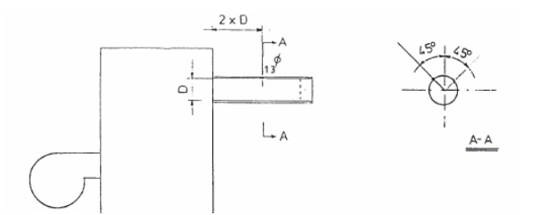
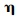
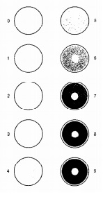
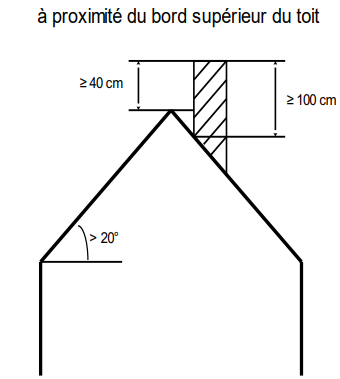
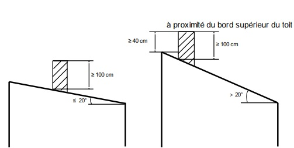
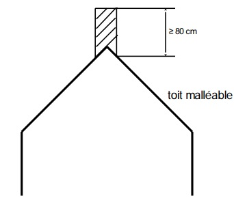
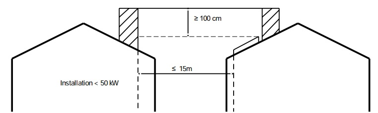
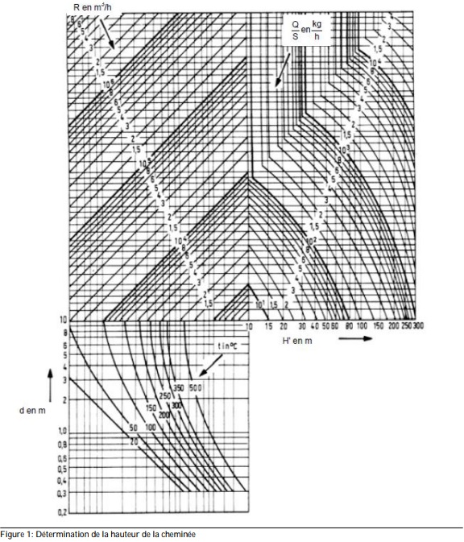
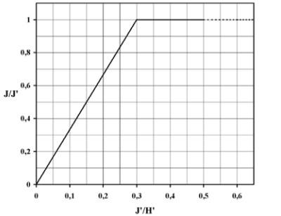
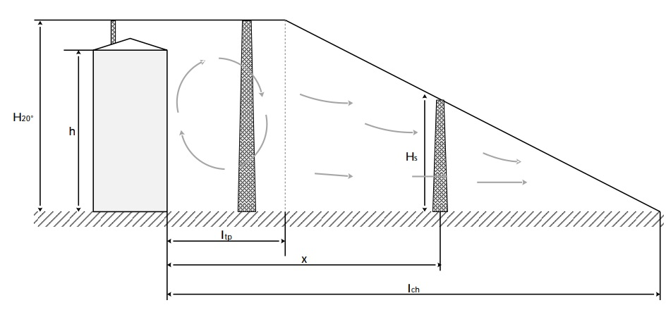

# Règlement grand-ducal du 7 octobre 2014 relatif\n a) aux installations de combustion alimentées en combustible solide ou liquide d’une puissance nominale utile supérieure à 7 kW et inférieure à 20 MW\nb) aux installations de combustion alimentées en combustible gazeux d’une puissance nominale utile supérieure à 3 MW et inférieure à 20 MW.

Nous Henri, Grand-Duc de Luxembourg, Duc de Nassau,

Vu l’article 2 de la [loi modifiée du 21 juin 1976](https://legilux.public.lu/eli/etat/leg/loi/1976/06/21/n1/jo) relative à la lutte contre la pollution de l’atmosphère;

Vu les articles 14, 16, 17, 18 et 20 paragraphe 2 de la [directive 2010/31/UE](https://legilux.public.lu/eli/dir_ue/2010/31/jo) du Parlement européen et du Conseil du 19 mai 2010 sur la performance énergétique des bâtiments;

Vu les avis de la Chambre des métiers, de la Chambre de commerce et de la Chambre des salariés;

Notre Conseil d’État entendu;

Sur rapport de Notre Ministre de l’Environnement et après délibération du Gouvernement en conseil;

Arrêtons:

## Titre I — GÉNÉRALITÉS

### Art. 1er — Objet

(1) Le présent règlement s’applique aux

aash installations de combustion fixes alimentées en combustible solide à chargement manuel ou à chargement automatisé ayant une puissance nominale utile supérieure à 7 kW et inférieure à 20 MW;

bash installations de combustion fixes alimentées en combustible liquide ayant une puissance nominale utile supérieure à 7 kW et inférieure à 20 MW;

cash installations de combustion fixes alimentées en combustible gazeux ayant une puissance nominale utile supérieure à 3 MW et inférieure à 20 MW,

quelle que soit l’affection des locaux où sont comprises ces installations qui sont dénommées ci-après «installation(s)».

(2) Le présent règlement s’applique également aux chauffages de locaux non raccordés au circuit de chauffage, indépendamment de leur puissance nominale utile et quelle que soit l’affectation des locaux où sont compris ces chauffages.

(3) Le présent règlement ne s’applique pas:

aash aux cheminées ouvertes;

bash aux installations destinées au séchage ou à la cuisson de produits par contact direct avec les gaz de combustion.

### Art. 2 — Définition

Au sens du présent règlement, on entend par:

1\) «agent de réception»:

la personne physique du service compétent de la Chambre des métiers agréée dans le cadre de la [loi du 21 avril 1993](https://legilux.public.lu/eli/etat/leg/loi/1993/04/21/n3/jo) relative à l’agrément de personnes physiques ou morales privées ou publiques, autres que l’État, pour l’accomplissement de tâches techniques, d’études et de vérification dans le domaine de l’environnement, pour procéder aux opérations de réception d’une installation;

2\) «bâtiment»:

une construction dotée d’un toit et de murs, dans laquelle l’énergie est utilisée pour réguler le climat intérieur;

3\) «bois non traité»:

un bois à l’état naturel qui a subi exclusivement un traitement mécanique;

4\) «chauffage de locaux non raccordé au circuit de chauffage»:

un fourneau individuel ou un chauffage par air chaud pulsé destiné à chauffer une seule ou plusieurs pièces sans être raccordé au circuit de chauffage, notamment les poêles à bûche, les poêles à pellets, les fourneaux, les inserts de cheminée;

5\) «certificat de contrôleur pour chauffages»:

l’habilitation conférée par le ministre ayant l’Environnement dans ses attributions, dénommé ci-après «ministre», à un candidat contrôleur pour les installations d’une puissance supérieure à 7 kW et inférieure ou égale à 3 MW visées par le règlement;

6\) «certificat constructeur»:

la documentation délivrée par le constructeur avec l’installation contenant toutes les spécifications relatives à l’installation dont le débit des polluants atmosphériques tel qu’il a été déterminé suivant des méthodes standardisées au banc d’essai;

7\) «contrôleur»:

la personne physique agissant en nom propre ou agissant pour une personne morale:

aash pouvant justifier ou bien d’une formation professionnelle du diplôme d’aptitude professionnelle (DAP) dans le métier concerné ou dans une branche d’activité apparentée ou bien d’une formation technique supérieure au certificat précité, à condition toutefois que ces formations aient été complétées par l’acquisition des connaissances spéciales requises pour l’exécution, suivant les règles de l’art, les travaux visés par les articles 5 et 18;

bash étant porteur d’un certificat de contrôleur établi par le ministre conformément à l’article 18, paragraphe (6);

8\) «entreprise»:

la personne physique ou morale établie au Luxembourg comme installateur chauffage-sanitaire, conformément à la législation en matière d’établissement, ou par une entreprise de droit étranger, exerçant légalement au Luxembourg des services dans le domaine du chauffage-sanitaire;

9\) «exploitant»:

le propriétaire ou le locataire d’un bâtiment dans lequel sont utilisées les installations;

10\) «gasoil»:

tout mélange d’hydrocarbures d’origine minérale ou de synthèse dont la teneur en soufre n’excède pas la valeur limite fixée par la réglementation en vigueur;

11\) «inspection périodique»:

aash nonobstant des travaux d’entretien, le contrôle périodique des paramètres prescrits,

bash et, le cas échéant, les réglages immédiats qui s’avèrent nécessaires pour assurer le bon fonctionnement de l’installation;

12\) «inspection périodique positive»:

la conformité des valeurs mesurées lors de l’inspection périodique avec les paramètres prescrits ;

13\) «inspection périodique négative»:

la non-conformité des valeurs mesurées lors de l’inspection périodique avec les paramètres prescrits;

14\) «installation»:

l’ensemble corps de chaudière-brûleur servant à des fins de combustion et raccordé à un circuit de chauffage, consommant des combustibles solides, liquides ou gazeux et comportant des générateurs de vapeur, d’eau chaude, d’eau surchauffée, d’air chaud ou d’autres fluides caloporteurs. L’installation est composée d’une unité de combustion, et le cas échéant, d’un système d’amenée d’air de combustion et d’un système d’évacuation des gaz de combustion.

15\) «installation existante»:

toute installation mise en service avant l’entrée en vigueur du présent règlement;

16\) «nouvelle installation»:

toute installation:

qui est mise en service ou qui a fait l’objet d’une transformation importante après l’entrée en vigueur du présent règlement;

qui a été mise en service ou qui a fait l’objet d’une transformation importante avant l’entrée en vigueur du présent règlement et dont la réception n’a pas encore été demandée au moment de cette entrée en vigueur;

qui a été mise en service avant l’entrée en vigueur du présent règlement et qui fait l’objet d’une transformation importante après cette entrée en vigueur;

17\) «personne agréée»:

la personne titulaire d’un agrément dans le cadre de la [loi du 21 avril 1993](https://legilux.public.lu/eli/etat/leg/loi/1993/04/21/n3/jo) relative à l’agrément de personnes physiques ou morales privées ou publiques, autres que l’État, pour l’accomplissement de tâches techniques d’études et de vérification dans le domaine de l’environnement;

18\) «oxydes d’azote NOx »:

le monoxyde et le dioxyde d’azote qui sont exprimés en dioxyde d’azote;

19\) «puissance nominale utile»:

la puissance calorifique maximale, exprimée en kW ou en MW, fixée et garantie par le constructeur comme pouvant être fournie en marche continue tout en respectant les rendements utiles annoncés par le constructeur, désignée ci-après «puissance»;

20\) «réception»:

le contrôle unique de l’installation et des paramètres prescrits qui intervient:

après la mise en service d’une nouvelle installation;

ou après une transformation importante d’une installation existante.

21\) «réception positive»:

la conformité des valeurs mesurées lors de la réception avec les paramètres;

22\) «réception négative»:

la non-conformité des valeurs mesurées lors de la réception avec les paramètres prescrits par les articles ci-après;

23\) «taux d’humidité résiduelle»:

La masse d’eau contenue dans le combustible par rapport à la masse du combustible sec;

24\) «transformation importante»:

aash la transformation d’une unité de combustion par le remplaçant de la chaudière ou du brûleur ou l’extension d’une installation.

### Art. 3 — Déclaration de mise hors service

La mise hors service d’une installation doit être déclarée auprès de l’Administration de l’environnement, dénommée ci-après «administration», par l’entreprise qui procède au démontage. Le formulaire dûment complété selon l’annexe X doit être transmis à l’administration dans un délai de 2 semaines suivant le démontage. La transmission peut se faire sur base d’un formulaire électronique mis à disposition par l’administration.

### Art. 4 — Combustibles

Dans les installations, seuls les combustibles suivants peuvent être utilisés, sous réserve que le constructeur les a déclarés compatibles pour l’installation concernée:

I) combustibles solides:

1\) charbon de bois, briquettes de charbon de bois, briquettes de lignette, briquettes de houille, anthracite;

2\) briquettes de tourbe;

3\) bois en morceau non traité et avec ou sans écorce sous forme de bûches de bois, plaquettes, brindilles, copeaux et copeaux de laminage;

4\) bois non traité sous forme de sciures de bois, poussières ou écorce;

5\) comprimés de bois non traité sous forme de briquettes ou sous forme de pellets qui ont été fabriqués exclusivement à l’aide d’un adhésif naturel;

6\) pailles ou autres substances végétales et, le cas échéant, des comprimés à base de pailles ou d’autres substances végétales.

II) combustibles liquides:

7\) gasoil qui n’a pas servi auparavant à d’autres fins et dont la teneur en soufre n’excède pas la limite fixée par le [règlement grand-ducal modifié du 21 février 2000](https://legilux.public.lu/eli/etat/leg/rgd/2000/02/21/n2/jo) concernant la teneur en soufre de certains combustibles liquides;

8\) méthanol, éthanol, huiles végétales en état naturel ou le méthylester d’huiles végétales.

Seuls les bioliquides pour lesquels il est certifié, au sens du [règlement grand-ducal du 27 février 2011](https://legilux.public.lu/eli/etat/leg/rgd/2011/02/27/n1/jo) fixant les critères de durabilité pour les biocarburants et les bioliquides qu’ils respectent les critères de durabilité y prévus, peuvent être utilisés comme combustible.

III) combustibles gazeux:

9\) gaz naturel, gaz de pétrole liquéfié (GPL, propane, butane), hydrogène, gaz de digestion ou biogaz.

### Art. 5 — Modalités de mesurage

(1) Installations ayant une puissance inférieure à 1 MW:

Lors de la réception et des inspections périodiques, trois mesures au moins sont effectuées.

Les valeurs limites des émissions sont considérées comme respectées si aucune mesure n’a montré le dépassement des valeurs limites respectives. Les mesures des paramètres d’exploitation d’une installation alimentée en combustible solide sont effectuées par application de la méthode décrite par l’annexe III.

(2) Installations ayant une puissance supérieure ou égale à 1 MW et inférieure à 10 MW:

a) Les valeurs calculées des rejets de polluants sont déterminées en moyennes semi-horaires. Dans la mesure du possible, les mesures sont effectuées à charge minimale, moyenne et à pleine charge;

b) Pour les mesures qui accompagnent le contrôle de réception et pour les mesures ultérieures, les valeurs limites d’émissions sont considérées comme respectées si aucune des moyennes déterminées au sens du point a) ne dépasse les valeurs limites respectives;

c) Des dispositifs de prélèvement facilement accessibles doivent être prévus sur chaque unité d’évacuation à un endroit approprié permettant la prise d’échantillons selon les règles de l’art. L’accès vers ces points de contrôle doit être aisément accessible et permettre des interventions en toute sécurité.

(3) Installations ayant une puissance supérieure ou égale à 10 MW et inférieure à 20 MW:

Dans le cas de mesures en continu des émissions de poussière et d’oxydes d’azote, les valeurs limites sont considérées comme respectées, si au cours d’une année civile:

aash aucune moyenne journalière n’est supérieure à la valeur limite;

bash 97% de toutes les moyennes semi-horaires n’excèdent pas 1,2 fois les valeurs limites respectives;

cash aucune des moyennes semi-horaires ne dépasse le double des valeurs limites respectives.

Les mesures effectuées au cours du contrôle annuel du bon fonctionnement des dispositifs de mesure en continu sont effectuées, à charge minimale, moyenne et à pleine charge.

(4) Le respect des valeurs limites est à vérifier suivant les méthodes énumérées aux annexes II, III, IV, V et XVII.

## Titre II — PRESCRIPTIONS RELATIVES A LA MISE EN PLACE ET A L’EXPLOITATION

### Chapitre Ier — Installations à combustible solide

#### Art. 6 — Prescriptions relatives aux combustibles solides

(1) Le taux d’humidité résiduelle des combustibles visés aux points 3), 4), 5) et 6) de l’article 4 doit être inférieur à 25 %.

(2) Par dérogation au paragraphe 1er, sont exclues de cette limite les installations à chargement automatique qui sont conçues par le constructeur pour un taux d’humidité supérieur à 25%.

#### Art. 7 — Prescriptions de combustion pour les chauffages de locaux non raccordés au circuit de chauffage

Les chauffages de locaux non raccordés au circuit de chauffage doivent être conformes aux valeurs limites d’émissions de l’annexe I.

#### Art. 8 — Prescriptions de combustion pour les installations à combustible solide d’une puissance supérieure à 7 kW et inférieure à 1 MW

(1) À l’exception des chauffages de locaux non raccordés au circuit de chauffage, les installations à combustible solide d’une puissance supérieure à 7 kW et inférieure à 1 MW doivent avoir un rendement de combustion au moins égal à 85%. Le rendement de combustion est exprimé et calculé par application de la méthode décrite à l’annexe IV.

(2) Les installations visées au paragraphe 1er ne peuvent être exploitées que si les valeurs limites ne sont pas dépassées.

Les nouvelles installations visées au paragraphe 1er ne peuvent être exploitées que s’il est certifié par le constructeur que les valeurs limites en poussières ne sont pas dépassées. Le respect de la valeur limite pour les émissions de poussières est à démontrer par certificat constructeur.

1\. installations à combustible solide mises en service avant le 1er janvier 2016

> <table>
> <tr>
> <td colspan="3"><b>Installations existantes</b></td>
> </tr>
> <tr>
> <td><b>Combustible selon l’article 4</b></td>
> <td><b>Puissance [kW]</b></td>
> <td><b>CO [mg/m3]</b></td>
> </tr>
> <tr>
> <td>1 et 2</td>
> <td>>7<1000</td>
> <td>2000</td>
> </tr>
> <tr>
> <td rowspan="4">3, 4 et 5</td>
> <td>>7≤50</td>
> <td>4000</td>
> </tr>
> <tr>
> <td>>50≤150</td>
> <td>2000</td>
> </tr>
> <tr>
> <td>>150≤500</td>
> <td>1000</td>
> </tr>
> <tr>
> <td>>500<1000</td>
> <td>500</td>
> </tr>
> <tr>
> <td rowspan="2">6</td>
> <td>>7≤500</td>
> <td>4000</td>
> </tr>
> <tr>
> <td>>500<1000</td>
> <td>2000</td>
> </tr>
> </table>

> <table>
> <tr>
> <td colspan="4"><b>Nouvelles installations</b></td>
> </tr>
> <tr>
> <td><b>Combustible selon l’article 4</b></td>
> <td><b>Puissance [kW]</b></td>
> <td><b>Poussière [mg/m3]</b></td>
> <td><b>CO [mg/m3]</b></td>
> </tr>
> <tr>
> <td rowspan="2">1 et 2</td>
> <td>>7≤500</td>
> <td>90</td>
> <td>1000</td>
> </tr>
> <tr>
> <td>>500<1000</td>
> <td>90</td>
> <td>500</td>
> </tr>
> <tr>
> <td rowspan="2">3 et 4</td>
> <td>>7≤500</td>
> <td>100</td>
> <td>1000</td>
> </tr>
> <tr>
> <td>>500<1000</td>
> <td>100</td>
> <td>500</td>
> </tr>
> <tr>
> <td rowspan="2">5</td>
> <td>>7≤500</td>
> <td>60</td>
> <td>800</td>
> </tr>
> <tr>
> <td>>500<1000</td>
> <td>60</td>
> <td>500</td>
> </tr>
> <tr>
> <td>6</td>
> <td>>7<1000</td>
> <td>100</td>
> <td>250</td>
> </tr>
> </table>

2\. installations à combustible solide mises en service à compter du 1er janvier 2016

> | **Combustible selon l’article 4** | **Puissance [kW]** | **Poussière [mg/m3]** | **CO [mg/m3]** |
> |---|---|---|---|
> | 1 -6 | >7<1000 | 30 | 400 |

Les valeurs limites se rapportent à une teneur en oxygène des effluents gazeux de 13%.

(3) Les nouvelles installations visées au paragraphe 1er ne peuvent être exploitées que s’il est certifié par le constructeur que la valeur limite de 400 mg/m3 en oxydes d’azote n’est pas dépassée.

(4) Les installations visées au paragraphe 1er et qui sont étagées pour bûches de bois doivent être équipées d’un réservoir tampon ayant une capacité minimale de 55 L/kW.

#### Art. 9 — Prescriptions de combustion pour les installations à combustible solide d’une puissance supérieure ou égale à 1 MW et inférieure à 20 MW

(1) Les nouvelles installations à combustible solide d’une puissance supérieure ou égale à 1 MW et inférieure à 20 MW doivent avoir un rendement de combustion au moins égal à 90%. Le rendement de combustion est exprimé et calculé par application de la méthode décrite à l’annexe IV.

(2) Les installations visées au paragraphe 1er sont exploitées de façon à ce que les valeurs limites pour les émissions de poussière, du monoxyde de carbone et des oxydes d’azote ne soient pas dépassées:

<table>
<tr>
<td><b>Combustible selon article 4</b></td>
<td><b>Puissance [MW]</b></td>
<td><b>Poussière [mg/m3]</b></td>
<td><b>CO [mg/m3]</b></td>
<td><b>NOx [mg/m3]</b></td>
</tr>
<tr>
<td rowspan="3">1<i>a)</i> et 2<i>b)*</i>, c)*</td>
<td>≥1<5</td>
<td>20</td>
<td>150</td>
<td>500</td>
</tr>
<tr>
<td>≥5<10</td>
<td>20</td>
<td>150</td>
<td>500</td>
</tr>
<tr>
<td>≥10<20</td>
<td>20</td>
<td>150</td>
<td>400</td>
</tr>
<tr>
<td rowspan="2">3<i>c)</i>, 4<i>c)</i> et 5<i>c)</i></td>
<td>≥1<5</td>
<td>20</td>
<td>150</td>
<td>250</td>
</tr>
<tr>
<td>>5<20</td>
<td>20</td>
<td>150</td>
<td>250</td>
</tr>
<tr>
<td>6<i>c)</i></td>
<td>≥1<20</td>
<td>20</td>
<td>250</td>
<td>400</td>
</tr>
</table>

a) Les installations équipées d’une chaudière à lit fluidisé circulant ne doivent pas dépasser la valeur de 150 mg/m3 en oxydes d’azote.

Les valeurs limites se rapportent à une teneur en oxygène des effluents gazeux de 7%.

b) Les installations équipées d’une chaudière à lit fluidisé circulant ne doivent pas dépasser la valeur de 300 mg/m3 en oxydes d’azote.

c) Les valeurs limites se rapportent à une teneur en oxygène des effluents gazeux de 11%.

(3) Les installations visées au paragraphe 1er qui sont équipées d’un dispositif de dénitrification ne doivent pas dépasser la valeur de 30 mg/m3 pour l’ammoniac et les composés d’ammonium.

(4) Les installations visées au paragraphe 1er qui brûlent du bois non traité et de la paille sont exploitées de façon à ce que les émissions de substances organiques, exprimées en carbone organique total, ne dépassent pas la valeur de:

aash 10 mg/m3 pour le bois non traité;

bash 50 mg/m3 pour la paille.

(5) Les installations visées au paragraphe 1er alimentées en combustibles énumérés par l’article 4, points I)1) et I)2) sont à exploitées de façon à ce que les émissions de dioxyde et trioxyde de soufre, exprimés en tant que dioxyde de soufre, ne dépasse pas la valeur de:

aash 350 mg/m3 pour les installations équipées d’une chaudière à lit fluidisé circulant;

bash 1000 mg/m3 pour les installations équipées d’une autre chaudière.

### Chapitre II — Installations à combustible liquide

#### Art. 10 — Prescriptions de combustion pour les installations à combustible liquide d’une puissance supérieure à 7 kW et inférieure à 1 MW

(1) Les installations à combustible liquide d’une puissance supérieure à 7 kW et inférieure ou égale à 50 kW doivent avoir un rendement de combustion au moins égal à 90%.

Les installations à combustible liquide d’une puissance supérieure à 50 kW et inférieure à 1 MW doivent avoir un rendement de combustion au moins égal à 91%.

Le rendement de combustion est exprimé et calculé par application de la méthode décrite à l’annexe IV.

(2) L’indice de suie des installations visées au paragraphe 1er, exprimé et mesuré par application de la méthode décrite à l’annexe V, ne doit pas dépasser sur l’échelle de comparaison des gris:

aash la valeur 1, pour les nouvelles installations visées au paragraphe 1er;

bash la valeur 2, pour les installations existantes visées au paragraphe 1er.

(3) La combustion des installations visées au paragraphe 1er doit être telle que dans le dépôt de suie retenue sur le filtre manipulé conformément à l’annexe V, l’on ne décèle pas d’huile ou des particules d’huile incomplètement brûlées.

(4) La teneur en monoxyde de carbone des installations visées au paragraphe 1er ne doit pas dépasser la valeur de 1350 mg/m3 .

(5) Les nouvelles installations visées au paragraphe 1er ne peuvent être exploitées que s’il est certifié par le constructeur que les valeurs limites en oxydes d’azote suivantes ne sont pas dépassées:

| **Puissance [kW]** | **NOx [mg/kWh]** |
|---|---|
| ≤120 | 110 |
| > 120≤500 | 120 |
| >500 < 1000 | 185 |

Les valeurs limites se rapportent à une teneur en oxygène des effluents gazeux de 3%.

#### Art. 11 — Prescriptions de combustion pour les installations à combustible liquide d’une puissance supérieure ou égale à 1 MW et inférieure à 20 MW

(1) Les installations à combustible liquide d’une puissance supérieure ou égale à 1 MW et inférieure à 20 MW doivent avoir un rendement de combustion au moins égal à 91%.

Le rendement de combustion est exprimé et calculé par application de la méthode décrite à l’annexe IV.

(2) L’indice de suie des installations visées au paragraphe 1er, exprimé et mesuré par application de la méthode décrite à l’annexe V, ne doit pas dépasser sur l’échelle de comparaison des gris la valeur 1.

(3) La combustion des installations visées au paragraphe 1er doit être telle que dans le dépôt de suie retenue sur le filtre manipulé conformément à l’annexe V, l’on ne décèle pas d’huile ou des particules d’huile incomplètement brûlées.

(4) La teneur en monoxyde de carbone des installations visées au paragraphe 1er ne doit pas dépasser la valeur de 80 mg/m3 .

(5) Les installations visées au paragraphe 1er sont exploitées de façon à ce que la concentration des émissions des oxydes d’azote ne dépasse pas les valeurs;

aash 180 mg/m3 pour une température d’exploitation inférieure à 110 °C;

bash 200 mg/m3 pour une température d’exploitation entre 110 °C et 210 °C;

cash 250 mg/m3 pour une température d’exploitation supérieure à 210 °C.

(6) Les installations visées au paragraphe 1er qui sont équipées d’un dispositif de dénitrification ne doivent pas dépasser la valeur de 30mg/m3 pour l’ammoniac et les composés d’ammonium.

Les valeurs limites se rapportent à une teneur en oxygène des effluents gazeux de 3%.

### Chapitre III — Installations à combustible gazeux

#### Art. 12 — Prescriptions de combustion pour les installations à combustible gazeux d’une puissance supérieure à 3 MW et inférieure à 20 MW

(1) Les installations à combustible gazeux d’une puissance supérieure à 3 MW et inférieure à 20 MW doivent avoir un rendement de combustion au moins égal à 91%.

Le rendement de combustion est exprimé et calculé par application de la méthode décrite à l’annexe IV.

(2) Les installations visées au paragraphe 1er qui utilisent des gaz de digestion ou du biogaz sont exploitées de façon à ce que la concentration des émissions des particules solides ne dépasse pas 5 mg/m3.

(3) Les concentrations en monoxyde de carbone des installations visées au paragraphe 1er ne doivent pas dépasser 50 mg/m3 .

(4) Les installations visées au paragraphe 1er sont exploitées de façon à ce que la concentration des émissions des oxydes d’azote ne dépasse pas les valeurs :

aash 100 mg/m3 pour une température d’exploitation inférieure à 110 °C;

bash 110 mg/m3 pour une température d’exploitation entre 110 et 210°C;

cash 150 mg/m3 pour une température d’exploitation supérieure à 210°C.

Les valeurs limites se rapportent à une teneur en oxygène des effluents gazeux de 3%.

(5) Les installations visées au paragraphe 1er qui sont équipées d’un dispositif de dénitrification ne doivent pas dépasser la valeur de 30mg/m3 pour l’ammoniac et les composés d’ammonium.

### Chapitre IV — Cheminées

#### Art. 13 — Exigences relatives aux cheminées d’installations à combustible solide ou liquide d’une puissance supérieure à 7 kW et inférieure à 1 MW

(1) Les cheminées d’installations à combustible solide ou liquide d’une puissance supérieure à 7 kW et inférieure à 1 MW ainsi que les cheminées des chauffages de locaux non raccordés au circuit de chauffage doivent correspondre aux exigences suivantes, illustrées à l’annexe VI:

1\. Dans le cas d’une toiture inclinée:

a) Les cheminées destinées à être intégrées ou annexées à des immeubles ayant une toiture avec une inclinaison supérieure à 20° sont construites à proximité du faîtage.

b) Pour les toitures à deux ou plusieurs versants (Giebeldach) l’ouverture de la cheminée doit dépasser le faîtage d’au moins 40 cm ou la surface de la toiture d’au moins 100 cm.

c) Pour les toitures en appentis (Pultdach):

i) ≤ 20°, l’ouverture de la cheminée doit être distante d’au moins 100 cm de la surface de la toiture;

ii) > 20°, l’ouverture de la cheminée doit dépasser le faîtage d’au moins 40 cm ou la surface de la toiture d’au moins 100 cm.

2\. Dans le cas d’un toit malléable, la cheminée sort du faîtage et dépasse celui-ci de 80 cm.

(2) Les cheminées des installations visées au paragraphe 1er d’une puissance allant jusqu’à 50 kW, distantes de moins de 15 m d’une ouverture d’aération, de fenêtres ou de portes, doivent dépasser le bord supérieur de celles-ci d’au moins 100 cm.

Pour chaque tranche de 50 kW supplémentaire, il faut ajouter 2 m au rayon. Le rayon maximal est limité à 40 m.

(3) Le présent article ne s’applique pas aux cheminées existantes des installations visées au paragraphe 1er.

#### Art. 14 — Exigences relatives aux cheminées des installations à combustible liquide ou solide d’une puissance supérieure ou égale à 1 MW et inférieure à 20 MW et aux cheminées des installations à combustible gazeux d’une puissance supérieure à 3 MW et inférieure à 20 MW

(1) Les émissions des cheminées des installations à combustible liquide ou solide d’une puissance supérieure ou égale à 1 MW et inférieure à 20 MW et des cheminées des installations à combustible gazeux d’une puissance supérieure à 3 MW et inférieure à 20 MW sont évacuées de façon que la diffusion dans l’air, circulant librement, est garantie. Des caches sur les cheminées ne sont pas admissibles.

(2) La hauteur minimale des hautes cheminées des installations visées au paragraphe 1er est déterminée par les méthodes décrites à l’annexe VII.

## Titre III — RÉCEPTION DES INSTALLATIONS

### Chapitre Ier — Réception des installations ayant une puissance inférieure ou égale à 3 MW

#### Art. 15 — Réception des installations à combustible solide ou liquide d’une puissance supérieure à 7 kW et inférieure ou égale à 3 MW

(1) À l’exception des chauffages de locaux non raccordés au circuit de chauffage, les nouvelles installations à combustible solide ou liquide d’une puissance supérieure à 7 kW et inférieure ou égale à 3 MW sont soumises, sur demande préalable d’une entreprise, à une réception.

(2) L’entreprise ayant procédé à la mise en service d’une installation visée au paragraphe 1er est tenue d’introduire auprès du service compétent de la Chambre des métiers la demande de réception dans un délai de quatre semaines après la mise en service de l’installation. Une copie de la demande de réception est transmise immédiatement par la Chambre des métiers à l’administration. La transmission peut se faire sous forme électronique.

(3) La réception est effectuée par les agents de réception dans un délai de trois mois à compter de l’introduction de la demande.

(4) L’agent de réception procède au contrôle des paramètres prescrits par les articles 6, 8, 9, 10 ou 11, y compris à une mesure des émissions de poussières des installations de combustion à combustible solide, et par les articles 13 ou 14.

Les points à contrôler sont repris à l’annexe XVI.

(5) Lorsque la réception est positive, l’agent de réception qui y a procédé transmet immédiatement à l’exploitant de l’installation visée au paragraphe 1er un rapport de réception, dûment complété et conforme aux spécifications de l’annexe XI et transmet dans la quinzaine de la date de la réception une copie de ce rapport à l’administration. La transmission peut se faire sur base d’un formulaire électronique mis à disposition par l’administration.

Lorsque l’agent de réception constate une ou plusieurs non-conformité(s) reprise(s) au chapitre 2 de l’annexe XVI, il marque cette ou ces non-conformité(s) en tant qu’éléments à surveiller sur le rapport de réception. Ce rapport est transmis immédiatement à l’exploitant de l’installation visée au paragraphe 1er ainsi qu’en copie dans la quinzaine de la date de la réception à l’administration. La transmission peut se faire sur base d’un formulaire électronique mis à disposition par l’administration.

Le constat d’une ou plusieurs non-conformité(s) reprise(s) au chapitre 2 de l’annexe XVI ne donne pas lieu à une réception négative, suivie d’une nouvelle réception. Ce constat donne lieu à une attention particulière à apporter aux éléments à surveiller lors des interventions subséquentes à l’installation en question.

Lorsque la réception est négative, l’agent de réception qui y a procédé marque la non-conformité sur le rapport de réception ainsi que la ou les cause(s) probable(s) de cette non-conformité. Les éléments menant, en cas de nonconformité, à une réception négative sont repris au chapitre 1 de l’annexe XVI. II transmet immédiatement ce rapport à l’exploitant de l’installation visée au paragraphe 1er et le transmet en copie dans la quinzaine à l’administration. La transmission peut se faire sur base d’un formulaire électronique mis à disposition par l’administration.

Si de simples opérations d’entretien de l’installation visée au paragraphe 1er peuvent remédier à la non-conformité, l’exploitant dispose d’un délai d’un mois pour y faire procéder.

Si une transformation importante de l’installation visée au paragraphe 1er est nécessaire, l’exploitant dispose d’un délai de six mois pour y faire procéder.

Endéans les délais précités, ces opérations donnent lieu à une nouvelle réception. Au cas où cette nouvelle réception n’est pas effectuée ou donne lieu à un résultat négatif, l’installation visée au paragraphe 1er est réputée ne pas satisfaire aux dispositions du présent règlement et ne peut être maintenue en service.

#### Art. 16 — Conseils aux exploitants

Lors de la réception d’une installation visée à l’article 15, l’agent de réception donne des conseils à l’exploitant sur les points suivants:

aash le combustible à utiliser;

bash le stockage approprié du combustible;

cash dans le cas d’un combustible solide, le grade de sécheresse du combustible;

dash les consignes de sécurité.

### Chapitre II — Réception des installations ayant une puissance supérieure à 3 MW

#### Art. 17 — Réception des installations à combustible solide, liquide et gazeux d’une puissance supérieure à 3 MW et inférieure à 20 MW

(1) Les nouvelles installations à combustible solide, liquide et gazeux d’une puissance supérieure à 3 MW et inférieure à 20 MW sont soumises à une réception.

(2) L’exploitant est tenu d’introduire auprès de l’administration au moins un mois avant la mise en service de l’installation visée au paragraphe 1er une déclaration de mise en service contenant toutes les informations requises par l’annexe XII. La déclaration peut se faire sur base d’un formulaire électronique mis à la disposition par l’administration.

Au moins une semaine avant de procéder à une prise d’échantillons, la personne agréée présente à l’administration un plan détaillé ainsi que le calendrier des mesures. La présentation peut se faire sous forme électronique.

(3) La réception est effectuée dans un délai d’un mois à compter de la mise en service de l’installation visée au paragraphe 1er.

La personne agréée procède au contrôle des paramètres prescrits par les articles 9, 11 ou 12 et par l’article 14.

(4) Lorsque la réception est positive, la personne agréée qui y a procédé transmet dans le délai d’un mois à l’exploitant et à l’administration un rapport de réception contenant toutes les informations requises par l’annexe XIII et indiquant la conformité de l’installation. La transmission peut se faire sur base d’un formulaire électronique mis à disposition par l’administration.

Lorsque la réception est négative, l’exploitant de l’installation est tenu d’établir dans un délai d’un mois une prise de position détaillée relative aux conclusions et recommandations de la personne agréée. Cette prise de position doit également comprendre un échéancier précis dans lequel l’exploitant entend se conformer aux exigences du présent règlement. En cas de défaut, l’installation est réputée ne pas satisfaire aux dispositions du présent règlement et ne peut être maintenue en service.

La prise de position, accompagnée d’une copie du rapport en question, est transmise immédiatement par la personne agréée à l’administration. La transmission peut se faire sous forme électronique.

La personne agréée est tenue, lors de la réception, de signaler sans délai à l’administration tout défaut, toute nuisance ainsi que toute situation qui constitue ou est susceptible de constituer une atteinte à l’environnement. La signalisation peut se faire sous forme électronique.

## Titre IV — INSPECTION PÉRIODIQUE DES INSTALLATIONS

### Chapitre Ier — Inspection périodique des installations ayant une puissance supérieure à 7 kW et inférieure ou égale à 3 MW

#### Art. 18 — Inspection périodique des installations à combustible solide ou liquide d’une puissance supérieure à 7 kW et inférieure ou égale à 3 MW

(1) À l’exception des chauffages de locaux non raccordés au circuit de chauffage, l’exploitant d’une installation alimentée en combustible solide ou liquide d’une puissance supérieure à 7 kW et inférieure ou égale à 3 MW est tenu de faire procéder à une inspection périodique tous les deux ans.

Lorsqu’un système électronique de surveillance et de contrôle est en place, l’inspection doit avoir lieu tous les 4 ans.

Les dispositions visées à l’alinéa 1er s’appliquent:

1\) pour les nouvelles installations, au plus tard deux ans à compter de la date de réception positive, telle qu’elle figure sur le rapport de réception;

2\) pour les installations existantes, au plus tard deux ans à compter de l’entrée en vigueur du présent règlement.

(2) Cette inspection périodique doit comprendre une évaluation du rendement de la chaudière et de son dimensionnement par rapport aux exigences en matière de chauffage du bâtiment. L’évaluation du dimensionnement de la chaudière ne doit pas être répétée dès lors qu’aucune transformation importante n’a été apportée entretemps au système de chauffage ou en ce qui concerne les exigences en matière de chauffage du bâtiment.

L’inspection périodique comprend également le contrôle des systèmes utilisés pour le chauffage de bâtiments, tels que le générateur de chaleur, le système de contrôle et la/les pompe(s) de circulation.

(3) L’inspection périodique est réalisée soit par un contrôleur employé auprès d’une entreprise, soit par une personne agréée.

(4) Sans préjudice des dispositions de l’article 24, le contrôleur ou la personne agréée vérifie le respect des prescriptions visées aux articles 8, 9, 10 ou 11 et aux articles 13 ou 14.

Les points à contrôler sont repris à l’annexe XVI.

(5) Les inspections périodiques des installations visées au paragraphe 1er sont effectuées à la demande de l’exploitant.

La Chambre des métiers dresse la liste officielle des entreprises qui sont habilitées à procéder à une inspection périodique au sens du présent règlement.

(6) Dans le cadre de ses attributions légales, la Chambre des métiers organise périodiquement une formation spéciale de contrôleur pour les installations visées au paragraphe 1er.

Le contenu de cette formation est déterminé suivant l’évolution technique de la matière et en accord avec le ministre. Cette formation est sanctionnée par un contrôle de connaissances théoriques et pratiques à organiser par la Chambre des métiers.

Le ministre confère l’habilitation à la fonction de contrôleur pour les installations visées au paragraphe 1er.

Cette habilitation est conférée au candidat contrôleur:

1\. qui a accompli la formation prévue à l’alinéa 1 ou une formation équivalente à l’étranger, reconnue par la Chambre des métiers.

2\. qui agit en son nom propre ou qui agit pour une entreprise.

3\. qui dispose des instruments de mesure conformes à l’annexe VIII.

L’habilitation est valable pour une durée de cinq ans. Elle est renouvelable pour des durées consécutives de cinq ans sous condition que le détenteur ait participé avant son expiration à un cours de mise à niveau à organiser par la Chambre des métiers.

Si endéans les quatre ans suivant l’expiration de son habilitation de contrôleur, une personne participe à un cours de mise à niveau à organiser par la Chambre des métiers, elle a droit à son habilitation valable pour une durée de cinq ans, sans devoir se soumettre au cycle de formation complet.

L’habilitation peut être retirée par le ministre si les conditions de son obtention ne sont plus remplies ou le contrôleur ne respecte pas les dispositions prévues par le présent règlement.

L’habilitation est consignée sous forme d’un certificat de contrôleur établi par le ministre.

(7) Lorsque les inspections périodiques sont positives, le contrôleur ou la personne agréée qui y a procédé transmet immédiatement à l’exploitant de l’installation un rapport d’inspection périodique dûment complété et conforme aux spécifications de l’annexe XI et transmet dans la quinzaine de la date de l’inspection périodique une copie du rapport à l’administration. La transmission peut se faire sur base d’un formulaire électronique mis à disposition par l’administration.

Lorsque le contrôleur ou la personne agréée constate une ou plusieurs non-conformité(s) reprise(s) au chapitre 2 de l’annexe XVI, il/elle marque cette ou ces non-conformité(s) en tant qu’éléments à surveiller sur le rapport de l’inspection périodique. Ce rapport est transmis immédiatement à l’exploitant de l’installation visée au paragraphe 1er ainsi qu’en copie dans la quinzaine de la date de l’inspection périodique à l’administration. La transmission peut se faire sur base d’un formulaire électronique mis à disposition par l’administration.

Le constat d’une ou plusieurs non-conformité(s) reprise(s) au chapitre 2 de l’annexe XVI ne donne pas lieu à une inspection périodique négative. Ce constat donne lieu à une attention particulière à apporter aux éléments à surveiller lors des interventions subséquentes à l’installation en question.

Lorsque les inspections périodiques sont négatives, le contrôleur ou la personne agréée qui y a procédé marque la non-conformité sur le rapport d’inspection périodique ainsi que la ou les cause(s) probable(s) de cette non-conformité, transmet immédiatement à l’exploitant de l’installation le rapport dûment complété et conforme et le transmet en copie dans la quinzaine de la date de l’inspection périodique à l’administration. La transmission peut se faire sur base d’un formulaire électronique mis à disposition par l’administration. Les éléments menant, en cas de non-conformité, à une inspection périodique négative sont repris au chapitre 1 de l’annexe XVI.

Si de simples opérations d’entretien de l’installation peuvent remédier à la non-conformité, l’exploitant dispose d’un délai d’un mois pour y faire procéder. Cette opération donne lieu à une nouvelle inspection périodique. Au cas où la nouvelle inspection périodique n’est pas effectuée, l’installation est réputée ne pas satisfaire aux dispositions du présent règlement et ne peut être maintenue en service.

Au cas où cette nouvelle inspection périodique donnerait lieu à un résultat négatif, l’installation doit faire l’objet d’une transformation importante endéans un délai de six mois. Cette transformation importante donne lieu à une nouvelle réception. En cas de défaut, l’installation est réputée ne pas satisfaire aux dispositions du présent règlement et ne peut être maintenue en service.

(8) Le rapport d’inspection périodique comprend des recommandations sur base de l’évaluation dont question au paragraphe (2) pour l’amélioration rentable de la performance énergétique du système inspecté. Ces recommandations peuvent être fondées sur une comparaison de la performance énergétique du système inspecté avec celle du meilleur système disponible réalisable et celle d’un système de type analogue dont tous les composants concernés atteignent le niveau de performance énergétique exigé, selon le type de bâtiment concerné, par le [règlement grand-ducal modifié du 31 août 2010](https://legilux.public.lu/eli/etat/leg/rgd/2010/08/31/n1/jo) concernant la performance énergétique des bâtiments fonctionnels respectivement par le [règlement grand-ducal modifié du 30 novembre 2007](https://legilux.public.lu/eli/etat/leg/rgd/2007/11/30/n7/jo) concernant la performance énergétique des bâtiments d’habitation. En tant que de besoin, l’administration établit un formulaire type de rapport d’inspection sous format électronique.

(9) Les rapports d’inspection font objet d’un contrôle indépendant par l’administration. A cette fin, l’administration sélectionne de manière aléatoire au moins un pourcentage statistiquement significatif de tous les rapports d’inspection établis au cours d’une année donnée et soumet ceux-ci à une vérification.

(10) L’administration veille à ce que des informations sur les rapports d’inspection ainsi que sur leur utilité et leurs objectifs soient fournies en particulier à l’exploitant.

(11) En vue de l’exécution des mesures d’inspection périodique, les contrôleurs ou les personnes agréées sont autorisés à pratiquer une ouverture entre la chaudière et la cheminée suivant les indications de l’annexe II.

(12) Le bon fonctionnement des instruments de mesure utilisés en vue d’effectuer les inspections périodiques doit être contrôlé et certifié, selon les modalités visées à l’annexe VIII, par une personne agréée. Ce contrôle doit être répété tous les deux ans.

### Chapitre II — Inspection périodique des installations ayant une puissance supérieure à 3 MW

#### Art. 19 — Inspection périodique des installations à combustible solide, liquide ou gazeux d’une puissance supérieure à 3 MW et inférieure à 20 MW

(1) La première inspection périodique d’une nouvelle installation d’une puissance supérieure à 3 MW et inférieure à 20 MW est effectuée dans un délai d’un an après réception positive par une personne agréée.

Par la suite, l’inspection périodique de l’ensemble de l’installation est effectuée annuellement par une personne agréée.

Au moins une semaine avant de procéder au mesurage, un plan détaillé ainsi que le calendrier des prises des mesures sont à présenter à l’administration. La présentation peut se faire sous forme électronique.

(2) Cette inspection périodique doit comprendre une évaluation du rendement de la chaudière et de son dimensionnement par rapport aux exigences en matière de chauffage du bâtiment. L’évaluation du dimensionnement de la chaudière ne doit pas être répétée dès lors qu’aucune transformation importante n’a été apportée entre-temps au système de chauffage ou en ce qui concerne les exigences en matière de chauffage du bâtiment.

L’inspection périodique comprend également le contrôle des systèmes utilisés pour le chauffage de bâtiments, tels que le générateur de chaleur, le système de contrôle et la (les) pompe(s) de circulation.

(3) Pour les installations visées au paragraphe 1er, la personne agréée vérifie le respect des prescriptions visées respectivement aux articles 9, 11 ou 12 et à l’article 14.

(4) Lorsque les inspections périodiques sont positives, la personne agréée qui y a procédé transmet dans le délai d’un mois à l’exploitant et à l’administration un rapport d’inspection périodique contenant toutes les informations requises par l’annexe XIII et indiquant la conformité de l’installation. La transmission peut se faire sur base d’un formulaire électronique mis à disposition par l’administration.

Dans le cas où la personne agréée constate une non-conformité, l’exploitant de l’installation est tenu d’établir dans un délai d’un mois une prise de position détaillée relative aux conclusions et recommandations de la personne agréée. Cette prise de position doit également comprendre un échéancier précis dans lequel l’exploitant entend se conformer aux exigences du présent règlement. En cas de défaut, l’installation est réputée ne pas satisfaire aux dispositions du présent règlement et ne peut être maintenue en service.

La prise de position, accompagnée d’une copie du rapport en question, est transmise immédiatement par la personne agréée à l’administration. La transmission peut se faire sous forme électronique.

La personne agréée est tenue lors de l’inspection périodique de signaler sans délai à l’administration tout défaut, toute nuisance ainsi que toute situation qui constitue ou est susceptible de constituer une atteinte à l’environnement.

(5) L’exploitant est tenu de transmettre à l’administration pour le 1er mars au plus tard un rapport annuel contenant toutes les informations requises par l’annexe XV et relatives à l’année écoulée. La transmission peut sur base d’un formulaire électronique mis à disposition par l’administration.

#### Art. 20 — Inspection périodique et calibrage des appareils de mesure en continu d’installations à combustible solide, liquide ou gazeux d’une puissance supérieure ou égale à 10 MW et inférieure à 20 MW

(1) Les nouvelles installations à combustible solide, liquide ou gazeux d’une puissance supérieure ou égale à 10 MW et inférieure à 20 MW doivent être équipées d’un système de mesurage en continu des émissions des poussières et oxydes d’azote.

(2) L’exploitant d’une installation visée au paragraphe 1er doit faire

1\. contrôler annuellement l’ensemble de l’installation, y compris le bon fonctionnement des dispositifs de mesure en continu;

2\. contrôler le calibrage des appareils de mesure en continu:

a) une première fois avant leur mise en service

b) le cas échéant chaque fois qu’un nouveau calibrage s’avère nécessaire; sinon, tous les trois ans.

Cette inspection doit être effectuée par une personne agréée.

Un nouveau calibrage s’avère nécessaire chaque fois qu’une ou plusieurs des composantes du système de mesure est modifiée ou remplacée ou qu’une anomalie de fonctionnement est constatée.

(3) Lorsque le contrôle annuel du fonctionnement des dispositifs de mesure est positif, la personne agréée qui y a procédé transmet dans le mois qui suit le contrôle à l’exploitant et à l’administration un rapport de contrôle contenant toutes les informations requises par l’annexe XIV et indiquant la conformité de l’installation. La transmission peut se faire sur base d’un formulaire électronique mis à disposition par l’administration.

Lorsque le contrôle annuel des appareils de mesure est négatif, la personne agréée qui y a procédé indique la nonconformité dans le rapport d’inspection périodique et informe dans la quinzaine l’exploitant et l’administration de la non-conformité de l’installation. L’information peut se faire sur base d’un formulaire électronique mis à disposition par l’administration.

(4) L’exploitant est tenu de transmettre à l’administration pour le 1er mars au plus tard un rapport annuel contenant toutes les informations requises par l’annexe XV et relatives à l’année écoulée. La transmission peut se faire sur base d’un formulaire électronique mis à disposition par l’administration.

## Titre V — DISPOSITIONS FINALES

### Art. 21 — Registre des installations

L’administration est chargée du recensement des installations à combustible solide, liquide ou gazeux visées par le présent règlement, qui ont été réceptionnées ou qui ont subi une inspection périodique au sens du présent règlement.

### Art. 22 — Frais

(1) Sont à charge des demandeurs les prestations de réception, les prestations d’inspection périodique, de contrôle des dispositifs de mesure en continu et de calibrage de ces derniers.

(2) Le prix maximal de la réception à effectuer par le service compétent de la Chambre des métiers est fixé par convention entre le ministre et la Chambre des métiers.

### Art. 23 — Dispositions abrogatoires

Sous réserve des dispositions de l’article 24 paragraphe (2), le [règlement grand-ducal modifié du 23 décembre 1987](https://legilux.public.lu/eli/etat/leg/rgd/1987/12/23/n5/jo) relatif aux installations alimentées en combustible liquide est abrogé.

Les documents de réception et de révision établis sur base des dispositions réglementaires prises en exécution de l’article 2 de la [modifiée du 21 juin 1976](https://legilux.public.lu/eli/etat/leg/loi/1976/06/21/n1/jo) relative à la lutte contre la pollution de l’atmosphère et applicables avant la prise d’effet du présent règlement gardent la valeur probante qui leur était conférée par ces dispositions réglementaires.

### Art. 24 — Dispositions transitoires

(1) À l’exception des chauffages de locaux non raccordés au circuit de chauffage, toutes les installations existantes à combustible solide d’une puissance inférieure à 1 MW couvertes par le présent règlement, doivent se conformer, selon l’échéancier figurant dans le tableau ci-après, aux prescriptions de combustion applicables pour les nouvelles installations et visées aux articles 8 et 9.

| Date de mise en service | Date limite de mise en conformité |
|---|---|
| jusqu’au 31 décembre 1995 | 1er janvier 2019 |
| du 1er janvier 1996 jusqu’au 31 décembre 2005 | 1er janvier 2023 |
| du 1er janvier 2006 jusqu’à la date d’entrée en vigueur du présent règlement | 1er janvier 2026 |

Si, à l’expiration des délais précités, le respect des prescriptions de combustion en question ne peut être démontré, l’installation est réputée ne pas satisfaire aux dispositions du présent règlement et ne peut être maintenue en service.

(2) Les installations mises en service avant l’entrée en vigueur du présent règlement et pour lesquelles la demande de réception a été introduite avant cette entrée en vigueur, font l’objet d’une réception dans les conditions visées par les articles 10 et 11 du [règlement grand-ducal modifié du 23 décembre 1987](https://legilux.public.lu/eli/etat/leg/rgd/1987/12/23/n5/jo) relatif aux installations alimentées en combustible liquide.

### Art. 25 — Exécution

Notre Ministre de l’Environnement est chargée de l’exécution du présent règlement qui sera publié au Mémorial.

La Ministre de l’Environnement,   Carole Dieschbourg

Palais de Luxembourg, le 7 octobre 2014.   Henri

\**Annexe I**

\**Valeurs limites d’émissions et rendement minimal des chauffages de locaux non raccordés au** **circuit de chauffage**

<table>
<tr>
<td colspan="4"><b>à partir de l’entrée en vigueur du présent règlement</b></td>
</tr>
<tr>
<td><b>Type d’installation</b></td>
<td><b>CO [mg/m3]</b></td>
<td><b>poussière [mg/m3]</b></td>
<td><b>Rendement minimal [%]</b></td>
</tr>
<tr>
<td>Chauffage de locaux pour combustibles solides</td>
<td>2000</td>
<td>75</td>
<td>73</td>
</tr>
<tr>
<td>Chauffage de locaux utilisant des comprimés à bois</td>
<td>400</td>
<td>50</td>
<td>85</td>
</tr>
<tr>
<td>Fourneau individuel pour combustible solide</td>
<td>3000</td>
<td>75</td>
<td>70</td>
</tr>
<tr>
<td>Fourneau de chauffage central pour combustible solide</td>
<td>3500</td>
<td>75</td>
<td>75</td>
</tr>
<tr>
<td>Insert de cheminée fermée</td>
<td>2000</td>
<td>75</td>
<td>75</td>
</tr>
</table>

<table>
<tr>
<td colspan="4"><b>à partir du 1er janvier 2015</b></td>
</tr>
<tr>
<td><b>Type d’installation</b></td>
<td><b>CO [mg/m3]</b></td>
<td><b>poussière [mg/m3]</b></td>
<td><b>Rendement minimal [%]</b></td>
</tr>
<tr>
<td>Chauffage de locaux pour combustibles solides</td>
<td>1250</td>
<td>40</td>
<td>73</td>
</tr>
<tr>
<td>Chauffage de locaux utilisant des comprimés à bois</td>
<td>250</td>
<td>30</td>
<td>85</td>
</tr>
<tr>
<td>Fourneau individuel pour combustible solide</td>
<td>1500</td>
<td>40</td>
<td>70</td>
</tr>
<tr>
<td>Fourneau de chauffage central pour combustible solide</td>
<td>1500</td>
<td>40</td>
<td>75</td>
</tr>
<tr>
<td>Insert de cheminée fermée</td>
<td>1250</td>
<td>40</td>
<td>75</td>
</tr>
</table>

\**Annexe II**

\**Ouverture entre la chaudière et la cheminée**

L’ouverture pour le contrôle à effectuer lors des travaux de réception ou de l’inspection périodique est à percer, dans la mesure du possible, à une distance qui est égale à deux fois le diamètre de la conduite des gaz de combustion à partir de la chaudière et sous un angle de 45 degrés dans la partie supérieure de la conduite, suivant le graphique suivant:

\**Annexe III**

\**Mesurage des émissions des installations à combustible solide**

1\. Les mesures sont à prélever dans le noyau du flux des gaz d’échappement.

2\. Les mesures sont effectuées à la puissance nominale de l’installation ou, le cas échéant, à la puissance la plus haute réglable.

3\. Pour les installations conçues pour une combustion mixte en combustible solide, les mesures sont effectuées lors de la combustion du combustible principal.

4\. La température de la chaudière lors des mesures doit être de 60 °C au moins. Dans le cas d’une installation à chargement manuel, les mesures sont à commencer cinq minutes après observation d’une incandescence suffisante à une inflammation, cédée à la masse de chargement maximale en combustible, indiquée par le constructeur.

5\. Les mesures des émissions sont à prendre simultanément avec les mesures de la teneur en oxygène dans les gaz d’échappement en valeur moyenne d’un quart d’heure.

Les émissions mesurées sont à convertir à la teneur en oxygène de référence selon la relation suivante:

ER=(21−O2R)/(21−O2M)×EM

| avec | ER | = | émissions, référées à la teneur de dioxygène de référence, |
|---|---|---|---|
|  | EM | = | émissions mesurées, |
|  | O2R | = | teneur de dioxygène de référence en pourcentage volumique, |
|  | O2M | = | teneur volumique du dioxygène dans les gaz d’échappement sec. |

6\. Si les mesures sont effectuées à chargement partiel, il est à procéder comme suit:

6.1 S’il s’agit d’une installation sans ventilation, les mesures sont à prendre pendant cinq minutes à volet d’aération ouvert et pendant dix minutes à volet d’aération fermé.

6.2 S’il s’agit d’une installation ayant une ventilation non-automatisée (on/off), les mesures sont à prendre cinq minutes avec ventilation et dix minutes sans ventilation.

6.3 S’il s’agit d’une installation avec ventilation réglable, les mesures sont à prendre pendant quinze minutes à aération diminuée.

\**Annexe IV**

\**Rendement de combustion des installations à combustible solide, liquide ou gazeux**

1\. La formule pour le calcul du rendement de combustion d’après la méthode de mesurage CO2 est la suivante:

η=100−[(tA−tL)×((A1)/(CO2+B))]

|  | = | rendement |
|---|---|---|
| t A | = | température des gaz de combustion en °C |
| tL | = | température de l’air de combustion en °C mesurée au niveau de l’entrée d’aération du brûleur (am Ansaugstutzen gemessen) |
| CO2 | = | dioxyde de carbone en % volume mesuré |
| A1 | = | 0,50 pour gasoil, huile végétale en état naturel, méthylester d’huile végétale |
| B | = | 0,007 pour gasoil, huile végétale en état naturel, méthylester d’huile végétale |

|  | Gasoil | Gaz naturel | Gaz liquéfié |
|---|---|---|---|
| A1 | 0,50 | 0,37 | 0,42 |
| B | 0,007 | 0,009 | 0,008 |

2\. La formule pour le calcul du rendement de combustion d’après la méthode de mesurage O2 est la suivante:

η=100−[(tA−tL)×((A2)/(21−O2)+B)]

|  | = | rendement |
|---|---|---|
| tA | = | température des gaz de combustion en °C |
| tL | = | température de l’air de combustion en °C mesurée au niveau de l’entrée d’aération du brûleur (am Ansaugstutzen gemessen) |
| O2 | = | oxygène en % volume mesure |

|  | **Gasoil** | **Gaz naturel** | **Gaz liquéfié** |
|---|---|---|---|
| A2 | 0,68 | 0,66 | 0,63 |
| B | 0,007 | 0,009 | 0,008 |

<table>
<tr>
<td colspan="7"><b>Biomasse</b></td>
</tr>
<tr>
<td><b>Taux d’humidité</b></td>
<td><b>0%</b></td>
<td><b>10%</b></td>
<td><b>20%</b></td>
<td><b>30%</b></td>
<td><b>40%</b></td>
<td><b>50%</b></td>
</tr>
<tr>
<td>A2</td>
<td>0,657 2</td>
<td>0,668 2</td>
<td>0,682 4</td>
<td>0,701 7</td>
<td>0,729 0</td>
<td>0,770 9</td>
</tr>
<tr>
<td>B</td>
<td>0,008 3</td>
<td>0,010 7</td>
<td>0,012 5</td>
<td>0,0114 9</td>
<td>0,018 3</td>
<td>0,023 5</td>
</tr>
</table>

<table>
<tr>
<td colspan="6"><b>Lignette, tourbe</b></td>
</tr>
<tr>
<td><b>Taux d’humidité</b></td>
<td><b>0%</b></td>
<td><b>10%</b></td>
<td><b>20%</b></td>
<td><b>30%</b></td>
<td><b>40%</b></td>
</tr>
<tr>
<td>A2</td>
<td>0,671 7</td>
<td>0,680 9</td>
<td>0,683 8</td>
<td>0,707 0</td>
<td>0,728 1</td>
</tr>
<tr>
<td>B</td>
<td>0,007 3</td>
<td>0,008 4</td>
<td>0,009 7</td>
<td>0,011 5</td>
<td>0,014 0</td>
</tr>
</table>

<table>
<tr>
<td colspan="6"><b>Houille</b></td>
</tr>
<tr>
<td><b>Taux d’humidité</b></td>
<td><b>0%</b></td>
<td><b>10%</b></td>
<td><b>20%</b></td>
<td><b>30%</b></td>
<td><b>40%</b></td>
</tr>
<tr>
<td>A2</td>
<td>0,690 1</td>
<td>0,693 2</td>
<td>0,696 7</td>
<td>0,700 6</td>
<td>0,705 0</td>
</tr>
<tr>
<td>B</td>
<td>0,005 4</td>
<td>0,005 7</td>
<td>0,006 1</td>
<td>0,006 5</td>
<td>0,006 9</td>
</tr>
</table>

\**Annexe V**

\**Indice de suie**

L’indice de suie est déterminé d’après la méthode suivante:

Une minute après l’allumage du brûleur, une quantité bien définie (1) de gaz de combustion est prise pendant un temps déterminé (2) dans le noyau de flux de ce dernier et aspirée (3) au travers d’une sonde placée face au flux (4) ellemême reliée à un appareil d’aspiration muni d’un papier filtre (5). Le papier filtre exposé (6) est examiné qualitativement en vue de déceler la présence éventuelle de particules huileuses (7) et le noircissement du filtre est comparé (8) à une échelle gris du type Bacharach (9)»

Signification de

(1) «quantité bien définie»

5,75 + 0,25 Nl (litre normal) par cm2 de surface efficace de papier filtre.

(2) «pendant un temps déterminé»

Durée de chaque prélèvement: maximum 5 minutes.

(3) «est aspirée»

Le dispositif de prélèvement doit être conçu de telle manière que

aash la température, à l’avant et au niveau du filtre, ne soit pas inférieure au point de condensation;

bash seuls des dépôts négligeables de substances solides apparaissent en avant du filtre.

(4) «au travers d’une sonde placée au flux»

Les points suivants doivent être observés lors des mesures de fumée:

a) sur le parcours, où s’effectue la mesure, le flux doit être régulier;

b) sur le parcours, l’état du flux ne doit pas être modifié par la prise d’échantillons;

c) aash il faut utiliser comme sonde de prélèvement, un tuyau de métal courbe à l’angle droit aux parois minces (épaisseur inférieure à 1 mm) avec une embouchure aux parois amincies comme une lame;

bash pendant le prélèvement, la vitesse d’aspiration (au niveau de l’embouchure de la sonde) doit toujours être 2 à 3 fois supérieure à la vitesse moyenne du gaz de combustion, exprimé perpendiculairement au plan de mesure. Celle-ci peut être calculée à partir de la capacité de chauffage de l’installation, l’excédent d’air, la pression et la température du gaz de combustion ainsi que la surface du plan de mesure (générale 1 à 3 m/s).

(5) «papier-filtre»

Filtre blanc de cellulose avec une capacité de réflexion de 85-0,25%.

(6) «papier-filtre exposé»

Pour que le papier-filtre exposé puisse être utilisé dans de bonnes conditions pour la détermination de la qualité de suie, les points suivants sont nécessaires:

aash il ne doit pas avoir été humecté par la condensation ou altéré dans sa couleur par l’échauffement

et

aash il devra être noirci régulièrement sur toute la surface.

(7) «examiné qualitativement en vue de déceler la présence éventuelle de particules huileuses»

Outre la suie, on ne doit déceler ou sentir sur le papier-filtre exposé ni huile, ni particules incomplètement brûlées.

(8) «comparée»

Soit par comparaison visuelle directe du papier-filtre avec l’échelle des gris, soit avec un photomètre étalonné au moyen de l’échelle de gris.

(9) «échelle de comparaison des gris»

\**Annexe VI**

\**Détermination de la hauteur minimale de cheminées d’installations à combustible solide ou** **liquide d’une puissance supérieure à 7 kW et inférieure à 1 MW**

1\. Les exigences dont question à l’article 13, paragraphe 1er, point a) i) qui concernent une toiture inclinée, sont illustrées comme suit:

2\. Les exigences dont question à l’article 13, paragraphe 1er, point a) ii) ou iii) qui concernent une toiture inclinée, sont illustrées comme suit:

3\. Les exigences dont question à l’article 13, paragraphe 1er point b) qui concernent un toit malléable, sont illustrées comme suit:

4\. Les exigences dont question à l’article 13, paragraphe (2), sont illustrées comme suit:

\**Annexe VII**

\**Détermination de la hauteur minimale des hautes cheminées**

Si la grandeur Q/S dépasse la valeur de 10 kg/h, la hauteur de la cheminée est déterminée suivant la méthode décrite par le point 2.

Si la grandeur Q/S est inférieure à 10kg/h, la méthode décrite sous le point 1 s’applique. Pour les installations de combustions dont la grandeur Q/S est inférieure à 10 kg/h, un surhaussement de la cheminée en considérant les zones de construction et de végétation n’est pas nécessaire.

Q (kg/h) débit massique des polluants atmosphérique émis;

S facteur pour la détermination de la hauteur de la cheminée. Les valeurs sont reprises par le tableau 1.

\**Tableau 11:** Valeurs S

| Polluant | S |
|---|---|
| poussière | 0,08 |
| monoxydes de carbone | 7,5 |
| oxydes d’azote | 0,1 |

\**1. Hauteur des cheminées des installations de combustion pour lesquelles la grandeur Q/S est inférieure à 10 kg/h**

1.1 Le rejet des gaz de combustion s’effectue en général au-dessus des toits, par une cheminée ou un conduit d’évacuation ayant une hauteur minimale de 10 mètres au-dessus du sol et dépassant le faîtage d’au moins 3 m.

Pour une inclinaison de la toiture de moins de 20°, la hauteur du faîtage se détermine sous prise de base d’une inclinaison de 20° de la toiture.

1.2 Pour déterminer la hauteur du faîtage la largeur du bâtiment (côté étroit) lc est à utiliser. Ainsi la hauteur de la cheminée H20° résulte de la somme de la hauteur du chéneau (hch), la hauteur du toit (ht ) et le dépassement du faîtage de 3 m.

H20° = hch + ht + 3m

ht=(lc)/(2)*tan20∘

<table>
<tr>
<td colspan="2">avec</td>
</tr>
<tr>
<td>H20°</td>
<td>Hauteur de la cheminée sous prise de base d’une inclinaison de 20°</td>
</tr>
<tr>
<td>hch</td>
<td>Hauteur du chéneau</td>
</tr>
<tr>
<td>ht</td>
<td>Hauteur du faîtage moins la hauteur du chéneau</td>
</tr>
<tr>
<td>lc</td>
<td>Largeur du bâtiment (côté étroit)</td>
</tr>
</table>

La hauteur de la cheminée ne peut cependant dépasser le double de la hauteur du bâtiment.

\**2. Hauteur des cheminées des installations de combustion pour lesquelles la grandeur Q/S est supérieure ou égale à 10 kg/h**

La hauteur minimale des installations ayant un rapport Q/S supérieur ou égal à 10 kg/h se calculera selon les points 2.1 et 2.2.

2.1 Détermination de la hauteur H’

La hauteur de la cheminée est déterminée à l’aide de la figure 1.

<table>
<tr>
<td colspan="2">avec</td>
</tr>
<tr>
<td>H’ (m)</td>
<td>hauteur de la cheminée suivant figure 1;</td>
</tr>
<tr>
<td>d (m)</td>
<td>diamètre intérieur de la cheminée ou équivalent du diamètre intérieur de la coupe transversale;</td>
</tr>
<tr>
<td>t (°C)</td>
<td>température des gaz d’échappement à l’embouchure de la cheminée;</td>
</tr>
<tr>
<td>R (m3 /h)</td>
<td>débit volumique des effluents gazeux;</td>
</tr>
</table>

Si plusieurs polluants atmosphériques sont émis, la hauteur de la cheminée se calculera sur la base de la substance pour laquelle la grandeur Q/S est la plus élevée.

Pour t, R et Q sont à introduire les valeurs qui résultent si l’installation est exploitée en fonctionnement normal, mais les dans les conditions les plus défavorables en matière de la lutte contre la pollution atmosphérique.

Pour les émissions de monoxyde d’azote un grade de conversion de 60 sur 100 par rapport au dioxyde d’azote est prendre pour base, c.-à.-d. que le débit massique du monoxyde d’azote est à multiplier par un facteur 0,92 et que la valeur Q résultante est à introduire en tant que débit massique pour le dioxyde d’azote dans le nomogramme (figure 1).

2.2 Surhaussement de la cheminée en considérant les zones de construction et de végétation.

Dans le cas d’une urbanisation close, existante ou admise par le plan d’aménagement ou d’une végétation close couvrant plus que 5% de la surface d’influence, un complément J est ajouté à la hauteur H’ déterminée par la méthode visée par le point 2.1.

La surface d’influence est définie comme la surface se trouvant dans un rayon de 50 fois la hauteur de la cheminée H’ et où aux points d’immission la charge supplémentaire dépasse la valeur limite de longue durée de 3%. Pour les cheminées ayant une hauteur de moins de 20 mètres, le rayon d’influence est de 1 km au moins.

La valeur J est exprimée en m et est déterminée à l’aide de la figure 2.

\**Figure 22: Détermination de la valeur J**

<table>
<tr>
<td colspan="2">avec</td>
</tr>
<tr>
<td>H (m)</td>
<td>hauteur de construction de la cheminée (H=H’+J)</td>
</tr>
<tr>
<td>J’ (m)</td>
<td>hauteur moyenne au-dessus du sol des constructions closes et existantes ou admises suivant le plan d’aménagement ou de la végétation close</td>
</tr>
</table>

La détermination de la hauteur de la cheminée requiert de prendre en considération les caractéristiques du terrain dans le cas où l’installation est située dans une vallée ou dans le cas où des élévations du terrain gène la propagation des émissions.

\**3. Considération de bâtiments hauts isolés**

Pour le cas où se trouvent dans les alentours de la cheminée une urbanisation ou une végétation, le point 2.2 est à respecter.

Cependant, dans certains cas, des bâtiments hauts isolés peuvent empêcher que les effluents gazeux soient évacués dans l’air circulant librement. La hauteur de la cheminée doit alors être corrigée. Ceci vaut spécialement pour les cheminées projetées se trouvant dans les directions des vents principales. S’il n’y a pas de points d’immission pertinents à apprécier dans ces zones, une correction de la cheminée ne s’impose pas nécessairement.

La valeur ltp est calculée par la formule suivante:

ltp=1,75*(l)/([1+0,25*(l)/(h)])

<table>
<tr>
<td colspan="2">avec</td>
</tr>
<tr>
<td>ltp</td>
<td>étendue horizontale de la zone de tourbillonnement proche en m</td>
</tr>
<tr>
<td>l</td>
<td>largeur du bâtiment perpendiculairement a ligne centre du bâtiment - cheminée</td>
</tr>
<tr>
<td>h</td>
<td>hauteur du bâtiment</td>
</tr>
</table>

La hauteur de la cheminée dépend de la zone et est calculée d’après les formules suivantes:

aash la cheminée se trouve dans la zone ltp:

HS = H20°

aash la cheminée se trouve dans la zone ltp < x < lch:

HS=lch−X*(H20°)/(lch−ltp)

La hauteur de la cheminée H est celle dont la valeur entre HS et HN est la plus haute.

\**Figure 3: Détermination de la hauteur de la cheminée en considérants des bâtiments hauts isolés.**

| H | hauteur de la cheminée |
|---|---|
| H20° | hauteur de la cheminée suivant la formule 20° |
| HS | hauteur de la cheminée corrigée |
| HN | hauteur de la cheminée selon les points 1 et 3 |
| x | distance entre le bâtiment et la cheminée |
| lch | étendue horizontale de la zone de considération pour la correction de la hauteur de la cheminée lch = 5*ltp |
| ltp | étendue horizontale de la zone de tourbillonnement proche |
| l | largeur du bâtiment perpendiculairement a ligne centre du bâtiment - cheminée |
| h | hauteur du bâtiment |

\**4. Plusieurs cheminées**

S’il en résulte plusieurs cheminées de même hauteur et émettant des effluents gazeux similaires, il est à vérifier dans quelle mesure ces émissions peuvent être regroupées pour la détermination de la hauteur de chaque cheminée.

Cette vérification est à effectuer notamment dans le cas où la distance horizontale entre les différentes cheminées est inférieure à 1,4 fois la hauteur de la cheminée et supérieure à 5 fois le diamètre de la cheminée. Dans ce cas, la hauteur est calculée en additionnant les différents débits massiques des différentes sources d’émissions, et en conservant les autres paramètres,

Si la distance horizontale entre les différentes cheminées est inférieure à 5 fois le diamètre de la cheminée, la hauteur de la cheminée est calculée en additionnant les différents débits massiques et les différents débits volumétriques des différentes sources d’émission et en supposant un diamètre fictif équivalent.

Selon le cas, une évaluation spécifique doit être réalisée, s’il ne peut pas être exclu que les fumées des différentes sources pourraient se superposer.

\**Annexe VIII**

\**Conformité des instruments de mesure**

Chaque entreprise visée à l’article 18, paragraphe (5), doit avoir au moins un jeu d’instruments de mesure conforme pour être inscrite à la liste dont question au même article.

Tous les instruments de mesure utilisés par l’entreprise doivent être reconnus conformes par une personne agréée. Chaque jeu d’instruments de mesure doit être muni d’un certificat de contrôle conforme établi par une personne agréée.

En cas de déclaration de non-conformité d’un jeu d’instruments de mesure, l’entreprise dispose d’un délai de 2 mois pour faire procéder aux opérations de réparation.

Un nouveau certificat de contrôle conforme est à présenter pour chaque jeu d’instruments de mesure réparé, établi par une personne agréée.

Au cas où une entreprise ne posséderait qu’un seul jeu d’instruments de mesure trouvé non conforme, elle est rayée de la liste mentionnée ci-dessus jusqu’à ce quelle présente un nouveau certificat de contrôle conforme du jeu d’instruments de mesure réparé, établi par la personne agréée.

\**Annexe IX**

\**Demande de réception**

La demande de réception doit contenir au moins les informations suivantes:

A) Nom, prénom et l’adresse complète de l’exploitant

B) Emplacement de l’installation

C) Genre de réception

nouvelle installation

transformation importante

D) Type de bâtiments

maison unifamiliales ou d’appartements

bâtiment administratif

commerce, industrie

autre

E) Installation

1\) type d’installation

2\) année de construction, puissance en kW ou en MW, marque et type de chaudière et de brûleur

3\) Volume du réservoir tampon en l

F) Type de combustible

G) Capacité du réservoir de combustible; uniquement s’il s’agit de combustible solide et liquide

H) Nom, adresse et code de l’entreprise demandant la réception

\**Annexe X**

\**Formulaire de mise hors service d’une installation**

Cette déclaration doit contenir au moins les informations suivantes:

A) Nom, prénom et l’adresse complète de l’exploitant

B) Raison de mise hors service:

nouvelle installation,

changement de combustible,

autre raison.

C) Installation à démonter:

Emplacement de l’installation,

marque et type de la chaudière et du brûleur,

combustible utilisé,

puissance de la chaudière,

année de construction de la chaudière et du brûleur,

code de l’installation,

date de la mise hors service.

D) Entreprise:

Nom, adresse complète et code de l’entreprise.

\**Annexe XI**

Rapport de réception et rapport d’inspection périodique d‘une installation à combustible solide ou liquide d’une puissance supérieure à 7 kW et inférieure ou égale à 3 MW

Le rapport de réception et le rapport d’inspection pour les installations à combustible solide ou liquide d’une puissance supérieure à 7 kW et inférieure ou égale à 3 MW doivent contenir au minimum les données suivantes:

A) Exploitant:

Nom, prénom et adresse complète de l’exploitant,

emplacement précis de l’installation,

personne de contact.

B) Nature de l’installation:

Combustible utilisé,

marque et type de la chaudière et du brûleur,

puissance de la chaudière en kW ou en MW,

année de construction de la chaudière et du brûleur,

année de la mise en service de la chaudière et du brûleur,

volume du réservoir tampon en l.

C) Résultats des mesures et de l’inspection visuelle:

1\. Installations à combustible solide

poussière en mg/m3 :

la valeur qui figure dans le certificat constructeur ou la valeur mesurée lors de la réception,

monoxyde de carbone en mg/m3 ,

rendement de combustion,

contrôle du conduit de fumées,

résultat global (conforme, non conforme).

2 Installations à combustible liquide

Indice de suie,

résidus d’huile,

monoxyde de carbone,

contrôle du conduit de fumées,

résultat global (conforme, non conforme).

3\. Éléments à surveiller

4\. Contrôle du bon fonctionnement des parties accessibles.

D) Déclaration de l’exploitant (uniquement pour une réception)

L’exploitant déclare par signature qu’il a été instruit par l’agent ayant procédé à la réception sur les points de l’article 16.

E) Contrôleur:

Nom, adresse complète et code de l’entreprise,

Nom, prénom et code du contrôleur,

Date de contrôle du jeu d’instrument de mesure,

Signature du contrôleur,

F) Observations du contrôleur,

G) Recommandations d’amélioration.

\**Annexe XII**

\**Déclaration de mise en service d’une installation à combustible solide, liquide ou gazeux d’une** **puissance supérieure à 3 MW et inférieure à 20 MW**

La déclaration de mise en service d’une installation à combustible solide, liquide ou gazeux d’une puissance supérieure à 3 MW et inférieure à 20 MW doit contenir au moins les informations suivantes:

A) Exploitant:

Nom et adresse complète de l’exploitant,

emplacement précis de l’installation.

B) Nature de l’installation

Combustible utilisé,

capacité du dépôt des combustibles

puissance de la chaudière en MW

constructeur de l’installation,

année de construction de la chaudière et du brûleur

hauteur de la cheminée

coordonnées GPS de la cheminée

dispositif(s) de réduction des rejets de polluants

constructeur

année de construction

dispositif de dénitrification (si équipée)

constructeur

année de construction

C) uniquement pour les installations d’une puissance supérieure ou égale à 10 MW et inférieure à 20 MW

Dispositifs de mesure en continu

Constructeur

année de construction

D) Date prévue pour la mise en service de l’installation

E) Date prévue pour la réception de l’installation

Nom de l’organisme agréé

\**Annexe XIII**

\**Rapport de réception et rapport d’inspection périodique d’une installation d’une puissance** **supérieure à 3 MW et inférieure à 20 MW**

Le rapport de réception et le rapport d’inspection périodique pour les installations à combustible solide, liquide ou gazeux d’une puissance supérieure à 3 MW et inférieure à 20 MW doivent contenir au minimum les données suivantes:

A) Exploitant:

Nom et adresse complète de l’exploitant

emplacement précis de l’installation

B) Nature de l’installation

Combustible utilisé,

puissance de la chaudière en MW

constructeur de l’installation

année de construction de la chaudière et du brûleur

date de la mise en service de la chaudière et du brûleur

hauteur de la cheminée

coordonnées GPS de la cheminée

dispositif(s) de réduction des rejets de polluants

constructeur

année de construction

date de mise en service

dispositif de dénitrification (si équipée)

constructeur

année de construction

date de mise en service

Le point B) n’est plus à reprendre dans le rapport de l’inspection périodique, sauf dans le cas d’un changement.

C) Résultats des mesures:

1\. Installations à combustible solide ou gazeux

poussière en mg/m3

monoxyde de carbone en mg/m3

oxydes d’azote en mg/m3

ammoniac en mg/m3 , si équipées d’un dispositif de dénitrification

rendement de combustion

état d’opération de l’installation pendant les mesures

Résultat global (conforme, non conforme)

2\. Installations à combustible liquide

indice de suie

résidus d’huile

monoxyde de carbone en mg/m3

oxydes d’azote en mg/m3

ammoniac en mg/m3 , si équipées d’un dispositif de dénitrification

rendement de combustion

état d’opération de l’installation pendant les mesures

résultat global (conforme, non conforme)

D) Organisme agréé

Nom, adresse complète et code de l’entreprise

Nom, prénom et code de l’agent

Signature de l’agent

E) Observations de l’agent

\**Annexe XIV**

\**Rapport d’inspection périodique et de calibrage des appareils de mesure en continu**

Le rapport de l’inspection périodique et de calibrage des dispositifs de mesure en continu doivent contenir au minimum les informations suivantes:

A) Exploitant:

Nom et adresse complète de l’exploitant

B) Dispositifs de mesure en continu

Constructeur

année de construction

date de mise en service

date du dernier calibrage

C) Gaz de calibration

gaz de calibration de la personne agréée

fabricant

concentration

date de production

date de validité

D) Résultats de mesure

Résultat global (conforme, non conforme)

E) Personne agréée:

Nom, adresse et code de la personne agréée

Nom, prénom et code de l’agent

Signature de l’agent.

\**Annexe XV**

\**Rapport annuel**

Le rapport annuel doit contenir au minimum les informations suivantes:

A) Exploitant:

Nom et adresse complète de l’exploitant

B) Paramètres de fonctionnement de l’installation:

aash Heures de fonctionnement de l’installation par an (h/a)

bash Consommation de combustible pour l’année écoulée (en m3 /a, l/a, t/a) ainsi que la qualité du combustible

cash Estimation de consommation pour l’année à venir

dash Évaluation des émissions annuelles de tous les polluants (y compris le CO2 ) sur base de la production de l’année écoulée et sur base des mesures réalisées (t/a)

eash Mesures envisagées à réduire les émissions des polluants

fash Toutes perturbations de fonctionnement de l’installation ayant un effet négatif sur les émissions des polluants

\**Annexe XVI**

\**Contrôle des installations de combustion alimentées en combustible solide ou liquide d’une** **puissance inférieure ou égale à 3 MW**

1\. **Eléments menant, en cas de non-conformité, à une réception négative, respectivement à une inspection périodique négative**

1.1. **Valeurs de la combustion**

1.1.1 Valeurs à vérifier lors de réception

a) Émission de poussières (certificat constructeur);

b) Émission du monoxyde de carbone;

c) Rendement de combustion;

d) Valeur limite en oxydes d’azote (certificat constructeur);

e) Volume du réservoir tampon (installations étagées pour bûches de bois);

f) Indice de suie;

g) Détection d’huile ou de particules d’huile.

1.1.2 Valeurs à vérifier lors de l’inspection périodique

a) Émission du monoxyde de carbone;

b) Rendement de combustion;

c) Volume du réservoir tampon (installations étagées pour bûches de bois);

d) Indice de suie;

e) Détection d’huile ou de particules d’huile.

1.2. **Cheminées des installations**

1.2.1. Conduit de fumées

Hauteur de la cheminée au-dessus de la toiture;

Hauteur de la cheminée par rapport aux ouvertures d’aération, de portes et de fenêtres.

2\. **Eléments menant en cas de non-conformité, à un rapport de réception avec éléments à surveiller, respectivement à un rapport d’inspection périodique avec éléments à surveiller**

2.1. **Valeurs de la combustion**

Émission de poussières (mesurages lors de la réception)

2.2. **Prescriptions relatives au combustible solide**

Taux d’humidité du combustible

\**Annexe XVII**

\**Mesurages des polluants**

Les mesures des polluants suivants sont à effectuer selon les méthodes figurant dans le tableau ci-après:

| **Polluants** | **Méthode** |
|---|---|
| carbone organique total | détection à ionisation de flamme ou équivalent |
| poussières | gravimétrique ou équivalent |
| NO2 | électrochimique ou équivalent |
| NH3 | chromatographie ionique ou équivalent |
| CO | électrochimique ou équivalent |
