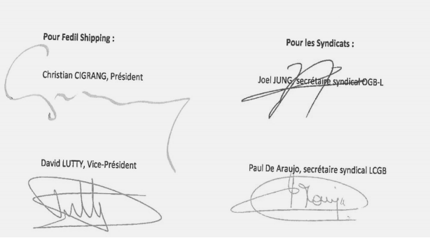

# Règlement grand-ducal du 21 novembre 2014 portant déclaration d'obligation générale de la convention collective de travail sur les conditions de travail des gens de mer (valable du 01/08/2014 au 01/08/2015), conclue entre la Fedil Shipping, d'une part et les syndicats OGB-L et LCGB, d'autre part.

Nous Henri, Grand-Duc de Luxembourg, Duc de Nassau,

Vu l’article L.164-8 du [Code du Travail](https://legilux.public.lu/eli/etat/leg/code/travail);

Sur proposition concordante des assesseurs de l’Office National de Conciliation et sur avis des chambres professionnelles compétentes;

Vu l’article 2 (1) de la [loi du 12 juillet 1996](https://legilux.public.lu/eli/etat/leg/loi/1996/07/12/n3/jo) portant réforme du Conseil d’Etat et considérant qu’il y a urgence;

Sur le rapport de Notre Ministre du Travail, de l’Emploi et de l’Economie sociale et solidaire et après délibération du Gouvernement en conseil;

Arrêtons:

## Art. 1er.

La convention collective de travail sur les conditions de travail des gens de mer (valable du 01/08/2014 au 01/08/2015) conclue entre la Fedil Shipping, d’une part et les syndicats OGB-L et LCGB, d’autre part, est déclarée d’obligation générale pour tout le secteur.

## Art. 2.

Conformément au paragraphe (5) de l’article L.164-8 du [Code du travail](https://legilux.public.lu/eli/etat/leg/code/travail), la déclaration d’obligation générale prend effet à partir de la date d’entrée en vigueur de la convention collective de travail sur les conditions de travail des gens de mer.

## Art. 3.

Notre Ministre du Travail, de l’Emploi et de l’Economie sociale et solidaire est chargé de l’exécution du présent règlement qui sera publié au Mémorial avec la convention collective de travail sur les conditions de travail des gens de mer.

Le Ministre du Travail, de l’Emploi  et de l’Economie sociale et solidaire,   Nicolas Schmit

Palais de Luxembourg, le 21 novembre 2014.   Henri

\**Annexe**

\**CONVENTION COLLECTIVE DE TRAVAIL**

\**sur les conditions de travail des gens de mer**

conclue entre

| Fedil Shipping |
|---|

d’une part et

| LCGB - OGB-L |
|---|

d’autre part

Valable du 01/08/2014 au 01/08/2015

\**Sommaire**

| **PREAMBULE** | **4202** |
|---|---|
| **BUT & CHAMP D’APPLICATION** | **4202** |
| **DISPOSITIF:** | **4202** |
| **ARTICLE 1er: ADOPTION DE L’ACCORD ECSA/ETF DU 19 MAI 2008** | **4202** |
| **ARTICLE 2: LOI APPLICABLE** | **4202** |
| **ARTICLE 3: TRAVAIL UN JOUR FERIE** | **4202** |
| **ARTICLE 4: ORGANISATION DU TEMPS DE TRAVAIL** | **4202** |
| **ARTICLE 5: CONGES** | **4203** |
| **ARTICLE 6: RAPATRIEMENT** | **4203** |
| **ARTICLE 7: POLITIQUE DE FORMATION** | **4204** |
| **ARTICLE 8: HARCELEMENT ET VIOLENCE** | **4204** |
| **ARTICLE 9: EGALITE ET LUTTE CONTRE LA DISCRIMINATION** | **4204** |
| **ARTICLE 10: EXECUTION ET INTERPRETATION DU CONTRAT** | **4204** |
| **ARTICLE 11: DUREE DE LA PRESENTE CONVENTION** | **4204** |
| **ARTICLE 12: DECLARATION D’OBLIGATION GENERALE** | **4204** |

\**PREAMBULE**

Considérant la [loi du 9 novembre 1990](https://legilux.public.lu/eli/etat/leg/loi/1990/11/09/n1/jo) ayant pour objet la création d’un registre public maritime luxembourgeois telle que modifiée,

Considérant la [directive 2009/13/CE](https://legilux.public.lu/eli/dir_ue/2009/13/jo) du Conseil du 16 février 2009 portant mise en œuvre de l’accord conclu par les Associations des armateurs de la Communauté européenne (ECSA) et la Fédération européenne des travailleurs des transports (ETF) concernant la convention du travail maritime, 2006, et modifiant la [directive 1999/63/CE](https://legilux.public.lu/eli/dir_ue/1999/63/jo) (ci-après «la Directive»),

Considérant les dispositions de la convention du travail maritime 2006,

Les partenaires sociaux se sont mis d’accord sur le présent texte:

\**BUT & CHAMP D’APPLICATION**

Considérant que le droit maritime est un droit extraordinaire du droit commun et que par conséquent il ne saurait être fait référence à ce dernier excluant ipso facto l’application des dispositions du [code du travail](https://legilux.public.lu/eli/etat/leg/code/travail) sauf référence expresse à ce dernier.

La présente convention s’applique aux gens de mer travaillant sur des navires battant pavillon luxembourgeois, sauf dispositions contraires de la présente convention collective.

Les marins résidant en dehors de l’Union européenne sont soumis à la loi choisie par les parties au moment de l’engagement.

\**DISPOSITIF**

## Article 1er: — Adoption de l’accord ECSA/ETF du 19 mai 2008

Les parties signataires de la présente convention adoptent en l’état le texte de la Directive et reconnaissent que les règles qui y figurent sont les minima qui seront respectés sur les navires battant pavillon luxembourgeois.

Certaines notions étant cependant à préciser, les parties conviennent et précisent également que:

## Article 2: — Loi applicable

Sans préjudice des dispositions énumérées dans la présente convention collective, les relations de travail seront réglées par la [loi du 9 novembre 1990](https://legilux.public.lu/eli/etat/leg/loi/1990/11/09/n1/jo) ayant pour objet la création d’un registre public maritime luxembourgeois telle que modifiée respectivement par la convention du travail maritime 2006 de l’Organisation Internationale du Travail. Les conditions de travail des gens de mer suivront automatiquement l’évolution des textes législatifs et réglementaires. La nature de la relation de travail exclut toute application par défaut du [code du travail](https://legilux.public.lu/eli/etat/leg/code/travail) luxembourgeois.

## Article 3: — Travail un jour férié

Sauf dispositions expresses contraires dans le contrat de travail, sont considérés comme jours fériés légaux les jours suivants:

– le Nouvel An

– le lundi de Pâques

– le premier mai

– l’Ascension

– le lundi de Pentecôte

– la Fête Nationale

– l’Assomption

– la Toussaint

– le premier jour de Noël

– le deuxième jour de Noël (Saint-Etienne).

Tout travail un jour férié fera l’objet d’une compensation telle que prévue par le contrat de travail ou convention subordonnée.

## Article 4: — Organisation du temps de travail

Le nombre minimal d’heures de repos ne doit pas être inférieur à:

– 10 heures par période de 24 heures, et

– 77 heures par période de 7 jours.

Toutefois les parties à la présente convention conviennent que dans l’intérêt des marins et d’une organisation efficace de l’entreprise, les marins peuvent être employés au-delà des limites journalières.

Au-delà de 8 heures par jour, les heures supplémentaires sont rémunérées/compensées à concurrence du salaire de base majoré de 25%.

## Article 5: — Congés

Le congé est régi par la législation en vigueur réglementant le congé annuel payé au moment de la signature de la présente, à moins que des améliorations légales soient mises en vigueur pendant la durée du présent contrat.

Il est de 3 jours ouvrables par mois d’embarquement effectif. Le congé est calculé au prorata du nombre de jours embarqués.

## Art. 6 — Rapatriement

\*§ 1 - Droit au rapatriement*

Les gens de mer embarqués sur des navires battant pavillon luxembourgeois ont le droit d’être rapatriés aux frais de l’armateur:

1\. lorsque le contrat d’engagement maritime vient à expiration à son échéance normale et que le marin se trouve dans un pays autre que son pays de résidence;

2\. en cas de licenciement sauf licenciement pour faute grave dans le chef du marin;

3\. à la fin de la période de préavis;

4\. lorsque le marin n’est plus en mesure d’exercer les fonctions prévues par le contrat d’engagement maritime ou qu’il n’est pas possible de lui demander de les exercer compte tenu de circonstances particulières à savoir:

– la maladie, l’accident ou toute autre raison d’ordre médical nécessitant son débarquement;

– le naufrage;

– l’hypothèse où l’armateur n’est plus en mesure de remplir ses obligations légales et contractuelles d’employeur pour cause d’ouverture d’une procédure collective, changement d’immatriculation, vente du navire ou toute autre raison analogue;

– quand le navire fait route vers une zone de conflit armé, où le marin refuse de se rendre;

– en cas de cessation ou de suspension du contrat d’engagement maritime conformément à la convention collective ou en cas de cessation du contrat pour toute autre raison similaire.

\*§ 2.- Modalités du rapatriement*

L’armateur est déchargé de l’obligation de rapatriement si le marin n’a pas demandé son rapatriement dans un délai de 30 jours suivant son débarquement.

La durée maximale des périodes d’embarquement au terme desquelles les gens de mer ont droit au rapatriement est de neuf mois.

(1) L’armateur s’acquitte de l’obligation mise à sa charge au premier paragraphe du présent article au moyen d’une garantie financière, d’une assurance ou de tout autre dispositif équivalent.

(2) Il est interdit à l’armateur d’exiger du marin, au début de son emploi, une avance en vue de couvrir les frais de son rapatriement et, également, de recouvrer auprès du marin les frais de rapatriement sur son salaire ou autres droits, sauf si le marin a été débarqué pour faute grave ou à la suite d’une blessure ou d’une maladie résultant d’un fait intentionnel ou d’une faute inexcusable du marin.

(3) Les frais à la charge de l’armateur en cas de rapatriement doivent inclure au moins:

1\. le voyage jusqu’à la destination choisie pour le rapatriement,

2\. le logement et la nourriture du marin depuis le moment où il quitte le navire jusqu’à son arrivée à la destination de rapatriement;

3\. la rémunération et les indemnités depuis le moment où le marin quitte le navire jusqu’à son arrivée à la destination de rapatriement;

4\. le transport de 30 kilogrammes de bagages personnels du marin jusqu’à la destination de rapatriement;

5\. le traitement médical, si nécessaire, en attendant que l’état de santé du marin lui permette de voyager jusqu’à sa destination de rapatriement.

(4) L’armateur doit continuer de supporter les frais de rapatriement jusqu’à ce que le marin soit débarqué à la destination fixée, ou jusqu’à ce qu’il obtienne un emploi convenable à bord d’un navire se rendant à l’une de ces destinations.

(5) L’armateur a la responsabilité d’organiser le rapatriement par des moyens appropriés et rapides. Le transport aérien doit être dans la mesure du possible le mode normal de transport.

(6) A défaut de choix par le marin, celui-ci a droit au rapatriement vers une destination avec laquelle il est réputé avoir des attaches effectives, notamment:

1\. le lieu où il a accepté de s’engager;

2\. son pays de résidence ou tout autre lieu convenu entre les parties au moment de l’engagement.

Le temps passé dans l’attente du rapatriement et la durée du voyage ne doivent pas être déduits des congés payés que le marin a acquis.

Rien ne doit être considéré comme faisant obstacle au droit de l’armateur de recouvrer le coût du rapatriement au titre d’arrangements contractuels avec des tiers.

## Article 7: — Politique de formation

Les armateurs s’engagent à soutenir et favoriser les politiques nationales propres à encourager le développement des carrières et des aptitudes professionnelles ainsi que les possibilités d’emploi des gens de mer, afin que le secteur maritime soit pourvu d’une main-d’œuvre stable et compétente.

Les politiques visées au paragraphe 1er de la présente ont pour but d’aider les gens de mer à renforcer leurs compétences, leurs qualifications et leurs possibilités d’emploi.

## Article 8: — Harcèlement et violence

L’entreprise déclare ne pas tolérer au sein de l’entreprise quelque forme de harcèlement (sexuel/moral), notamment le harcèlement sexuel tel que défini par les articles L. 245-1 et ss. du [Code du Travail](https://legilux.public.lu/eli/etat/leg/code/travail).

Il en découle que l’employeur veillera à assurer à tous les salariés un lieu de travail qui respecte la dignité de chacun et qui est exempt de tout harcèlement sexuel ou moral de quelque origine qu’il soit. L’employeur s’engage en outre à prendre les mesures nécessaires pour prévenir et résoudre le harcèlement sexuel et moral s’il se produit, dans les meilleures conditions possibles et dans la plus stricte confidentialité. Les sanctions disciplinaires à prendre lors de la survenance d’un cas de harcèlement seront déterminées par le chef d’entreprise après consultation de la délégation du personnel s’il il en existe une.

L’entreprise s’engage à faire appliquer la convention du 25 juin 2009 déclarée d’obligation générale et faisant partie intégrale de la présente, sur le harcèlement et la violence au travail telle que signée par les organisations syndicales et patronales.

## Article 9: — Egalité et lutte contre la discrimination

La société s’engage à garantir l’égalité entre homme et femme, notamment une égalité salariale conformément aux articles L.241-1 à L.244-3 du [code du travail](https://legilux.public.lu/eli/etat/leg/code/travail) et à lutter contre tout type de discrimination basée sur la race, la religion, les origines ethniques.

## Article 10: — Exécution et interprétation du contrat

Les difficultés résultant de l’exécution et de l’interprétation du présent contrat seront tranchées entre la Direction et le(s) représentant(s) du personnel, le cas échéant avec l’aide des syndicats signataires et de la Fedil.

Les conflits collectifs, c’est-à-dire les difficultés au sens de l’alinéa qui précède, pour lesquelles un accord s’avère impossible, seront soumis à l’Office National de Conciliation, conformément aux dispositions du [Code du Travail](https://legilux.public.lu/eli/etat/leg/code/travail).

Les parties contractantes ont convenu de régler par texte conventionnel toute la relation contractuelle du salarié avec la société et de régler de ce fait, dans le texte de la convention collective, toutes les situations prévisibles. Des amendements au présent texte de la convention sont donc possibles d’un commun accord à tout moment.

## Article 11: — Durée de la présente convention

La convention collective est conclue pour une durée initiale de 1 an.

La convention collective peut être dénoncée avec un préavis de 3 mois avant la date d’échéance.

Il sera prorogé par tacite reconduction d’année en année, sauf si l’une des parties le dénonce par lettre recommandée, avec un préavis de trois mois avant la date d’échéance.

Des pourparlers seront entamés au plus tard 6 semaines avant l’expiration du contrat en vue de son renouvellement.

En cas de dénonciation, le contrat restera en vigueur jusqu’à la signature d’une nouvelle convention entre les parties contractantes endéans un maximum de 12 mois.

Les parties concernées peuvent décider d’un commun accord de renégocier la convention ou certaines de ses dispositions.

Pour tenir compte de l’évolution de la législation, ce texte sera revu et éventuellement corrigé hors de son renouvellement dès lors que cette révision sera rendue nécessaire pour que la présente convention ne devienne pas obsolète durant son application et qu’elle puisse être adaptée à la législation existante.

## Article 12: — Déclaration d’obligation générale

Les partenaires sociaux ont également convenu que la déclaration d’obligation générale de la présente convention collective sera demandée par les parties signataires à partir de la date d’entrée en vigueur fixée d’un commun accord par les partenaires sociaux au 1er août 2014.

Fait en 5 exemplaires à Luxembourg, le 29 juillet 2014.

