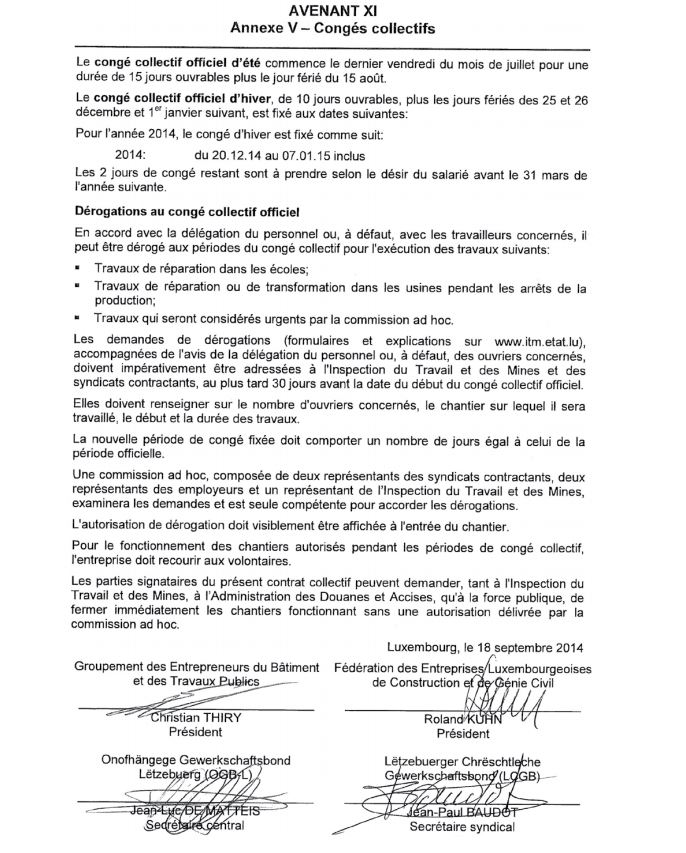

# Règlement grand-ducal du 2 février 2015 portant déclaration d’obligation générale de l’avenant XI à la convention collective de travail pour le bâtiment conclu entre le Groupement des entreprises du bâtiment et des travaux publics et la Fédération des entreprises luxembourgeoises de construction et de génie civil, d’une part, et les syndicats OGB-L et LCGB, d’autre part.

Nous Henri, Grand-Duc de Luxembourg, Duc de Nassau,

Vu l’article L.164-8 du [Code du Travail](https://legilux.public.lu/eli/etat/leg/code/travail);

Sur proposition concordante des assesseurs de l’Office National de Conciliation et sur avis des chambres professionnelles compétentes;

Vu l’article 2 (1) de la [loi du 12 juillet 1996](https://legilux.public.lu/eli/etat/leg/loi/1996/07/12/n3/jo) portant réforme du Conseil d’Etat et considérant qu’il y a urgence;

Sur le rapport de Notre ministre du Travail, de l’Emploi et de l’Economie sociale et solidaire et après délibération du Gouvernement en conseil;

Arrêtons:

## Art. 1er.

L’avenant XI à la convention collective de travail pour le bâtiment conclu entre le Groupement des entrepreneurs du bâtiment et des travaux publics et la Fédération des entreprises luxembourgeoises de construction et de génie civil, d’une part, et les syndicats OGB-L et LCGB, d’autre part, est déclaré d’obligation générale pour tout le secteur.

## Art. 2.

Conformément au paragraphe (5) de l’article L.164-8 du [Code du travail](https://legilux.public.lu/eli/etat/leg/code/travail), la déclaration d’obligation générale prend effet à partir de la date d’entrée en vigueur de l’avenant XI à la convention collective de travail pour le secteur du bâtiment.

## Art. 3.

Notre Ministre du Travail, de l’Emploi et de l’Economie sociale et solidaire est chargé de l’exécution du présent règlement qui sera publié au Mémorial avec l’avenant à la convention collective de travail pour le secteur du bâtiment.

Le Ministre du Travail, de l’Emploi et de l’Economie sociale et solidaire,   Nicolas Schmit

Château de Berg, le 2 février 2015.   Henri

