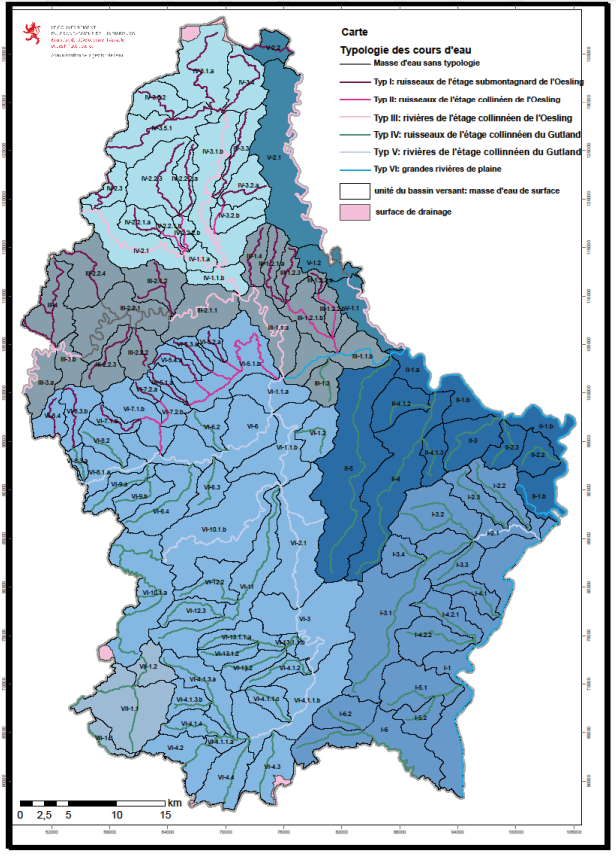
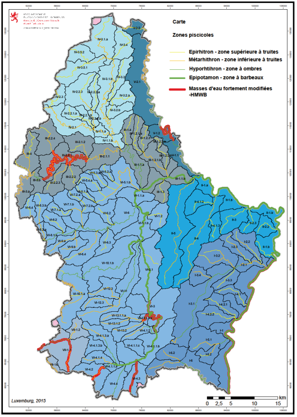

# Règlement grand-ducal du 15 janvier 2016 relatif à l'évaluation de l'état des masses d'eau de surface.

## Art. 1er.

L’Administration de la gestion de l’eau établit un programme de surveillance de l’état des eaux pour l’évaluation de l’état chimique et écologique des masses d’eau de surface.

Ce programme est composé:

– d’un contrôle de surveillance;

– de contrôles opérationnels;

– de contrôles d’enquête.

## Art. 2.

Un contrôle de surveillance est effectué afin d’évaluer les changements à long terme des conditions naturelles ainsi que les changements résultant des activités anthropogéniques. Il porte sur les paramètres biologiques et hydromorphologiques définis à l’annexe V, parties B et C, ainsi que sur les substances chimiques énumérées à l’annexe III et à l’annexe V, parties D et E.

Le contrôle de surveillance des substances chimiques est effectué dans l’eau, sauf pour les substances chimiques énumérées à l’annexe III et numérotées 5, 15, 16, 17, 21, 28, 34, 35, 37, 43 et 44 pour lesquelles il est effectué dans le biote.

Le contrôle de surveillance est réalisé aux quatre points de contrôle désignés à l’annexe I suivant les fréquences minimales indiquées à l’annexe II.

Le contrôle de surveillance des substances inscrites sur la liste de vigilance établie par la Commission européenne, dont question à l’article 8ter de la [directive 2013/39](https://legilux.public.lu/eli/dir_ue/2013/39/jo), est effectué au point de contrôle le plus représentatif parmi ceux désignés à l’annexe I à la fréquence la plus appropriée, sans que celle-ci ne puisse être inférieure à une fois par an.

En complément du contrôle de surveillance, un contrôle peut être effectué à certains points de contrôle à des fréquences différentes ou porter sur d’autres paramètres ou d’autres sites de surveillance afin de satisfaire à des obligations de surveillance en application d’engagements internationaux, contractés dans le cadre des Commissions Internationales pour la Protection de la Moselle et de la Sarre, de la Commission Internationale pour la Protection du Rhin et de la Commission Internationale de la Meuse.

Le contrôle complémentaire porte sur des substances représentatives pour les groupes de substances chimiques suivants:

1\. les composés organohalogénés et substances qui peuvent donner naissance à de tels composés dans le milieu aquatique;

2\. les composés organophosphorés;

3\. les composés organostanniques;

4\. les substances qui possèdent un pouvoir cancérigène ou mutagène dans le milieu aquatique ou par l’intermédiaire de celui-ci;

5\. les substances dont les propriétés pouvant affecter les fonctions stéroïdogénique, thyroïdienne ou reproductive ou d’autres fonctions endocriniennes dans ou via le milieu aquatique ont été démontrées;

6\. les huiles minérales et hydrocarbures d’origine pétrolière;

7\. les matières synthétiques persistantes qui peuvent flotter, rester en suspension ou couler et qui peuvent gêner toute utilisation des eaux;

8\. certains métalloïdes et métaux ainsi que leurs composés et les produits biocides et phytopharmaceutiques ayant sur le milieu aquatique un effet nuisible;

9\. les substances ayant un effet nuisible sur le goût ou sur l’odeur des produits de consommation humaine dérivés du milieu aquatique ainsi que les composés susceptibles de donner naissance à de telles substances dans les eaux;

10\. les composés organosilicés toxiques ou persistants et substances qui peuvent donner naissance à de tels composés dans les eaux;

11\. les cyanures et les fluorures;

12\. les matières en suspension;

13\. les substances contribuant à l’eutrophisation;

14\. les substances exerçant une influence défavorable sur le bilan d’oxygène.

## Art. 3.

Pour les masses d’eau de surface identifiées comme risquant de ne pas satisfaire aux objectifs environnementaux mentionnés à l’article 5 de la [loi modifiée du 19 décembre 2008](https://legilux.public.lu/eli/etat/leg/loi/2008/12/19/n17/jo) relative à l’eau ou dans lesquelles sont rejetées des substances prioritaires énumérées à l’annexe III, des contrôles opérationnels sont entrepris afin d’évaluer le changement de l’état de ces masses d’eau consécutif aux programmes de mesures établis en application de l’article 28 de la [même loi](https://legilux.public.lu/eli/etat/leg/loi/2008/12/19/n17/jo).

Les points de contrôle et les paramètres contrôlés sont choisis selon les critères énumérés respectivement à l’annexe I parties B et C et en fonction de la pollution constatée. Les contrôles doivent avoir lieu à des intervalles ne dépassant pas ceux indiqués à l’annexe II, à moins que des intervalles plus longs ne se justifient sur la base des connaissances techniques et des avis des experts.

## Art. 4.

Des contrôles d’enquête sont organisés dans les cas suivants:

– dépassement des normes de qualité environnementale établies pour les substances figurant à l’annexe III et à l’annexe V, partie E, lorsque la cause est inconnue;

– risque de non atteinte des objectifs environnementaux dévoilé par les résultats du contrôle de surveillance et en l’absence d’un contrôle opérationnel pour la masse d’eau pertinente;

– pollution accidentelle.

Ces contrôles ont pour but de déterminer la cause, l’ampleur et l’incidence de la situation constatée et d’apporter les informations nécessaires à l’adoption des mesures propres à remédier à la situation constatée.

## Art. 5.

L’évaluation de l’état chimique d’une masse d’eau de surface est réalisée sur base des résultats du contrôle de surveillance, du contrôle opérationnel et, le cas échéant, du contrôle d’enquête. L’analyse des pressions et incidences importantes de l’activité humaine sur l’état des eaux de surface peut en outre se baser sur les résultats des analyses des substances figurant sur la liste de vigilance.

L’état chimique d’une masse d’eau de surface est considéré comme bon lorsque les concentrations mesurées ne dépassent en aucun point les normes de qualité environnementale définies à l’annexe III.

Pour les normes de qualité environnementales établies pour les substances numérotées 2, 5, 15, 20, 22, 23 et 28 à l’annexe III, un bon état chimique doit être atteint au plus tard le 22 décembre 2021 au moyen des programmes de mesures prévus dans le plan de gestion de district hydrographique développé conformément à l’article 52 de la [loi modifiée du 19 décembre 2008](https://legilux.public.lu/eli/etat/leg/loi/2008/12/19/n17/jo) relative à l’eau.[^2]

Les normes de qualité environnementale établies pour les substances numérotées 34 à 45, s’appliquent avec effet à compter du 22 décembre 2018 en vue d’atteindre un bon état chimique en ce qui concerne ces substances au plus tard le 22 décembre 2027 et de prévenir la détérioration de l’état chimique des masses d’eau de surface en rapport avec ces substances. À cette fin et au plus tard le 22 décembre 2018, l’Administration de la gestion de l’eau établit un programme de surveillance supplémentaire et un programme préliminaire de mesures concernant ces substances et dresse, au plus tard le 22 décembre 2021, un programme définitif de mesures qui est mis en œuvre et rendu pleinement opérationnel au plus tard le 22 décembre 2024.

Lorsque, conformément au [règlement grand-ducal du 1er mars 2012](https://legilux.public.lu/eli/etat/leg/rgd/2012/03/01/n1/jo) établissant des spécifications techniques pour l’analyse chimique des eaux de surface et des eaux souterraines, il est fait référence à la valeur moyenne calculée d’un résultat de mesure, lorsque l’on procède à l’aide de la meilleure technique disponible n’entraînant pas de coûts excessifs, en indiquant «inférieure à la limite de quantification» et si la limite de quantification de ladite technique est supérieure à la norme de qualité environnementale, le résultat pour la substance mesurée n’est pas pris en compte aux fins de l’évaluation de l’état chimique global de la masse d’eau considérée.

Dans le plan de gestion de district hydrographique, la classification de l’état chimique des masses d’eau est représentée sur une carte conformément aux dispositions de l’annexe VI.

Le plan de gestion de district hydrographique comprend également un tableau présentant les limites de quantification des méthodes d’analyse appliquées, et des informations sur les performances de ces méthodes au regard des critères de performance minimaux pour les méthodes d’analyse.

Une justification de la fréquence de surveillance est incluse dans le plan de gestion de district hydrographique si les contrôles des substances pour lesquelles une norme de qualité environnementale pour les sédiments et/ou le biote est appliquée sont espacés de plus d’un an sur la base des connaissances techniques et des avis des experts.[^3]

## Art. 6.

L’Administration de la gestion de l’eau procède à la délimitation des masses d’eau de surface aux fins de l’évaluation de leur état écologique, ou dans le cas des masses d’eau fortement modifiées, de leur potentiel écologique en fonction de la typologie définie à l’annexe IV.

L’évaluation de l’état et du potentiel écologiques est réalisée sur base des éléments de qualité biologique, hydromorphologique et physico-chimique et des polluants spécifiques définis à l’annexe V, parties B, C, D et E.

L’état écologique d’une masse d’eau de surface est considéré comme très bon, bon, moyen, médiocre ou mauvais.

Le potentiel écologique d’une masse d’eau fortement modifiée est considéré comme, maximal, bon, moyen, médiocre ou mauvais.

L’état et le potentiel écologiques sont déterminés par l’élément de qualité biologique le plus mauvais.

Si les paramètres physico-chimiques assurent un bon fonctionnement de l’écosystème et que les normes de qualité environnementale sont respectées, les masses d’eau atteignent au moins le bon état ou potentiel.

Pour qu’une masse d’eau de surface puisse être évaluée comme étant dans un très bon état écologique, les critères suivants doivent être respectés:

– tous les éléments de qualité biologique de la masse d’eau en question répondent aux critères du très bon état définis à l’annexe V partie B;

– tous les éléments de qualité hydromorphologique de la masse d’eau en question répondent aux critères du très bon état définis à l’annexe V partie C;

– aucun des paramètres physico-chimique déterminés au sein de la masse d’eau en question ne dépasse les valeurs de fond fixées à l’annexe V partie D pour le très bon état et,

– aucun des polluants organiques spécifiques déterminés au sein de la masse d’eau en question ne dépasse les normes de qualité fixés à l’annexe V partie E.

Dans le plan de gestion de district hydrographique, la classification de l’état écologique et du potentiel écologique sont représentés sur des cartes conformément à l’annexe VI.

## Art. 7.

Lorsqu’un risque potentiel pour ou via l’environnement aquatique résultant d’une exposition aiguë est constaté sur la base de concentrations ou d’émissions mesurées ou estimées dans l’environnement et lorsqu’une norme de qualité environnementale pour le biote ou les sédiments est utilisée, l’Administration de la gestion de l’eau procède également à un contrôle dans l’eau de surface et applique les normes de qualité environnementale exprimées en concentration maximale admissible « NQE-CMA » établies à l’annexe III, lorsqu’il en existe.[^4]

## Art. 8.

L’Administration de la gestion de l’eau procède à une analyse tendancielle à long terme des concentrations des substances prioritaires énumérées à l’annexe III, qui ont tendance à s’accumuler dans les sédiments ou le biote.

Elle prend les mesures nécessaires pour éviter que les concentrations n’augmentent pas de manière significative.

Le contrôle est réalisé aux points de contrôle définis à l’annexe I à raison d’une fois par an tous les trois ans, à moins qu’un autre intervalle ne se justifie sur la base des connaissances techniques et des avis des experts.

## Art. 9.

L’Administration de la gestion de l’eau dresse un inventaire, illustré par des cartes, des émissions, rejets et pertes des substances énumérées à l’annexe III et, pour les substances ayant une tendance à s’accumuler dans les sédiments ou le biote, de leurs concentrations dans les sédiments ou le biote. L’inventaire fait l’objet d’un réexamen lors de chacune des mises à jour de l’état des lieux établi en application de l’article 19 de la [loi précitée du 19 décembre 2008](https://legilux.public.lu/eli/etat/leg/loi/2008/12/19/n17/jo).

L’inventaire est établi sur la base de l’état des lieux, des résultats des contrôles effectués en application du présent règlement ainsi que du registre national des rejets et des transferts de polluants établi par la [loi du 13 mars 2009](https://legilux.public.lu/eli/etat/leg/loi/2009/03/13/n3/jo) a) concernant certaines modalités d’application et la sanction du [règlement (CE) n° 166/2006](https://legilux.public.lu/eli/reg_ue/2006/166/jo) du Parlement Européen et du Conseil du 18 janvier 2006 concernant la création d’un registre européen des rejets et des transferts de polluants et modifiant les [directives 91/689/CE](https://legilux.public.lu/eli/dir_ue/1991/689/jo) et [96/61/CE](https://legilux.public.lu/eli/dir_ue/1996/61/jo), b) portant création d’un registre national des rejets et des transferts de polluants, c) modifiant l’article 15 de la [loi modifiée du 10 juin 1999](https://legilux.public.lu/eli/etat/leg/loi/1999/06/10/n5) relative aux établissements classés.

Pour l'estimation des concentrations des polluants, l'année 2010 sert de période de référence, sauf pour les substances visées par le [règlement d'exécution (UE) n° 540/2011](https://legilux.public.lu/eli/reg_ue/2011/540/jo) de la Commission du 25 mai 2011 portant application du [règlement (CE) n° 1107/2009](https://legilux.public.lu/eli/reg_ue/2009/1107/jo) du Parlement européen et du Conseil en ce qui concerne la liste des substances actives approuvées, pour lesquelles il y a lieu de tenir compte de la moyenne des concentrations des années 2008, 2009 et 2010. Pour la mise à jour de l'inventaire, la période de référence est l'année précédant la révision de l'état des lieux ou, pour les produits phytopharmaceutiques, la moyenne des trois années précédant la révision de l'état des lieux.[^1]

## Art. 10.

Le [règlement grand-ducal du 30 décembre 2010](https://legilux.public.lu/eli/etat/leg/rgd/2010/12/30/n15/jo) relatif à l’évaluation de l’état de masses d’eau de surface est abrogé.

## Art. 11.

Notre Ministre de l’Environnement est chargé, de l’exécution du présent règlement qui sera publié au Mémorial.

\**Annexe I**

\**A) Stations du réseau de contrôle de surveillance**

<table>
<tr>
<td>No</td>
<td>Cours d’eau</td>
<td>Code</td>
<td>Masse d’eau</td>
<td colspan="5">Coordonnées géographiques</td>
</tr>
<tr>
<td></td>
<td></td>
<td></td>
<td></td>
<td>Localisation</td>
<td>Longueur Luxembourg 1930 / Gauss</td>
<td>Largeur Luxembourg 1930 / Gauss</td>
<td>Longueur WGS84</td>
<td>Largeur WGS 84</td>
</tr>
<tr>
<td>1</td>
<td>Sûre</td>
<td>L112010A11</td>
<td>VI-1.1.a</td>
<td>amont Erpeldange</td>
<td>75846</td>
<td>103172</td>
<td>6.11034</td>
<td>49.86291</td>
</tr>
<tr>
<td>2</td>
<td>Alzette</td>
<td>L100011A21</td>
<td>VI-1.1.a</td>
<td>Ettelbruck, en amont de l’embouchure dans la Sûre</td>
<td>75525</td>
<td>101226</td>
<td>6.10600</td>
<td>49.84500</td>
</tr>
<tr>
<td>3</td>
<td>Syr</td>
<td>L202030A12</td>
<td>I-2.1</td>
<td>Mertert</td>
<td>102033</td>
<td>85368</td>
<td>6.47355</td>
<td>49.70244</td>
</tr>
<tr>
<td>4</td>
<td>Chiers</td>
<td>L300030A06</td>
<td>VII-1.1</td>
<td>Rodange, pont à Athus</td>
<td>56792</td>
<td>69261</td>
<td>5.81937</td>
<td>49.54749</td>
</tr>
</table>

\**B) Sélection des sites pour le contrôle opérationnel**

Pour les substances de la liste de substances prioritaires, des points de contrôle sont sélectionnés selon les dispositions de la législation établissant la norme de qualité environnementale des substances en cause. Dans tous les autres cas, y compris pour les substances de la liste de substances prioritaires pour lesquelles la législation ne donne pas d’indications spécifiques, les points de contrôle sont sélectionnés comme suit:

– pour les masses d’eau courant un risque en raison de pressions ponctuelles importantes, des points de contrôle en nombre suffisant pour évaluer l’ampleur et l’incidence des pressions ponctuelles. Lorsqu’une masse d’eau est soumise à plusieurs pressions ponctuelles, les points de contrôle peuvent être sélectionnés en vue d’évaluer l’ampleur et l’incidence de ces pressions dans leur ensemble,

– pour les masses d’eau courant un risque en raison de pressions diffuses importantes, des points de contrôle en nombre suffisant, à l’intérieur d’une sélection des masses, pour évaluer l’ampleur et l’incidence des pressions diffuses. Les masses sont sélectionnées de manière à être représentatives des risques relatifs de pressions diffuses et des risques relatifs de ne pas avoir un bon état des eaux de surface,

– pour les masses d’eau courant un risque en raison de pressions hydromorphologiques importantes, des points de contrôle en nombre suffisant, à l’intérieur d’une sélection des masses, pour évaluer l’ampleur et l’incidence des pressions hydromorphologiques. Les masses sont sélectionnées de manière à donner des indications sur l’incidence globale des pressions hydromorphologiques auxquelles toutes les masses sont soumises.

\**C) Sélection des éléments de qualité**

Afin d’évaluer l’ampleur des pressions auxquelles les masses d’eau de surface sont soumises, l’Administration de la gestion de l’eau contrôle les éléments de qualité qui permettent de déterminer les pressions auxquelles la ou les masses sont soumises. A cette fin, sont contrôlés selon le cas:

– les paramètres permettant de déterminer l’élément de qualité biologique ou les éléments qui sont les plus sensibles aux pressions auxquelles les masses d’eau sont soumises,

– toutes les substances prioritaires rejetées et les autres polluants rejetés en quantités importantes,

– les paramètres permettant de déterminer l’élément de qualité hydromorphologique le plus sensible à la pression identifiée.

\**ANNEXE II**

\**Fréquence d’analyse des éléments de qualité lors des contrôles de surveillance et opérationnels**

<table>
<tr>
<td>Elément de qualité</td>
<td>Fréquence</td>
<td>Cycle</td>
</tr>
<tr>
<td colspan="3"><b>Physico-chimique</b></td>
</tr>
<tr>
<td>Température</td>
<td>Tous les 3 mois</td>
<td>Au moins une fois tous les 6 ans</td>
</tr>
<tr>
<td>Température en amont et en aval d’un point de rejet thermique est en continu.</td>
<td>En continu</td>
<td>Tous les ans</td>
</tr>
<tr>
<td>Bilan d’oxygène</td>
<td>Tous les 3 mois</td>
<td>Au moins une fois tous les 6 ans</td>
</tr>
<tr>
<td>Salinité</td>
<td>Tous les 3 mois</td>
<td>Au moins une fois tous les 6 ans</td>
</tr>
<tr>
<td>Nutriments</td>
<td>Tous les 3 mois</td>
<td>Au moins une fois tous les 6 ans</td>
</tr>
<tr>
<td>Etat d’acidification</td>
<td>Tous les 3 mois</td>
<td>Au moins une fois tous les 6 ans</td>
</tr>
<tr>
<td>Polluants spécifiques</td>
<td>Tous les 3 mois</td>
<td>Au moins une fois tous les 6 ans</td>
</tr>
<tr>
<td colspan="3"><b>Chimie</b></td>
</tr>
<tr>
<td>Substances dangereuses prioritaires et substances prioritaires (Annexe III)</td>
<td>Mensuelle</td>
<td>Au moins une fois tous les 6 ans</td>
</tr>
<tr>
<td>Substances <i>5, 21, 28, 30, 35, 37, 43 et 44</i> de l’annexe III, dites ubiquistes</td>
<td>Tous les 3 ans</td>
<td>Au moins une fois tous les 6 ans</td>
</tr>
<tr>
<td>Substances pour lesquelles des normes de qualité environnementale ont été définies pour les sédiments ou le biote à l’annexe III.</td>
<td>Une fois par an</td>
<td>Au moins une fois tous les 6 ans</td>
</tr>
<tr>
<td>Substances figurant dans la liste de vigilance</td>
<td>Au moins une fois par an mais tenant compte des périodes d’émission</td>
<td>Au moins une fois tous les 6 ans</td>
</tr>
<tr>
<td colspan="3"><b>Biologie</b></td>
</tr>
<tr>
<td>Phytoplancton: Abondance Composition Présence de taxons sensibles</td>
<td>6 fois par an pendant la période de végétation</td>
<td>Au moins une fois tous les 6 ans</td>
</tr>
<tr>
<td>Macrophytes et phytobenthos: Abondance Composition Présence de taxons sensibles</td>
<td>Une fois par an</td>
<td>Tous les 3 ans</td>
</tr>
<tr>
<td>Faune benthique invertébrée: Abondance</td>
<td>Une fois par an</td>
<td>Tous les 3 ans</td>
</tr>
<tr>
<td>Composition Présence de taxons sensibles Diversité</td>
<td></td>
<td></td>
</tr>
<tr>
<td>Ichtyofaune: Abondance Composition Age Présence de taxons sensibles</td>
<td>Une fois par an</td>
<td>Tous les 3 ans</td>
</tr>
<tr>
<td><b>Hydromorphologie</b></td>
<td></td>
<td></td>
</tr>
<tr>
<td>Continuité</td>
<td>Une fois par an</td>
<td>Tous les 6 ans</td>
</tr>
<tr>
<td>Hydrologie</td>
<td>En continu</td>
<td>Tous les ans</td>
</tr>
<tr>
<td>Morphologie</td>
<td>Une fois par an</td>
<td>Tous les 6 ans</td>
</tr>
</table>

\**Annexe III**

\*Les normes de qualité environnementale (NQE) reprises ci-dessous sont exprimés d’une part en valeur moyenne annuelle, d’autre part en concentration maximale admissible. La norme exprimée en valeur moyenne est considérée comme respectée pour une masse d’eau donnée si, pour tout point d’échantillonnage associé à la masse d’eau, la moyenne arithmétique des concentrations mesurées à différentes périodes de l’année ne dépasse pas la valeur fixée dans la norme. La norme exprimée en concentration maximale admissible est considérée comme respectée pour une masse d’eau donnée si, pour tout point de contrôle associé à cette masse d’eau, la concentration mesurée lors de chaque échantillonnage ne dépasse pas la valeur fixée dans la norme.*

\*Les normes de qualité environnementale sont exprimées en concentrations totales dans l’échantillon d’eau brut, sauf dans le cas des métaux suivants :*

\*cadmium, plomb, mercure et nickel. Pour ces métaux, les normes de qualité environnementale se rapportent à la concentration dans la phase dissoute d’un échantillon d’eau obtenu par filtration à travers un filtre de 0,45 µm ou par tout autre traitement préliminaire équivalent.*

\*Il y a lieu d’entendre par :*

aash *« Taxon de biote » : un taxon aquatique donné au rang taxinomique de sous-phylum, classe ou leurs équivalents*

bash *« Matrice » : milieu de l’environnement aquatique, à savoir l’eau, les sédiments ou le biote*

<table>
<tr>
<td>n°</td>
<td>Substance</td>
<td>Numéro CAS (Chemical Abstracts Service)</td>
<td>Substance ubiquiste</td>
<td>NQE plus sévère</td>
<td>Substance dangereuse et prioritaire</td>
<td>Substance ayant une tendance à s’accumuler dans les sédiments ou le biote</td>
<td>NQE: Moyenne annuelle (MA) µg/L</td>
<td>NQE Concentration maximale admissible (CMA) µg/L</td>
<td>NQE Biote µg/kg</td>
</tr>
<tr>
<td>1</td>
<td>Alachlore</td>
<td>15972-60-8</td>
<td></td>
<td></td>
<td></td>
<td></td>
<td>0.3</td>
<td>0.7</td>
<td></td>
</tr>
<tr>
<td>2</td>
<td>Anthracène</td>
<td>120-12-7</td>
<td></td>
<td>X</td>
<td>X</td>
<td>X</td>
<td>0.1</td>
<td>0.1</td>
<td></td>
</tr>
<tr>
<td>3</td>
<td>Atrazine</td>
<td>1912-24-9</td>
<td></td>
<td></td>
<td></td>
<td></td>
<td>0.6</td>
<td>2</td>
<td></td>
</tr>
<tr>
<td>4</td>
<td>Benzène</td>
<td>71-43-2</td>
<td></td>
<td></td>
<td></td>
<td></td>
<td>10</td>
<td>50</td>
<td></td>
</tr>
<tr>
<td>5</td>
<td>Diphényléthers bromés</td>
<td>32534-81-9</td>
<td>X</td>
<td>X</td>
<td>X</td>
<td>X</td>
<td></td>
<td>0.14</td>
<td>0.0085</td>
</tr>
<tr>
<td>6</td>
<td>Cadmium et ses composés</td>
<td>7440-43-9</td>
<td></td>
<td></td>
<td>X</td>
<td>X</td>
<td>< 0.08 (classe 1) 0.08 (classe 2) 0.09 (classe 3) 0.15 (classe 4) 0.25 (classe 5)</td>
<td>< 0.45 (classe 1) 0.45 (classe 2) 0.6 (classe 3) 0.9 (classe 4) 1.5 (classe 5)</td>
<td></td>
</tr>
<tr>
<td><i>is</i></td>
<td>Tétrachlorure de carbone</td>
<td>56-23-5</td>
<td></td>
<td></td>
<td></td>
<td></td>
<td>12</td>
<td>sans objet</td>
<td></td>
</tr>
<tr>
<td>7</td>
<td>Chloroalcanes C10-13</td>
<td>85535-84-8</td>
<td></td>
<td></td>
<td>X</td>
<td>X</td>
<td>0.4</td>
<td>1.4</td>
<td></td>
</tr>
<tr>
<td>8</td>
<td>Chlorfenvinphos</td>
<td>470-90-6</td>
<td></td>
<td></td>
<td></td>
<td></td>
<td>0.1</td>
<td>0.3</td>
<td></td>
</tr>
<tr>
<td>9</td>
<td>Chlorpyrifos (éthylchlorpy- rifos)</td>
<td>2921-88-2</td>
<td></td>
<td></td>
<td></td>
<td></td>
<td>0.03</td>
<td>0.1</td>
<td></td>
</tr>
<tr>
<td>9*bis*</td>
<td>Pesticides cyclodiènes: Aldrine Dieldrine Endrine Isodrine</td>
<td>309-00-2 60-57-1 72-20-8 465-73-6</td>
<td></td>
<td></td>
<td></td>
<td></td>
<td>Somme = 0.01</td>
<td>sans objet</td>
<td></td>
</tr>
<tr>
<td rowspan="2">9*ter*</td>
<td>DDT total,</td>
<td>sans objet</td>
<td></td>
<td></td>
<td></td>
<td></td>
<td>0.025</td>
<td>sans objet</td>
<td></td>
</tr>
<tr>
<td>Para-para-DDT</td>
<td>50-29-3</td>
<td></td>
<td></td>
<td></td>
<td></td>
<td>0.01</td>
<td>sans objet</td>
<td></td>
</tr>
<tr>
<td>10</td>
<td>1,2-Dichloroéthane</td>
<td>107-06-2</td>
<td></td>
<td></td>
<td></td>
<td></td>
<td>10</td>
<td>sans objet</td>
<td></td>
</tr>
<tr>
<td>11</td>
<td>Dichlorométhane</td>
<td>75-09-2</td>
<td></td>
<td></td>
<td></td>
<td></td>
<td>20</td>
<td>sans objet</td>
<td></td>
</tr>
<tr>
<td>12</td>
<td>Di(2-ethylhexyl)phtalate (DEHP)</td>
<td>117-81-7</td>
<td></td>
<td></td>
<td>X</td>
<td>X</td>
<td>1.3</td>
<td>sans objet</td>
<td></td>
</tr>
<tr>
<td>13</td>
<td>Diuron</td>
<td>330-54-1</td>
<td></td>
<td></td>
<td></td>
<td></td>
<td>0.2</td>
<td>1.8</td>
<td></td>
</tr>
<tr>
<td>14</td>
<td>Endosulfan</td>
<td>115-29-7</td>
<td></td>
<td></td>
<td>X</td>
<td></td>
<td>0.005</td>
<td>0.01</td>
<td></td>
</tr>
<tr>
<td>15</td>
<td>Fluoranthène</td>
<td>206-44-0</td>
<td></td>
<td>X</td>
<td></td>
<td>X</td>
<td>0.0063</td>
<td>0.12</td>
<td>30</td>
</tr>
<tr>
<td>16</td>
<td>Hexachlorobenzène</td>
<td>118-74-1</td>
<td></td>
<td></td>
<td>X</td>
<td>X</td>
<td></td>
<td>0.05</td>
<td>10</td>
</tr>
<tr>
<td>17</td>
<td>Hexachlorobutadiène</td>
<td>87-68-3</td>
<td></td>
<td></td>
<td>X</td>
<td>X</td>
<td></td>
<td>0.6</td>
<td>55</td>
</tr>
<tr>
<td>18</td>
<td>Hexachlorocyclohexane</td>
<td>608-73-1</td>
<td></td>
<td></td>
<td>X</td>
<td>X</td>
<td>0.02</td>
<td>0.04</td>
<td></td>
</tr>
<tr>
<td>19</td>
<td>Isoproturon</td>
<td>34123-59-6</td>
<td></td>
<td></td>
<td></td>
<td></td>
<td>0.3</td>
<td>1.0</td>
<td></td>
</tr>
<tr>
<td>20</td>
<td>Plomb et ses composés</td>
<td>7439-92-1</td>
<td></td>
<td>X</td>
<td></td>
<td>X</td>
<td>1.2</td>
<td>14</td>
<td></td>
</tr>
<tr>
<td>21</td>
<td>Mercure et ses composés</td>
<td>7439-97-6</td>
<td>X</td>
<td></td>
<td>X</td>
<td>X</td>
<td></td>
<td>0.07</td>
<td>20</td>
</tr>
<tr>
<td>22</td>
<td>Naphtalène</td>
<td>91-20-3</td>
<td></td>
<td>X</td>
<td></td>
<td></td>
<td>2</td>
<td>130</td>
<td></td>
</tr>
<tr>
<td>23</td>
<td>Nickel et ses composés</td>
<td>7440-02-0</td>
<td></td>
<td>X</td>
<td></td>
<td></td>
<td>4</td>
<td>34</td>
<td></td>
</tr>
<tr>
<td>24</td>
<td>Nonylphénol (4-nonylphé- nol)</td>
<td>25154-52-3</td>
<td></td>
<td></td>
<td>X</td>
<td></td>
<td>0.3</td>
<td>2</td>
<td></td>
</tr>
<tr>
<td>25</td>
<td>Octylphénol / 140-66-9 (4-(1,1’,3,3’-tétra- méthylbutyl)-phénol)</td>
<td></td>
<td></td>
<td></td>
<td></td>
<td>0.1</td>
<td>sans objet</td>
<td></td>
<td></td>
</tr>
<tr>
<td>26</td>
<td>Pentachlorobenzène</td>
<td>608-93-5</td>
<td></td>
<td></td>
<td>X</td>
<td>X</td>
<td>0.007</td>
<td>sans objet</td>
<td></td>
</tr>
<tr>
<td>27</td>
<td>Pentachlorophénol</td>
<td>87-86-5</td>
<td></td>
<td></td>
<td></td>
<td></td>
<td>0.4</td>
<td>1</td>
<td></td>
</tr>
<tr>
<td>28</td>
<td>Hydrocarbures aromatiques</td>
<td>X</td>
<td>X</td>
<td>X</td>
<td>X</td>
<td>sans objet</td>
<td>sans objet</td>
<td></td>
<td></td>
</tr>
<tr>
<td></td>
<td>polycycliques (HAP)</td>
<td></td>
<td></td>
<td></td>
<td></td>
<td></td>
<td></td>
<td></td>
<td></td>
</tr>
<tr>
<td></td>
<td>Benzo(a)pyrène</td>
<td>50-32-8</td>
<td></td>
<td></td>
<td></td>
<td>X</td>
<td>1.7 x 10-4</td>
<td>0.27</td>
<td>5</td>
</tr>
<tr>
<td></td>
<td>Benzo(b)fluoranthène</td>
<td>205-99-2</td>
<td></td>
<td></td>
<td></td>
<td>X</td>
<td>note 12</td>
<td>0.017</td>
<td>note 12</td>
</tr>
<tr>
<td></td>
<td>Benzo(k)fluoranthène</td>
<td>207-08-9</td>
<td></td>
<td></td>
<td></td>
<td>X</td>
<td>note 12</td>
<td>0.017</td>
<td>note 12</td>
</tr>
<tr>
<td></td>
<td>Benzo(ghi)pérylène</td>
<td>191-24-2</td>
<td></td>
<td></td>
<td></td>
<td>X</td>
<td>note 12</td>
<td>8.2x10-3</td>
<td>note 12</td>
</tr>
<tr>
<td></td>
<td>Indéno(1,2,3cd)pyrène</td>
<td>193-39-5</td>
<td></td>
<td></td>
<td></td>
<td>X</td>
<td>note 12</td>
<td>sans objet</td>
<td>note 12</td>
</tr>
<tr>
<td>29</td>
<td>Simazine</td>
<td>122-34-9</td>
<td></td>
<td></td>
<td></td>
<td></td>
<td>1</td>
<td>4</td>
<td></td>
</tr>
<tr>
<td>29*bis*</td>
<td>Tétrachloroéthylène</td>
<td>127-18-4</td>
<td></td>
<td></td>
<td></td>
<td></td>
<td>10</td>
<td>sans objet</td>
<td></td>
</tr>
<tr>
<td>29*ter*</td>
<td>Trichloro-ethylène</td>
<td>79-01-6</td>
<td></td>
<td></td>
<td></td>
<td></td>
<td>10</td>
<td>sans objet</td>
<td></td>
</tr>
<tr>
<td>30</td>
<td>Composés du tributylétain</td>
<td>36643-28-4</td>
<td>X</td>
<td colspan="2">X</td>
<td>X</td>
<td>0.0002</td>
<td>0.0015</td>
<td></td>
</tr>
<tr>
<td>31</td>
<td>Trichlorobenzènes</td>
<td>12002-48-1</td>
<td></td>
<td colspan="2"></td>
<td></td>
<td>0.4</td>
<td>sans objet</td>
<td></td>
</tr>
<tr>
<td>32</td>
<td>Trichlorométhane</td>
<td>67-66-3</td>
<td></td>
<td colspan="2"></td>
<td></td>
<td>2.5</td>
<td>sans objet</td>
<td></td>
</tr>
<tr>
<td>33</td>
<td>Trifluraline</td>
<td>1582-09-8</td>
<td></td>
<td colspan="2">X</td>
<td></td>
<td>0.03</td>
<td>sans objet</td>
<td></td>
</tr>
<tr>
<td>34</td>
<td>Dicofol</td>
<td>115-32-2</td>
<td></td>
<td colspan="2">X</td>
<td>X</td>
<td>1.3 x 10-3</td>
<td>sans objet:</td>
<td>33</td>
</tr>
<tr>
<td>35</td>
<td>Acide perfluorooctane-</td>
<td>1763-23-1</td>
<td>X</td>
<td colspan="2">X</td>
<td>X</td>
<td>6.5 x 10-4</td>
<td>36</td>
<td>9.1</td>
</tr>
<tr>
<td></td>
<td>sulfonique et ses dérivés</td>
<td></td>
<td></td>
<td></td>
<td></td>
<td></td>
<td></td>
<td></td>
<td></td>
</tr>
<tr>
<td></td>
<td>(per-fluoro-octane-sulfonate</td>
<td></td>
<td></td>
<td></td>
<td></td>
<td></td>
<td></td>
<td></td>
<td></td>
</tr>
<tr>
<td></td>
<td>PFOS)</td>
<td></td>
<td></td>
<td></td>
<td></td>
<td></td>
<td></td>
<td></td>
<td></td>
</tr>
<tr>
<td>36</td>
<td>Quinoxyfène</td>
<td>124495-18-7</td>
<td></td>
<td colspan="2">X</td>
<td>X</td>
<td>0.15</td>
<td>2.7</td>
<td></td>
</tr>
<tr>
<td>37</td>
<td>Dioxines et composés de type dioxine</td>
<td></td>
<td>X</td>
<td colspan="2">X</td>
<td>X</td>
<td></td>
<td>sans objet</td>
<td>Somme de PCDD + PCDF + PCB-TD 0.0065 μg.kg–1TEQ</td>
</tr>
<tr>
<td>38</td>
<td>Aclonifène</td>
<td>74070-46-5</td>
<td></td>
<td></td>
<td></td>
<td></td>
<td>0.12</td>
<td>0.12</td>
<td></td>
</tr>
<tr>
<td>39</td>
<td>Bifénox</td>
<td>42576-02-3</td>
<td></td>
<td></td>
<td></td>
<td></td>
<td>0.012</td>
<td>0.04</td>
<td></td>
</tr>
<tr>
<td>40</td>
<td>Cybutryne</td>
<td>28159-98-0</td>
<td></td>
<td></td>
<td></td>
<td></td>
<td>0.0025</td>
<td>0.016</td>
<td></td>
</tr>
<tr>
<td>41</td>
<td>Cyperméthrine</td>
<td>52315-07-8</td>
<td></td>
<td></td>
<td></td>
<td></td>
<td>8 x 10-5</td>
<td>6 x 10-4</td>
<td></td>
</tr>
<tr>
<td>42</td>
<td>Dichlorvos</td>
<td>62-73-7</td>
<td></td>
<td></td>
<td></td>
<td></td>
<td>6 x 10-4</td>
<td>7 x 10-4</td>
<td></td>
</tr>
<tr>
<td>43</td>
<td>Hexabromo-cyclododécane (HBCDD)</td>
<td></td>
<td>X</td>
<td colspan="2">X</td>
<td>X</td>
<td>0.0016</td>
<td>0.5</td>
<td>167</td>
</tr>
<tr>
<td>44</td>
<td>Heptachlore et époxyde d’heptachlore</td>
<td>76-44-8/1024-57-3</td>
<td>X</td>
<td colspan="2">X</td>
<td>X</td>
<td>2 x 10-7</td>
<td>3 x 10-4</td>
<td>6.7 x 10-3</td>
</tr>
<tr>
<td>45</td>
<td>Terbutryne</td>
<td>886-50-0</td>
<td></td>
<td></td>
<td></td>
<td></td>
<td>0.065</td>
<td>0.34</td>
<td>[^5]</td>
</tr>
</table>

\**Annexe IV**

\**A) Typologie luxembourgeoise des cours d’eau**

En fonction des caractéristiques abiotiques, géographiques, géologiques, hydromorphologiques et hydrologiques, les masses d’eau de surface sont réparties au Grand-Duché de Luxembourg en 6 types:

Type I - Ruisseaux de l’étage submontagnard de l’Oesling

Type II - Ruisseaux de l’étage collinéen de l’Oesling

Type III - Rivières de l’étage collinéen de l’Oesling

Type IV - Ruisseaux de l’étage collinéen du Gutland

Type V - Rivières de l’étage collinéen du Gutland

Type VI - Grandes rivières de plaine

Etant donné que le Grand-Duché de Luxembourg appartient entièrement à l’écorégion 8, les 6 types de masses d’eau de surface appartiennent également à l’écorégion 8.

\**B) Carte représentant la délimitation des masses d’eau de surface et des masses d’eau de surface fortement modifiées:**

*[image omitted (0.8 MB) — see the official version: https://legilux.public.lu/eli/etat/leg/rgd/2016/01/15/n2/consolide/20201214]*

\**C) Carte représentant la typologie luxembourgeoise des cours d’eau:**

\**Annexe V**

\**PARTIE A:**

\**Normes pour le contrôle des éléments de qualité biologique et les paramètres hydromorphologiques**

\*Normes pour le contrôle des éléments de qualité*

Les méthodes utilisées pour le contrôle des paramètres types doivent être conformes aux normes internationales qui ont trait au contrôle mentionnées ci-dessous ou à d’autres normes nationales ou internationales garantissant des données de qualité scientifique et de comparabilité équivalentes:

\*Normes pour l’échantillonnage des éléments de qualité biologique*

Méthodes génériques à associer aux méthodes spécifiques figurant dans les normes relatives aux éléments de qualité biologiques suivants:

| EN ISO 5667-3:2012 | Qualité de l’eau – Echantillonnage – Partie 3: conservation et manipulation des échantillons |
|---|---|

\*Normes pour le phytoplancton:*

| EN 15204:2006 | Qualité de l’eau – Norme guide pour le dénombrement du phytoplancton par microscopie inversée (technique d’Utermöhl) |
|---|---|
| ISO 10260:1992 | Qualité de l’eau – Mesurage des paramètres biochimiques – Dosage spectrométrique de la chlorophyle a |

\*Normes pour les macrophytes et le phytobenthos:*

| EN 14184:2014 | Qualité de l’eau - Guide pour l’étude des macrophytes aquatiques dans les cours d’eau |
|---|---|
| EN 150708:2009 | Qualité de l’eau – Guide pour l’étude, l’échantillonnage et l’analyse en laboratoire du phytobenthos dans les cours d’eau peu profonds |
| EN 13946:2014 | Qualité de l’eau – Guide pour l’échantillonnage en routine et le prétraitement des diatomées benthiques de rivière et de plans d’eau |
| EN 14407:2014 | Qualité de l’eau – Guide pour l’identification et le dénombrement des échantillons de diatomées benthiques de rivières et de lacs |

\*Normes pour les invertébrés benthiques :*

| EN ISO 10870:2012 | Qualité de l’eau – Lignes directrices pour la sélection des méthodes et des dispositifs d’échantillonnage des macro-invertébrés benthiques dans les eaux douces |
|---|---|
| EN 15196:2006 | Qualité de l’eau – Guide d’échantillonnage et de traitement d’exuvies nymphales de Chirinomidae (ordre des diptères) pour l’évaluation écologique |
| EN 16150:2012 | Qualité de l’eau – Lignes directrices pour l’échantillonnage des macro-invertébrés benthiques en cours d’eau peu profonds au prorata des surfaces de recouvrement des habitats présents |

\*Normes pour les poissons:*

| EN 14962:2006 | Qualité de l’eau – Guide sur le domaine d’application et la sélection des méthodes d’échantillonnage de poissons |
|---|---|
| EN 14011:2003 | Qualité de l’eau – Echantillonnage des poissons à l’électricité |
| EN 15910:2014 | Qualité de l’eau – Guide sur l’estimation de l’abondance des poissons par des méthodes hydroacoustiques mobiles |
| EN 14757:2005 | Qualité de l’eau – Echantillonnage des poissons à l’aide de filets maillants |

\*Normes pour les paramètres hydromorphologiques:*

| EN 14614:2004 | Qualité de l’eau – Guide pour l’évaluation des caractéristiques hydromorphologiques des rivières |
|---|---|

\**PARTIE B:**

TABLEAU 1: Critères généraux pour l’évaluation de l’état écologique sur base des éléments de qualité biologique

| **Très bon état** | **Bon état** | **Etat moyen** | **Etat médiocre** | **Mauvais état** |
|---|---|---|---|---|
| Pas ou très peu d’altérations anthropogéniques des valeurs des éléments de qualité physico-chimiques et hydro-morphologiques applicables au type de masse d’eau de surface par rapport aux valeurs normalement associées à ce type dans des conditions non perturbées Les valeurs des éléments de qualité biologique pour la masse d’eau de surface correspondent à celles normalement associées à ce type dans des conditions non perturbées (état de référence) et n’indiquent pas ou très peu de distorsions. Il s’agit des conditions et communautés caractéristiques. | Les valeurs des paramètres biologiques respectent les valeurs limites ne déviant que légèrement de l’état de référence. | Les paramètres biologiques témoignent d’une influence anthropogénique moyenne et la biocénose aquatique est perturbée par rapport à la biocénose de référence. | Les paramètres biologiques témoignent d’une importante influence anthropogénique qui perturbe la biocénose qui diffère considérablement de la biocénose de référence. | Les paramètres biologiques témoignent d’une très grande influence anthropogénique qui perturbe la biocénose aquatique à tel point que la biocénose de référence fait presque totalement défaut. |

TABLEAU 2: Éléments de qualité biologique faisant partie de l’évaluation de l’état écologique des eaux de surface.

| **Élément** | **Très bon état** | **Bon état** | **État moyen** |
|---|---|---|---|
| Phytoplancton: Abondance Composition Présence de taxons sensibles | La composition taxinomique du phytoplancton correspond totalement ou presque totalement aux conditions non perturbées. L’abondance moyenne de phytoplancton est totalement en rapport avec les conditions physico-chimiques caractéristiques et n’est pas de nature à altérer sensiblement les conditions de transparence caractéristiques. L’efflorescence planctonique est d’une fréquence et d’une intensité qui correspondent aux conditions physico-chimiques caractéristiques. | Légères modifications dans la composition et l’abondance des taxa planctoniques par comparaison avec les communautés caractéristiques. Ces changements n’indiquent pas de croissance accélérée des algues entraînant des perturbations indésirables de l’équilibre des organismes présents dans la masse d’eau ou de la qualité physico-chimique de l’eau ou du sédiment. La fréquence et l’intensité de l’efflorescence planctonique peuvent augmenter légèrement. | La composition des taxa planctoniques diffère modérément des communautés caractéristiques. L’abondance est modérément perturbée et peut être de nature à produire une forte perturbation indésirable des valeurs des autres éléments de qualité biologique et physicochimique. La fréquence et l’intensité de l’efflorescence planctonique peuvent augmenter modérément. Une efflorescence persistante peut se produire durant les mois d’été. |
| Macrophytes et phytobenthos: Abondance Composition Présence de taxons sensibles | La composition taxinomique correspond totalement ou presque totalement aux conditions non perturbées. Pas de modifications détectables dans l’abondance moyenne macrophytique et phytobenthique. | Légères modifications dans la composition et l’abondance des taxa macrophytiques et phytobenthiques par rapport aux communautés caractéristiques. Ces changements n’indiquent pas de croissance accélérée du phytobenthos ou de formes supérieures de vie végétale entraînant des perturbations indésirables de l’équilibre des organismes présents dans la masse d’eau ou de la qualité physico-chimique de l’eau ou du sédiment. La communauté phytobenthique n’est pas perturbée par des touffes et couches bactériennes dues à des activités anthropogéniques. | La composition des taxa macrophytiques et phytobenthiques diffère modérément de la communauté caractéristique et est sensiblement plus perturbée que dans le bon état. Des modifications modérées de l’abondance moyenne macrophytique et phytobenthique sont perceptibles. La communauté phytobenthique peut être perturbée et, dans certains cas, déplacée par des touffes et couches bactériennes dues à des activités anthropogéniques. |
| Faune benthique invertébrée: Abondance Composition Présence de taxons sensibles Diversité | La composition et l’abondance taxinomiques correspondent totalement ou presque totalement aux conditions non perturbées. Le ratio des taxa sensibles aux perturbations par rapport aux taxa insensibles n’indique aucune détérioration par rapport aux niveaux non perturbés. Le niveau de diversité des taxa d’invertébrés n’indique aucune détérioration par rapport aux niveaux non perturbés. | Légères modifications dans la composition et l’abondance des taxa d’invertébrés par rapport aux communautés caractéristiques. Le ratio des taxa sensibles aux perturbations par rapport aux taxa insensibles indique une légère détérioration par rapport aux niveaux non perturbés. Le niveau de diversité des taxa d’invertébrés indique de légères détériorations par rapport aux niveaux non perturbés. | La composition et l’abondance des taxa d’invertébrés diffèrent modérément de celles des communautés caractéristiques. D’importants groupes taxinomiques de la communauté caractéristique font défaut. Le ratio des taxa sensibles aux perturbations par rapport aux taxa insensibles et le niveau de diversité des taxa d’invertébrés sont sensiblement inférieurs au niveau caractéristique et nettement inférieurs à ceux du bon état. |
| Ichtyofaune: Abondance Composition Age Présence de taxons sensibles | La composition et l’abondance des espèces correspondent totalement ou presque totalement aux conditions non perturbées. Toutes les espèces caractéristiques sensibles aux perturbations sont présentes. Les structures d’âge des communautés n’indiquent guère de perturbation anthropogénique et ne révèlent pas de troubles dans la reproduction ou dans le développement d’une espèce particulière. | Légères modifications dans la composition et l’abondance des espèces par rapport aux communautés caractéristiques, en raison d’effets anthropogéniques sur les éléments de qualité physico-chimiques et hydromorphologiques. Les structures d’âge des communautés indiquent des signes de perturbation dus aux effets anthropogéniques sur les éléments de qualité physico-chimique et hydro- morphologique et, dans certains cas, révèlent des troubles dans la reproduction ou dans le développement d’une espèce particulière, en ce sens que certaines classes d’âge peuvent faire défaut. | La composition et l’abondance des espèces diffèrent modérément de celles des communautés caractéristiques, en raison d’effets anthropogéniques sur les éléments de qualité physico-chimiques ou hydro-morphologiques. Les structures d’âge des communautés indiquent des signes importants de perturbation anthropogénique, en ce sens qu’une proportion modérée de l’espèce caractéristique est absente ou très peu abondante. |

TABLEAU 3: Éléments de qualité biologique faisant partie de l’évaluation du potentiel écologique des masses d’eau fortement modifiées (HWRM).

| **Élément** | **Potentiel maximal** | **Bon potentiel** | **Potentiel moyen** |
|---|---|---|---|
| Eléments biologiques | Les valeurs des éléments de qualité biologique pertinents reflètent, autant que possible, celles associées au type de masse d’eau de surface le plus comparable, vu les conditions physiques qui résultent des caractéristiques artificielles ou fortement modifiées de la masse d’eau. | Légères modifications dans les valeurs des éléments de qualité biologique pertinents par rapport aux valeurs trouvées pour un potentiel écologique maximal. | Modifications modérées dans les valeurs des éléments de qualité biologique pertinents par rapport aux valeurs trouvées pour un potentiel écologique maximal. Ces valeurs accusent des écarts plus importants que dans le cas d’un bon potentiel écologique. |

TABLEAU 4: Méthodologie et limites pour la classification du type de cours d’eau VI pour le paramètre biologique du phytoplancton

<table>
<tr>
<td rowspan="2">Type de cours d‘eau VI</td>
<td rowspan="2">Méthode</td>
<td colspan="5"><b>Phytoplancton – PhytoFluss</b></td>
</tr>
<tr>
<td>Très bon</td>
<td>Bon</td>
<td>Moyen</td>
<td>Médiocre</td>
<td>Mauvais</td>
</tr>
<tr>
<td>Indice global</td>
<td>Phytofluss – Mischke und Behrendt (2007)</td>
<td>0,5 - 1,5</td>
<td>1,51 - 2,5</td>
<td>2,51 - 3,5</td>
<td>3,51 - 4,5</td>
<td>>4,5</td>
</tr>
</table>

TABLEAU 5: Méthodologie et limites pour la classification des masses d’eau fortement modifiées (HMWB) à caractère d’eau stagnante pour le paramètre biologique du phytoplancton

<table>
<tr>
<td rowspan="2">Type Lac 9 pour HMWB</td>
<td rowspan="2">Méthode</td>
<td colspan="5"><b>Phytoplancton – PhytoSee</b></td>
</tr>
<tr>
<td>Très bon</td>
<td>Bon</td>
<td>Moyen</td>
<td>Médiocre</td>
<td>Mauvais</td>
</tr>
<tr>
<td>Indice global (PSI) – EQR</td>
<td>PhytoSee (version 5.1) – Mischke, Riedmüller, Hoehn&Nixdorf (2008)</td>
<td>0,5 - 1,5</td>
<td>1,51 - 2,5</td>
<td>2,51 - 3,5</td>
<td>3,51 - 4,5</td>
<td>4,5 - 5,5</td>
</tr>
</table>

TABLEAU 6: Méthodologie et limites pour la classification par type de cours d’eau pour le sous-paramètre biologique des macrophytes (IBMR)

<table>
<tr>
<td>Méthodologie:</td>
<td colspan="6">NF T90-395 (AFNOR, 2003): Indice biologique des macrophytes en rivière</td>
</tr>
<tr>
<td rowspan="2">Typologie</td>
<td rowspan="2">Valeur de Référence IBMR</td>
<td colspan="5"><b>IBMR</b></td>
</tr>
<tr>
<td>Très bon</td>
<td>Bon</td>
<td>Moyen</td>
<td>Médiocre</td>
<td>Mauvais</td>
</tr>
<tr>
<td>Type I et II</td>
<td>13,43</td>
<td>20-11,95</td>
<td>11,94-10,61</td>
<td>10,60-7,07</td>
<td>7,06-3,54</td>
<td><3,54</td>
</tr>
<tr>
<td>Type III</td>
<td>12,46</td>
<td>20-11,09</td>
<td>11,08-9,84</td>
<td>9,83-6,56</td>
<td>6,55-3,28</td>
<td><3,28</td>
</tr>
<tr>
<td>Type IV</td>
<td>11,83</td>
<td>20-10,53</td>
<td>10,52-9,35</td>
<td>9,34-6,23</td>
<td>6,22-3,12</td>
<td><3,12</td>
</tr>
<tr>
<td>Type V</td>
<td>10,77</td>
<td>20-9,59</td>
<td>9,58-8,51</td>
<td>8,50-5,67</td>
<td>5,66-2,84</td>
<td><2,84</td>
</tr>
<tr>
<td>Type VI</td>
<td>9,86</td>
<td>20-8,78</td>
<td>8,77-7,79</td>
<td>7,78-5,19</td>
<td>5,18-2,560</td>
<td><2,60</td>
</tr>
</table>

TABLEAU 7: Méthodologie et limites pour la classification par type de cours d’eau pour le sous-paramètre biologique des diatomées (IPS)

<table>
<tr>
<td>Méthodologie:</td>
<td colspan="6">Indice de polluosensibilité, Cemagref, Cotse et al. (1987), EN 13946, EN 14407</td>
</tr>
<tr>
<td rowspan="2">Typologie</td>
<td rowspan="2">Valeur de Référence IPS</td>
<td colspan="5"><b>IPS</b></td>
</tr>
<tr>
<td>Très bon</td>
<td>Bon</td>
<td>Moyen</td>
<td>Médiocre</td>
<td>Mauvais</td>
</tr>
<tr>
<td>Type I, II et III</td>
<td>17,1</td>
<td>20-16,9</td>
<td>16,8-13,3</td>
<td>13,2-8,9</td>
<td>8,8-4,5</td>
<td>4,5-0,1</td>
</tr>
<tr>
<td>Type IV, V et VI</td>
<td>16,9</td>
<td>20-16,9</td>
<td>16,8-13,3</td>
<td>13,2-8,9</td>
<td>8,8-4,5</td>
<td>4,5-0,1</td>
</tr>
</table>

TABLEAU 9: Méthodologie et limites pour la classification par type de cours d’eau pour le paramètre biologique des macroinvertébrés (IBG-DCE)

<table>
<tr>
<td>Méthodologie:</td>
<td colspan="5">Norme XP T90-333 (AFNOR, 2009): prélèvement des macro-invertébrés aquatiques en rivières peu profondes; Norme XP T90-388 (AFNOR, 2010): Traitement au laboratoire d’échantillons contenant des macroinvertébrés de cours d’eau</td>
<td></td>
</tr>
<tr>
<td rowspan="2">Typologie</td>
<td rowspan="2">Valeur de référence: <b>IBG-DCE</b></td>
<td colspan="4"><b>IBG-DCE</b></td>
<td></td>
</tr>
<tr>
<td>Très bon</td>
<td>Bon</td>
<td>Moyen</td>
<td>Médiocre</td>
<td>Mauvais</td>
</tr>
<tr>
<td>Type I, II et III</td>
<td>17</td>
<td>20 - 17</td>
<td>16 - 13</td>
<td>12 - 9</td>
<td>8 - 5</td>
<td>4 - 1</td>
</tr>
<tr>
<td>Type IV, V et VI</td>
<td>16</td>
<td>20 - 16</td>
<td>15 - 12</td>
<td>11 - 8</td>
<td>7 - 4</td>
<td>3 - 1</td>
</tr>
</table>

TABLEAU 9: Méthodologie et limites pour la classification par type de cours d’eau pour le paramètre biologique des poissons (IPR)

<table>
<tr>
<td>Méthodologie:</td>
<td colspan="5">NF T90-344 (AFNOR, 2004): Détermination de l’indice poissons rivières</td>
<td></td>
</tr>
<tr>
<td rowspan="2">Typologie</td>
<td rowspan="2">Valeur de référence: <b>IPR</b></td>
<td colspan="4"><b>IPR</b></td>
<td></td>
</tr>
<tr>
<td>Très bon</td>
<td>Bon</td>
<td>Moyen</td>
<td>Médiocre</td>
<td>Mauvais</td>
</tr>
<tr>
<td>Type I, II, III, VI, V et VI</td>
<td>4,42</td>
<td><5</td>
<td>5-16</td>
<td>>16-25</td>
<td>>25-36</td>
<td>>36</td>
</tr>
</table>

\**PARTIE C**

\**Tableau 1: Éléments de qualité hydromorphologique faisant partie de l’évaluation de l’état écologique des eaux de surface.**

| **Élément** | **Très bon état** | **Bon état** | **État moyen** |
|---|---|---|---|
| Régime hydrologique: Quantité et dynamique du débit de l’eau Connexion aux masses souterraines | La quantité et la dynamique du débit, et la connexion résultante aux eaux souterraines, correspondent totalement ou presque totalement aux conditions non perturbées. | Conditions permettant d’atteindre les valeurs indiquées ci-dessus pour les éléments de qualité biologique. | Conditions permettant d’atteindre les valeurs indiquées ci-dessus pour les éléments de qualité biologique. |
| Continuité de la rivière | La continuité de la rivière n’est pas perturbée par des activités anthropogéniques et permet une migration non perturbée des organismes aquatiques et le transport de sédiments. | Conditions permettant d’atteindre les valeurs indiquées ci-dessus pour les éléments de qualité biologique. | Conditions permettant d’atteindre les valeurs indiquées ci-dessus pour les éléments de qualité biologique. |
| Conditions morphologiques: Variation de la profondeur et de la largeur de la rivière Structure et substrat du lit Structure de la rive | Les types de chenaux, les variations de largeur et de profondeur, la vitesse d’écoulement, l’état du substrat et tant la structure que l’état des rives correspondent totalement ou presque totalement aux conditions non perturbées. | Conditions permettant d’atteindre les valeurs indiquées ci-dessus pour les éléments de qualité biologique. | Conditions permettant d’atteindre les valeurs indiquées ci-dessus pour les éléments de qualité biologique. |

Tableau 2. Éléments de qualité hydromorphologique faisant partie de l’évaluation du potentiel écologique des eaux de surface.

|  | **Potentiel maximal** | **Bon potentiel** | **Potentiel moyen** |
|---|---|---|---|
| Eléments hydromorphologiques | Les conditions hydromorphologiques correspondent aux conditions normales, les seuls effets sur la masse d’eau de surface étant ceux qui résultent des caractéristiques artificielles ou fortement modifiées de la masse d’eau dès que toutes les mesures pratiques d’atténuation ont été prises afin d’assurer qu’elles autorisent le meilleur rapprochement possible d’un continuum écologique, en particulier en ce qui concerne la migration de la faune, le frai et les lieux de reproduction. | Conditions permettant d’atteindre les valeurs indiquées pour les éléments de qualité biologique du bon potentiel. | Conditions permettant d’atteindre les valeurs indiquées pour les éléments de qualité biologique pour le potentiel moyen |

\**PARTIE D**

\**Valeurs de fond et d’orientation pour les paramètres physico-chimiques nécessaires à l’évaluation de l’état écologique des eaux de surface**

TABLEAU 1: valeurs de fond représentant des limites pour les paramètres physico-chimiques pour atteindre le très bon état écologique

<table>
<tr>
<td></td>
<td>Temp / Delta Temp.</td>
<td>Oxygène dissous</td>
<td>DBO5</td>
<td>TOC</td>
<td>Chlorures</td>
<td>pH</td>
<td>o-PO4-P</td>
<td>Ptotal</td>
<td>NH4-N</td>
<td>NO3</td>
</tr>
<tr>
<td>Unité</td>
<td>°C</td>
<td>mg/L</td>
<td>mg/L</td>
<td>mg/L</td>
<td>mg/L</td>
<td></td>
<td>mg/L</td>
<td>mg/L</td>
<td>mg/L</td>
<td>mg/L</td>
</tr>
<tr>
<td></td>
<td></td>
<td>Minimum</td>
<td>Moyenne annuelle</td>
<td>Moyenne annuelle</td>
<td>Moyenne annuelle</td>
<td>Minimum- Maximum</td>
<td>Moyenne annuelle</td>
<td>Moyenne annuelle</td>
<td>Moyenne annuelle</td>
<td>Moyenne annuelle</td>
</tr>
<tr>
<td>Type I, II, III, IV, V</td>
<td rowspan="2">Voir tableau 3</td>
<td>>9</td>
<td>2</td>
<td>5</td>
<td>50</td>
<td>-</td>
<td>0,02</td>
<td>0,05</td>
<td>0,04</td>
<td>10</td>
</tr>
<tr>
<td>Type VI</td>
<td>>8</td>
<td>3</td>
<td>5</td>
<td>50</td>
<td>-</td>
<td>0,02</td>
<td>0,05</td>
<td>0,04</td>
<td>10</td>
</tr>
</table>

TABLEAU 2: valeurs d’orientation représentant les limites pour les paramètres physico-chimiques pour atteindre le bon état écologique

<table>
<tr>
<td></td>
<td>Température de l‘eau</td>
<td>Oxygène</td>
<td>DBO5</td>
<td>Carbone organique total</td>
<td>Chlorures</td>
<td>pH</td>
<td>o-PO4-P</td>
<td>Ptotal</td>
<td>NH4-N</td>
<td>NH3-N</td>
<td>NO2-N</td>
<td>NO3</td>
</tr>
<tr>
<td>unité</td>
<td>°C</td>
<td>mg/L</td>
<td>mg/L</td>
<td>mg/L</td>
<td>mg/L</td>
<td></td>
<td>mg/L</td>
<td>mg/L</td>
<td>mg/L</td>
<td>µg/L</td>
<td>µg/L</td>
<td>mg/L</td>
</tr>
<tr>
<td></td>
<td>max/an</td>
<td>min/ an</td>
<td>Moyenne annuelle</td>
<td>Moyenne annuelle</td>
<td>Moyenne annuelle</td>
<td>min/an- max/an</td>
<td>Moyenne annuelle</td>
<td>Moyenne annuelle</td>
<td>Moyenne annuelle</td>
<td>Moyenne annuelle</td>
<td>Moyenne annuelle</td>
<td>Moyenne annuelle</td>
</tr>
<tr>
<td></td>
<td></td>
<td>Limite inférieure</td>
<td>Limite supérieure</td>
<td>Limite supérieure</td>
<td>Limite supérieure</td>
<td></td>
<td>Limite supérieure</td>
<td>Limite supérieure</td>
<td>Limite supérieure</td>
<td>Limite supérieure</td>
<td>Limite supérieure</td>
<td>Limite supérieure</td>
</tr>
<tr>
<td>Type I, II, III</td>
<td rowspan="3">Voir tableau 3</td>
<td>8</td>
<td>3</td>
<td>7</td>
<td>200</td>
<td>6,5-8</td>
<td>0,07</td>
<td>0,1</td>
<td>0,1</td>
<td>1</td>
<td>30</td>
<td>25</td>
</tr>
<tr>
<td>Type IV, V</td>
<td>7</td>
<td>3</td>
<td>7</td>
<td>200</td>
<td>7,0-8,5</td>
<td>0,07</td>
<td>0,1</td>
<td>0,1</td>
<td>2</td>
<td>50</td>
<td>25</td>
</tr>
<tr>
<td>Type VI</td>
<td>7</td>
<td>6</td>
<td>7</td>
<td>200</td>
<td>7,0-8,5</td>
<td>0,07</td>
<td>0,1</td>
<td>0,1</td>
<td>2</td>
<td>50</td>
<td>25</td>
</tr>
</table>

TABLEAU 3: valeurs de fond et d’orientation représentant les limites pour le paramètre de la température de l’eau pour atteindre le très bon et le bon état écologique en fonction des zones piscicoles:

<table>
<tr>
<td></td>
<td colspan="5"><b>Zonation des poissons</b></td>
</tr>
<tr>
<td>Type</td>
<td><b>ff/tempff</b></td>
<td><b>Sa-ER</b></td>
<td><b>Sa-MR</b></td>
<td><b>Sa-HR</b></td>
<td><b>EP</b></td>
</tr>
<tr>
<td>Type I</td>
<td></td>
<td>x</td>
<td>x</td>
<td></td>
<td></td>
</tr>
<tr>
<td>Type II</td>
<td></td>
<td>x</td>
<td>x</td>
<td></td>
<td></td>
</tr>
<tr>
<td>Type III</td>
<td></td>
<td></td>
<td>x</td>
<td>x</td>
<td></td>
</tr>
<tr>
<td>Type IV</td>
<td>x</td>
<td>x</td>
<td>x</td>
<td>x</td>
<td></td>
</tr>
<tr>
<td>Type V</td>
<td></td>
<td></td>
<td>x</td>
<td>x</td>
<td>x</td>
</tr>
<tr>
<td>Type VI</td>
<td></td>
<td></td>
<td></td>
<td></td>
<td>x</td>
</tr>
<tr>
<td>Températures de fond [°C]</td>
<td>< 18</td>
<td>< 18</td>
<td>< 18</td>
<td>< 18</td>
<td>< 20</td>
</tr>
<tr>
<td><i>Delta temp. [K]</i></td>
<td><i>0</i></td>
<td><i>0</i></td>
<td><i>0</i></td>
<td><i>0</i></td>
<td><i>0</i></td>
</tr>
<tr>
<td>Températures d‘orientation Temp. [°C]*</td>
<td>< 20</td>
<td>< 20</td>
<td>< 20</td>
<td>< 21,5</td>
<td>< 25</td>
</tr>
<tr>
<td>Température en période de reproduction des espèces ayant besoin d’eau froide pour leur reproduction (<i>uniquement applicables aux eaux susceptibles de contenir de telles espèces</i>) [°C]</td>
<td><10</td>
<td><10</td>
<td><10</td>
<td><10</td>
<td><10</td>
</tr>
<tr>
<td><i>Delta temp. [K]**</i></td>
<td><i>1,5</i></td>
<td><i>1,5</i></td>
<td><i>1,5</i></td>
<td><i>1,5</i></td>
<td><i>3</i></td>
</tr>
</table>

\**Carte des zones piscicoles:**

\**PARTIE E:**

\**Normes (et objectifs) de qualité pour les polluants organiques spécifiques nécessaires à l’évaluation de l’état écologique**

| n° | Substance | CAS | Classe de qualité |
|---|---|---|---|
|  |  |  | Bon état |
|  |  |  | NQE: Moyenne annuelle (MA) µg/L |
|  | **METAUX** |  |  |
| 1 | Arsénic et ses composés | 7440-38-2 | 0.83 |
| 2 | Chrome | 7440-47-3 | 18 |
| 3 | Cobalt | 7440-48-4 | 0.3 |
| 4 | Cuivre | 7440-50-8 | 1.4 |
| 5 | Sélénium | 7782-49-2 | 0.95 |
| 6 | Zinc | 7440-66-6 | 7.8 |
|  | **PESTICIDES** |  |  |
| 7 | 2,4 D | 94-75-7 | 2.2 |
| 8 | 2,4 MCPA | 94-74-6 | 0.5 |
| 9 | Chlortoluron | 15545-48-9 | 0.1 |
| 10 | Diflufénican | 83164-33-4 | 0.01 |
| 11 | Flufenacet | 142459-58-3 | 0.04 |
| 12 | Glyphosate | 1071-83-6 | 28 |
| 13 | Métazachlore | 67129-08-2 | 0.019 |
| 14 | Métazachlore ESA | 172960-62-2 | 3 |
| 15 | Métazachlore OXA | 1231244-60-2 | 3 |
| 16 | Métolachlore | 51218-45-2 | 0.07 |
| 17 | Métolachlore ESA | 171118-09-5 | 3 |
| 18 | Métolachlore OXA | 152019-73-3 | 3 |
| 19 | Nicosulfuron | 111991-09-4 | 0.035 |
| 20 | Tebuconazole | 107534-96-3 | 1 |
| 21 | Terbutylazine | 5915-41-3 | 0.06 |
|  | **MEDICAMENTS** |  |  |
| 22 | Carbamazépine | 298-46-4 | 2.5 |

\**Annexe VI**

\**Représentation graphique**

Sur les cartes faisant partie du plan de gestion de district hydrographique, les résultats de l’évaluation de l’état des masses d’eau de surface sont représentés comme suit:

Pour l’état chimique:

| Etat chimique | Couleur |
|---|---|
| Bon | Bleu |
| Mauvais | Rouge |

Dans le plan de gestion de district hydrographique, l’état chimique des masses d’eau de surface peut être représenté sur 4 cartes en regroupant les substances suivantes:

a) Les substances qui figurent à l’annexe III (carte obligatoire);

b) Les substances qui figurent à l’annexe III sans les substances numérotées 5, 21, 28, 30, 35, 37, 43 et 44 (substances se comportant comme des substances persistantes, bioaccumulables et toxiques (PBT) ubiquistes);

c) substances numérotées 34 à 45 de l’annexe III (substances nouvellement identifiées);

d) substances numérotées 2, 5, 15, 20, 22, 23 et 28 de l’annexe III (substances prioritaires existantes pour lesquelles les NQE ont été révisées).

Pour l’état écologique:Orange

| Etat écologique | Couleur |
|---|---|
| Très bon | Bleu |
| Bon | Verte |
| Moyen | Jaune |
| Médiocre | Orange |
| Mauvais | Rouge |

Pour le potentiel écologique:

| Potentiel écologique | Couleur |
|---|---|
| Bon ou maximal | hachures en vert et gris foncé |
| Moyen | hachures en jaune et gris foncé |
| Médiocre | hachures en orange et gris foncé |
| Mauvais | hachures en rouge et gris foncé |

---

[^2]: [Règlement grand-ducal du 4 décembre 2020 modifiant le règlement grand-ducal modifié du 15 janvier 2016 relatif à l’évaluation de l’état des masses d’eau de surface.](https://legilux.public.lu/eli/etat/leg/rgd/2020/12/04/a979/jo)
[^3]: [Règlement grand-ducal du 4 décembre 2020 modifiant le règlement grand-ducal modifié du 15 janvier 2016 relatif à l’évaluation de l’état des masses d’eau de surface.](https://legilux.public.lu/eli/etat/leg/rgd/2020/12/04/a979/jo)
[^4]: [Règlement grand-ducal du 4 décembre 2020 modifiant le règlement grand-ducal modifié du 15 janvier 2016 relatif à l’évaluation de l’état des masses d’eau de surface.](https://legilux.public.lu/eli/etat/leg/rgd/2020/12/04/a979/jo)
[^1]: [Règlement grand-ducal du 12 décembre 2016 1. relatif à la protection des eaux souterraines contre la pollution et la détérioration; 2. modifiant l'article 9 du règlement grand-ducal du 15 janvier 2016 relatif à l'évaluation de l'état des masses d'eau de surface; 3. abrogeant le règlement grand-ducal du 8 juillet 2010 relatif à la protection des eaux souterraines contre la pollution et la détérioration.](https://legilux.public.lu/eli/etat/leg/rgd/2016/12/12/n2/jo)
[^5]: [Règlement grand-ducal du 4 décembre 2020 modifiant le règlement grand-ducal modifié du 15 janvier 2016 relatif à l’évaluation de l’état des masses d’eau de surface.](https://legilux.public.lu/eli/etat/leg/rgd/2020/12/04/a979/jo)
