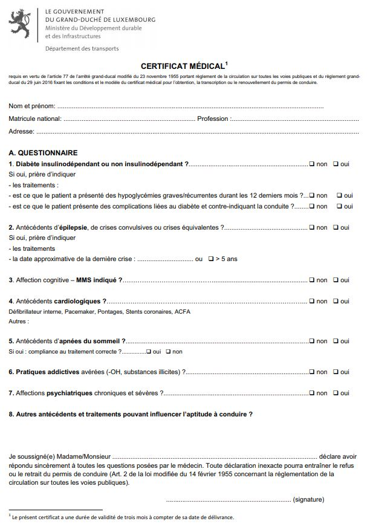
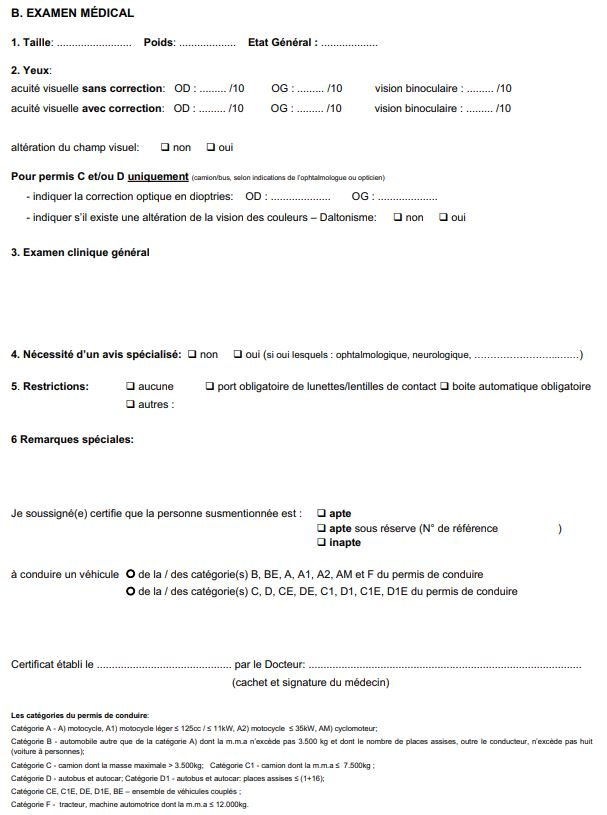

# Règlement grand-ducal du 22 juin 2016 fixant les conditions et le modèle du certificat médical pour l'obtention, la transcription ou le renouvellement du permis de conduire.

Nous Henri, Grand-Duc de Luxembourg, Duc de Nassau,

Vu la [loi modifiée du 14 février 1955](https://legilux.public.lu/eli/etat/leg/loi/1955/02/14/n3/jo) concernant la réglementation de la circulation sur toutes les voies publiques;

Vu l’[arrêté grand-ducal modifié du 23 novembre 1955](https://legilux.public.lu/eli/etat/leg/agd/1955/11/23/n1/jo) portant règlement de la circulation sur toutes les voies publiques;

Vu les avis de la Chambre des salariés, de la Chambre des fonctionnaires et employés publics, de la Chambre de commerce, de la Chambre des métiers et de la Chambre d’agriculture;

Vu l’article 2 (1) de la [loi modifiée du 12 juillet 1996](https://legilux.public.lu/eli/etat/leg/loi/1996/07/12/n3/jo) portant réforme du Conseil d’Etat et considérant qu’il y a urgence;

Sur le rapport de Notre Ministre du Développement durable et des Infrastructures, et après délibération du Gouvernement en Conseil;

Arrêtons:

## Art. 1er.

Le certificat médical pour l’obtention, la transcription ou le renouvellement du permis de conduire comporte les indications et questions suivantes:

Au recto:

<table>
<tr>
<td colspan="3">– Nom, prénom, matricule national, profession et adresse, de la personne examinée.</td>
<td></td>
<td></td>
</tr>
<tr>
<td><b>A.</b></td>
<td colspan="2"><b>Un questionnaire libellé comme suit:</b></td>
<td></td>
<td></td>
</tr>
<tr>
<td></td>
<td>1.</td>
<td>Diabète insulinodépendant ou non insulinodépendant?</td>
<td>non</td>
<td>oui</td>
</tr>
<tr>
<td></td>
<td></td>
<td>Si oui, prière d’indiquer</td>
<td></td>
<td></td>
</tr>
<tr>
<td></td>
<td></td>
<td>- les traitements:</td>
<td></td>
<td></td>
</tr>
<tr>
<td></td>
<td></td>
<td>- est ce que le patient a présenté des hypoglycémies graves/récurrentes durant les 12 derniers mois?</td>
<td>non</td>
<td>oui</td>
</tr>
<tr>
<td></td>
<td></td>
<td>- est ce que le patient présente des complications liées au diabète et contre-indiquant la conduite?</td>
<td>non</td>
<td>oui</td>
</tr>
<tr>
<td></td>
<td>2.</td>
<td>Antécédents d’épilepsie, de crises convulsives ou crises équivalentes?</td>
<td>non</td>
<td>oui</td>
</tr>
<tr>
<td></td>
<td></td>
<td>Si oui, prière d’indiquer</td>
<td></td>
<td></td>
</tr>
<tr>
<td></td>
<td>-</td>
<td>les traitements</td>
<td></td>
<td></td>
</tr>
<tr>
<td></td>
<td>-</td>
<td>la date approximative de la dernière crise . . . . . . . . . . . . . ou</td>
<td>> 5 ans</td>
<td></td>
</tr>
<tr>
<td></td>
<td>3.</td>
<td>Affection cognitive – MMS indiqué?</td>
<td>non</td>
<td>oui</td>
</tr>
<tr>
<td></td>
<td>4.</td>
<td>Antécédents cardiologiques?</td>
<td>non</td>
<td>oui</td>
</tr>
<tr>
<td colspan="3">Défibrillateur interne, Pacemaker, Pontages, Stents coronaires, ACFA Autres:</td>
<td></td>
<td></td>
</tr>
<tr>
<td></td>
<td>5.</td>
<td>Antécédents d’apnées du sommeil?</td>
<td>non</td>
<td>oui</td>
</tr>
<tr>
<td></td>
<td></td>
<td>Si oui: compliance au traitement correcte? ...........................</td>
<td>oui</td>
<td>non</td>
</tr>
<tr>
<td></td>
<td>6.</td>
<td>Pratiques addictives avérées (-OH, substances illicites)?......</td>
<td>non</td>
<td>oui</td>
</tr>
<tr>
<td></td>
<td>7.</td>
<td>Affections psychiatriques chroniques et sévères?</td>
<td>non</td>
<td>oui</td>
</tr>
<tr>
<td></td>
<td>8.</td>
<td>Autres antécédents et traitements pouvant influencer l’aptitude à conduire?</td>
<td></td>
<td></td>
</tr>
<tr>
<td colspan="5">Le questionnaire comprend en outre une déclaration, datée et signée par la personne examinée, ayant la teneur suivante:</td>
</tr>
<tr>
<td colspan="5">«Je soussigné(e) Madame/Monsieur . . . . . . . . . . . . . . . . . déclare avoir répondu sincèrement à toutes les questions posées par le médecin. Toute déclaration inexacte pourra entraîner le refus ou le retrait du permis de conduire (Art. 2 de la <a href="https://legilux.public.lu/eli/etat/leg/loi/1955/02/14/n3/jo">loi modifiée du 14 février 1955</a> concernant la réglementation de la circulation sur toutes les voies publiques).</td>
</tr>
<tr>
<td></td>
<td></td>
<td colspan="3">. . . . . . . . . . . . . . . . . . . . . . (signature)»</td>
</tr>
</table>

Au verso:

<table>
<tr>
<td><b>B.</b></td>
<td colspan="6"><b>Le résultat de l’examen médical libellé comme suit:</b></td>
<td></td>
</tr>
<tr>
<td>1.</td>
<td colspan="2">Taille:.......................................</td>
<td colspan="2">Poids:.....................................</td>
<td colspan="3">Etat Général:...........................</td>
</tr>
<tr>
<td>2.</td>
<td>Yeux:</td>
<td></td>
<td></td>
<td></td>
<td></td>
<td></td>
<td></td>
</tr>
<tr>
<td></td>
<td colspan="2">acuité visuelle sans correction:</td>
<td>OD: … /10</td>
<td>OG: … /10</td>
<td colspan="3">vision binoculaire: … /10</td>
</tr>
<tr>
<td></td>
<td colspan="2">acuité visuelle avec correction:</td>
<td>OD: … /10</td>
<td>OG: … /10</td>
<td colspan="3">vision binoculaire: … /10</td>
</tr>
<tr>
<td></td>
<td colspan="2">altération du champ visuel:</td>
<td>non</td>
<td>oui</td>
<td></td>
<td></td>
<td></td>
</tr>
<tr>
<td></td>
<td colspan="7">Pour permis C et/ou D uniquement (camion/bus, selon indications de l’ophtalmologue ou opticien)</td>
</tr>
<tr>
<td></td>
<td colspan="3">- indiquer la correction optique en dioptries:</td>
<td colspan="2">OD:...........</td>
<td colspan="2">OG:............</td>
</tr>
<tr>
<td></td>
<td colspan="5">- indiquer s’il existe une altération de la vision des couleurs – Daltonisme:</td>
<td>non</td>
<td>oui</td>
</tr>
<tr>
<td>3.</td>
<td colspan="2">Examen clinique général</td>
<td></td>
<td></td>
<td></td>
<td></td>
<td></td>
</tr>
<tr>
<td>4.</td>
<td>Nécessité d’un avis spécialisé:</td>
<td>non</td>
<td colspan="5">oui (si oui lesquels: ophtalmologique, neurologique, …)</td>
</tr>
<tr>
<td>5.</td>
<td>Restrictions: automatique obligatoire</td>
<td>aucune autres</td>
<td colspan="4">port obligatoire de lunettes/lentilles de contact</td>
<td>boîte</td>
</tr>
<tr>
<td>6.</td>
<td>Remarques spéciales:</td>
<td></td>
<td></td>
<td></td>
<td></td>
<td></td>
<td></td>
</tr>
<tr>
<td></td>
<td colspan="7">Le résultat de l’examen médical comprend en outre une déclaration, datée et signée par le médecin-examinateur, ayant la teneur suivante:</td>
</tr>
<tr>
<td></td>
<td colspan="4">«Je soussigné(e) certifie que la personne susmentionnée est:</td>
<td>apte</td>
<td></td>
<td></td>
</tr>
<tr>
<td></td>
<td></td>
<td></td>
<td></td>
<td></td>
<td colspan="3">apte sous réserve (N° de référence)</td>
</tr>
<tr>
<td></td>
<td></td>
<td></td>
<td></td>
<td></td>
<td>inapte</td>
<td></td>
<td></td>
</tr>
<tr>
<td></td>
<td>à conduire un véhicule</td>
<td colspan="6">de la/ des catégorie(s) B, BE, A, A1, A2, AM et F du permis de conduire de la/des catégorie(s) C, D, CE, DE, C1, D1, C1E, D1E du permis de conduire</td>
</tr>
<tr>
<td></td>
<td colspan="4">Certificat établi le ...............................................</td>
<td colspan="3">par le Docteur:....................................... (cachet et signature du médecin)»</td>
</tr>
<tr>
<td colspan="8">– Les catégories du permis de conduire.</td>
</tr>
</table>

## Art. 2.

Le certificat médical doit être conforme au modèle figurant en annexe du présent règlement.

Il a une durée de validité de trois mois, à compter de la date de délivrance par le médecin-examinateur.

## Art. 3.

Le [règlement ministériel du 23 avril 2012](https://legilux.public.lu/eli/etat/leg/rmin/2012/04/23/n17/jo) arrêtant les conditions et le modèle du certificat médical pour l’obtention, la transcription ou le renouvellement du permis de conduire, est abrogé.

## Art. 4.

Notre Ministre du Développement durable et des Infrastructures est chargé de l’exécution du présent règlement grand-ducal qui sera publié au Mémorial pour entrer en vigueur le 1er juillet 2016.

Le Ministre du Développement durable et des Infrastructures,   François Bausch

Palais de Luxembourg, le 22 juin 2016.   Henri

