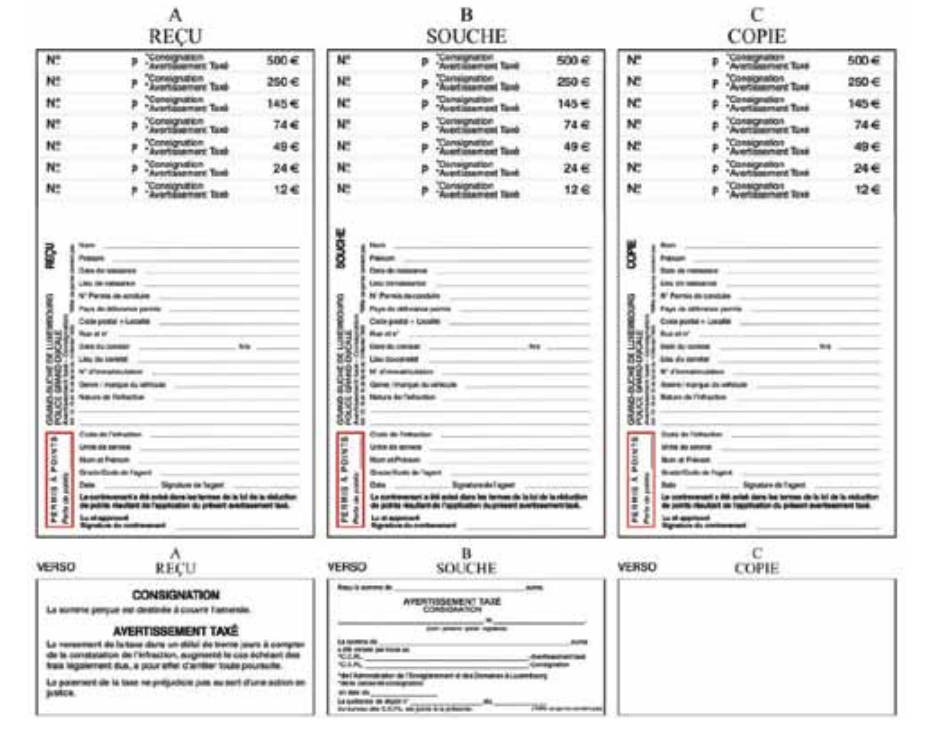
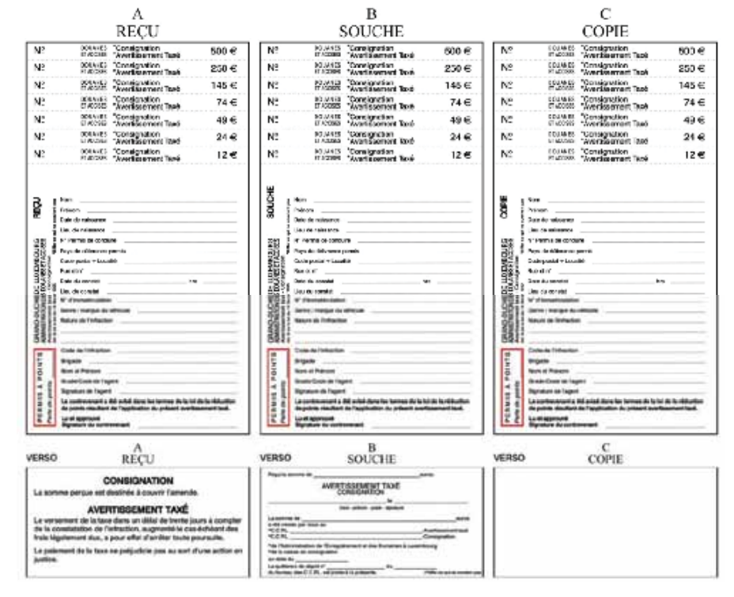
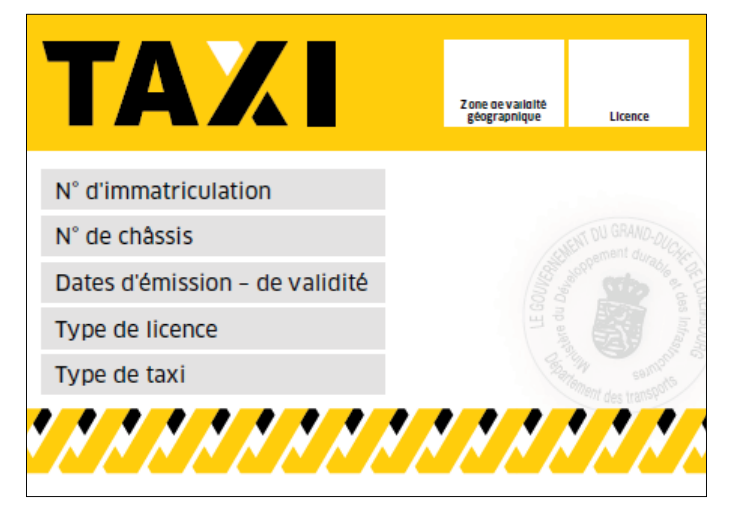

# Règlement grand-ducal du 23 juillet 2016 \n1) fixant les modalités d’application de la législation portant organisation des services de taxis; \n2) modifiant l’arrêté grand-ducal modifié du 23 novembre 1955 portant règlementation de la circulation sur toutes les voies publiques; \n3) modifiant le règlement grand-ducal modifié du 26 août 1993 relatif aux avertissements taxés, aux consignations pour contrevenants non résidents ainsi qu’aux mesures d’exécution de la législation en matière de mise en fourrière des véhicules et en matière de permis à points; \n4) modifiant le règlement grand-ducal modifié du 5 novembre 2015 portant réglementation de la circulation sur les voies et places ouvertes à la circulation publique aux abords de la Gare de Luxembourg; \n5) abrogeant le règlement grand-ducal du 9 juillet 2004 fixant des prix maxima pour courses en taxi; et \n6) abrogeant le règlement grand-ducal modifié du 3 décembre 1997 portant règlementation des services de taxis à l’Aéroport de Luxembourg.

Nous Henri, Grand-Duc de Luxembourg, Duc de Nassau,

Vu la [loi du 5 juillet 2016](https://legilux.public.lu/eli/etat/leg/loi/2016/07/05/n3/jo) portant a) organisation des services de taxis et b) modification du [Code de la consommation](https://legilux.public.lu/eli/etat/leg/code/consommation);

Vu l’article 112-8 du [Code de la consommation](https://legilux.public.lu/eli/etat/leg/code/consommation);

Vu les avis de la Chambre de commerce, de la Chambre des métiers et de la Chambre des salariés;

Vu l’avis de la Commission nationale pour la protection des données;

Notre Conseil d’Etat entendu;

Sur le rapport de Notre Ministre du Développement durable et des Infrastructures et de Notre Ministre de l’Economie et après délibération du Gouvernement en conseil;

Arrêtons:

## Chapitre Ier — Pièces justificatives pour l’obtention et le renouvellement d’une licence d’exploitation de taxi et d’une carte de conducteur de taxi

### Art. 1er.

(1) Pour l’obtention et le renouvellement d’une licence d’exploitation de taxi il y a lieu de joindre:

a) aux demandes émanant des personnes physiques les pièces suivantes:

1\. une copie du passeport, de la carte d’identité, du titre de voyage ou de tout autre document en tenant lieu, en cours de validité, permettant l’identification de l’intéressé;

2\. une copie de l’autorisation d’établissement ou d’une décision de principe d’établissement de loueur de taxis délivrée sur base de la [loi du 2 septembre 2011](https://legilux.public.lu/eli/etat/leg/loi/2011/09/02/n1/jo) réglementant l’accès aux professions d’artisan, de commerçant, d’industriel ainsi qu’à certaines professions libérales, en cours de validité;

3\. une copie du certificat d’immatriculation (partie I) ou, le cas échéant, un certificat du constructeur renseignant le numéro de châssis;

4\. une preuve de paiement de la taxe d’instruction;

5\. une attestation de l’Administration de l’enregistrement indiquant le numéro de TVA;

b) aux demandes émanant des sociétés commerciales les pièces suivantes:

1\. une copie des statuts de la société commerciale;

2\. une copie du passeport, de la carte d’identité, du titre de voyage ou de tout autre document en tenant lieu, en cours de validité, permettant l’identification du dirigeant;

3\. une copie de l’autorisation d’établissement ou d’une décision de principe d’établissement de loueur de taxis délivrée sur base de la [loi précitée du 2 septembre 2011](https://legilux.public.lu/eli/etat/leg/loi/2011/09/02/n1/jo), en cours de validité;

4\. une copie du certificat d’immatriculation (partie I) ou, le cas échéant, un certificat du constructeur renseignant le numéro de châssis;

5\. une preuve de paiement de la taxe d’instruction;

6\. une attestation de l’Administration de l’enregistrement indiquant le numéro de TVA;

7\. un extrait du Registre de Commerce et des Sociétés renseignant le numéro de la société.

(2) Pour l’obtention et le renouvellement d’une licence d’exploitation de taxi zéro émissions, il y a lieu de joindre en outre des documents visés au paragraphe 1er, une copie du contrat d’achat ou du contrat de crédit-bail indiquant la date de livraison d’un taxi zéro émissions, tel que défini à l’article 1er de la [loi du 5 juillet 2016](https://legilux.public.lu/eli/etat/leg/loi/2016/07/05/n3/jo) portant organisation des services de taxis.

(3) Pour l’échange visé à l’article 25, paragraphe 1er de la [loi du 5 juillet 2016](https://legilux.public.lu/eli/etat/leg/loi/2016/07/05/n3/jo) portant a) organisation des services de taxis et b) modification du [Code de la consommation](https://legilux.public.lu/eli/etat/leg/code/consommation), il y a lieu de joindre en plus de l’autorisation d’exploitation de taxi un certificat par lequel l’autorité émettrice dudit certificat atteste que l’autorisation d’exploitation de taxi délivrée sur base de la [loi modifiée du 18 mars 1997](https://legilux.public.lu/eli/etat/leg/loi/1997/03/18/n1/jo) portant réglementation des services de taxis était valable au moment de la date d’entrée en vigueur de [cette loi](https://legilux.public.lu/eli/etat/leg/loi/1997/03/18/n1/jo).

### Art. 2.

Pour l’obtention et le renouvellement d’une carte de conducteur de taxi, il y a lieu de joindre à la demande:

a) une copie du passeport, de la carte d’identité, du titre de voyage ou de tout autre document en tenant lieu, en cours de validité, permettant l’identification de l’intéressé;

b) une copie du permis de conduire, valable pour la conduite de taxis;

c) un extrait du casier judiciaire datant de moins de trois mois;

d) une copie du certificat de participation dont question à l’article 9 de la [loi du 5 juillet 2016](https://legilux.public.lu/eli/etat/leg/loi/2016/07/05/n3/jo) portant organisation des services de taxis;

e) une déclaration écrite et signée par laquelle l’intéressé justifie ses connaissances linguistiques conformément à l’article 7 de la [loi du 5 juillet 2016](https://legilux.public.lu/eli/etat/leg/loi/2016/07/05/n3/jo) portant organisation des services de taxis;

f) une photographie récente de 45/35 mm sur papier souple, la tête prise de face ayant au moins 20 mm de hauteur;

g) une preuve de paiement de la taxe d’instruction.

## Chapitre II — Normes environnementales

### Art. 3.

(1) Pour les véhicules comportant quatre places assises, hormis celle du conducteur:

a) les taxis qui font l’objet d’une licence d’exploitation de taxi nouvelle ou d’une transcription après l’entrée en vigueur de la [loi du 5 juillet 2016](https://legilux.public.lu/eli/etat/leg/loi/2016/07/05/n3/jo) portant organisation des services de taxis, doivent respecter les normes environnementales suivantes après le 1er janvier 2017:

1\. en matière d’émissions de CO2: max. 130 g de CO2/km; et

2\. en matière de norme EURO: min. EURO 5;

b) les taxis qui font l’objet d’une licence d’exploitation de taxi nouvelle ou d’une transcription après l’entrée en vigueur de la [loi du 5 juillet 2016](https://legilux.public.lu/eli/etat/leg/loi/2016/07/05/n3/jo) portant organisation des services de taxis, doivent respecter les normes environnementales suivantes après le 1er janvier 2021:

1\. en matière d’émissions de CO2: max. 95 g de CO2/km; et

2\. en matière de norme EURO: min. EURO 6.

(2) Pour les véhicules comportant entre cinq et huit places assises, hormis celle du conducteur, les taxis qui font l’objet d’une licence d’exploitation de taxi nouvelle ou d’une transcription après l’entrée en vigueur de la [loi du 5 juillet 2016](https://legilux.public.lu/eli/etat/leg/loi/2016/07/05/n3/jo) portant organisation des services de taxis, doivent respecter les normes environnementales suivantes après le 1er janvier 2022:

1\. en matière d’émissions de CO2: max. 147 g de CO2/km; et

2\. en matière de norme EURO: min. EURO 6.

## Chapitre III — Equipements spéciaux des taxis

### Art. 4.

(1) Le tableau-taxi doit être affiché à tout moment de manière visible dans l’habitacle avant du taxi à portée de vue des passagers. Un deuxième exemplaire doit à tout moment être mis à disposition du client sur demande de celui-ci.

(2) Le tableau-taxi doit être conforme au modèle fixé à l’annexe 1.

Ce tableau-taxi doit répondre aux conditions suivantes:

a) être de nature fixe, sous forme de carton sous plastique;

b) avoir une largeur d’au moins 200 mm et une hauteur d’au moins 140 mm;

c) indiquer en caractères bien lisibles:

1\. le ou les noms et le ou les prénoms ou la raison sociale de l’exploitant de taxi,

2\. l’adresse du principal établissement de l’exploitant de taxi,

3\. le nombre de places assises,

4\. la date de validité de la licence,

5\. le type de la licence d’exploitation de taxi,

6\. le type de taxi,

7\. les tarifs.

Ces indications doivent figurer dans les champs prévus;

d) porter le numéro de la licence d’exploitation de taxi et de la zone de validité géographique;

e) indiquer les coordonnées de l’organisme visé à l’article 17 de la [loi du 5 juillet 2016](https://legilux.public.lu/eli/etat/leg/loi/2016/07/05/n3/jo) portant organisation des services de taxis.

(3) Le tableau-taxi doit être apposé par l’exploitant.

Si un tableau-taxi a été volé, perdu, détruit, endommagé ou rendu autrement illisible ou inutilisable, l’exploitant de taxi concerné est tenu de le remplacer sans délai.

### Art. 5.

(1) Les taxis doivent être munis d’une plaque-zone-taxi apposée à tout moment derrière le pare-brise côté droit du véhicule et être visible de l’extérieur.

(2) La plaque-zone-taxi doit être conforme au modèle fixé à l’annexe 2.

Cette plaque-zone-taxi doit répondre aux conditions suivantes:

a) avoir une forme rectangulaire et être d’une largeur d’au moins 100 mm et d’une hauteur d’au moins 70 mm, sous forme de carton;

b) indiquer en caractères lisibles le numéro de la zone de validité géographique et le numéro de la licence d’exploitation de taxi;

c) indiquer le numéro d’immatriculation du taxi;

d) indiquer le numéro de châssis du taxi;

e) indiquer la date d’émission et la date limite de validité de la licence d’exploitation de taxi;

f) indiquer le type de la licence d’exploitation de taxi;

g) indiquer le type de taxi;

h) porter le cachet du ministre ayant les Transports dans ses attributions désigné ci-après par «le ministre».

(3) La plaque-zone-taxi est délivrée par le ministre à l’exploitant de taxi au même moment que la licence d’exploitation de taxi.

Si une plaque-zone-taxi a été volée, perdue, détruite, endommagée ou rendue autrement illisible ou inutilisable, l’exploitant de taxi concerné est tenu d’en informer le ministre et de la remplacer sans délai. A cette fin, il doit faire parvenir une demande écrite motivée au ministre accompagnée soit d’une déclaration de perte soit de la plaque-zonetaxi endommagée ou rendue autrement illisible ou inutilisable.

### Art. 6.

(1) Un panneau lumineux doit être installé sur le toit du taxi. Il doit s’allumer dès que le taxi est mis à la disposition des clients et s’éteindre dès que le compteur du taximètre est mis en route.

(2) Ce panneau lumineux doit répondre aux conditions suivantes:

a) avoir une forme rectangulaire ou trapézoïdale, les coins étant arrondis;

b) avoir une largeur au minimum de 250 mm et au maximum de 520 mm, à condition toutefois que cette largeur ne dépasse pas le gabarit du toit du taxi sur lequel il est monté;

c) avoir une hauteur au minimum de 75 mm et au maximum de 120 mm;

d) porter à ses faces avant et arrière l’inscription «Taxi»:

1\. en jaune avec un contour noir;

2\. d’une hauteur au minimum de 50 mm;

3\. composée de lettres ayant une épaisseur au minimum de 10 mm et au maximum de 15 mm;

e) avoir, à titre facultatif, des lignes de contour, à condition pour celles-ci d’être de la même couleur que l’inscription «Taxi» et d’avoir une largeur maximale de 20 mm;

f) comporter un éclairage interne uniforme et non éblouissant, dont la couleur n’est ni le bleu ni l’orange;

g) ne comporter aucun élément ni aucune inscription à caractère réfléchissant;

h) ne pas être muni d’inscriptions publicitaires autres que la raison sociale ou les coordonnées de l’entreprise;

i) être fixé sur le toit du taxi, selon les règles de l’art et de façon à ne présenter aucun danger pour la sécurité des usagers de la voie publique;

j) avoir le point le plus bas de son bord inférieur à moins de 150 mm du toit du taxi.

(3) Le panneau lumineux doit être apposé par l’exploitant du taxi.

Si un panneau lumineux a été volé, perdu, détruit, endommagé ou rendu autrement illisible ou inutilisable, l’exploitant de taxi concerné est tenu de le remplacer sans délai.

### Art. 7.

(1) L’exploitant de taxi doit tenir en permanence à bord du taxi un carnet métrologique à jour pour chaque taximètre installé dans un taxi qu’il exploite. Ce carnet doit documenter d’une façon complète et univoque l’installation du taximètre ainsi que toutes les interventions effectuées, et notamment les réparations, les vérifications, les scellements et bris de scellements ainsi que les essais éventuels et leurs résultats.

(2) Le modèle du carnet métrologique ainsi que les données qu’il doit renseigner sont fixés par le ministre.

(3) Le carnet métrologique est délivré par la Société nationale de circulation automobile, ci-après dénommée «SNCA», sous le contrôle du ministre.

En vue de la délivrance du carnet métrologique, l’exploitant de taxi doit présenter sa licence d’exploitation de taxi et disposer, en tant que propriétaire ou détenteur, d’un taxi.

Les prestations à fournir par la SNCA en relation avec la délivrance du carnet métrologique sont à charge de l’exploitant de taxi.

(4) Si un carnet métrologique a été volé, perdu, détruit, endommagé ou rendu autrement illisible ou inutilisable, l’exploitant de taxi concerné est tenu d’en informer sans délai la SNCA. Cette information se fait sous forme d’une déclaration de perte, dans les formes et conditions prévues pour la déclaration de perte du certificat d’immatriculation d’un véhicule.

Après avoir enregistré la déclaration de perte et récupéré, le cas échéant, le carnet métrologique original inutilisable, la SNCA met à la disposition de l’exploitant un duplicata du carnet métrologique original.

(5) Tout carnet métrologique est lié à un seul taximètre. En cas de transfert d’un taximètre sur un autre taxi, le même carnet doit être conservé, seul le taxi dans lequel le taximètre est réinstallé doit être renseigné dans le carnet. Si un taxi équipé d’un taximètre change d’exploitant de taxi sans que le taximètre n’ait été désinstallé, le même carnet doit être conservé.

(6) Le cas échéant, le carnet métrologique doit accompagner le taximètre afférent en réparation. Si un taximètre de remplacement est installé dans un taxi pendant le temps de réparation du taximètre défectueux ou non conforme, le taximètre de remplacement doit être couvert par son propre carnet métrologique.

(7) L’exploitant de taxi doit mettre sans délai hors service tout taxi dès que le taximètre y installé ne répond plus aux exigences réglementaires ou faire remplacer, sans délai, le taximètre défectueux ou non conforme par un taximètre en état de fonctionnement et conforme.

(8) L’exploitant de taxi et le chauffeur doivent s’assurer de l’état réglementaire des pneumatiques et tout particulièrement de la conformité de la dimension de ces pneumatiques à celles ayant servi pour déterminer le coefficient caractéristique de chaque taxi.

(9) L’exploitant de taxi et le chauffeur doivent s’assurer de l’état réglementaire du taximètre et tout particulièrement du déclenchement du calcul du temps d’attente conformément aux modalités définies par le ministre.

### Art. 8.

(1) Tout taximètre installé dans un taxi, y compris ses dispositifs complémentaires qui peuvent avoir une influence, directe ou indirecte, sur le calcul du prix à payer par l’usager du taxi, ainsi que leur circuit d’installation, doivent être scellés par la SNCA, sans que les qualités métrologiques du taximètre soient altérées et de façon à ce que tout accès aux éléments protégés par le scellement soit rendu impossible et sans que la pellicule de scellement soit cassée.

(2) Tous les scellements relatifs à un taximètre doivent porter de façon non équivoque et indélébile la marque de la SNCA.

(3) Le bris de scellement peut être effectué par un installateur de taximètre bénéficiant d’un agrément par le fabricant de taximètre pour le taximètre en question:

a) pour programmer un changement d’un élément ou d’un paramètre ayant un effet déterminant sur le calcul du tarif, à condition de documenter le bris de scellement dûment dans le carnet métrologique, d’apposer un scellement dont les modalités sont déterminées par le ministre, et de présenter le taximètre pour scellement à la SNCA dans un délai de cinq jours ouvrables suivant le bris de scellement;

b) pour toute autre raison technique liée au bon fonctionnement du taximètre et à la fixation du tarif, à condition de documenter le bris de scellement dûment dans le carnet métrologique, de notifier le bris de scellement sans délai à la SNCA et d’apposer un scellement dont les modalités sont déterminées par le ministre.

(4) Le ministre fixe les exigences techniques pour les taximètres et leurs dispositifs complémentaires ainsi que les modalités de remplissage du carnet métrologique.

(5) En cas de mise hors service définitive du taximètre l’exploitant doit retourner sans délai l’original du carnet métrologique à la SNCA.

### Art. 9.

(1) Une vérification par la SNCA du fonctionnement correct et conforme d’un taximètre installé dans un taxi, comportant, selon le cas, un scellement partiel ou complet du taximètre ou de son installation, doit au moins avoir lieu dans les cas suivants:

a) lors de la première installation du taximètre dans un taxi;

b) lors de chaque intervention qui donne lieu soit à un changement d’un élément ou d’un paramètre ayant un effet déterminant sur le calcul du tarif du taximètre, notamment lors d’un remplacement des pneumatiques montés sur le taxi par des pneumatiques d’autres dimensions non agréés ou d’un changement du donneur d’impulsions ou un réglage de la date et de l’heure;

c) au plus tard une année après la dernière vérification du taximètre ou après cinq bris de scellements ininterrompus d’opérations visées à l’article 8, paragraphe 3 b).

A cette fin, la SNCA peut exiger la présentation de toute pièce ou de tout document qu’elle juge utile dans le cadre de la vérification en question.

Pour tout bris de scellement visé à l’article 8, paragraphe 3 b), la SNCA peut requérir toutes les informations utiles pour la vérification du bien-fondé de l’opération effectuée.

(2) Les modalités conditionnant les vérifications auxquelles la SNCA est tenue de procéder sur les taximètres et leur installation dans les taxis ainsi que les conditions selon lesquelles la SNCA et l’installateur sont tenus d’assurer un archivage et traçage approprié de toutes ces interventions sont arrêtées par le ministre.

### Art. 10.

(1) Chaque taximètre installé dans un taxi doit être muni d’une vignette, apposée sur le taximètre soit par la SNCA, soit, après un bris de scellement, par l’installateur bénéficiant d’un agrément par le fabricant de taximètre pour le taximètre en question.

(2) Les données qu’elle doit renseigner sont fixées par le ministre.

(3) Une vignette ne doit être apposée sur un taximètre par la SNCA ou l’installateur que si le taximètre, ses dispositifs complémentaires et son installation répondent à toutes les exigences du présent règlement et de ses dispositions d’exécution. Toute vignette apposée sur un taximètre non conforme à ces exigences doit, le cas échéant, en être enlevée.

(4) Une nouvelle vignette est apposée par la SNCA sur un taximètre dans tous les cas prévus au paragraphe 1er de l’article 9. Par ailleurs une nouvelle vignette peut être apposée sur un taximètre en cas de dégradation accidentelle de la vignette dont ce taximètre est pourvu, à condition que la SNCA se soit assurée qu’il n’y a pas de doute sur la raison de la dégradation en question. Le cas échéant, le remplacement de la vignette doit être mentionné dans le carnet métrologique du taximètre afférent.

(5) Une nouvelle vignette est apposée par l’installateur sur un taximètre dans tous les cas prévus à l’article 8, paragraphe 3 b). Par ailleurs une nouvelle vignette peut être apposée sur un taximètre en cas de dégradation accidentelle de la vignette dont ce taximètre est pourvu, à condition que l’installateur bénéficiant d’un agrément par le fabricant de taximètre pour le taximètre en question se soit assuré qu’il n’y a pas de doute sur la raison de la dégradation en question. Le cas échéant, le remplacement de la vignette doit être mentionné dans le carnet métrologique du taximètre afférent.

(6) La délivrance de la vignette apposée par la SNCA se fait dans les conditions du paragraphe 3 de l’article 7.

La délivrance de la vignette apposée par l’installateur se fait par l’installateur.

En vue de la mise à disposition de vignettes d’installateur, l’installateur doit présenter annuellement à la SNCA son agrément d’installateur par le fabricant de taximètre et la liste des taximètres pour lesquels il dispose d’un agrément.

Le cas échéant, la délivrance d’un duplicata d’une vignette apposée par l’installateur se fait dans les conditions du paragraphe 4 de l’article 7.

### Art. 11.

(1) Les vignettes dont question à l’article 10 doivent être apposées sur le boîtier du taximètre lui-même ou, à défaut, à proximité immédiate du taximètre, à un endroit facilement accessible sans démontage du taximètre. Dans ce dernier cas, l’endroit de fixation de la vignette doit être spécifié dans le carnet métrologique du taximètre.

(2) Les vignettes doivent être scellées au moyen d’une pellicule de scellement autocollante qui ne doit pas pouvoir être retirée sans donner lieu concomitamment à la destruction de la vignette.

### Art. 12.

Les tarifs que la SNCA est autorisée à percevoir pour les services prestés par elle en vertu du présent règlement sont fixés comme suit:

| a) | Constitution d’un dossier lors de la première vérification d’un taximètre: | 25,64 euros HTVA |
|---|---|---|
| b) | Vérification d’un taximètre et de son installation: | 29,92 euros HTVA |
| c) | Scellement d’un taximètre et de son installation: | 25,64 euros HTVA |
| d) | Délivrance d’un carnet métrologique: | 21,37 euros HTVA |
| e) | Délivrance d’un duplicata d’un carnet métrologique: | 42,73 euros HTVA |
| f) | Délivrance d’un lot de dix vignettes d’installateur: | 4,98 euros HTVA. |

## Chapitre IV — Affichage des tarifs

### Art. 13.

(1) L’exploitant de taxi doit afficher à tout moment sur la fenêtre arrière droite de son taxi de manière visible le tarif des services de taxi.

(2) Le modèle d’affichage des tarifs doit être conforme au modèle fixé à l’annexe 3.

Cet affichage doit répondre aux conditions suivantes:

a) avoir une largeur d’au moins 200 mm et une hauteur d’au moins 130 mm;

b) indiquer les tarifs unitaires et les tarifs forfaitaires;

c) indiquer les suppléments par colis, par animal ainsi que tout autre supplément pratiqué;

d) indiquer les moyens de paiement acceptés;

e) indiquer le numéro de la zone de validité géographique et le numéro de la licence d’exploitation de taxi;

f) indiquer le numéro de TVA ainsi que le numéro de l’autorisation d’établissement;

g) indiquer les tarifs en caractères bien lisibles.

Ces indications doivent figurer dans les champs prévus.

(3) Si une affiche des tarifs a été volée, perdue, détruite, endommagée ou rendue autrement illisible ou inutilisable, l’exploitant de taxi concerné est tenu de la remplacer sans délai.

## Chapitre V — Données traitées

### Art. 14.

(1) Les données de fichiers accessibles en vertu du paragraphe 4 de l’article 18 de la [loi du 5 juillet 2016](https://legilux.public.lu/eli/etat/leg/loi/2016/07/05/n3/jo) portant organisation des services de taxi sont:

a) concernant l’exploitant personne physique: nom, prénom, date de naissance, pays de naissance, numéro d’identification du registre national des personnes physiques, résidence habituelle, numéro de téléphone, adresse électronique, numéro de fax, adresse de correspondance;

b) concernant l’exploitant société commerciale: nom et prénom du dirigeant, date de naissance du dirigeant, pays de naissance du dirigeant, numéro d’identification du dirigeant du registre national des personnes physiques, dénomination de la société, résidence habituelle du dirigeant, adresse, numéro de téléphone, adresse électronique, numéro de fax, adresse de correspondance;

c) concernant le conducteur de taxi: nom, prénom, date de naissance, pays de naissance, numéro d’identification du registre national des personnes physiques, résidence habituelle, numéro de téléphone, numéro du permis de conduire, catégorie du permis, date de délivrance du permis, date de fin de validité du permis, photographie, adresse électronique, numéro de fax, adresse de correspondance.

Les photographies ne sont conservées que pendant une durée de deux mois après la délivrance de la carte de conducteur et sont, à l’expiration de ce délai, automatiquement et irréversiblement supprimées.

(2) Les données qui peuvent être communiquées à la SNCA en vertu du paragraphe 10 de l’article 18 de la [loi du 5 juillet 2016](https://legilux.public.lu/eli/etat/leg/loi/2016/07/05/n3/jo) portant organisation des services de taxi sont les données suivantes:

a) pour l’exploitant

– nom et prénom(s) de l’exploitant personne physique ou du dirigeant

– dénomination de la société

– adresse de résidence

– adresse de correspondance

b) pour la voiture (taxi)

– numéro d’immatriculation

– numéro de châssis

– date de première mise

– marque

– modèle

– couleur

– nombre maximum de passagers

– taille des roues

– norme Euro

– émission CO2

c) pour le taximètre

– numéro du carnet métrologique

– type de taximètre

– numéro de série du taximètre

– information sur la modification apportée

– date de la modification

– date de vérification.

## Chapitre VI — Commission des taxis

### Art. 15.

La Commission des taxis, désignée ci-après la «commission», qui a pour mission d’instruire tout dossier, d’entendre l’intéressé dans ses explications et moyens de défense, dresse un procès-verbal et formule un avis motivé, pris à la majorité des voix, à l’adresse du ministre avant que ce dernier ne prenne des mesures ou des sanctions administratives visées à l’article 19, paragraphe 1er de la [loi du 5 juillet 2016](https://legilux.public.lu/eli/etat/leg/loi/2016/07/05/n3/jo) portant organisation des services de taxis.

### Art. 16.

(1) La commission se réunit sur convocation du président de la commission. La convocation mentionne l’ordre du jour arrêté par le président.

Si, après instruction du dossier, la commission estime qu’une sanction ou mesure au sens de l’article 19 de la [loi du 5 juillet 2016](https://legilux.public.lu/eli/etat/leg/loi/2016/07/05/n3/jo) portant organisation des services de taxis n’est pas nécessaire, elle ne convoque pas l’intéressé.

Si, après instruction du dossier, la commission estime qu’une sanction ou mesure dans le sens de l’article 19, paragraphe 1er, de la [loi du 5 juillet 2016](https://legilux.public.lu/eli/etat/leg/loi/2016/07/05/n3/jo) portant organisation des services de taxis est susceptible d’être prononcée, elle adresse au moins quatorze jours avant la séance de la commission une convocation par lettre recommandée avec avis de réception à l’intéressé, l’invitant à comparaître devant elle. Si l’intéressé, dûment convoqué, ne comparaît pas, la commission rend son avis sans l’avoir entendu.

(2) La commission peut entendre des témoins. Elle peut s’entourer d’experts à titre consultatif pour l’assister dans ses travaux.

(3) La commission peut demander tout document et élément d’information qu’elle juge nécessaire pour l’accomplissement de sa mission.

### Art. 17.

La commission se compose de membres effectifs et suppléants dont:

a) un membre représentant le ministre;

b) un membre représentant le ministre ayant les Classes moyennes dans ses attributions;

c) un membre représentant la Chambre des métiers;

d) un membre représentant la SNCA.

### Art. 18.

La commission est composée pour chaque affaire de trois membres au moins et d’un secrétaire qui ne prend pas part aux délibérations.

Le représentant du ministre remplit les fonctions de président de la commission.

En cas d’empêchement du président, la commission est présidée par le membre ayant les Classes moyennes dans ses attributions.

La commission se dote d’un règlement intérieur qui est approuvé par le ministre.

### Art. 19.

Les membres de la commission touchent une indemnité de 25 euros par réunion.

Le président et le secrétaire touchent le double de l’indemnité par réunion.

## Chapitre VII — Taxes d’instruction et taxe annuelle

### Art. 20.

Les taxes prévues à l’article 20, paragraphe 1er et 2, de la [loi du 5 juillet 2016](https://legilux.public.lu/eli/etat/leg/loi/2016/07/05/n3/jo) portant organisation des services de taxis, sont fixées comme suit:

a) Taxes d’instruction du dossier

\**Référence aux articles et paragraphes de la loi** **Libellé de la taxe** **Montant de la taxe (en euros)** 04 -04 Délivrance d’une licence d’exploitation de taxi 100 05 -02 Transcription d’une licence d’exploitation de taxi 35 -02 Extension temporaire d’une licence d’exploitation de taxi 20 -04 Renouvellement d’une licence d’exploitation de taxi 80 -05 Délivrance d’une licence d’exploitation de taxi provisoire 20 10 -03 Délivrance d’une carte de conducteur de taxi 50 11 -02 Renouvellement d’une carte de conducteur de taxi 25 20 Modification à apporter -01 – à une licence d’exploitation de taxi 30 -01 – à une carte de conducteur de taxi 20 Délivrance d’un duplicata -01 – d’une licence d’exploitation de taxi 30 -01 – d’une carte de conducteur de taxi 20 25 -01 Echange d’une licence d’exploitation de taxi 50

b) Taxe annuelle

\**Référence aux articles et paragraphes de la loi** **Taxe** **Montant de la taxe (en euros)** 20 -02 Par licence d’exploitation de taxi, pour les taxis de la zone géographique 1: – pour un taxi qui émet plus de 100 g CO2/km 500 – pour un taxi qui émet moins de 100 g CO2/km 300 – pour un taxi qui émet 0 g CO2/km 150 pour les taxis des zones géographiques 2 à 6: – pour un taxi qui émet plus de 100 g CO2/km 400 – pour un taxi qui émet moins de 100 g CO2/km 200 – pour un taxi qui émet 0 g CO2/km 50

## Chapitre VIII — Dispositions modificatives

### Art. 21.

L’[arrêté grand-ducal modifié du 23 novembre 1955](https://legilux.public.lu/eli/etat/leg/agd/1955/11/23/n1/jo) portant règlement de la circulation sur toutes les voies publiques est modifié comme suit:

1\. A l’article 2, la rubrique 2.8 est remplacée par le texte suivant:

> Taxi: voiture automobile à personnes, telle que définie à l’article 1er de la [loi du 5 juillet 2016](https://legilux.public.lu/eli/etat/leg/loi/2016/07/05/n3/jo) portant organisation des services de taxis.

2\. A l’article 45*bis*, l’alinéa 9 est supprimé.

3\. L’intitulé C. – Taxis, voitures de location avec chauffeur et location de voitures sans chauffeur, figurant au-dessus de l’article 55, est remplacé par Voitures de location avec chauffeur et location de voitures sans chauffeur.

4\. Les articles 55 et 56 sont abrogés.

5\. L’article 56*ter* est remplacé par le libellé suivant:

> **Art. 56*ter*.**
>
> Les propriétaires et les conducteurs sont responsables de l’observation de l’article 56*bis*.

6\. A l’article 57, l’alinéa 1er est remplacé par le libellé suivant:

> Les véhicules destinés à la location sans chauffeur ne sont pas soumis aux dispositions des articles 56*bis* et 56*ter*.

7\. A l’article 115, la lettre c) du paragraphe 1er est remplacée par le libellé suivant:

> c) des agents de l’Administration des douanes et accises contrôlant les dispositions légales relatives soit à la vignette prévue par la législation portant approbation et application de l’accord relatif à la perception d’un droit d’usage pour l’utilisation de certaines routes par des véhicules utilitaires lourds, soit à la surcharge des véhicules, soit aux documents de bord et d’équipements spéciaux des véhicules destinés à transporter ou à utiliser comme carburant des matières pouvant présenter un danger pour la sécurité, la salubrité ou la santé publiques, soit qui agissent dans le cadre des fonctions qui leur sont conférées par la législation sur les services de taxis, lorsque ces agents portent les insignes de leur fonction; ces insignes doivent être visibles sans confusion possible de jour comme de nuit.

### Art. 22.

Le [règlement grand-ducal modifié du 26 août 1993](https://legilux.public.lu/eli/etat/leg/rgd/1993/08/26/n1/jo) relatif aux avertissements taxés, aux consignations pour contrevenants non résidents ainsi qu’aux mesures d’exécution de la législation en matière de mise en fourrière des véhicules et en matière de permis à points, est modifié comme suit:

(1) A l’article 1er, le premier alinéa est remplacé par le libellé suivant:

> Les montants de la taxe à percevoir pour l’avertissement taxé prévu par les articles 12 et 15 de la [loi modifiée du 14 février 1955](https://legilux.public.lu/eli/etat/leg/loi/1955/02/14/n3/jo) concernant la réglementation de la circulation sur toutes les voies publiques ainsi que par l’article 21 de la [loi du 5 juillet 2016](https://legilux.public.lu/eli/etat/leg/loi/2016/07/05/n3/jo) portant organisation des services de taxis sont fixés à 12, 24, 49, 74, 145, 250 et 500 euros, selon la gravité de l’infraction constatée.

(2) Le catalogue des avertissements taxés qui figure en annexe I du [règlement grand-ducal modifié du 26 août 1993](https://legilux.public.lu/eli/etat/leg/rgd/1993/08/26/n1/jo) précité est modifié comme suit:

I. Dans la phrase introductive, la lettre F) est remplacée par le libellé suivant:

> «F) de la [loi du 5 juillet 2016](https://legilux.public.lu/eli/etat/leg/loi/2016/07/05/n3/jo) portant organisation des services de taxis et du [règlement grand-ducal du 23 juillet 2016](https://legilux.public.lu/eli/etat/leg/rgd/2016/07/23/n14/jo) fixant les modalités d’application de la législation portant organisation des services de taxis;».

II. Les rubriques 55 et 56 sont abrogées.

III. A la rubrique 115 et 116, l’infraction 02 est remplacée par le libellé suivant:

> <table>
> <tr>
> <td rowspan="2"><i>Référence aux articles</i></td>
> <td rowspan="2"><i>Nature de l’infraction</i></td>
> <td colspan="4"><i>Montant de la taxe</i></td>
> <td rowspan="2"><i>Réduction de points en vertu de l’art. 2*bis *de la <a href="https://legilux.public.lu/eli/etat/leg/loi/1955/02/14/n3/jo">loi modifiée du 14 février 1955</a></i></td>
> </tr>
> <tr>
> <td>I</td>
> <td>II</td>
> <td>III</td>
> <td>IV</td>
> </tr>
> <tr>
> <td>-02</td>
> <td>Défaut de suivre les injonctions des agents de l’Administration des douanes et accises contrôlant les dispositions légales relatives soit à la vignette prévue par la législation portant approbation et application de l’accord relatif à la perception d’un droit d’usage pour l’utilisation de certaines routes par des véhicules utilitaires lourds, soit à la surcharge des véhicules, soit aux documents de bord et d’équipements spéciaux des véhicules, soit qui agissent dans le cadre des fonctions qui leur sont conférées par la législation sur les services de taxis</td>
> <td></td>
> <td></td>
> <td></td>
> <td>145</td>
> <td>2</td>
> </tr>
> </table>

IV. La partie F. est remplacée par le libellé suivant:

> F.
>
> I. [Loi du 5 juillet 2016](https://legilux.public.lu/eli/etat/leg/loi/2016/07/05/n3/jo) portant organisation des services de taxis.
>
> II. [Règlement grand-ducal du 23 juillet 2016](https://legilux.public.lu/eli/etat/leg/rgd/2016/07/23/n14/jo) fixant les modalités d’application de la législation portant organisation des services de taxis.
>
> I. **[Loi du 5 juillet 2016](https://legilux.public.lu/eli/etat/leg/loi/2016/07/05/n3/jo) portant organisation des services de taxis**
>
> <table>
> <tr>
> <th rowspan="2"><i>Référence aux articles et paragraphes de la loi</i></th>
> <th rowspan="2"><i>Nature de l’infraction</i></th>
> <th colspan="4"><i>Montant de la taxe</i></th>
> </tr>
> <tr>
> <th>I</th>
> <th>II</th>
> <th>III</th>
> <th>IV</th>
> </tr>
> <tr>
> <td>02</td>
> <td></td>
> <td></td>
> <td></td>
> <td></td>
> <td></td>
> </tr>
> <tr>
> <td>-01</td>
> <td>Stationnement sur un emplacement de taxi sans se trouver en permanence à la disposition des clients</td>
> <td></td>
> <td>74</td>
> <td></td>
> <td></td>
> </tr>
> <tr>
> <td>-02</td>
> <td>Stationnement ou placement du taxi à un endroit de la voie publique, autre qu’un emplacement de taxi, en vue d’offrir ses services ou d’attendre des commandes par voie radiotéléphonique, téléphonique, écrite ou par tout autre moyen électronique</td>
> <td></td>
> <td>74</td>
> <td></td>
> <td></td>
> </tr>
> <tr>
> <td>03</td>
> <td>Effectuer le service des taxis sans être titulaire d’une licence d’exploitation de taxi valable</td>
> <td></td>
> <td></td>
> <td></td>
> <td>500</td>
> </tr>
> <tr>
> <td>05</td>
> <td></td>
> <td></td>
> <td></td>
> <td></td>
> <td></td>
> </tr>
> <tr>
> <td>-01</td>
> <td>Défaut d’exhiber la licence d’exploitation de taxi sur demande des membres de la Police grand-ducale ou des fonctionnaires de l’Administration des douanes et accises</td>
> <td></td>
> <td></td>
> <td>145</td>
> <td></td>
> </tr>
> <tr>
> <td>-02</td>
> <td>Prise en charge de clients sur le territoire d’une zone autre que celle pour laquelle la licence d’exploitation de taxi est valable, hormis le cas de services de taxis effectués sur demande préalable dûment documentée par voie radiotéléphonique, téléphonique, écrite ou par tout autre moyen électronique</td>
> <td></td>
> <td></td>
> <td></td>
> <td>500</td>
> </tr>
> <tr>
> <td>-03</td>
> <td>Stationnement ou attente à un endroit de la voie publique, en vue d’offrir ses services ou d’attendre des commandes par voie radiotéléphonique, téléphonique, écrite ou par tout autre moyen électronique sur le territoire d’une zone autre que pour laquelle la licence d’exploitation de taxi est valable</td>
> <td></td>
> <td></td>
> <td></td>
> <td>250</td>
> </tr>
> <tr>
> <td>07</td>
> <td></td>
> <td></td>
> <td></td>
> <td></td>
> <td></td>
> </tr>
> <tr>
> <td>-01</td>
> <td>Non-titulaire d’une carte de conducteur de taxi valable</td>
> <td></td>
> <td></td>
> <td></td>
> <td>250</td>
> </tr>
> <tr>
> <td>11</td>
> <td></td>
> <td></td>
> <td></td>
> <td></td>
> <td></td>
> </tr>
> <tr>
> <td>-01</td>
> <td>Défaut d’afficher de manière visible la carte de conducteur de taxi pendant le service</td>
> <td></td>
> <td>74</td>
> <td></td>
> <td></td>
> </tr>
> <tr>
> <td>12</td>
> <td></td>
> <td></td>
> <td></td>
> <td></td>
> <td></td>
> </tr>
> <tr>
> <td>-01</td>
> <td>Chargement de clients à moins de 50 mètres d’un emplacement de taxi</td>
> <td></td>
> <td></td>
> <td>145</td>
> <td></td>
> </tr>
> <tr>
> <td>-02</td>
> <td>Refus de prendre en charge sur les emplacements de taxi un client demandant une course à courte distance</td>
> <td></td>
> <td></td>
> <td>145</td>
> <td></td>
> </tr>
> <tr>
> <td>-03</td>
> <td>Fait de gêner, par quelque moyen que soit, le libre choix des clients de prendre un autre taxi se trouvant sur les emplacements de taxi</td>
> <td></td>
> <td></td>
> <td>145</td>
> <td></td>
> </tr>
> <tr>
> <td>-04</td>
> <td>Prise en charge d’individus poursuivis par la clameur publique ou par les membres de la Police grand-ducale</td>
> <td></td>
> <td></td>
> <td>145</td>
> <td></td>
> </tr>
> <tr>
> <td>-05</td>
> <td>Recherche de clients par paroles, gestes ou pancartes</td>
> <td></td>
> <td></td>
> <td>145</td>
> <td></td>
> </tr>
> <tr>
> <td>-06</td>
> <td>Fait de fumer dès la prise en charge d’un ou de plusieurs clients</td>
> <td>24</td>
> <td></td>
> <td></td>
> <td></td>
> </tr>
> <tr>
> <td>-07</td>
> <td>Fait de réclamer un prix supérieur à celui du tarif indiqué par le taximètre</td>
> <td></td>
> <td></td>
> <td></td>
> <td>250</td>
> </tr>
> <tr>
> <td>-08</td>
> <td>Mise en marche du taximètre avant la prise en charge du client</td>
> <td></td>
> <td></td>
> <td></td>
> <td>250</td>
> </tr>
> <tr>
> <td>-09</td>
> <td>Mise à zéro du taximètre avant que le client n’ait pu vérifier le prix dû</td>
> <td></td>
> <td></td>
> <td></td>
> <td>250</td>
> </tr>
> <tr>
> <td>-10</td>
> <td>Fait de mettre en compte le temps d’arrêt en cas de panne</td>
> <td></td>
> <td></td>
> <td></td>
> <td>250</td>
> </tr>
> <tr>
> <td>-11</td>
> <td>Fait de circuler de manière continue au même endroit afin de démarcher un client</td>
> <td></td>
> <td></td>
> <td>145</td>
> <td></td>
> </tr>
> <tr>
> <td>-12</td>
> <td>Fait de ne pas laisser le client lire et comparer les prix</td>
> <td></td>
> <td></td>
> <td>145</td>
> <td></td>
> </tr>
> <tr>
> <td>-13</td>
> <td>Fait de placer son véhicule de manière à constituer un danger ou une gêne pour les autres usagers</td>
> <td></td>
> <td>74</td>
> <td></td>
> <td></td>
> </tr>
> <tr>
> <td>-14</td>
> <td>Défaut de placer ou de faire avancer le taxi dans l’ordre d’arrivée des taxis sur les emplacements de taxi</td>
> <td></td>
> <td>74</td>
> <td></td>
> <td></td>
> </tr>
> <tr>
> <td>-15</td>
> <td>Défaut de délivrer un reçu réglementaire au client</td>
> <td></td>
> <td></td>
> <td>145</td>
> <td></td>
> </tr>
> <tr>
> <td>-16</td>
> <td>Défaut de conduire les clients à destination par le chemin le plus court, sauf dans le cas où le client en indique un autre</td>
> <td></td>
> <td></td>
> <td></td>
> <td>250</td>
> </tr>
> <tr>
> <td>-17</td>
> <td>Défaut d’assurer le fonctionnement régulier et normal du taximètre pendant toute la durée de la course</td>
> <td></td>
> <td></td>
> <td></td>
> <td>250</td>
> </tr>
> <tr>
> <td>-18</td>
> <td>Utiliser un véhicule autre qu’un taxi zéro émissions pour une licence d’exploitation de taxis zéro émissions</td>
> <td></td>
> <td></td>
> <td></td>
> <td>500</td>
> </tr>
> <tr>
> <td>13</td>
> <td></td>
> <td></td>
> <td></td>
> <td></td>
> <td></td>
> </tr>
> <tr>
> <td>-01</td>
> <td>Utilisation d’un véhicule, autre qu’un taxi dans le cadre des services de taxis</td>
> <td></td>
> <td></td>
> <td></td>
> <td>500</td>
> </tr>
> <tr>
> <td>-02</td>
> <td>Utilisation à des fins autres que comme taxi, d’un véhicule routier équipé d’un taximètre règlementaire, d’un tableau-taxi, d’une plaque-zone-taxi ou d’un panneau lumineux «TAXI»</td>
> <td></td>
> <td></td>
> <td></td>
> <td>500</td>
> </tr>
> <tr>
> <td>-03</td>
> <td>Utilisation d’un taxi non muni</td>
> <td></td>
> <td></td>
> <td></td>
> <td>500</td>
> </tr>
> <tr>
> <td></td>
> <td>d’un taximètre réglementaire</td>
> <td></td>
> <td></td>
> <td></td>
> <td>250</td>
> </tr>
> <tr>
> <td>-04</td>
> <td>d’un tableau-taxi réglementaire</td>
> <td></td>
> <td></td>
> <td></td>
> <td>250</td>
> </tr>
> <tr>
> <td>-05</td>
> <td>d’une plaque-zone-taxi réglementaire</td>
> <td></td>
> <td></td>
> <td></td>
> <td>250</td>
> </tr>
> <tr>
> <td>-06</td>
> <td>d’un panneau lumineux «TAXI» réglementaire</td>
> <td></td>
> <td></td>
> <td></td>
> <td>250</td>
> </tr>
> <tr>
> <td>-07</td>
> <td>Installation sur un véhicule routier, autre qu’un taxi, d’un taximètre réglementaire, d’un tableau-taxi, d’une plaque-zone-taxi ou d’un panneau lumineux «TAXI»</td>
> <td></td>
> <td></td>
> <td></td>
> <td>250</td>
> </tr>
> <tr>
> <td>-08</td>
> <td>Affichage de publicité lumineuse ou réfléchissante</td>
> <td></td>
> <td></td>
> <td>145</td>
> <td></td>
> </tr>
> <tr>
> <td>-09</td>
> <td>Affichage de publicité sur une vitre</td>
> <td></td>
> <td></td>
> <td>145</td>
> <td></td>
> </tr>
> <tr>
> <td>15</td>
> <td></td>
> <td></td>
> <td></td>
> <td></td>
> <td></td>
> </tr>
> <tr>
> <td>-01</td>
> <td>Défaut d’utiliser le taximètre réglementaire</td>
> <td></td>
> <td></td>
> <td></td>
> <td>250</td>
> </tr>
> <tr>
> <td>-02</td>
> <td>Défaut d’un dispositif imprimeur opérationnel relié au taximètre</td>
> <td></td>
> <td></td>
> <td></td>
> <td>250</td>
> </tr>
> <tr>
> <td>17</td>
> <td></td>
> <td></td>
> <td></td>
> <td></td>
> <td></td>
> </tr>
> <tr>
> <td>-01</td>
> <td>Défaut d’afficher de manière visible à l’intérieur du taxi les coordonnées du Ministère du développement durable et des infrastructures</td>
> <td></td>
> <td></td>
> <td>145</td>
> <td></td>
> </tr>
> </table>
>
> II. **[Règlement grand-ducal du 23 juillet 2016](https://legilux.public.lu/eli/etat/leg/rgd/2016/07/23/n14/jo) fixant les modalités d’application de la législation portant organisation des services de taxis**
>
> <table>
> <tr>
> <th rowspan="2"><i>Référence aux articles et paragraphes du règlement grand-ducal</i></th>
> <th rowspan="2"><i>Nature de l’infraction</i></th>
> <th colspan="4"><i>Montant de la taxe</i></th>
> </tr>
> <tr>
> <th>I</th>
> <th>II</th>
> <th>III</th>
> <th>IV</th>
> </tr>
> <tr>
> <td>03</td>
> <td></td>
> <td></td>
> <td></td>
> <td></td>
> <td></td>
> </tr>
> <tr>
> <td>-01</td>
> <td>Non-respect après le 1er janvier 2017, pour les véhicules faisant l’objet d’une licence d’exploitation de taxi nouvelle ou d’une transcription, des normes environnementales pour l’exploitation d’un véhicule comportant moins de six places assises, hormis celle du conducteur, en tant que taxi</td>
> <td></td>
> <td></td>
> <td></td>
> <td>500</td>
> </tr>
> <tr>
> <td>-02</td>
> <td>Non-respect après le 1er janvier 2021, pour les véhicules faisant l’objet d’une licence d’exploitation de taxi nouvelle ou d’une transcription, des normes environnementales pour l’exploitation d’un véhicule comportant moins de six places assises, hormis celle du conducteur, en tant que taxi</td>
> <td></td>
> <td></td>
> <td></td>
> <td>500</td>
> </tr>
> <tr>
> <td>-03</td>
> <td>Non-respect après le 1er janvier 2022, pour les véhicules faisant l’objet d’une licence d’exploitation de taxi nouvelle ou d’une transcription, des normes environnementales pour l’exploitation d’un véhicule comportant plus de cinq places assises, hormis celle du conducteur, en tant que taxi</td>
> <td></td>
> <td></td>
> <td></td>
> <td>500</td>
> </tr>
> <tr>
> <td>04</td>
> <td></td>
> <td></td>
> <td></td>
> <td></td>
> <td></td>
> </tr>
> <tr>
> <td>-01</td>
> <td>Défaut d’afficher à tout moment de manière visible un tableau-taxi dans l’habitacle du taxi</td>
> <td></td>
> <td></td>
> <td>145</td>
> <td></td>
> </tr>
> <tr>
> <td>-02</td>
> <td>Utilisation d’un tableau-taxi non-conforme au modèle</td>
> <td></td>
> <td>74</td>
> <td></td>
> <td></td>
> </tr>
> <tr>
> <td>-03</td>
> <td>Défaut de remplacer un tableau-taxi volé, perdu, détruit, endommagé ou rendu autrement illisible ou inutilisable</td>
> <td></td>
> <td>74</td>
> <td></td>
> <td></td>
> </tr>
> <tr>
> <td>05</td>
> <td></td>
> <td></td>
> <td></td>
> <td></td>
> <td></td>
> </tr>
> <tr>
> <td>-01</td>
> <td>Défaut d’apposer la plaque-zone-taxi à tout moment derrière le pare-brise côté droit du véhicule et d’être visible de l’extérieur</td>
> <td></td>
> <td></td>
> <td>145</td>
> <td></td>
> </tr>
> <tr>
> <td>-02</td>
> <td>Utilisation d’une plaque-zone-taxi non conforme au modèle</td>
> <td></td>
> <td>74</td>
> <td></td>
> <td></td>
> </tr>
> <tr>
> <td>-03</td>
> <td>Défaut de remplacer une plaque-zone taxi volée, perdue, détruite, endommagée ou rendue autrement illisible ou inutilisable ou d’en informer le ministre</td>
> <td></td>
> <td>74</td>
> <td></td>
> <td></td>
> </tr>
> <tr>
> <td>06</td>
> <td></td>
> <td></td>
> <td></td>
> <td></td>
> <td></td>
> </tr>
> <tr>
> <td>-01</td>
> <td>Défaut d’installer le panneau-lumineux sur le toit du taxi</td>
> <td></td>
> <td></td>
> <td>145</td>
> <td></td>
> </tr>
> <tr>
> <td>-02</td>
> <td>Utilisation d’un panneau-lumineux non-conforme au modèle</td>
> <td></td>
> <td>74</td>
> <td></td>
> <td></td>
> </tr>
> <tr>
> <td>-03</td>
> <td>Défaut de remplacer un panneau-lumineux volé, perdu, détruit, endommagé ou rendu autrement illisible ou inutilisable</td>
> <td></td>
> <td>74</td>
> <td></td>
> <td></td>
> </tr>
> <tr>
> <td>07</td>
> <td></td>
> <td></td>
> <td></td>
> <td></td>
> <td></td>
> </tr>
> <tr>
> <td>-01</td>
> <td>Défaut de tenir en permanence à bord du taxi un carnet métrologique à jour</td>
> <td></td>
> <td></td>
> <td>145</td>
> <td></td>
> </tr>
> <tr>
> <td>-02</td>
> <td>Défaut de l’exploitant de taxi de mettre sans délai hors service tout taxi dès que le taximètre y installé ne répond plus aux exigences réglementaires ou faire remplacer, sans délai, le taximètre défectueux ou non conforme par un taximètre en état de fonctionnement et conforme</td>
> <td></td>
> <td></td>
> <td></td>
> <td>250</td>
> </tr>
> <tr>
> <td>-03</td>
> <td>Défaut de l’exploitant de taxi ou du chauffeur de s’assurer de l’état réglementaire des pneumatiques et tout particulièrement de la conformité de la dimension de ces pneumatiques à celles ayant servi pour déterminer le coefficient caractéristique de chaque taxi</td>
> <td></td>
> <td></td>
> <td></td>
> <td>250</td>
> </tr>
> <tr>
> <td>-04</td>
> <td>Défaut de l’exploitant de taxi ou du chauffeur de s’assurer de l’état réglementaire du taximètre et tout particulièrement du déclenchement du calcul du temps d’attente conformément aux modalités définies par le ministre</td>
> <td></td>
> <td></td>
> <td></td>
> <td>250</td>
> </tr>
> <tr>
> <td>08</td>
> <td></td>
> <td></td>
> <td></td>
> <td></td>
> <td></td>
> </tr>
> <tr>
> <td>-01</td>
> <td>Défaut de scellement non réglementaire du taximètre</td>
> <td></td>
> <td></td>
> <td>145</td>
> <td></td>
> </tr>
> <tr>
> <td>-03</td>
> <td>Défaut de documenter le bris de scellement dûment dans le carnet métrologique, d’apposer un scellement réglementaire ou non-respect du délai de 5 jours ouvrables suivant le bris de scellement pour présenter le taximètre pour scellement à la SNCA suite à une programmation d’un changement d’un élément ou d’un paramètre ayant un effet déterminant sur le calcul du tarif</td>
> <td></td>
> <td></td>
> <td>145</td>
> <td></td>
> </tr>
> <tr>
> <td>-03</td>
> <td>Défaut de documenter le bris de scellement dûment dans le carnet métrologique, de notifier le bris de scellement sans délai à la SNCA ou d’apposer un scellement réglementaire pour toute autre raison technique liée au bon fonctionnement du taximètre et à la fixation du tarif</td>
> <td></td>
> <td></td>
> <td>145</td>
> <td></td>
> </tr>
> <tr>
> <td>-05</td>
> <td>Défaut de retourner sans délai l’original du carnet métrologique à la SNCA en cas de mise hors service définitive du taximètre</td>
> <td></td>
> <td></td>
> <td>145</td>
> <td></td>
> </tr>
> <tr>
> <td>09</td>
> <td></td>
> <td></td>
> <td></td>
> <td></td>
> <td></td>
> </tr>
> <tr>
> <td></td>
> <td>Défaut de présentation auprès de la SNCA du taximètre:</td>
> <td></td>
> <td></td>
> <td></td>
> <td></td>
> </tr>
> <tr>
> <td>-01</td>
> <td>lors de la première installation du taximètre dans un taxi</td>
> <td></td>
> <td></td>
> <td>145</td>
> <td></td>
> </tr>
> <tr>
> <td>-02</td>
> <td>lors de chaque intervention qui donne lieu soit à un changement d’un élément ou d’un paramètre ayant un effet déterminant sur le calcul du tarif du taximètre, notamment lors d’un remplacement des pneumatiques montés sur le taxi par des pneumatiques d’autres dimensions ou d’un changement du donneur d’impulsions ou un réglage de la date et de l’heure</td>
> <td></td>
> <td></td>
> <td>145</td>
> <td></td>
> </tr>
> <tr>
> <td>-03</td>
> <td>au plus tard une année après la dernière vérification du taximètre ou après cinq bris de scellements ininterrompus d’opérations visées à l’article 8, paragraphe 3 b)</td>
> <td></td>
> <td></td>
> <td>145</td>
> <td></td>
> </tr>
> <tr>
> <td>10</td>
> <td></td>
> <td></td>
> <td></td>
> <td></td>
> <td></td>
> </tr>
> <tr>
> <td>-01</td>
> <td>Défaut d’une vignette réglementaire apposée sur le taximètre</td>
> <td></td>
> <td></td>
> <td>145</td>
> <td></td>
> </tr>
> <tr>
> <td>-02</td>
> <td>Défaut d’enlever une vignette lorsque le taximètre est désinstallé d’un taxi</td>
> <td></td>
> <td>74</td>
> <td></td>
> <td></td>
> </tr>
> <tr>
> <td>11</td>
> <td></td>
> <td></td>
> <td></td>
> <td></td>
> <td></td>
> </tr>
> <tr>
> <td>-01</td>
> <td>Défaut d’une pellicule de scellement autocollante sur le taximètre</td>
> <td></td>
> <td></td>
> <td>145</td>
> <td></td>
> </tr>
> <tr>
> <td>13</td>
> <td></td>
> <td></td>
> <td></td>
> <td></td>
> <td></td>
> </tr>
> <tr>
> <td>-01</td>
> <td>Défaut d’afficher de manière visible le tarif des services de taxi sur la fenêtre arrière droite du taxi</td>
> <td></td>
> <td></td>
> <td></td>
> <td>250</td>
> </tr>
> <tr>
> <td>-02</td>
> <td>Défaut d’utilisation du modèle d’affichage réglementaire</td>
> <td></td>
> <td></td>
> <td>145</td>
> <td></td>
> </tr>
> </table>

(3) L’annexe II-1 est remplacée par le libellé suivant:

«ANNEXE II-1

»

(4) L’annexe II-3 est remplacée par le libellé suivant:

«ANNEXE II-3

»

### Art. 23.

Au [règlement grand-ducal du 5 novembre 2015](https://legilux.public.lu/eli/etat/leg/rgd/2015/11/05/n1/jo) portant réglementation de la circulation sur les voies et places ouvertes à la circulation publique aux abords de la Gare de Luxembourg sont apportées les modifications suivantes:

(1) L’article 4 est remplacé par le texte suivant:

> **Art. 4.**
>
> Pour les voies ci-après, l’accès est interdit aux conducteurs de véhicules automoteurs, à l’exception des taxis qui disposent d’une licence d’exploitation de taxi pour la zone de validité géographique 1:
>
> – la zone taxis près du parvis de la Gare longeant la N3 de la sortie «nord» jusqu’à l’entrée «sud».
>
> Cette disposition est indiquée par le signal C,3a complété par un panneau additionnel du modèle 5a portant l’inscription «excepté taxis de la zone de validité géographique 1».

(2) L’article 18 est remplacé par le texte suivant:

> **Art. 18.**
>
> A l’endroit ci-après, l’arrêt et le stationnement sont interdits, à l’exception de l’arrêt et du stationnement des taxis qui disposent d’une licence d’exploitation de taxi pour la zone de validité géographique 1:
>
> – le long de la voie de contournement de la gare routière RGTR jusqu’à la sortie «nord» de la zone taxis près du parvis de la Gare longeant la N3.
>
> Cette disposition est indiquée par le signal C,19 complété par un panneau additionnel du modèle 5a portant l’inscription «excepté taxis de la zone de validité géographique 1».

## Chapitre IX — Dispositions abrogatoires

### Art. 24.

Sont abrogés:

a) le [règlement grand-ducal du 9 juillet 2004](https://legilux.public.lu/eli/etat/leg/rgd/2004/07/09/n1/jo) fixant des prix maxima pour courses en taxi;

b) le [règlement grand-ducal modifié du 3 décembre 1997](https://legilux.public.lu/eli/etat/leg/rgd/1997/12/03/n1/jo) portant réglementation des services de taxis à l’Aéroport de Luxembourg.

## Chapitre X — Dispositions finales

### Art. 25.

La référence au présent règlement grand-ducal se fait sous la forme suivante: «règlement grand-ducal du 23 juillet 2016 fixant les modalités d’application de la législation portant organisation des services de taxis».

## Chapitre XI — Dispositions transitoires

### Art. 26.

Pour les exploitants de taxis qui disposent d’une autorisation d’exploitation de taxi délivrée sur la base de la [loi modifiée du 18 mars 1997](https://legilux.public.lu/eli/etat/leg/loi/1997/03/18/n1/jo) portant réglementation des services de taxis, les dispositions des articles 4, paragraphe 2, 5, 7, paragraphe 1er, 8, paragraphe 1er, 9, paragraphe 1er b) et 10, paragraphe 1er, s’appliquent à partir de l’échange de cette autorisation d’exploitation de taxi contre une licence d’exploitation au sens de la [loi du 5 juillet 2016](https://legilux.public.lu/eli/etat/leg/loi/2016/07/05/n3/jo) portant organisation des services de taxis et au plus tard dans les six mois à compter de l’entrée en vigueur du présent règlement grand-ducal.

### Art. 27.

Le présent règlement grand-ducal entre en vigueur à la date de l’entrée en vigueur de la [loi du 5 juillet 2016](https://legilux.public.lu/eli/etat/leg/loi/2016/07/05/n3/jo) portant organisation des services de taxis.

### Art. 28.

Notre Ministre du Développement durable et des Infrastructures et Notre Ministre de l’Economie sont chargés, chacun en ce qui le concerne, de l’exécution du présent règlement qui sera publié au Mémorial.

Le Ministre du Développement durable et des Infrastructures,   François Bausch   Le Ministre de l’Economie,   Etienne Schneider

Cabasson, le 23 juillet 2016.   Henri

\**ANNEXE 1**

\**Modèle du tableau-taxi**

*[image omitted (0.6 MB) — see the official version: https://legilux.public.lu/eli/etat/leg/rgd/2016/07/23/n14/jo]*

\**ANNEXE 2**

\**Modèle de la plaque-zone-taxi**

\**ANNEXE 3**

\**Modèle d’affichage des tarifs**

*[image omitted (0.7 MB) — see the official version: https://legilux.public.lu/eli/etat/leg/rgd/2016/07/23/n14/jo]*
