# Règlement grand-ducal du 23 juillet 2016 modifiant 1. le règlement grand-ducal modifié du 30 novembre 2007 concernant la performance énergétique des bâtiments d’habitation; 2. le règlement grand-ducal modifié du 31 août 2010 concernant la performance énergétique des bâtiments fonctionnels; et 3. le règlement grand-ducal du 12 décembre 2012 instituant un régime d’aides pour la promotion de l’utilisation rationnelle de l’énergie et la mise en valeur des énergies renouvelables dans le domaine du logement.

Nous Henri, Grand-Duc de Luxembourg, Duc de Nassau,

Vu la [loi modifiée du 5 août 1993](https://legilux.public.lu/eli/etat/leg/loi/1993/08/05/n1/jo) concernant l’utilisation rationnelle de l’énergie;

Vu la [loi modifiée du 23 décembre 2004](https://legilux.public.lu/eli/etat/leg/loi/2004/12/23/n1/jo) établissant un système d’échange de quotas d’émission de gaz à effet de serre;

Vu la [directive 2010/31/UE](https://legilux.public.lu/eli/dir_ue/2010/31/jo) du Parlement européen et du Conseil du 19 mai 2010 sur la performance énergétique des bâtiments;

Vu les avis de la Chambre de commerce et de la Chambre des métiers;

Notre Conseil d’État entendu;

De l’assentiment de la Conférence des présidents de la Chambre des députés;

Sur le rapport de Notre Ministre de l’Économie, de Notre Ministre de l’Environnement et de Notre Ministre des Finances et après délibération du Gouvernement en conseil;

Arrêtons:

## Art. Ier.

Le [règlement grand-ducal modifié du 30 novembre 2007](https://legilux.public.lu/eli/etat/leg/rgd/2007/11/30/n7/jo) concernant la performance énergétique des bâtiments d’habitation est modifié comme suit:

1° A l’article 2, le paragraphe 3*bis* est remplacé pour prendre la teneur suivante:

> (3*bis*) « bâtiment d’habitation dont la consommation d’énergie est quasi nulle »: un bâtiment d’habitation qui respecte les exigences minimales définies au chapitre 1 de l’annexe et les exigences en vigueur à partir du 1er janvier 2017 en ce qui concerne la valeur spécifique du besoin en chaleur de chauffage **qH** visée au chapitre 2.1 de l’annexe et en ce qui concerne la valeur spécifique du besoin total en énergie primaire **QP** visée au chapitre 2.2 de l’annexe.

2° A l’article 3, le paragraphe 8 est remplacé pour prendre la teneur suivante:

> (8) L’étude de faisabilité visée à l’article 5 est à établir par les personnes visées au paragraphe 7 à l’exception de l’étude de faisabilité pour les bâtiments d’habitation neufs dotés d’un système de climatisation actif qui est à établir par les ingénieurs-conseils dont la profession est définie par la [loi du 13 décembre 1989](https://legilux.public.lu/eli/etat/leg/loi/1989/12/13/n1/jo) portant organisation des professions d’architecte et d’ingénieur-conseil.

3° L’article 4, paragraphe 3 est supprimé.

dustom 3°*bis*A l’article 6, paragraphe 1, la première phrase est complétée par les termes et l’exigence définie au chapitre 2.1 de l’annexe.

Au même article, le paragraphe 2 est remplacé par le texte suivant:

> (2) Alternativement, pour les extensions avec une surface de référence énergétique An inférieure ou égale à 80 mètres carrés, il peut être dérogé au respect de l’exigence définie au chapitre 2.1 de l’annexe si les exigences définies au tableau 1a du chapitre 1.1 de l’annexe sont respectées.

4° A l’annexe, le sommaire est supprimé.

5° A l’annexe, chapitre 0.1, définitions « Maison à économie d’énergie (ESH) », « Maison à basse consommation d’énergie (NEH) » et « Maison passive (PH) », les termes chapitre 1.3.3 sont remplacés par les termes chapitre 1.3.

6° A l’annexe, chapitre 0.2, le tableau est remplacé par le tableau suivant:

> | ∆UWB | W/(m²K) | Facteur de correction des ponts thermiques |
> |---|---|---|
> | A | m² | Surface de l’enveloppe thermique d’un bâtiment |
> | a | - | Paramètre numérique |
> | Ai | m² | Surface de plancher nette délimitée par les éléments de construction d’un espace utile/d’une zone |
> | AFe | m² | Surface de fenêtre |
> | AGF | m² | Surface de plancher |
> | ANGF,R | m² | Surface de plancher nette considérée lors de la détermination de la transmittance solaire |
> | AOG | m² | Surface de plancher de l’étage supérieur |
> | AOG,n | m² | Surface de plancher imputable pour l’étage supérieur |
> | aR | m | Profondeur du local (dimensions intérieures) |
> | AWA | m² | Surface totale des façades, non compris la surface totale des baies vitrées (ou fenêtres) |
> | AW | m² | Surface totale des baies vitrées (ou fenêtres) |
> | α | ° | Angle de vue d’un élément en surplomb horizontal / du paysage |
> | A/Ve | m-1 | Rapport entre la surface de l’enveloppe thermique d’un bâtiment au volume chauffé brut du bâtiment |
> | AFG | m² | Surface de la fermeture horizontale inférieure contre sol |
> | An | m² | Surface de référence énergétique |
> | bR | m | Longueur de la façade principale |
> | β | ° | Angle de vue d’un élément en surplomb latéral |
> | cH | - | Taux de couverture de la production de chaleur de chauffage |
> | cPL | Wh/(m³K) | Capacité d’accumulation thermique spécifique de l’air |
> | Cwirk | Wh/K | Capacité d’accumulation thermique effective |
> | cWW,i=1 | - | Taux de couverture de la production de chaleur par une installation solaire thermique (production d’eau chaude sanitaire) |
> | cWW,i=2 | - | Taux de couverture de la production de chaleur par une installation de chauffage de base (production d’eau chaude sanitaire) |
> | cWW,i=3 | - | Taux de couverture de la production de chaleur par un système de chauffage d’appoint (production d’eau chaude sanitaire) |
> | dT | m | Epaisseur effective d’un élément de construction |
> | e | - | Coefficient de la classe de protection |
> | eCO2 | kgCO2/kWh | Facteur environnemental rapporté à l’énergie finale |
> | eCO2,H | kgCO2/kWh | Facteur environnemental (chaleur de chauffage) |
> | eCO2,Hilf | kgCO2/kWh | Facteur environnemental (énergie auxiliaire) |
> | eCO2,WW | kgCO2/kWh | Facteur environnemental (eau chaude sanitaire) |
> | eE,H | kWhE/kWh | Facteur de dépense pour la production de chaleur de chauffage |
> | eE,WW | kWhE/kWh | Facteur de dépense pour la production d’eau chaude sanitaire |
> | ei | kWh/« Unité » | Pouvoir calorifique du vecteur énergétique utilisé pour l’année i |
> | eP | kWhp/kWhe | Facteur de dépense en énergie primaire rapporté à l’énergie finale |
> | eP,H | kWhp/kWhE | Facteur de dépense en énergie primaire (chaleur de chauffage) |
> | eP,Hilf | kWhp/kWhE | Facteur de dépense en énergie primaire (énergie auxiliaire) |
> | eP,WW | kWhp/kWhE | Facteur de dépense en énergie primaire (production d’eau chaude sanitaire) |
> | f | % | Quote-part de la surface des fenêtres |
> | f1/M | - | Facteur d’ajustement f1,M |
> | f2/M | - | Facteur d’ajustement f2,M |
> | fa/h | - | Rapport de la profondeur sur la hauteur libre du local |
> | fa/s | - | Facteur d’ajustement pour la prise en considération de l’inclinaison et de l’orientation de l’installation photovoltaïque |
> | FC | - | Facteur de réduction dû aux protections solaires |
> | fDWW,j | - | Facteur d‘ajustement limitant la prise en compte de l’autoconsommation de la production d’électricité par une installation photovoltaïque pour la production d’eau chaude sanitaire par des chauffe-eaux instantanés, (fDWW,j = 0 dans le cas de tout autre système de production d’eau chaude sanitaire) |
> | Ff,i | - | Facteur d’ombrage partiel des fenêtres dû à des éléments en surplomb latérales |
> | Fg | - | Facteur de réduction dû au réglage |
> | FG,i | - | Quote-part vitrée d’une fenêtre rapportée aux dimensions brutes (gros-œuvre) |
> | Fh,i | - | Facteur d’ombrage partiel des fenêtres dû à des constructions avoisinantes et au paysage |
> | fKlima | - | Facteur de correction climatique annuel pour la chaleur de chauffage |
> | fmod | - | Facteur de correction des exigences |
> | F0,i | - | Facteur d’ombrage partiel des fenêtres dû à des éléments en surplomb horizontales |
> | fPV,WE | - | Facteur de puissance de l’installation photovoltaïque en fonction du nombre de logements pour la production d’eau chaude sanitaire par un chauffe-eau instantané |
> | Fs,i | - | Facteur de conversion du pouvoir calorifique supérieur en pouvoir calorifique inférieur d’un vecteur énergétique |
> | FS,i | - | Facteur d’ombrage pour l’ombrage dû aux constructions pour les fenêtres i conformément à la norme DIN V 18599-2:2011-12, chapitre 6.4.1. |
> | fsys | - | Facteur de performance du système |
> | FV,i | - | Facteur d’encrassement d’une fenêtre |
> | FW,i | - | Facteur de réduction dû à une incidence non verticale du rayonnement solaire |
> | fw,M | - | Facteur de pondération mensuel |
> | fWW,d,e | - | Facteur de production électrique décentrale d’eau chaude sanitaire |
> | fze | - | Facteur de correction pour un chauffage intermittent |
> | FꝮ,i | - | Facteur de correction de la température |
> | fш,M | - | Facteur d’ajustement mensuel du rayonnement incident de l’installation photovoltaïque |
> | gtot | - | Facteur de transmission énergétique totale en tenant compte de la protection solaire |
> | gꞱ | - | Facteur de transmission énergétique totale pour une incidence verticale du rayonnement |
> | YM | - | Rapport mensuel entre les apports et les déperditions totales en chaleur |
> | h | W/(m²K) | Coefficient de déperdition spécifique de chaleur du bâtiment |
> | Hi | kWh/[Unité] | Pouvoir calorifique inférieur d’un vecteur énergétique |
> | Hiu | W/K | Coefficient de déperdition de chaleur entre un local chauffé et un local non chauffé |
> | hR | m | Hauteur libre du local (dimensions intérieures) |
> | Hs | kWh/[Unité] | Pouvoir calorifique supérieur d’un vecteur énergétique |
> | HT | W/K | Coefficient de déperdition de chaleur par transmission |
> | Hue | W/K | Coefficient de déperdition de chaleur d’un local non chauffé vers l’extérieur |
> | HV | W/K | Coefficient de déperdition de chaleur par ventilation |
> | HWB | W/K | Coefficient de déperdition de chaleur dû à des ponts thermiques linéaires |
> | Indice M | - | Correspond à une durée de référence d’un mois |
> | Indice i | - | Nombre, relatif au sous-ensemble i |
> | I0,s,M | [W/m²] | Intensité énergétique moyenne mensuelle du rayonnement solaire total sur une surface horizontale (0°) (climat de référence Luxembourg) |
> | I90,s,M | [W/m²] | Intensité énergétique moyenne mensuelle du rayonnement solaire total sur une surface verticale (90°) (climat de référence Luxembourg) |
> | IS,M,r | W/m² | Intensité énergétique moyenne mensuelle du rayonnement solaire total en fonction de l’orientation de la surface |
> | IS,M,x | W/m² | Intensité énergétique moyenne mensuelle du rayonnement solaire total sur une surface intermédiaire |
> | IS,ref | kW/m2 | Intensité énergétique de référence du rayonnement solaire avec 1 kW/m² |
> | Ꝯe,M | °C | Température extérieure moyenne par mois |
> | Ꝯi | °C | Température intérieure moyenne |
> | li | m | Longueur d’un pont thermique |
> | n | h-1 | Taux de renouvellement d’air effectif (énergétiquement efficace) |
> | n50 | h-1 | Valeur d’étanchéité à l’air du bâtiment obtenue pour une différence de pression de 50 Pa |
> | nH | h-1 | Taux de renouvellement de l’air moyen d’une installation de ventilation pendant le fonctionnement à pleine charge lors de la période de chauffage |
> | nN | h-1 | Taux de renouvellement de l’air moyen d’une installation de ventilation pendant le fonctionnement à charge partielle lors de la période de chauffage |
> | nWE | - | Nombre de logements |
> | ῃ0M | - | Taux d’utilisation mensuel des gains thermiques sans tenir compte de la transmission de chaleur au local dans le cas d’un réglage optimal des températures des locaux |
> | ῃBat | - | Rendement du système de stockage d’électricité |
> | ῃEWT | - | Rendement annuel de l’échangeur de chaleur géothermique |
> | ῃL | % | Rendement du système de récupération de chaleur en conditions d’exploitation |
> | ῃM | - | Taux d’utilisation mensuel des gains thermiques |
> | Ш | ° | Inclinaison de l’installation photovoltaïque |
> | PFG | m | Périmètre de la surface AFG |
> | PPV | kW | Puissance de crête que l’installation photovoltaïque fournit en conditions de test standard (STC) |
> | QCO2 | kgCO2/m²a | Valeur spécifique d’émissions totales de CO2 |
> | QCO2,H | kgCO2/m²a | Valeur spécifique d’émissions de CO2, chaleur de chauffage |
> | QCO2,Hilf | kgCO2/m²a | Valeur spécifique d’émissions de CO2, énergie auxiliaire |
> | QCO2,PV,self | kgCO2/m²a | Crédit spécifique annuel en émissions de CO2 imputable obtenu grâce à la production d’électricité d‘une installation photovoltaïque |
> | QCO2,WW | kgCO2/m²a | Valeur spécifique d’émissions de CO2, production d’eau chaude sanitaire |
> | QE,B | kWh/m²a | Valeur spécifique du besoin en énergie finale |
> | QE,Bat | kWh/M | Capacité du système de stockage d’électricité |
> | QE,B,H | kWh/m²a | Valeur spécifique du besoin en énergie finale pour la production centrale de chaleur de chauffage et la production décentrale d’eau chaude sanitaire |
> | Q*E,B,H | kWh/m²a | Valeur spécifique modifiée du besoin en énergie finale pour la production centrale de chaleur de chauffage et la production décentrale d’eau chaude sanitaire |
> | QE,B,H,WW | kWh/m²a | Valeur spécifique du besoin en énergie finale pour la production de chaleur de chauffage et d’eau chaude sanitaire par un système de chauffage central |
> | Q*E,B,H,WW | kWh/m²a | Valeur spécifique modifiée du besoin en énergie finale pour la production de chaleur de chauffage et d’eau chaude sanitaire par un système de chauffage central |
> | QE,H | kWh/m²a | Valeur spécifique du besoin en énergie finale, chaleur de chauffage |
> | QE,Hilf | kWh/m²a | Valeur spécifique du besoin en énergie finale, énergie auxiliaire |
> | QE,M,el | kWh/M | Besoin mensuel en électricité des installations techniques du bâtiment imputable |
> | QE,M,el,day | kWh/M | Besoin mensuel en électricité des installations techniques du bâtiment dans les périodes présentant un rayonnement solaire |
> | QE,M,el,night | kWh/M | Besoin mensuel en électricité des installations techniques du bâtiment en dehors des périodes présentant un rayonnement solaire |
> | QE,PV,Bat,M | kWh/M | Part mensuelle supplémentaire imputable grâce à un système de stockage d’électricité |
> | QE,PV | kWh/M | Production annuelle d’électricité d’une installation photovoltaïque |
> | QE,PV,M | kWh/M | Production mensuelle d’électricité d’une installation photovoltaïque |
> | QE,PV,self,a | kWh/a | Part annuelle autoconsommée de l’électricité produite par une installation photovoltaïque |
> | QE,PV,self,M | kWh/M | Part mensuelle autoconsommée de l’électricité produite par une installation photovoltaïque |
> | QE,V | kWh/m²a | Valeur spécifique de la consommation en énergie finale |
> | QE,V,H | kWh/m²a | Valeur spécifique de la consommation en énergie finale pour la production centrale de chaleur de chauffage et la production décentrale d’eau chaude sanitaire |
> | QE,V,H,WW | kWh/m²a | Valeur spécifique de la consommation en énergie finale pour la production centrale de chaleur de chauffage et d’eau chaude sanitaire |
> | QE,WW | kWh/m2a | Valeur spécifique du besoin en énergie finale, production d’eau chaude sanitaire |
> | Qh | kWh/a | Besoin annuel en chaleur de chauffage |
> | Qh,M | kWh/M | Besoin mensuel en chaleur de chauffage |
> | qH | kWh/m²a | Valeur spécifique du besoin en chaleur de chauffage |
> | QH | kWh/m²a | Chaleur de chauffage mise à disposition par une installation de production de chaleur |
> | qH,A | kWh/m²a | Besoin en énergie pour la distribution et l’accumulation de chaleur |
> | qH,Hilf | kWh/m²a | Valeur spécifique du besoin en énergie auxiliaire pour la production de chaleur de chauffage |
> | qH,Hilf,S | kWh/m²a | Valeur spécifique du besoin en énergie auxiliaire pour l’accumulation de chaleur de chauffage |
> | qH,Hilf,Ü | kWh/m²a | Valeur spécifique du besoin en énergie auxiliaire pour la transmission de chaleur de chauffage |
> | qH,Hilf,V | kWh/m²a | Valeur spécifique du besoin en énergie auxiliaire pour la distribution de chaleur de chauffage |
> | Qh,M | kWh/M | Besoin mensuel en chaleur de chauffage |
> | qH,max | kWh/m²a | Valeur maximale du besoin spécifique en chaleur de chauffage |
> | qH,ref | kWh/m²a | Valeur spécifique de référence du besoin en chaleur de chauffage |
> | qH,S | kWh/m²a | Déperditions spécifiques d’accumulation de chaleur |
> | qH,V | kWh/m²a | Déperditions spécifiques de distribution de chaleur |
> | QHilf,A | kWh/m²a | Valeur spécifique du besoin en énergie auxiliaire des installations techniques |
> | QHilf,H | kWh/m²a | Valeur spécifique du besoin en énergie auxiliaire pour la production de chaleur y comprises, la distribution, l’accumulation et la transmission |
> | QHilf,L | kWh/m²a | Valeur spécifique du besoin en énergie auxiliaire des installations de ventilation |
> | QHilf,WW | kWh/m²a | Valeur spécifique du besoin en énergie auxiliaire pour la production d’eau chaude sanitaire y comprises la distribution, l’accumulation et la transmission |
> | Qi,M | kWh/M | Gains de chaleur internes mensuels |
> | qiM | W/m2/h | Valeur spécifique moyenne des gains de chaleur internes mensuels |
> | qL | W/m³/h | Puissance spécifique absorbée par une installation de ventilation |
> | QP | kWh/m²a | Valeur spécifique du besoin total en énergie primaire |
> | QP,H | kWh/m²a | Valeur spécifique du besoin en énergie primaire, chaleur de chauffage |
> | QP,Hilf | kWh/m²a | Valeur spécifique du besoin en énergie primaire, énergie auxiliaire |
> | QP,max | kWh/m²a | Valeur maximale du besoin spécifique en énergie primaire total |
> | QP,PV,self | kWh/m²a | Crédit spécifique annuel en énergie primaire imputable obtenu grâce à la production d’électricité d‘une installation photovoltaïque |
> | QP,ref | kWh/m²a | Valeur spécifique de référence du besoin total en énergie primaire |
> | QP,WW | kWh/m²a | Valeur spécifique du besoin en énergie primaire, production d’eau chaude sanitaire |
> | Qs,M | kWh/M | Gains solaires mensuels par des éléments de construction transparents |
> | Qtl,M | kWh/M | Déperdition de chaleur mensuelle par ventilation et par transmission |
> | qV,i | kWh/a | Consommation énergétique au cours de l’année de référence i |
> | qV,H,i | kWh/a | Consommation énergétique au cours de l’année de référence i tributaire des conditions météorologiques |
> | qV,m | kWh/a | Consommation énergétique moyenne |
> | qV,WW,i | kWh/a | Consommation énergétique au cours de l’année de référence i indépendante des conditions météorologiques |
> | QWW | kWh/m²a | Valeur spécifique du besoin en énergie utile, production d’eau chaude sanitaire |
> | qWW | kWh/m²a | Valeur spécifique du besoin en énergie, production d’eau chaude sanitaire |
> | qWW,Hilf,S | kWh/m²a | Valeur spécifique du besoin en énergie auxiliaire, accumulation d’eau chaude sanitaire |
> | qWW,Hilf,V | kWh/m²a | Valeur spécifique du besoin en énergie auxiliaire, distribution d’eau chaude sanitaire |
> | qWW,S | kWh/m²a | Valeur spécifique des déperditions d’accumulation de l’eau chaude sanitaire |
> | qWW,V | kWh/m²a | Valeur spécifique des déperditions de distribution et de circulation de l’eau chaude sanitaire |
> | qWW,Hilf | kWh/m²a | Valeur spécifique du besoin en énergie auxiliaire, production d’eau chaude sanitaire |
> | Rse | m²K/W | Résistivité thermique extérieure |
> | Rsi | m²K/W | Résistivité thermique intérieure |
> | tB | h/a | Nombre d’heures de fonctionnement par an d’une installation technique |
> | tB,H | h | Durée de fonctionnement à pleine charge d’une installation technique pendant la durée de fonctionnement |
> | tB,N | h | Durée de fonctionnement à charge partielle d’une installation technique pendant la durée de fonctionnement |
> | tH | h | Durée de la période de chauffage |
> | tIG,day | - | Facteur d’ajustement pour la période présentant un rayonnement solaire |
> | tM ou TM | d/M | Nombre de jours par mois |
> | tS | - | Transmittance solaire des éléments de construction extérieurs d’un local |
> | tS,max | - | Valeur limite de la transmittance solaire des éléments de construction extérieurs d’un local |
> | Ƭ | h | Inertie thermique du bâtiment |
> | UFG0 | W/(m²K) | Valeur U d’une fermeture horizontale inférieure en contact avec le sol |
> | Ui | W/(m²K) | Coefficient de transmission thermique d’un élément de construction |
> | Umax | W/(m²K) | Valeurs maximales des coefficients de transmission thermique |
> | Umax,BH | W/(m²K) | Valeurs maximales des coefficients de transmission thermique d’éléments de construction spéciaux |
> | Ug | W/(m²K) | Valeur U d’une vitre |
> | Uf | W/(m²K) | Valeur U d’un cadre de fenêtre |
> | Uw | W/(m²K) | Valeur U de l’ensemble de la fenêtre (vitre et cadre) |
> | UWG0 | W/(m²K) | Valeur U d’une paroi en contact avec le sol |
> | Ve | m³ | Volume brut chauffé du bâtiment |
> | Ve,OG | m³ | Volume brut de l’étage supérieur |
> | Ve,OG-1 | m³ | Volume brut de l’étage situé au-dessous de l’étage supérieur |
> | Vi,s | « Unité »/a | Consommation énergétique annuelle d’un vecteur énergétique en fonction de l’unité de consommation ou de facturation avec « i » rapporté au pouvoir calorifique inférieur et « s » au pouvoir calorifique supérieur |
> | *VL* | m³/h | Débit d’air d’une installation de ventilation |
> | *VL,m* | m³/h | Débit d’air pondéré selon la durée de fonctionnement de l’installation de ventilation |
> | Vn | m³ | Volume d’air chauffé d’un bâtiment |
> | Vr | m³ | Volume d’air d’un local qui, en tant que partie du volume d’air chauffé d’un bâtiment, n’est pas renouvelé par une installation de ventilation |
> | Vr,L | m³ | Volume d’air d’un local qui, en tant que partie du volume d’air chauffé d’un bâtiment, est renouvelé par une installation de ventilation |
> | V | m³ ou litre | Volume ou contenu |
> | Ψi | W/m(mK) | Coefficient linéique de transmission thermique d’un pont thermique |

hustom 6°*bis*

A l’annexe, chapitre 1.1, point 2) a), les termes A l’exception des extensions visées au point b), sont supprimés.

Au même chapitre, le point 2) b) est supprimé et la numérotation est adaptée par conséquence.

Au même chapitre, le texte suivant est inséré entre le Tableau 1 et le point 1):

> Alternativement, pour les extensions d’une surface de référence énergétique An ≤ 80 m2 , pour lesquelles le calcul du respect des exigences selon le chapitre 2.1 n’est pas réalisé, les éléments de construction neufs doivent être conçus de sorte que les coefficients de transmission thermique ne dépassent pas les valeurs maximales fixées dans le Tableau 1a.
>
> <table>
> <tr>
> <td colspan="5"><b>Valeurs maximales des coefficients de transmission thermique de chacun des éléments de construction Umax en W/(m²K) 1)</b></td>
> </tr>
> <tr>
> <td></td>
> <td colspan="2">Climat extérieur</td>
> <td colspan="2">Surfaces en contact avec le sol ou des locaux non chauffés</td>
> </tr>
> <tr>
> <td>Date de la demande de l’autorisation de bâtir Element de construction</td>
> <td>1.1.2015- 31.12.2016</td>
> <td>à partir du 1.1.2017</td>
> <td>1.1.2015- 31.12.2016</td>
> <td>à partir du 1.1.2017</td>
> </tr>
> <tr>
> <td>Mur et fermeture horizontale inférieure du bâtiment</td>
> <td>0,19</td>
> <td>0,13</td>
> <td>0,24</td>
> <td>0,17</td>
> </tr>
> <tr>
> <td>Toit et fermeture horizontale supérieure du bâtiment</td>
> <td>0,14</td>
> <td>0,11</td>
> <td>0,24</td>
> <td>0,17</td>
> </tr>
> <tr>
> <td>Fenêtre ou porte-fenêtre, y compris le cadre 4) 5)</td>
> <td>1,00</td>
> <td>0,90</td>
> <td>1,00</td>
> <td>0,90</td>
> </tr>
> <tr>
> <td>Porte, y compris le cadre</td>
> <td>1,50</td>
> <td>1,00</td>
> <td>1,85</td>
> <td>1,35</td>
> </tr>
> <tr>
> <td>Coupole d’éclairage naturel</td>
> <td>1,20</td>
> <td>1,00</td>
> <td>1,20</td>
> <td>1,00</td>
> </tr>
> </table>
>
> \*Tableau 1a – Valeurs maximales des coefficients de transmission thermique [W/(m2K)] pour les* *extensions d’une surface de référence énergétique An ≤ 80 m2, pour lesquelles le calcul du respect  *des exigences selon le chapitre 2.1 n’est pas réalisé**

7° A l’annexe, chapitre 1.1, point 4), les termes Les baies vitrées sont remplacés par les termes Les vitrines de locaux servant à des activités commerciales ou libérales,

et dans le même chapitre, est inséré après le quatrième alinéa, un alinéa libellé comme suit:

> Les exigences minimales relatives aux coefficients de transmission thermique applicables contre des locaux très peu chauffés ou des locaux non chauffés à l’intérieur de parties du bâtiment d’habitation du même utilisateur ne s’appliquent pas si l’influence du non-respect de ces exigences minimales sur le besoin en chaleur de chauffage total du bâtiment d’habitation entier est très faible et si ces locaux se trouvent intégralement à l’intérieur de l’enveloppe thermique et de l’enveloppe d’étanchéité à l’air.

8° A l’annexe, le chapitre 1.2 est remplacé par le chapitre suivant:

> \***1.2 Exigences minimales relatives à la protection thermique d’été***
>
> En vue de garantir un confort thermique en été ou de limiter le besoin en énergie de refroidissement, il est essentiel de prendre, entre autres, des mesures de protection solaire suffisantes. Dans le cadre des exigences minimales relatives à la protection thermique d’été, des prescriptions concernant l'efficacité de la protection solaire sont établies. Elles sont déterminées en fonction des dimensions et de l'orientation des éléments de construction transparents et du vitrage utilisé. Les apports solaires à travers les éléments de construction transparents (ci-après dénommés les « fenêtres ») sont limités grâce à ces exigences minimales.
>
> Étant donné qu'il s'agit d'exigences minimales, il est recommandé d'adopter des mesures supplémentaires en vue d'améliorer le confort en été. Outre une réduction supplémentaire de la transmittance solaire, ces mesures peuvent consister, par exemple, à réduire les sources de chaleur internes ou à refroidir les masses d’accumulation thermique par une ventilation nocturne. Les exigences minimales définies dans le présent chapitre concernant la protection thermique d’été n'affectent pas les exigences d'autres règles techniques, notamment, en ce qui concerne la température ambiante maximale.
>
> Le respect des exigences relatives à la protection thermique d’été doit être démontré pour les locaux conditionnés se trouvant à l’intérieur de l’enveloppe thermique et à l’intérieur de l’enveloppe d’étanchéité à l’air qui présentent une efficacité de protection solaire équivalente. On considère que des locaux présentent une efficacité de protection solaire équivalente lorsque la valeur du facteur de transmission énergétique total (gtot) de la protection solaire et du vitrage ne s'écarte pas de plus de ∆gtot = 0,1.
>
> Le respect des exigences relatives à la protection thermique d’été doit être démontré pour un local « critique ». Le local critique est défini comme étant le local ayant les apports solaires spécifiques les plus importants par m² de surface de plancher nette considérée lors de la détermination de la transmittance solaire. Est considéré comme « local », un seul local ou un ensemble de locaux en équilibre thermique assuré par un échange d'air.
>
> Une procédure simplifiée permettant de démontrer le respect des exigences minimales relatives à la protection thermique d’été est décrite ci-après. Les exigences relatives à l'efficacité de la protection solaire sont définies au moyen de l'indice de « transmittance solaire » (tS). La transmittance solaire caractérise les apports solaires par mètre carré de surface de plancher nette considérée lors de la détermination de la transmittance solaire qui pénètrent dans le local à travers les fenêtres et les impostes alors que la protection solaire est fermée. Plus la surface vitrée est importante, plus l'efficacité de la protection solaire doit être élevée afin de respecter les exigences.
>
> En vue de contrôler la protection thermique d’été de façades vitrées à double peau, il est possible, dans le cadre d'une procédure simplifiée, de négliger le vitrage extérieur et de considérer la protection solaire installée dans l'espace intermédiaire comme protection solaire extérieure.
>
> Cette méthode simplifiée ne peut raisonnablement pas être appliquée aux atriums, aux constructions vitrées et aux systèmes d'isolation thermique transparente. Dans ces cas, il faut garantir une protection thermique d’été par des méthodes de calcul d’ingénierie plus précises (par exemple: calcul de simulation dynamique). L'application de ces méthodes est généralement autorisée, voire recommandée en cas de concepts à ventilation nocturne. Dans ce cas, les apports solaires doivent être limités de sorte à ce que la température ambiante sans refroidissement actif ne soit supérieure à 26 °C sur plus de 10% du temps d’exploitation. En ce qui concerne les sources de chaleur internes et les taux de renouvellement d'air, il est possible d'appliquer au calcul les exigences générales prévues dans la norme DIN 4108-2. Il faut réaliser le calcul avec des données climatiques du Luxembourg ou avec une année de référence test d'une région directement voisine.
>
> \**1.2.1 Détermination de la transmittance solaire**
>
> La transmittance solaire tS des éléments de construction extérieurs transparents d'un local est calculée comme suit:
>
> 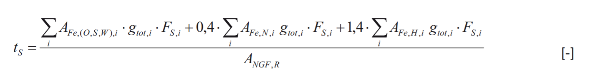
>
> où:
>
> | tS | [-] | est la transmittance solaire des éléments de construction extérieurs d'un local; |
> |---|---|---|
> | AFe,(O,S,W),i | [m²] | est la surface des fenêtres i orientées vers le nord-est en passant par le sud jusqu'au nord-ouest (45° ≤ x ≤ 315°) (dimensions intérieures brutes (gros-œuvre)); |
> | AFe,N,i | [m²] | est la surface des fenêtres i orientées vers le nord-ouest en passant par le nord jusqu'au nord-est (315° < x; x <45°) et les surfaces des fenêtres toujours à l'ombre du rayonnement direct (dimensions intérieures brutes (gros-œuvre)); |
> | AFe,H,i | [m²] | est la surface des fenêtres i horizontales ou inclinées ou des éléments de construction transparents i avec 0° ≤ inclinaison ≤ 60° (dimensions intérieures brutes (gros-œuvre)); |
> | gtot,i | [-] | est le facteur de transmission énergétique total (vitrage, protection solaire) de la fenêtre i pour une incidence verticale du rayonnement conformément au chapitre 1.2.3; |
> | FS,i | [-] | est le facteur d’ombrage pour l’ombrage dû aux constructions pour les fenêtres i conformément à la norme DIN V 18599-2:2011-12, chapitre 6.4.1. Si aucun ombrage dû aux constructions existe, alors FS,i est égal à 1; |
> | ANGF,R | [m²] | est la surface de plancher nette du local considérée lors de la détermination de la transmittance solaire. |
>
> \**1.2.2 Exigence minimale relative à la transmittance solaire**
>
> La transmittance solaire tS d'un local ne doit pas dépasser la valeur limite de la transmittance solaire tS,max mentionnée dans le tableau 1b.
>
> \*tS* ≤ *tS,max*
>
> La valeur limite tS,max dépend du type de construction visé au chapitre 1.2.4 et du quotient de la profondeur du local par la hauteur du local fa/h visé au chapitre 1.2.5.
>
> <table>
> <tr>
> <td rowspan="2">Valeur limite de la transmittance solaire tS,max</td>
> <td colspan="5">fa/h</td>
> </tr>
> <tr>
> <td>≤1,0</td>
> <td>1,5</td>
> <td>2,0</td>
> <td>5,0</td>
> <td>5,0</td>
> </tr>
> <tr>
> <td>Construction légère</td>
> <td>6,2%</td>
> <td>5,8%</td>
> <td>5,6%</td>
> <td>5,2%</td>
> <td>4,8%</td>
> </tr>
> <tr>
> <td>Construction moyennement lourde</td>
> <td>8,7%</td>
> <td>7,9%</td>
> <td>7,5%</td>
> <td>6,8%</td>
> <td>6,1%</td>
> </tr>
> <tr>
> <td>Construction lourde</td>
> <td>9,6%</td>
> <td>8,8%</td>
> <td>8,2%</td>
> <td>7,5%</td>
> <td>6,7%</td>
> </tr>
> </table>
>
> \*Tableau 1b - Valeur limite de la transmittance solaire tS,max*
>
> Les valeurs intermédiaires de tS,max qui ne sont pas comprises dans le tableau 1b et les valeurs de fa/h >5 peuvent être obtenues au moyen des équations suivantes:
>
> | construction légère: | TS,max =0,0624 ∙ fa/h -0,168 | [-] |
> |---|---|---|
> | construction moyennement lourde: | TS,max =0,0868 ∙ fa/h -0,2192 | [-] |
> | construction lourde: | TS,max =0,0964 ∙ fa/h -0,2302 | [-] |
>
> Si le pourcentage de la surface de fenêtre rapportée à la surface de plancher nette considérée lors de la détermination de la transmittance solaire dans un local « critique » est inférieur ou égal aux valeurs indiquées dans le tableau 1c, la protection thermique d’été est considérée comme garantie et il n'est pas nécessaire de démontrer l'exigence minimale relative à la protection thermique d’été pour ce local.
>
> <table>
> <tr>
> <td>Inclinaison des fenêtres par rapport à l'horizontale</td>
> <td>Orientation des fenêtres1)</td>
> <td>Pourcentage de la surface de fenêtre rapportée à la surface de plancher nette considérée lors de la détermination de la transmittance solaire2)</td>
> </tr>
> <tr>
> <td rowspan="2">Entre 60° et 90°</td>
> <td>Nord-ouest en passant par le sud jusqu'au nord-est</td>
> <td>10%</td>
> </tr>
> <tr>
> <td>Toutes les autres orientations au nord</td>
> <td>20%</td>
> </tr>
> <tr>
> <td>De 0° à 60°</td>
> <td>Toutes les orientations</td>
> <td>7%</td>
> </tr>
> <tr>
> <td colspan="3">1) Lorsque le local considéré présente des fenêtres avec différentes orientations, il faut prendre la valeur limite la plus petite. 2) Le pourcentage de surface de fenêtre d'un local est la somme de toutes les surfaces de fenêtre (dimensions brutes (gros-œuvre)) divisée par la surface de plancher nette considérée lors de la détermination de la transmittance solaire.</td>
> </tr>
> </table>
>
> \*Tableau 1c - Valeurs limites du pourcentage de surface de fenêtre par rapport à la surface de*
>
> \*plancher nette considérée lors de la détermination de la transmittance solaire d'un local critique*
>
> \*à partir duquel la protection thermique d’été est considérée comme étant garantie sans avoir à*
>
> \*le démontrer*
>
> \**1.2.3 Facteur de transmission énergétique totale, gtot**
>
> Le tableau 1d fournit des valeurs standard pour le facteur de transmission énergétique totale gtot pour des systèmes de protection solaire courants et différents vitrages. En alternative, le facteur gtot peut être déterminé conformément à la norme DIN EN 13363- 1/2. Pour les systèmes qui ne peuvent pas être représentés de cette manière, le facteur gtot peut être celui indiqué dans les données garanties par le fabricant.
>
> 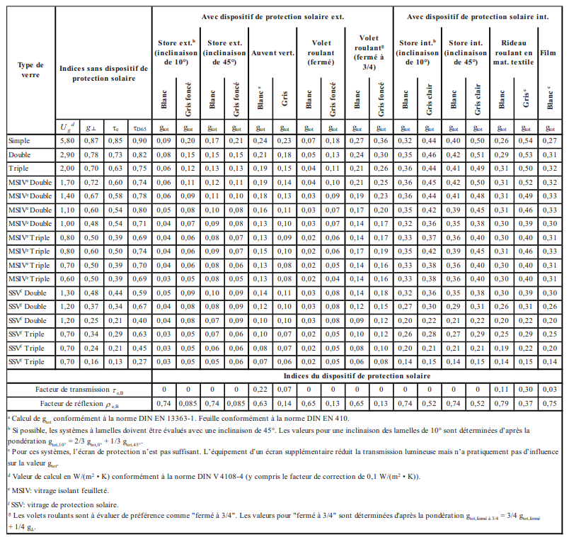
>
> \*Tableau 1d - Valeurs standard des indices des vitrages et des dispositifs de protection solaire*
>
> \*conformément à la norme DIN V 18599-2:2011-12*
>
> Pour les vitrages de protection solaire présentant, pour une incidence verticale du rayonnement, un facteur de transmission énergétique totale de gꞱ ≤ 0,4, la valeur de gtot peut être multipliée par 0,8 compte tenu de la réduction permanente du rayonnement diffus.
>
> \**1.2.4** **Détermination du type de construction et de la capacité d'accumulation**
>
> \**thermique effective, Cwirk**
>
> Le type de construction peut être déterminé de manière simplifiée à l'aide du tableau 1e.
>
> <table>
> <tr>
> <td></td>
> <td>Type de construction</td>
> <td>Description des exigences</td>
> </tr>
> <tr>
> <td>Construction légère</td>
> <td>Construction légère</td>
> <td>Toutes les surfaces de délimitation du local doivent être du type construction légère, par exemple: mur extérieur en bois ou avec isolation thermique à l'intérieur, cloisons de type construction légère, plafond suspendu et faux plancher, etc.</td>
> </tr>
> <tr>
> <td>Construction moyennement lourde</td>
> <td>Construction mixte avec des accumulateurs thermiques en partie accessibles</td>
> <td>Au moins l'une des surfaces de délimitation du local est du type construction en dur: mur extérieur, plafond, cloisons (lorsqu'elles sont présentes en quantité non négligeable dans un local, ce qui est généralement le cas dans les locaux de surface < 25 m2 ), plancher</td>
> </tr>
> <tr>
> <td>Construction lourde</td>
> <td>Construction lourde avec des accumulateurs thermiques accessibles</td>
> <td>Toutes* les surfaces de délimitation du local mentionnées doivent être du type construction en dur: mur extérieur, plafond, cloisons, plancher</td>
> </tr>
> <tr>
> <td colspan="3">*) Pour les locaux plus petits, on considère qu'il s'agit d'un type de construction lourde lorsque trois des surfaces de délimitation du local sont construites en dur. Cela peut être démontré par calcul.</td>
> </tr>
> </table>
>
> \*Tableau 1e - Détermination simplifiée du type de construction*
>
> Les éléments de construction peuvent être considérés comme étant en dur lorsque leur masse surfacique est supérieure à 100 kg/m² en tenant uniquement compte des couches des éléments de construction qui se trouvent à l'intérieur de l'épaisseur effective. L'épaisseur effective dT d'un élément de construction est la plus petite des valeurs suivantes:
>
> aot l'épaisseur des matériaux situés entre la surface respective et la première couche d'isolation thermique (matériaux avec une conductivité thermique lambda inférieure ou égale à 0,1 W/(mK));
>
> bot la valeur maximale de 10 cm;
>
> cot pour les éléments de construction intérieurs: la moitié de l'épaisseur totale de l'élément de construction.
>
> En alternative, il est possible de déterminer le type de construction et la capacité d'accumulation thermique effective Cwirk conformément à la norme DIN V 4108-2. Dans ce cas, il faut appliquer les limites de classe visées au tableau 1f pour déterminer le type de construction.
>
> | Type de construction | Cwirk/ANGF,R |
> |---|---|
> | Construction légère | < 50 Wh/(m²K) |
> | Construction moyennement lourde | entre 50 et 130 Wh/(m²K) |
> | Construction lourde | > 130 Wh/(m²K) |
>
> \*Tableau 1f - Classification du type de construction d'après la capacité d'accumulation thermique*
>
> \*effective Cwirk conformément à la norme DIN V 4108-2*
>
> \**1.2.5 Rapport de la profondeur sur la hauteur libre du local, fa/h**
>
> La valeur limite de la transmittance solaire est déterminée en fonction du rapport de la profondeur sur la hauteur libre du local.
>
> 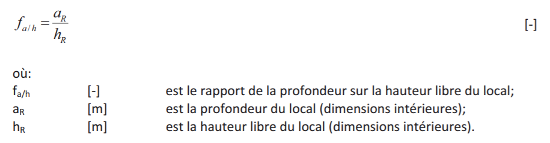
>
> Pour les locaux rectangulaires dotés de fenêtres dans une façade extérieure, la profondeur du local aR correspond à la profondeur du local reportée verticalement sur cette façade extérieure (dimensions intérieures).
>
> Pour les locaux rectangulaires dotés de fenêtres dans plusieurs façades extérieures (différentes orientations), la profondeur du local correspond à la plus petite valeur des profondeurs reportées verticalement sur ces façades extérieures.
>
> Pour les locaux qui ne sont pas rectangulaires, la profondeur du local aR peut être calculée à partir de la surface de plancher nette considérée lors de la détermination de la transmittance solaire ANGF,R et de la longueur de la façade principale bR.
>
> 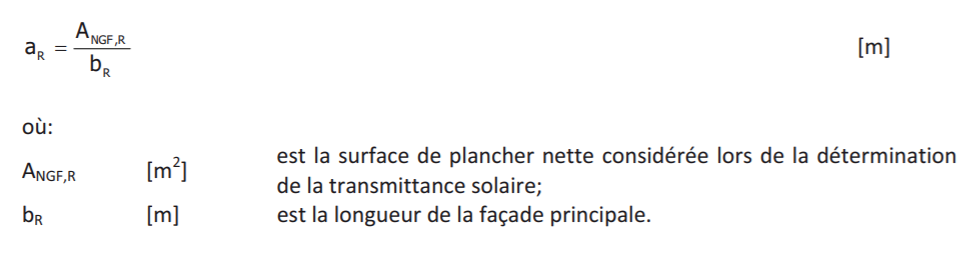
>
> En cas de fenêtres avec différentes orientations, la façade principale correspond à l'orientation présentant la surface de fenêtre la plus importante.
>
> 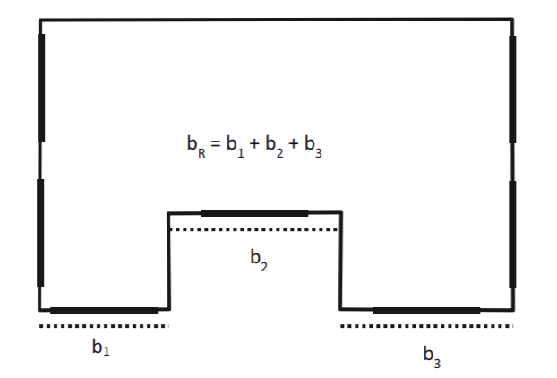
>
> \*Illustration 0 – Détermination de la façade principale*
>
> Si les façades ne sont pas droites, la projection de la façade pour chaque orientation est prise en considération en adoptant pour chaque orientation un champ angulaire de 90° (une distinction est donc établie uniquement entre quatre orientations).
>
> Si le local à évaluer présente des hauteurs différentes, il faut utiliser la hauteur moyenne du local pondérée par la surface.
>
> 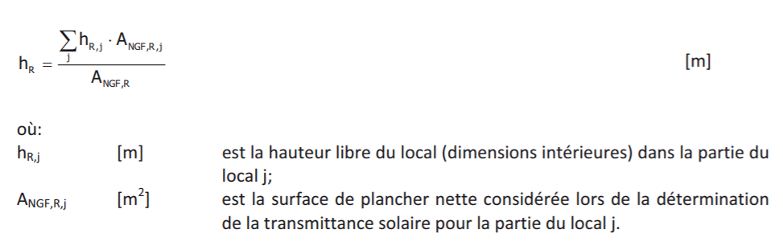
>
> Dans des locaux présentant des surfaces de fenêtre principalement horizontales, tels que des halls dotés d'impostes réparties uniformément sur la toiture, le rapport fa/h peut être pris égal à 2.

9° A l’annexe, chapitre 1.4, le tableau 3 est complété par les lignes suivantes:

> | 7 | Conduites avec une température aller du fluide caloporteur inférieur à 35°C | ½ des exigences visées aux lignes 1 à 4 |
> |---|---|---|
> | 8 | Conduites dans la structure du plancher | 10 mm |

et le texte du même chapitre est complété par l’alinéa suivant:

> Pour les conduites qui sont posées à l’extérieur, il y a lieu de respecter le double des épaisseurs minimales prévues dans le tableau 3.

10° A l’annexe, chapitre 2, l’illustration 1 est remplacée par l’illustration suivante:

> 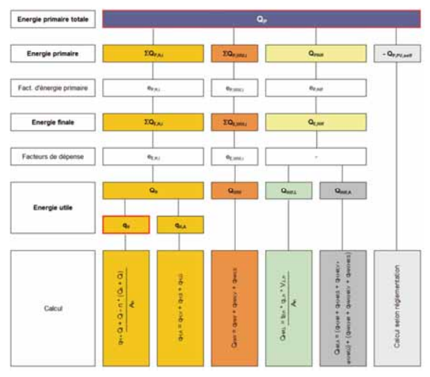

11° A l’annexe, le chapitre 2.1 est remplacé par le chapitre suivant:

> \**«** **2.1 Valeur spécifique du besoin en chaleur de chauffage, qH**
>
> La valeur spécifique du besoin en chaleur de chauffage **qH** du bâtiment considéré ne doit pas dépasser la valeur maximale du besoin spécifique en chaleur de chauffage **qH,max** déterminée conformément au chapitre 2.3 sur la base du bâtiment de référence.
>
> 
>
> 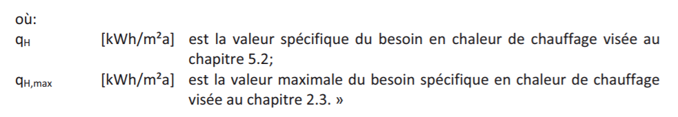

12° A l’annexe, le chapitre 2.2 est remplacé par le chapitre suivant:

> \****«** 2.2 Valeur spécifique du besoin total en énergie primaire, QP**
>
> La valeur spécifique du besoin total en énergie primaire **QP** du bâtiment considéré ne doit pas dépasser la valeur maximale du besoin spécifique en énergie primaire total **QP,max** déterminée conformément au chapitre 2.3 sur la base du bâtiment de référence.
>
> 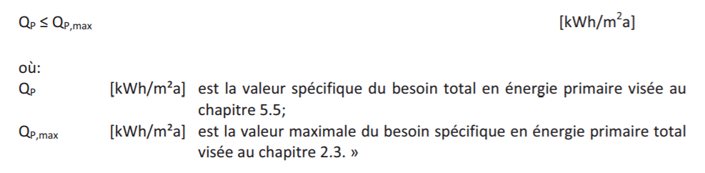

13° A l’annexe, il est inséré un nouveau chapitre 2.3 libellé comme suit:

> \**2.3 Bâtiment de référence**
>
> Le bâtiment de référence est identique au bâtiment à certifier en termes d'utilisation, de cubage et d'orientation. Sans préjudice de la planification respectivement de l'exécution concrète, les exécutions de référence déterminées dans le calcul sont adoptées pour les points suivants:
>
> aot étanchéité à l'air du bâtiment;
>
> bot coefficients de transmission thermique;
>
> cot systèmes techniques pour le chauffage et l’eau chaude sanitaire;
>
> dot traitement d’air des locaux.
>
> Les exécutions de référence sont définies dans le tableau 5. Toutes les conditions générales qui n'y sont pas décrites sont appliquées dans le bâtiment de référence comme dans le bâtiment à certifier.
>
> Le calcul de la valeur spécifique de référence du besoin total en énergie primaire **QP**,ref doit être réalisé conformément aux règles du chapitre 5.5 en ce qui concerne le calcul de la valeur spécifique du besoin total en énergie primaire **QP** en utilisant les exécutions de référence visées au tableau 5. La valeur maximale du besoin spécifique en énergie primaire total **QP,max** correspond à la valeur spécifique de référence du besoin total en énergie primaire **QP****,ref** sous considération du facteur de correction des exigences **fmod**.
>
> 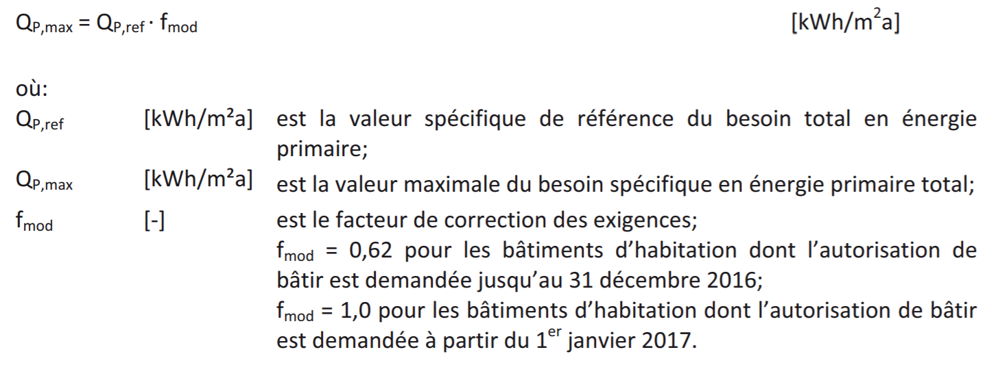
>
> Le calcul de la valeur spécifique deValeur U référence du besoin en chaleur de chauffage **qH,ref** doit être réalisé conformément au chapitre 5.2 en ce qui concerne le calcul de la valeur spécifique du besoin en chaleur de chauffage **qH** en utilisant les exécutions de référence visées au tableau 5. La valeur maximale du besoin spécifique en chaleur de chauffage **qH,max** correspond à la valeur spécifique de référence du besoin en chaleur de chauffage **qH,ref**.
>
> 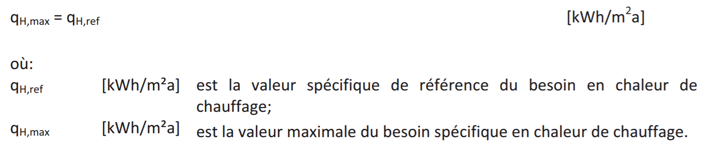
>
> Les valeurs U du bâtiment de référence ne contiennent pas encore les facteurs de correction de la température, ils sont à fixer conformément aux chapitres 5.2.1.3.1 et 5.2.1.3.2 en analogie au bâtiment à certifier. Lors de la prise en compte de valeurs U effectives, les valeurs U vers l’extérieur sont à considérer.
>
> <table>
> <tr>
> <td><b>N°</b></td>
> <td><b>Système</b></td>
> <td><b>Propriété</b></td>
> <td><b>Valeurs de référence pour</b> <b>bâtiments d’habitation</b> <b>dont</b> <b>l’autorisation de bâtir est</b> <b>demandée jusqu’au</b> <b>31 décembre 2016</b></td>
> <td><b>Valeurs de référence pour</b> <b>bâtiments d’habitation dont</b> <b>l’autorisation de bâtir est</b> <b>demandée à partir du</b> <b>1er janvier 2017</b></td>
> </tr>
> <tr>
> <td>1</td>
> <td>Mur et fermeture horizontale inférieure du bâtiment vers climat extérieur</td>
> <td>Valeur U</td>
> <td>0,19 W/(m²·K)</td>
> <td>0,13 W/(m²·K)</td>
> </tr>
> <tr>
> <td>2</td>
> <td>Toit et fermeture horizontale supérieure du bâtiment vers climat extérieur</td>
> <td>Valeur U</td>
> <td>0,14 W/(m²·K)</td>
> <td>0,11 W/(m²·K)</td>
> </tr>
> <tr>
> <td>3</td>
> <td>Éléments de construction en contact avec le sol ou des zones non chauffées</td>
> <td>Valeur U</td>
> <td>0,24 W/(m²·K)</td>
> <td>0,17 W/(m²·K)</td>
> </tr>
> <tr>
> <td>4</td>
> <td>Bandes d’éclairage naturel, coupoles d'éclairage naturel</td>
> <td>UW gꞱ</td>
> <td>1,20 W/(m²·K) 0,50</td>
> <td>1,00 W/(m²·K) 0,50</td>
> </tr>
> <tr>
> <td>5</td>
> <td>Fenêtres, portes-fenêtres et fenêtres de toit</td>
> <td>Uw gꞱ</td>
> <td>1,00 W/(m²·K) 0,50</td>
> <td>0,90 W/(m²·K) 0,50</td>
> </tr>
> <tr>
> <td>6</td>
> <td>Portes extérieures</td>
> <td>Valeur U</td>
> <td>1,50 W/(m²·K)</td>
> <td>1,00 W/(m²·K)</td>
> </tr>
> <tr>
> <td>7</td>
> <td>Portes donnant sur des locaux non chauffés</td>
> <td>Valeur U</td>
> <td>1,85 W/(m²·K)</td>
> <td>1,35 W/(m²·K)</td>
> </tr>
> <tr>
> <td>8</td>
> <td>Facteur de correction des ponts thermiques</td>
> <td>∆UWB</td>
> <td>0,05 W/(m²·K)</td>
> <td>0,03 W/(m²·K)</td>
> </tr>
> <tr>
> <td>9</td>
> <td>Étanchéité à l'air du bâtiment*</td>
> <td>n50</td>
> <td>1,0 1/h</td>
> <td>0,6 1/h</td>
> </tr>
> <tr>
> <td>10</td>
> <td>Part de la surface de référence énergétique An ventilée par une installation de ventilation mécanique</td>
> <td>-</td>
> <td colspan="2">100 % (Les locaux conditionnés du bâtiment de référence sont complètement ventilés mécaniquement. Le calcul du coefficient de déperdition de chaleur par ventilation se fait conformément au chapitre 5.2.1.5 pour le bâtiment de <i> référence avec un rapport *VL,m / Vn</i> égal au taux de renouvellement d’air neuf hygiénique minimum de 0,35 h-1.)</td>
> </tr>
> <tr>
> <td>11</td>
> <td>Puissance spécifique absorbée par une installation de ventilation mécanique</td>
> <td>qL</td>
> <td>0,45 W/(m³/h)</td>
> <td>0,40 W/(m³/h)</td>
> </tr>
> <tr>
> <td>12</td>
> <td>Rendement du système de récupération de chaleur de l‘installation de ventilation mécanique</td>
> <td>ῃL,i</td>
> <td>80 %</td>
> <td>85 %</td>
> </tr>
> <tr>
> <td>13</td>
> <td>Installation de production de chaleur</td>
> <td>-</td>
> <td colspan="2">Chaudière à condensation, montage à l’intérieur de l’enveloppe thermique. Conduites de distribution de chaleur à l’intérieur de l’enveloppe thermique. Régime de températures pour toutes les composantes: 55/45°C. Vecteur énergétique: gaz naturel</td>
> </tr>
> <tr>
> <td>14</td>
> <td>Installation de production d’eau chaude sanitaire</td>
> <td>-</td>
> <td>Chaudière à condensation, montage à l’intérieur de l’enveloppe thermique. Conduites de distribution d’eau chaude sanitaire à l’intérieur de l’enveloppe thermique. Accumulateur chauffé indirectement avec montage à l’intérieur de l’enveloppe thermique. Vecteur énergétique: gaz naturel. Dans habitations MFH avec conduite de circulation sans câbles/rubans chauffants électriques et dans habitations EFH sans conduite de circulation</td>
> <td>Chaudière à condensation, montage à l’intérieur de l’enveloppe thermique. Conduites de distribution d’eau chaude sanitaire à l‘intérieur de l’enveloppe thermique. Accumulateur chauffé indirectement avec montage à l’intérieur de l’enveloppe thermique. Vecteur énergétique: gaz naturel. Dans habitations MFH avec conduite de circulation sans câbles/rubans chauffants électriques et dans habitations EFH sans conduite de circulation Installation solaire thermique pour la production d’eau chaude sanitaire avec montage de l’accumulateur à l’intérieur de l’enveloppe thermique. Conduites de distribution à l’intérieur de l’enveloppe thermique</td>
> </tr>
> <tr>
> <td>15</td>
> <td>Pompes</td>
> <td>-</td>
> <td colspan="2">Pompes réglées</td>
> </tr>
> <tr>
> <td>16</td>
> <td>Production électrique renouvelable</td>
> <td>-</td>
> <td colspan="2">Pas d’installation photovoltaïque</td>
> </tr>
> <tr>
> <td>17</td>
> <td>Echangeur de chaleur géothermique</td>
> <td>-</td>
> <td colspan="2">Pas d’échangeur de chaleur géothermique</td>
> </tr>
> <tr>
> <td>18</td>
> <td>Réglage de la température</td>
> <td>-</td>
> <td colspan="2">Par local</td>
> </tr>
> </table>
>
> \*Tableau 5 – Exécutions de référence du bâtiment de référence*
>
> | * | Pour les extensions, pour lesquelles aucun test d’étanchéité à l’air individuel selon le chapitre 1.3 ne peut être réalisé, la valeur d’étanchéité à l’air n50 de l’extension à certifier est à fixer égale à la valeur d’étanchéité à l’air n50du bâtiment de référence pour le calcul de performance énergétique. Dans ce cas, les éléments de construction neufs ainsi que leurs raccords sont à réaliser selon les détails d’exécution de la norme DIN 4108-7. Le respect de ces détails est à confirmer. |
> |---|---|

pustom 13°*bis*

A l’annexe, chapitre 3.3, l’énumération est complétée par les points suivants:

> aot crédit spécifique annuel en énergie primaire imputable obtenu grâce à la production d’électricité d’une installation photovoltaïque **QP,PV,self** conformément au chapitre 5.4*ter*;
>
> bot crédit spécifique annuel en émissions de CO2 imputable obtenu grâce à la production d’électricité d’une installations photovoltaïque **QCOЇ,PV,self** conformément au chapitre 5.6.3*bis*.

qustom 13°*ter*

A l’annexe, le chapitre 4.1.2 est complété par le point suivant:

> aot mention « comme planifié » s’il s’agit d’un certificat de performance énergétique qui reflète la performance énergétique du bâtiment dans la phase de planification du bâtiment.

rustom 13°*quater*

A l’annexe, chapitre 4.1.4, les deux points suivants sont insérés avant le dernier point:

> aot crédit spécifique annuel en énergie primaire imputable obtenu grâce à la production d’électricité d’une installation photovoltaïque **QP,PV,self** en kWh/m2 a conformément au chapitre 5.4*ter*;
>
> bot crédit spécifique annuel en émissions de CO2 imputable obtenu grâce à la production d’électricité d’une installations photovoltaïque **QCOЇ,PV,self** en kgCO2/m2 a conformément au chapitre 5.6.3*bis*;

sustom 13°*quinquies*

A l’annexe, le titre du chapitre 4.1.5 est remplacé par le titre suivant:

> « Indications concernant l’installation de chauffage, la production d’eau chaude sanitaire et la production d’électricité ».

Au même chapitre, un nouveau point libellé comme suit est inséré avant le dernier point:

> aot indication si une technologie de production d’électricité a été prise en compte, ainsi que le type de technologie;

14° A l’annexe, chapitre 4.1.6, le texte du deuxième point est remplacé par le texte suivant:

> aot valeur spécifique modifiée du besoin en énergie finale pour la production de chaleur de chauffage et d’eau chaude sanitaire par un système de chauffage central respectivement valeur spécifique modifiée du besoin en énergie finale pour la production centrale de chaleur de chauffage et la production décentrale d’eau chaude sanitaire en kWh/m2 a conformément au chapitre 5.8 avec indication du facteur de déviation standard moyen;

15° A l’annexe, le chapitre 5.1.2 est remplacé par le chapitre suivant:

> La surface de référence énergétique An correspond à la partie conditionnée (pour laquelle le chauffage ou la climatisation est nécessaire) de la surface de plancher nette à l’intérieur de l’enveloppe thermique et à l’intérieur de l’enveloppe d’étanchéité à l’air. An est déterminée comme suit:
>
> 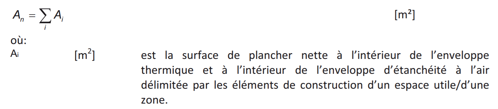
>
> aot La présence d’un système de transmission de chaleur dans un local n’est pas déterminante pour la prise en compte de ce local dans la surface de référence énergétique (p.ex. des locaux entourés par d’autres locaux chauffés).
>
> bot Pour les locaux avec des hauteurs libres différentes tels qu’un local situé sous la toiture, seule fait partie de la surface de référence énergétique la partie de la surface dont la hauteur est supérieure à 1,0 m. La hauteur d'un local va du bord supérieur du plancher fini au bord inférieur du plafond fini. Pour les plafonds comportant des poutres apparentes, la mesure est effectuée entre les poutres.
>
> cot Ne font pas partie de la surface de référence énergétique les surfaces suivantes, même si elles sont comprises dans l’enveloppe thermique ou dans l’enveloppe d’étanchéité à l’air:
>
> asc les garages pour équipements roulants;
>
> bsc les locaux à poubelles;
>
> csc les gaines techniques;
>
> dsc les locaux servant à l’approvisionnement en combustibles.

16° A l’annexe, chapitre 5.2.1.4, il est inséré un nouveau point 4 libellé comme suit:

> 4\. pour les bâtiments d’habitation présentant une mauvaise protection thermique sans isolation thermique intérieure ou extérieure considérable, le facteur de correction des ponts thermiques ∆UWB à prendre en considération est évalué par l’expert sur base des circonstances locales. Le facteur de correction peut être égal à 0.

17° A l’annexe, chapitre 5.2.1.5, avant la définition du facteur « e » sont insérés les termes suivants:

> | n50 | [1/h] | est la valeur d’étanchéité à l’air du bâtiment. Si des valeurs mesurées conformément au chapitre 1.3 sont disponibles, celles-ci peuvent être utilisées pour l’établissement du certificat de performance énergétique de bâtiments existants et en ce qui concerne les bâtiments neufs pour l’établissement du certificat de performance énergétique visé à l’article 3, paragraphe 11 du présent règlement grand-ducal; |
> |---|---|---|

xustom 17°*bis*

A l’annexe, chapitre 5.2.1.8, définition du facteur « Fh,i », les termes et au paysage sont insérés entre les termes avoisinantes et conformément.

Au chapitre 5.2.1.8.1, le titre est complété par les termes et au paysage.

Au même chapitre, première phrase, les termes et au paysage sont insérés entre les termes avoisinantes et peut .

Au même chapitre, tableau 14, première ligne, la deuxième colonne est complétée par les termes et au paysage, et dans le titre du tableau sont insérés les mêmes termes entre le terme avoisinantes et le symbole Fh,i .

18° A l’annexe, chapitre 5.2.1.8, la définition du facteur « FG,i » est remplacée comme suit:

> est la quote-part vitrée d’une fenêtre i par rapport aux dimensions brutes (gros-œuvre), la valeur standard est 0,7;

et le tableau 12 du même chapitre est remplacé par le tableau suivant:

> | Élément de construction transparent | Valeurs standard 1) du facteur de transmission énergétique totale gꞱ |
> |---|---|
> | Vitrage simple | 0,87 |
> | Vitrage double ou deux vitres séparées | 0,75 |
> | Vitrage isolant, vitrage double avec revêtement sélectif | 0,60 à 0,70 |
> | Vitrage triple avec revêtement sélectif | 0,40 à 0,60 |
> | Vitrage de protection solaire | 0,20 à 0,50 |
>
> \*Tableau 12 – Valeurs standard du facteur de transmission énergétique totale gꞱ*

19° A l’annexe, chapitre 5.2.1.9, tableau 17, les termes Réglage de la température par local avec réglage de la température aller en fonction des températures extérieures sont remplacés par les termes Réglage de la température par local ou réglage de la température par local de référence dans des bâtiments dont la classe d’isolation thermique est B ou A et les termes Réglage de la température par local de référence sont remplacés par les termes Réglage de la température par local de référence dans des bâtiments dont la classe d’isolation thermique est autre que B ou A.

20° A l’annexe, sont insérés deux nouveaux chapitres 5.4*bis* et 5.4*ter* libellés comme suit:

> \**5.4bis Etablissement du bilan énergétique d’une installation photovoltaïque**
>
> La production mensuelle d’électricité d’une installation photovoltaïque **QE,PV,M** est déterminée à partir de la production annuelle d’électricité d’une installation photovoltaïque multipliée par le facteur d’ajustement mensuel **fw,M** d’après la formule suivante:
>
> 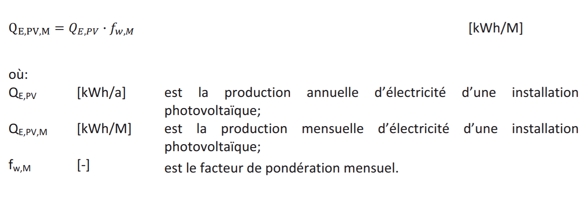
>
> La production annuelle d’électricité d’une installation photovoltaïque **QE,PV** est déterminée à partir de la formule suivante:
>
> 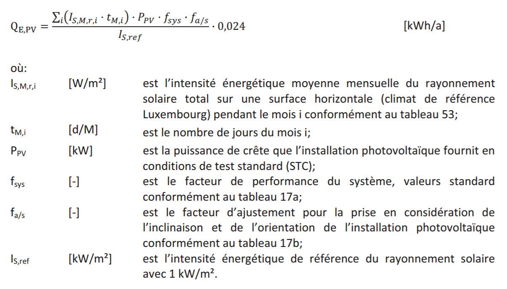
>
> Le facteur de pondération mensuel **fw,M** de la production annuelle d’électricité d’une installation photovoltaïque est à déterminer à partir de la formule suivante:
>
> 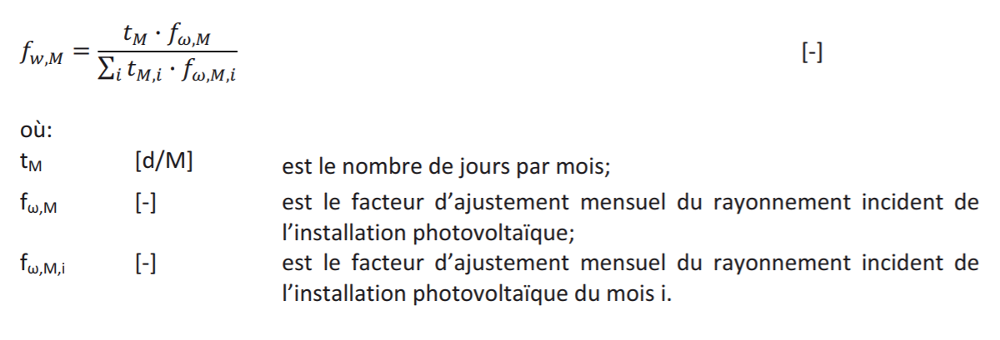
>
> Le facteur d’ajustement mensuel du rayonnement incident de l’installation photovoltaïque **fШ,M** est dépendant de l’orientation et de l’inclinaison de l’installation photovoltaïque. Il est déterminé d’une manière simplifié à partir de la formule suivante en prenant en compte les données climatiques du tableau 53:
>
> 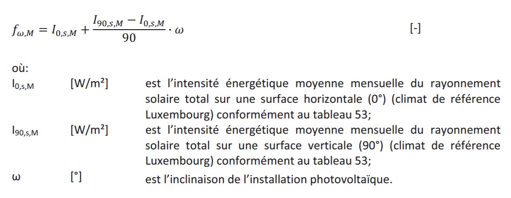
>
> En cas de plusieurs générateurs, la production mensuelle d’électricité d’une installation photovoltaïque **QE,PV,M** est à déterminer séparément pour chaque générateur. Les valeurs mensuelles de la production d’électricité soModules moyennement ventilésnt à additionner afin d’obtenir une somme mensuelle.
>
> Le tableau suivant reprend les facteurs de performance du système **fsys** pour différents systèmes d’installations photovoltaïques et leur mode d’installation.
>
> | Technologie | cristallin | amorphe et HIT | organique |
> |---|---|---|---|
> | Modules non ventilés | 0,70 | 0,75 | 0,90 |
> | Modules moyennement ventilés | 0,75 | 0,77 | 0,89 |
> | Modules fortement ventilés ou installés au so | 0,80 | 0,80 | 0,88 |
>
> \*Tableau 17a - Facteurs de performance du système fsys*
>
> Le tableau suivant reprend les facteurs d’ajustement **fa/s** pour la prise en considération de l’inclinaison et de l’orientation de l’installation photovoltaïque. Les valeurs intermédiaires peuvent être interpolées.
>
> <table>
> <tr>
> <td rowspan="3">Inclinaison</td>
> <td colspan="8">Orientation</td>
> </tr>
> <tr>
> <td>Nord</td>
> <td>Nord-ouest</td>
> <td>Ouest</td>
> <td>Sud-ouest</td>
> <td>Sud</td>
> <td>Sud- est</td>
> <td>Est</td>
> <td>Nord- est</td>
> </tr>
> <tr>
> <td>180</td>
> <td>135</td>
> <td>90</td>
> <td>45</td>
> <td>0</td>
> <td>-45</td>
> <td>-90</td>
> <td>-135</td>
> </tr>
> <tr>
> <td>0</td>
> <td>1,00</td>
> <td>1,00</td>
> <td>1,00</td>
> <td>1,00</td>
> <td>1,00</td>
> <td>1,00</td>
> <td>1,00</td>
> <td>1,00</td>
> </tr>
> <tr>
> <td>10</td>
> <td>0,91</td>
> <td>0,93</td>
> <td>0,99</td>
> <td>1,04</td>
> <td>1,07</td>
> <td>1,05</td>
> <td>1,00</td>
> <td>0,94</td>
> </tr>
> <tr>
> <td>20</td>
> <td>0,81</td>
> <td>0,85</td>
> <td>0,96</td>
> <td>1,07</td>
> <td>1,11</td>
> <td>1,08</td>
> <td>0,98</td>
> <td>0,87</td>
> </tr>
> <tr>
> <td>30</td>
> <td>0,70</td>
> <td>0,77</td>
> <td>0,93</td>
> <td>1,07</td>
> <td>1,13</td>
> <td>1,09</td>
> <td>0,96</td>
> <td>0,79</td>
> </tr>
> <tr>
> <td>40</td>
> <td>0,60</td>
> <td>0,69</td>
> <td>0,90</td>
> <td>1,06</td>
> <td>1,12</td>
> <td>1,07</td>
> <td>0,93</td>
> <td>0,72</td>
> </tr>
> <tr>
> <td>50</td>
> <td>0,50</td>
> <td>0,62</td>
> <td>0,85</td>
> <td>1,02</td>
> <td>1,09</td>
> <td>1,04</td>
> <td>0,89</td>
> <td>0,66</td>
> </tr>
> <tr>
> <td>60</td>
> <td>0,43</td>
> <td>0,57</td>
> <td>0,80</td>
> <td>0,97</td>
> <td>1,03</td>
> <td>0,99</td>
> <td>0,83</td>
> <td>0,60</td>
> </tr>
> <tr>
> <td>70</td>
> <td>0,38</td>
> <td>0,52</td>
> <td>0,74</td>
> <td>0,90</td>
> <td>0,95</td>
> <td>0,92</td>
> <td>0,77</td>
> <td>0,55</td>
> </tr>
> <tr>
> <td>80</td>
> <td>0,35</td>
> <td>0,47</td>
> <td>0,67</td>
> <td>0,82</td>
> <td>0,85</td>
> <td>0,83</td>
> <td>0,71</td>
> <td>0,49</td>
> </tr>
> <tr>
> <td>90</td>
> <td>0,32</td>
> <td>0,42</td>
> <td>0,60</td>
> <td>0,72</td>
> <td>0,73</td>
> <td>0,73</td>
> <td>0,63</td>
> <td>0,44</td>
> </tr>
> </table>
>
> \*Tableau 17b - Facteurs d’ajustement fa/s pour la prise en considération de l’inclinaison et de*
>
> \*l’orientation de l’installation photovoltaïque*
>
> Les formules précédentes ne peuvent pas être employées pour des installations photovoltaïques situées partiellement à l’ombre. Dans un tel cas, un calcul détaillé est à réaliser selon les règles de l’art en vigueur. Peuvent être prises en considération des simulations détaillées des installations, si celles-ci se basent sur des intervalles de calcul horaires au maximum et des données climatiques horaires (TRY, année de référence test) du Luxembourg. Les données de calcul de base et les résultats sont à documenter dans un rapport séparé.
>
> \**5.4ter Autoconsommation de l’électricité produite par une installation photovoltaïque**
>
> Le bilan énergétique d’une installation photovoltaïque s’opère conformément au chapitre 5.4*bis* qui fournit la production mensuelle d’électricité d’une installation photovoltaïque **QE,PV,M**. Uniquement l’électricité produite par une installation photovoltaïque qui peut être autoconsommée par les installations techniques destinées au conditionnement du bâtiment (chauffage, ventilation et auxiliaires) est imputable au bâtiment. A cette fin, les installations photovoltaïques situées sur l’enveloppe extérieure du bâtiment, respectivement sur des constructions annexes au bâtiment peuvent être prises en compte. Pour déterminer le besoin mensuel en électricité produit par une installation photovoltaïque qui peut être autoconsommé, il est notamment nécessaire de procéder à une répartition du besoin mensuel en électricité des installations techniques du bâtiment dans les périodes présentant un rayonnement solaire **QE,M,el,day** et dans les périodes ne présentant pas un rayonnement solaire **QE,M,el,night**. Cette répartition du besoin en électricité s’opère d’après la formule suivante:
>
> 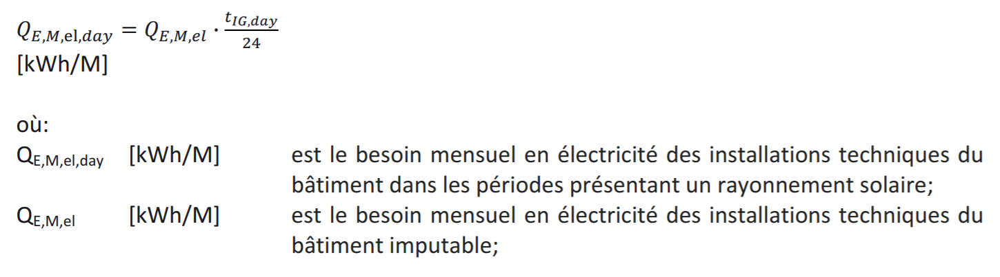
>
> 
>
> Le besoin mensuel en électricité des installations techniques du bâtiment imputable **QE,M,el** comprend tous les besoins en électricité qui sont nécessaires pour la production de chaleur et de l’eau chaude sanitaire, le besoin en énergie auxiliaire pour la distribution, l’accumulation et la transmission de chaleur et d’eau chaude sanitaire, ainsi que le besoin en électricité des installations de ventilation mécaniques. Il est déterminé à partir de la formule suivante:
>
> 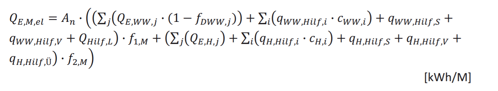
>
> où
>
> | An | [m2] | est la surface de référence énergétique calculée conformément au chapitre 5.1.2; |
> |---|---|---|
> | QE,WW,j | [kWh/m2 a] | est la valeur spécifique du besoin en énergie finale, production d’eau chaude sanitaire, avec l’indice j pour les installations de production de chaleur sur base d’électricité; |
> | fDWW,j | [-] | est le facteur d‘ajustement limitant la prise en compte de l’autoconsommation de la production d’électricité par une installation photovoltaïque pour la production d’eau chaude sanitaire par des chauffe-eaux instantanés, (fDWW,j = 0 dans le cas de tout autre système de production d’eau chaude sanitaire) avec l’indice j pour les installations de production de chaleur sur base d’électricité; |
> | qH,Hilf,i | [kWh/m2 a] | est la valeur spécifique du besoin en énergie auxiliaire pour la production de chaleur de chauffage, avec l’indice i pour plusieurs installations de production de chaleur; |
> | cH,i | [-] | est le taux de couverture de la production de chaleur de chauffage, avec l’indice i pour plusieurs installations de production de chaleur; |
> | qWW,Hilf,i | [kWh/m2 a] | est la valeur spécifique du besoin en énergie auxiliaire, production d’eau chaude sanitaire, avec l’indice i pour plusieurs installations de production de chaleur; |
> | cWW,i=1 | [-] | est le taux de couverture de la production de chaleur par une installation solaire thermique (production d’eau chaude sanitaire) conformément au chapitre 6.3.2.1; |
> | cWW,i=2 | [-] | est le taux de couverture de la production de chaleur par une installation de chauffage de base (production d’eau chaude sanitaire) conformément au chapitre 6.3.2.1; |
> | cWW,i=3 | [-] | est le taux de couverture de la production de chaleur par un système de chauffage d’appoint (production d’eau chaude sanitaire) conformément au chapitre 6.3.2.1; |
> | qH,Hilf,S | [kWh/m2 a] | est la valeur spécifique du besoin en énergie auxiliaire pour l’accumulation de chaleur de chauffage; |
> | qWW,Hilf,S | [kWh/m2 a] | est la valeur spécifique du besoin en énergie auxiliaire, accumulation d’eau chaude sanitaire; |
> | qWW,Hilf,V | [kWh/m2 a] | est la valeur spécifique du besoin en énergie auxiliaire, distribution d’eau chaude sanitaire; |
> | QHilf,L | [kWh/m2 a] | est la valeur spécifique du besoin en énergie auxiliaire des installations de ventilation; |
> | f1,M | [-] | est le facteur d‘ajustement f1,M déterminé ci-après; |
> | QE,H,j | [kWh/m2 a] | est la valeur spécifique du besoin en énergie finale, chaleur de chauffage, avec l’indice j pour les installations de production de chaleur sur base d’électricité; |
> | qH,Hilf,V | [kWh/m2 a] | est la valeur spécifique du besoin en énergie auxiliaire pour la distribution de chaleur de chauffage; |
> | qH,Hilf,Ü | [kWh/m2 a] | est la valeur spécifique du besoin en énergie auxiliaire pour la transmission de chaleur de chauffage; |
> | f2,M | [-] | est le facteur d‘ajustement f2,M déterminé ci-après. |
>
> Le facteur d‘ajustement limitant la prise en compte de la production d’eau chaude sanitaire par des chauffe-eaux instantanés **fDWW** est déterminé à partir de la formule suivante dans le cas d’une production d’eau chaude sanitaire par un chauffe-eau instantané:
>
> 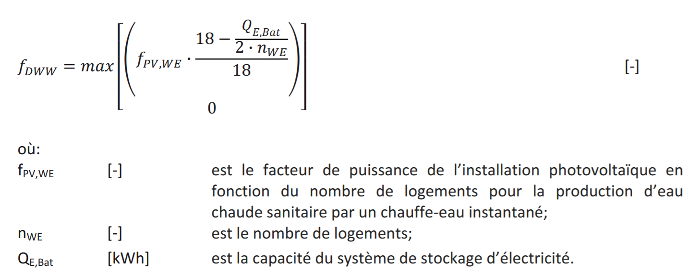
>
> Le facteur de puissance de l’installation photovoltaïque en fonction du nombre de logements pour la production d’eau chaude sanitaire par un chauffe-eau instantané **fPV,WE** est déterminé à partir de la formule suivante:
>
> 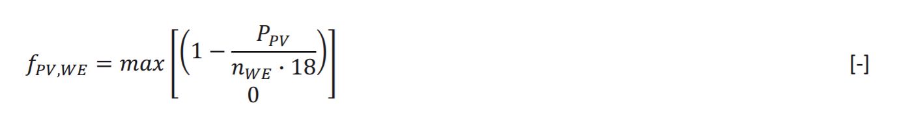
>
> \**Remarque:** La valeur standard pour la durée de déchargement du système de stockage d’électricité est fixée à 2 heures et la valeur standard pour la puissance du chauffe-eau instantané par logement est fixée à 18 kW.
>
> La répartition des besoins en énergie annuels en valeurs mensuelles s’opère avec les facteurs d‘ajustement mensuels **f1,M** et **f2,M** selon les règles suivantes:
>
> 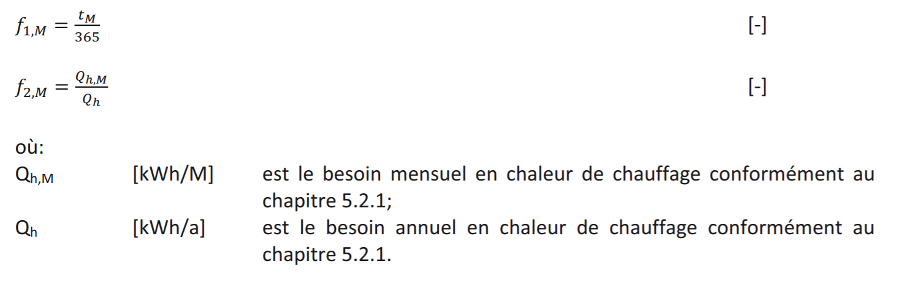
>
> Dans le cas d’installations existantes, dont la détermination du besoin en chaleur de chauffage est réalisée selon la méthodologie simplifiée conformément au chapitre 5.7, tous les besoins en énergie auxiliaire (**QHilf,H** et **QHilf,WW** conformément au chapitre 5.7.7) sont à répartir en fonction du nombre de jours par mois moyennant le facteur d’ajustement **f1,M**.
>
> | **Mois** | **tIG,day** |
> |---|---|
> | Janvier | 3,5 |
> | Février | 6,5 |
> | Mars | 8,4 |
> | Avril | 10,5 |
> | Mai | 12,3 |
> | Juin | 13,2 |
> | Juillet | 13,0 |
> | Août | 11,1 |
> | Septembre | 9,4 |
> | Octobre | 6,9 |
> | Novembre | 4,2 |
> | Décembre | 2,8 |
>
> \*Tableau 17c - Facteurs d‘ajustement tIG,day pour les périodes présentant un rayonnement solaire*
>
> La production mensuelle d’électricité d’une installation photovoltaïque **QE,PV,M** peut être mise en relation avec le besoin mensuel en électricité des installations techniques du bâtiment dans les périodes présentant un rayonnement solaire **QE,M,el,day**. La part mensuelle autoconsommée de l’électricité produite par une installation photovoltaïque **QE,PV,self,M** est déterminée selon la formule suivante:
>
> 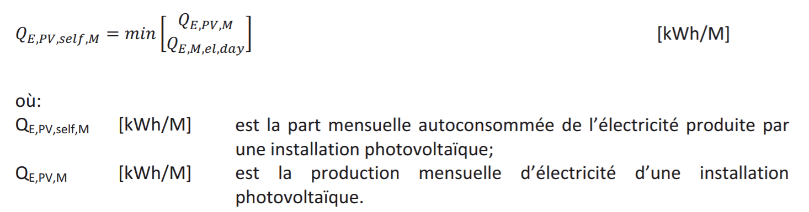
>
> \**Systèmes de stockage d’électricité**
>
> Le recours à des systèmes de stockage d’électricité ouvre la possibilité de consommer l’électricité produite par une installation photovoltaïque sur une période plus longue. Les systèmes de stockage, en fonction de leur capacité du système de stockage d’électricité **QE,Bat** et de leur rendement du système de stockage d’électricité **Ƞ****Bat****,** peuvent augmenter la quote-part de l’électricité autoconsommée. La part mensuelle supplémentaire imputable grâce à un système de stockage d’électricité **QE,PV,Bat,M** en combinaison avec une installation photovoltaïque est déterminée de la manière suivante:
>
> 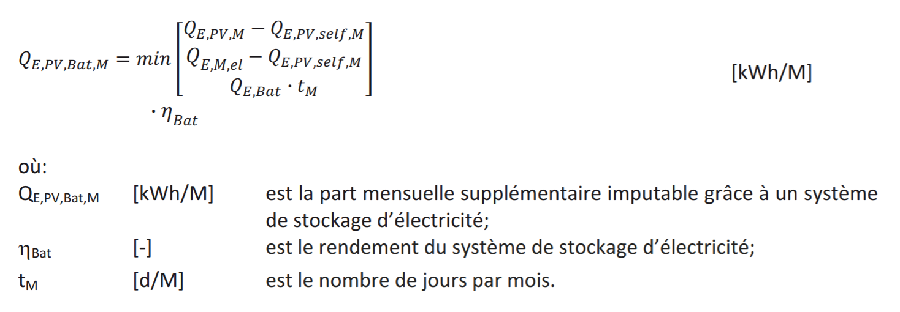
>
> La part annuelle autoconsommée de l’électricité produite par une installation photovoltaïque **QE,PV,self,a** (sous considération du stockage d’électricité par un système de stockage) est déterminée comme suit:
>
> 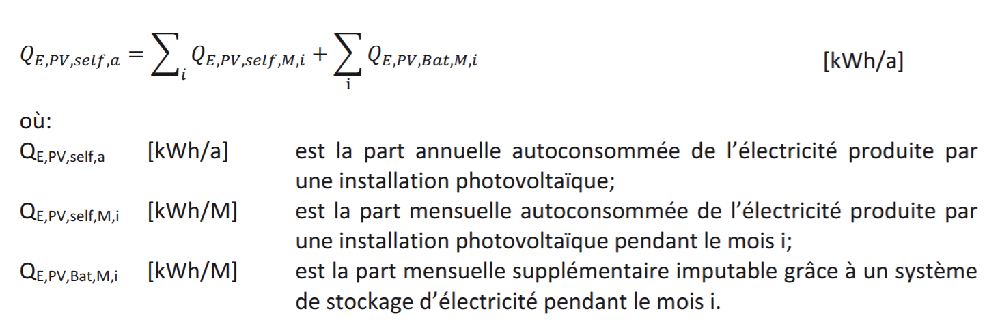
>
> Le crédit spécifique annuel en énergie primaire imputable obtenu grâce à la production d’électricité d‘une installation photovoltaïque **QP,PV,self** est à déterminer d’après la formule suivante:
>
> 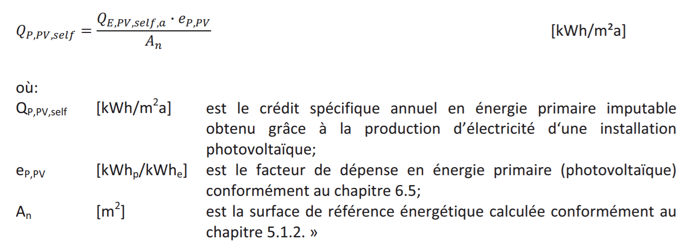

21° A l’annexe, chapitre 5.5, les termes et de la valeur spécifique du besoin en énergie primaire, énergie auxiliaire **QP,Hilf** sont remplacés par les termes , de la valeur spécifique du besoin en énergie primaire, énergie auxiliaire **QP,Hilf** et du crédit spécifique annuel en énergie primaire imputable obtenu grâce à la production d’électricité d’une installation photovoltaïque **QP,PV,self** . La formule du même chapitre est remplacée par la formule suivante:

> QP = QP,H + QP,WW + QP,Hilf - QP,PV,self
>
> [kWh/m²a]

et le même chapitre est complété par les termes suivants:

> où:
>
> | QP | [kWh/m2 a] | est la valeur spécifique du besoin total en énergie primaire; |
> |---|---|---|
> | QP,H | [kWh/m2 a] | est la valeur spécifique du besoin en énergie primaire, chaleur de chauffage; |
> | QP,WW | [kWh/m2 a] | est la valeur spécifique du besoin en énergie primaire, production d’eau chaude sanitaire; |
> | QP,Hilf | [kWh/m2 a] | est la valeur spécifique du besoin en énergie primaire, énergie auxiliaire; |
> | QP,PV,self | [kWh/m2 a] | est le crédit spécifique annuel en énergie primaire imputable obtenu grâce à la production d’électricité d‘une installation photovoltaïque. |

22° A l’annexe, il est inséré un nouveau chapitre 5.6.3*bis* libellé comme suit:

> | **5.6.3bis** | **Crédit spécifique annuel en émissions de CO2 imputable obtenu** **grâce à la production d’électricité d‘une installation** **photovoltaïque, QCO2,PV,self** |
> |---|---|
>
> Le crédit spécifique annuel en émissions de CO2 imputable obtenu grâce à la production d’électricité d‘une installation photovoltaïque **QCO2,PV,self** est déterminé selon la formule suivante:
>
> 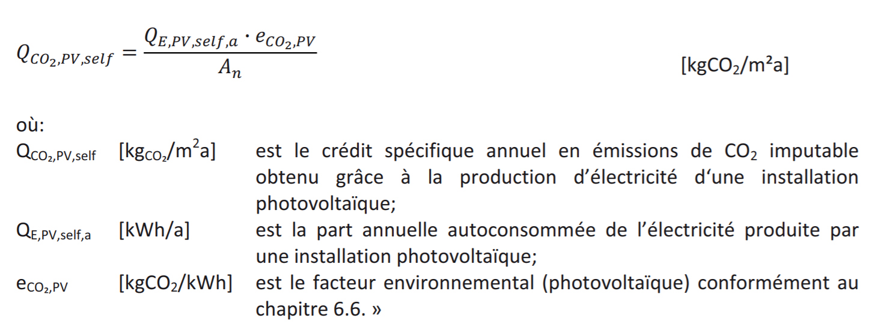

23° A l’annexe, chapitre 5.6.4, la formule est remplacée par la formule suivante:

> 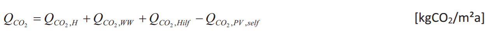

et le même chapitre est complété par les termes suivants:

> | QCO2 | [kgCO2/m²a] | est la valeur spécifique d’émissions totales de CO2; |
> |---|---|---|
> | QCO2,PV,self | [kgCO2/m²a] | est le crédit spécifique annuel en émissions de CO2 imputable obtenu grâce à la production d’électricité d‘une installation photovoltaïque calculé conformément au chapitre 5.6.3*bis*. |

24° A l’annexe, chapitre 5.7.3, les termes d’étanchéité à l’air conformément au chapitre 1.3 sont insérés entre les termes lorsqu’il n’existe aucune valeur mesurée et , il faut utiliser,, et le tableau 18 est complété par les lignes suivantes:

> | 4 | Bâtiment existant – rénové partiellement | ≈ 3,0 |
> |---|---|---|
> | 5 | Bâtiment existant – rénové | ≈ 2,0 |

afustom 24°*bis*

A l’annexe, chapitre 5.7.4, la définition du facteur Fh,i est complétée par les termes et au paysage.

Au même chapitre, Tableau 19, première ligne, première colonne, les termes et au paysage sont insérées entre le terme « avoisinantes » et le symbole Fh,i.

25° A l’annexe, chapitre 5.7.4, le dernier alinéa est supprimé.

26° A l’annexe, chapitre 5.8.1, le premier alinéa est remplacé comme suit:

> Les données de consommation sont à utiliser avec une correction climatique. Lors de la détermination de la consommation énergétique moyenne **qV,m** d’un bâtiment, seule la consommation énergétique tributaire des conditions météorologiques **qV,H** est corrigée. La consommation énergétique indépendante des conditions météorologiques **qV,WW** ne fait l’objet d’aucune correction climatique. La consommation énergétique moyenne **qV,m** doit être déterminée sur une période de référence d’au moins trois ans, elle est calculée à l’aide de la formule suivante:
>
> 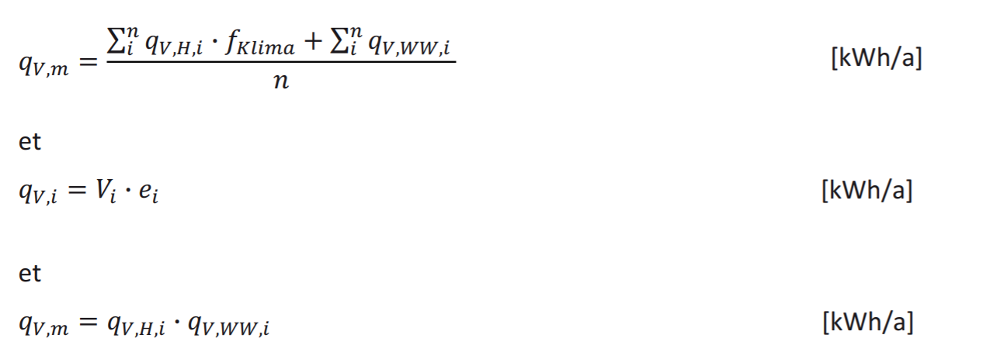
>
> où:
>
> | qV,m | [kWh/a] | est la consommation énergétique moyenne; |
> |---|---|---|
> | qV,H,i | [kWh/a] | est la consommation énergétique au cours de l’année de référence i tributaire des conditions météorologiques; |
> | fKlima | [-] | est le facteur de correction climatique annuel pour la chaleur de chauffage; |
> | qV,WW,i | [kWh/a] | est la consommation énergétique au cours de l’année de référence i indépendante des conditions météorologiques; |
> | n | [-] | est le nombre d’années; |
> | qV,i | [kWh/a] | est la consommation énergétique au cours de l’année de référence i; |
> | Vi | [«Unité»/a] | est la consommation énergétique annuelle d’un vecteur énergétique en fonction de l’unité de consommation ou de facturation; |
> | ei | [-] | est le pouvoir calorifique du vecteur énergétique utilisé pour l’année i conformément au tableau 52. |
>
> Les facteurs de correction climatique annuels pour la chaleur de chauffage fKlimanécessaires à la correction climatique sont publiés par le ministre.
>
> La consommation énergétique indépendante des conditions météorologiques **qV,WW** est obtenue comme suit:
>
> aot à partir de valeurs de mesure ou de valeurs de calcul selon les règles de la technique reconnues;
>
> bot à partir des valeurs forfaitaires suivantes:
>
> > <table>
> > <tr>
> > <td rowspan="2"><b>Installations de</b> <b>production de</b> <b>chaleur</b></td>
> > <td rowspan="2"><b>Unité</b></td>
> > <td colspan="2"><b>avec installation</b> <b>solaire thermique</b></td>
> > <td colspan="2"><b>sans installation</b> <b>solaire thermique</b></td>
> > </tr>
> > <tr>
> > <td><b>EFH</b></td>
> > <td><b>MFH</b></td>
> > <td><b>EFH</b></td>
> > <td><b>MFH</b></td>
> > </tr>
> > <tr>
> > <td>Chaudières et autres</td>
> > <td>[kWh/m2a]</td>
> > <td>8</td>
> > <td>14</td>
> > <td>20</td>
> > <td>27</td>
> > </tr>
> > <tr>
> > <td>Pompes à chaleur</td>
> > <td>[kWh/m2a]</td>
> > <td>3</td>
> > <td>5</td>
> > <td>6</td>
> > <td>9</td>
> > </tr>
> > </table>
> >
> > ;
>
> cot à partir d'un relevé mensuel de la consommation de chaleur pendant les mois d'été: juin, juillet et août. Généralement, pendant cette période, très peu de chaleur est utilisée pour le chauffage.

et dans le même chapitre, le dernier alinéa est supprimé.

27° A l’annexe, chapitre 5.8.2, le deuxième et le troisième alinéa sont remplacés par les alinéas suivants:

> La valeur spécifique du besoin en énergie finale pour la production de chaleur de chauffage et d’eau chaude sanitaire par un système de chauffage central **QE,B,H,WW** est déterminée selon la formule suivante en prenant en compte la valeur spécifique du besoin en énergie finale, chaleur de chauffage **QE,H** et la valeur spécifique du besoin en énergie finale, production d’eau chaude sanitaire **QE,WW** qui sont calculées conformément au chapitre 5.2.4 respectivement au chapitre 5.3.2.
>
> 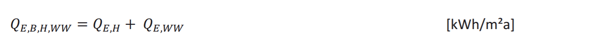
>
> où:
>
> | QE,B,H,WW | [kWh/m²a] | est la valeur spécifique du besoin en énergie finale pour la production de chaleur de chauffage et d’eau chaude sanitaire par un système de chauffage central; |
> |---|---|---|
> | QE,H | [kWh/m²a] | est la valeur spécifique du besoin en énergie finale, chaleur de chauffage conformément au chapitre 5.2.4; |
> | QE,WW | [kWh/m²a] | est la valeur spécifique du besoin en énergie finale, production d’eau chaude sanitaire conformément au chapitre 5.3.2. |
>
> La valeur spécifique du besoin en énergie finale pour la production de chaleur de chauffage et d’eau chaude sanitaire par un système de chauffage central **QE,B,H,WW** est à modifier pour tenir compte de l’utilisation individuelle du bâtiment. La valeur spécifique modifiée du besoin en énergie finale pour la production de chaleur de chauffage et d’eau chaude sanitaire par un système de chauffage central **Q*E,B,H,WW** est déterminée à l’aide de la formule suivante:
>
> 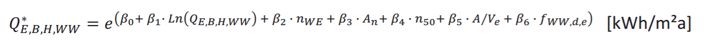
>
> où:
>
> | Q* E,B,H,WW | [kWh/m2a] | est la valeur spécifique modifiée du besoin en énergie finale pour la production de chaleur de chauffage et d’eau chaude sanitaire par un système de chauffage central; |
> |---|---|---|
> | β0 | [-] | est un coefficient de régression = 2,42185740; |
> | β1 | [-] | est un coefficient de régression = 0,47645404; |
> | QE,B,H,WW | [kWh/m2a] | st la valeur spécifique du besoin en énergie finale pour la production de chaleur de chauffage et d’eau chaude sanitaire par un système de chauffage central; |
> | β2 | [-] | est un coefficient de régression = 0,02946239; |
> | nWE | [-] | est le nombre de logements; |
> | β3 | [-] | est un coefficient de régression = -0,00034947; |
> | An | [m2] | est la surface de référence énergétique calculée conformément au chapitre 5.1.2; |
> | β4 | [-] | est un coefficient de régression = -0,01462978; |
> | n50 | [1/h] | est la valeur d’étanchéité à l’air du bâtiment; |
> | β5 | [-] | est un coefficient de régression = 0,15538768; |
> | A/Ve | [m-1] | est le rapport entre la surface de l’enveloppe thermique d’un bâtiment au volume chauffé brut du bâtiment (le rapport A/Ve tient compte des facteurs de correction de la température); |
> | β6 | [-] | st un coefficient de régression = -0,04736075; |
> | fWW,d,e | [-] | est le facteur de production électrique décentrale d’eau chaude sanitaire; fWW,d,e = 1 si présence d’une production électrique décentrale d’eau chaude sanitaire; fWW,d,e = 0 si absence d’une production électrique décentrale d’eau chaude sanitaire. |
>
> La valeur spécifique de la consommation en énergie finale pour la production centrale de chaleur de chauffage et d’eau chaude sanitaire **QE,V,H,WW** est alors à considérer en rapport avec la valeur spécifique modifiée du besoin en énergie finale pour la production de chaleur de chauffage et d’eau chaude sanitaire par un système de chauffage central **Q*E,B,H,WW**. L’expert est tenu de documenter dans le certificat de performance énergétique du bâtiment d’habitation les écarts importants entre le besoin énergétique estimé et la consommation effective mesurée, ainsi que les causes possibles.
>
> 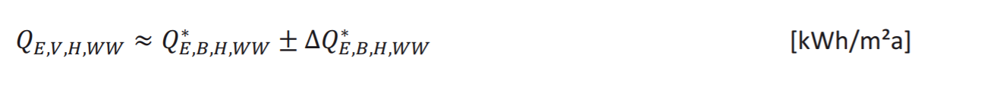
>
> La valeur spécifique modifiée du besoin en énergie finale pour la production de chaleur de chauffage et d’eau chaude sanitaire par un système de chauffage central **Q*E,B,H,WW** est à indiquer dans le certificat de performance énergétique avec un facteur de déviation standard moyen (32%).
>
> 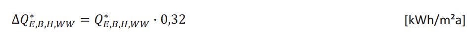

28° A l’annexe, chapitre 5.8.3, le deuxième et le troisième alinéa sont remplacés par les alinéas suivants:

> La valeur spécifique du besoin en énergie finale pour la production centrale de chaleur de chauffage et la production décentrale d’eau chaude sanitaire **QE,B,H** est déterminée selon la formule suivante en prenant en compte la valeur spécifique du besoin en énergie finale, chaleur de chauffage **QE,H** qui est calculée conformément au chapitre 5.2.4.
>
> 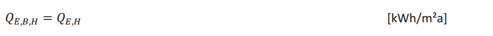
>
> où
>
> | QE,B,H | [kWh/m²a] | est la valeur spécifique du besoin en énergie finale pour la production centrale de chaleur de chauffage et la production décentrale d’eau chaude sanitaire; |
> |---|---|---|
> | QE,H | [kWh/m²a] | est la valeur spécifique du besoin en énergie finale, chaleur de chauffage conformément au chapitre 5.2.4. |
>
> La valeur spécifique du besoin en énergie finale pour la production centrale de chaleur de chauffage et la production décentrale d’eau chaude sanitaire **QE,B,H** est à modifier pour tenir compte de l’utilisation individuelle du bâtiment. La valeur spécifique modifiée du besoin en énergie finale pour la production centrale de chaleur de chauffage et la production décentrale d’eau chaude sanitaire **Q*E,B,H** est déterminée à l’aide de la formule suivante:
>
> 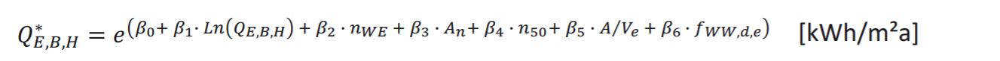
>
> où:
>
> | Q* E,B,H | [kWh/m²a] | est la valeur spécifique modifiée du besoin en énergie finale pour la production centrale de chaleur de chauffage et la production décentrale d’eau chaude sanitaire; |
> |---|---|---|
> | β0 | [-] | est un coefficient de régression = 2,42185740; |
> | β1 | [-] | est un coefficient de régression = 0,47645404; |
> | QE,B,H | [kWh/m²a] | est la valeur spécifique du besoin en énergie finale pour la production centrale de chaleur de chauffage et la production décentrale d’eau chaude sanitaire; |
> | β2 | [-] | est un coefficient de régression = 0,02946239; |
> | nWE | [-] | est le nombre de logements; |
> | β3 | [-] | est un coefficient de régression = -0,00034947; |
> | An | [m2] | est la surface de référence énergétique calculée conformément au chapitre 5.1.2; |
> | β4 | [-] | est un coefficient de régression = -0,01462978; |
> | n50 | [1/h] | est la valeur d’étanchéité à l’air du bâtiment; |
> | β5 | [-] | est un coefficient de régression = 0,15538768; |
> | A/Ve | [m-1] | est le rapport entre la surface de l’enveloppe thermique d’un bâtiment au volume chauffé brut du bâtiment (le rapport A/Ve tient compte des facteurs de correction de la température); |
> | β6 | [-] | t un coefficient de régression = -0,04736075; |
> | fWW,d,e | [-] | est le facteur de production électrique décentrale d’eau chaude sanitaire; fWW,d,e = 1 si présence d’une production électrique décentrale d’eau chaude sanitaire; fWW,d,e = 0 si absence d’une production électrique décentrale d’eau chaude sanitaire. |
>
> La valeur spécifique de la consommation en énergie finale pour la production centrale de chaleur de chauffage et la production décentrale d’eau chaude sanitaire **QE,V,H** est alors à considérer en rapport avec la valeur spécifique modifiée du besoin en énergie finale pour la production centrale de chaleur de chauffage et la production décentrale d’eau chaude sanitaire **Q*E,B,H**. L’expert est tenu de documenter dans le certificat de performance énergétique du bâtiment d’habitation les écarts importants entre le besoin énergétique estimé et la consommation effective mesurée, ainsi que les causes possibles.
>
> 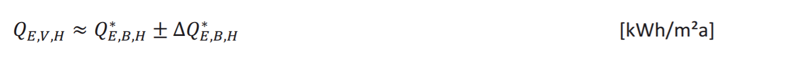
>
> La valeur spécifique modifiée du besoin en énergie finale pour la production centrale de chaleur de chauffage et la production décentrale d’eau chaude sanitaire **Q*E,B,H** est à indiquer dans le certificat de performance énergétique avec un facteur de déviation standard moyen (32%).
>
> 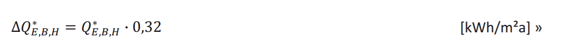

29° A l’annexe, chapitre 6.3.2.2, tableau 35, ligne Air/eau, la valeur de 0,30 est remplacée par la valeur de 0,37 et dans le même tableau, ligne Air vicié/eau, la valeur de 0,25 est remplacée par la valeur de 0,30.

30° A l’annexe, le chapitre 6.3.2.3 est complété *in fine* par l’alinéa suivant:

> Dans une habitation EFH, il est possible de considérer dans le calcul l’absence d’un circuit de circulation même en présence d’un tel circuit s’il est assuré que le fonctionnement de la pompe de circulation est commandé en fonction du temps et n’excède pas trois heures par jour.

31° A l’annexe, chapitre 6.5, tableau 50, la rubrique « électricité » est complétée par la ligne suivante:

> | Production d’électricité par une installation photovoltaïque | 2,66 |
> |---|---|

32° A l’annexe, chapitre 6.6, tableau 51, la rubrique « électricité » est complétée par la ligne suivante:

> | Production d’électricité par une installation photovoltaïque | 0,651 |
> |---|---|

33° A l’annexe, chapitre 7, le sommaire des illustrations et des tableaux est supprimé.

## Art. II.

Le [règlement grand-ducal modifié du 31 août 2010](https://legilux.public.lu/eli/etat/leg/rgd/2010/08/31/n1/jo) concernant la performance énergétique des bâtiments fonctionnels est modifié comme suit:

1° A l’article 4, le paragraphe 9, la dernière phrase est remplacée par la phrase suivante:

> L’étude de faisabilité visée à l’article 6 est à établir par des architectes respectivement par des ingénieurs-conseils dont la profession est définie par la [loi du 13 décembre 1989](https://legilux.public.lu/eli/etat/leg/loi/1989/12/13/n1/jo) portant organisation des professions d’architecte et d’ingénieur-conseil respectivement par des personnes agréées en vertu du [règlement grand-ducal modifié du 10 février 1999](https://legilux.public.lu/eli/etat/leg/rgd/1999/02/10/n5/jo) relatif à l’agrément de personnes physiques ou morales privées ou publiques, autres que l’Etat pour l’accomplissement de tâches techniques d’étude et de contrôle dans le domaine de l’énergie, à l’exception de l’étude de faisabilité pour les bâtiments fonctionnels neufs dotés d’un système de climatisation actif qui est à établir par les ingénieurs-conseils dont la profession est définie par la [loi du 13 décembre 1989](https://legilux.public.lu/eli/etat/leg/loi/1989/12/13/n1/jo) portant organisation des professions d’architecte et d’ingénieur-conseil.

2° A l’annexe, chapitre 1.1, point 3), les termes Les vitrines sont remplacées par les termes Les vitrines de locaux servant à des activités commerciales ou libérales,

et dans le même chapitre, il est inséré un nouveau point 11) libellé comme suit:

> 11\) Les exigences minimales relatives aux coefficients de transmission thermique applicables contre des locaux très peu chauffés ou des locaux non chauffés à l’intérieur de parties du bâtiment fonctionnel du même utilisateur ne s’appliquent pas si l’influence du non-respect de ces exigences minimales sur le besoin en chaleur de chauffage total du bâtiment fonctionnel entier est très faible, et si ces locaux se trouvent intégralement à l’intérieur de l’enveloppe thermique et de l’enveloppe d’étanchéité à l’air.

custom 2°*bis*

A l’annexe, chapitre 1.2, alinéa 3, la première phrase est remplacée par les phrases suivantes:

> Le respect des exigences relatives à la protection thermique d’été doit être démontré pour les zones conditionnées se trouvant à l’intérieur de l’enveloppe thermique et à l’intérieur de l’enveloppe d’étanchéité à l’air qui présentent une efficacité de protection solaire équivalente. Dans ce chapitre, on entend par « zone » un espace servant exclusivement à déterminer les exigences au niveau de la protection thermique d’été de ce chapitre.

Au même chapitre, alinéa 4, la dernière phrase est remplacée par la phrase suivante:

> Est considérée comme « local », un seul local ou un ensemble de locaux en équilibre thermique assuré par un échange d'air.

Au même chapitre, alinéas 4 et 5, les termes surface utile respectivement surface utile du local sont remplacés par les termes surface de plancher nette considérée lors de la détermination de la transmittance solaire.

Au même chapitre, alinéa 12, les termes cette zone sont remplacés par les termes ce local.

Au même chapitre, à partir de l’alinéa précédent le Tableau 3, les termes surface de plancher nette sont complétés par les termes considérée lors de la détermination de la transmittance solaire , les termes surface de plancher nette du local et les termes surface de plancher nette du local considérée lors de la détermination de la transmittance solaire sont remplacés par les termes surface de plancher nette considérée lors de la détermination de la transmittance solaire.

Au même chapitre, Tableau 5, les termes une zone remplacés par les termes un local.

Au même chapitre, l’énumération • l'épaisseur des matériaux situés entre la surface respective et la première couche d'isolation thermique complétée par les termes (matériaux avec une conductivité thermique lambda inférieure ou égale à 0,1 W/(mK));

Au même chapitre, les termes 2003-07 relatifs à la norme DIN V 4108-2 sont supprimés.

Au même chapitre, le schéma suivant est inséré entre la phrase En cas de fenêtres avec différentes orientations, la façade principale correspond à l'orientation présentant la surface de fenêtre la plus importante. et la phrase Si les façades ne sont pas droites, la projection de la façade pour chaque orientation est prise en considération en adoptant pour chaque orientation un champ angulaire de 90° (une distinction est donc établie uniquement entre quatre orientations).

> 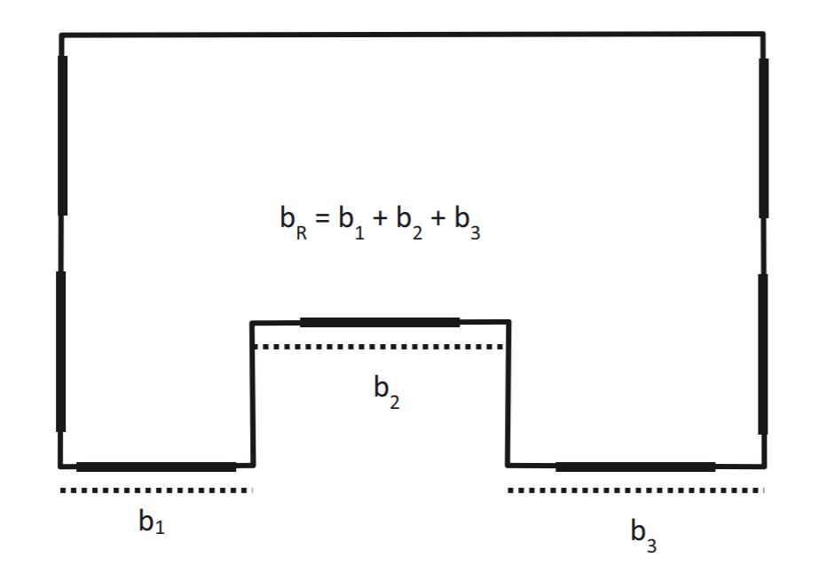
>
> \*Figure 1 – Détermination de la façade principale*

3° A l’annexe, chapitre 1.2.1, la formule (1) est remplacée par la formule suivante:

> 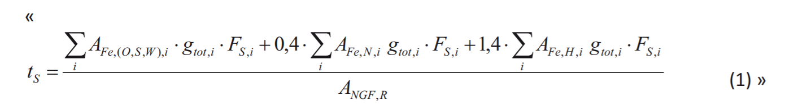

et dans le même chapitre, avant la définition du facteur « ANGF,R » sont insérés les termes suivants:

> | FS,i | [-] | est le facteur d’ombrage pour l’ombrage dû aux constructions pour les fenêtres i conformément à la norme DIN V 18599-2:2011-12, chapitre 6.4.1. Si aucun ombrage dû aux constructions existe, alors FS,i est égal à 1; |
> |---|---|---|

4° A l’annexe, le chapitre 1.2.3 est supprimé.

5° A l’annexe, chapitre 1.2.4, le tableau 4 est remplacé par le tableau suivant:

> 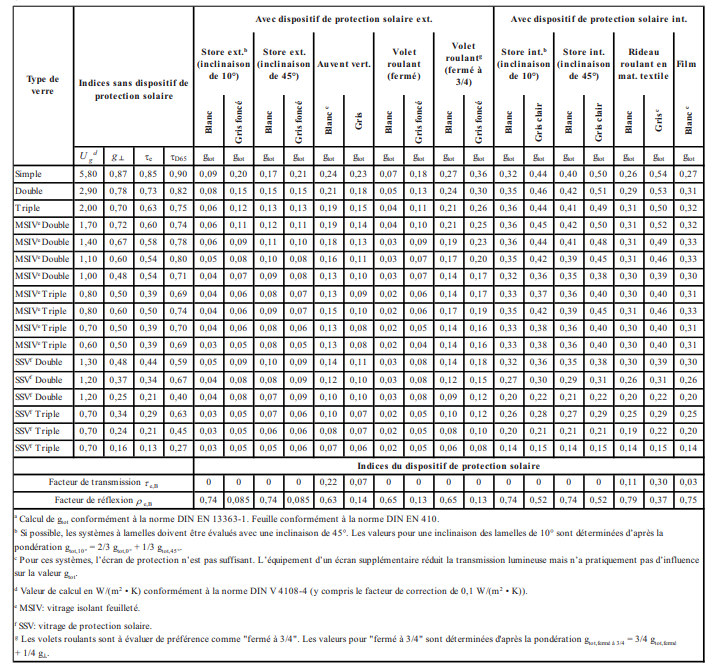
>
> \*Tableau 4 - Valeurs standard des indices des vitrages et des dispositifs de protection solaire selon*
>
> \*la norme DIN V 18599-2:2011-12*

6° A l’annexe, chapitre 1.2.6, avant l’explication du facteur bR de la formule (4) sont insérés les termes suivants:

> | ANGF,R | [m2] | est la surface de plancher nette considérée lors de la détermination de la transmittance solaire; |
> |---|---|---|

7° A l’annexe, chapitre 1.5, le tableau 8 est complété par les lignes suivantes:

> | 7 | Conduites avec une température aller du fluide caloporteur inférieur à 35°C | ½ des exigences visées aux lignes 1 à 4 |
> |---|---|---|
> | 8 | Conduites dans la structure du plancher | 10 mm |

et dans le même chapitre, est inséré après le cinquième alinéa, un alinéa libellé comme suit:

> Pour les conduites qui sont posées à l’extérieur, il y a lieu de respecter le double des épaisseurs minimales prévues dans le tableau 8.

8° A l’annexe, le chapitre 5.1.2 est complété par le point suivant:

> aot mention « comme planifié » s’il s’agit d’un certificat de performance énergétique qui reflète la performance énergétique du bâtiment dans la phase de planification du bâtiment.

## Art. III.

Le [règlement grand-ducal du 12 décembre 2012](https://legilux.public.lu/eli/etat/leg/rgd/2012/12/12/n1/jo) instituant un régime d’aides pour la promotion de l’utilisation rationnelle de l’énergie et la mise en valeur des énergies renouvelables dans le domaine du logement est modifié comme suit:

A l’annexe II, Concernant l’art. 4. Nouvelle maison à performance énergétique élevée, les points 1 et 2 sont complétés comme suit:

> « Le certificat de performance énergétique doit être établi selon la méthodologie en vigueur à la date de la demande d’aides financières. Au cas où une nouvelle maison à performance énergétique élevée est éligible pour l’obtention d’aides financières selon la méthodologie en vigueur à la date de la demande de l’autorisation de bâtir de la maison et ne l’est plus suite à l’application de la méthodologie en vigueur à la date de la demande d’aides financières, le certificat de performance énergétique établi selon la méthodologie en vigueur à la date de la demande de l’autorisation de bâtir peut servir de justificatif.

## Art. IV.

Le présent règlement grand-ducal entre en vigueur le premier jour du deuxième mois qui suit sa publication au Mémorial.

## Art. V.

Notre Ministre de l’Économie, Notre Ministre de l’Environnement et Notre Ministre des Finances sont chargés de l’exécution du présent règlement qui sera publié au Mémorial.

Le Ministre de l’Économie,   Étienne Schneider   La Ministre de l’Environnement,   Carole Dieschbourg   Le Ministre des Finances,   Pierre Gramegna

Cabasson, le 23 juillet 2016.   Henri

Doc. parl. [6851](http://www.legilux.public.lu/eli/etat/projet/pr/10032); sess. ord. 2014-2015 et 2015-2016; [Dir. 2010/31/UE](https://legilux.public.lu/eli/dir_ue/2010/31/jo).
