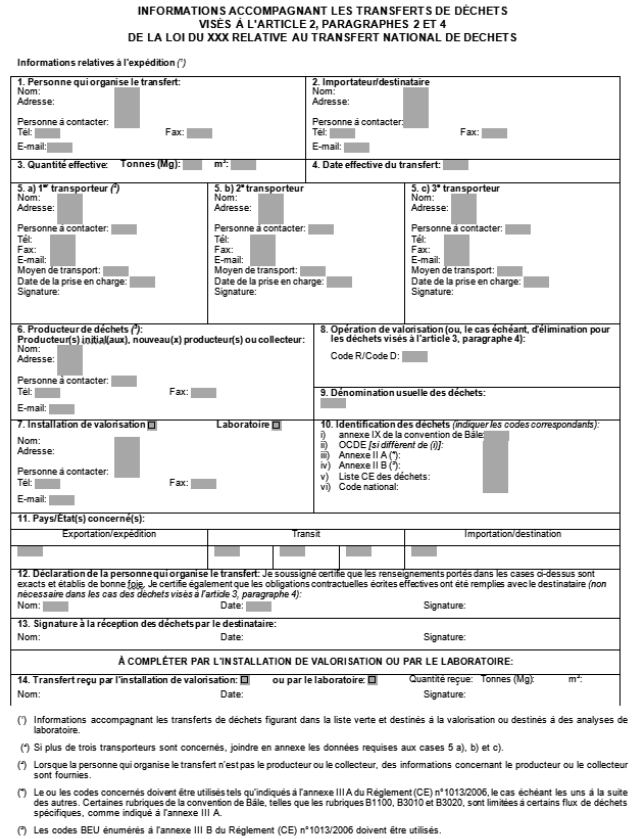
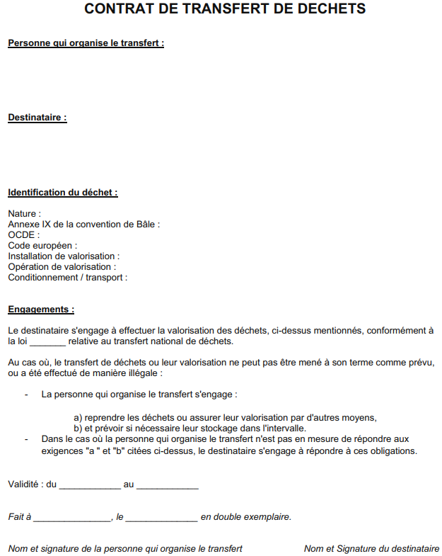
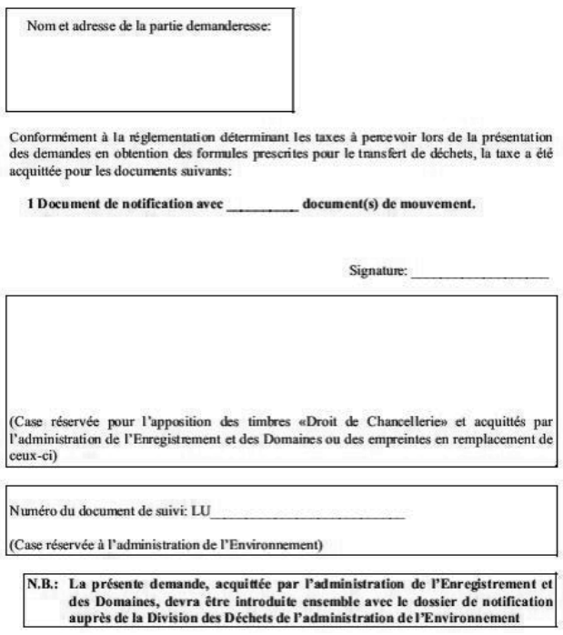

# Règlement grand-ducal du 22 septembre 2016 concernant les documents accompagnant le transfert national de déchets.

Nous Henri, Grand-Duc de Luxembourg, Duc de Nassau,

Vu la [loi du 31 août 2016](https://legilux.public.lu/eli/etat/leg/loi/2016/08/31/n4) relative au transfert national de déchets et notamment ses articles 2 et 13;

Vu les avis de la Chambre des métiers et de la Chambre des salariés;

Les avis de la Chambre de commerce et de la Chambre d'agriculture ayant été demandés;

Vu l'article 2(1) de la [loi modifiée du 12 juillet 1996](https://legilux.public.lu/eli/etat/leg/loi/1996/07/12/n3) portant réforme du Conseil d'Etat et considérant qu'il y a urgence;

Sur le rapport de Notre Ministre de l'Environnement, et après délibération du Gouvernement en Conseil;

Arrêtons:

## Art. 1er.

Les transferts de déchets visés à l'article 2, paragraphes 2 et 4 de la [loi du 31 août 2016](https://legilux.public.lu/eli/etat/leg/loi/2016/08/31/n4/jo) relative au transfert national de déchets doivent être accompagnés du document suivant:

## Art. 2.

Le contrat visé à l'article 13 paragraphe 2 de la [loi du 31 août 2016](https://legilux.public.lu/eli/etat/leg/loi/2016/08/31/n4/jo) relative au transfert national de déchets est établi selon le modèle suivant:

## Art. 3.

Les demandes en obtention des formules prescrites pour le transfert national ou transfrontalier de déchets doivent se faire par le document suivant:

## Art. 4.

Notre Ministre de l'Environnement est chargé de l'exécution du présent règlement qui sera publié au Mémorial.

La Ministre de l'Environnement,   Carole Dieschbourg

Rome, le 22 septembre 2016.   Henri
